# Mathworks《实用数据科学与MATLAB（数据探索、特征工程、机器学习、毕业项目）｜Practical Data Science with MATLAB》 p71 31_评估特征.zh_en [BV1Jr421w7wL_p71]

🎼，Predictive models use relationships between one or more features like engine weight to predict the value of a response feature like horsepower。

By including additional predictors like car color that are unrelated to the response。

You won't receive additional benefit and may even hurt model performance。

The goal of feature selection is to improve your model by keeping only the features that provide value and discarding the rest。

The resulting model will also be simpler to interpret and more computationally efficient。

In this video， you'll learn about several quantitative methods for evaluating and selecting features。

There are three types of feature selection methods， wrapper， embedded， and filter。

Rrappper methods train and evaluate a predictive model by using different combinations of features。

Then select the set of features that provide the best model performance。

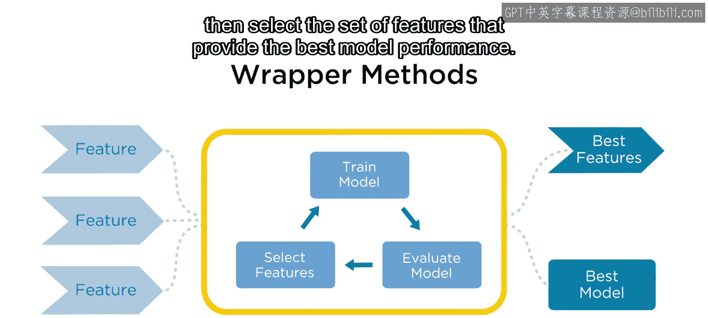

Embbedded methods are a class of machine learning models that automatically perform feature selection as a part of model training。

The result is a trained model that emphasizes the useful features and deemphasizees the rest。

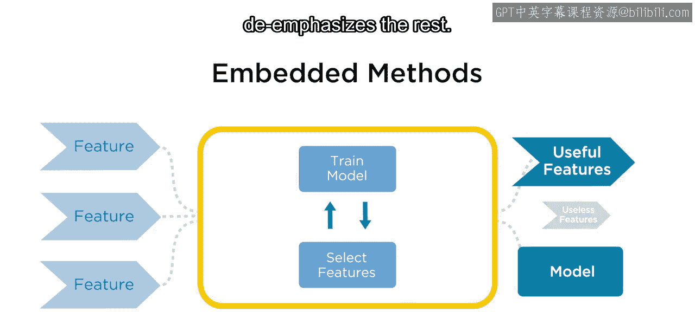

Both wrapper and embedded methods rely on model performance to guide feature selection。

And you'll learn how to use these techniques in the next course in this specialization。

Filter methods in contrast。Are applied before training a model。

They are based on these statistical properties of predictors and their relationship to the response。

They can be applied regardless of the model and are often used in combination with wrapper or embedded methods。

The rest of this video explores the main ideas behind three common filter techniques。

 variance thresholding， covariance and correlation。

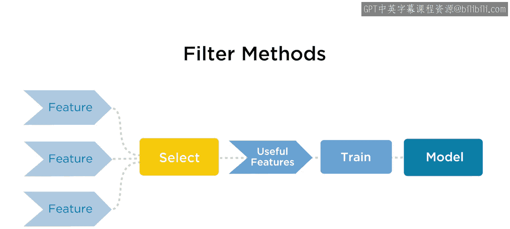

And statistical tests for feature independence。Let's start with variance thresholding。

 which is guided by a simple premise。A predictive model uses changes in predictor values to estimate the corresponding changes in response values。

So features whose values don't change much aren't likely to help。

The first step is to determine how much each predictor varies by computing its variance。

In a previous lesson， you learned about several statistics for describing distributions。

 including mean， which describes the average or expected value。And standard deviation。

 which describes the spread of values about the mean。Variance is equal to standard deviation。

 squared。The variance of a feature is attained by computing the distance from each value to the mean。

Squaaring it。And computing the average over all values。

Larger variances generally indicate that more values are located farther from the mean。

While smaller variances indicate that more values are clustered closer to the meat。

While it is tempting to compare the variance of two features directly。

It is important to understand how variance is affected by scale。For example。

 the variance of a feature recorded in centimeters。

Will be 10000 times that of the same feature in meters。

 even though both features contain the same information。

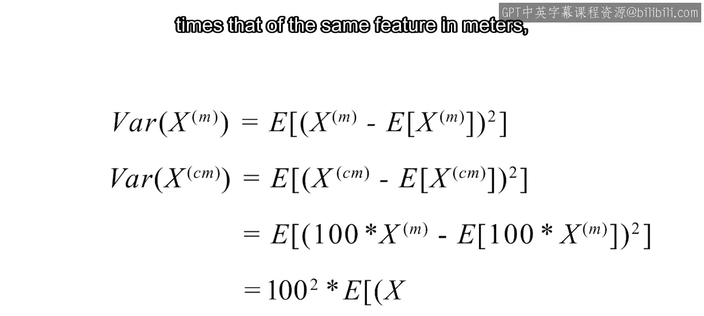

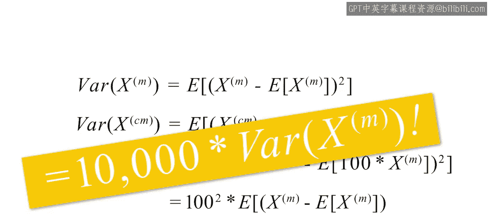

Therefore， it's important to scale features before computing their variance。Next。

 choose a threshold value。And select only the features whose scaled variance lies above the threshold and discard the rest。

Choosing a good threshold can be a little tricky in practice。But ideally。

 you are looking for a large drop in variance between a group of high variance features to keep and a group of low variance features to discard。

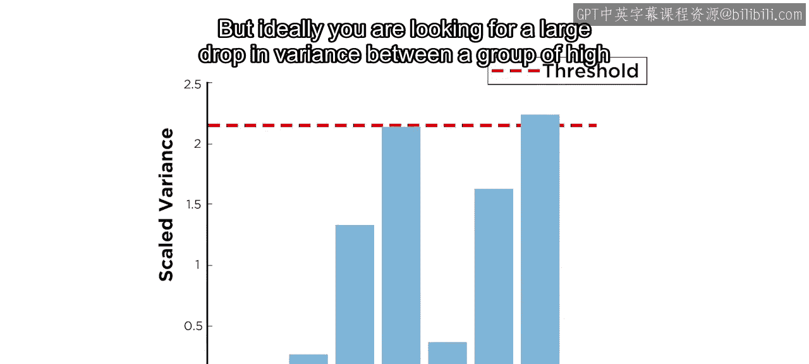

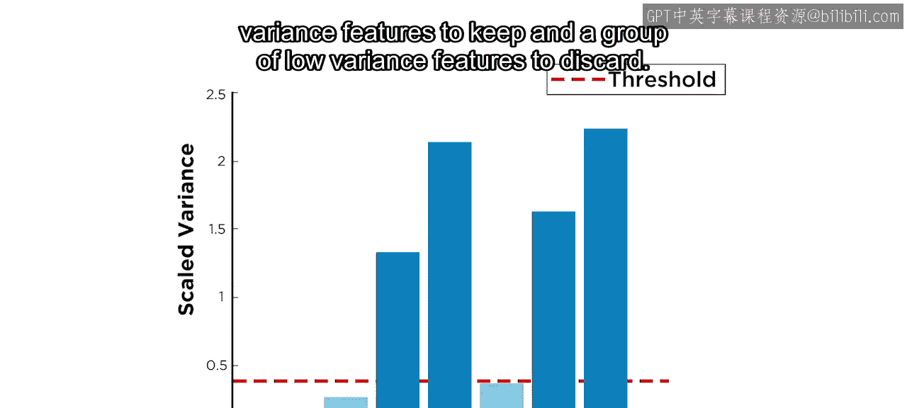

This may coincide with a sharp bend or elbow when the variances are plotted in descending order。

 but not necessarily。As it can be hard to identify a good threshold。

 it's better to be conservative with variance thresholdholding。

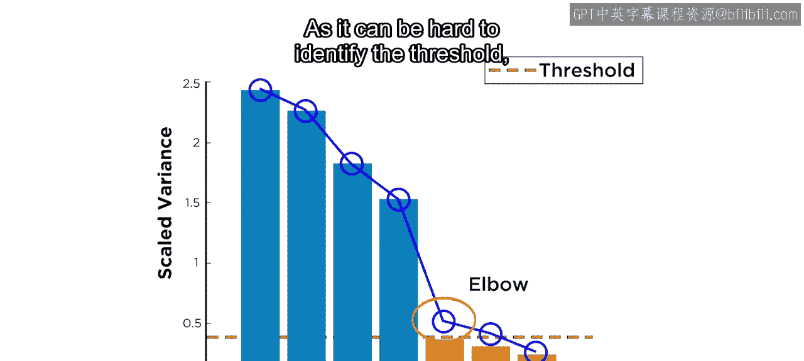

In favor of other metrics that considered the relationship between predictors and the response。

One such measure is covariance。Covariance is the expected value of the product of two terms。

The distance from the predictor values to the predictor mean。

In the distance of the response values to the response mean。

While variance is always greater than or equal to zero。

The covariance of two features can be positive or negative。

Values close to 0 indicate a weaker relationship between the predictor and response。Larger。

 positive or negative values indicate a stronger relationship。To see why。

 consider the signs of each term in the covariance formula。

Which are determined by the location of the feature values with respect to the feature means。

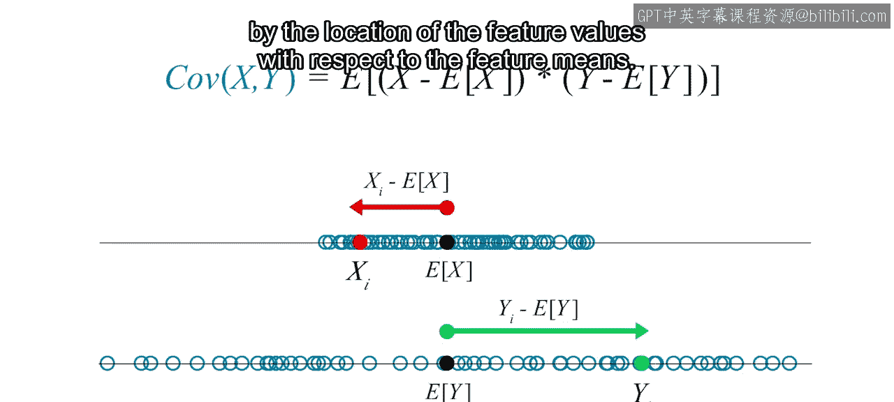

For unrelated features， the sign of each predictor term is unrelated to the sign of the corresponding response term。

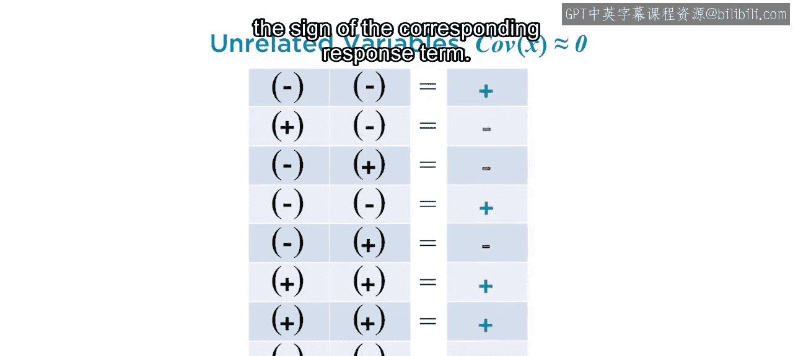

So the sign of the products will vary randomly。When the products are averaged。

 the result will be close to zero due to cancellation。

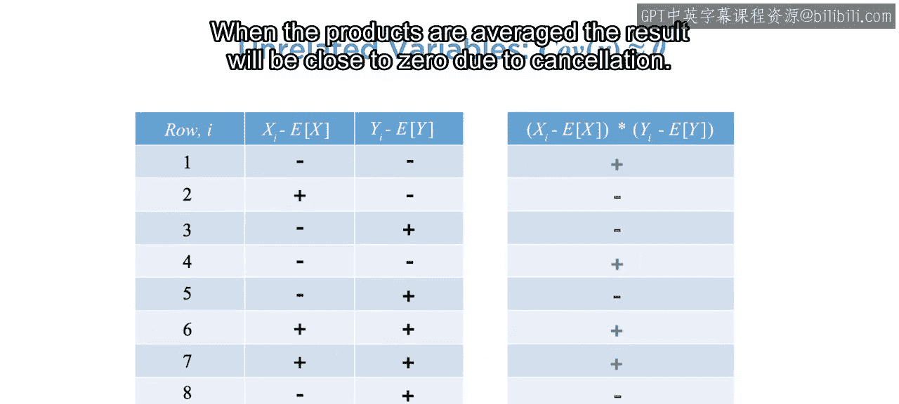

For related features， the signs of each term will be related。

So their product will be consistently positive or negative。

This will result in less cancellation and an expected value further from0。Unfortunately。

 covariance is also affected by scale， so it can't be used to compare the relationship strengths of different predictors。

However， when you scale the covariance value by the standard deviation of each variable。

 the result is a dimensionless metric that can be used for comparison。

The Pearson correlation coefficient。You've already learned about Pearson correlation in the previous course。

But here are the key properties again。

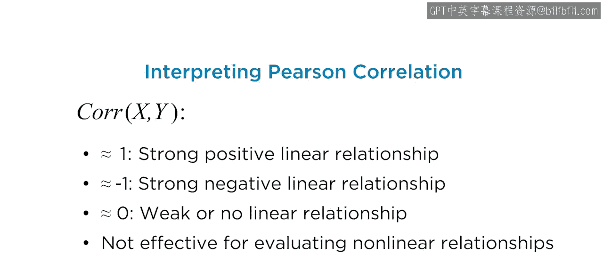

When used as a tool for feature selection， correlation lets you compare the strength of the linear relationships between the predictors and the response and discard weeklyly related features。

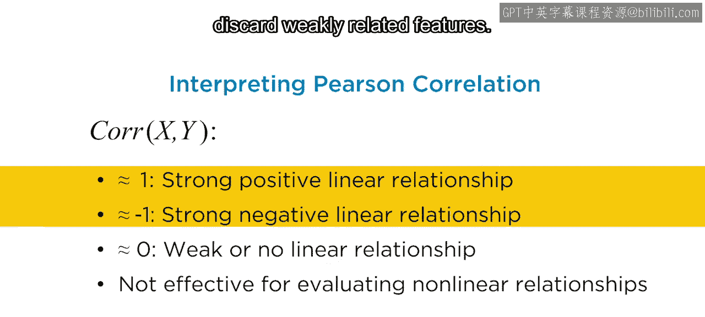

In addition to Pearson correlation， there are two other measures， Spearman and Kendo correlation。

 which perform better on nonlinear data。It's important to note that all three measures are only effective at identifying monotonic。

That is strictly increasing or decreasing relationships。

Identifying and evaluating other types of nonlinear relationships requires more advanced techniques。

The last filter method is statistical tests for feature independence。

The main idea behind these tests。Is that the values of two independent features should be distributed in a particular manner。

 when considered together。It's therefore possible to compute the probability or P value that two features are independent by analyzing their distribution。

When using a statistical test for the purposes of feature selection。

The first step is to choose the appropriate test， which depends on the data type of each predictor and the response。

Next， choose a probability threshold called the alpha value below which it will be assumed that the predictor and response are statistically dependent。

Lastly， compute the P value。If the P value is above the threshold。

 the response and predictor are assumed to be independent， and that predictor is eliminated。

Otherwise， the predictor is retained。The methods for computing P values are beyond the scope of this course。

 but you can use MATLb to calculate them for you。In the live script reading that follows。

 you'll learn how while using the Chai Square and A Nova test to select features。

You'll also see how P values can be obtained for a correlation based test。

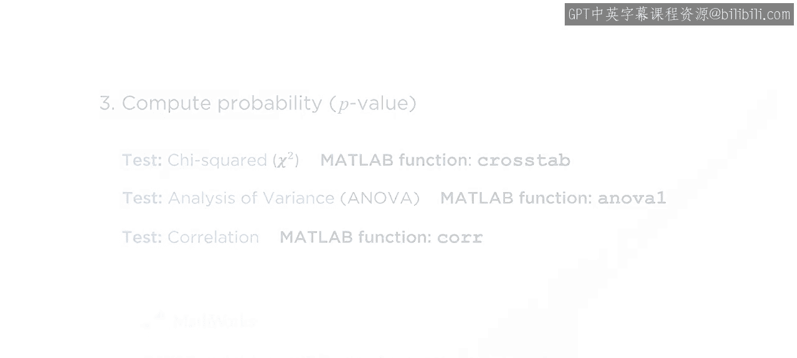