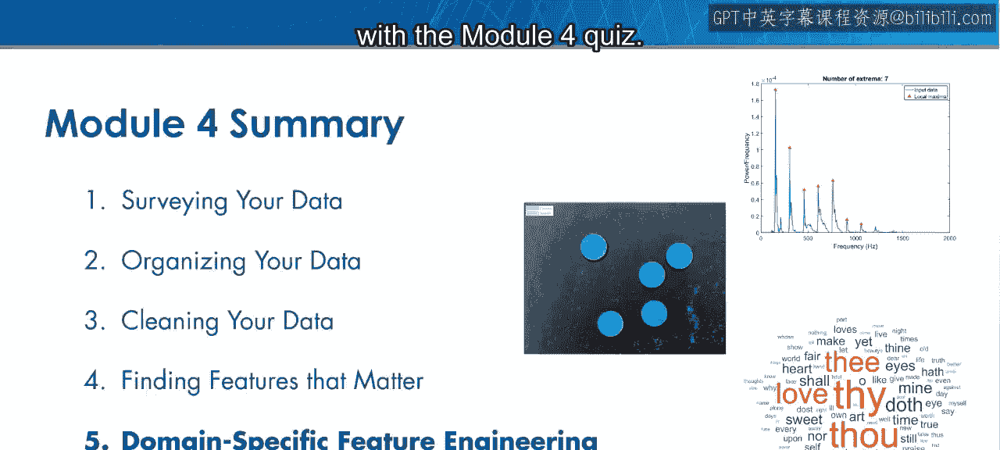

# Mathworks《实用数据科学与MATLAB（数据探索、特征工程、机器学习、毕业项目）｜Practical Data Science with MATLAB》 p73 33_模块4寻找重要特征总结.zh_en [BV1Jr421w7wL_p73]

🎼。Congratulations， you've reached the end of moduleule 4。

 Let's take a moment to review the skills you've developed in this module and how they will help you prepare for the next step in the data science workflow。

 machine learning。It's often said that a predictive model is only as good as its feature set。

You started off this module by learning what features are and how they are used before learning how to generate new features from existing ones。

And with those new features， you'll be able to build a wider variety of predictive models than you could with your original feature set。

By engineering new features that better describe the response。

 you'll find that your models perform better， too。Transforming or combining existing features isn't the only way to generate new features。

Unsupervised learning can help you unearth relationships and patterns in your data set that you didn't know existed。

And with MatTLb clustering functions， you now have the tools to discover these relationships and turn them into useful features for your predictive models。

But with all these features， how can you distinguish those features that will be helpful from those that won't when you build your predictive model。

You can now answer this question by identifying an appropriate feature evaluation technique and applying it to your data。

But sometimes the size and complexity of a dataset set makes it difficult to explore and understand。

 let alone engineer and evaluate features。Using principal component analysis， you can analyze。

 visualize， and extract features from complex data sets that leave others wondering where to start。

In the next module， you'll sharpen your feature engineering skills further and pick up a few new tricks along the way as you extract features from the data types that separate the amateur data scientists from the pros。

 signals， images and free form text。But before moving on。

 it's time to test your feature engineering and evaluation skills with the module 4 quiz。

。