# Mathworks《实用数据科学与MATLAB（数据探索、特征工程、机器学习、毕业项目）｜Practical Data Science with MATLAB》 p74 34_模块5特定领域特征工程介绍.zh_en [BV1Jr421w7wL_p74]

🎼。

Welcome to the final module for this course。So far。

 you have learned a complete workflow to prepare a data set， in this case。

 airline flight data for machine learning。You started by exploring the data in MatTLAb。

Followed by cleaning and organizing the data。

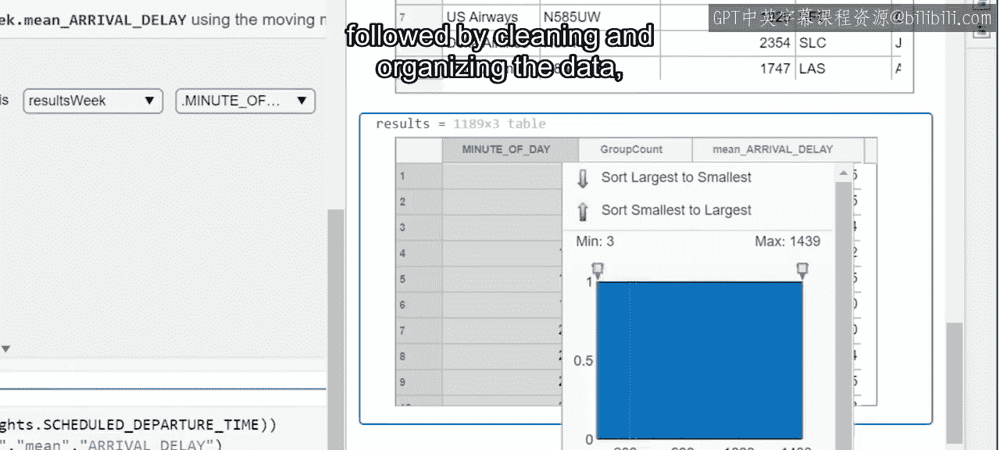

And finally， by engineering features。

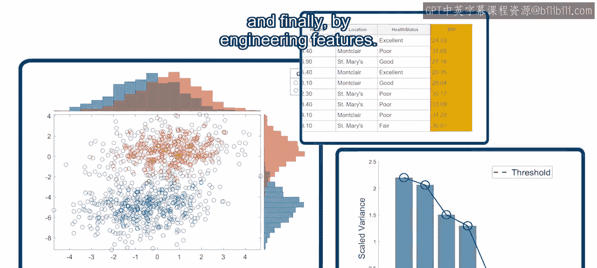

But what if your data doesn't look like the flights table？Depending on your domain。

 your data could look very different。

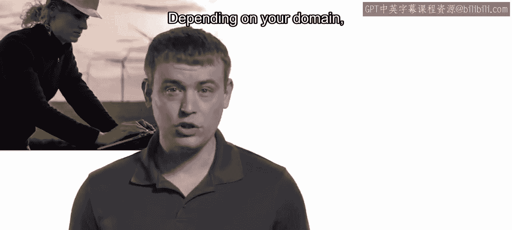

How would you apply feature engineering then？Don't worry。

 the techniques and concepts you've learned are still relevant regardless of your domain。

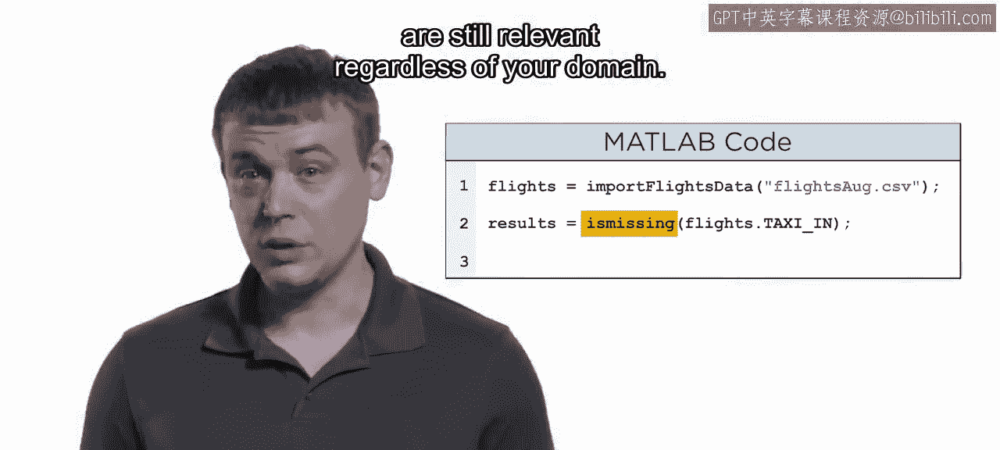

For example， you'll always have to pre process and clean your data。

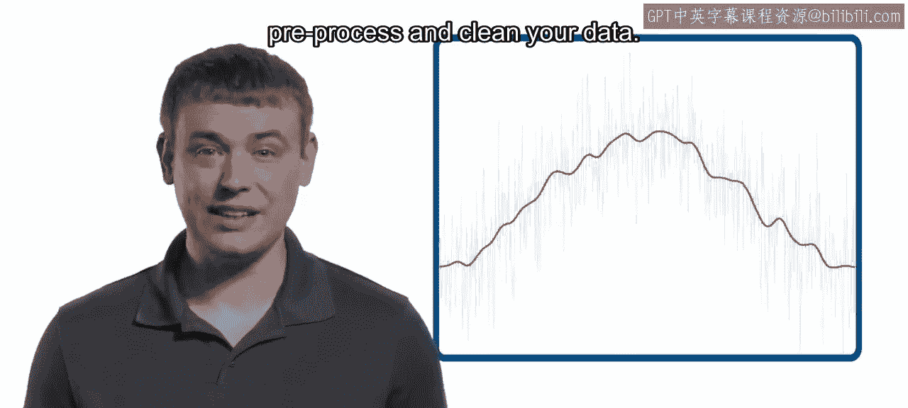

But when your data is more than just a table with rows of numbers， you may need extra capabilities。

That's why MATLAb has a large collection of libraries called toololboxes that contain additional functionality for analyzing data from different domains。

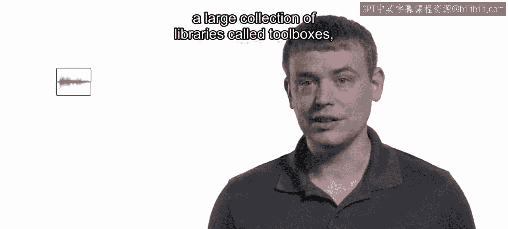

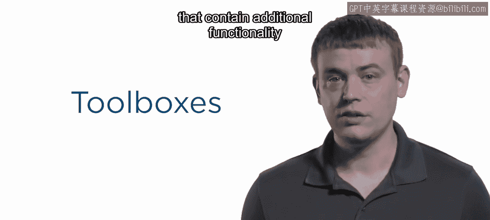

Do you have video and sensor data from a self driving car？RNAN sequencing data from a gene assays。

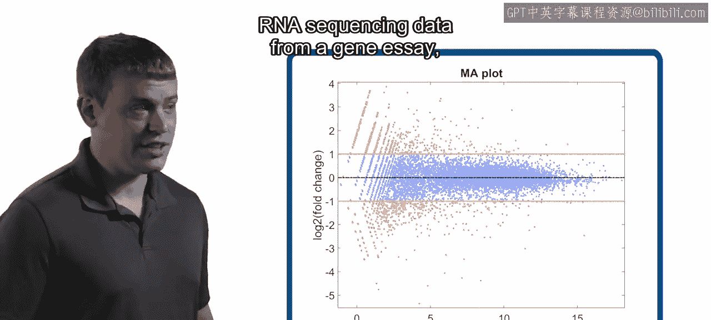

Product reviews from a retail website。You can analyze all these types of data and more。

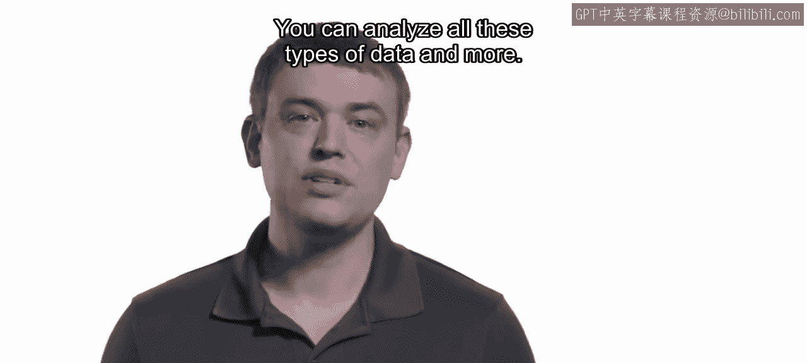

In this module， you'll explore three common types of data。Signals。Images and text。

Each of these types represents a deep field of study that could easily fill an entire course。

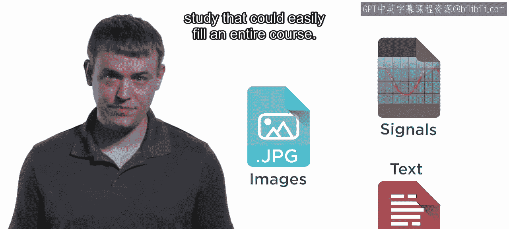

So for this module， there are two distinct goals。For those who are new to one of these types of data。

 the goal is to grasp some of the fundamentals。 So you know where to start when you encounter it。

For those who are already experienced with a particular data type。

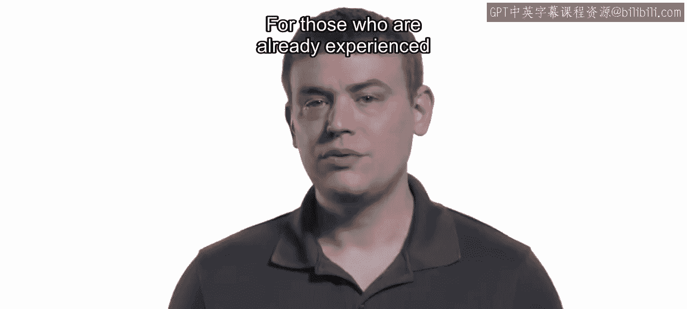

The goal is to learn how to apply your domain knowledge within the framework of data science。

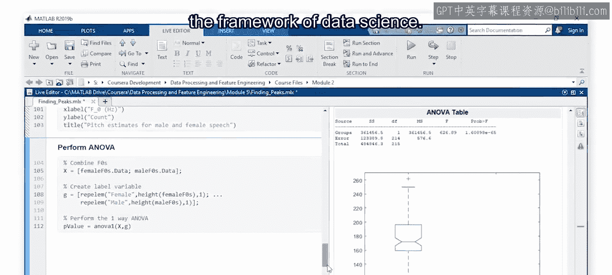

For example， you'll use feature extraction techniques that are unique to each type of data。

You'll find peaks in signals， which can show the timing of important events。

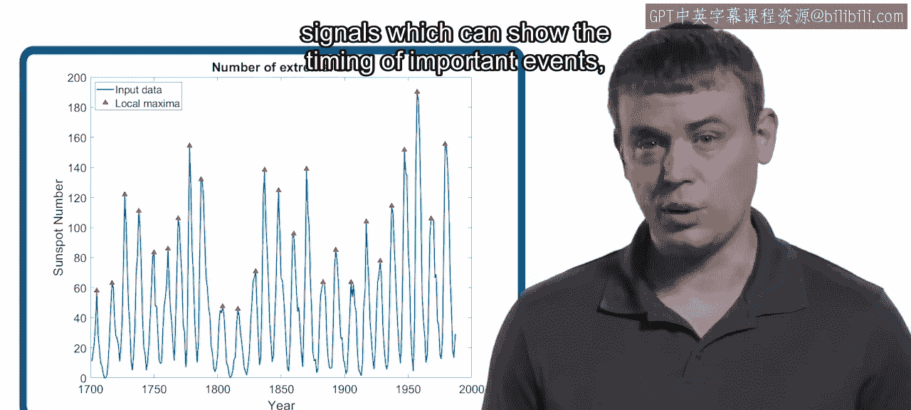

You'll locate edges in images， which can mark the boundaries between objects。

And you'll count the most common words in text， which can reveal important topics and content。

These are all simple features， but they can be highly predictive in regression and classification tasks。

In each lesson， you'll use functions from the relevant toolbox to identify and apply the feature extraction techniques best suited for your specific application。

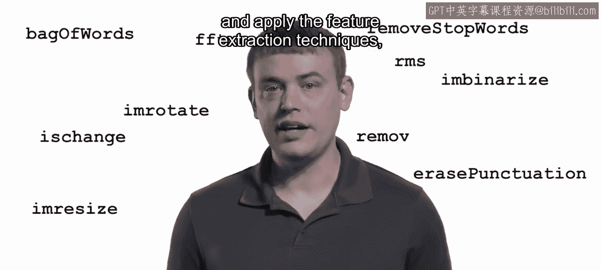

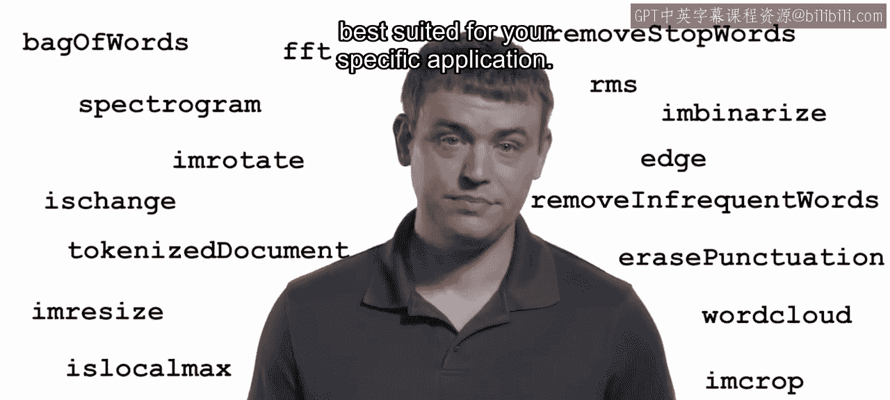

By the end of this module， youll be ready to combine your domain specific knowledge with the functionality of Matlab to apply feature engineering to your data。

 So let's dive in。