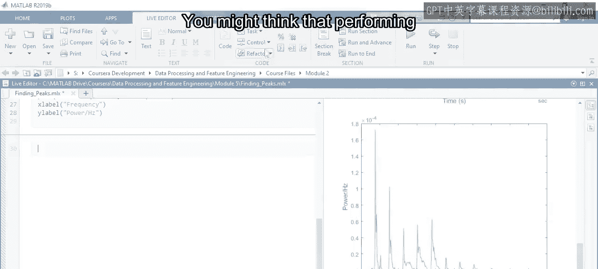
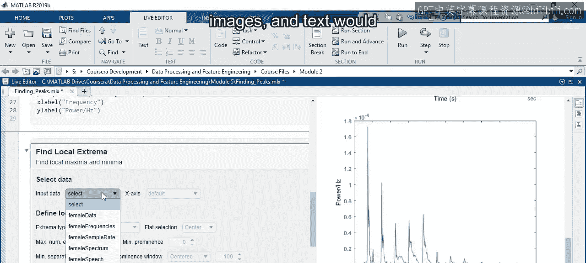
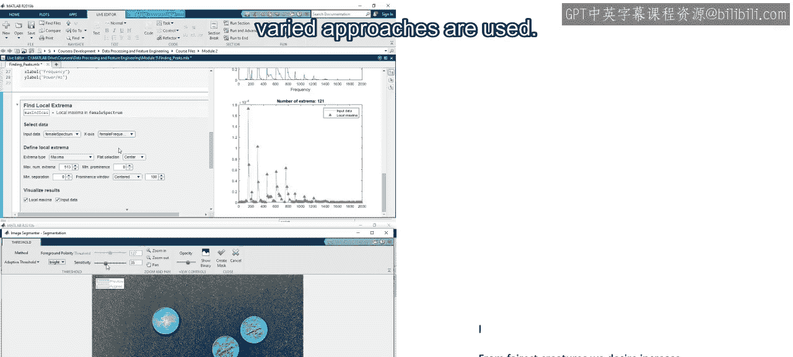
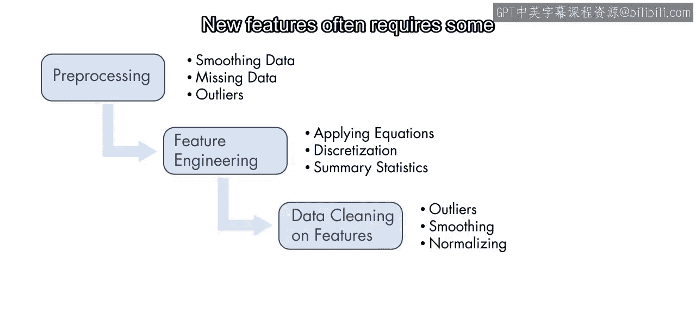
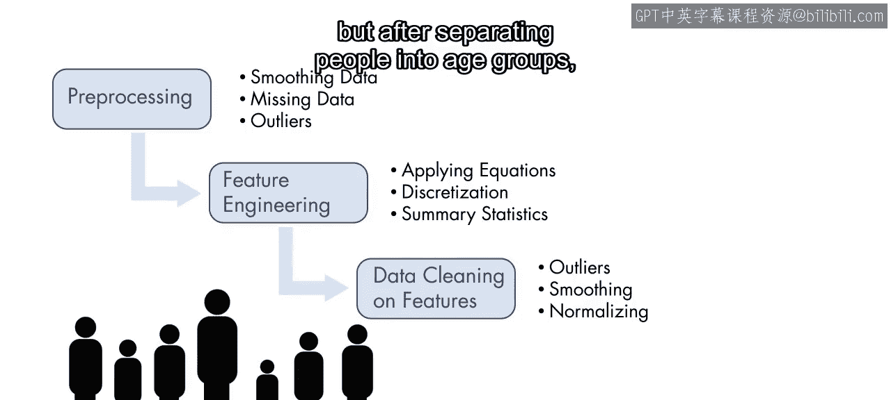
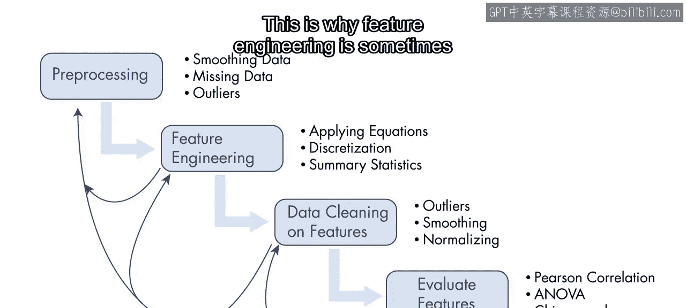
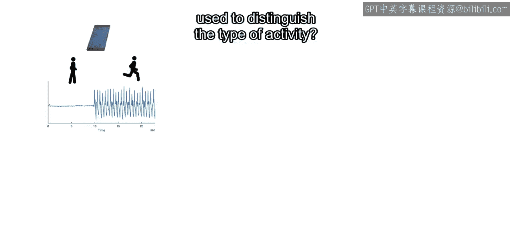
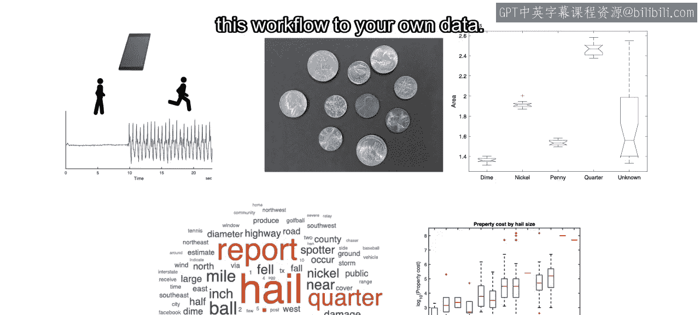
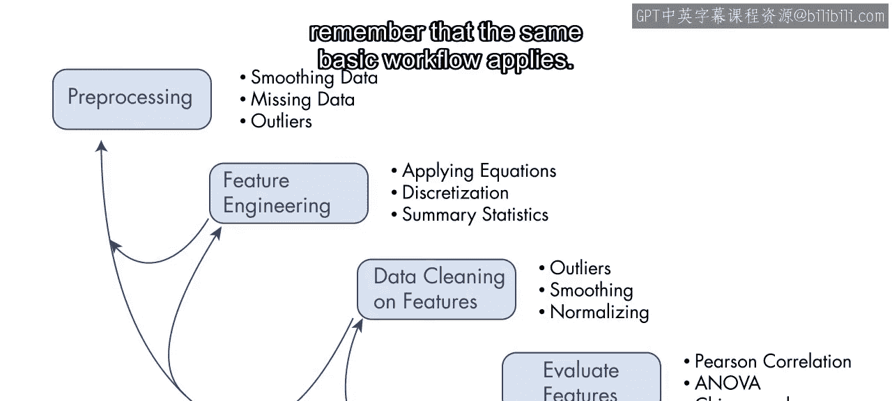

# Mathworks《实用数据科学与MATLAB（数据探索、特征工程、机器学习、毕业项目）｜Practical Data Science with MATLAB》 p75 35_特征工程工作流程.zh_en [BV1Jr421w7wL_p75]

🎼。

You might think that performing feature engineering on signals， images。

 and text would require completely different workflows。

 and it is true that even within these broad fields， varied approaches are used。

However， no matter your domain， there is a sequence of general steps you'll take when performing feature engineering。

You've seen each step individually already。In this video， you'll learn how they all fit together。

First， you saw how to prepare your data。Preprocessing is often necessary before creating features。

But the approach you take will vary depending on the features you're interested in。For example。

 you might dettrid and smooth your data before detecting peaks。

Or remove outliers prior to calculating summary statistics。Next。

 you used a variety of techniques for creating new features。

 such as performing calculations with one or more variables。

Discrtizing observations and calculating summary statistics。

New features often require some of the cleaning steps you performed earlier。

For example， a person2 me tall might not be an outlier in the original data set。

But after separating people into age groups。

A child Ba tallll becomes an outlier。Lastly， you determined if your features are useful。That is。

 you check to see if they help you better explain your data and make future predictions。

You learn some statistical techniques and visualizations to evaluate features。

Later in the specialization， you'll also evaluate features by investigating their effect on machine learning models。

When applying feature engineering to your own data， remember that the process is highly iterative。

At any point in the process， you may return to any previous step。

Trial and error is part of the process。This is why feature engineering is sometimes referred to as more of an art than a science。

Creating new features often requires you to think creatively about how you might use the available information to answer your questions。

Can the summary statistics of a cell phone's motion sensors be used to distinguish the type of activity？

Can the area of coins and images be used to accurately group them？

Is there a correlation between the words used to describe a hailstorm and the damage caused by the storm？

You'll walk through these examples and more in this module。As you do。

 notice how the data available is used to answer the questions above。

Think of how you can apply this workflow to your own data。

What prepro steps would be required？How would you evaluate the features？No matter the domain。

 remember that the same basic workflow applies。

