# Mathworks《实用数据科学与MATLAB（数据探索、特征工程、机器学习、毕业项目）｜Practical Data Science with MATLAB》 p76 36_将数据与时间表同步.zh_en [BV1Jr421w7wL_p76]

🎼，Suppose you're working with a set of temperature data that was recorded at regular intervals over time。

This type of data is called a signal。In the field of data science。

 a signal is a type of data where the values have a particular order。In the lesson on smoothing data。

 signals were referred to as a type of indexed data。

 since there is an indexing variable such as time that defined the order to the data points。

Time is a common way to index signals， but there are many otherwise ways。

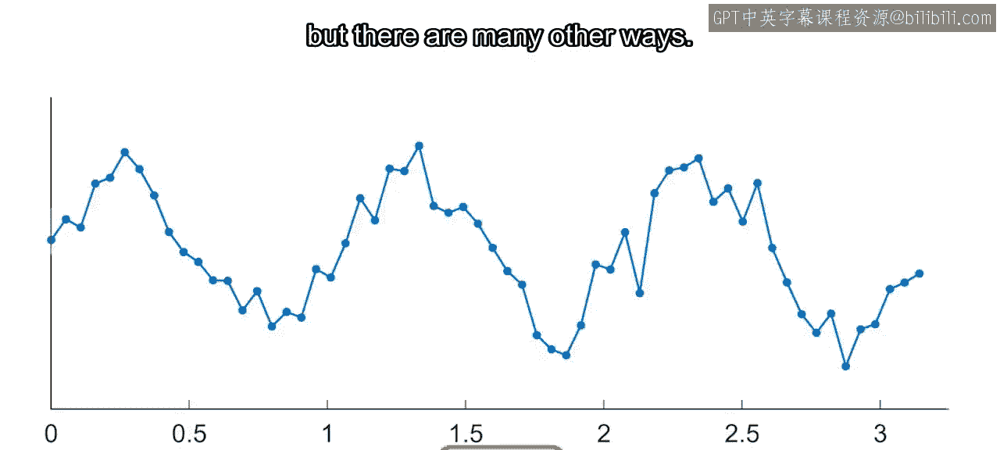

An image can be thought of as a two dimensional signal， where instead of time。

 the pixels are indexed by their position in the X， Y plane。

An important aspect of signals is the sample rate， which is a number that defines how the data is indexed。

For example， the audio signal you're hearing right now was recorded with a sample rate of 44。1 kHz。

 meaning there were 44100 data points for each second of audio。Also。

 the video signal you're watching right now was recorded on a screen with a pixel density that defined how many pixels there were per unit of length。

In this case， the density was 221 PI。Meaning there were 221 pixels per inch。

It's important to use the right sample rate when analyzing signals。When playing back audio。

 using the wrong sample rate is the difference between data science with MatLb or data science with Matlab or data science with MatLb。

So if you have multiple signals and they all have different sample rates， how do you analyze them？

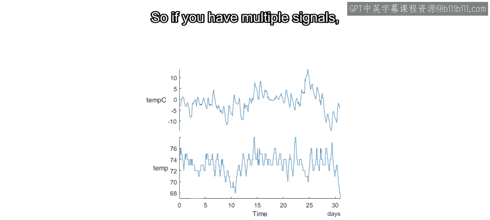

In this video， you'll learn how to organize， resample and synchronize signal data so you can compare signals with different sample rates。

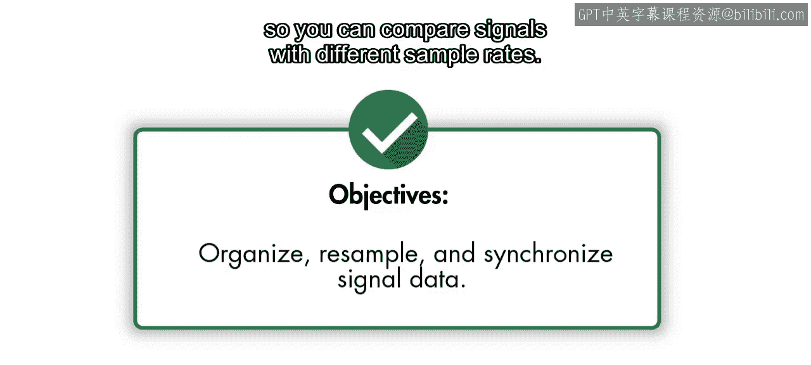

To demonstrate， let's load two signals with temperature data。Both are included in Matlabs。

 so you don't need to download them。

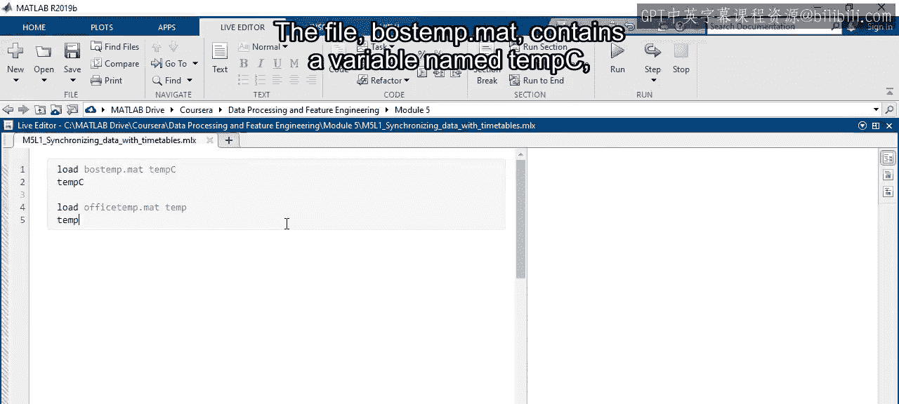

The file Bo tempemp dot mat， contains a variable named Temp C。

 which has temperature values in Celsius recorded in Boston， sampled once per hour。

The file office temp dot mat contains a variable called temp。

 with temperatures in Fahrenheit recorded inside an office building sampled once every half hour。

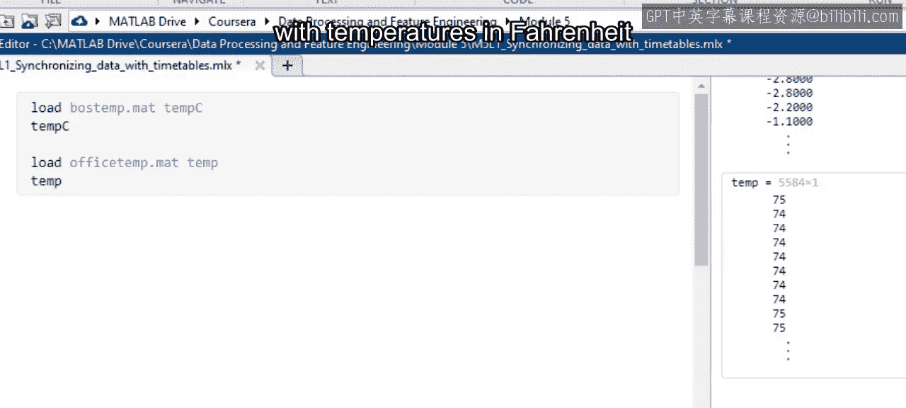

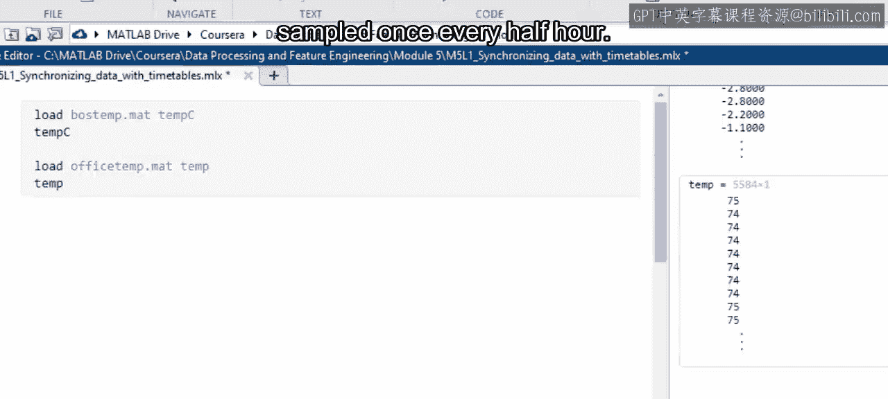

Therefore， the sample rate for the office signal is double the sample rate of the Boston signal。

If you plot these signals， you might notice another thing。

The Boston signal has around 750 data points， while the office signal has more than 5000。

This means that not only do these signals have different sample rates。

 but the office data was recorded for a longer period of time。

 How can you align these signals so you can compare temperatures recorded at the same times of day。

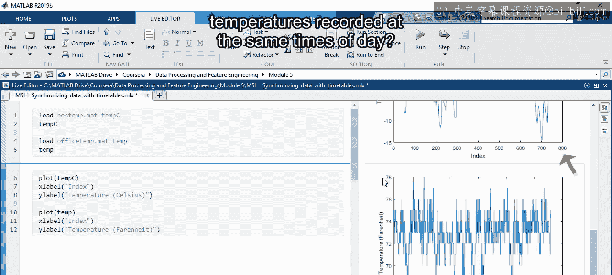

To start， you'll need to organize the signals into timetables。

This type of data structure is similar to a table， but the first column is always time。

You can create a timetable if you know the sample rate in Htz， number of samples per second。

But an alternative option is to specify the time step。So for the Boston signal。

 you can use a time step of one hour。And for the office signal。

 you can use a time step of 30 minutes。You can see that the times both start at zero。

 which implies that these signals started at the same time。This may not always be the case。

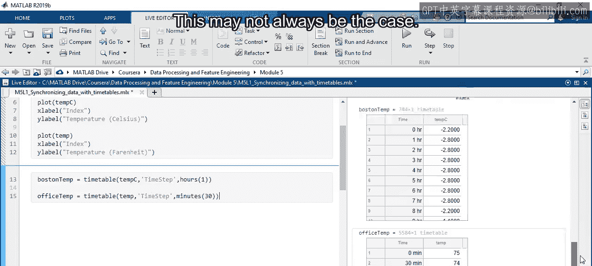

For example， you may already have the exact times of the recordings stored as date time values。

In this case， you could specify a row times option with timetable。

 or if you already have the data in a regular table。

 you could convert it directly with the function table to timetable。

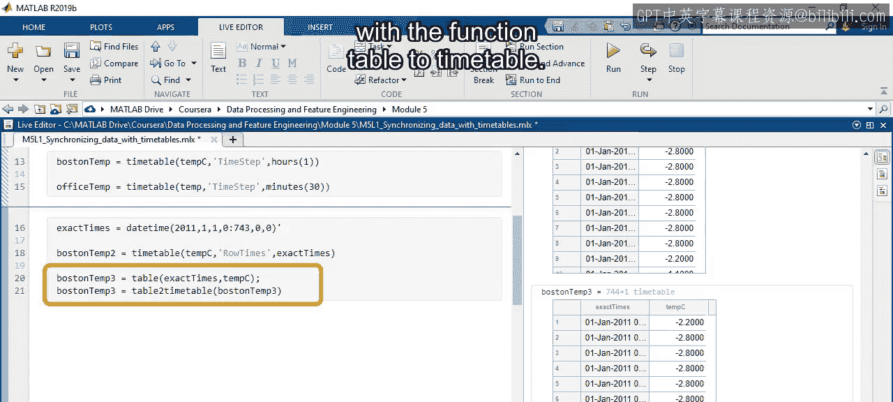

But for now， let's stick with the original timetables。Since we specified a time step。

 the values in the time column are duration values instead of date times。

You might recall from a previous lesson that duration values can have different units。

 such as days or seconds。You can convert the unit to the time column from hours to days by specifying the format as the letter D for day。

You could also use M for minutes or S for seconds。If you reloot the Boston signal with units of days。

 you can see that the data was recorded over a period of 31 days。

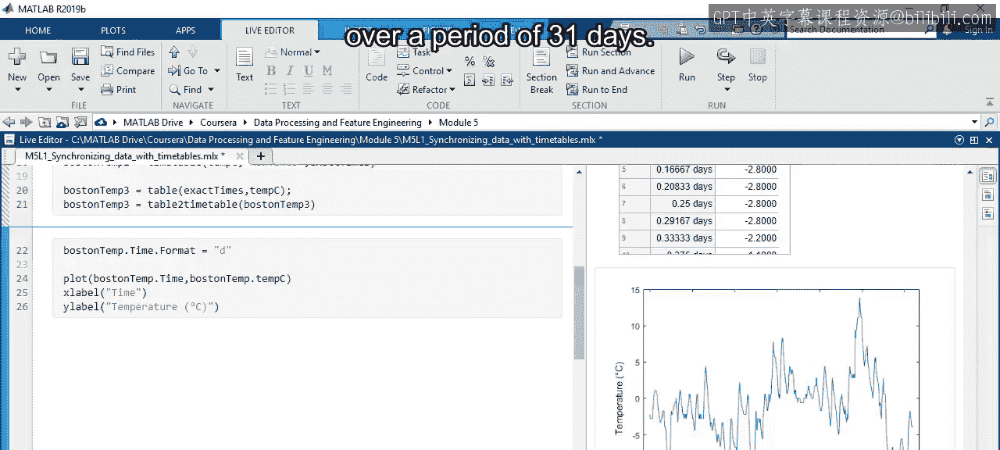

Now to align the two signals， one option is to convert one of the signals to a different sample rate。

For example， you could convert the sample rate of the Boston signal from one per hour to two per hour to match the office signal。

This is an increase in the sample rate。 So you'll need to insert points in between the existing data points with a process called interpolation。

Any existing points will be left alone。An increase in the sample rate is commonly called ups。

But you can also lower the sample rate， which is called downsling。

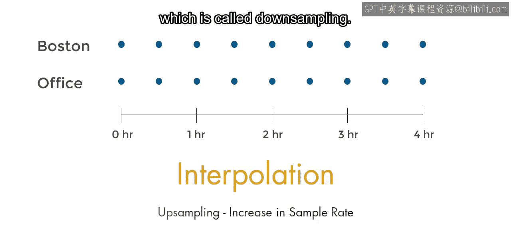

To change the sample rate， use the retime function。

You'll need to specify the interpolation method and the new sample rate。

The example here uses linear interpolation， but there are other choices you can read about in the documentation。

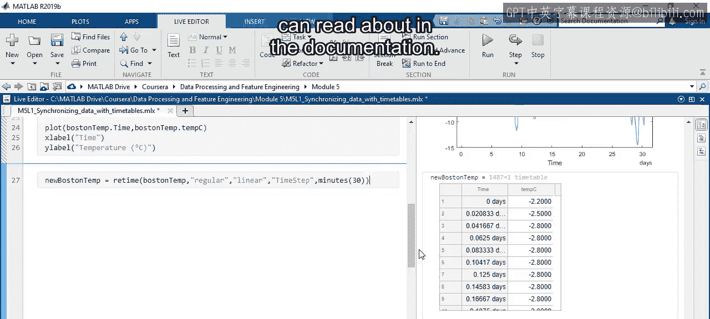

The units of the time column are still in days， but there are now twice as many data points in the timetable。

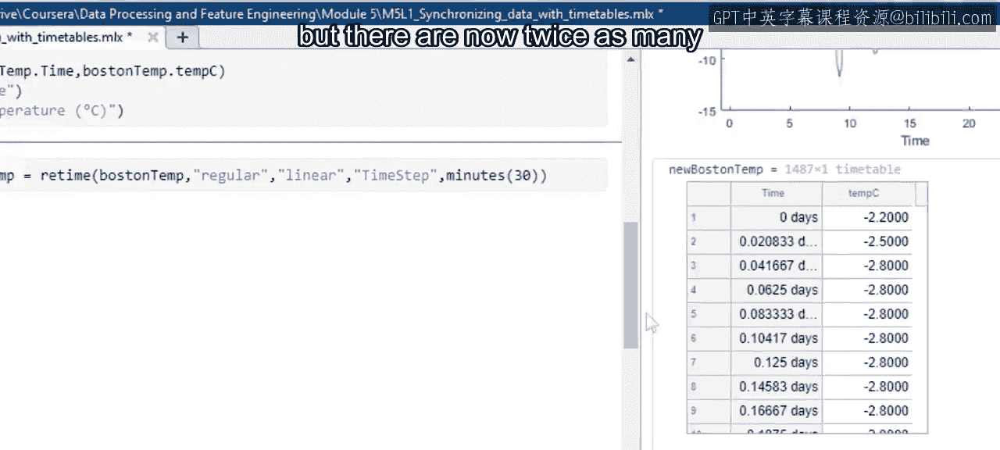

This usage of re time is also helpful if your signal doesn't have regularly sampled points or has missing time points。

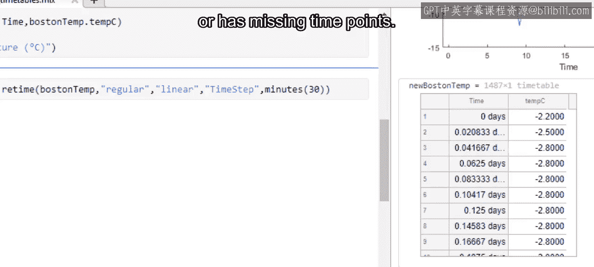

The temperature data already had regular sampling， but if it didn't。

 you could use retime to impose regular sampling or fill missing time points。

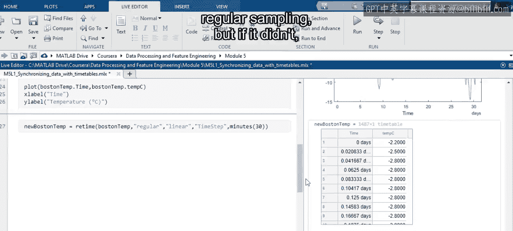

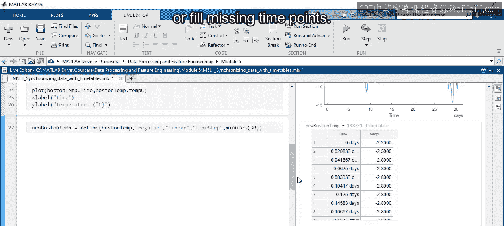

Another useful thing you can do with re time is apply summary statistics instead of interpolation methods。

For example， say you wanted the daily high and low temperatures。

You can use the retime function to get the minimum and maximum temperature by replacing the word linear with max and min and the time step with one day。

This code creates two timetables。If you plot the signals。

 you can see that there's only one data point for each day。The daily high or the daily low。

But let's get back to the idea of aligning the different signals。

If you have two timetables with the same sampling rate like you have now。

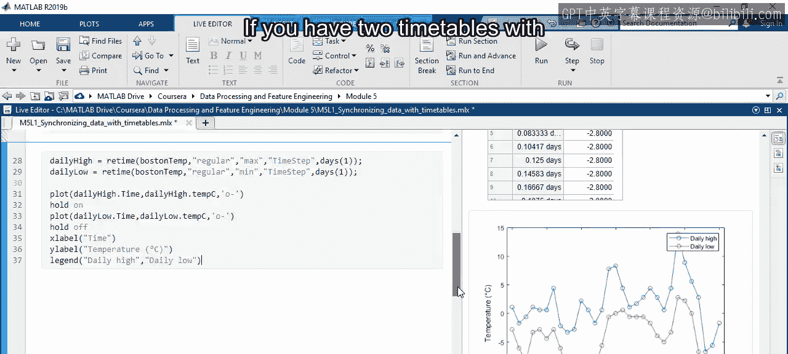

You could perform a joint operation to merge them together。

 just like you've done before with regular tables。However。

 this can get awfully tedious when you have multiple timetables。

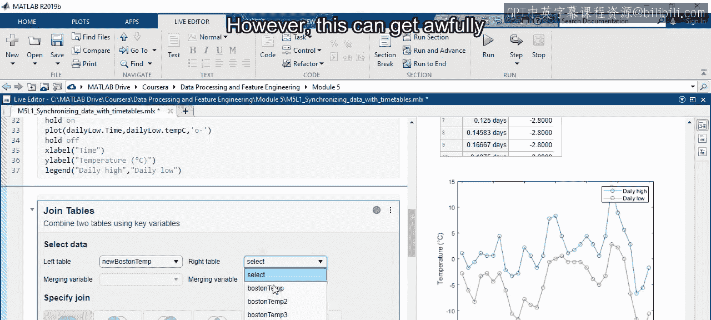

Instead， you can combine the sample rate conversion and joining processes into a single synchronizing step with the aptly named function。

 synchronize。

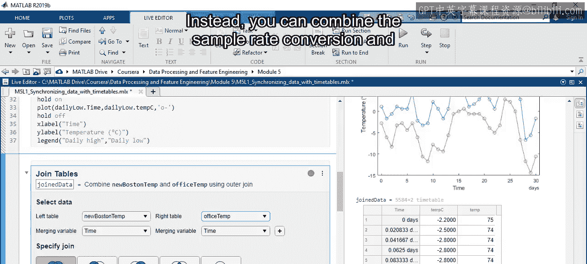

Similar to re time， you can specify an interpolation method or summary statistic。

 as well as a different sample rate。For now， let's use the original sample rate from the Boston data of one per hour。

 specified as a time step。The output is a new timetable now with three columns。For each time point。

 you have a value from both signals， meaning these signals are synchronized。

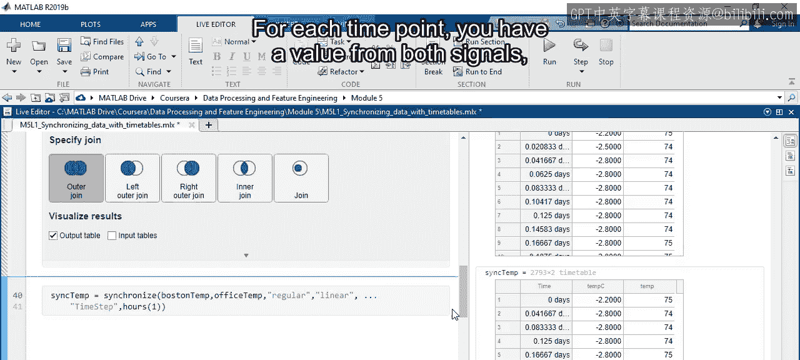

A nice way to visualize timetables with multiple columns is with a stacked plot。

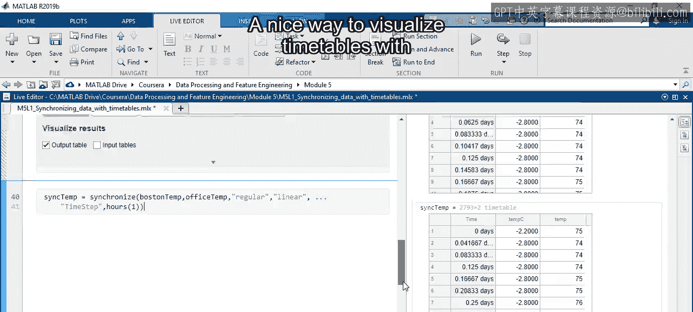

This creates a plot with a separate Y axis for each signal， but a shared X axis。

But something's not right here。

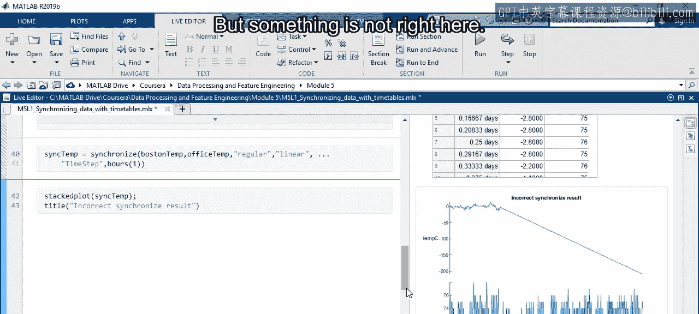

Why does the tempemp C curve have a long， sloped line。It gets cold in Boston， but not that cold。

The new Boston signal has this line because the office signal contained death from four months。

 while the Boston signal spanned only one month。The line is a result of the linear interpolation method that extrapolated beyond the last data point。

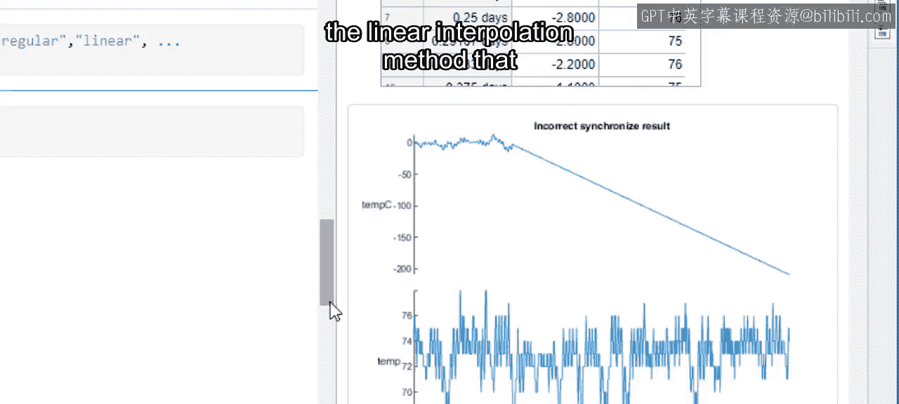

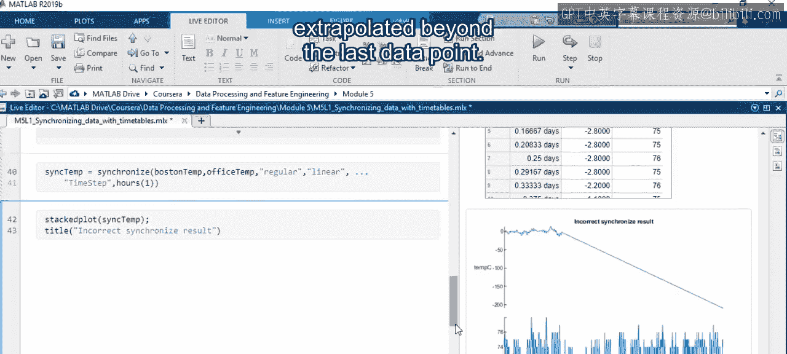

It doesn't make much sense to try to extrapolate this much data。

You can fix this by adding the option end values with a Nan to the synchronized line。

This will add missing values to the Boston signal after it ends。There， that's much better。

The signals are still synchronized， but the Boston signal stops after one month。

Let's zoom in on the first month of data by setting the X axis limit to 31 days。

Now you can start to see the daily trends in the temperature for both sets of data。Later。

 you'll learn how to extract features from signals like these。

 And since the signals are now synchronized， you can use the same methods for both signals。

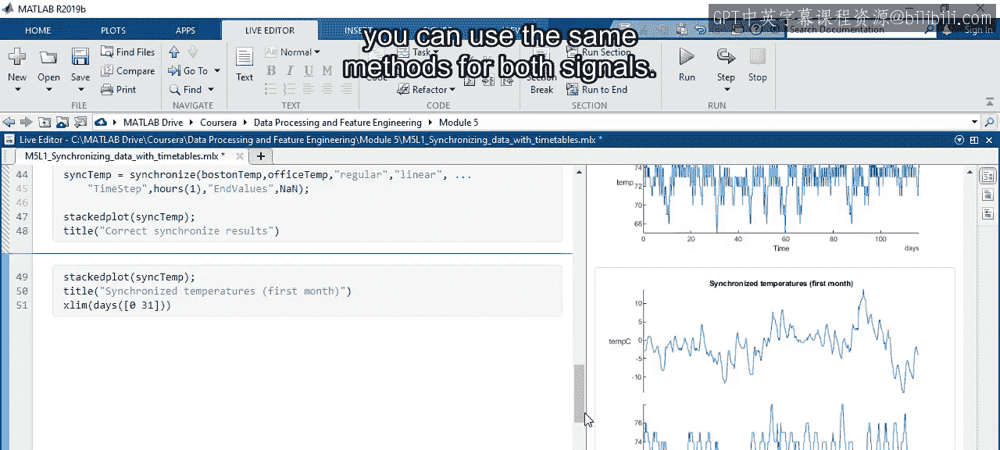

To summarize， timetables are a useful way to organize and work with signals。

You can create timetables in several ways。This example we used time steps。

 but you can also use a sample rate or explicit row times。

Use the retime function to convert a signal sample rate or to resample at regular time points from a signal that isn't regularly sampled。

Lastly， use the synchronize function to synchronize timetables with different sample rates。

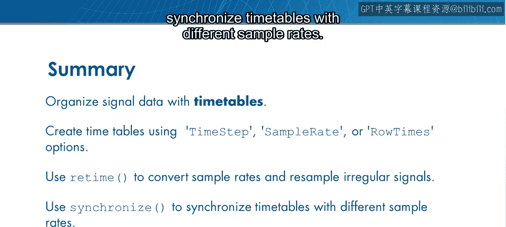

For more details， check out the documentation for re time and synchronize and take a minute to review the different options for interpolating signals or aggregating them with summary statistics。

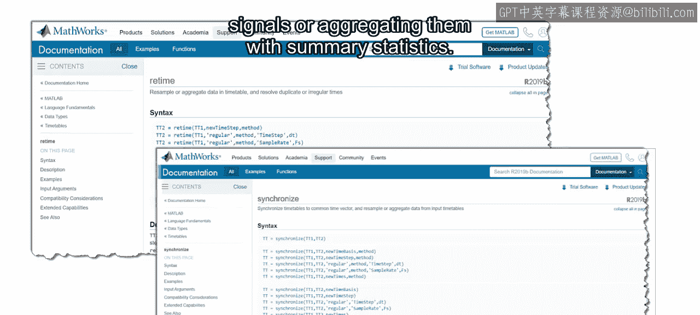

🎼。