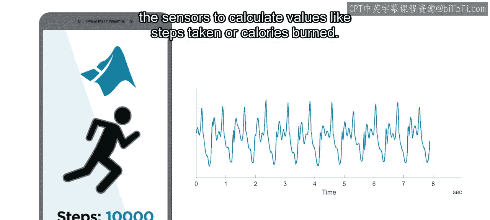
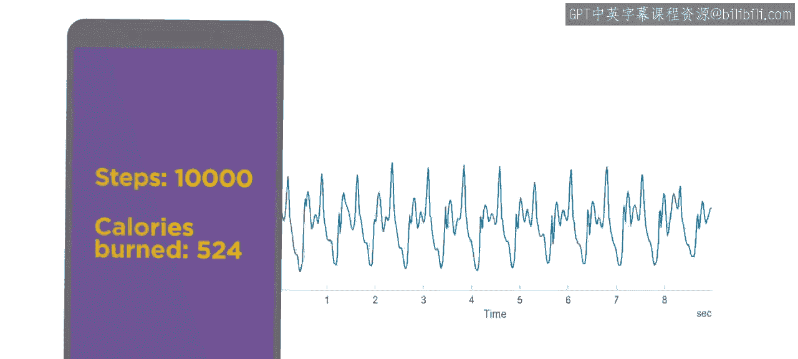
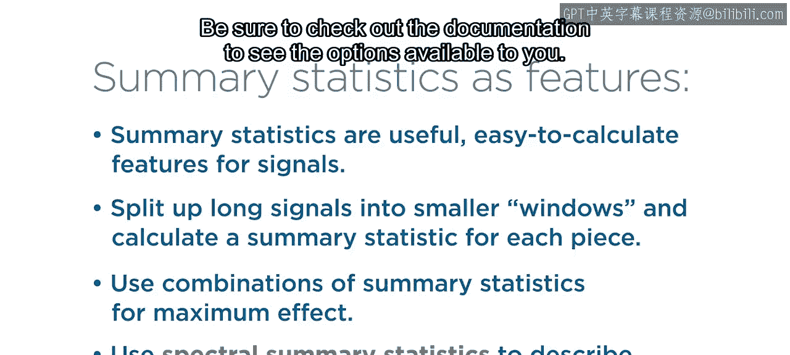

# Mathworks《实用数据科学与MATLAB（数据探索、特征工程、机器学习、毕业项目）｜Practical Data Science with MATLAB》 p77 37_汇总统计作为特征.zh_en [BV1Jr421w7wL_p77]

🎼，You've just learned how to organize data in timetables by resampling and synchronizing signals。

Within the framework introduced earlier， this was an important preprocessing step for preparing your data。

In this video， you'll move into feature engineering by learning how to use summary statistics as features to describe signals。

Why summary statistics？Let's say you're helping to create a phone or smartwatch app that tracks physical activity using internal sensors。

As the team's data scientist， it's your job to find a way to use signals from the sensors to calculate values like steps taken or calories burned。

To provide accurate values， you'll likely need to discriminate between different types of activities。

For example， you might report different values depending on whether the user is sitting。

Standing。Walking。Or walking upstairs。

In this video， you'll see how to use summary statistics to describe these activities using signal data。

The data you'll see was recorded with an accelerometer。

Which is a common sensor in modern cell phones。It measures the acceleration of the phone along three axes X。

Why。And Z。When you're holding the phone still， it will report a constant but non zero value due to gravity。

Notice how the values change as the phone rotates。It will only register exactly zero in free fall。

Which we don't recommend trying。Here's some example data from the Y axis channel of an accelerometer。

In this case， the person wearing the smart watch was standing in place for about 10 seconds。And then。

 started walking。There's obviously a big difference between the two activities。

But notice that the signal is fairly consistent during each activity。

One approach to tell these activities apart is to split the signal into two parts and calculate some summary statistics for the entirety of each part。

Then you would use these numbers as features to classify the type of activity。Of course。

 you won't know beforehand where to split the signal into two。

So it's more common to take a long signal and split it into regularly sized pieces。

 This is a process， called windowing。Once the signal is split into separate windows。

You compute summary statistics for each piece。And make a prediction。

So what types of summary statistics are useful？A simple mean calculation。

Might be enough to tell apart static activities。Like sitting versus standing。

Since the sensor is probably in different orientations between activities。When you're sitting still。

 the accelerometer reports a constant value for each axis。When you stand up。

 the accelerometer output for each axis moves to a different constant value。

You can detect this change by calculating the mean values for different windows。Now。

 which summary statistic do you think would be useful for discriminating between standing and walking？

There's plenty of candidates， but a good choice is the standard deviation。While walking。

 the sensor is constantly moving， so the values will fluctuate in a way that reflects the intensity of the movement。

Since there is more variation in the signal when walking compared to standing。

The standard deviation will be higher。The table you saw earlier also showed this change。

But how could he tell apart similar activities such as walking normally versus walking upstairs？

In these cases， the signals might appear very similar。It's possible that higher order statistics。

 like skewness and kosis， could tease apart these differences。

But another common way to compare complicated signals like these is to analyze the frequency content of the signals。

Frequency analysis is helpful because a signal can be thought of as a combination of one or more frequencies。

The simplest example is a pure tone that only contains a single frequency。

A slightly more complicated signal is a musical note， such as one from a guitar。

This signal has a fundamental frequency that defines the pitch of the sound。

But there are also harmonics， which are higher frequency components of the sound。Of course。

 the signals from an accelerometer aren't musical notes， but the same principles apply。

You can think of them as a combination of different frequencies。

The frequency content of a signal can be analyzed with a Fourier transform。

Which is a mathematical transformation that converts a signal to a different domain。

This means the data is indexed differently。The original data was indexed by time。

 whereas the transform data is indexed by frequency。If you look closely at the transform data。

 you can see a series of regularly spaced peaks。The first peak is the fundamental frequency around 1 hertz。

Which corresponds to the fluctuations in the time domain signal that are roughly one second apart。

The other peaks in the frequency are the harmonics， just like the musical note。Within MATLb。

 you can easily calculate Fourier transforms and create plots like these。

 which are commonly called spectra。You can see a few of the possibilities in the plots tab under spectral estimationation。

This plot was created using the function periodogram。Another common choice is the P Welch function。

 which plots a smooth version of the periodogram。These functions will create plots when you call them with no output arguments。

But you can check the documentation to see how to return the spectrum values from the plot instead。

In the usage here， the signal is in the variable X， and the sample rate is in the variable Fs。

The two outputs are the spectrum， PXx， and the indexing array of frequencies F。

The empty inputs are used to specify the default values for those options。

So how can spectral analysis help you to distinguish between two different types of activities？Well。

 there's a whole other class of summary statistics you can calculate once you have the spectrum。

Instead of a mean， you can calculate a spectral mean， also called a spectral centroid。

And instead of standard deviation， you can calculate a spectral standard deviation。

 which is also called the spectral spread。Spectral statistics are calculated in much the same way as summary statistics you've already seen。

But they represent very different values。The mean of a signal over time represents the average amplitude。

Whereas the spectral centroid is a frequency value that represents the weighted average of all the frequencies in the spectrum。

Similarly， the spectral spread is a measure of how widely the spectrum is distributed across frequencies。

Let's apply these techniques to accelerometer signals from a person walking normally and walking upstairs。

Take a look at the spectra calculated from the Y axis signal for both activities。

Notice that the normal walking spectrum in blue has regularly spaced peaks。

 meaning the harmonics of this signal are very prominent。On the other hand。

 the walking upstairs spectrum only has one prominent peak at the fundamental frequency。

Since the harmonics are less prominent， most of the energy of this signal is concentrated at lower frequencies。

This concentration influences the spectral centroid。

 which is around1 hertz for the walking upstairs signal。

The spectrum of the walking normally signal has more energy at higher frequencies。Therefore。

 the spectral centroid is larger， around 3 hertz。This difference may not seem like much。

 but consider the implications。You've now managed to tell apart two very similar signals。

With a single summary statistic。If one statistic isn't enough。

 you can combine multiple summary statistics together to create a larger set of features。

Then you can apply the filtering methods you learned about previously to select only the features that help with your desired outcome。

To recap， summary statistics are useful features for signals。

You can apply them by splitting a long signal into small pieces or windows。

 and then calculating a statistic for each window。Use combinations of summary statistics when a single statistic isn't enough。

And lastly， use spectral summary statistics to analyze the frequency spectrum of signals。

Be sure to check out the documentation to see the options available to you。

。