# Mathworks《实用数据科学与MATLAB（数据探索、特征工程、机器学习、毕业项目）｜Practical Data Science with MATLAB》 p78 38_寻找峰值.zh_en [BV1Jr421w7wL_p78]

🎼，Let's say you're analyzing a data set with audio recordings of speech。

You've seen how to use summary statistics to describe signals。

But what if you need to measure specific properties of the signal。

 such as the pitch of the person speaking？The pitch can be a useful feature in many situations。

It's important for speech recognition in tonal languages like Mandarin。

 where a difference in pitch will result in a completely different word。

Pitch can also be used to help identify the sex of the speaker。

Males typically have a voice pitch between 80 and 180 Hz。

 While females tend to have a pitch between 150 and 250 Hz。In this video。

 you'll see how to estimate the fundamental frequency or if not of different voices。

You'll do so by finding peaks in the frequency spectra of male and female speech recordings。

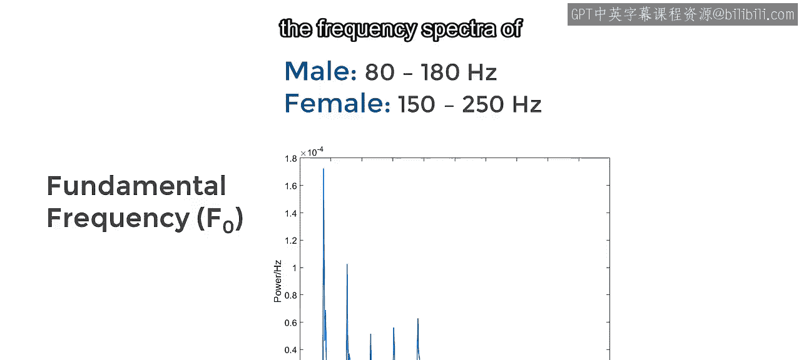

Referring back to the feature engineering workflow。

 Finding peaks is another method of feature engineering。

You'll also learn some cleaning techniques for peaks。

 such as filtering by peak prominence and spacing。

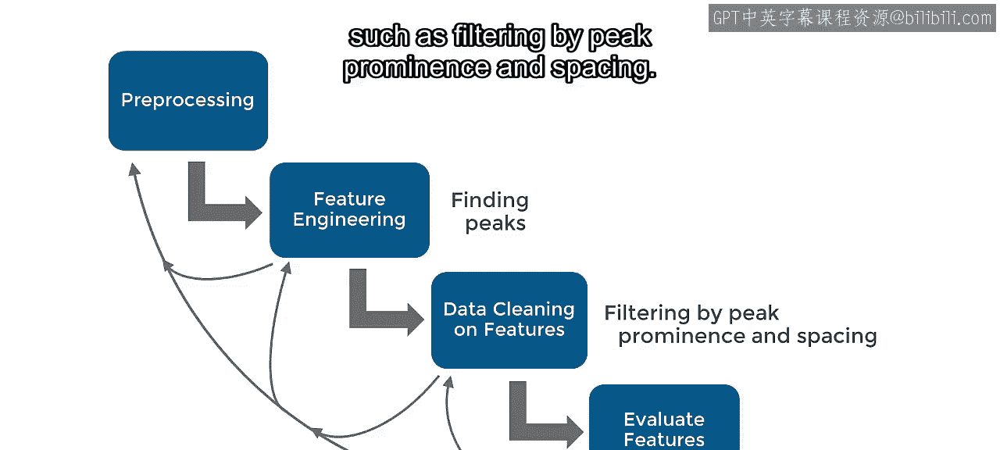

Lastly， you'll evaluate your feature within Anova。Let's load two audio files that contains speech recordings from a male and female speaker。

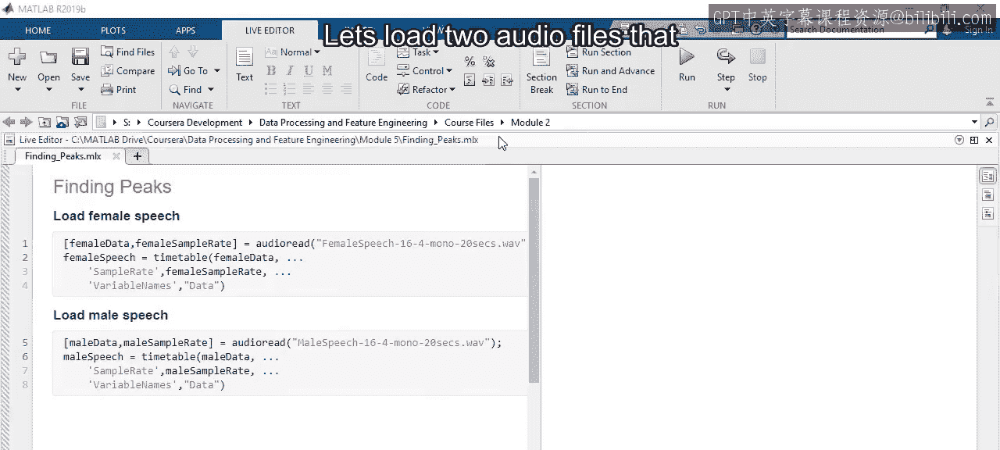

Both files are included in MatTL。Use the function audioudio read to load two variables。😡。

The signal and the sample rate。

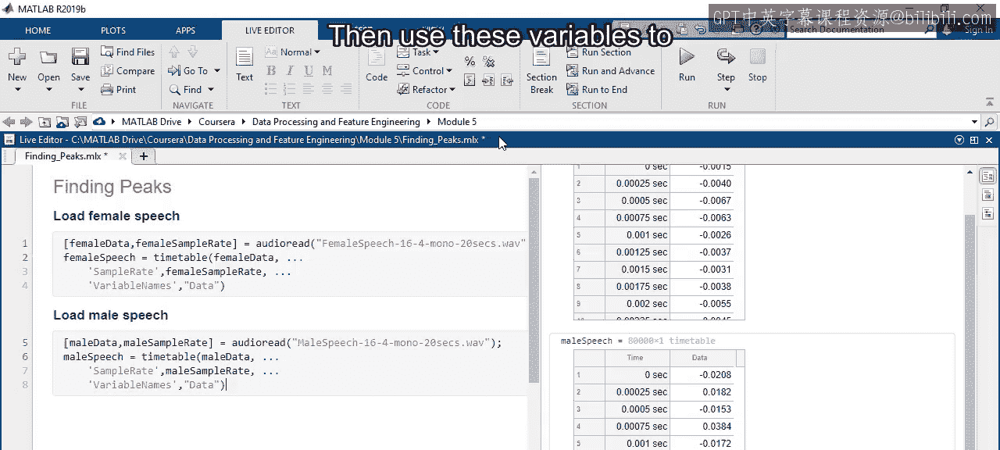

Then use these variables to create a timetable for each file。

Right now would be a good time to apply any preproces operations such as synchronizing or normalizing。

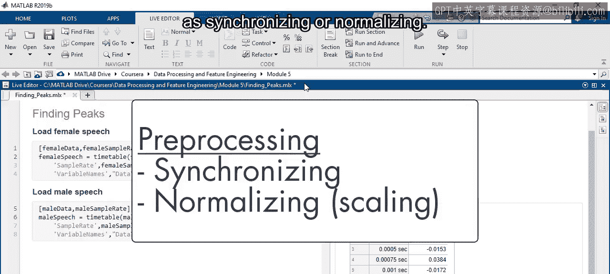

It might be necessary if the audio files were recorded with different settings or equipment。However。

 these particular files were recorded at the same time， so no additional prepros is necessary。Next。

 extract a sample from the female speech timetable using the times shown here。

This waveform is a recording of the sound bow from the word rainbow。

 You can play the recording with the function， sound。收。If you zoom in。

 you'll notice a repeating pattern every 5 milliseconds or so。

 These repetitions are cycles of the fundamental frequency。

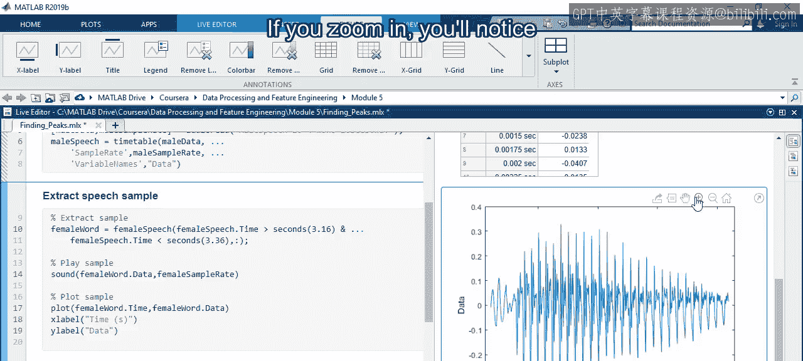

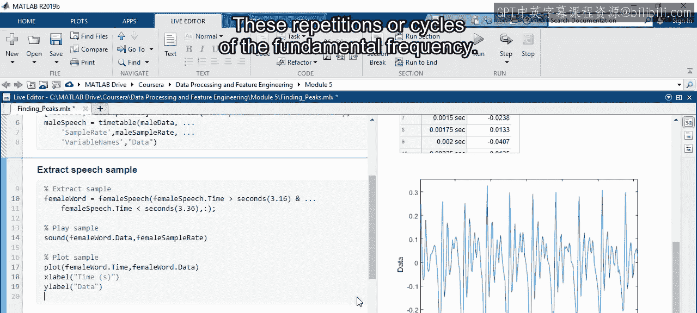

You can see this more clearly in the frequency spectrum。

 which can be calculated with the function periodogram。

Notice the spectrum has a series of prominent peaks。The first peak near 200 Hz， represents F not。

While the other peaks are the harmonics。Harmonic frequencies are multiples of the fundamental。

 so their values are two times F not， three times F n， and so on。

Let's try to identify these frequencies by finding locations of the peaks in the spectrum。

You can automate the peak finding process with a live editor task called Find Local ExtreMma。

This will generate reusable code so you can reproduce your results with other data。

Insert one of these tasks now and select the spectrum as the input data。Whoa， that's a lot of peaks。

If you zoom in， you can see that every peak in the signal has been labeled。

These peaks won't help with the F not estimation， so you'll need to change some parameters in the live task。

There are two parameters that you can adjust to reduce the number of detected peaks。

These are min prominence。And min separation。The prominence is a measure of how well a peak stands out from the surrounding points。

Its value is measured relative to the scale of the data。

Which has a maximum around two times 10 to the negative4。

Since the peak at F not scales almost the entire range。

 itss prominence value is probably close to this number。

You could increase the minimum prominence so that only the F notO peak is detected。

But the enot peak is not always the biggest。Instead。

 it may be better to try to identify all the harmonic peaks。

Then if not could be calculated by taking the average distance between the peaks。

Try increasing the minimum prominence to 10 to the negative5 by typing1 E negative 5。

You can see this removes most of the smaller peaks。

 but there are still some extra peaks that do not fall near a harmonic frequency。

Because the harmonics have a fixed spacing， you can specify the min separation to limit how often a peak can be detected。

Let's try a value of 100 Htz as the minimum separation between peaks。That's pretty good。

Only the F not peak and some of the harmonic peaks are marked。

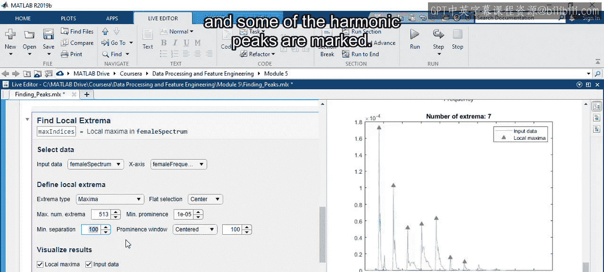

Now， to estimate the fundamental frequency， you can use the output from the live task and the function diff to get the frequency difference between each peak。

Then take the average value。 And there you go。 The fundamental frequency for the sample is around 152 Hz。

But hold on to just a second。Do the parameters you found also work for the recordings of mail speech。

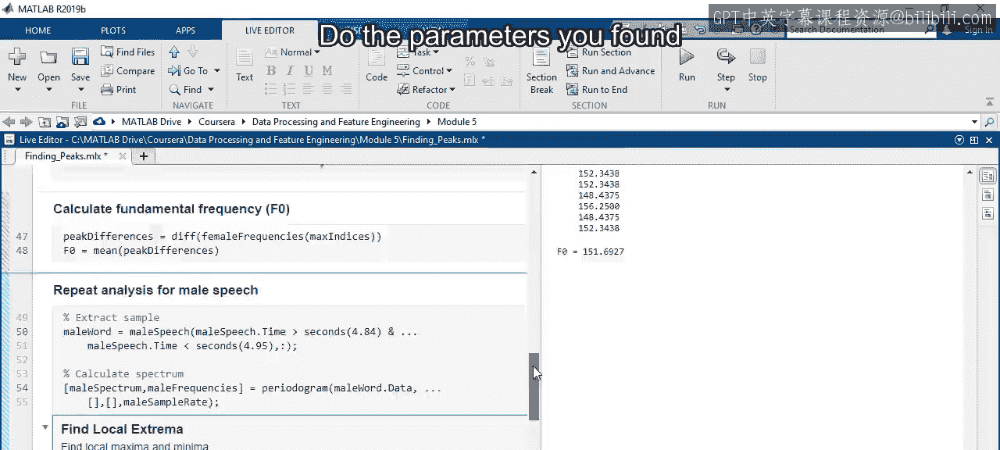

Let's repeat the process， with a new sample。Make sure to use the same parameters to be consistent。Oh。

 there's clearly some peaks that have been missed。That's because the minimum separation is set to 100 Htz。

 but sometimes the male voice drops below this value。

Problems like these are common when trying to find features。

The methods that work for one piece of data may not work for another。Thankfully。

 this is a situation where domain knowledge can come in handy。

Voice pitches rarely drop below 60 hertz， so let's try min separation of 60。

This seems to work pretty well， but it brings up another issue If some harmonics are missed。

There could be some very large peak differences。So instead of using the mean。

 you can use a statistic that is less susceptible to outliers， such as the median。

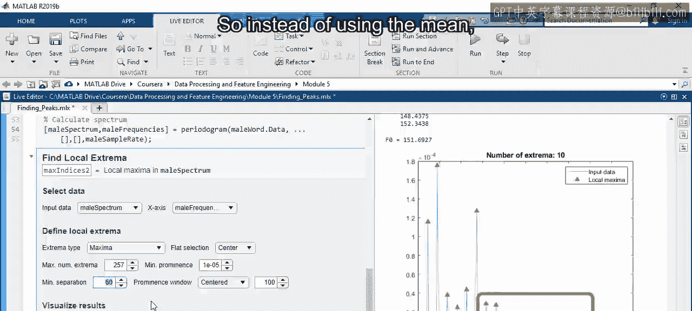

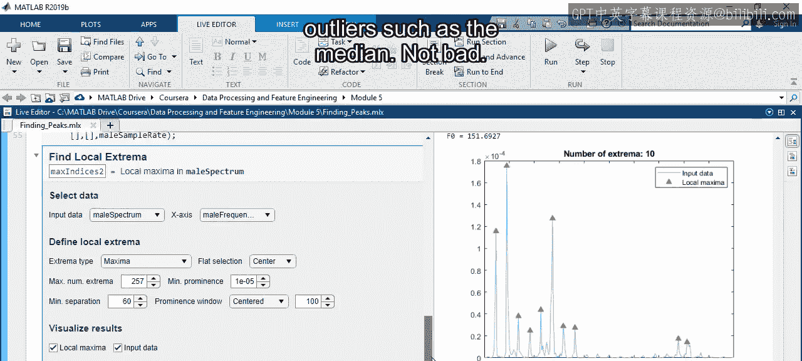

Not bad。 It looks like the pitch for this segment is around 94 Hz。

This value is lower than the one measured from the female speech sample。

 but is the male voice always lower？To get an answer。

 you'll need to get more samples from different parts of the recordings。

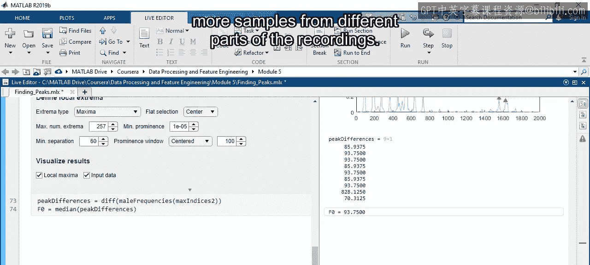

Doing this by hand would be very tedious。But you've already seen an easier way by using the function retime。

Previously， you used retime to split up a signal into separate windows and then apply a summary statistic for each window。

Instead of a summary statistic， you can apply a custom function that calculates the pitch。

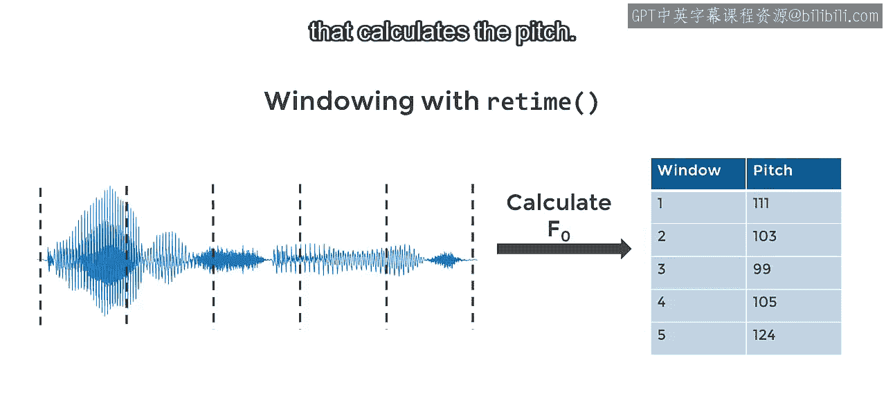

Here's an example of a function that uses auto generated code from the live task。

 which includes the prominence and separation values that worked well with this data。

To see the function in detail， check out the live script that accompanies this video。

Let's use Retime to apply this function to the entire mail recording with a window length of 100 milliseconds。

The output is another timetable， but now it has the pitch estimates for each window。

A histogram shows that most values are below 200 hertz。

But there are definitely outliers at higher frequencies。

These could be from windows where some of the harmonics were missed by the peak detection。

It might be worth going back to tweak the peak finding parameters。

 but you can also remove the outliers using the techniques you've already learned。

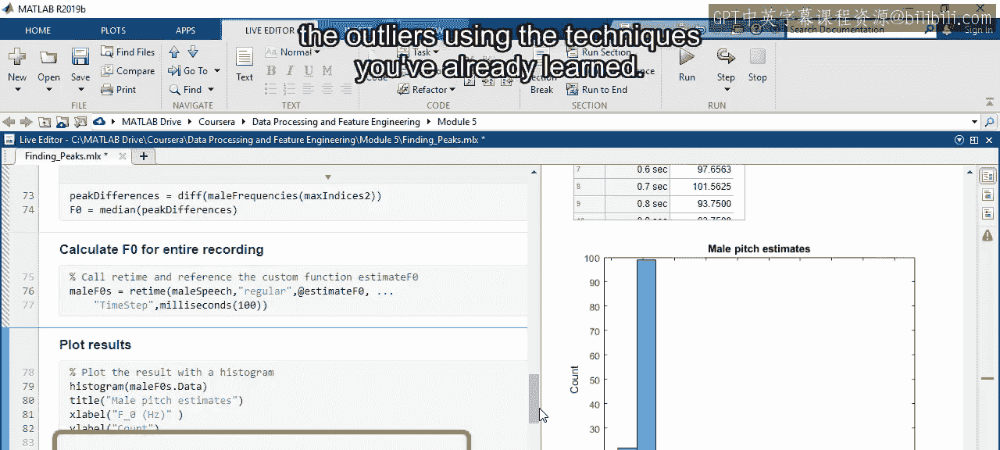

Finally， you can repeat this analysis for the female speech recording and compare the results。

A histogram shows that the female enot values tend to be higher than the male once。

 but with some overlap in the distributions。It's also worth noting that each recording only has one person speaking。

 so these distributions could change with more data。

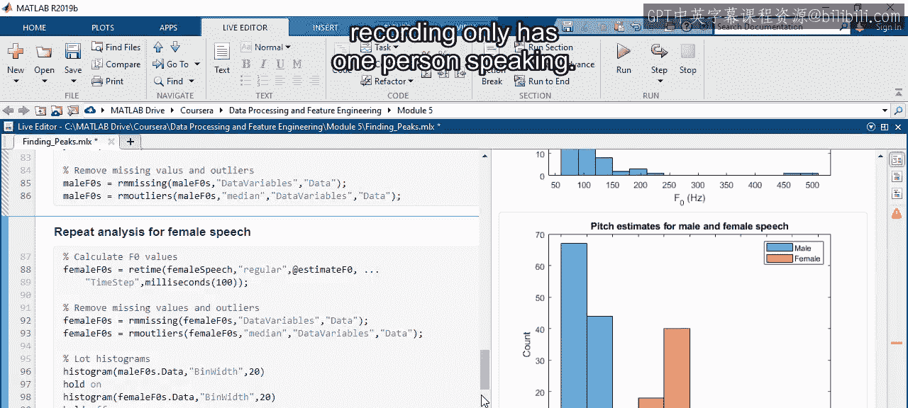

Nevertheless， there is certainly a difference between the distributions。

 which can be quantified with a one way anova。To calculate a P value。

 you need to combine both sets of F not values into an array and create a label variable that specifies if the data was from a male or female speaker。

The reported P value in the Anova table is very small， meaning it's highly significant。Therefore。

 this measure of pitch is a useful feature for telling apart these speakers。

It might be useful for identifying the sex of any speaker。

 but you need to verify this with more data。

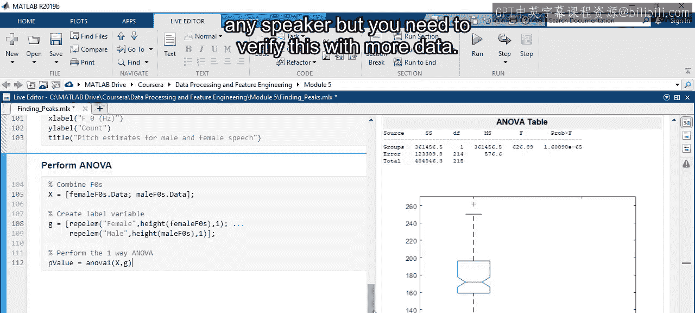

To summarize， you've just seen how to extract frequencies from signals by finding peaks in the frequency spectrum。

The fine local extre task is a useful way to find peaks by picking parameters such as minimum prominence and separation。

Don't forget to test your methods on multiple data samples before applying them to the whole dataset。

And lastly， use auto generated code from the live task in the retime function to apply a windowing process to an entire signal。

For more details， take a look at the live script that accompanies this video。

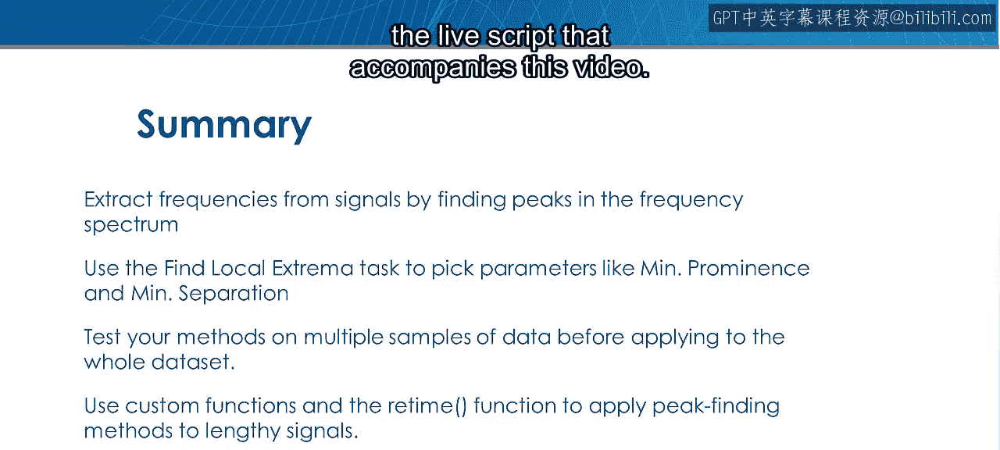

。