# Mathworks《实用数据科学与MATLAB（数据探索、特征工程、机器学习、毕业项目）｜Practical Data Science with MATLAB》 p79 39_可选-使用MATLAB Mobile记录传感器数据.zh_en [BV1Jr421w7wL_p79]

🎼，Many fitness tracking apps use sensors in your mobile device to monitor your movement with MatTLAab Mobi。

 you have access to data from your device's accelerometer， gyroscope。

 magnetometer and GPS In this video， you will learn to log accelerometer data using MatTLAab mobile and interact with the data in a live script。

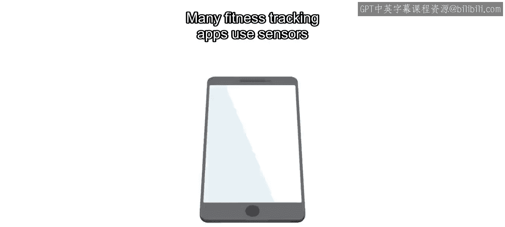

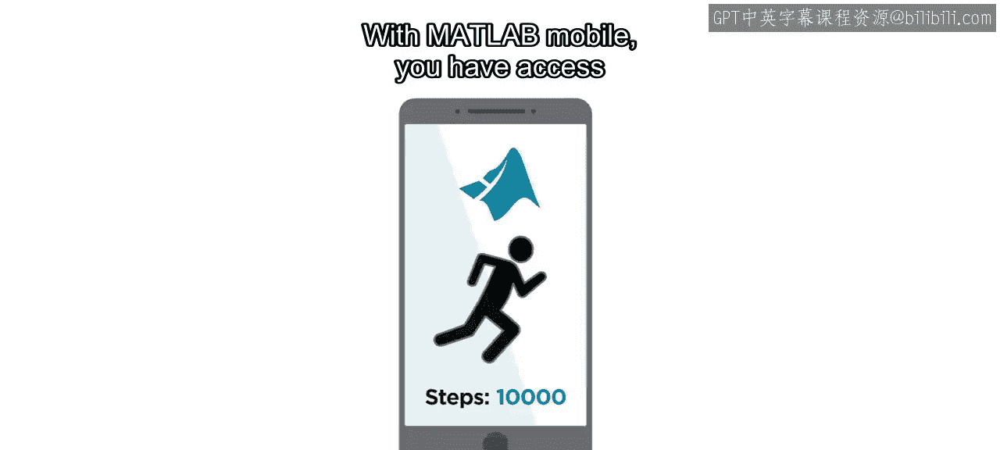

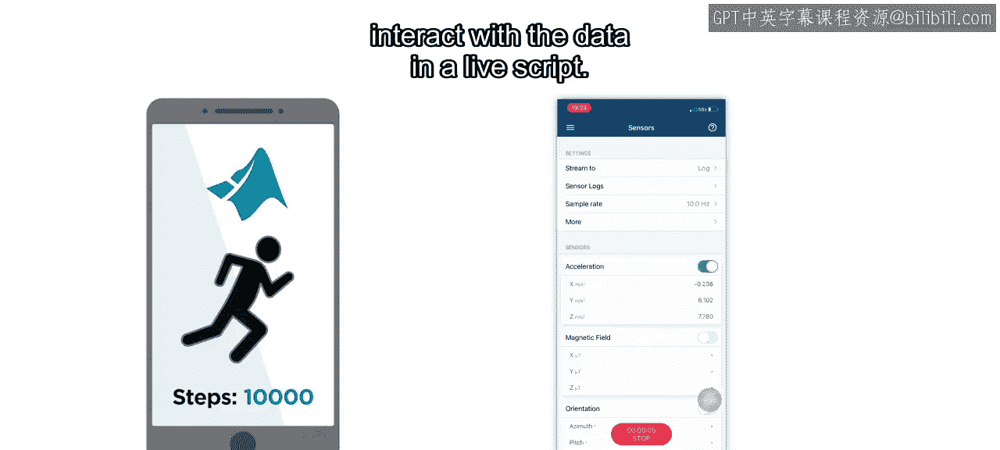

To start collecting sensor data first， download MatTLb mobilebile from your device's app store and sign in with your Mathworks account。

The first screen you see when you open Matlab mobilele is the Matlab command line。

You can use the command line to enter the same commands that you would in a desktop installation of Matlab。

To set up your device for data logging， first， navigate to the sensors menu。

 Make sure to turn on sensor access and set the name of the folder your data will be stored in。

Then select the acceleration sensor and set the streamream2 option to log。When you're ready。

 press start。Now as you move around， acceleration data will be recorded by MATLb Mole。

After you finish recording， press the stop button， Na your data file and click save。

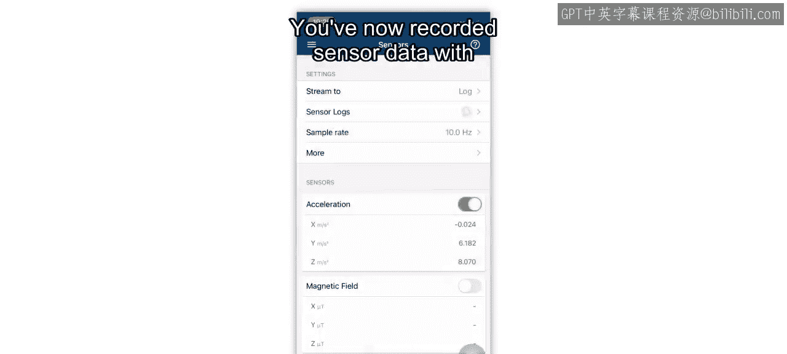

You've now recorded sensor data with MatTLb mobilebi and stored it on your device。

 but how can you start working with this data on your computer？

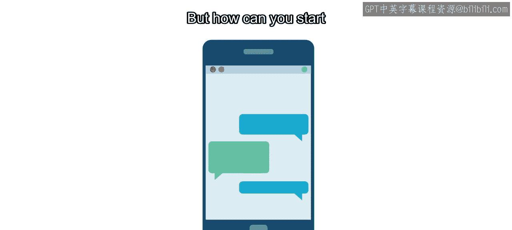

MatLB Mobile automatically syncs all your files with MatTLB Drive。

 a cloud based service for sharing files across different devices。

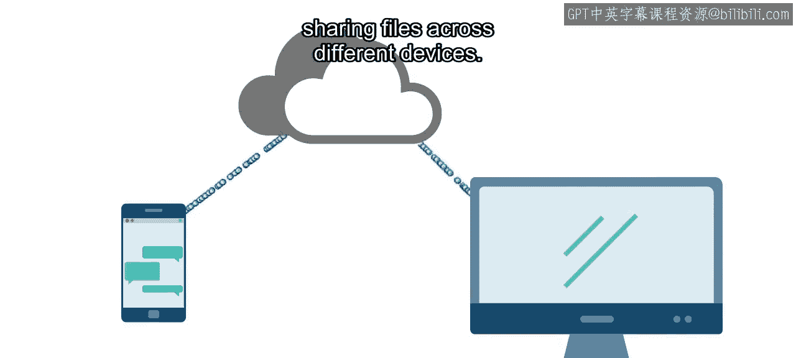

Navigate to Matlab drive on your computer to access this file。

 The sensor log will be in the folder you named earlier。

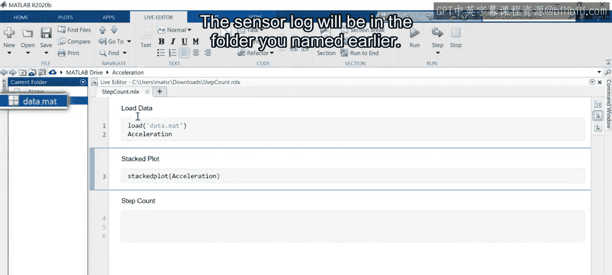

Then use the load command to load the data into the Matlab workspace。

Censor data from MATLB Mobile is stored in a timetable。

A timetable is a type of table that has a time stampamp associated with every row。

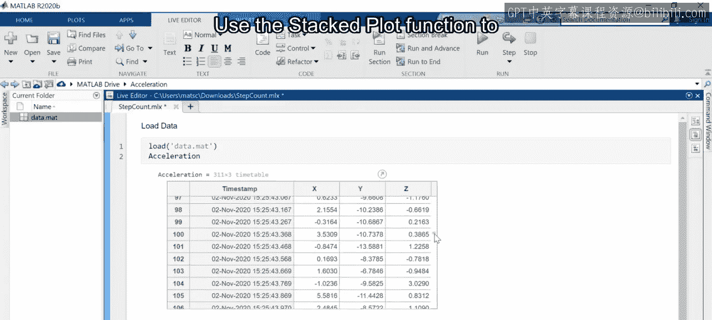

Use the stacked pot function to visualize the three signals in your timetable。

 which correspond to acceleration in the three axes of your device。

If you look closely at this data set， you will notice equally spaced peaks on the Z axis signal。

These correspond to individual steps， while walking。

Let's use this signal to count the number of steps。

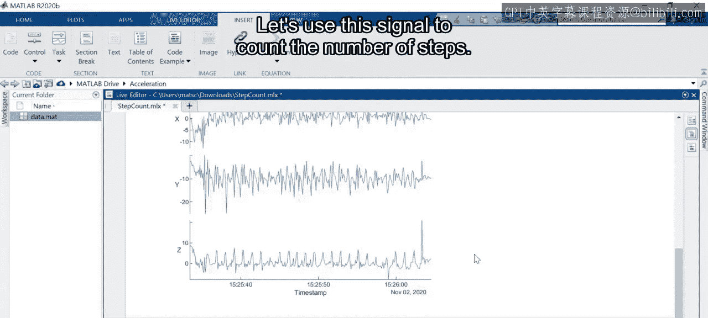

Insert the Find local Extrema Live task into your live script。

Select the Z axis signal and choose settings that identify only the prominent peaks in the signal。

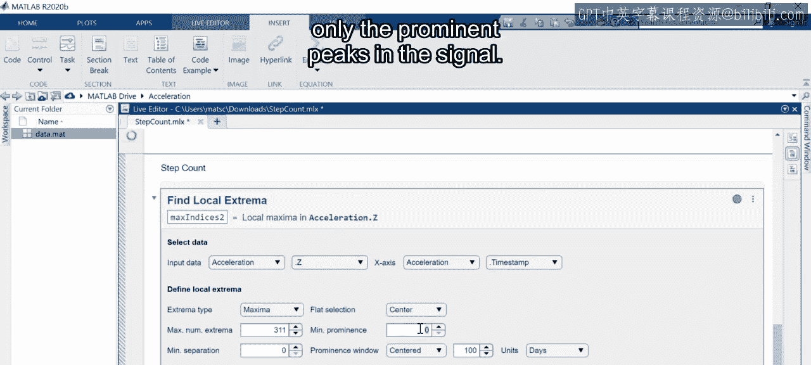

The generated plot shows the signal with the detected peaks。

The total number of peaks is a good estimate for the number of steps。

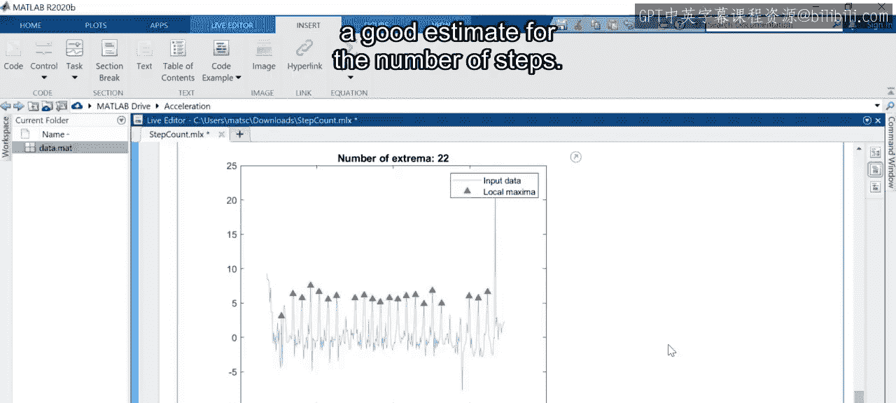

You've now learned how to record， access， and analyze mobile phone sensor data in MATLAb。

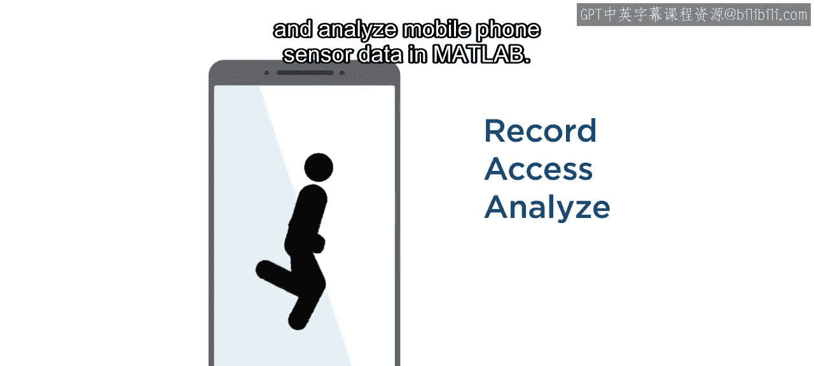

You used an accelerometer to count the number of steps while walking。

 But this is just the beginning of what you can do。

 Can you calculate your movement speed with GPS data or estimate how many calories you've burned。

Give it a try and good luck。

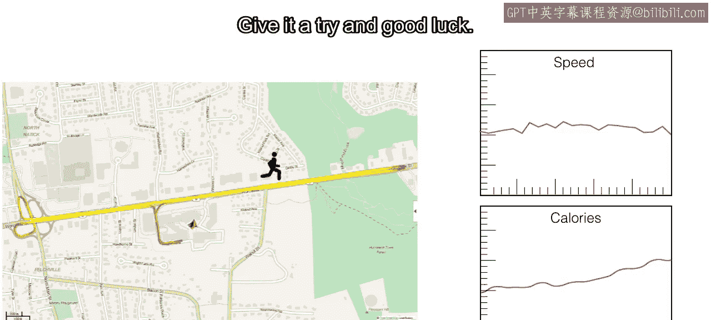