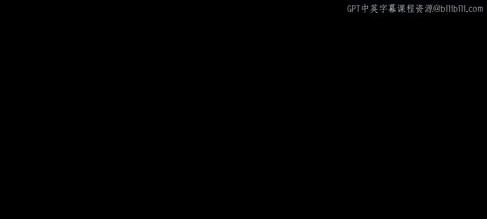
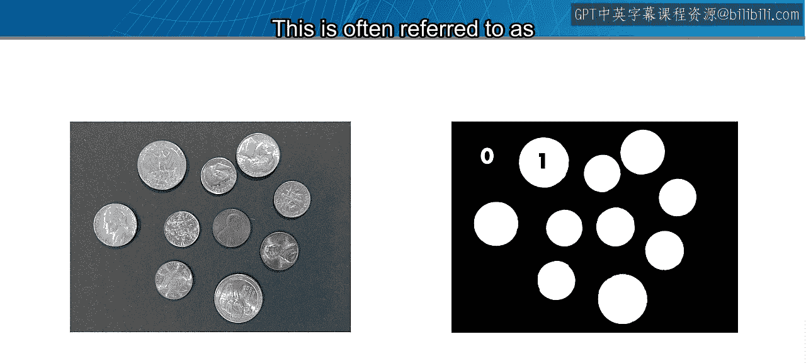
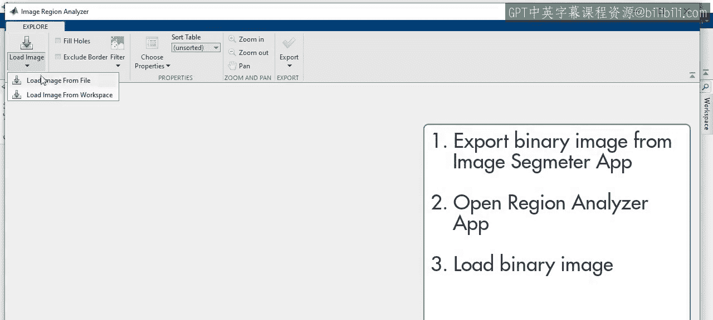
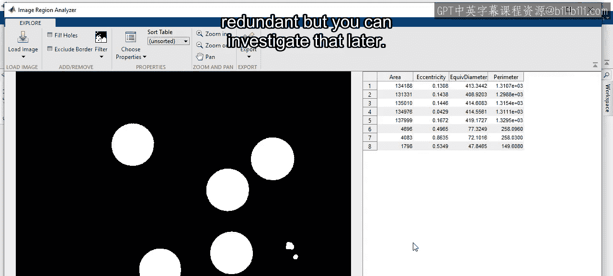
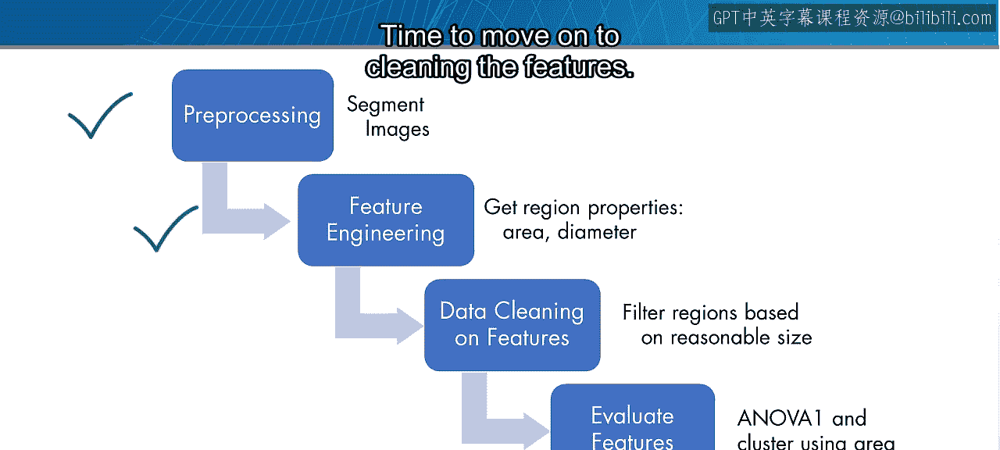
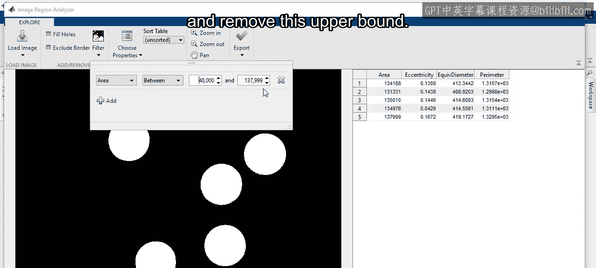
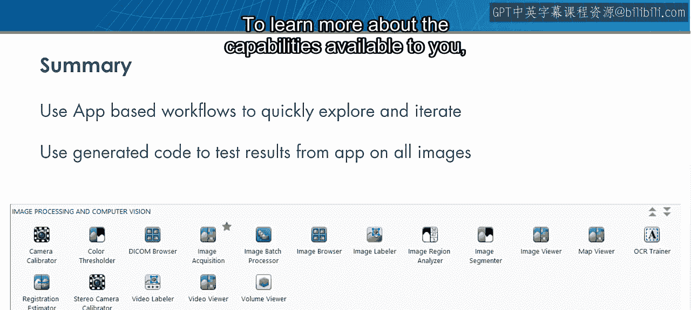
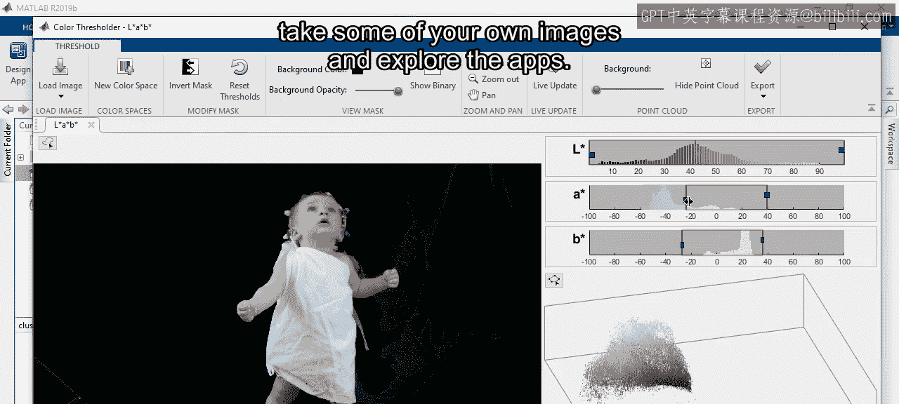
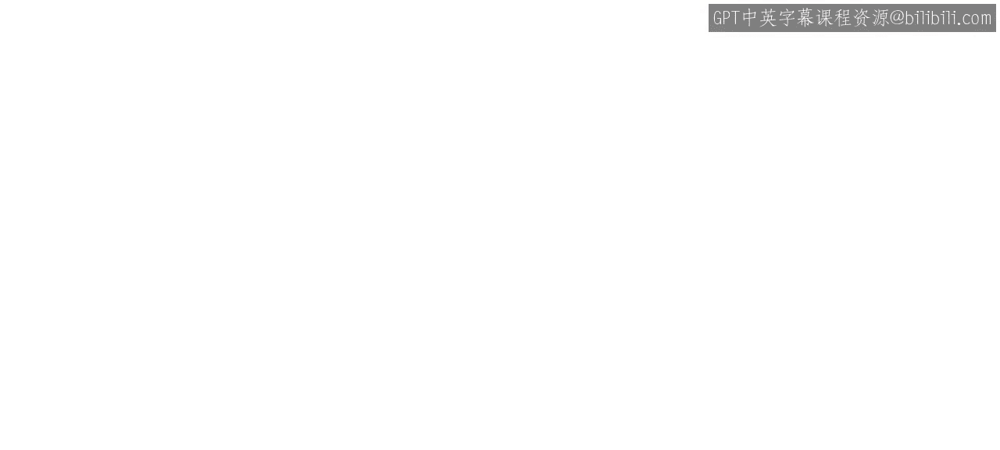

# Mathworks《实用数据科学与MATLAB（数据探索、特征工程、机器学习、毕业项目）｜Practical Data Science with MATLAB》 p80 40_图像特征工程与聚类.zh_en [BV1Jr421w7wL_p80]

🎼，Without you realizing it， your visual system is continuously performing feature engineering。Edges。

 shapes， colors， patterns and illumination are just a few of the many features your brain is using to identify objects and help you navigate your environment。

Take this image， for example， you probably knew instantly that this was an image of different coins。

 even if you were unfamiliar with the type of coins。

That's because your brain is good at identifyingifying objects。

How many different types of coins do you see。You're probably using size to start grouping them。

 along with the unique patterns and edges。But how could you teach a computer to identify these coins？

In this video， you'll see an example of performing feature engineering to identify different coins and images。

We'll prepare the images for feature engineering， generate features， clean the features。

 and then apply and evaluate the features to see if we can successfully group the coins。

Though we'll go through the process sequentially， keep in mind that the process is highly iterative。

Before starting with pre processing， you first need to decide what features to use since the specific features will determine the approach。

If you're unfamiliar with these coins， there are US currency， and there are four types in the images。

 pennies， nickels， dims and quarters。The size of each type has remained constant over time。

 but the images used when minting the coins occasionally change。

So determining the area of each coin might be a useful feature for identifying its type。

To find the area of each coin will first segment the image。

 meaning turning the gray scale image into a matrix where pixels with a coin have logical value of 1 and background pixels have logical value of0。

 This is often referred to as a binary image or a black and white image。

Start by navigating to the Moule 5 folder in MATLb。

There you'll find grayscale images I took of different coins。

The folder labeled unknown are not unknown coins， but images containing different types of coins。

In the App tab， you'll find many apps for image processing applications if you work with image data。

 set aside some time to explore this section as there are many apps to handle many common tasks。

Our first goal is to segment the images to do this， use the imageage segmenter app。

After opening the app， the first step is to load an image。

 It is a good idea to examine your images and start with one that is representative of the data here。

 I'll open the first image in the Dme folder。The app prompts us with a question。

Would you like to adjust the image contrast。A common segmentation method is to separate the foreground and background pixels using a threshold intensity value。

 Adjusting the contrast ensures the pixel values use the full range available。

 which is often a good idea。The image is displayed and several options become available。

 specifically， notice the createate mask， add to mask and refine mask sections。

A mask specifies which pixels will become ones in the binary image。

We need a mask that covers just the coins to segment the image。

Let's start with a threshold option in the Create mask section。

The app displays a preview of a global threshold operation。This isn't too bad。

 The coloring indicates how the coins are segmented from the background。

 but you can see the top and left areas of the image have lots of pixels identified as foreground that shouldn't be。

This is because the illumination of the image is not uniform。With the app。

 you can quickly experiment with different approaches。

Using an adaptive threshold helps compensate for uneven illumination。Now。

 the mask looks more uniform。You can also adjust the sensitivity of the thresholding。

For this particular image， we see that small changes have noticeable effects on the mask。

It's often helpful to look at the binary image by clicking show binary。

The goal is to make the coin solid white and have a completely black background。

 but we don't need to do this in just one step。Click create mask to apply the changes。

The image updates to show the App operation and the history section updates with the steps we've taken so far。

Also notice that the options in the Create maskask section are now inactive since we already have an initial mask。

 but the refined mask options are now active。The borders of the coins are well captured。

 but not their interiors under refined mask， select fill holes to capture the entire area of each coin。

Great， the area of each coin is captured， but there is still a lot of noise。

 as indicated by the yellow dots in the background。😊。

Let's go back to Ref mask and see what else is available。HCl borders。

 This image doesn't have any coins touching the border。

 but I recall that some of the images do coins touching the borders will have smaller areas than expected。

 So let's clear borders to remove them from the analysis。Now。

 let's see if it's possible to clean up the background using morphology。

Morology is a broad set of image processing operations that uses shapes to reduce， expand， fill。

 and open a mask。In the upper left， there's a drop down to select the operation to perform。

Each operation has a short description。 For example。

 open mask says this removes foreground objects smaller than the structuring element。

 This sounds just like what we need。That is a nice improvement。

You can change the shape of the structuring element， as well as the size。

Increasing the size removes larger objects from the foreground。 so let's increase it。

Eventually we don't see much improvement in the mask， and of course。

 we don't know what effect this might have on our other images。However。

 these remaining regions are much smaller than the coins， and we can address them later。

 So let's apply the operation。This segmentation works fairly well。

 but what if you want to try a different approach without losing your current work？No problem。

 Just click new segmentation。This starts a second segmentation on the original image。

The first segmentation is still there with its entire history。

You can use this to try several approaches and pick the best one。Of course， this is just one image。

 How can we apply the same steps to all the images and check if the segmentation is acceptable。

We'll do this in two steps， generate a function to repeat the segmentation。

 then use the image batch processor app to segment all images and inspect the results。Under export。

 select generate function。Notice that the generated code includes a comment for each step performed in the app。

And the code required for that step。Save the function。

Then from the apps tab open the image batch processor app。Load the images。

And specify the function we just saved to apply to all the images。

here we want to process all the images so in the process section select process all。

A progress bar at the lower right shows how many images have been processed。

 but you can start looking at the results right away。

Let's inspect the results to see if our segmentation works on all images。

The app displays both the original image along with a processed image。

 allowing us to see if we got the results we wanted。This looks good。

 And we didn't write a line of code。😊，Now I have a confession to make。

 it took many iterations to get the segmentation shown here。

 but the app makes it much faster to explore and iterate。

When I found an image that was not well segmented， I just went back to the imageage segmenter app。

 tried a different approach and applied the new function to all images using the image batch processor。

Let's look back at our overall workflow to see where we are。 Pre processingces is done。

 I promise the next steps will go faster。😊，Often， preprocess is one of the most time consuming steps when working with new data。

Next up， creating features from the segmented image。

To get properties like area of individual regions in the segmented image。

 will'll use the image region analyzer app。This app requires a segmented image in the workspace or save to a file。

Start by exporting the binary image to the workspace。And opening the image region analyzer app。

And we have features。Let's choose the features to keep。The coins are circles， so let's keep area。

 eccentricity， equivalent diameter and perimeter。Some of these features may be redundant。

 but you can investigate that later。

The feature engineering step is done。 Time to move on to cleaning the features。

The image still contains regions that are not coins and therefore need to be removed。

The Iage Region Anar app lets you filter the image based on the properties of the regions。

Here we see that the smallest area of an actual coin is about 130，000 pixels。Well。

 the areas we want to remove are about 5，000。So let's set a minimum area of about 40000 pixels。

And there you go， the small regions are removed and were left for the table of features for the image。

Notice that the app sets the maximum area to be the largest area in the image。Here。

 we don't want an upper limit。 Otherwise， any larger coins will be filtered out。

 so we need to look at the generated code and remove this upper bound。

Under export， select export function。In the generated code。

 we see the two lines that perform the steps taken in the app。

 the filtering and the calculation of region properties。

Remove the upper bound in the filter operation by changing it to inth。Also。

 this comment informs us that we can return the variable properties as a table by uncommenting this line of code。

 so let's do that。And then， save the new function。We're now ready to see if we can use area as a feature to group the different coins。

😊，To do this， we need to apply the segment image and filter region functions created in the apps to all the images。

Then we'll cluster the observations and compare the clustering results to the known coin labels。

There is a live script provided that does this analysis。We'll go through it quickly here。

 but you can investigate it in more detail。The first step is to create an image data store。

Notice that it uses the folder names as labels for the images。

This is how we'll compare the clustering results to the known coins。

To run this script on your computer， you'll need to update the location of the images。

Inside the while loop， the features for each image are obtained and added to a table named properties。

In each loop iteration， an image from the data store is loaded。

The two functions just created are applied to calculate the region properties for the current image。

The code here gets the label for the image， repeats it for each coin found in the image and then adds it to the table。

The loop ends by adding the results from the current image to the table。Great。

 we have a table with 89 observations and features for each one。😊。

So now that we have a table of the results， how might you determine if area is a useful feature。

You saw several ways to evaluate features earlier。Since the response variable type is a categorical。

 the function of Nova1 can be used to test area as a feature。

The P value is nearly  zero indicating that coin type is dependent on area。Additionally。

 the notched box plot shows that though dimes and pennies are close， they are statistically distinct。

To finish this analysis， imagine you didn't know there were four types of coins。

 but wanted to try grouping the data based on area。

that is you want to cluster the data using your feature。

The first step might be to find the optimal number of clusters using the eval clusters function。

Here we test clustering area using the K means algorithm with five different k values ranging from 2 to 6。

Good， the optimal K or number of clusters is four， which is what we expect for this data set。Next。

 pass area to the K means function and specify four clusters。

This will return the assigned cluster for each observation， which is added to the table。

Scrolling through the table， we see that each type of coin is only associated with a single cluster。

Without labeling any of the images， you would come to the correct conclusion that there were four types of coins。

An app based workflow similar to this example can be applied in many applications。For example。

 there's an app for segmentation based on color and one for image registration。

Many of these apps will generate code enabling you to quickly explore techniques on a single image and then test the workflow on larger data sets。

To learn more about the capabilities available to you。

 take some of your own images and explore the apps。 You never know you may discover a new hobby。

。

