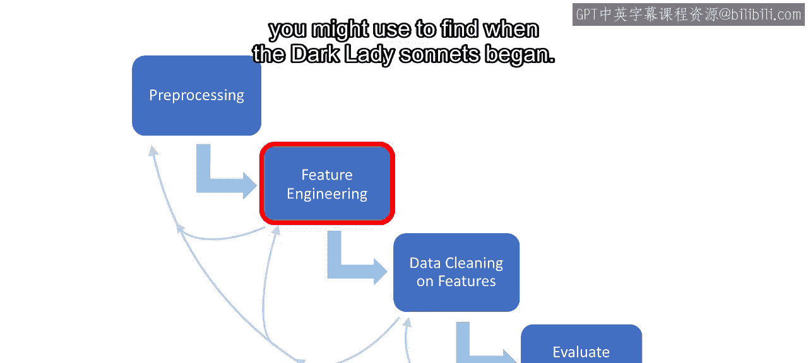
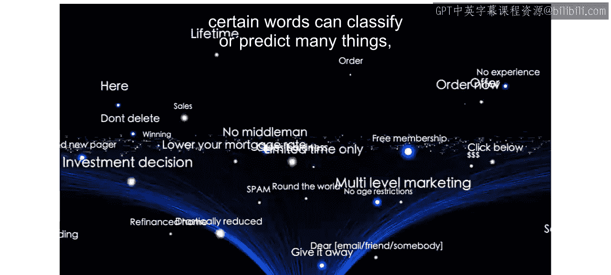
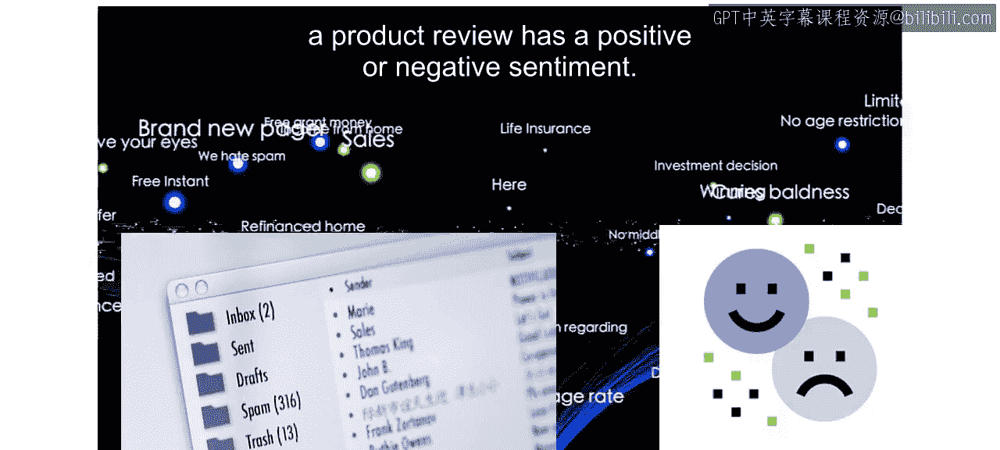
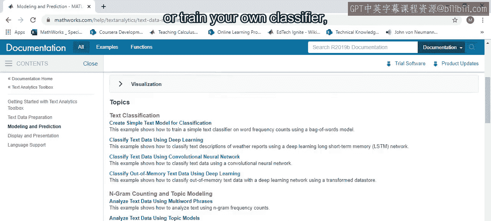

# Mathworks《实用数据科学与MATLAB（数据探索、特征工程、机器学习、毕业项目）｜Practical Data Science with MATLAB》 p81 41_文本特征工程.zh_en [BV1Jr421w7wL_p81]

🎼，You've seen how to import， restructure， analyze， and clean data in tables containing numerical and categorical variables。

You've also seen how to think about and approach feature engineering with signals and images。

Lots of valuable information can also be found in bodies of text。

There are analogous steps for processing， cleaning and feature engineering with text and MATLb。

In this video， you'll learn methods for extracting text from common document formats。

 as well as from websites and social media。Then you'll learn how to restructure， pre process。

 and clean text data in MATLb for exploration， analysis， and feature engineering。

Shakespeare's sonnets have been read and studied for many years。

Literary critics group Shakespeares sonnets into two main series Sonets 1 through 127 are called the Fair Youth Sonets。

Where the speaker expresses themes like friendship， admiration， and love for a young man。

Snets 128 through 154 are called the Dark Lady Sonets。

 where both the speaker and the fair youth have an affair with a woman with dark hair。

These address darker themes such as lust， jealousy and hate。

Can this shift in themes be detected using data science。First。

 you'll need to get the text into MATLb。You can read from plain text files， Microsoft Word documents。

 PDFs， and HTML using the extract file text function。For text and CSV or Excel files。

 you can use the import tool as you've done previously。

And you can readate directly from the web using a combination of web read and extract HTML text。

Let's extract the text of Shakespeare's sonnets from Sonets。txt， which is included in Maab。

Before you can analyze the text and sequence， you need to extract or split it into the individual sonnets。

You could extract the 18th sonnet， for example， like this。However。

 you probably don't want to do this 15 more times using each numeral。

Notice that there seem to be two empty lines between each sonnet。

 so let's split the text by two consecutive new line characters。This splits up the summit。

 but there are also some headings and empty species。

Calculating the length of each component and visualizing the result。

 you can see that the distribution is definitely split。

Looking closer at each end reveals that all the shorter strings are under 25 characters in length。

Since a sonnet is a poetic form with 14 lines and 10 syllables per line。

 this is too short and you can remove these strings。With this。

 you now have each sonnet stored as an individual string。

You can now look at the 18th or any other sonnet much more easily。

Let's start to analyze the text and think about features you might use to find when the dark Lady sonnets begin。

The presence and frequency of certain words can classify or predict many things。

 from whether an email is spam to whether a product review has a positive or negative sentiment。

Let's try investigating the sonnets in this way。To do so。

 youll use the tokenized document function to convert each sonnet string into a document and its unique components or tokens。

 in this case， words and punctuation。You can visualize the most common tokens in their relative frequency using a word cloud。

Here you see that the most common token is a comma。There's also other punctuation。

 words repeated due to capitalization differences， and what are called stop words like A，2 and but。

While all these elements are important to sentence structure and give context to other words。

 they do not have meaning on their own and can interfere with the analysis you're trying to perform。

You can remove this kind of word noise using functions shown here。

To see a list of the stop wordss that are removed， use the stop wordss command。

Now the word cloud contains more meaningful words， but it looks like some of them are essentially still stop words。

 just a Shakespearean variety。You can eliminate custom sets of words as well using the remove Word function。

So let's remove thhy， V， thinine， and similar words。That looks much better。

As you might have anticipated， if you're familiar with Shakespeare's sonnets。

 it looks like the most common， meaningful word is love。

Word clouds are an effective way to quickly visualize the more common elements in your text。

To dive deeper into analysis， however， and make use of features like word count。

 you'll need to quantify things numerically。This is where the bag of words function comes in handy。

 It will take the list of documents and create a matrix of counts。 Each row is a tokenized document。

 and each column is a different， unique word from the combined set of documents。

Each value is the number of times the word appears in a document。

One way to visualize the structure of this matrix is using the spy function。

Each blue dot represents a nonze entry。You can sum the columns to visualize how many times each unique word appears in all the documents。

 or you can use the top K words function to get this information a table。

Or you can use the vocabulary list to extract the column for a particular word to see where it appears and with what frequency。

Along with this， you can further analyze where and how a word appears using the context function。

To try to find the shift from fair youth to dark lady sonnets。

 let's look at the presence and frequency of love versus hate over the course of the sonnets。

To get at the theme or the sentiment associated with these words。

 you want to account for the various forms they can take， such as loved， loves or hatedated。

You can use the normalized words function to reduce words to a root form。

Notice that the specific form love appeared 162 times， and now that you've normalized other forms。

 you see 199 appearances。Let's look at where all the variations of love and hate are in the sonnets。

It's difficult to conclude much from just the bar plots。

 You've previously seen how to use summary statistics to extract features for data over time。

 So let's calculate a normalized moving average of each wordss appearance count。Interestingly。

 while love varies up and down， both love and hate see a very noticeable increase in appearance at the same time in the later sonnets starting just after number 1。

27。Remember， the Fair You sonnets end at 127 and the dark Lady sonnets begin at 128。

Looks like you successfully found this shift in theme using data science。In this video。

 you learned how to do some common extraction， preprocessing。

 and feature engineering tasks with text data。However。

 there is much more that you can do with text in Maabb。

Explore the documentation to see numerous ways you can perform analysis and feature extraction similar to what you've just learned using word sequences。

You can perform full sentiment analysis or train your own classifier， create theme in top models。

 and much more。

