# Mathworks《实用数据科学与MATLAB（数据探索、特征工程、机器学习、毕业项目）｜Practical Data Science with MATLAB》 p82 42_风暴事件特征工程.zh_en [BV1Jr421w7wL_p82]

🎼，You've just learned the core techniques of engineering features with text in MATLAb and applied them to find a theme shift in Shakespeare's sonnets in this video。

 you'll be introduced to a new live script which you can go through and modify on your own。

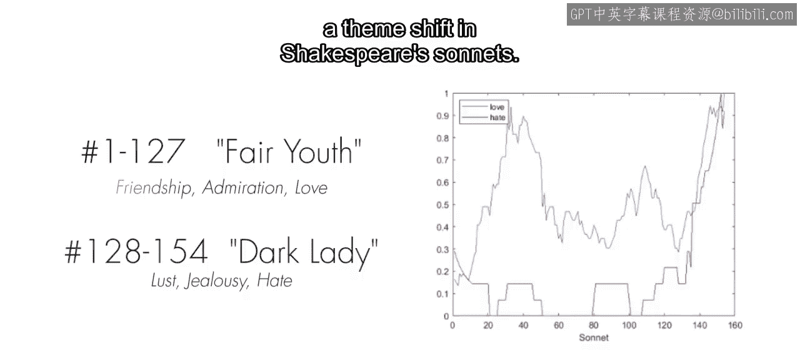

In it， you'll expand on the workflow you just learned to pre processcess and analyze data from a storm event descriptions you've seen previously。

In particular， you'll find， extract， and process hail size descriptions from the storm event narratives to create features that predict the damage cost。

Then you'll evaluate the predictive quality of your features using both visualizations and AOA testing。

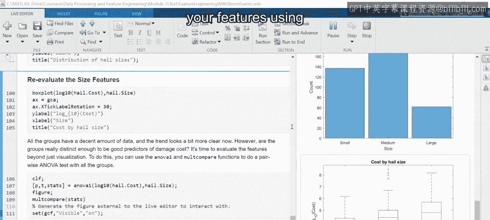

Taking a look at some of the event narratives of hail events。

 you'll notice various reference objects used to describe the size of hail observed。

It's reasonable to expect a trend where as hail size increases， the damage cost increases too。

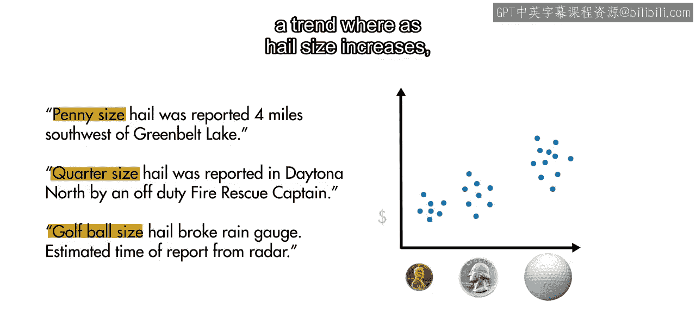

Start by using the StM Data importm function to load one year of data。

You can also import more storm event files on your own for further exploration。Next。

 preprocess the data by replacing all missing cost values with zeros。

Combining property and crop cost into a single total。

And extracting the hail events with non empty entries。

Notice that phrases like quarter sizeized are sometimes hyphenated and sometimes separate words。

For consistency， replace all hyphens with spaces to evaluate each word separately。In general。

 initial preprocessing steps vary from case to case。

 so make sure to always examine your data first to see what kind of changes you might need to make。

Now， just like you did in the Shakespeare example， you tokenize the document。

Remove punctuation and stop words。Add part of speech tags。

Reduce all words to their root form in lowercase。

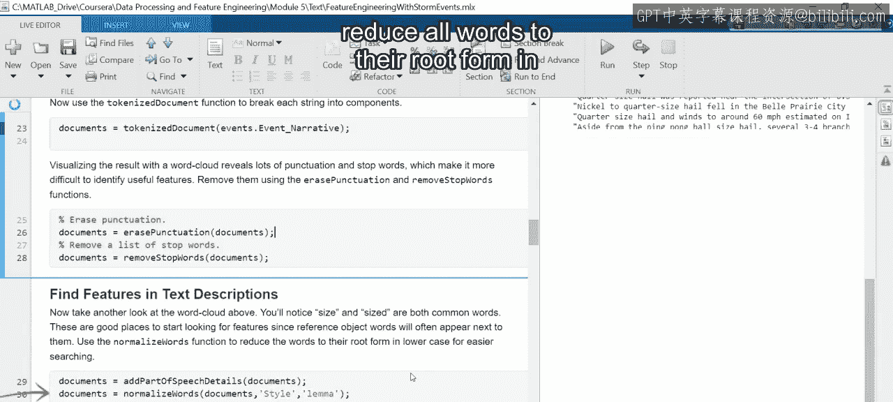

And visualize the result with a word cloud。These steps are a common preprocess workflow for analyzing text data。

Recall that you're trying to find descriptions of hail size。

So a good place to start is with multi word sentences that include the word size。

Take a look at these examples。Notice that there are both two and three word sequences。

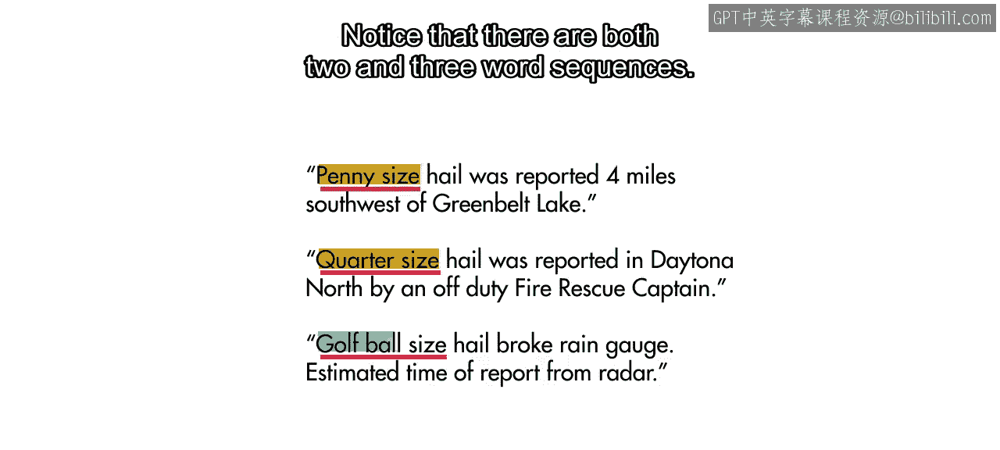

Like the bag of Word function you saw in the Shakespeare example。

 the bag of Engram's function is used to find multi word sequences containing the word size。

Let's start by examining the words immediately preceding size。

As expected from our earlier exploration of the data。

 some phrases like ball size don't give us much information on their own。

So let's extract the three word sequences or trigrams involving these words。

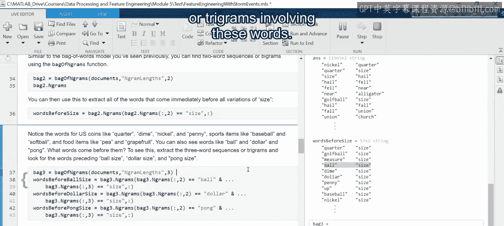

This makes more sense。There is golf ball size， half dollar size， and ping pong size。 Again。

 this illustrates the importance of understanding your data so you know when to customize your preproces steps。

A frequent and frustrating issue with text data is spelling errors。To deal with this issue。

 use the replace words function to correct them aspelling。In this case。

 there is a misspelling of the word nickel。Also， while not necessarily incorrect。

 multi word descriptions like tennis ball and half dollar can be harder to find than individual words。

 so let's replace these multi word phrases with single words。Misspellings， abbreviations。

 and expression replacements are expected when working with text。So in general。

 it's a good idea to carefully examine the data to detect possible issues early。

Notice that there is a wide variety of size descriptors being used here。

 from US coins to sports items to food items。Languages tend to have multiple ways of expressing the same idea。

 so it is a good practice to look out for redundancies when working with text data。

We will be addressing the redundancies in this data later in the live script。In this example。

 to see if there is a trend with size and damage costs， let's sort these descriptors by size。

 using the object to size conversions from the US National Weather Service。

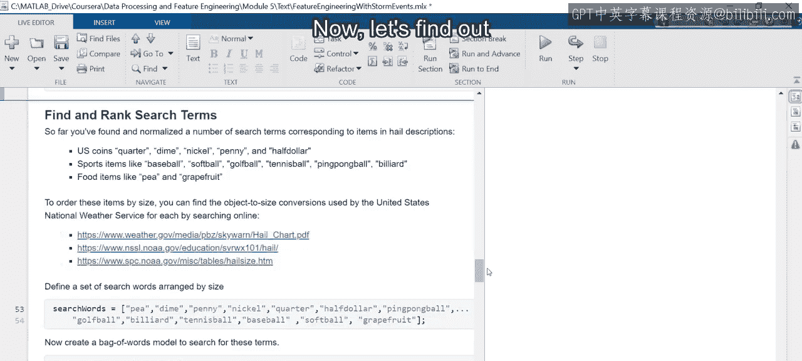

Now， let's find out which narratives include the different size descriptors。To do this。

 begin by using a bag of words model to search for each of the descriptors。

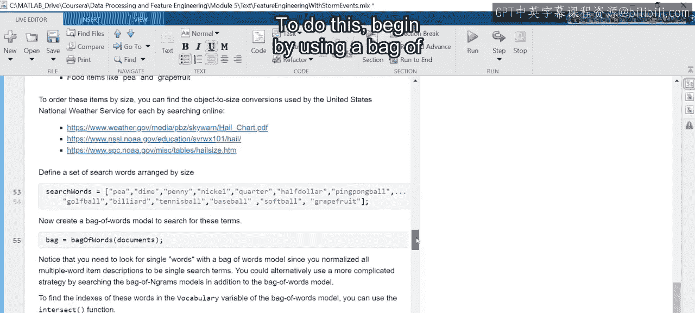

Notice that you are only looking for single terms because of the multi word replacements you made earlier。

Next， use the Intersect function to find where the size descriptors appear in the bag's vocabulary。

The set order value stable ensures that the resulting indexing corresponds to the size ordering of the descriptors。

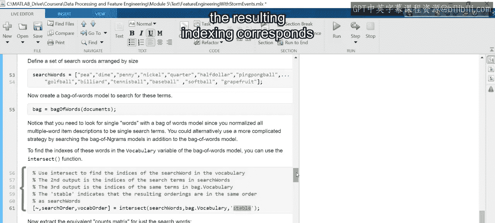

Just like you did in the Shakespeare example， extract accounts matrix for the search words so that you know exactly which narratives include which size descriptors。

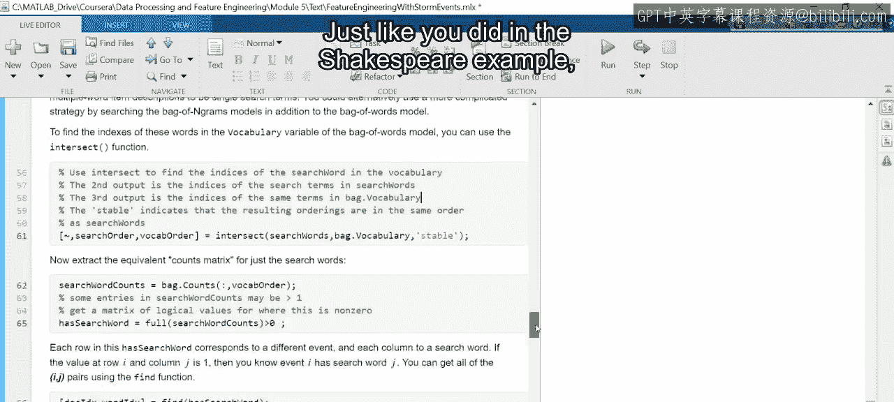

Now you're ready to evaluate the size features visually。

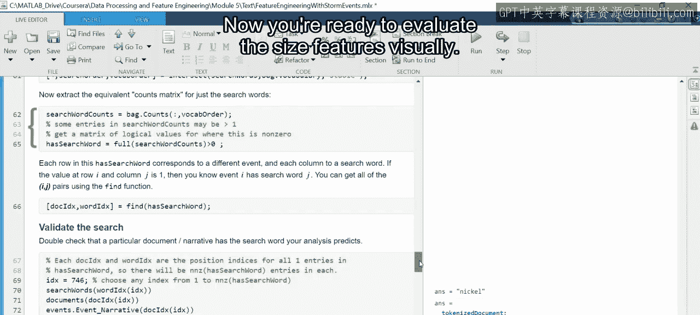

To start， let's assemble a table with costs and size descriptors from different events。

You can visualize this data with a box plot。Since the costs vary over several orders of magnitude。

 use a log10 scale。

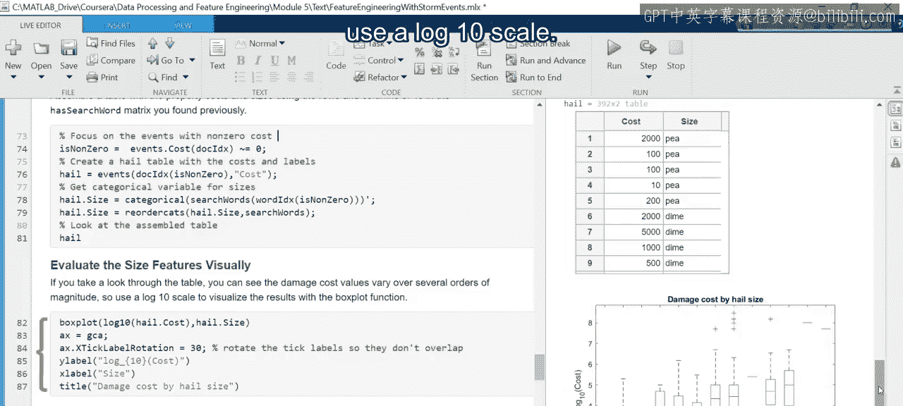

You can see a clear trend of increasing damage with size。But some groups only have a few data points。

 while other groups seem to have very similar distributions。Therefore， with this data。

 grouping the descriptors into small， medium， and large categories would help simplify the analysis。

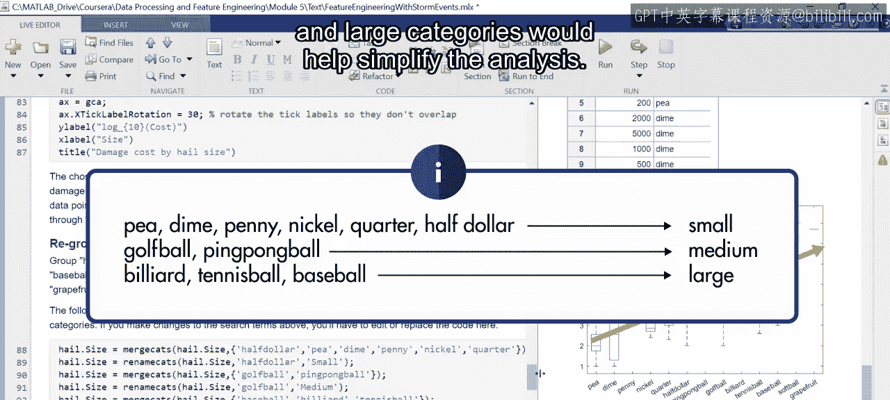

You can now evaluate the features more rigorously by performing pairwise and Nova tests within all the groups。

Based on this analysis， the medium and large categories are significantly different from small。

 but not each other。But wait a minute。There might be outliers biasing this analysis。

Let's remove outliers from each group。

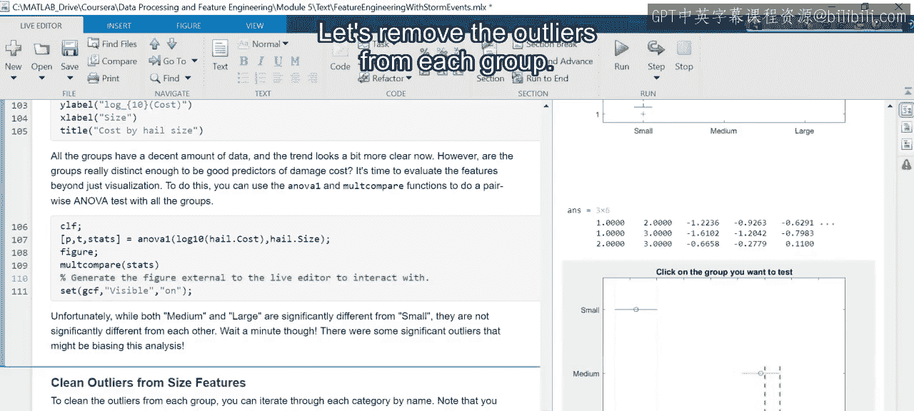

Now， all three sizes are significantly distinct predictors of damage cost。

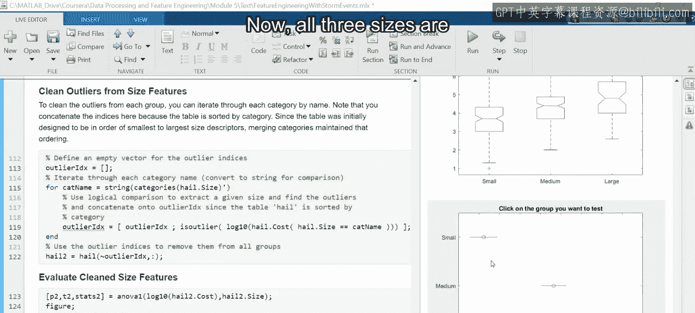

In this video， you walked through an example using the feature engineering workflow to process。

 explore， extract， and evaluate the new， more complex features。

You preprocess the data to identify multi word sequences as potential predictive features。

Then you evaluated the features using both visual and statistical tools such as box plots and AOva testing before restructuring and cleaning the features further to improve their predictive power。

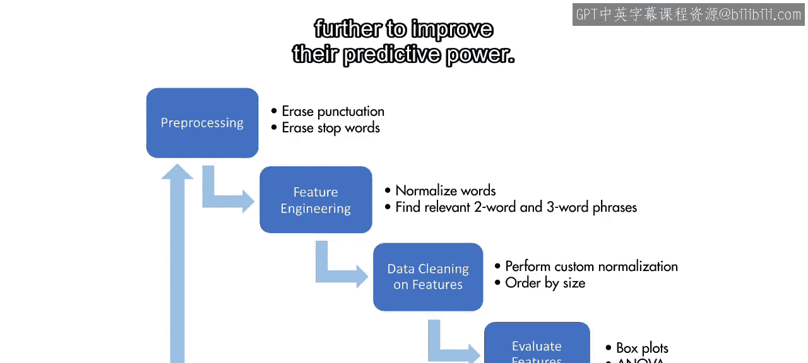

You might already have some ideas on how to expand upon the analysis done in this video。For example。

 how might you incorporate additional size information not provided using reference objects such as hail two inches in diameter？

You can use this script and the available storm data to explore this possibility and so many more。

Post your results in the forums to discuss with your peers and see what others have done。

