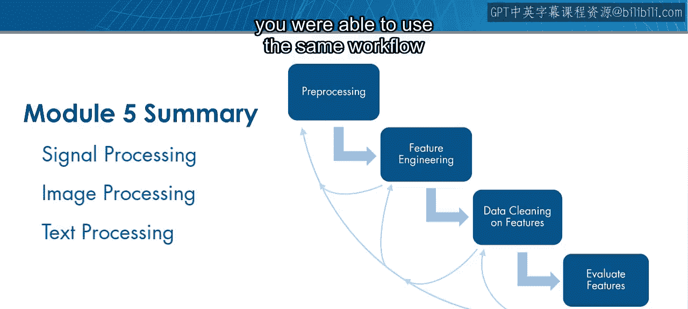
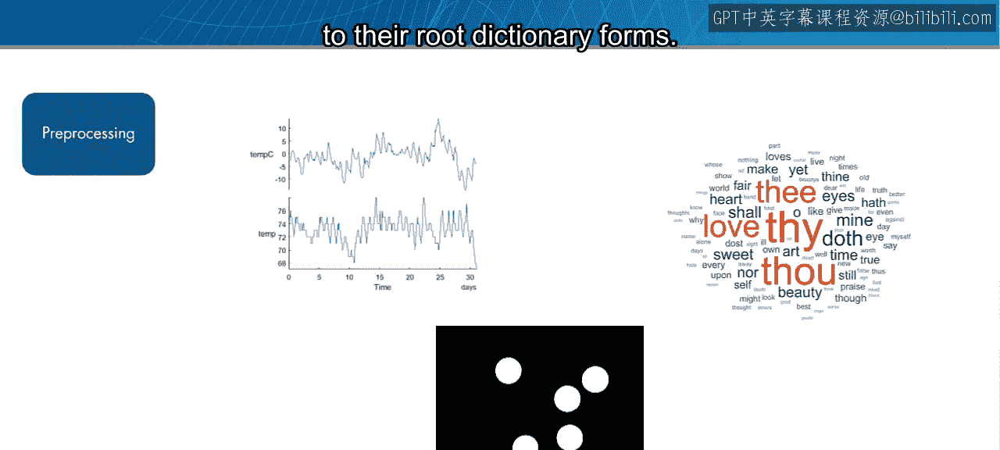
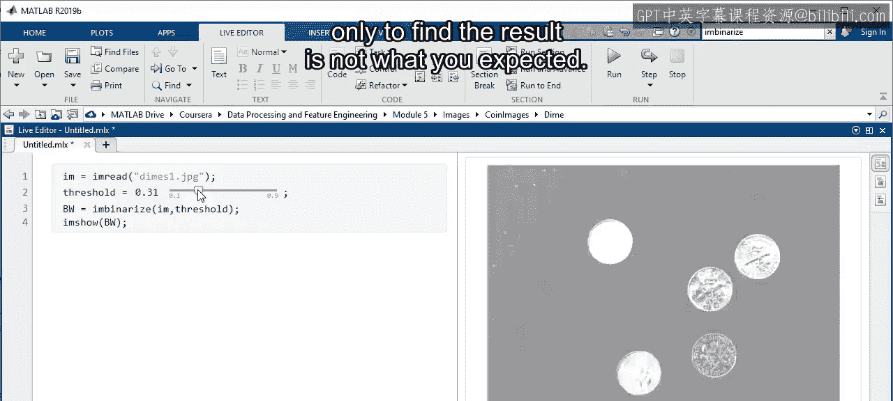
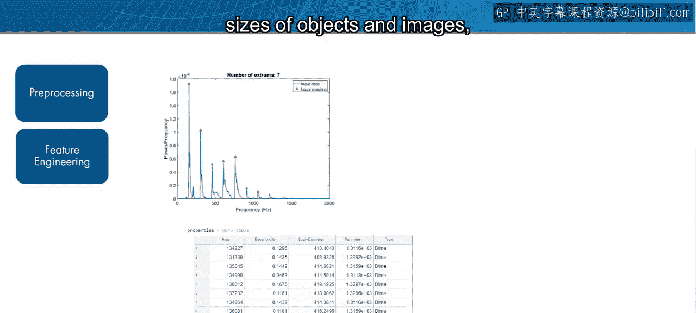
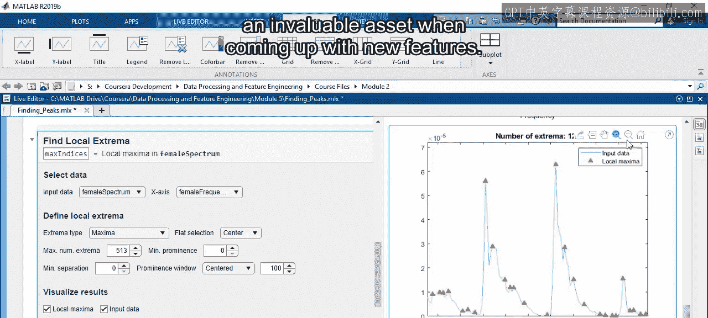
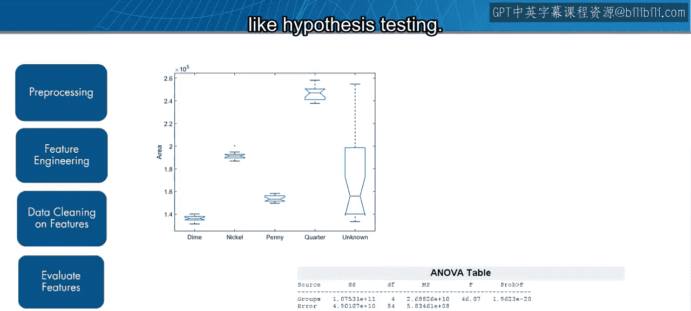
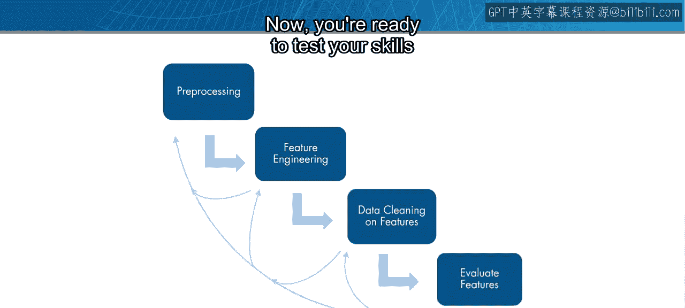
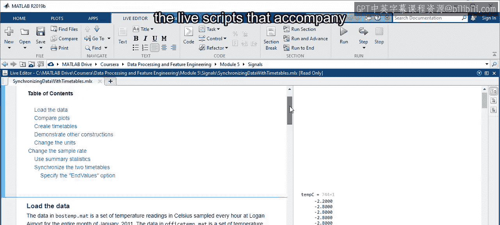

# Mathworks《实用数据科学与MATLAB（数据探索、特征工程、机器学习、毕业项目）｜Practical Data Science with MATLAB》 p83 43_模块5特定领域特征工程总结.zh_en [BV1Jr421w7wL_p83]

🎼，Well done， You now have new skills for domain specific feature engineering。Throughout this module。

 you explored different data types like signals， images， and text， all within a common framework。

Even though you were working with different types of data。

 you were able to use the same workflow to engineer useful features。

Each approach began with preprocessing the data。For example。

 you synchronize signals with different sample rates。

You segment in images by applying thresholds and morphological operations。

And you removed stop words from text， followed by normalizing the remaining words to their root dictionary forms。

Preprocessing is one of the more difficult and time consuming activities in data science。

 especially when working with new data。 you'll often try a series of steps only to find the result is not what you expected。

That's where interactive tools like apps and live editor tasks come in。

Use these tools to quickly try different approaches on one piece of data。

 then use the generated code to test the approach on the rest of the data。Next。

 you extracted features from the data such as prominent frequencies and signals。

 sizes of objects and images， and word counts and text。

Trying to find useful features in a new data set can be a daunting task。

 but remember that feature engineering is as much an art as it is a science。

Your own domain expertise is an invaluable asset when coming up with new features。

Finally， you cleaned and evaluated your features with filtering techniques like hypothesis testing。

This workflow is a general process that can help you engineer features in virtually any domain。

 and don't forget that is a highly iterative process。

 You should check your results after each step and loop back as necessary。😊。

Now you're ready to test your skills on some new data sets。

First， take a few minutes to review the live scripts that accompany the videos in this module。

 they include additional details and explanations for applying these concepts to new data。

When you're finished reviewing， take the quiz。 Good luck。

