# Mathworks《实用数据科学与MATLAB（数据探索、特征工程、机器学习、毕业项目）｜Practical Data Science with MATLAB》 p84 44_数据处理和特征工程总结.zh_en [BV1Jr421w7wL_p84]

🎼，Congratulations on reaching the end of data processing and feature engineering with MATL。

You now have new skills that you can apply not just to data science。

 but anytime you encounter messy data。Let's take a moment to look back at what you're able to do with your new skills。

Most real world data processing problems will involve data spread across multiple files。

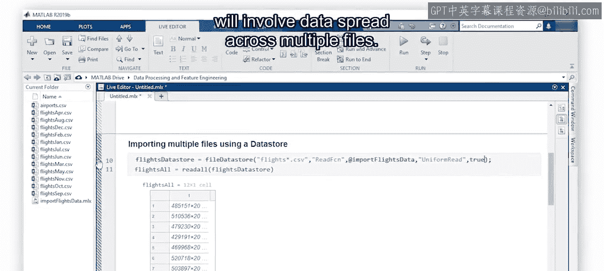

The files might be organized the same way， but separated by date， like the flights data。

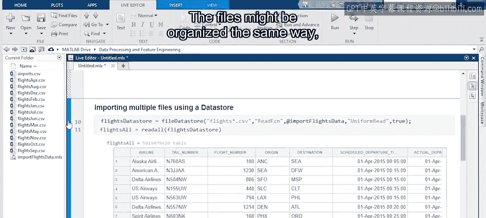

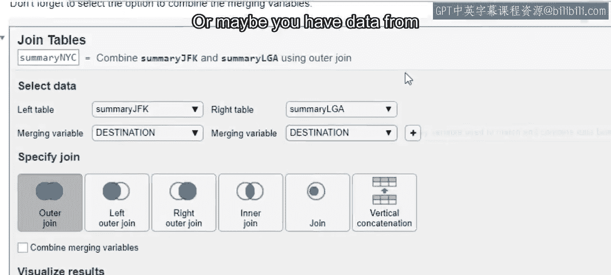

Or maybe you have data from different sources that share key variables。

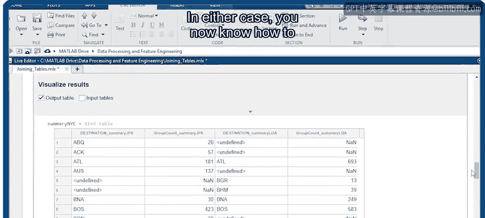

In either case， you now know how to combine and organize your data for further analysis。😡。

That analysis， however， might be difficult if you don't first clean your data。

Missing data and outliers。Can biass you results in visualizations。

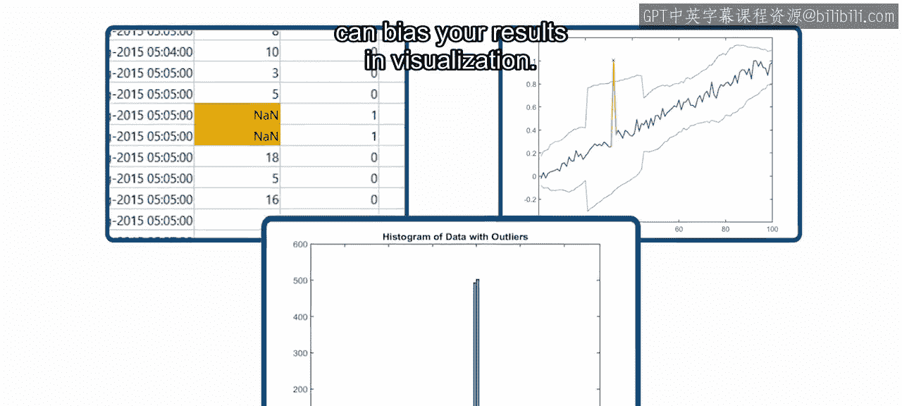

Noisy data may hide underlying trends。

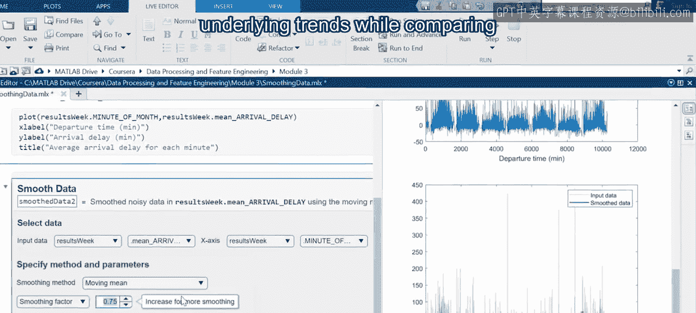

While comparing the importance of variables that have different scales is challenging。

Cleaning your data can be time consuming because you often need to test many different approaches。

You can now use tools like live Edit tasks， apps。And dedicated functions to quickly iterate and choose the method best suited to your application。

After you've cleaned the data。You can start creating new features。

And you now know how to apply different methods for doing just that。For example。

 you might apply an equation to existing variables。

Or use an unsupervised clustering algorithm to group the data。

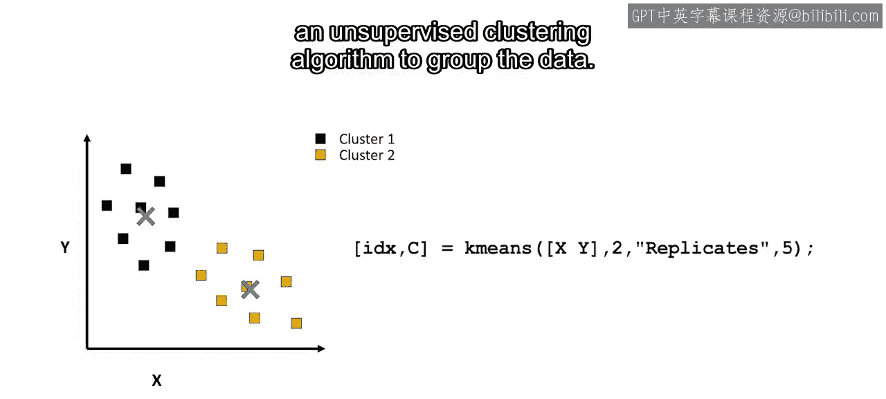

No matter the approach， you're looking for new features that better explain the variance in the observations。

Useful features can reduce time spent building predictive models and provide insight to why certain features matter。

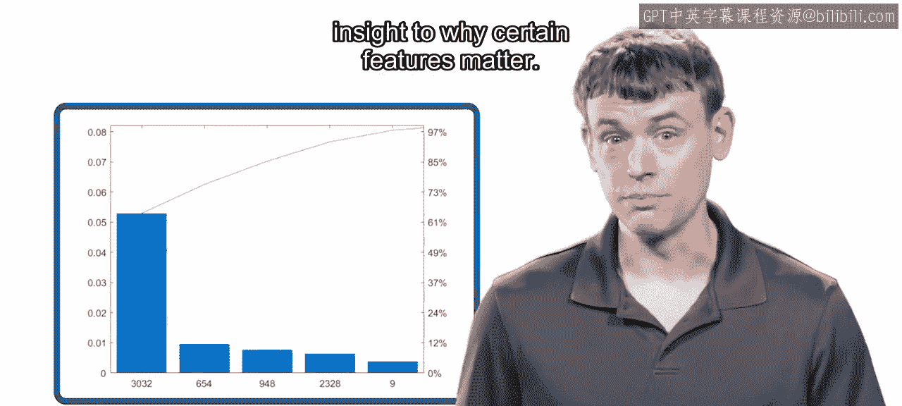

Finally， you saw all these concepts applied to several domain specific examples。

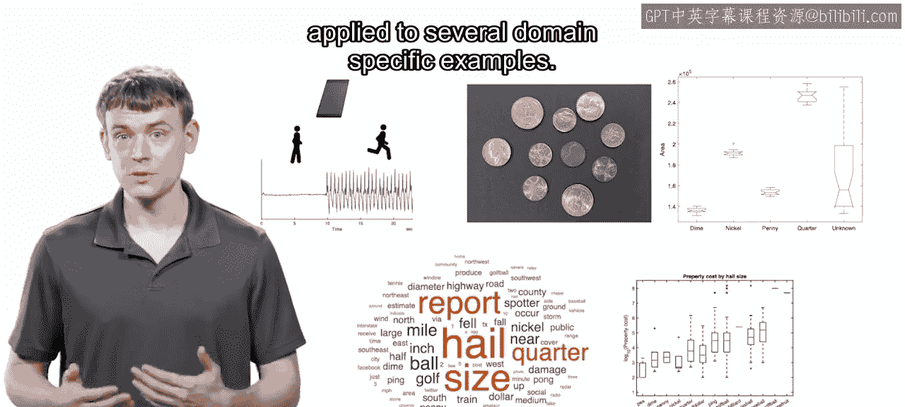

Though the details of working with signals， images and text differ。

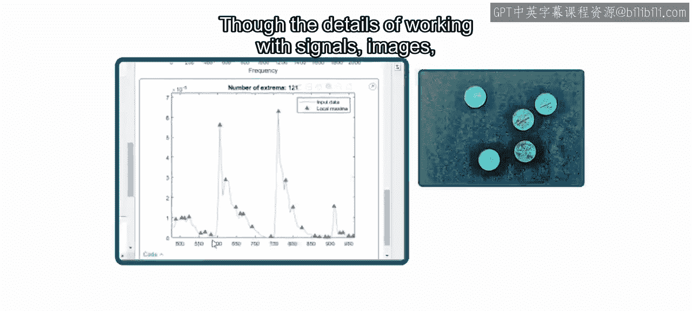

You saw that the overall feature engineering workflow stays the same。

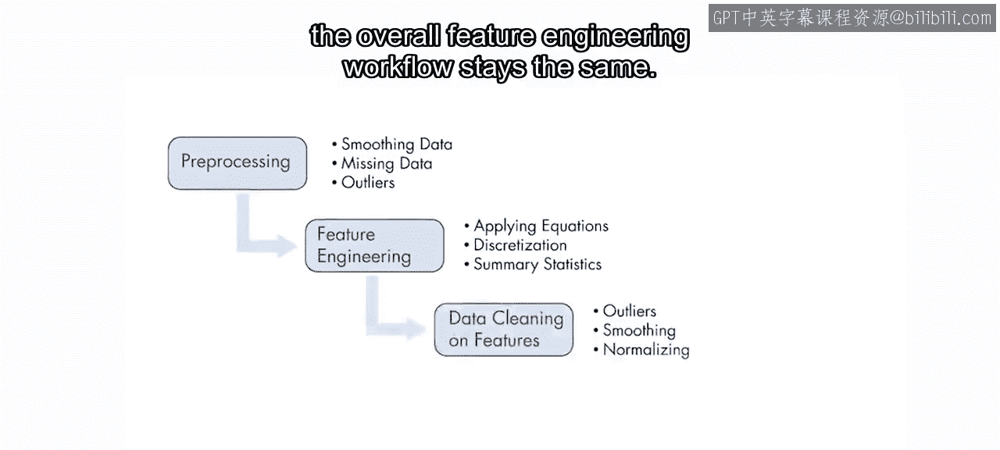

So what will you do next with these skills？

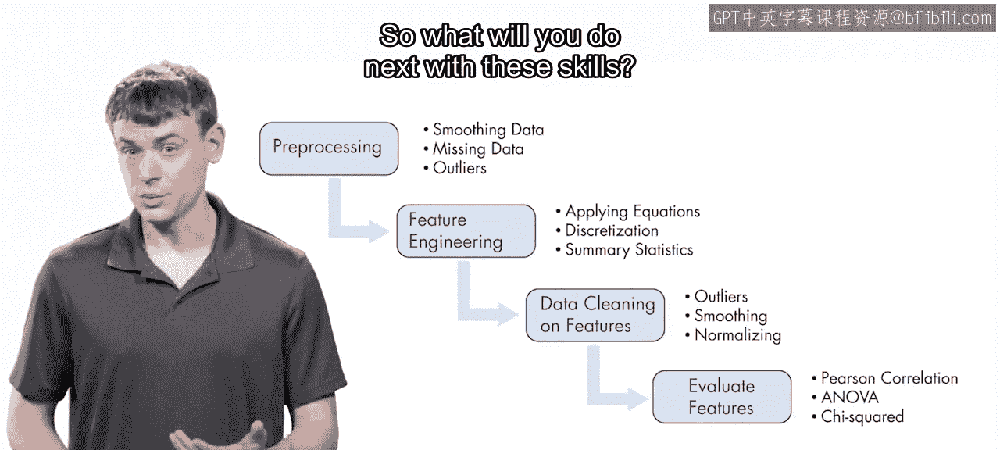

Let's ask Heather， who will be leading you through course 3。Heather， what topics are covered next？

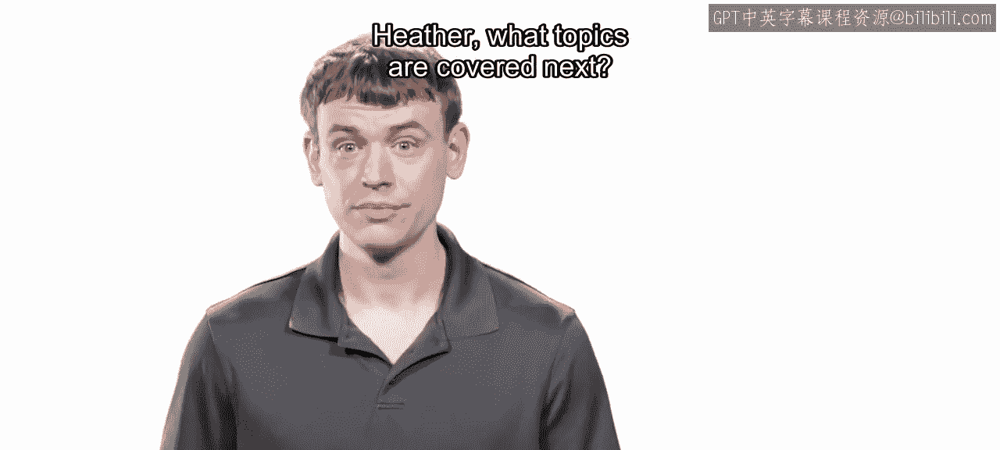

Thanks， Adam。Now that you've cleaned your data and created features。

 it's time to use those features for machine learning。😊，In this course。

 you use Ke means and other algorithms to cluster your data into groups。

This is called unsupervised machine learning because you provide only input data and let the algorithm cluster the data。

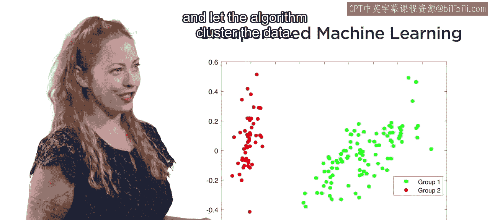

There are no right or wrong answers in unsupervised learning。

 and the goal is often to find hidden patterns and learn more about the underlying structure of the data。

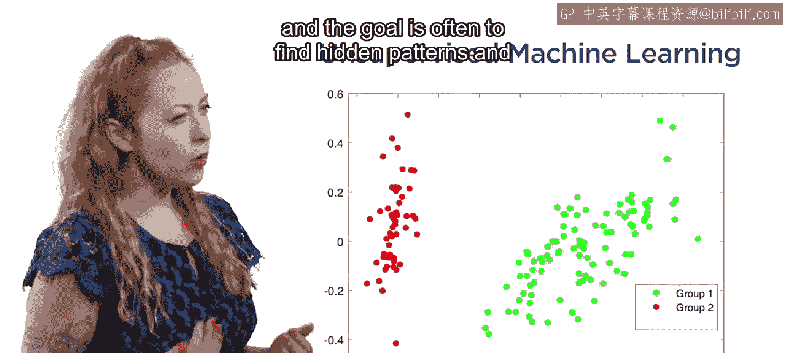

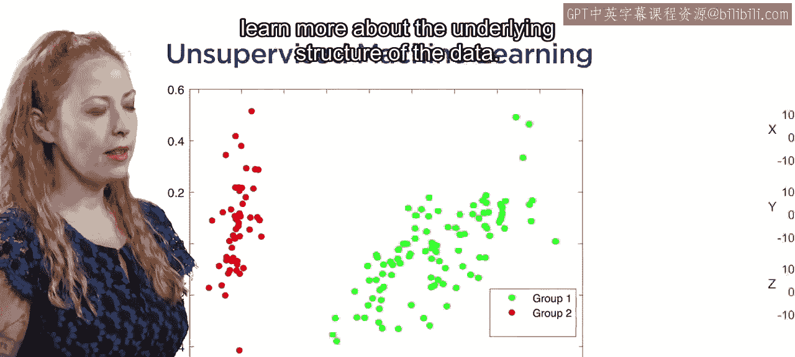

But consider a scenario where you have known outcomes like the cell phone sensor data。

In this situation， you want to use the information from labeled data to train a model that can correctly identify the activity。

This is known as supervised machine learning。The end goal in this example is to deploy the model onto a device that people can use to track their activity。

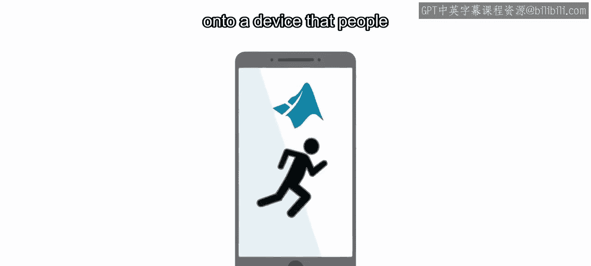

Join us for course three and learn how to apply supervised machine learning to your data。

You'll use apps to quickly apply different machine learning algorithms。

Then you evaluate the results and refine your models。

You'll also learn how to address common issues such as your model， not generalizing to new data。

I look forward to seeing you there。