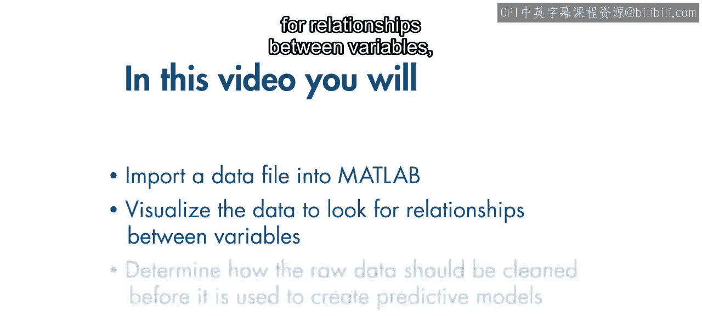
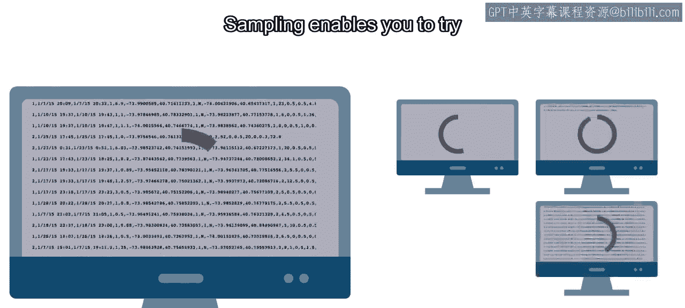
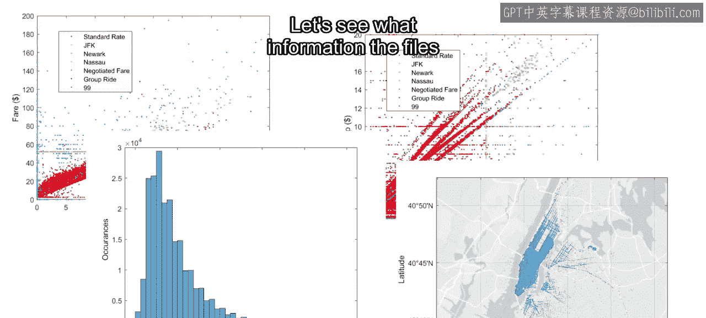
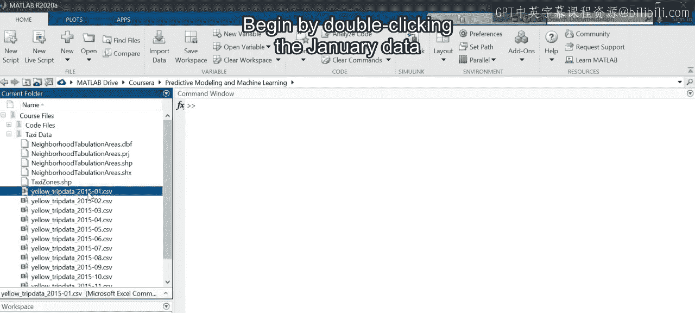
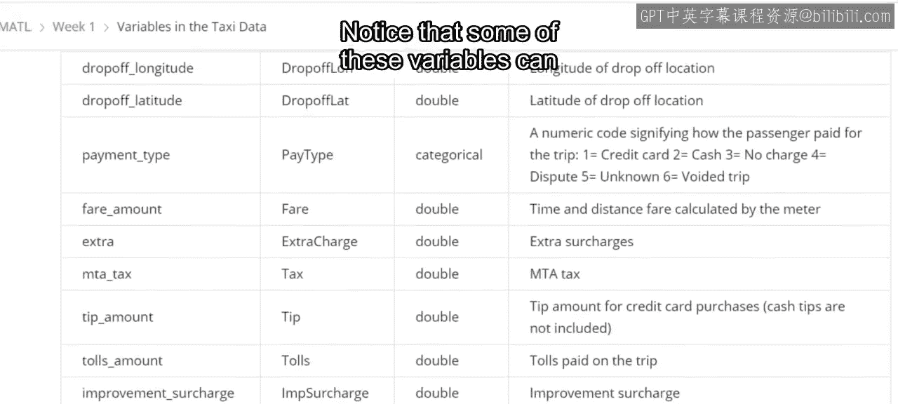
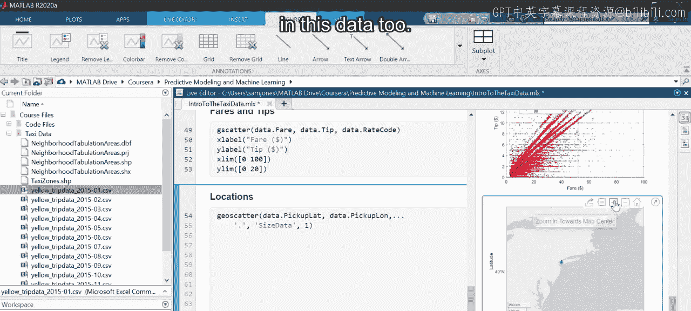

# Mathworks《实用数据科学与MATLAB（数据探索、特征工程、机器学习、毕业项目）｜Practical Data Science with MATLAB》 p88 3_出租车数据介绍.zh_en [BV1Jr421w7wL_p88]

🎼，The first step in any data science project is to understand the data。In this course。

 the primary data set is a sampling of the yellow cabides in New York City in 2015 from the New York City Tax Limousine Commission。

In this lesson， you will import a data file into MATLb。

Visualize the data to look for relationships between variables and determine how the raw data should be cleaned before it is used to create predictive models。

In 2015， passengers took nearly 300 million yellow cab rides in New York City。

Working with the complete data set for all these rides would require considerable time and computational resources。

In situations like this， it's common to work with a smaller sample data set。

Sampling enables you to try many different models and test parameters quickly。

The full data set can then be used to fine tune the model。

The 12 data files provided represent 2% of the total trips sample at random from each month。

Let's see what information the files contain by importing the data into MALb。

Begin by double clicking the January data file to open the import tool。

Many details are provided for each ride， including the pickup and drop off locations and times。

 the trip distance and the fare。Renaming some of the long or awkward variable names now will make typing them easier and less airprone。

For example， T pickup date time can be shortened to pickup time。

Recall that you change your variable name by clicking on it in the import tool。

Let's also give the other variables shorter， more descriptive names。

The reading following this video lists the original names in the data files and the names you'll be using in this course。

Notice that some of these variables can only take one of a few values。Rate code， for example。

 only takes the values 1 through6。Change the data type of rate code。

 vendor and pay type to categorical。That looks good， let's generate a script and explore the data。

Run the script to import the January taxi data into a table。Most of the variables。

 like date times for pickup and drop off are ready to use。However。

 the categorical variables all have numbers for category names。

A rate code of one is less intuitive than a category of standard fare。

Let's use the live editor to change these。Click the triangle next to the variable name and select editit categories。

Then change the category names from the number to the actual rate code。

You can find the list of rate codes in the reading following this video。

Now repeat the process for the pay type and vendor variables。

Click the update code button to make these changes part of the live script。Don't worry。

 you don't need to do these steps every time I functions are provided for you to use throughout the course。

Visualizing the data is a good way to quickly gain insight into the variables。 Intuly。

 you'd expect a relationship between the distance of a trip and the fare。

Let's check by creating a scatter plot of far as a function of distance。HThis strip of 3。

3 million miles seems unlikely， as that's about six trips to the moon and back。

 And the numerous negative fares are also suspicious。 The outliers are dominating the plot。

New York City measures roughly 40 miles north to south， and from the plot。

 it looks like most of the fares are less than $200。

Let's limit the x axis to between0 and 40 miles and the y axis to between 0 and $200。

That's interesting。 There appears to be three linear relationships。 One is horizontal。

 suggesting a fixed cost fare， independent of distance。

Could these be related to the different far types。Using a group scatter plot with rate code as a grouping variable should answer this。

The flat rate line corresponds to the JFK rate code category。

It looks like the other two linear relationships correspond to the standard rate and the Newark airport rate。

Just one plot has given quite an insight into the trends in the data set。

The scatter plot shows how the fares vary with trip distance。

 but what's the distribution of these two variables？

A histogram will show how often trips of each distance and each faire occur。Well。

 that 3 million mile trip to outer space is once again dominating the plot。

One way to deal with outliers in a histogram is to specify the bin edges as a second input argument。

Any points outside the bins will be left out of the plot。

Setting the bin edges to range from 0 to 10 miles in quarter mile intervals better reveals the distribution。

Most trips are less than two miles， but the many longer trips skew the data to the right。

Do the faires show the same trend。Let's make a histogram and C。

There are some very large fares in the data。 Most of the fares are fairly small。

 but there's a large spike away from the main group。Specify the bin edges。

 making sure to include that spike。Using $1 increments from 0 to 60 should get it。

The fair shows a skewed distribution similar to the distance histogram。

 but with a spike of nearly $5000 fares at $52。This corresponds to the horizontal line for the JFK rate code from the grouped scatter plot。

The fare is only part of the cost of a taxi trip， how much should the tip be？

Let's look at the tips as a function of the fair。It looks like there are some very generous tippers。

There are also some negative values which must be misrecorded data。Looking at the plot。

 it seems like $20 for the tip and $100 for the fare will capture most of the data。

Let's use those for the axes limits。Inesting， you can see many horizontal and vertical lines corresponding to fixed dollar amounts and diagonal lines corresponding to tips as a percentage of fare。

Let's try grouping the rate code again to see if that variable explains the behavior。

Most of the standard rate fares fall on the left side of the plot。

 and the special rate codes make up more of the higher fare rides。So far。

 you've only looked at the cost of cabides。Yellow cabs can pick up passengers anywhere in the city。

Is there a pattern in the pickup locations？Use a geocatter plot to visualize the locations。

Looks like there are some extreme outliers in this data， too。

Center the map on New York and zoom in。Wow， you can see an outline of Central Park。

Click update code and save these new bounds to the live script。

You've uncovered several trends and patterns in this data set。

 you've also found lots of outliers and incorrect values。

 like negative cost and impossibly large distances。

These need to be cleaned before using the data to make predictions。Later。

 you'll use what you've learned so far to clean the data and generate some useful features。Yeah。

