# Mathworks《实用数据科学与MATLAB（数据探索、特征工程、机器学习、毕业项目）｜Practical Data Science with MATLAB》 p89 4_创建和清理特征.zh_en [BV1Jr421w7wL_p89]

🎼，If you need to plan when to leave so that you arrive at your destination on time。

 you'll need to know how long the trip will take。A core feature of modern navigation software is predicting trip duration based on historical data such as pickup and drop off locations。

 route distance and time of day。In this video， you'll further explore the New York City taxi data to create and claim features for a predictive model。

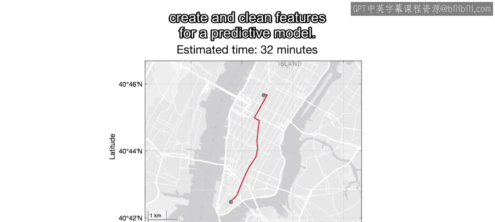

Recall that features such as route distance and pickup and drop off locations are already recorded。

You can calculate trip duration using the difference between drop off and pickup times and extract the time of day from the recorded pickup time。

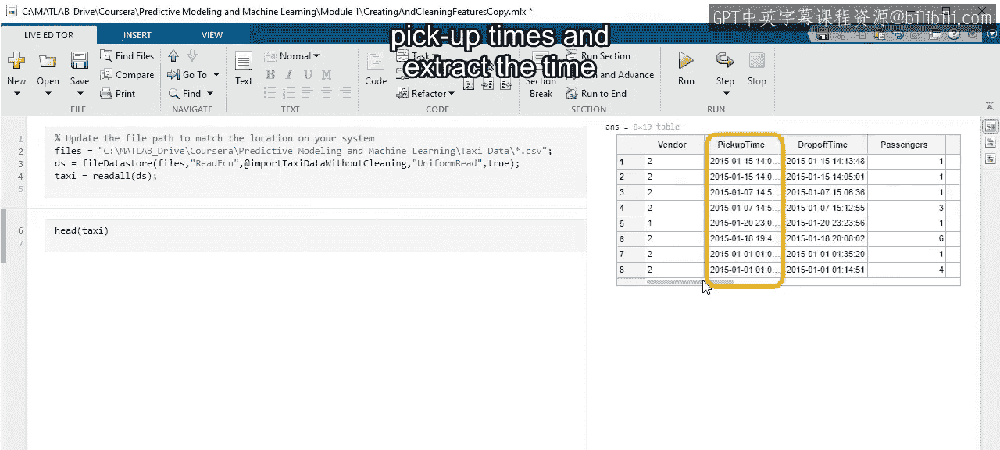

Don't forget， though， Real data is always messy。You'll want to clean the data since errors and outliers will interfere with your analysis and bias calculations。

Once you've cleaned the data， you can generate the new variables or features you need。

When you're done performing any additional cleaning that the new features require。

 you're ready to evaluate how well they work by training and testing predictive models。

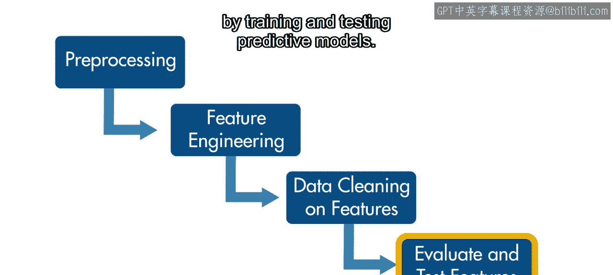

To begin cleaning， let's check how many undefined entries exist in the raw data by counting the number of nonze indices returned by theIs missing function。

In this case， there are no undefined values， but this doesn't mean there are no errorss。

Using the summary function， you can see that the distance data has entries of zero。

You know that these are errors since a trip distance of zero makes no sense。

 you can treat them as missing data。Calculating the percentage of data affected by these errors。

 you see that it is very small， less than 1%。Additionally。

 these entries seem to occur at random so you can safely remove them without biasing your analysis。

Using your domain knowledge， you could apply the same basic sanity check to other variables that should be either positive or non negative。

 such as number of passengers。Fair。Additional charges。And total charge。

Looking at the distribution of variables is a good way to identify outliers。

Let's start with the remaining distance data。It looks like some very large outliers are biasing the histogram visualization。

A box plot confirms that a few extreme outliers are present。

And that the bulk of the distribution is concentrated in much lower， more reasonable values。

You can also see that the distribution is heavily skewed。

 making many methods of outlier removal non ideal。For example。

 the standard intercorrtile range based boundaries would cut off everything above6 and a half miles。

If you remove this data， you'd be losing a significant number of completely reasonable trips。Instead。

 let's use the percentile function， PRRC tile to check where the boundaries that remove the top 0。

01% of the data is。Looks like this is about 40 miles， which seems like a reasonable upper limit。

 given the geographic size of New York City。Performing this cleaning using RM outliers gives you a much more reasonable distribution。

Now let's look at the pickup and drop off locations。Looking back at the summary results。

 you'll notice pickup locations with coordinates of0， which are on the equator and prime Merridian。

The same kind of thing shows up with drop offs。 These must be airs since taxis were not travelling across oceans。

Let's define a generous area around New York City to include only reasonable coordinates。

 say from 40 degrees to 42 degrees north and from 75 degrees to 73 degrees west。

To eliminate all the locations outside this area， use a single logical vector。

And then use this vector to index into the table。Let's create the logical vector now。

The pickup latitude must be greater than or equal to the lower boundary。

And less than or equal to the upper boundary。The same conditions must be met for the drop off latitudes。

So copy and paste the pickup conditions and edit them appropriately。Next。

 add the conditions for the pickup longitudes in the same way。

Don't forget to edit the boundary values as needed for longitude。Finally。

 repeat the process to add the drop off longitude conditions。

Now let's use the geoplot function to visualize the data in this region over a map。

 starting with the pickup locations。You'll need the latitudes and longitudes。

 And let's use a small marker size， since many of the locations will be very close together。

Based on pickup locations， it looks like you can cut the area down even more than you already have。

To visualize the drop off locations， copy and paste the code you just used and change the table variables to the drop off latitude and longitude。

Again， it looks like a smaller area around the city center will capture the data you need。

To find more precise boundaries， let's use a histogram and visualize the distribution of drop off latitudes。

Then add the pickup latitudes to the same figure。Along with a legend for reference。Something like 40。

6 to 40。9 degrees seems to capture just about everything。

Let's update the cleaning boundaries to these new values。Now。

 let's repeat this process with the longitudes。Copy the code you just used and edit the table variables to those for longitude。

The result is very similar。 This time， it looks like a longitude range of -74。2 to -73。

6 degrees captures essentially everything。 So let's update these boundaries as well。

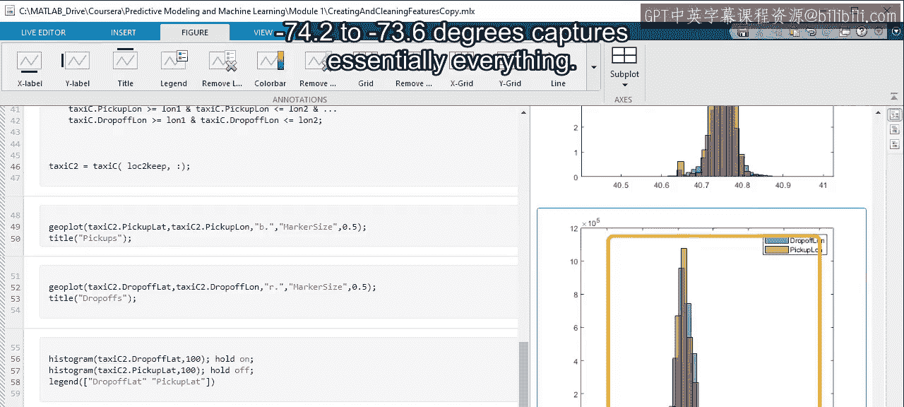

Rerunning the cleaning and map visualization code with these new bounds。

 you see that both the pickup locations and drop off locations look much more reasonable。

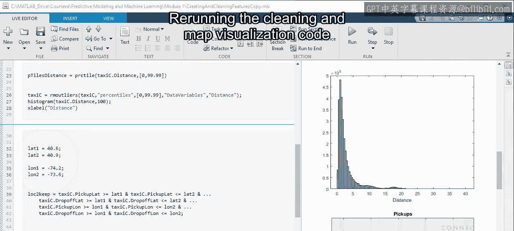

Finally， just to be careful， let's verify that the percentage of location data removed was not too high。

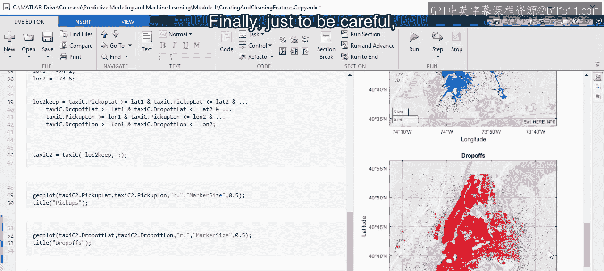

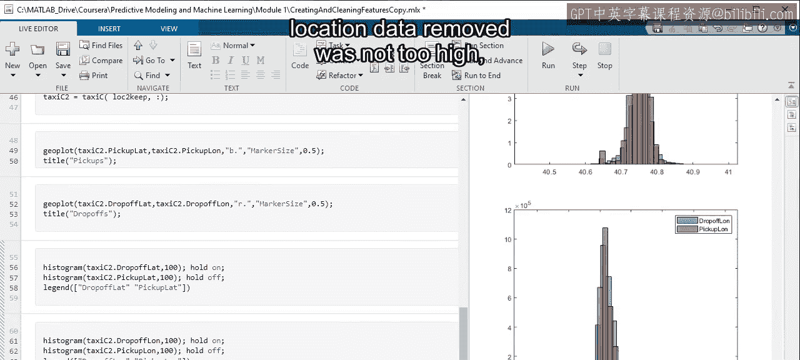

Less than 2%， it looks good。Now that you've cleaned the distance and location data。

 then the next variables you need to look at are trip duration and the time of day for the pickup。

Since these do not exist in the data， you need to create them。

 and you may need to clean them as well。

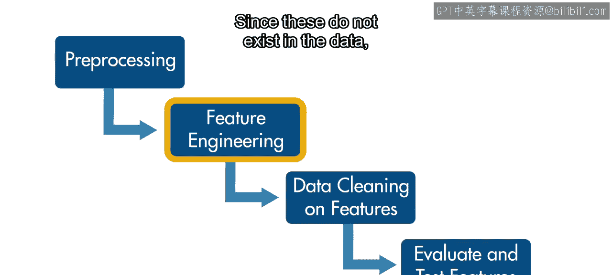

Extracting the time of day from the pickup date times is easy using Aly name time of day function。

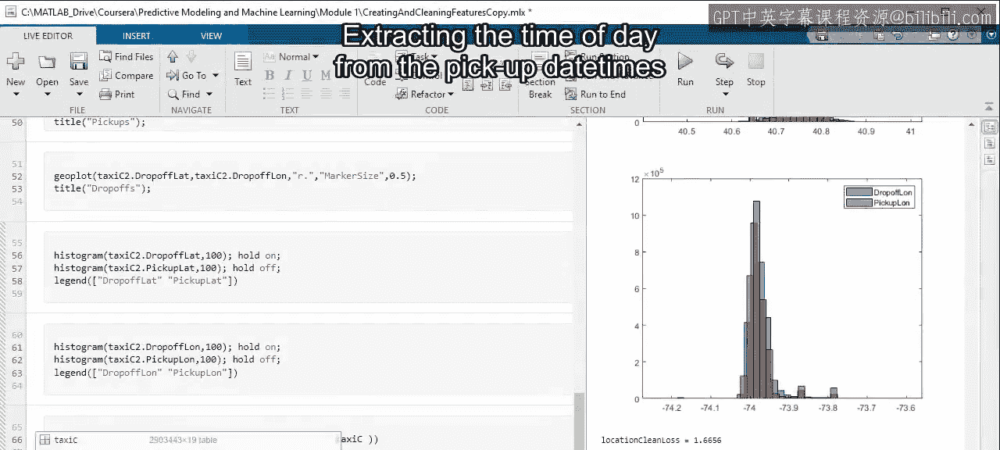

Viewing the distribution doesn't reveal anything unreasonable。

 so this feature doesn't seem to require additional cleaning。

Let's convert this duration variable to a numeric variable using the hours function。

 since that is what machine learning algorithms will need。Next。

 let's calculate the trip duration by taking the difference between the drop off times and pickup times。

Converting this from a duration data type to numerical minutes is done using yet another aly named function Min。

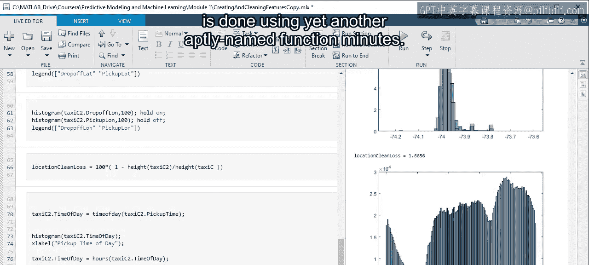

Now， let's look at the histogram of this feature。This time。

 the distribution clearly indicates the need for some cleaning。Nobody rode in a taxi for 10。

000 minutes or more。

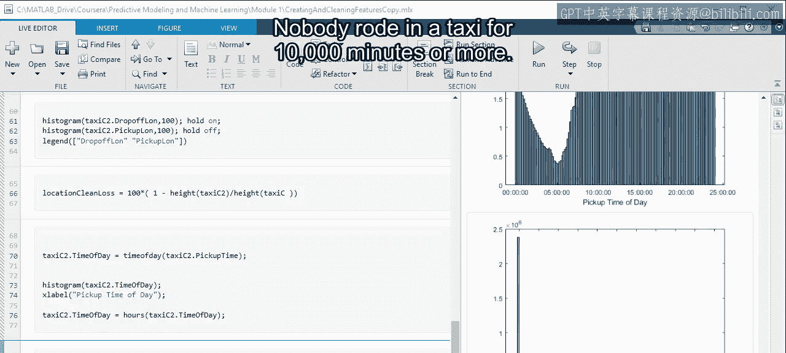

Based on these results， your next step is to clean this feature。In general。

 cleaning a new feature is often necessary， even if the variables used to calculate it don't seem to have abnormalities by themselves。

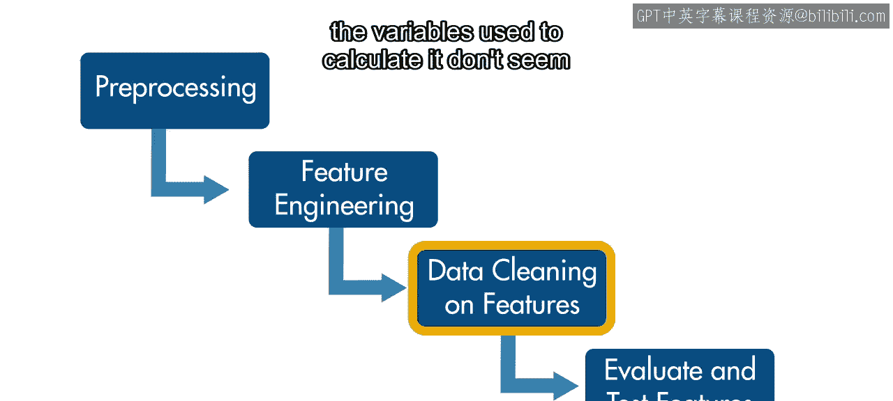

Again， start off with some basic sanity cleaning。 The trip duration must be positive。

And certainly much less than a full day。Double checking the percentage of data cleaned。

 You see this removes essentially nothing。However， zero minutes to a full day is still an unreasonably wide range。

Try calculating the boundaries that evenly remove 1% total from the top and bottom using the PRRC tile function。

About a minute and a half up to almost an hour and 10 minutes seems reasonable。Finally。

 revisualize the distribution。

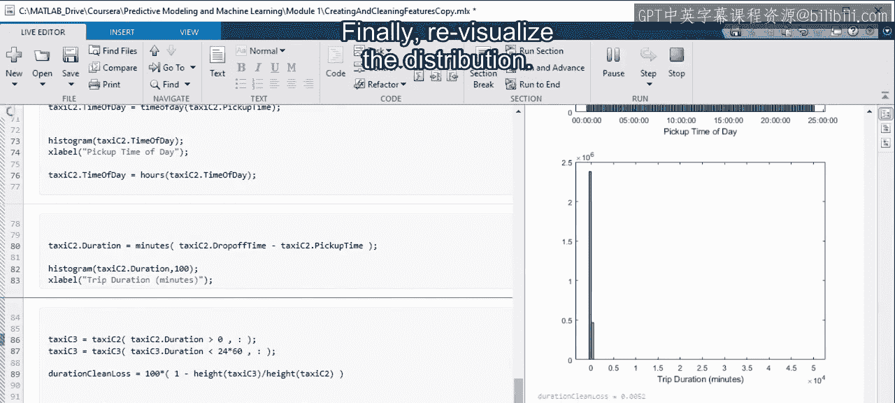

It looks much more realistic now。At this point， you're ready to start evaluating how well the features you've chosen would work by training and testing predictive models。

Don't forget， feature engineering is an iterative process。

You may need to return to previous steps to perform additional cleaning or calculate new features to enhance your models。

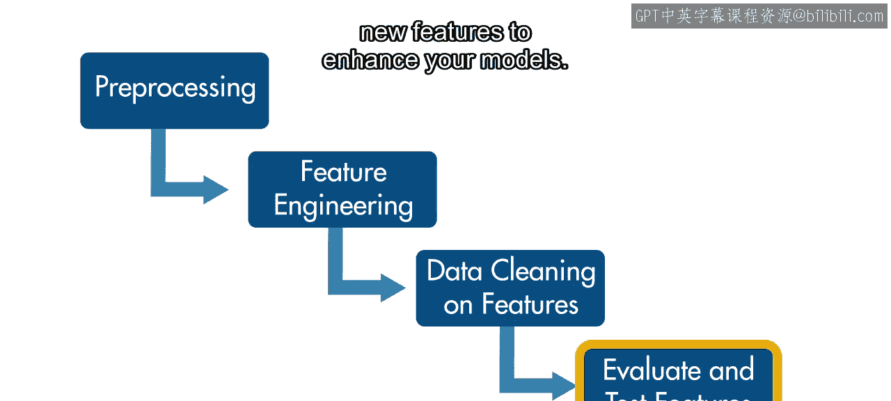