# Mathworks《实用数据科学与MATLAB（数据探索、特征工程、机器学习、毕业项目）｜Practical Data Science with MATLAB》 p91 6_使用回归学习器应用程序.zh_en [BV1Jr421w7wL_p91]

🎼，In this video， you will practice implementing regression models to predict the duration of taxi trips in New York City。

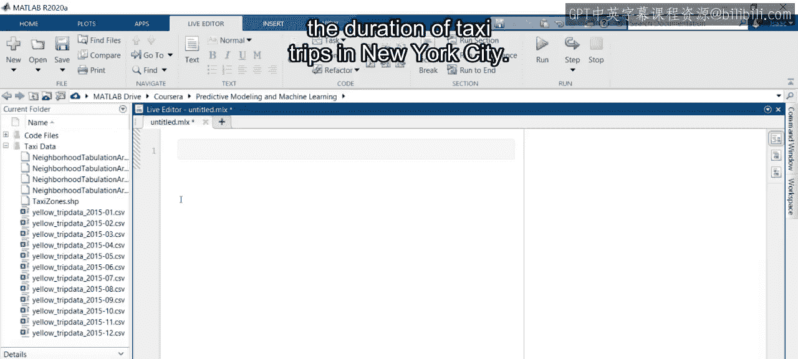

Several regression models are available， so how do you know which one you should use？

It's usually not possible to know in advance which one will be most appropriate。

 so you'll need to test a few different approaches。

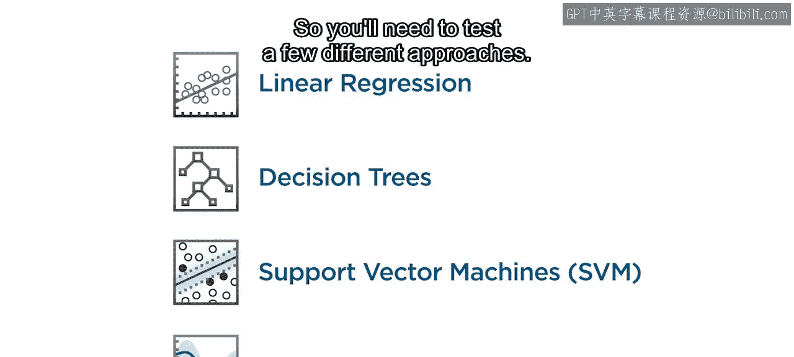

The regression learner app enables you to quickly train models for this purpose。

 It assists in the entire process from selecting data to exporting a trained model。

The tasks of selecting， training， and assessing models are iterative。

This exploration process is the strength of the app workflow。

 which lets you quickly test models and compare the results。

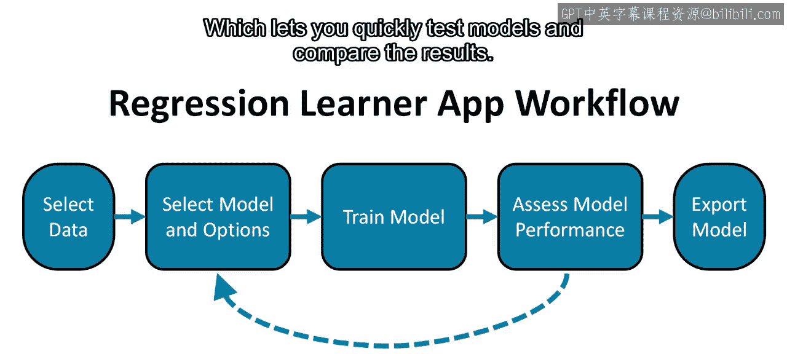

To follow along， first import the taxi data into myLb。

Use the custom import function included with a data set to import the month of May。

The duration of a trip is likely dependent on the time of day。

 So let's add it as a new feature to account for potential variations in traffic conditions。

The function named add time of day performs this feature extraction for you and is provided in the course files。

As you can see， it creates a new variable named time of day。

 which is a continuous number between 0 and 24 that represents the hour the trip began。

You're now ready to model the taxi data using the regressionion learner app。

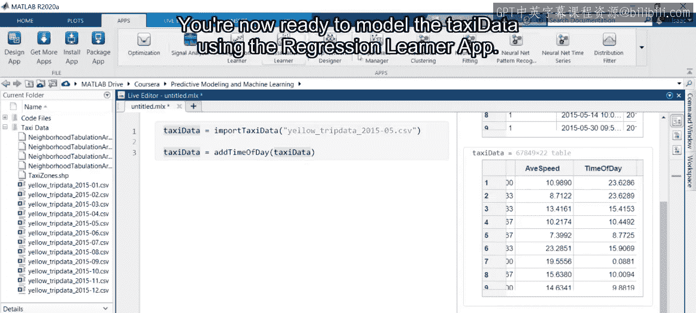

The first step in the app workflow is to select the data you'll model。

Start by clicking the New session button。This opens a window and prompts you to select the data set to use。

Select the taxi data from the first drop down list。Next。

 you'll need to specify which feature is the response variable that you want to predict。

 which in this case is the trip duration。Next you'll select the predictor variables。

There are many to choose from， but not all of them are useful in predicting the response variable。

For example， a trips duration is unlikely to depend on the number of passengers。

Let's start simple and choose two possible predictor variables， distance and time of day。Finally。

 you'd normally use validation during training， but you'll learn about this technique later in the course。

 so for now select no validationation and click Start session to return to the app。

Now that you've loaded the taxi data and selected predictor and response variables。

 you can start exploring models and comparing their results。

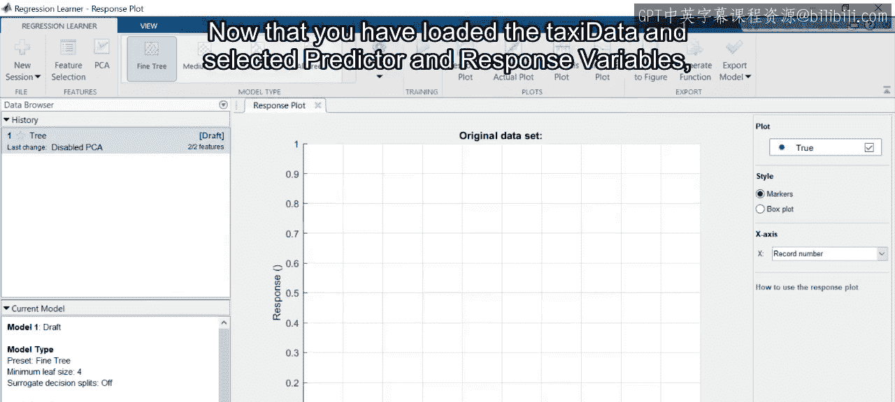

But first， take a moment to orient yourself within the app。

 There are several tools you'll use to train and assess your models， including the top tool strip。

A data browser with the history and details of your models。And a visualization window in the center。

The default visualization is called the response plot。

 which plots the response variable in this case duration on the Y axis。Notice that by default。

 the X axis is record number， meaning the row number each data point belongs to in the original table。

You can change the X axis to a predictor variable such as distance。

 using the drop down list to the right of the plot。At any point during your exploration。

 you can specify a different combination of predictors to include in the model using the feature selection options。

Additionally， if you have many features， you can perform principal component analysis inside the app to test feature sets with reduced dimensionality。

For this application， let's see if just the single variable distance is enough to accurately model a trip's duration。

Now you're ready to begin the process of iteratively selecting， training， and assessing models。

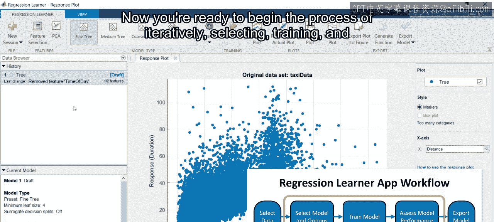

In the tool strip， you can choose which regression models to train。

The models are grouped with each type offering multiple default options。

Basic linear regression is generally a fast and simple model to train。So select linear from the list。

Then clickT to produce your first regression model。

Notice that the plot has added yellow markers representing the model's predicted values for duration。

You'll also notice that information regarding the new model has appeared in the current model browser in the lower left。

This area shows important information about the model， such as performance metrics。

 the model specific options that were used， and the features that were included。

Several other visualizations are available in the tool stripip to help you analyze your new model。

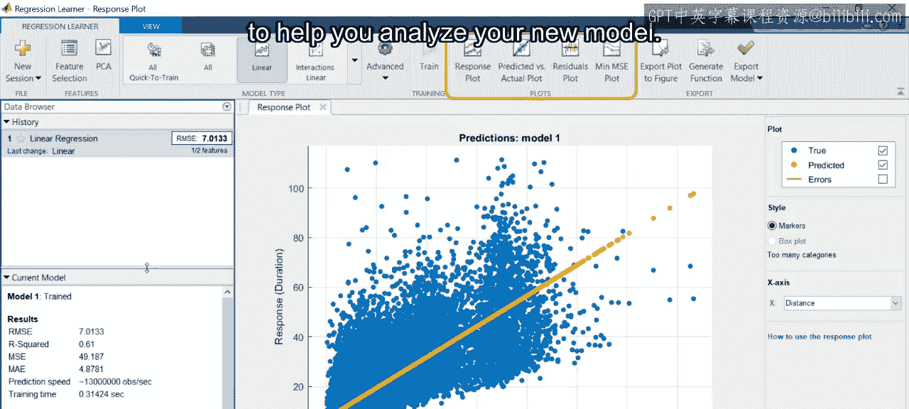

The next one is called the predicted versus actual plot。

 and it is useful in determining if any response values are poorly modeled。Here。

 the response variable of trip duration is shown along both axes。

The X axis represents the true value from the dataset。

While the Y axis represents the predicted value from the model。Therefore。

 the residual for each data point is the vertical distance from the black line。

But what if you wanted to know how the model's residuals depend on each variable？To find out。

 select the next visualization， the residuals plot。By default。

 the X axis is the same as the previous plot， while the y axis now represents the residual for each observation。

However， the X axis can be changed to visualize how residuals depend on different predictor variables as well。

 For instance， by selecting the X axis to be a predictor and choosing time of day。

 you can see that residuals have some dependence on the trip's departure time。

Most apparent is that the early morning hours tend to have overestimated durations。

So let's see if the results can be improved by adding the time of day variable to the model using the feature selection button。

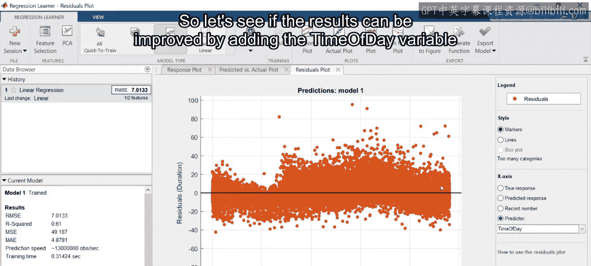

Since the new model hasn't been trained yet， the residual plot appears blank。

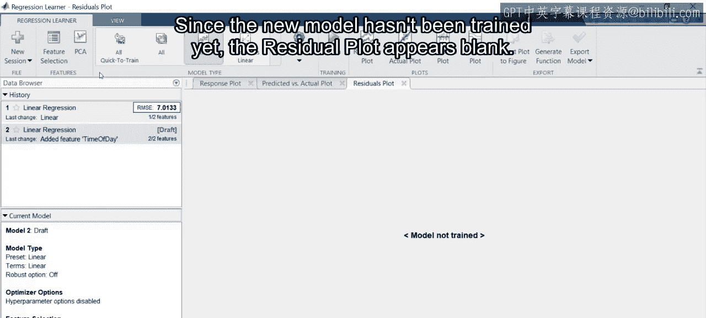

For now， return to the response plot。Previously， you trained just a single linear regression model。

 but the app also allows you to train multiple at once。In the model menu。

 the top two choices are all quick to train and all。All trains every model in this list。

This includes the more advanced algorithms like SVM and Gaussian process regression。

 so training all can potentially take hours to complete for large data sets。

The option all quick to train， trains only the quickest models， specifically linear regression。

 as well as a few regression trees。Select this option and click the button to begin training。

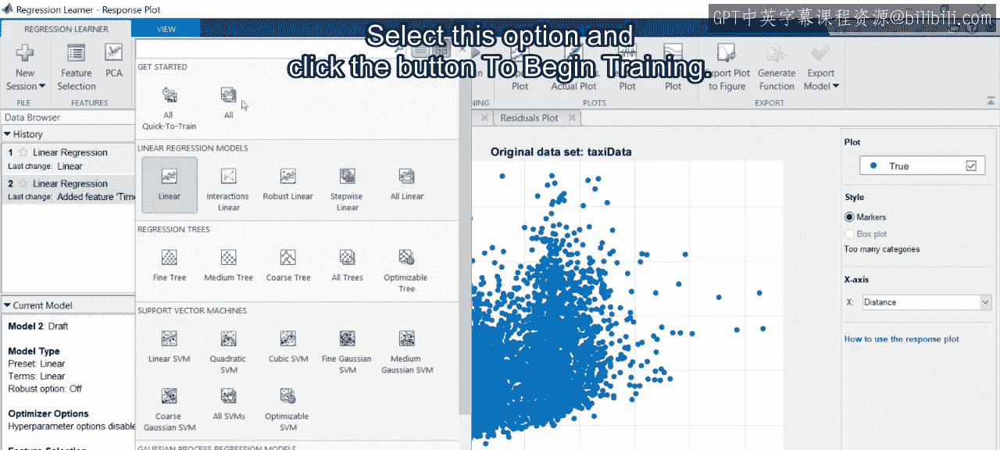

The entire process may take several minutes to complete， depending on your computer。

So did adding time of day improve upon your previous model？In order to make a comparison。

 you can review several metrics that are shown in the current model browser。

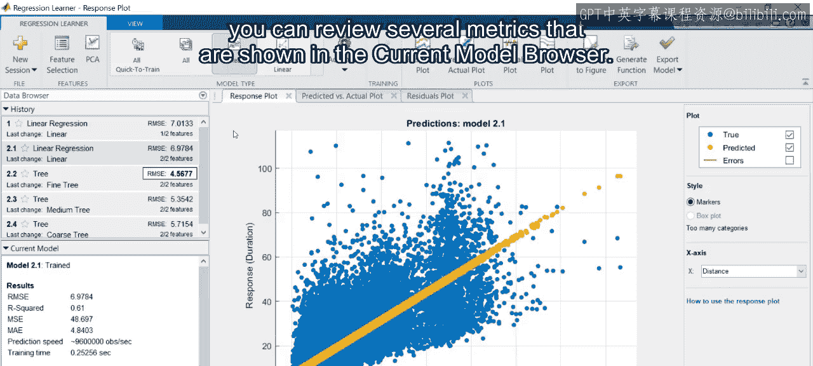

For instance， there is the mean squared error， which is minimized during the training process of linear regression。

It is also common to compare the square root of this value called the root mean squared error or RMSE for short。

 which you'll notice is presented for quick reference in the history browser。

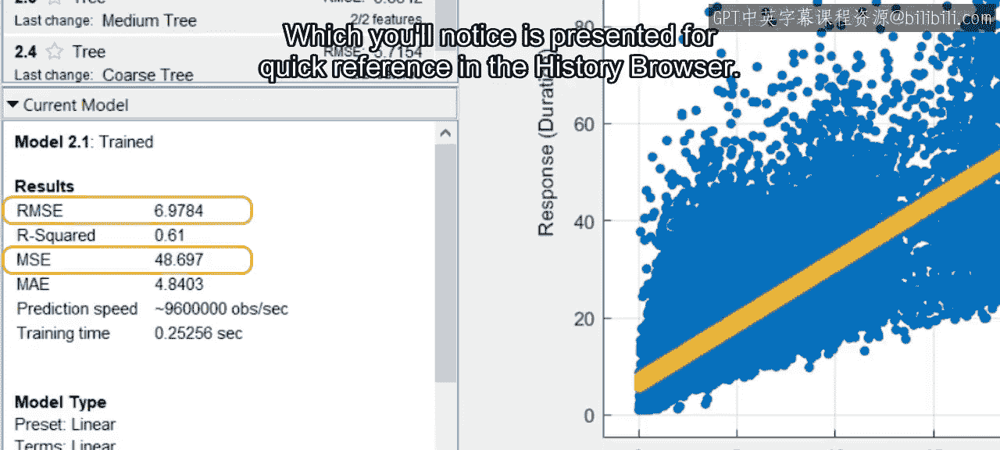

In the end， it looks like adding the time of day variable only slightly improved linear regressions root mean squared error。

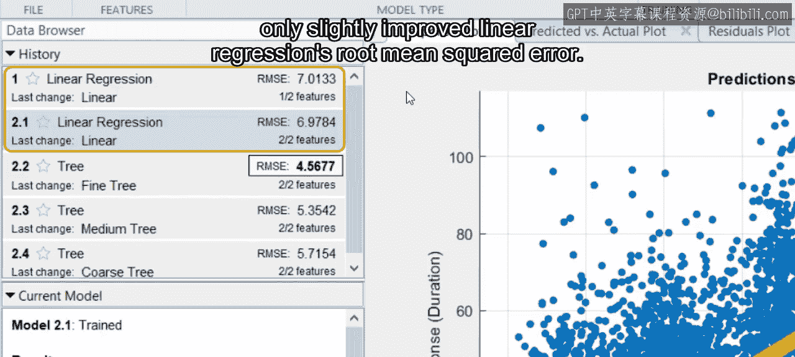

The tree models， however， perform significantly better。

Each tree model follows the same process of iteratively making splits based on the predictor values in order to divide your data into groups with similar response values。

The difference between the fine， medium， and coarse trees is the predefined minimum number of observations in a single leaf。

You can see this value reported in the current model browser。For a fine tree。

 the minimum leaf size is4。While for a course tree is 36， which means there are fewer leaves total。

But what if you need to make an even coarser tree than the default course option？

All models have advanced options that you can customize。For regression trees。

 these include an option for setting your own minimal leaf size。

After you create regression models interactively in the regression learner app。

 you can save the best model by exporting it。There are two ways to do this。

 you can either export the train model or you can save the algorithm used to train the model。First。

 let's export the trained model。This approach lets you access the model from a script to make predictions。

Choose the F tree regression model and select this option。

This saves the model as its own variable in the MATLb workspace。

 so you'll need to give this variable a name。

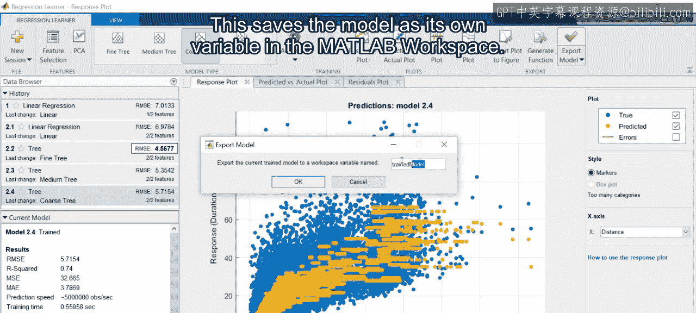

You can now see the model in your MALb workspace。It is listed here as being of type structure。

Which is a data type that can be accessed like a table using the period notation。For example。

 if you type the model's name， you'll see an auto completed list of available variables。

The one labeled regression tree is where the exported model is stored。

You can then go deeper into the model with a second period。Essentially。

 all the data that was in the app is now stored in this MATLb Workspace variable。For instance。

 if you select the variable X and execute the script。

 you'll see a table of the regression tree's predictor variables in this case。

 distance and time of day。Similarly， the variable y holds the trip durationian response values。

Later you'll learn how to use a trained model to make predictions from new data， but for now。

 what if instead of saving the trained model， you wanted to retrain a new one using a different data set without repeating all the steps you took in the app。

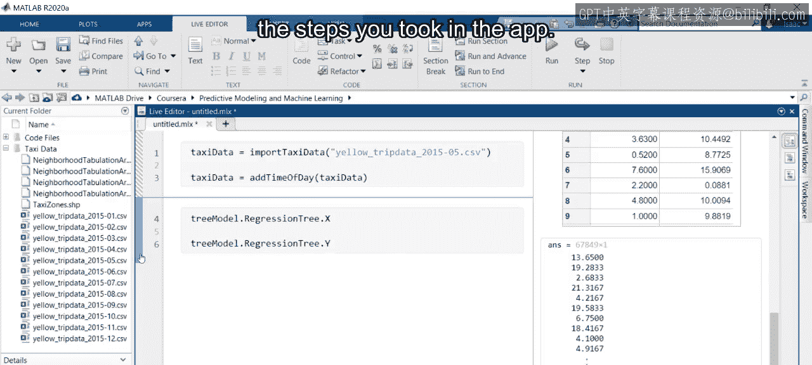

This is where the app's second export option is useful。With this option。

 you generate a function that saves the model's training process as opposed to the train model itself。

Select this option now to create a new function。

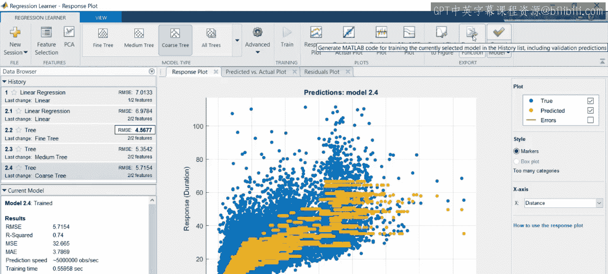

This opens a new file in MATLb here， comments are automatically provided to document how the function should be used。

 while the code section recreates the exact steps taken by the app to train the model。

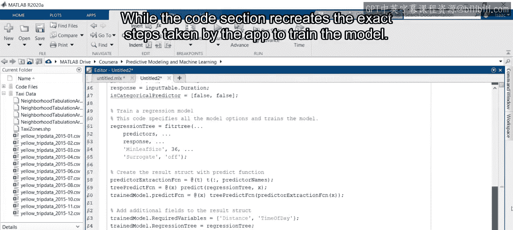

In this video， you use the regression learner app workflow to iteratively select， train。

 and assess multiple regression models in order to predict a taxi trip duration。Later。

 you'll learn how to use a train model to make predictions with new data。

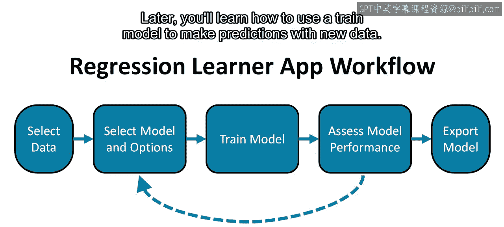

🎼。