# Mathworks《实用数据科学与MATLAB（数据探索、特征工程、机器学习、毕业项目）｜Practical Data Science with MATLAB》 p92 7_自定义模型参数.zh_en [BV1Jr421w7wL_p92]

🎼，You've now tried out different models in the regression learner app and found a promising approach。

But how do you customize the model to get the best performance。For example。

 you might improve a linear regression model of taxi trip duration by adding higher order polynomial terms。

To adjust model parameters， you'll need to implement the model with code so you can access additional options that aren't available in the app。

In this video， you'll use the same workflow to create linear regression and regression tree models。

First， you'll train a model using data in a table。Next。

 you'll inspect the train model and predict values with the training data。Finally。

 you'll customize some model parameters to tune the performance。By the end of this video。

 you'll be able to implement your own customized regression model in a live script。

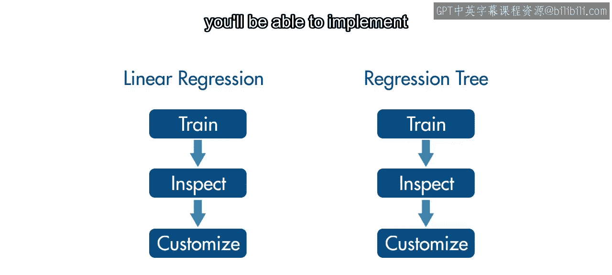

Let's start by importing one month of taxi data。And add some extra features， such as the trip。

 time of day。The goal is to train a model like the one you've already seen that predicts the trip duration。

To fit a linear regression model， use the fit LM function。

Start by entering the table of taxi data as the first argument and the type of model as the second argument。

For now， use the string linear as the model type。Next。

 specify the response variable and the predictor variables with name value pairs， as shown here。

Several good choices for predictors are available， but let's start with the distance in time of day variables。

After you run this code， you'll see lots of information about the model。

At the top is an expression describing the model with the variable names。

The one here refers to the interceptor。Below that is more information about fit coefficients and statistics。

For example， the coefficient estimate for distance is positive。

Implying that distance and duration are positively correlated。To inspect this output in more detail。

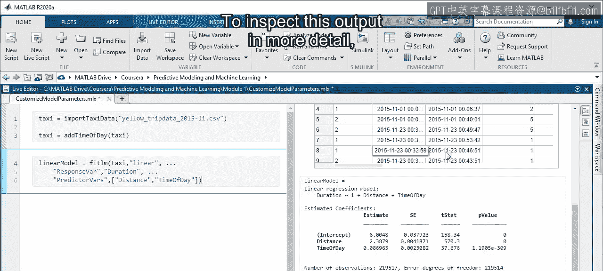

Double click the model variable in the workspace。You can see multiple properties with different types of information。

You can access these properties in the script using dot notation。

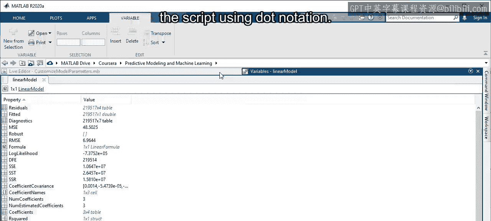

For example， to see information about the fit coefficients， type linear model dot coefficients。

This is a table with the same estimates and statistics displayed in the fit LM output。

You could use these coefficients to calculate the predicted duration values。

 but it's easier to do so with a function named， predict。The first input should be the trained model。

 and second input should be a table of data with column names that match the training data。For now。

 let's use the training data itself。 The output is a vector of response predictions。

 which in this case， are trip durations in minutes。

Let's see how these predictions compare to the actual response by adding a scatter plot with time of day on the X axis。

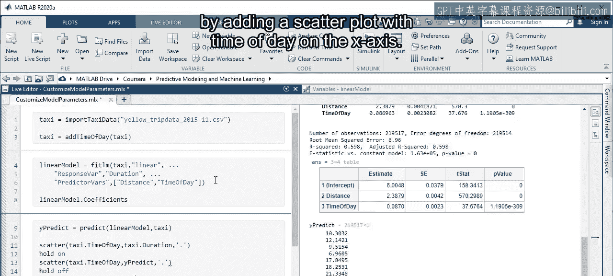

You can see a significant amount of overlap between the predicted and actual points。

But the predicted durations in the middle of the day aren't much different from those in other parts of the day when they should be lower。

Let's try to improve this model by customizing it。

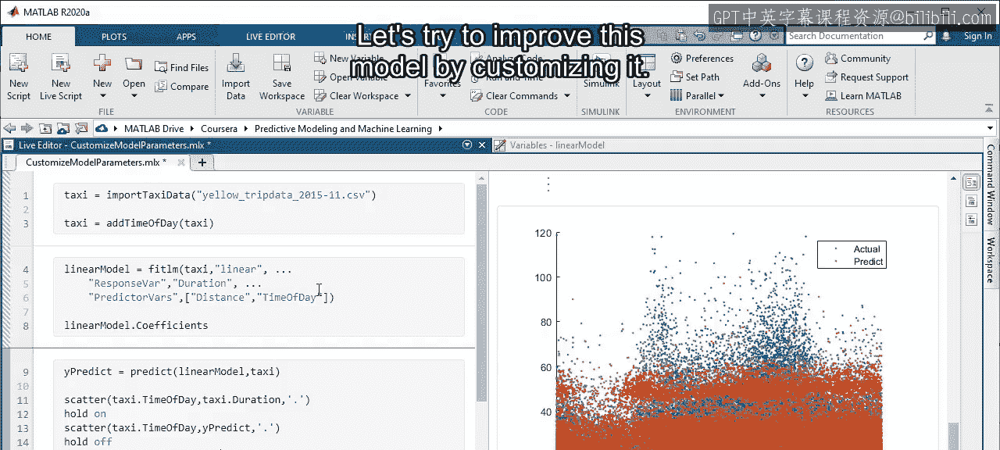

In addition to the linear option， there are other choices you can see here。

 such as interactions or quadratic。Since the duration can go up and down throughout the day。

 it's probably a good idea to customize the model further to include higher order terms。

For polynomial regression， use the string poly， followed by a series of integers that specify the order of the polynomial for each predictor。

So type polyly 14。To have a first order term for distance in terms up to fourth order for time of day。

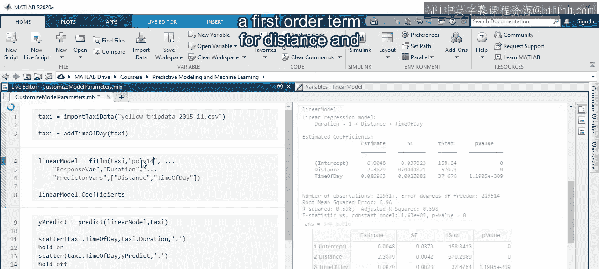

You can now see the fourth order term in the output。

 along with the lower order terms and interactions。When you rerun this section with the scatter plot。

 you can see that the predictions have improved。Now。

 the model predicts lower durations in the early morning and late at night。

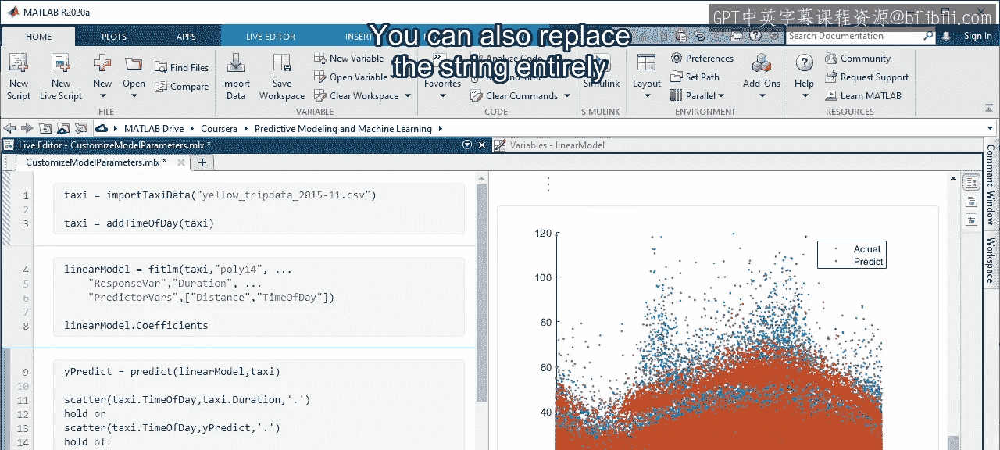

You can also replace this string entirely with an expression in the format shown earlier。

You don't need to include the response and predictor options since the variables are explicitly specified in the expression。

This format is known as Wilkinson notation， and it's very flexible。For instance。

 you can recreate the polynomial model with interactions by raising time of day to the fourth power and then multiplying the two variables together。

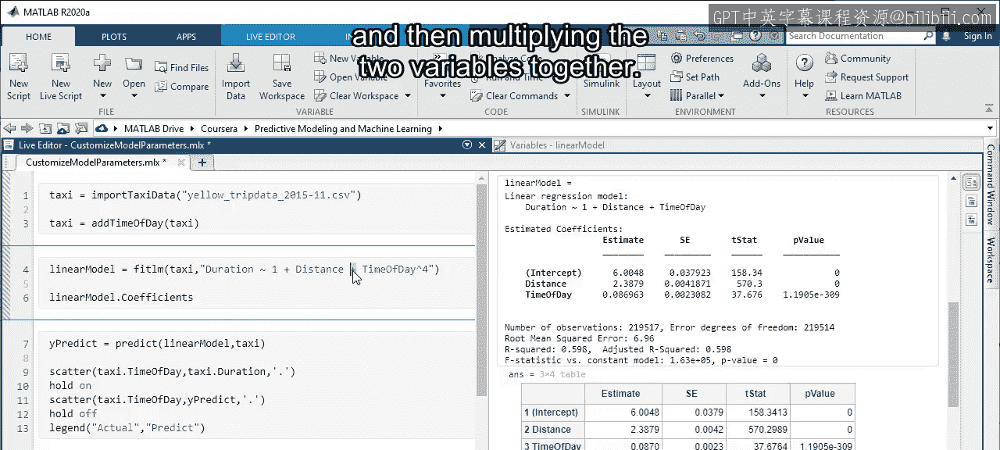

Notice that several of the terms in the output have colons。

 which are used to indicate interactions in Wilkinson notation。

You can see how these terms with colons are included in the full expanded expression at the top of the output。

Next， let's repeat the training process for a regression tree so you can see how the fit function fit R tree compares to fit LM。

Similar to Fit LM， the table should be the first argument to fit our tree。However。

 the second argument is the response name， duration。Finally。

 specify the predictors with a name value pair。Note that it can take a long time to train models。

 depending on factors such as the size， the data set in the type of model。

The default options for a regression tree will create a tree with a large number of leaves。

 which takes longer to train than the linear regression model from earlier。

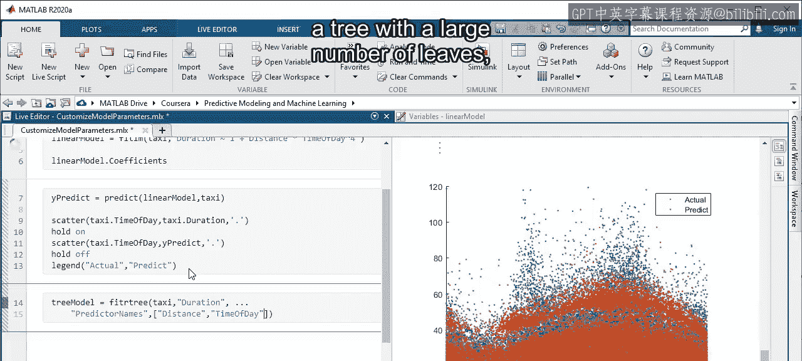

On this machine， the model took about three minutes to train。

The output of fit archery is a model variable， with its own unique properties。

Let's open the model from the workspace to see them。For example。

 the numb nodes property is a measure of the trees size。

It's the sum of the number of decision nodes or splits， and the number of terminal nodes or leaves。

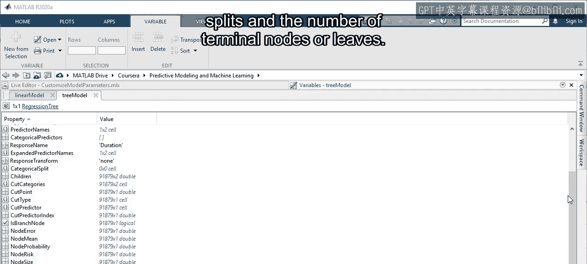

To view the tree itself， use the view function。The output is a list of the decision rules that define the structure of the tree。

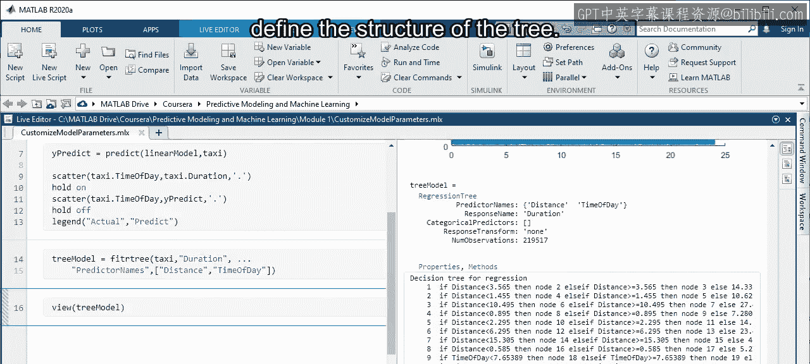

You can see that the top nodes all use the distance variable。

 which indicates that distance is the most important predictor in this model。

Let's see how this model predicts the duration with another scatter plot。

Use the predict function with the tree model。And then plot the predicted responses versus the time of day。

 like you did before。There's clearly much more overlap between the actual and predicted values。

But is this a good thing。The taxi data， like most real world data， is noisy。

And this model appears to be fitting the noise in addition to the main trends。Therefore。

 it may be better to simplify the tree to have fewer notes。

So how can you customize a regression tree？Fit arteryery has many options。

 but two important ones are min leaf size and max numb splits。

The min leaf size parameter sets a threshold for how many data points must belong to each leaf。

The default value for in leaf size is one。Let's increase this value to 50。

This customization will make the tree smaller or more coarse。

Much like how you can change from a fine tree to a course tree in the regression learner app。

Take a look at the scatter plot again to see how this affects the predictions。

There's now less overlap in the actual and predicted values。

But this can be a good thing since the model is not fitting all the noisy variation in the data。

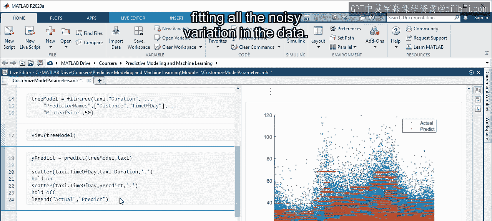

Another fit archery option， maximum splits， will explicitly set the number of decision rules for a tree。

Try setting this value to 20 and train the model again。The model now has even fewer node than before。

 since there are only 20 splits in the tree。You can visualize the tree graphically with the view function by setting the mode option to graph。

A separate plot will appear with a visual representation of the tree。

You can zoom in to inspect the various branches。For example。

 this node uses distance to create two branches， which are then split by the time of day。

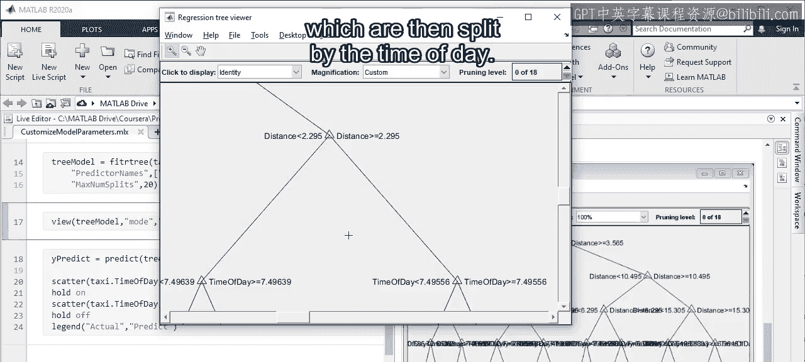

Keep in mind that this type of visualization will be very cluttered when there are thousands and thousands of nodes。

Let's take a final look at the scatter plot。

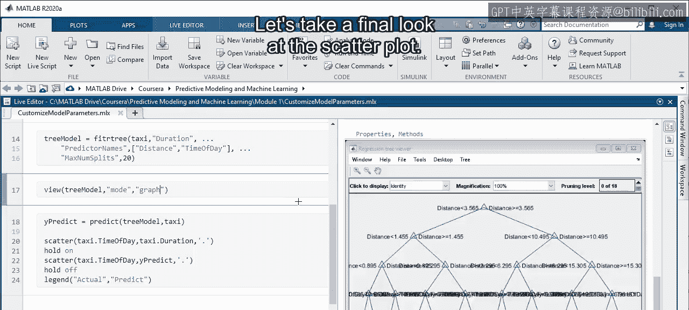

You can now see distinct bands of predicted data points。

 which is a result of having fewer decision rules。In other words。

 this customization made the model too simple and probably hurt the performance。

Choosing a good value for all the different parameters is a difficult problem， but don't worry。

 you'll learn different techniques to help select parameters in a later module。

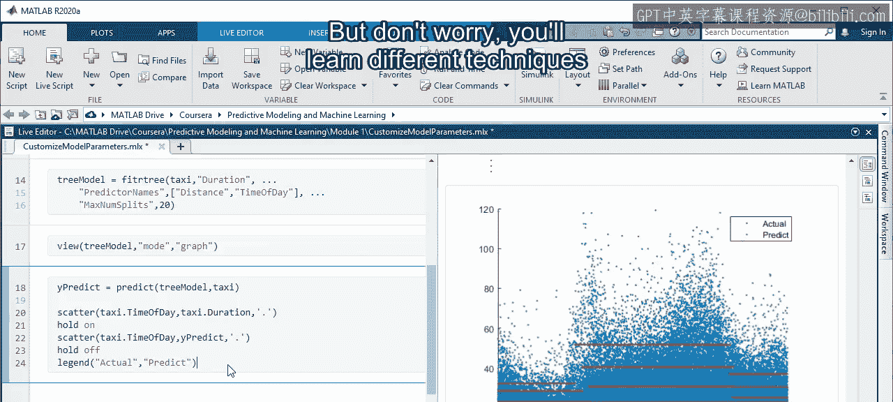

You're now able to write code， train， inspect， and customize several types of regression models。

Customization options will help you get the best performance from your models。

Remember that many of the fit functions in Matlabs share similar functionality and options。

 but with small differences for the different model types。And when customizing a model。

 take some time to review the documentation to see all the available options and examples。

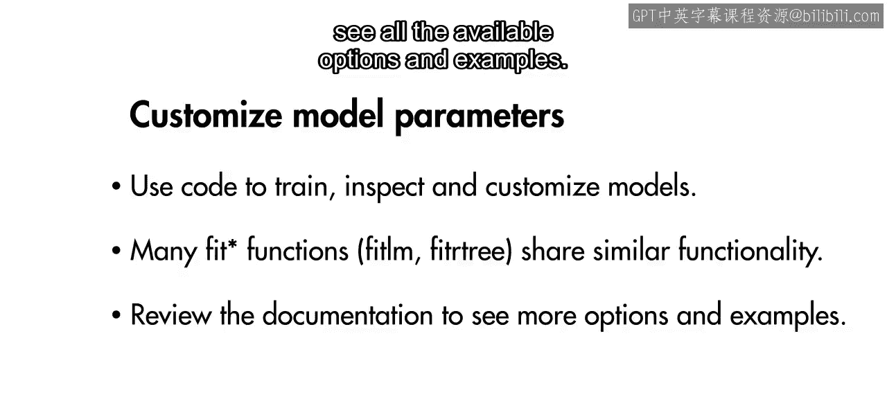