# Mathworks《实用数据科学与MATLAB（数据探索、特征工程、机器学习、毕业项目）｜Practical Data Science with MATLAB》 p93 8_评估回归模型.zh_en [BV1Jr421w7wL_p93]

🎼。

You've already learned about different types of regression models and how you can quickly train multiple models using the regression learner app。

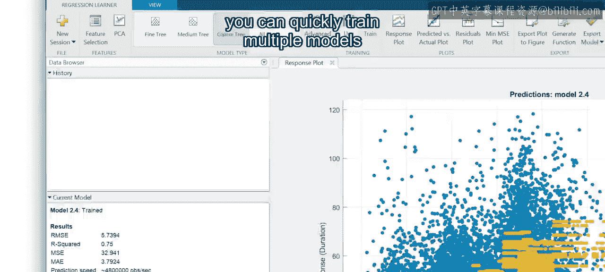

But how do you compare different models to select the one with the best performance。

The app reports a value called the root mean square error。

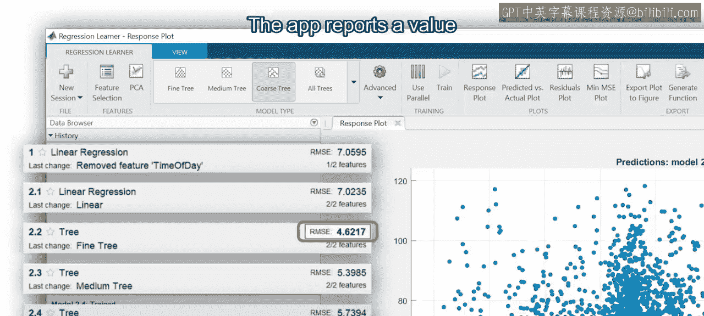

But what does this number actually mean？And are there other ways to measure regression model performance？

In this video， you'll learn how to evaluate regression models using different metrics。

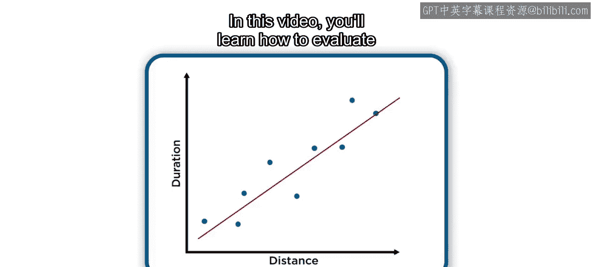

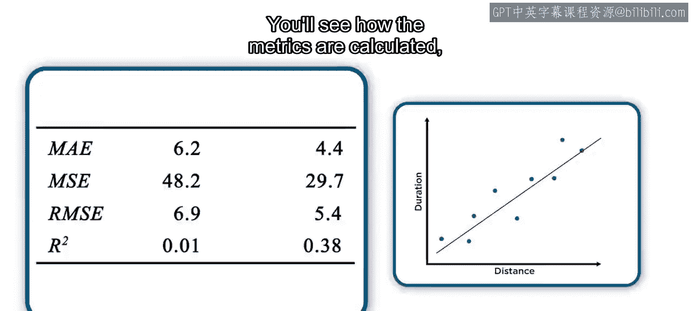

You'll see how the metrics are calculated， and more importantly， learn how to interpret them。

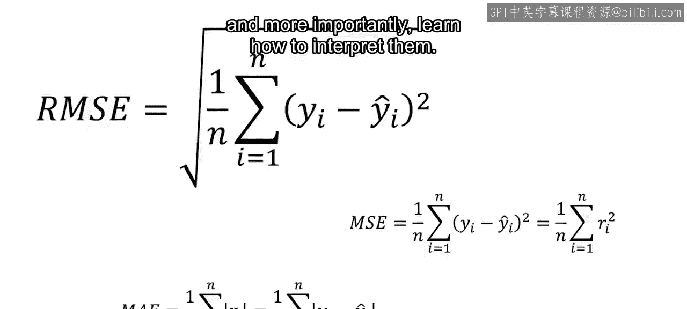

At the end of this video， you'll see how these metrics can be used to compare models in order to select the best choice。

Each of the metrics in this lesson is calculated， using the model's residuals。

Recall that these values are the difference between the actual data points and the predicted values。

If the model does a good job of predicting the response， the residuals will be close to 0。If not。

 the residuals will be larger。One way to measure the residuals is to find their average magnitude。

First， you take the absolute value of each residual。And then you can calculate the mean。

This metric is called the M Ae， or mean absolute error。

The M Ae is perhaps the most practical metric because it's simple and easy to communicate。

For example， you can say that the MAE has the same units as the response variable。

So if the MA E value is 5 for a model of taxi trip duration in minutes。

Then you can say that on average， the predicted durations are off by five minutes。However。

 regression models tend to use the square of the residuals instead of the absolute value during training。

 So metrics based on the squared residuals are also common。

If you add up the area of all these squares， you'll get the sum of squared errors or SSE。

Or if you find the average area， you'll calculate the mean squared error or MSE。

You can see that by choosing a poor regression line。The area of the squares becomes larger。

 which will increase the MSE。The MSE is useful because it emphasizes large errors。

You can see that if one residual increases， the area of the square increases very quickly。

This can have a significant effect on the MSE value。Therefore， if your model has a low MSE。

You can be confident that your model has relatively few large errors。

But notice that the MSE does not have the same units as the response variable。For this reason。

 the more commonly reported value is the square root of MSE。

Which you've already seen as the root mean square error， or R MS SE。So for this table of residuals。

 the RMSE is 6。1， slightly larger than the MAe。The metrics， MAe and RMSE。

Are useful for comparing models with one another。For example。

 you could compare the linear regression metrics to metrics from a regression tree。In this case。

 the linear regression model has lower error values。

 So it's likely the model with better performance。

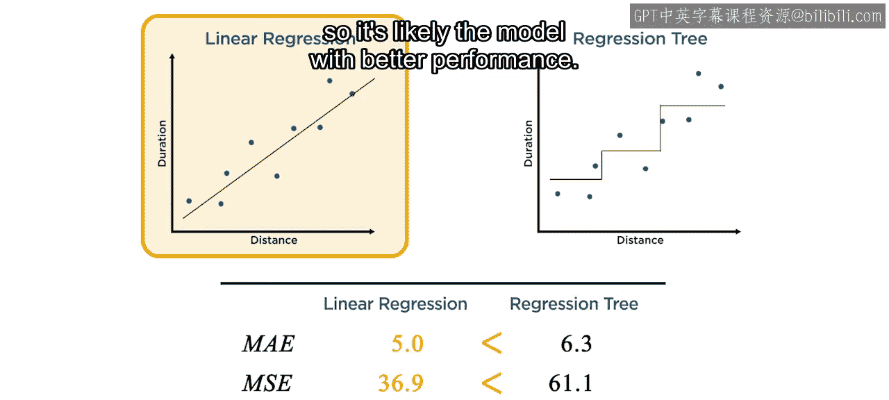

However， these metrics can only tell you how two models compare with each other。

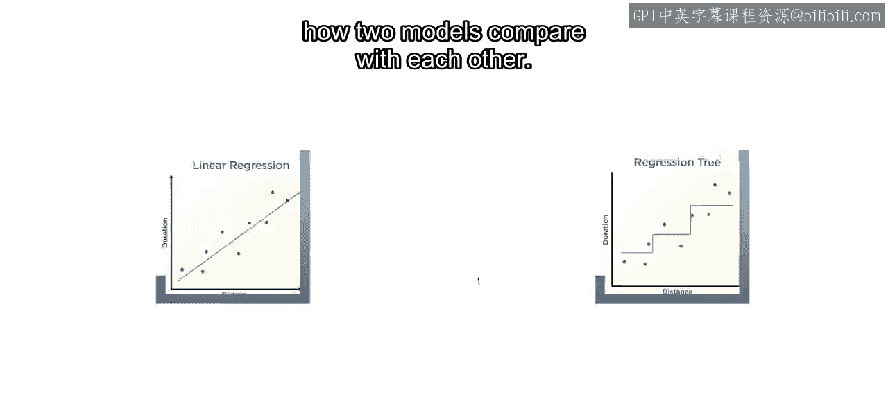

Neither can say whether a model is objectively a good fit to the data。

A different approach is to compare a model with a simple baseline model。

This is the motivation behind the metric R squared。

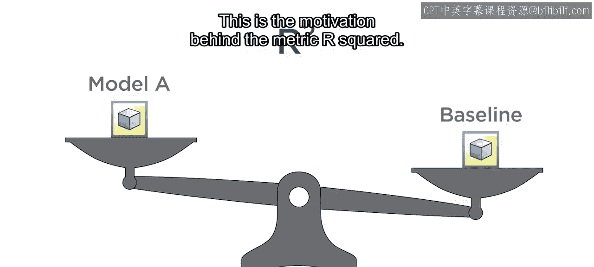

So what do you think is the simplest possible model you could use as a baseline？

One option is a horizontal line located at the mean response value。

You can see that the squares of the residuals are much larger。

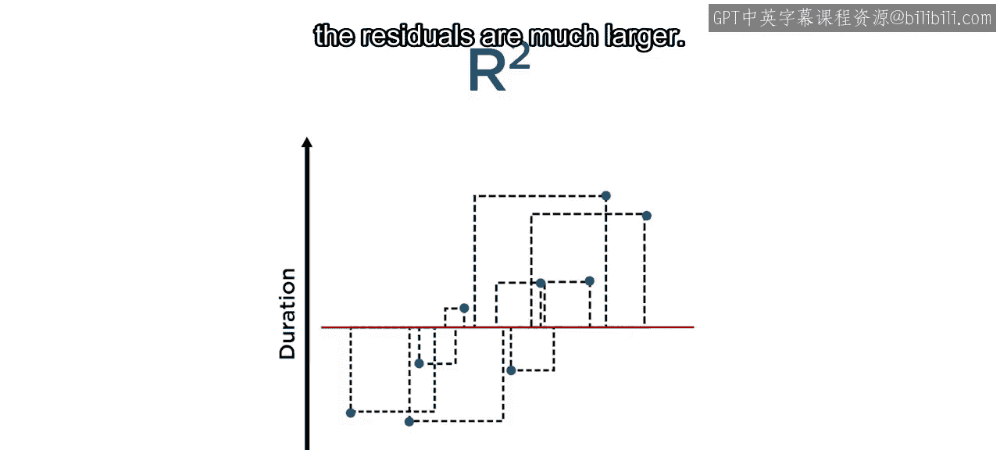

If you add up the areas of these squares， you get a value called the sum of squares total， or SST。

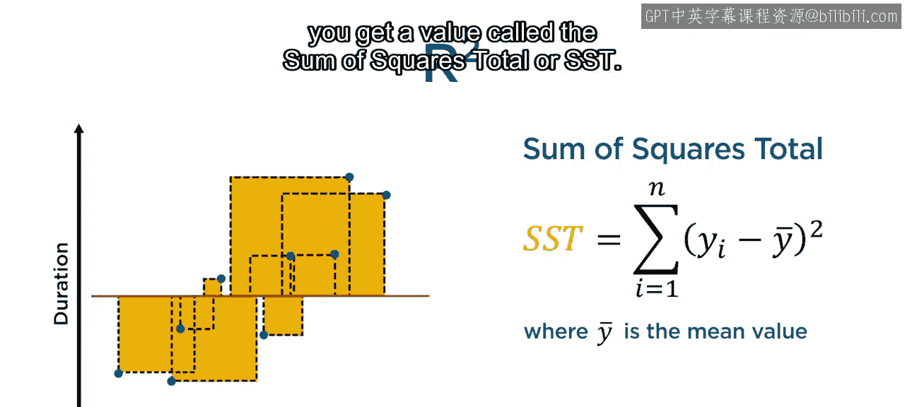

The R squared value is simply the relative difference between the SST and the SSE of a regression model。

You can think of it as the fraction of the total error that is eliminated by fitting a more complex model。

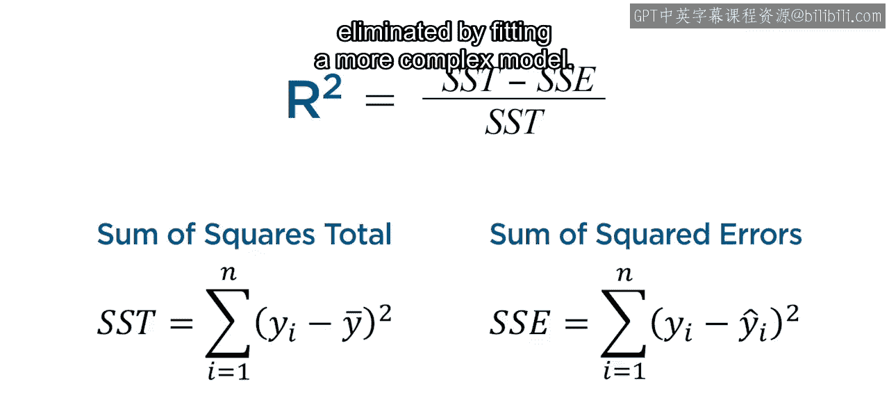

In other words， if the model predictions are accurate。

The SSE value will be small relative to the SST， making the R squared value very close to1。

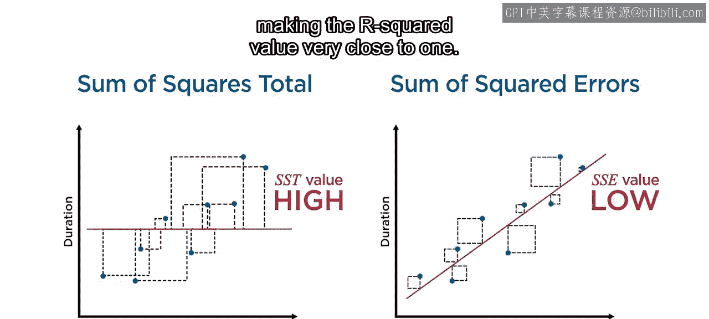

If the predictions are inaccurate， the SSE and SST values will be similar。

 so R squared will be close to 0。Returning back to the two regression models。

 you can see the R squared value for the linear regression is higher。

 which supports the idea that this model is a better choice for the data。However。

 the R squared value for the regression tree is still close to one。

 suggesting it's also a viable model。The R squared value is also useful because it does not depend on the scale of the data。

 unlike the error metrics。Consider these two new models。

The MAE and RMSE values are similar to the previous examples。

But this is only because the scale of the data just happens to be similar。Regardless。

 the R squared values are low for both new models， which suggests that neither model performs well。

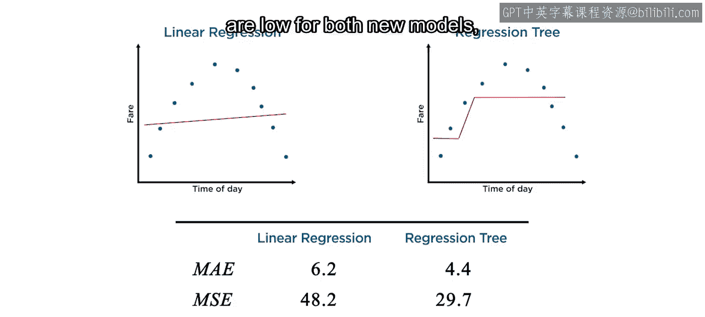

If this happens， you may need to add different features or rethink your choice of model。

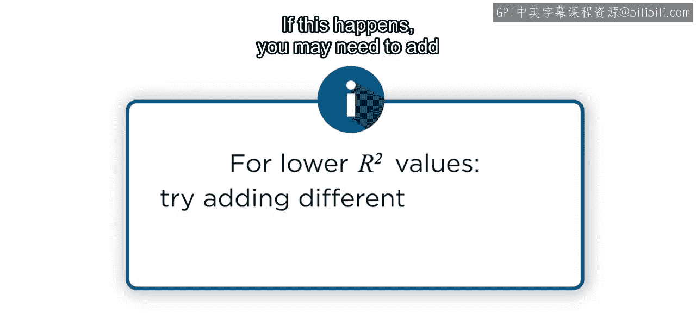

The data could have some underlying structure that a different model might capture。

A better choice will result in lower error metrics and a higher R squared。To summarize。

 there are several metrics for evaluating regression models。

They all use model residuals to quantify model performance。M AE， ME and RMSE are measures of error。

 so lower values are better。These measures are useful for making comparisons between models。

R squared is a measure of how well the model performs compared to a simple flat line model。

The values range between 0 and 1 with higher values， indicating better performance。And finally。

 use these metrics together to help select the regression model with the best performance。

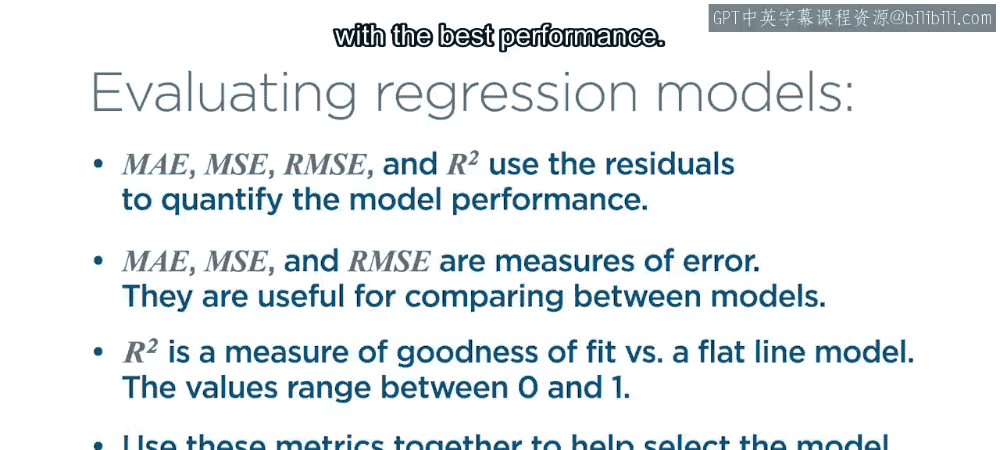