# Mathworks《实用数据科学与MATLAB（数据探索、特征工程、机器学习、毕业项目）｜Practical Data Science with MATLAB》 p94 9_在MATLAB中评估模型.zh_en [BV1Jr421w7wL_p94]

🎼，🎼You've learned how to evaluate the performance of regression models by interpreting metrics like RMSE and R squared。

You've also seen some ways to visualize the model performance in the regression learner app。

In this video， you'll see how to visualize the results from a predictive model and calculate regression metrics in MatWb。

You'll learn how to answer questions like。Where is the model performing well？

Where is it performing poorly。What practical implications do the metrics have。

And is the performance reasonable given the model's application。

Let's start with a linear regression model you saw earlier that predicts the trip duration from the taxi data。

Use the distance and time of day as the predictors and set the model type to poly14。

This means the model will have a first order polynomial term for distance。

And up to fourth order terms for the time of day。

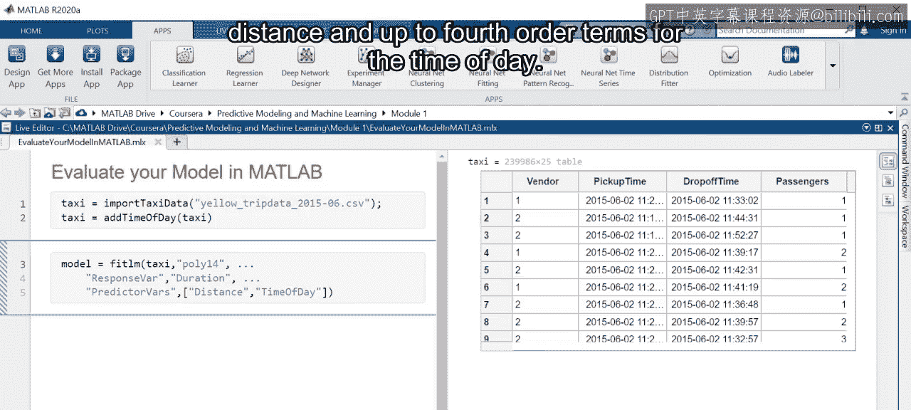

Remember that you can use the predict function to obtain the predicted durations。

Assign these predictions to a variable named， why predict。

Then assign the actual duration values to a variable named Y actual。

These are the variables you'll need to calculate regression metrics。First。

 use the variables to calculate the residuals， which you get by subtracting Y predict from y actual。

Let's use the residuals to calculate the root mean square error。

Remember that the RMSE is calculated by taking the square root of the mean of squared residuals。

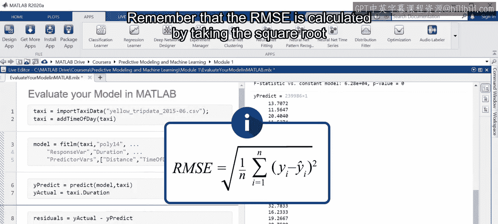

This is easily calculated in MatTlab by raising each residual to the second power。

Followed by applying the mean and square root functions。The RMSE for this model is around 6。5。

You could repeat a similar process for the other metrics， but to help you out。

 you've been given a function named R metrics that will calculate several values simultaneously。

This function will return a table with the mean， absolute error。The mean square error。

 The root mean square error。And are squared。The current model has an MAE around 4。5。

Meaning that the predicted trip durations are off by about 4 and a half minutes， on average。

That seems reasonable， since some taxi trips can take over an hour。However。

 the R squared value is around 0。68。Remember that values close to one indicate better performance。

 So the model is certainly not perfect。So if the model is not performing well。

 then where can it be improved？Is the error consistent for any trip duration？

To answer these questions， let's create some visualizations。

One visualization you saw on the regression learner app was a response plot。

Let's make one by plotting why actual and Y predict on the same axes。

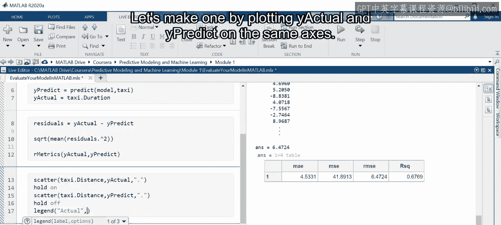

The predicted values capture some of the duration versus distance trend。

But notice there are areas where the values don't overlap。

This can indicate where the model is not performing well。

Another way to compare the predicted and actual values is with a scatter plot。

Which was called the predicted versus actual plot in the app。

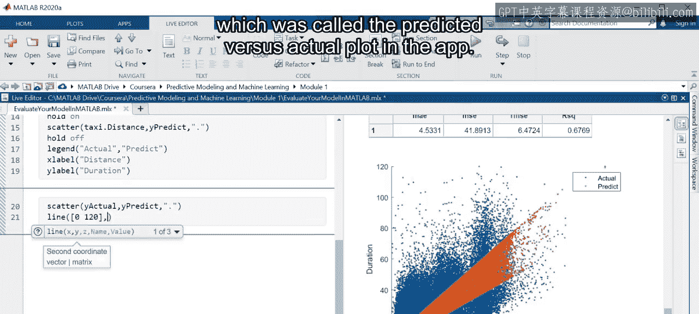

The diagonal black line here marks the point where the values are equal。So in this case。

 it's good that the points are somewhat centered around the diagonal line。

But it appears that more points are below the line than above it。

This suggests that the predicted values tend to be lower than the actual values。Of course。

 it's difficult to see where most of the data points are。

 because so many of them lie on top of each other。An alternative visualization is a 2D histogram。

 which uses color to denote the density of the points。

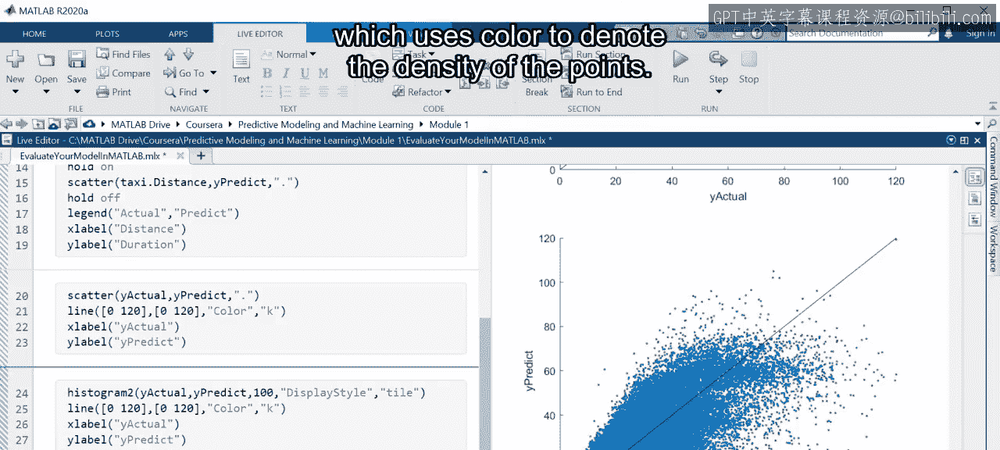

The densest area of the histogram that is the one with the most data points， is colored yellow。

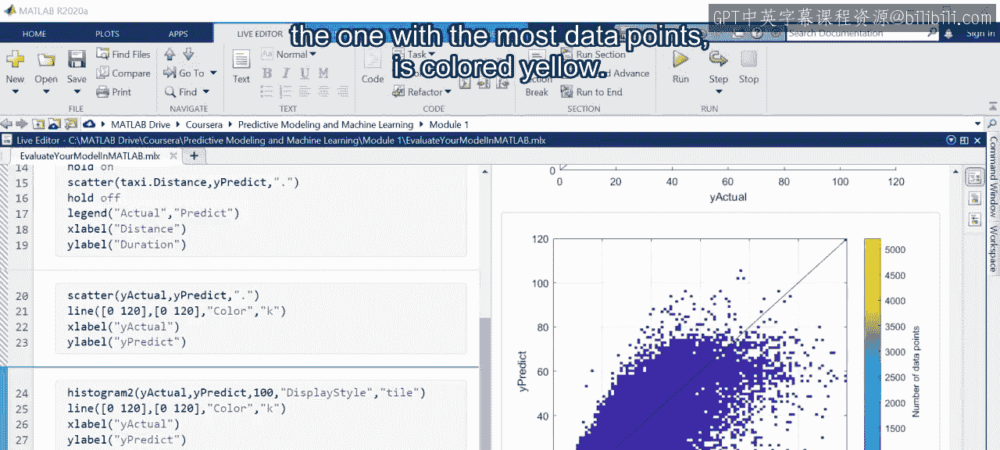

When you zoom in on the yellow region， you can see it's actually above the diagonal line。

This means that for the most common trips with short durations。

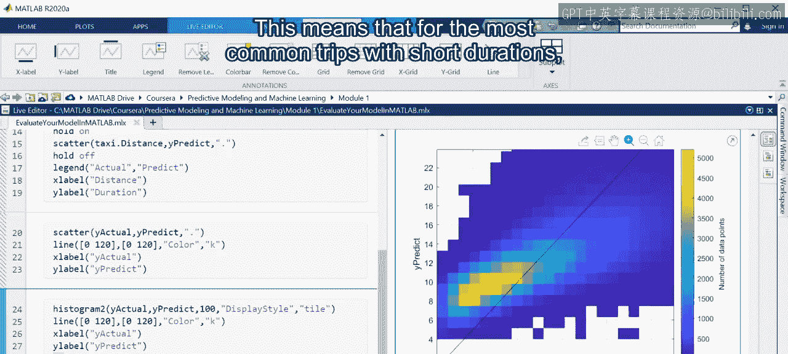

The model tends to overestimate the duration value。

This is the opposite of the trend you saw when zoomed out。

 meaning that the model underestimates the duration for less common trips with longer durations。Now。

 you've confirmed that the error is not consistent for all durations。

But is there an overall bias in the predictions？

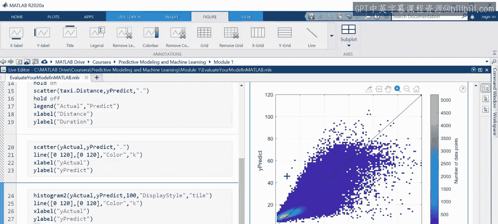

To answer this， let's make a histogram of the residuals。They should be centered around 0。

 which appears to be more or less true for this model。Regardless。

 you can tell from the range of the X axis that some of the residuals are quite large。

It looks like the worst predictions are off by more than an hour and a half。

That's a pretty big value， considering the MAE is under five minutes。

To see this distribution in more detail， let's recreate the residuals plot from the app that shows the residuals plotted against the response values。

But let's use another 2D histogram to get a better sense of the density of the data points。

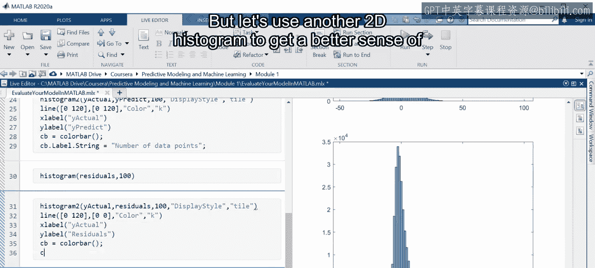

You can again see that the short trips tend to be overestimated since the yellow area with the most data points is slightly below 0。

However， there's another trend to point out。The spread of the residuals changes over the range of response values。

Meaning the variance of the residuals is not uniform。

This implies that the model is more accurate for some durations than others。Ideally。

 this wouldn't occur， but it may be acceptable for predicting the duration of a taxi trip。

You may not care if you're off by5 minutes for a short trip。

 but then off by 20 minutes or more for long trips。This answers the question about the model bias。

The error is not consistent across the range of responses。

 but there doesn't seem to be an overall bias in the predictions。Next。

 let's see if a regression tree model shows a similar behavior。First。

 save your work in this script and then click Save as to create a copy of the script with a different file name。

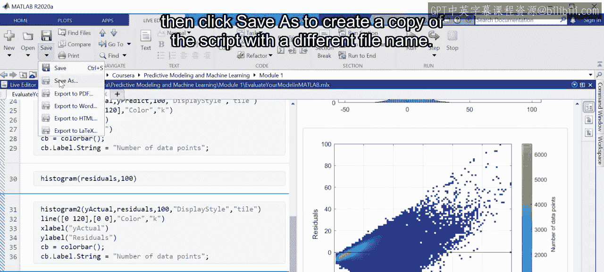

Now you can make changes without losing your previous work。

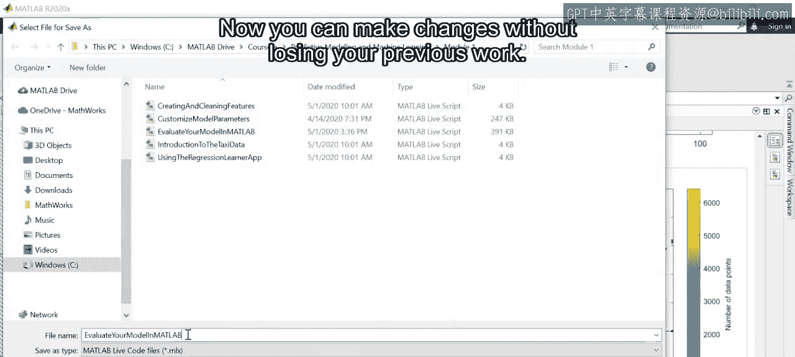

Scroll back up to the top of the script and replace the Fit LM function call with Fit R tree。

Use the same predictors for a fair comparison and use a min leaf size of 50。

Then click the Run to end button to run the whole script。

 except the section above that loads the data。Let's scroll through the script to see how the model performs。

The R metrics output shows that this model has an MAe of 3。73。An RMSSE of 5。6。And an R squared of 0。

76。These values are all better than the linear regression model。

 Me the error metrics are lower and R squared is higher。Therefore。

 the regression tree model has better metrics。But what does this mean practically。

The average error improved by about a minute， which might be significant depending on the application。

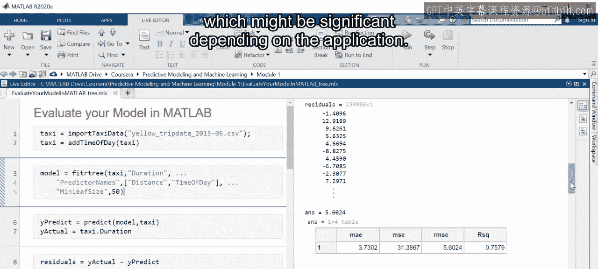

For example， a taxi company using this model to make financial decisions might love the better performance。

 since even a slight increase in accuracy could lead to significant cost savings。However。

 if a phone app is using the model to provide trip estimates。

Then the end user might not notice or even care about the extra accuracy。

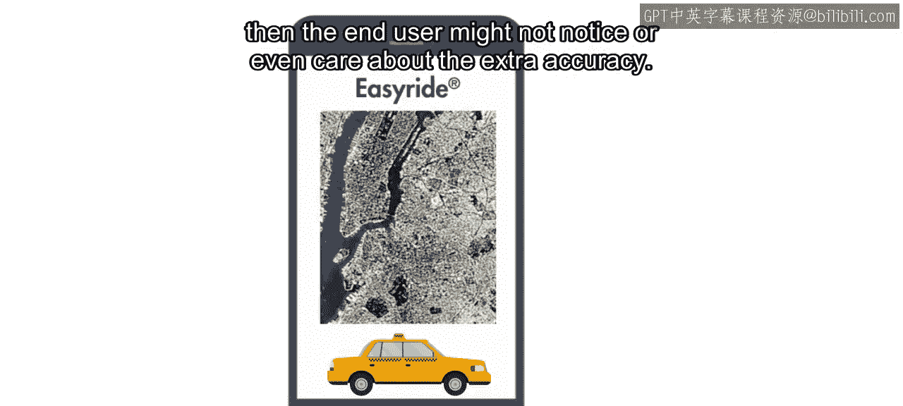

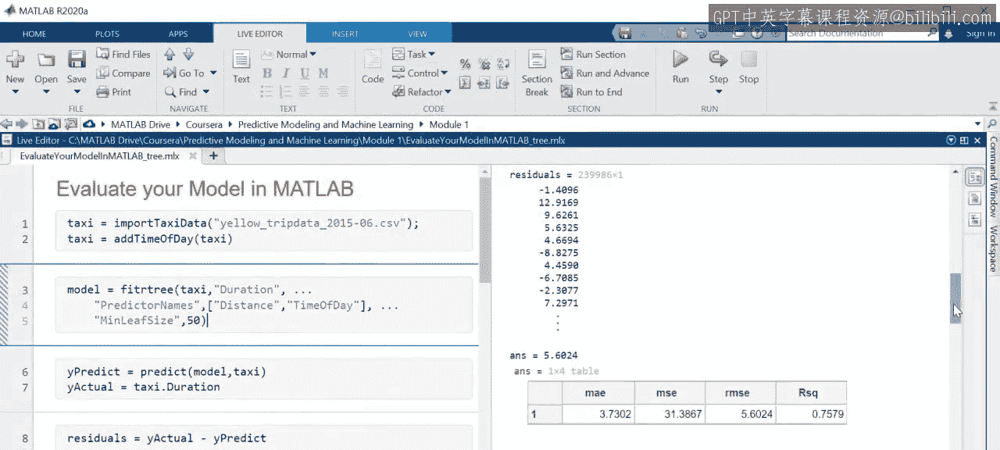

Let's continue to the visualizations。The scatter plot of duration versus distance suggests that the tree model captures more of the variation with distance。

You can see this when you compare the plot with the previous version。

The linear regression plot showed less overlap between the predicted and actual values。

The 2D histogram of predicted versus actual values also shows an improvement in accuracy。

 since the dense yellow area is closer to the diagonal line。However。

 the yellow region is still slightly above the line。

 indicating that the tree model also overestimates the duration for short trips。Finally。

 the 2D histogram of residuals indicates that the spread of the residuals is still not uniform。

When you put all these pieces of information together。

You can say that the regression tree has better performance than the linear regression model。

 but still has similar issues， such as large errors for long trips。Nevertheless。

 it may be accurate enough for certain applications。

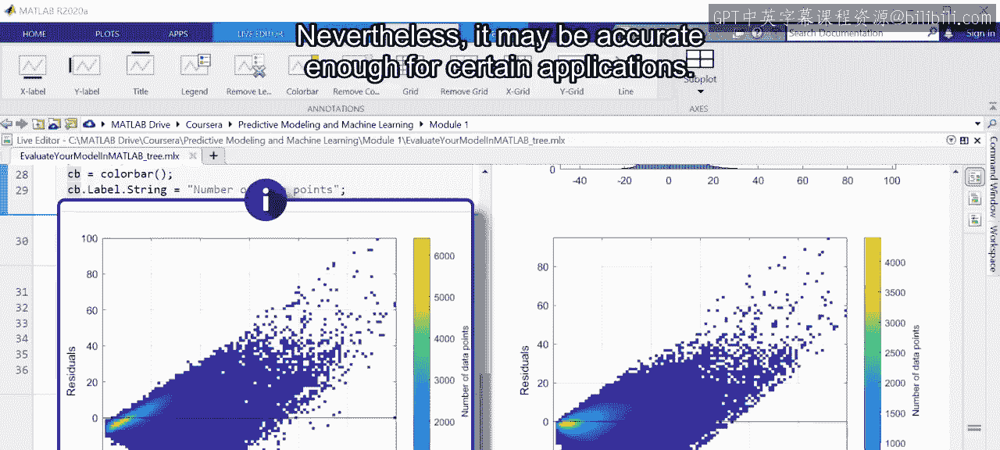

And that's it。 You can now use visualizations and metrics to evaluate regression models in MatTLb。

To summarize。Use metrics like ME， R MSE， and are squared to evaluate and compare regression models。

However， since those values don't tell you the whole story。

 use visualizations to get a deeper understanding of model performance。

Look for biases in the predictions， as well as specific areas where the model is performing poorly。

And finally， consider the model's application when evaluating。

The domain and situation should play a significant role when judging a model's performance。

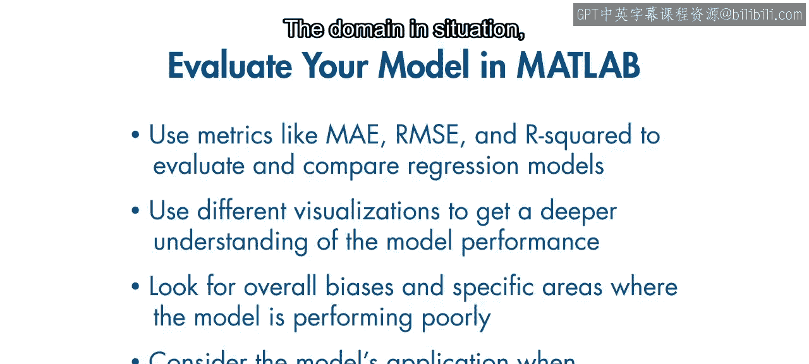

。