# Mathworks《实用数据科学与MATLAB（数据探索、特征工程、机器学习、毕业项目）｜Practical Data Science with MATLAB》 p95 10_回归总结.zh_en [BV1Jr421w7wL_p95]

🎼，Great work reaching the end of this module。Reggression models are used when the prediction is a continuous numeric value。

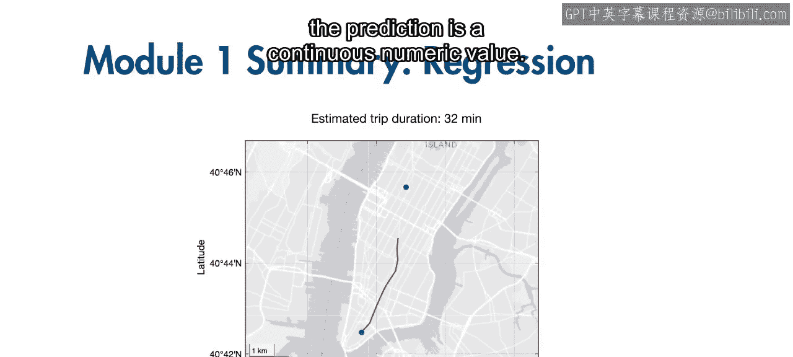

Here you looked at trip duration， but the same workflow applies in many applications， for example。

 predicting power demand， temperature， or estimating stock prices。

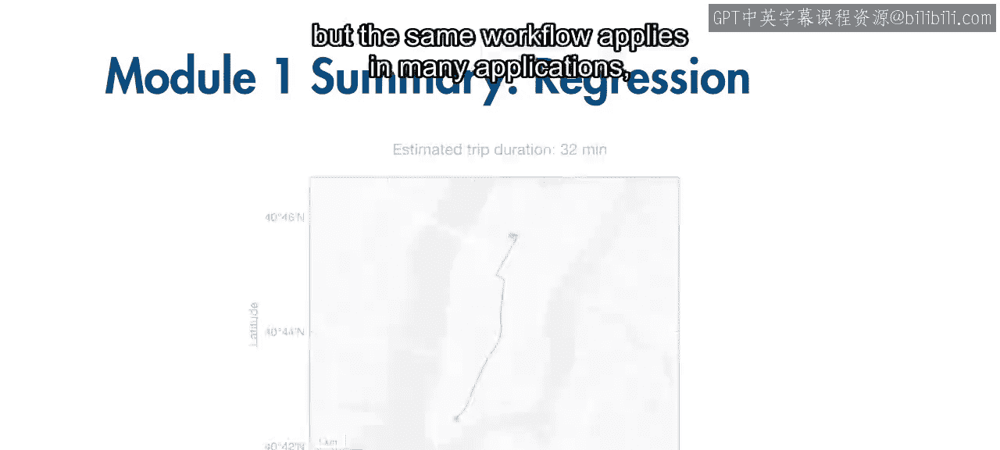

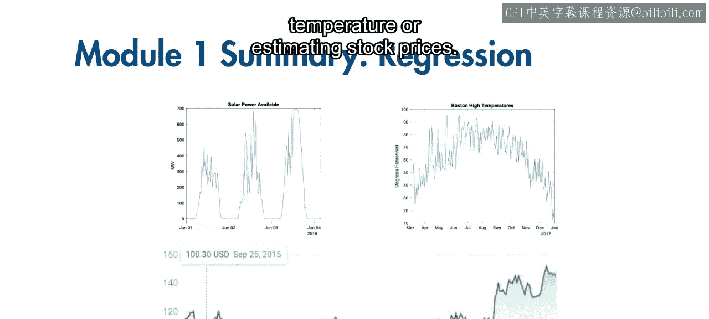

Using the regressionion learner app， you can now train various types of models。

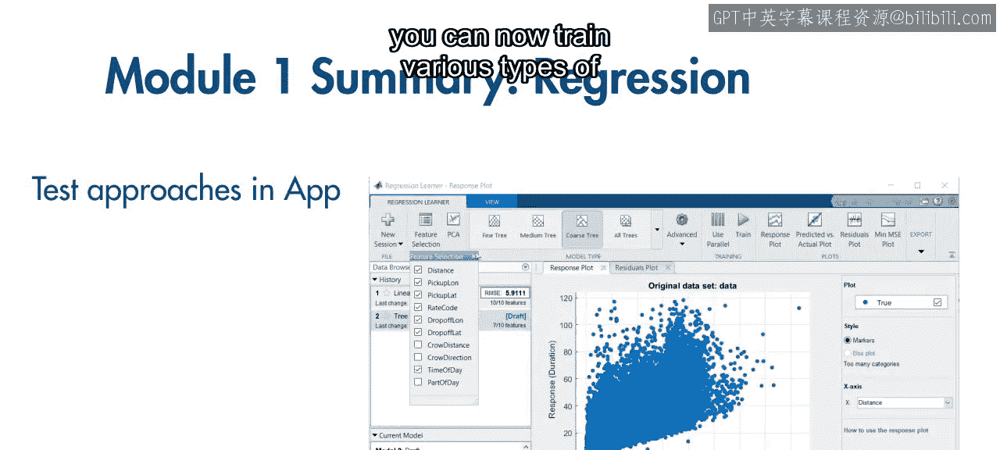

Using different combinations of predictor variables。

The app provides visualizations and metrics that you can use to determine the best approach for your application。

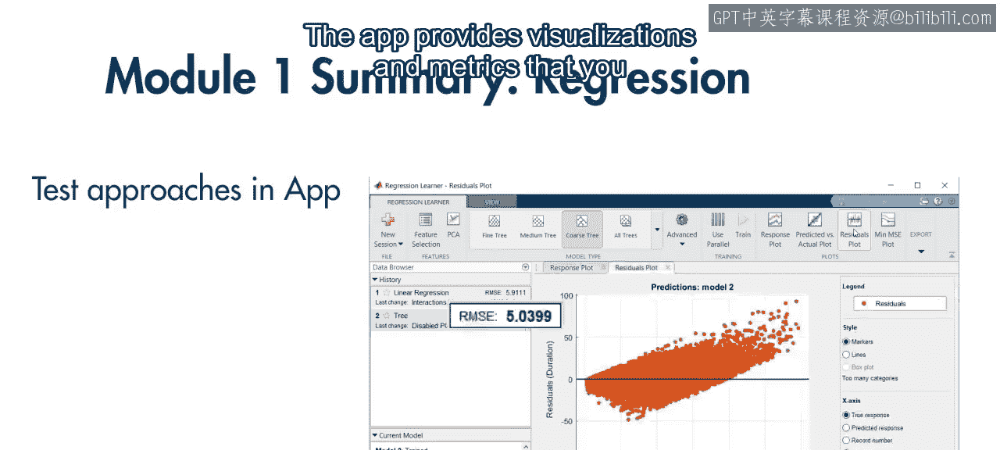

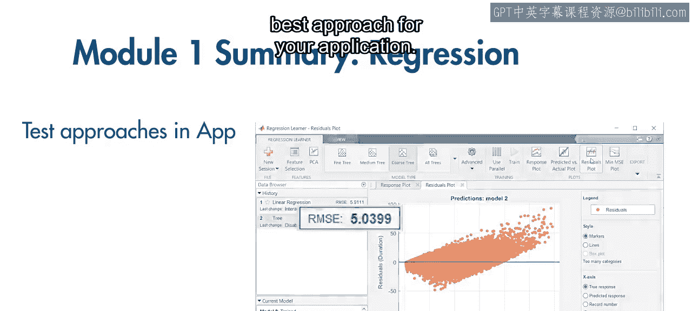

Once you've compared and tested models in the app， you'll likely need to explore additional model options and parameters in more detail。

You can now use code to further customize and train models。

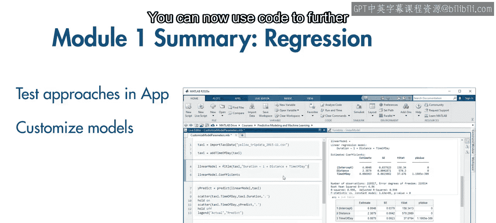

You also learn how to interpret metrics like root means squared error and r squared。

A good model will have both a low RMSE and an R squared value close to 1。

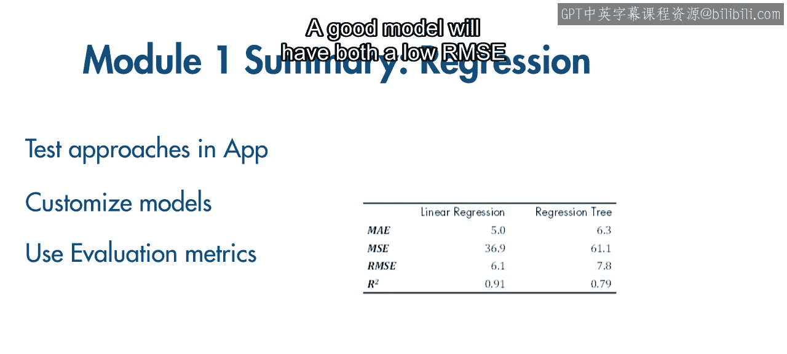

Before attempting the quiz， practice creating some regression models。

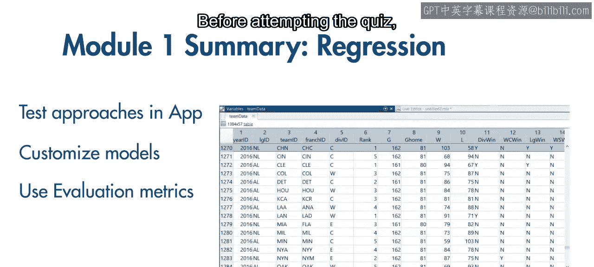

If your own data has a continuous numeric response， see if you can build a decent model。

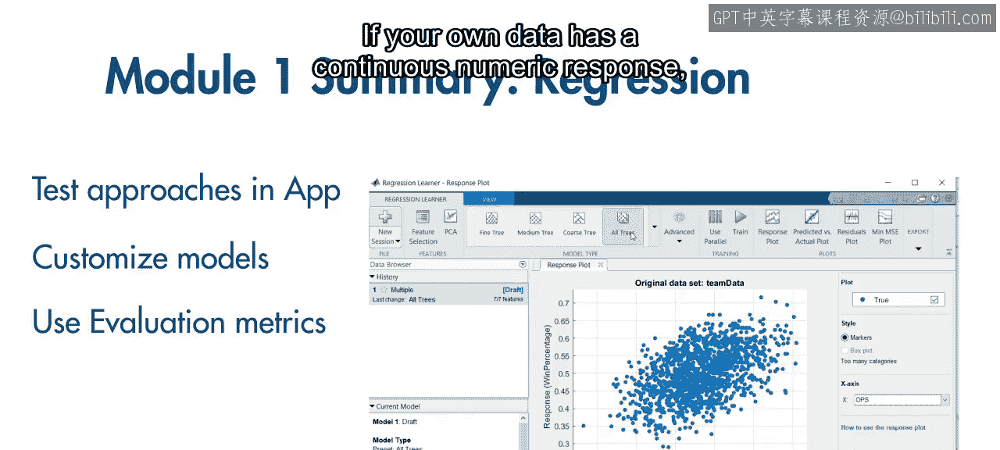

Using a dataset set that has meaning to you is a great way to practice。

 and when you look at the metrics for your model， use your domain knowledge to interpret the values and determine if the model is working as expected。

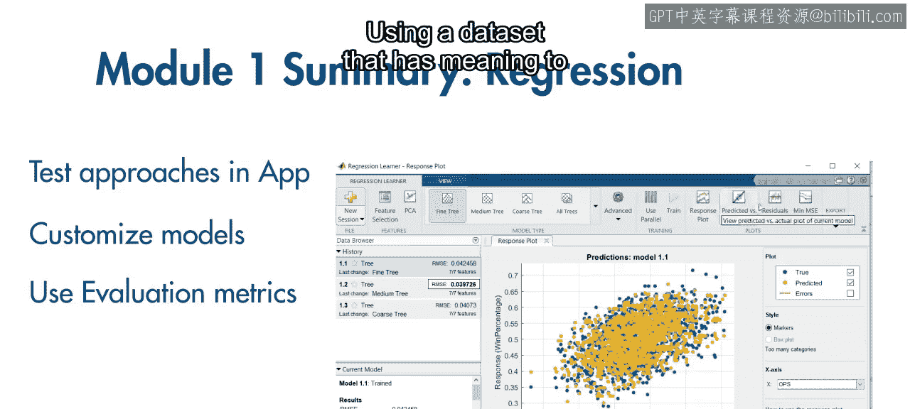

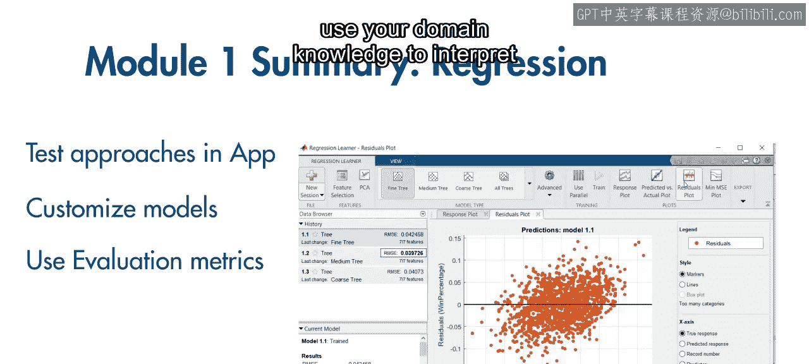

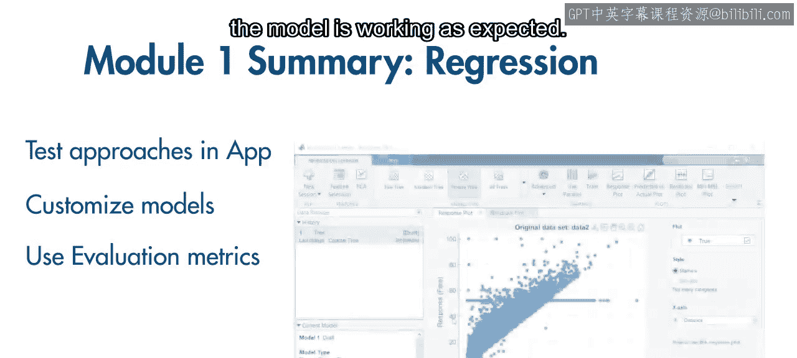

If you don't have a data set， don't worry， you can investigate lots of questions with the taxi data。

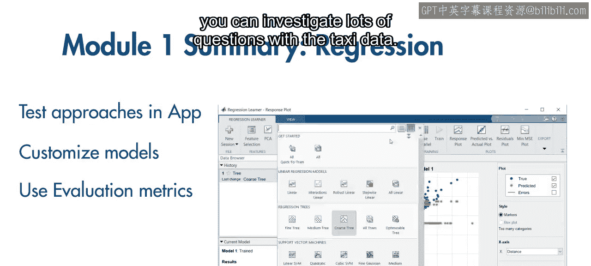

For example， see if you can improve the trip duration estimates or try predicting the trip cost。

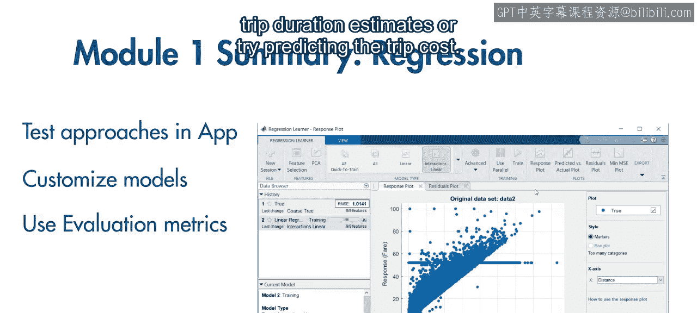

When you're ready， take the quiz for this module Good luck。

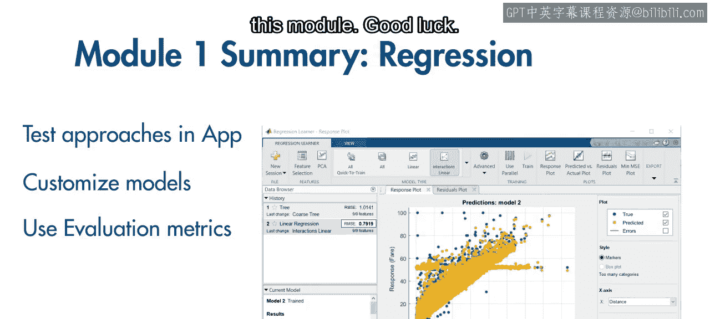