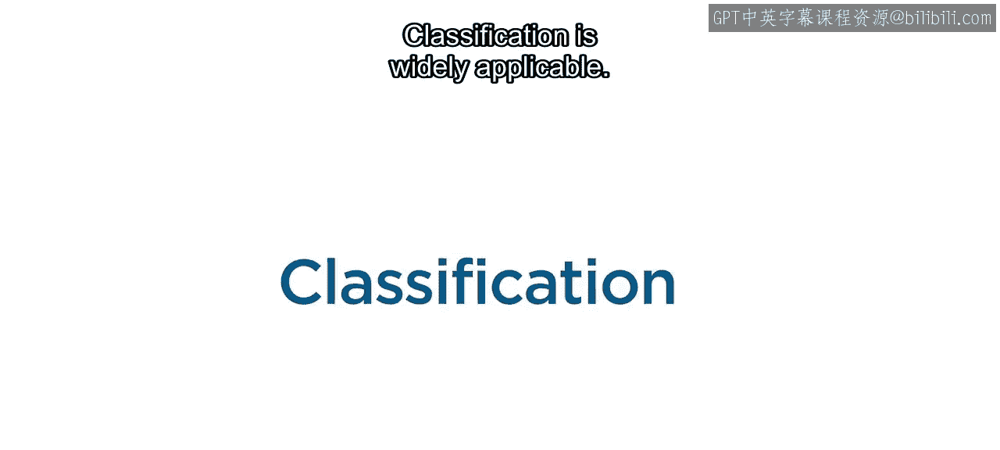
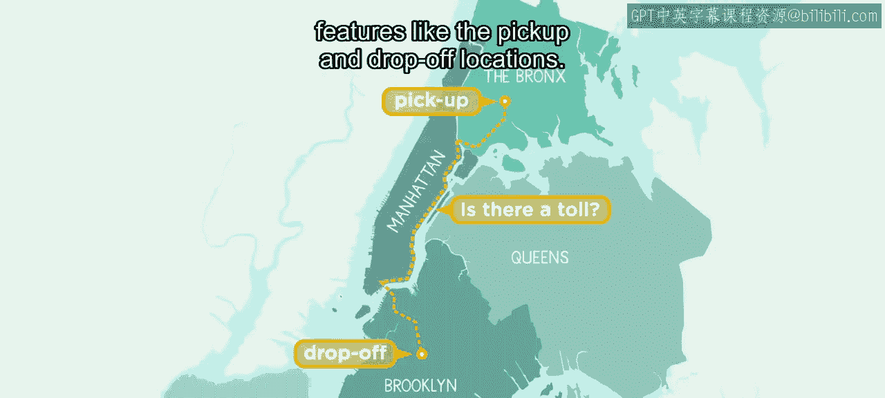
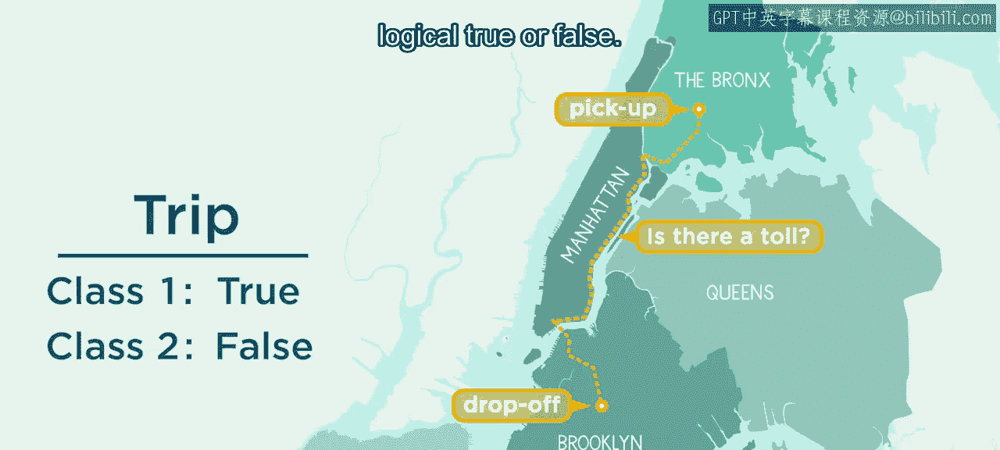
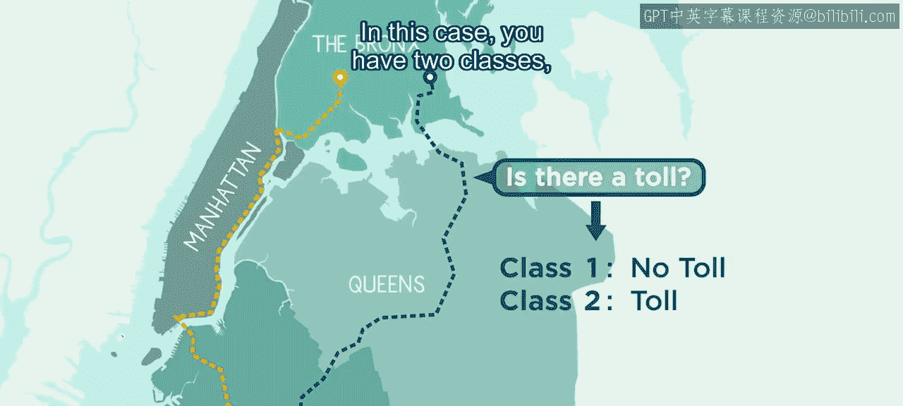
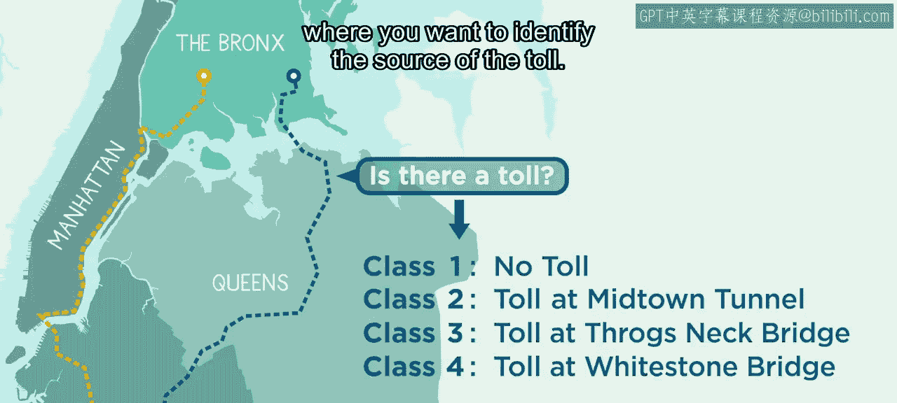
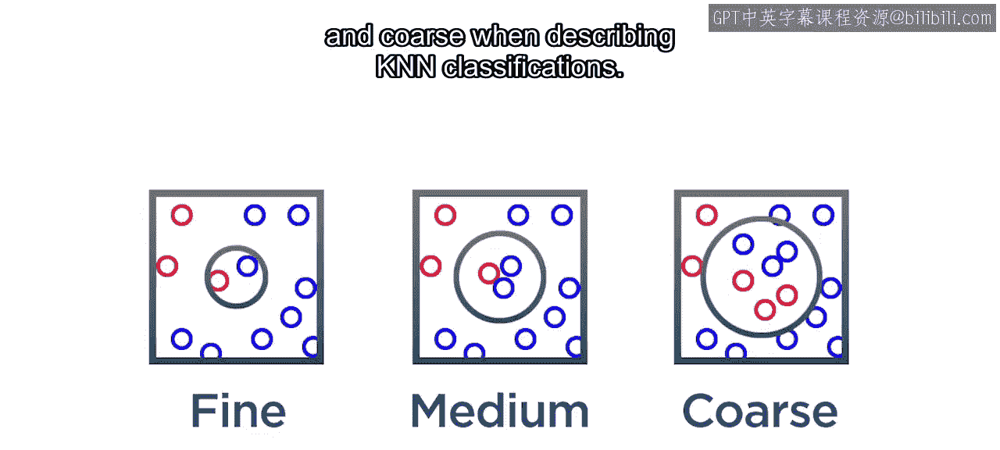
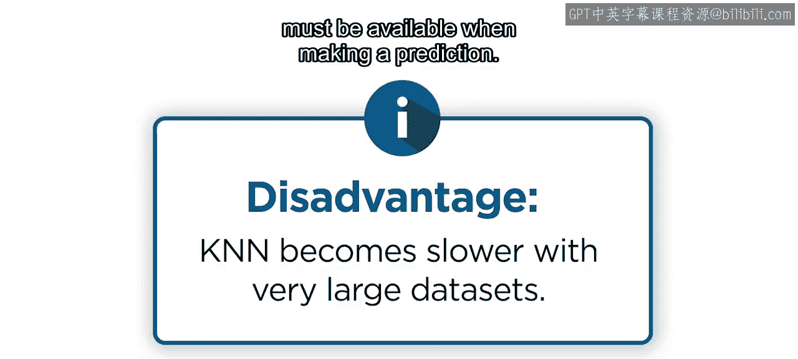
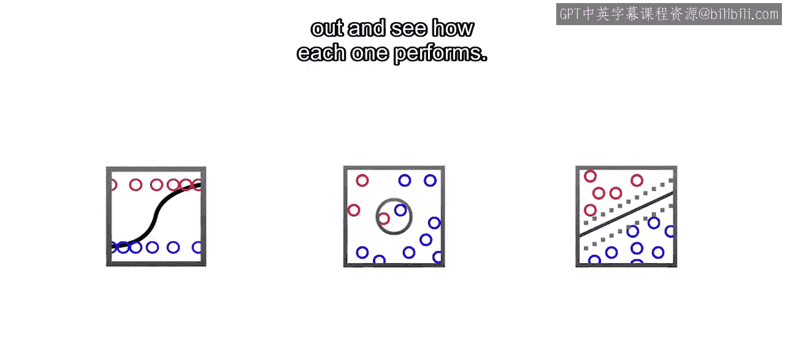
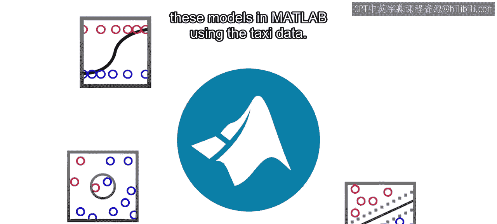

# Mathworks《实用数据科学与MATLAB（数据探索、特征工程、机器学习、毕业项目）｜Practical Data Science with MATLAB》 p96 11_分类介绍.zh_en [BV1Jr421w7wL_p96]

🎼，Previously， you learned that classification models predict the discrete value or values of a response using one or more predictors。

You can think of this as categorizing some unknown items into a discrete set of classes。

Classification is widely applicable。 It is used for email filtering。

 speech and handwriting recognition， medical diagnosis， and much more。

So how does classification work？In this video， you'll learn the basics of the most popular classification models。

Suppose you're in New York City。And you want to predict if a given trip will have a toll or not based on features like the pickup and drop off locations。

Notice here you're not trying to predict the value paid for the tool。

You just want to categorize a trip as having a tool or not having a tool。

Meaning you have two classes in this problem。You might use labels such as tool and no tool if you use categorical data。

Or you could use a logical true false。

Regardless of how you name the class labels and pick your variables。

 the goal with classification is to determine the class label for an unlabeled test case。

In this case， you have two classes， which is known as binary classification。

But you can also have a more complicated problem where you want to identify the source of the tool。

Problems with three or more classes are known as multiclass classification。

To introduce classification concepts， this video will focus on just binary classification。

A variety of classification models are available。 Some of the most common ones are shown here。

You already learn the basics about decision trees in regression。

The main difference in the case of classification is that the response variable is now discrete since possible outcomes are predetermined from your list of classes rather than computed based on the data。

So let's take a closer look at logistic regression， key nearest neighbors。

 and support vector machines。Keep in mind every model works with any number of predictors。

Let's start with logistic regression。Logistic regression is analogous to linear regression。

In linear regression， you find an equation to predict a continuous response using predictive variables。

In logistic regression， the goal is also to find an equation。

 But now to estimate a binary response variable such as yes， no or true or false。

 all of which can be encoded as 0 or 1。To do this， instead of fitting a line to the data。

 logistic regression fits an S shaped logistic function， also called the sigmoid function。

This curve goes from 0 to1。And it estimates the probability that the trip will have a toll based on your predictor feature。

So logistic regression still uses a formula， but one that is a better fit for a binary problem。

As with the case of linear regression， the task is defined the equation's coefficients。

It's important to note that you can choose a threshold value。

If the probability is greater than this threshold value， it's predicted the triple have a toll。

Otherwise， it's predicted it will not。It is tempting to assume that the classification threshold should always be 0。

5。But thresholds are problem dependent， and in many cases you must tune the threshold value。

For example， you might set a high threshold to classify spam。

So that you don't filter out important emails。You should consider logistic regression any time you have a binary response variable。

 That's what this model is uniquely built for。Also。

 this model works well when you have fairly well behaved data and relationships that are not too complex。

Because it's fast to train， this model is great for an initial benchmark。

Sometimes your data will be too complicated for a simple mathematical formula。In cases like this。

 using a classification model known as K nearestar neighborighors or KNN is a good approach。

This classification model assumes that similar things exist in close proximity or in other words。

 are near to each other。KNN predicts a response by looking at a given number K of neighboring observations。

To better understand how K and N works， consider an example in which you've set K equal to3。

For a new data point， the classification will take into account the points3 nearest neighbors。Here。

 notice two of the data points are labeled as tool。And one is labeled as no tool。

Since the majority of the neighbors are told， the new data point is classified as To。

This is also known as a majority voting mechanism。A KNN model is different from logistic regression。

 and that making a new prediction requires referencing it to all existing data rather than running it through a mathematical equation。

Therefore， KNN models can be computationally expensive for large data sets。Also。

 you need to be mindful of the right value for K。A value of one might lead to predictions that are less robust to noise or outliers。

Larger values of K will produce more stable predictions due to majority vote day。But eventually。

 a very large value of k will make less accurate predictions as it becomes difficult to capture complex behavior。

You'll need to adjust K to find the most appropriate value for a particular data set。

Depending on the value of K。It is common to use the terms fine， medium， and coarse。

 when describing KNN classifications。

In general， the K& N classification model is among the easiest to understand and interpret。

 And as you'll see later in this module， it can be quite accurate。

KNN's main disadvantage is that it becomes significantly slower as the volume of data increases。

This can make it an impractical choice in environments where predictions must be made rapidly。

Or where there are tight memory constraints since all the data must be available when making a prediction。

The final type of model covered in this video is support vector Ma or SVM。

You may remember SVM models as being an option for regression。

SVM models are also a popular choice for classification because of their flexibility。

In the binary classification problem， suppose you want to separate the orange squares representing no toolll from the blue circles representing toll。

Any line shown on this plot is a viable option。They would all perfectly separate the order squares from the blue circles。

But is there an optimal line or decision boundary？In order to best capture the behavior of the data。

 the goal is to find the line that will most accurately classify new observations into one of the two classes。

You would probably want a line that is evenly spaced between these two classes and provides a buffer for each class。

 That's exactly what SVM does。 The algorithm tries to find a line that's right in the middle of your two classes。

 maximizing the distance between the two， called the margin。

To find the line that maximizes the margin。The SVM algorithm first finds the points closest to the line from both classes。

These points are called support vectors。Thus， the SVM algorithm tries to find a decision boundary in such a way that the separation between the two classes is as wide as possible。

In this two dimensional case， that decision boundary corresponds to a line。

But this boundary is generally known as a hyperplane， which is applicable in higher dimensions。

In short， a support vector machine is a classifier that finds an optimal hyperplane that maximizes the margin between two classes。

In real examples， it's usually impossible to find a hyperplane that perfectly separates the two classes。

A point inside the margin， but correctly classified is called margin error。

A point on the wrong side of the separating boundary is a classification error。

The total error is the sum of the margin error and the classification error。

What happens when the data can be separated by a straight line or hyperplane as shown here？

In these situations， you can use a kernel method。Which projects the data into an extra dimension。

Instead of a decision line， there is now a decision surface that separates the points。

This concept can be generalized to higher dimensions。With the kernel method。

 you map data into a higher dimensional space where the data is linearly separable。

The mathematical function used for the transformation is known as the kernel function。

And there are different types of kernel functions。Linear is the most common。

 but other options include polynomial， ra basis function， and particularly Gaussian。

Each of these functions has its own characteristics and its own expression。

The kernel method is a real strength of SVM， as it enables you to handle nonlinear data efficiently。

However， the kernel function must be properly chosen to avoid increasing the training speed drastically。

In this video， you learned about some widely used classification models that can be tuned to work with any number of predictor variables。

Each has its own advantages and disadvantages in terms of accuracy and training speed。

The only way to know which one works best on a particular data set is to try them out and see how each one performs。

Next， you'll learn how to quickly train these models in MATLb using the taxi data。

。