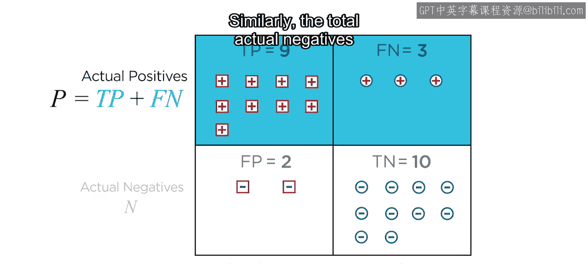
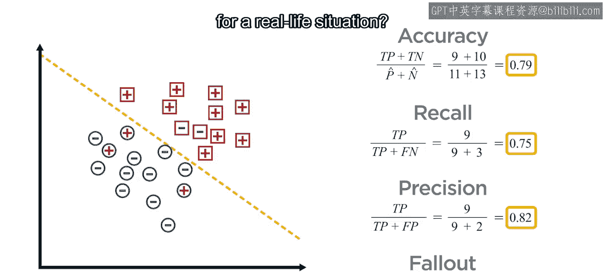
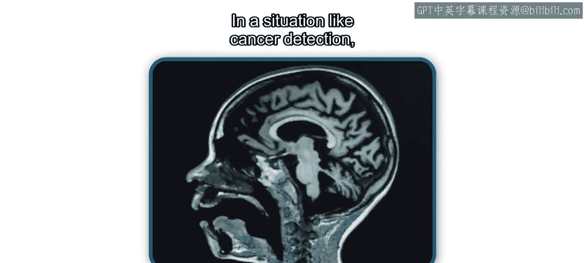

# Mathworks《实用数据科学与MATLAB（数据探索、特征工程、机器学习、毕业项目）｜Practical Data Science with MATLAB》 p98 13_评估分类模型.zh_en [BV1Jr421w7wL_p98]

🎼，You've just learned about some of the most common classification models。

As well as how to use the classification learner app。To quickly train these models。

You also saw some metrics and tools for evaluating classification models。

 such as accuracy and confusion matrices。In this video。

 you'll start by reviewing how to construct a confusion matrix。From the confusion matrix。

 you'll derive four key metrics for evaluating classification models。Recall， fallout。

 precision and accuracy。Next， you'll see why it's necessary to consider tradeoffs among these metrics when evaluating classification model performance。

Finally， you'll work with receiver operating characteristic curves to systematically evaluate the trade off between recall and fallout。

Let's get started with a simple example of binary classification。Recall。

 a binary classification model uses a decision boundary to separate two classes of data。

 In this case， positives and negatives。Although in general。

 the decision boundary does not have to be a straight line。

This video focuses on this simple case to illustrate the concepts。

Data points on one side of the decision boundary are predicted to be positive。

And data points on the other side are predicted to be negative。

There are 12 data points in the positive class， and this model correctly classifies nine of them。

These are the true positives。You can see this abbreviated STP。

The remaining three positives that were classified as negatives are the false negatives。Similarly。

 there are 12 data points in the negative class。The 10 of them that were correctly classified are the true negatives。

Finally， the two negatives incorrectly classified as positive are the false positives。

A common way to evaluate these four quantities together is using a confusion matrix。

The true values are grouped by row。And the predicted values are grouped by column。

Each quadrant in the confusion matrix represents the corresponding number of true positives。

 true negatives， false positives and false negatives。

These four quantities form the basis of all the classification evaluation methods in this video。

The total actual positives is equal to the sum of true positives and false negatives。

Similarly， the total actual negatives equals false positives plus true negatives。

Total predicted positives equals true positives plus false positives。

And total predicted negatives equals false negatives， plus true negatives。

The four key metrics mentioned earlier in this video。Recall， fallout， precision and accuracy。

Can all be calculated from here。Let's take a closer look at each of them individually before considering the trade offs among them。

Recall tells you how much of a given class is correctly identified by a model。Here。

 that is the ratio of the data correctly classified as positive。To the total positive data。

Fallout tells you how many false alarms the model generates for a given class。

For binary classification， this is the ratio of data incorrectly classified as positive。

To the total negative data。Precision represents the fraction of classifications to a given class that were correct。

Which is the ratio of correctly classified positive data。To the total data classified as positive。

Accuracy is the overall rate a model correctly classifies data。

It is the fraction of all correct predictions。To the total of all predictions。In other words。

 how often the model got its predictions right overall。If the classification is perfect。

 the accuracy， precision and recall will be one。And the fallout will be 0。Simple， right？

Unfortunately， most of the time， you will not be able to achieve this kind of ideal。Instead。

 you'll have to consider tradeoffs in the context of a model's optimal capabilities for the intended application。

To see this， let's return to the example。The model has an accuracy of 79%。A recall of 75%。

A precision of 82%。And a fallout of 17%。Would this be an acceptable performance for a real life situation？

In a situation like cancer detection， a false positive may cause a temporary anxiety for a patient。

But a false negative， in other words， a missed positive。Could have potentially deadly results。

Here you may want to maximize recall to ensure you don't miss any positives。You have to be careful。

 though。By changing the decision boundary， you can make recall 100%。However。

 accuracy will decrease to 71%。And worse yet， the new false positives will drop precision to 63% and increase the fallout to 58%。

As another example， imagine you're building a model to detect credit fraud。

Repeatedly locking your customers' cards due to activity incorrectly classified as suspicious could be a major source of frustration。

Reducing fallout will lower the number of false alarms generated by your model。Again， though。

 be careful。If you change the decision boundary to make fall out 0%。The accuracy will be 71%。However。

 this will increase false negatives so that your recall drops to 42%。In other words。

 your model would let 58% of potentially fraudulent activity through。Well。

 what if you're trying to classify email as spam？Letting a few undesirable messages through is not the end of the world。

However， causing a user to miss an important message from friends。

 family or coworkers is much more serious。Which metric would you focus on to minimize the number of false positives filtered out as junk by the model。

In real life scenarios， there will rarely be a decision boundary that perfectly separates the positives and negatives。

So you need to consider the inherent trade offs to build an acceptable model。

Based on what you've seen so far， it may be tempting to assume that while the other metrics may give contradictory priorities to the model。

Shooting for high accuracy will find a good balance among them all。This works sometimes。

 but yet again， you have to be careful。If your data has a class imbalance， for example。

 a large majority of the data is negatives。Then a model that predicts nearly。

 if not every data point to be negative。We'll have high accuracy。

An even high precision and low fallout。However， the recall will suffer。

What about when you have a large majority of positives？In this case。

 a model that predicts almost if not all data as positive， will again， have high accuracy。

What happens to the other metrics？At this point， you may correctly suspect it is a good idea to always look at multiple metrics when evaluating a model。

 for example， both recall and fallout。An effective way to evaluate a model using both recall and fallout is to construct the ROC curve and determine the area under the curve or AU。

ROC stands for Re operatingting Charistic。A term that comes from radar engineering。

 where it was first developed and used。The R O C curve represents recall and fallout for a model as a function of a threshold parameter that varies from 0 to 1。

 moving the decision boundary through the range of data。

The area under the curve also ranges from 0 to 1， with better models being closer to 1。

Now let's see what's behind all of this。First， let's talk about the threshold parameter。

Various binary classification models will assign a confidence score or probability of a data point being positive。

 ranging from 0 to 1。Which can be plotted as contours。As you have seen。

The decision threshold can vary throughout this range。

 affecting both the recall and fallout metrics as it changes。Variary the threshold value from 0 to 1。

And calculate the recall and fallout。The calculated recall and fallout values。

Are used to construct the ROC curve。Notice that ROC curves always start from the upper right corner。

This is because for a threshold of0， all data will be classified as positive。

 so both recall and fallout will be one。As the threshold value progresses through the data。

 the recall and fallout will change accordingly。Until the threshold reaches one where all data will be classified as negative。

 making both recall and fall out 0。In practice， the ROC curve is often constructed with more granularity。

In general， various models will have different ROC curves and therefore different areas under them。

An AU value close to one indicates that the model can achieve high recall while still maintaining low fallout。

As the area under the curve decreases， the amount of fallout necessary to achieve high recall gets worse。

At an area of 0。5， the model is essentially making random predictions。Below this。

 the model is actually better at predicting incorrectly than correctly。

The R OC curve is useful for helping you determine where to set a decision boundary by visualizing how recall and fallout are related。

Let's summarize。In this video， you learned how to construct a confusion matrix and derive key metrics for evaluating classification models。

You saw how evaluating a classification model requires considering trade offs。

And how to work with receiver operating characteristic curves to systematically evaluate the trade off between two metrics。

 recall and follow up。Next， you'll implement what you've seen here in MatTLap。

