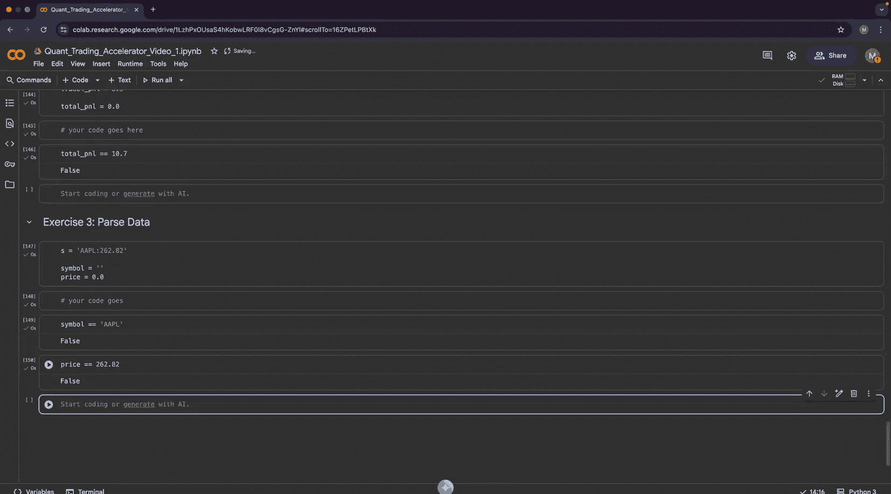

# MemLabs【中英⚡量化交易加速器｜Quant Trading Accelerator】 p01 P1 - Part 1： Variables [BV1UrreB1E8B_p1]

So this course， this course is quantant trading accelerator。

The reason it's called an accelerator is because we're going to be learning from0 extremely fast。

 just like how all these tech startup accelerator work。

 and the key principle behind it is that we're going to be learning by building just like a guitarist who learns how to play guitar。

 they learn by playing by playing the instrument。 and we're going to do the same。

 we're going to be learning by building。The only prerequisites for this is just intellectual curiosity。

 so it doesn't matter if you don't have any maths or programming experience that the main key prerequisite is just curiosity。

 So you're very curious how things work。 So we're going now going to discuss what is quant trading。

Quant trading， it differs from other forms of trading because it's based on our model。

 The model takes an input。Takes an input and it makes a prediction which is a prediction into the future。

 we also call it a forecast， and then that prediction is then passed into a strategy and that strategy converts the prediction into orders。

 and then the orders are then executed onto a broker platform or in exchange。So the course overview。

 there's like four key objectives， so you're going to be able to want you to develop research skills and be able to build and test your own trading ideas and to quantify them。

And we' you're going to have the ability to develop and back testest your own models and strategies。

 and then we're the fourth one is that we can put it all together。

 we can code it all together and automate them。So what's it that？Because we're learning by building。

 So we're going to be building several things together。 The first one is a data analysis library。

 And you may be wondering why are we doing this when there's like pandas And the key reason for this is that we can fully understand what pandas is doing behind the scenes while learning programming and also mathematics。

 So it's a really good exercise for understanding to become more proficient with pandas or Pols。

So once we've built that， we'll have quite a good level of programming and math that will then go into the research library which will allow us to test our ideas and to create models and once we've built our library we'll understand。

 have a good understanding of let's say， machine learning and econometrics。

That's we we can build and back test a machine learning model so that's that's we're going to be doing who's going to build a model and then we're going to build a strategy based on that model there are like four key skills to this which is the programming of mathematics which is say the foundation which we'll be doing for the first two projects and then the econometrics and machine learning and see these if you have a good understanding of econometrics and machine learning then you'll be dangerous。

The course logistics， its we're going to be using Google Coab。 So this is what this is Google Coab。

 And the reason for this is that you just need open up a web browser。

 don't need to store anything closelyly。 so you can have like two taps one。

 this coab notebook and then the video and the videos are going to be by size。

 So the roughly around 20 minutes each。 So this allows you to not allocate a huge amount of time for each video。

And the learning is going to be incremental and just in time。

 So I'm not going to teach you every part the kitchen sink of of mathematics and python that we're just going to learn just enough that we can build build upon。

 and we're going to build。Incremently。So another key thing don't skip the videos because each video builds upon the other。

 so don't decide okay， go straight to the model part or straight to the strategy part because。

Would you gonna be be built upon the other videos。And the exercises， please do them。

 If you're not actually doing the exercises you're not building。

 then you're not learning essentially， especially if you're going to use。

 I don't mind you using say like chat GPT as long as for example， if it's to debug a solution。

 but if it's just to generate the code， you're not going to learn anything。And also， it's really。

 really important that you comment。 So， for example， if something iss not clear to you。

 please let me know in the comments because there may be other people that it's not clear for。

 And then I know that I need to either remake the video or， or edit it。So that's the。

 the course overview out the way。 So now we can start by。The actual first lesson witches。

We're going to be dunk。I part1 is going to be variables。So just before I go into variables。

 I just want to show you this notebook what actually does。 So for example。

 I've just got this Python code here just to add some numbers and you can see when I I can run the number by either clicking on this button or by doing shift enter。

And you see here it generates the output， so it runs the code and if there's any output。

 it displays it。So。Now， we can actually start to create variables and to create a variable。

 you have to give it a meaningful name。 So for example， if I want to represent a price。

 I say price equals and say what the value it should equal。

 So I'm saying here that the price should equal， say，$10。And this is assigned it。

 And if I want to print out the value of it。I can do so like this。 And if I want to， for example。

 update it to say， for example， that it's going to go up by it's gone up by 50 cents。

 then I can do this。 So then。And essentially， what it's doing is saying the price equals the current price。

 which is 10 then plus 0。5。 So now if we print out。Is $10。50。

And we can also create new variables based on existing variables。 So， for example， if we want to。

 say the old price。Equals price minus-0。5。We can do this。 And then if I。Look at the price。 Now。

 it's 10。 And essentially what it's doing is， is， is this saying that the old price equals and see what the what the current price is is 1。

5。 So that's what it evaluates to。And then it's 0。5。 And that's essentially what it's doing。

I'm just going to print our price again。So it's like $10 here。

 And there's a really key important lesson is this memory referencing like， so， for example。

We have price equals $10。And we're going to say that the new price。Just say this point is $10。

As well。 Okay， and we're gonna update price and to say that it's now $11。So I'm going to run this。

 And now I'm going to print out what。The value of new price。 And I want you to have a think if。

 if it's going to be 11 or $10。So。Let's run it。And you can see here that it's $10， and it's not 11。

 So the， the key reason for this is that when I updated， So， for example， here， I updated price。

 This is a new memory allocation。 So it's it's a new。

So you can think of this as one memory allocation right to store this number。

 and I'm now saying that price has a new memory allocated for this number here。So。

It's only updated for price here， like at this time。 so it's not pointed to the same memory。

 if it was pointed to the same piece of memory， then it would would be this would be at 11。

 And we're going to see， for example， in later videos where we do with arrays that it actually works。

 but not with with numbers。So now we look at price。You can see it's it's at 11。

 so don't worry if this is not super clear for you at the moment。

 but just in future videos and when you actually start building that this will become more intuitive and more understandable。

 but it's just a very important。Detailed to discuss。

And so now what we're going to do is look into numbers because that's like the fundamental data type。

This。Okay， so let's have a look at the the data。 So this is function in Python that allows you to say。

 what's the data type for a variable。 So I'm gonna just show you that what price data type is。

 So this is a float。 And this is essentially what， what we call represents a real valued number。

 So this can be whole numbers， and it can also be like decimal point numbers。And for example。

 those floats， but there's also another data type to represent numbers which is called an integer。

 and this represents whole numbers。 So for example， number of trades。

 the number of trades can never be like 0。1 or 0。2， it's always just whole numbers。 So for example。

 if we make 100 trades and we print this out。So it's 100， and we have a look at the data type for it。

You can say it's an intego。And we can also， for example， we can convert number trades。So for example。

 we can do this， we can convert it from an incate to a float。So。If we be passing。

 if I do a number of trades。And then if we look at the type。OfNo portrait traits。

You can see it's now a floatat。 And if we actually have just print out， it's still 100。

 but you' now got this 0。0。 and this typically indicates that it's a float。

So now what we're going to do is I will just want to show you the the other way around。 So。

 for example， we can convert a float into an integer。But there's a key important detail here。

We we lose the decimal places here。 so that's just got to be very careful when you're converting from float to an end。

 in some use cases， you actually want to do this。And then you can do it the opposite opposite way around。

 which we've just shown， which is， for example， take an intego and convert it into a float。And also。

 what we can do is convert。Say a string， which we' we're going discuss later in the video is a string。

 So this is a string。And it's。Can be typical that maybe the data that you get let's say from a CS3 file or from an API。

 comes the price comes as a string that you need to convert。 So this is like very typical。 So。

 for example， here， it's now converted it from a string into into floats。

And now what we just need to discuss is arithmetic。So what arithmetic。Let's just write some。

So for example， hip。It's valid that these operate these are called operators and some operators have higher precedes than others。

 So for example， multiply has a higher precedence than the ad operation。

So it doesn't evaluate from left to right。 It evaluates which operator has higher precedeings。

 So essentially this， it evaluates it like this， which is。3 plus 9。

It's essentially because it evaluates this multiplication first。 And then so you can see here。

 that's essentially what it's doing。 However， if you want to force it to to do。

 let's say calculate this part first， then you would need to put parentesis。 So for example， here。

 three plus3 and we're going to multiply by free。And you can see it's a totally different number。

And we're forcing it to evaluate the addition before the multiplication。And now， essentially。

 what this is doing is now saying it is doing this。 It's six times free。And with arithmetic as well。

 that you may want to。You can do arithmetic on on a variable。

 So not just what these are called like literals or values。 We can also do with variables。 So。

 for example， we're going say， like， if we want to multiply it by， say， like。

 show how much increases by 5% the current price， then we can do this， right？ And if we， for example。

 if we want to show like that it decrease by， let's say 10%， then we can do something like this。

 So price。1 and then minus， let's see。10%。Okay。So， that's the。Arithmetic。

 and that's that's quite important because most beginners might think that it just evaluates from left to right and it doesn't。

And now we're going discuss strings。 So numbers are really important。

 but strings are also really important， especially because we're going to be loading like data from like a CSV file。

 And that's going to come in as strings。 So you have to be very competent in working with with strings。

So here we go。 So let's say we have a symbol and a symbol is like a unique identifier for a trading instrument。

 So， for example， this is for Google， right and。Let's just。

 And now if we look at we print out the variable， you can see that it's a string。

 And just to confirm， we can do this。 we can say ti type of symbol。 and you can see it string。

 STR is just short for string。And it was a very common operation is to add what's called a suffix。

 which is。 So when you add two strings together， it's called string concatenation。And。

What we're gonna do is add what's called a suffix。 And this is very common。

 Like when we're working with data is like， for example， we want to create a column。

 And let's say we a column is like the prices of Google。

 So we can add it like the front or at the end。 So for example， here。

 I'm going to just add it to the end， which is called a suffix。 And we just print it out now。

We can see that we've got this Google underscore price。However。

 we could do it at the beginning as well。 so for example。If we do this， for example， column。

 this is the prefix version is that we do price underscore。Simple。So you can see now there it's。

 it's prefix added。 So it's at the the beginning。And also， what we can do is。

 is do that the following。Is we can replace， for example， what's very common is like， for example。

 your preference may not be what's called underscores。 Maybe you want to use a dash instead。

 so you can do this。So for example， what we're going to say is we're going to replace all the underscores and replace it with dashes。

And if we evaluate this， you can see here that the underscore has been replaced with a dash。 However。

 a key detail here is it hasn't affected the underlying variable。

So it hasn't done what's called in place。 It It's generated a new string。 So， for example。

 if we actually want to save it， then we need to update the variable。

 So that's what we're going to do now， so。And the key reason for this is because a lot of the operations on a string is what's called imm mutable。

 So the data doesn't change。 yet creates a new memory adaptationcation like a new string。

 essentially so。This probably be a bit more clear， once we。Do this。 So it's exactly the same code。

And now。we look at it。You can see now it's changed。 So previously， it was an underscore。

 and now it's a dash。And another very common operation with strings is to split the string。So。

 for example， we can do this。 We can split it。And we're going to split it by the dash。

 and essentially what it does is it creates an array。

 and we're going to discuss array in the in the next video。

 but just as a brief introduction to an array。And。We may want to save this。 So for example。

 we're going to do tokens。Equals。This， okay。So we're going to save the array。

And I'm just going to print out。 So you can see now tokens is now an array and to access the individual elements of the array。

 So for example， we want to get the first element。 we can do this。 can see its price。And then。

The second token。Oops。Is Google。 So you can see that it's splitter into an array。 And essentially。

 the algorithm behind it is essentially like doing this。It's like finding out what the index is。

 and we're going to denote the index by I。Okay， and then if we print our I。

 its saying that the' it's founder at position5。Okay， so。

 and essentially what what will do is it will do what's called a sub slice。

 So it'll find it will do this so。If I put I here。The first token， as you see， is price。And then。

That is going get the next token。 and， but it's going。

It's not going to start from I because that's that's the exact position where that hyphen is。

 So it wants to at the next position。 So this is why we do a plus1。And essentially。

 it's going to say， okay， this is it is called what's。Slice， I think Python calls it a slice。

And now we're going to slice it to show the， the string the next token。 So if we're going here。

 And this is essentially saying just。Start from here， but then go to the end of the array。

 So as you can see now， we've got a price on our token。 So this is roughly the the code。

 how it's done it。And so that's the now I want to just show you formatting strings。 So， for example。

 our price at the moment is $11。And I'm going to do this。 I'm going to。

 I want to just print out as a string， like the symbol。 Let's say what， let's say this is Google。

 right。Price。Is。And I'm going to concatenate。So this is remember the string con concatenation at the price。

But there's an error here because if you read the error。

 you can see here it can only concatenate string and not float to string。

 So we have to convert the float into a string。 so we can do it like this。

 I'm just going to uncomment again because the reason why I'm doing this is because if you click on run all。

 it's going to fail here and not run the the code afterwards。 So I'm just going to uncom it。

We can do this。 So now we can do symbol plus。Price is。And then we're going to convert。 We have to。

 We'll explicitly convert it into a string。So you see here that this is what it said that the price is。

 but there's a much cleaner way to do this。 And this is what this was called like a full matted string。

 So if you put an F before the string and now if we can do this。So。Price is。So。

This essentially formats the string， and this takes care of like， for example。

 if the price is not string it automatically formats it into into a string。 and it's identical。

 There's no right or wrong wrong answer。 But I just， my preference is always just use formatted。

So that's the the variables and some basic data types。

 the most fundamental data types that we need to know。 So now we're going to go into exercises。

 So we're going to do the first exercise。Is the following。 So exercise 1。Is to calculate。Price Dlta。

 and the price deta is， is just the change in in the price。

So what we're gonna do is I'll just get some prices。 So， say the price to， let's say the price today。

Is 100。Okay。And the price yesterday。90。Okay。And I want you to calculate how much it's moved by。Okay。

 so that's the the， we're gonna put the price。 So I want you to update this variable and。

You're going to're going to do the calculation。 okay， so your code is gonna go here。Okay， and then。

If you got it correctly， your price Dlta should equal 10。At the moment it' going to。

 So this is what's called a Boolean。 so Booleing can either be true or false so。If your code。

 it should， if you've done the calculation correctly。Then it should equal 10。

 and this should be true。 So only continue to the exercise until this becomes thus as satisfied as true。

Then the the next exercise。2 is calculate。Total profit and loss。 we， we。Dooteta as P for short。

The piano。Okay， so what I'm gonna do is going to。Explicitly say some trades as install them the performance of a trades and store them。

Farables， Ok。 So the say-2。0 trade。Free piano。Equals a 3。0。Okay。I'm in truthful。This is like 8。5。

 Okay， and then the total P L， which is what we want to。That I want you to update。I's this one。 Okay。

 so your code again， your code is going to go here。And then I want。

 So if you've done the calculation correctly， then the total P And L。Should be  10。7。Okay。

 and at the moment this is s because that's my default value that I've set。 So。

 so that's the second exercise。And now the final exercise， which is a bit trickier。

But not impossible。Is this， which is we're going to pass the data。 And this is very common。

 You're going to get data from an API that may not be in a well structured format。

 And you have to what's called pass， which is like essentially doing string processing。So。

 for example， and let's say。We've downloaded some data。 and let's say it comes as a string。 So。

 for example， this is Apple and the price is 262。82， okay， and I want you to extract from this。

The symbol。And we're going to just initialize it as empty， an empty string。 and then the price。

And we're just going to initialize this as a default value of 0。0。Okay。

 and your code to pass is going to go here。And。To do this， if you go。

 if you look at the previous examples， you should work out how， how to do it， so。

Just look at the the section on converting numbers， strings to numbers， and then how to tokenise。

So that's your code。And。Then the， the tests that you need。 there's going to be two tests。

 The first one is that the symbol。Should he call Apple。Okay。So the moment equals false。And then。

 the price equals。262。82。Okay， and then that's also false。

 So that's the exercises and only continue to the next exercise once these tests are equal true。

And that's the end of the video， please like and subscribe and see you in the next one。

This course is free。 Thanks to my Patreon supporters， Doit and Manic Sony。

 If you're getting value from the series and want to help me create more。

 consider joining them on Patreon。

