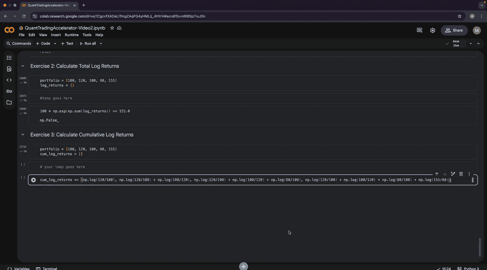

# MemLabs【中英⚡量化交易加速器｜Quant Trading Accelerator】 p02 P2 (Full Course) - Part 2： Arrays [BV1UrreB1E8B_p2]

Hello， welcome back to the quantant trading accelerator。 This is part2。 In this part。

 we're going to cover a array and its application to to finance。

 And this essentially is the fundamental building block of quant trading， AI and Ml。

 So it's really important that we have a really strong understanding of array arrays。

 So let's get started straight away。So we can represent an array。As this so for example。

 this could be like a price time series。And， for example， we can just put some numbers in here。

And we can print out to see what are the rears。And。

We can also just to check to see what python recognizer it has。So for example。

 you see here it recognizes a list and Python calls a raise list if you see a list being mentioned it just means an array and another common functionality is to know what the length is and for example。

 you get some data from an exchange you don't know how many prices you're going to receive so you might need to know how many prices there are。

And so flexible here。 we see that that is full。And a very common。

Functionality is to access the elements。And we do this by what's called indexing。So， for example。

 if we want to get the first price。We can do so， by。This syntax here。

 And this very important detail is that it starts from 0。

 And there's lots of like computer science memes about jokes about things starting from 0。

So as you can see here， we can also just go over and list them。 See here，10。2 is the first price。

 And then obviously， for the next one， it's 9。4。 and we can just do。The same videos those。Okay， and。

And also， in addition， what we can do is we can also act we can pass in a negative number。

 And when we pass in a negative number。Essential， we're saying we get it from the the end。

 So it starts from the beginning。 If it's a positive number， but if it's negative。

 then it starts from the end， and we can do exactly the same。

 So it's just essentially looping over in reverse order。Do this enough for money is free。

AAmong us full。And we're got to be very careful because， for example。

 if we try to access a number that's out of index range。 So for example，5。

You get this index list list index out of range。 So you've got to be very careful that you watch your're passing。

 This is an error。 So I'm just going to comment this。 So if I click， if you click on rerun。

 it doesn't stop here。 Otherwise it would。 So that's accessing the elements of an array array。

 which is a very basic functionality， but now I want to just show it like， say updating。

So if we wanted to update elements。We can do so like this。So， for example， let's just， let's do this。

 let's say。The first element we want to update to none。

So now if we print out a nu essentially represents like a what's called like a null。

 which is like an empty value essentially， and this goes quite common when you're downloading market data or from exchange。

 sometimes there can be errors and sometimes the prices like it be missing data so。

It's quite common for it to， to have a null anyway。 So that's prices updatingb the elements。 And so。

 for example， we can also， we can do this。 We can do prices。

We can also do their way around by using a negative number。 So here what it's going to dos。

Here is what it's going to do。Update the， the last element。 So if we can see now。

That we we've got nuns now at the first the first element at the head and at the tail of the array array。

And now what we can do is to look into how to remove elements。Okay， so。We can do this。

 We can do prices dot pop。 And what P does is remove at the tail at the end the of the list。

And there's a good reason it does at the end， which we'll go over later。 But so， for example， now。

 if we look at the， the prices now。We can see that it's removed from the end， the none at the end。

 So now it's just three elements now， but we could also remove from the the beginning。

 and we can explicitly tell it to remove from the beginning by passing an index。 So， for example。

 here， this is going to pop at the front of the of the array。And now。

We see that we've got only just two elements left。So。We can there's other other ways of of deleting。

 So， for example， you could do this。So now there's two elements。

 and this is will essentially remove 9。4。 So if can I have run this and then just print out。

You can see it， it's removed it， but you could also again use。Price this minuss1。

 but just got be just one caveat to this is that you don't with pop。

 you receive the the element removed whereas with first you don't receive it。So for example。

 I can do this now。And our print out prices。You can see now we've got an empty list。

 And I just want to show you' got to be very careful about using pop。 So， for example。

 where you remove elements from， from an array。 So and I'm gonna give you an example。 So。

 for example， I've got I'm just gonna。Just。Is this number here。I think that is how many。So that's。

I can't see that that's 200 million。And。I'm gonna create a price time series of。200 million。

 And it's just gonna be ones。And。You can do a range of them。This might。Take a bit to。

 to do by it's initializing。I'm then gonna time the function for to。To remove。

 we're gonna remove at the beginning。We're going to remove from the beginning and when you remove from the beginning。

 youre essentially remove the first element， but then you have to move everything across。So。

Let's just show an example now。 So I'm just gonna run time here。So it's done it in 225 milliseconds。

 Okay， but if we essentially we're just clear emptying our array， right。

 and let's do the the same notes。 let me just copy and past this again because it's removed the elements so we need to repopulate it。

But this time， what we're going to do。Its we're going to。Do prices。Pop。

 and it's going to pop it at the end of the list。 Okay， and we're now we going to measure it。

So you see it's done in 6 microseconds， so。Really huge speed improvement。

So and the reason for this is because it doesn't have to shift the elements across。

 So if this is just very important because this essentially scales linearly with the size of your array。

 whereas this it's。Because you have to like it's like it was called like a constant time operation to remove。

 whereas this is like a linear time operation。So you've just got to be very careful about removing elements from ray should always remove it from the end。

So that's the， that's add removing elements and to add elements now。 So， for example。Now， adding。

Elements。Now， to add， let's just say we've got an empty price time series， okay。

And we can add prices。Mannually， by， for example， we want't add to the price 10。

5 we can do this and now that's added it。And you can see now we've got like an array of just one element。

 but we could also add multiple at in one line and we can do that using this。So for example。

 we can pass in all right。 So if I got like a some numbers the 11。49。512。3。I this and now。

If we print them out， you can see now it's added these numbers in。There's。

 and I just want to quickly just go over。This notion called an in homogeneous array。I just going to。

What genius are？And an inhogeneous array is， for example。

 is where you've got an array of mixed data types。 So for example。If I have。

 let me give you a good example here， so if I got like 1。0。Like a float。 and I've got a string。

 and I've got oops， and I've got a boolean。And I've got this。 This is an in homogeneous array。

 And we're gonna to see later why it's important to to have what's called homogeneous array。

 And another example， which you might is this one。 So for example， you've got 1。0。 and you got。

 say an intego。 And then let's just say another float。So that it's still numbers。

 but it's not homogeneous。 And when we're working with quant trade and AI machine learning。

 you want to always work with homogeneous arrayse。So let me just give you another example of a in homogeneous array。

Now。We're gonna to look into homogeneous array。hel没。

And one of these is where the the the data type are always the same。

 each element has the same data type。 So， for example， it's very common。

 the most common array in quant trading and AI machine learning is a floater array。

And this is a homogeneous array because we know that each element in the array is afloat and we can reason with this that we can run。

Pacific CPU instructions to paralyze and speed up the computations。

 And we're going to see an example of this later on。So again。

 that's another example is just say with numbers they've got like intertego right。

And this is also a homogeneous， right？So now that we've covered a rays now we need to to go over loops。

And so loop。Coinciize really nicely with arrays， because we want to do operations。 and we want to。

 we don't want to manually say update or add to to the array。 want to do it like automatically。

 And this is where loops come in。 And so， in fact， the most basic like loop is like this range。

 And this is。Allows you to loop。 So， for example， this is gonna loop over five times。

And here it's going just to print out。 And again， it starts from 0。

 So you can see it's printed out5 numbers from 0 to 4。And。So that's range， but you can also。

 for example， let's have got a price time series， say T 2 and 9。5。5 and 9。4。

 the numbers don't matter too much。And then you've got this four price in prices and what this is going to do。

 it's going to loop over each element individually。And we're gonna to print the mount。

And the reason we want loops is because we don't。 Okay， we know what the。

 we could just just do this manually， right， But we may not know how many prices we get。

 Let's say we get downloads and prices from somewhere。 We may not know how many prices we've got。

 We want a loop over them。So it's like undeterministic what the how the prices have been initialized。

And again， so we're just gonna print the the the numbers out right。

 But let's just make have like just a bit more of a practical application。 So， for example。

 we might have trade peer groups。We might have trade Ps。

 which is each element represents a round trip trade and that round trip trade can have an associated PL and essentially a profit loss。

 So， for example， the first trade could make， say $120。And。Next trade loses $2。

Next trade loses a dollar。And then the fourth trade makes $4。10， okay。And we can just likely sample。

We can loop over them。And let's just say this is our total pin now。

 which is we want to add up all the our trays to work out what the total PL is。Okay。

 and we just go over So trade P now。 And it's also very important that you have a a good variable name for when you're looping。

So it just makes it very clear。 So trade pins is what we're going to loop over the list。

 And essentially what we're just going to do is to just add the the trade panelel。Okay。

 and then we're just gonna print up the tutop pinena。So there we go。

 And this is essentially what pandas and polars are doing。 It's just a arrays or factorss。

 essentially， and you， you're doing loops and they're doing calculations while looping。

 And just to show。Now we can just like manually just calculate。

 I just want to show what it's actually doing just to make it super crystal clear。So minus1。😔。

And then，4。1。And you can see we got the same number。

 but we're doing it all in one in a loop and not doing it manually。 So now that's。

 I want to go over now is what's nu I array。 And I'm going to give you a really。

Good justification for using N rice， because you might come across them and may not know why you should use them。

And I think I've got a good example to justify why you should use them。So， okay。

 so I'm going to import the numpi library。And this is essentially just allows us。

 And the what'm doing is is I'm just naming it as MP。

 And that's quite common practice is to to import it and just rename it does MP。 So now with MP。

 what I'm going to do。I I'm going to set enter quite a large number。 I'm going to。

Just it's easy if I just copy and paste。And I'm going to create an array。And it's gonna be of one。

 It's just each array element is gonna be ones。And this is what's also called like an identity factor。

So this is what I'm going to create。 and it might take a while。 So and that you can see here。

 it's all all once。 and we check the length。It's of this size。

 And now what I want to do is just to see， why are we。And why we want to use nupy， So for example。

If I count if I want to do a sum， just imagine these are like trade Ps and we want to add them up。

 Okay， if we run this now。Okay， it's done it in  hundred04 milliseconds。 Okay。

 and now what I'm going to do is just use the。The pythons built in some function。And just。

 this is Pythonons built in some function。And this is numyi， which is a very specialized function。

 oops。cause was this。Okay。So maybe if I just do it， I don't know why。

So what I do is I just do it manually， that maybe a bit easier as well。So for， let's just say。

 for Val。And a。And was just going to。ToAt the thoughtm。Okay， and then we're just going to， to。

 to print out， which okay， so just make sure that I'm gonna run this。And as you can see。

 it's taken a long time to do。 So while while it's doing this。

 I'm going to just explain why it is this so much faster。

 And the reason is because this is a homogeneous array。 And because all the。

 it's all floating point numbers。That it can take advantage of this using specialized CPU instructions。

 which are called like SMD。 So essentially it paralyzes the calculations。

 and it's essentially what GPus are doing。 but the CPUus can do it So because for example。

 if it was like inhomogenous array， it wouldn't be able to run these specialized CPU instructions。

 but because it knows it's an array of floating point numbers。

 it can use very specialized instructions。 And also as well。

 another factor is that as this is written in C。 So it really allows to write highly optimized calculations。

 As you can see here， look the speed differences night and day here。

 So this is a good justification for example， when we're going create our data analysis library that we're going to use Ny。

were doing our calculations and this is， you know this is a good empirical proof why we should use it。

So now that we've gone over nupyise。 and I just want to show you like some practical applications of of array with an application to finance。

So。Let's do this。So log roomss， we're going to go into talk about the log room function and why。

Because they have lots of applications to， to finance。 And so， for example。

 it's just the inverse of the exponential function。 So the exponential functions。 So， for example。

 you can raise it to the power of two， okay。And essentially。

 because we're just raised it by the power too。 if we take the logarithm of it。Okay。

It's going to just tell us what how much we raised it by。

 So you can see here that we raised it by the power of two， okay。

But let's make this bit more practical now， so。Imagine that we're going to invest like $1000。

At a continuous rate。Of， let's say。Of 5%。看一眼。Okay。And let's say that， for example， this is how。

 for example， after one year。This is what how much money we would。Make， so we say make， itll be $50。

 right。 But imagine we do this， like in the next year。And in the next year。

 we just need to just multiply it because we're going to reinvest the the money into it， okay。

So then， and this is， and you can see there's going to be this pattern here。 So， for example。

 in the third week。I started the third week third year。That。It's gonna be continuously compounding。

 And we can just repeat this and repeat this after like。Put this in in a loop， essentially， but。

It if we' were going just loop over it， it wouldn't be competition by me。

It wouldn't be computationally efficient， right， So for example。

Let's just like give you an example here。 So for example， capital。Is 1000。And we loop over。

So range of 20， let's say for 20 years。And we do capital。1。05。 And we then just print up the capital。

 okay。So we can do something much better here。 We can just just use like an analytical solution。 So。

 for example， we can just say capital times1。05 raised to the power of 20。

 And it'll give us exactly the same answer。 And this is way more efficient because thiss just a one liner。

 This has to loop over。 So for example， this was like， I don't know，50 years。 Okay then。

This would have to loop over 50 times， and here it's just looping over just once。

But you see here that you're raising it by。The power of 20， Okay。

 And so now next a good practical example to use logarithms is this。So， first of all， how long。

To double our investment。Okay， so let's say again， we we got capital。Is 1000。And essentially。

 we want to find some T， and I'm just going to default， initialize it to one。Where the capital。

 we're going to do two times our capital equals the capital times， then the rate of the return。

Rate to the power of tea， okay。And obviously， this is going to be false。

 There's multiple ways we could solve this。 Like， for example。

 you could use like a brute force approach looping over every single T， but that would be。

Crazy to do。 So we're not going to do that。 We're just going to solve this analytically。 So。

 for example， we're just going to divide the capital on both sides。And then this essentially。

 just becomes one point。0，5。Race or the power of T。

 And that's essentially what we're looking at thus。And you can see it's still false。

 So we haven't got the a T。 But what we can do， is remember， because when you take the log your your。

You you you've got the term the the power。 and we can simplify the algebra now。 So， for example。

 we can take the log on both sides。So now we're going to take the log on the left hand side。

And we also want to take the log on the right hand side。 And now it just becomes T。

 multiplied by the log。Of the， and this is a log return now。

So now we've got the log return of our rate of return。 That sounds complicated。

 but essentially we're just taking the log right of， of the current rate of return。And again， if we。

Is still false， okay。But now we can just use simple algebra now to， to， to rearrange it for T。

 So now we can just do MP log。Of two。Divide dividedivided by the， the log return。Okay。

 and now we can print out the the lockquione。 Okay， so it'， it takes 14。2 years。

 and we can empirically check this。 We can do it like an empirical proof by doing this。

 So we can just take the capital， multiply it by 1。05 raised to the power of T。

And you can see here that we've got we've analytically come to a solution。

 you can see we've double done money。 exactly in 4。214。2 years。 Okay。

 so now that should give you a bit of more intuition around the the log ribbon function。

 And just before we go into calculating log return going is log return。

 So I just want to explain what actually is a log return and why we use them rather than just say like。

Absolute values like trade， like， okay，$10 or $1。So for example。

 this is what were to say live returnss。Okay， so let's say I， I tell you， I've made $100。 Okay。

 and you go， okay， that's， that's great。 But what did you start from。

 And that's what's the really most important。 What did you start from And returns essentially models this。

 So， for example， if I started。My， my profit。 but I started with， say，$50。

Then I would have doubled my money， and that would have been really impressive。 Okay， However。

 if I started with $99。Then I've only just made 1%， and that's not impressive。

 So this is why it's really important to work with returns because this tells you like， okay。If。

How much your essentially your investment strategy or quant strategy or any generic strategy。

How much can it scale by。 So， for example， if you increase the money。

 how much more money would you make。 So it's， so then you don't have to worry about like， okay。

 concrete values。 You work in in a more like scale unitless measurement。 So that's the。

 the practical reason why we want to use returns。 But we're more interested in the log returns。 So。

Just kind of write log returns here。And let's say， we have a port photo。And the portfolio starts。

 The value at the beginning is 100， and it goes up to 120 and then drops back down to oops。

Back to 100， okay。And this is a time series， and this is the of our portfolio value over three time steps。

 And for example， we can calculate the deltas or the differences by just saying like 1 hundred and 20。

And then 100-120。 And you can see here by looking at the the price differences。

 you can see it's gone up。 It goes up by 20 and it drops down by 20。

 So that's like it goes up by equally the same amount， right？ However。

 if we look at the returns of it， it shows a completely different picture。And that is。

That there's this asymmetric property。 So， for example， we do 20。Over 100， and the  -20。Over 120。

Okay， so you see it， it goes up by 20%， but then it drops down by 16。6%。

 So this is like asymmetric property with returns。 and it just。

We want to make it everything symmetric， right， So。

 and this is where log returns come in because it has this property called time addivity。

 and they are symmetric。 So， for example， log returns。

 if we have a represent our this portfolio represented in log space。Then。

Well do the the following right。 So we take 120。Over 100。And now，100。Over 120， okay。

And if we just print this out。Even to see something really cool now。

You can see it goes up by the same amount just， and it's just it's just flipped the sign， right？

 So it goes， it's just like price deltas in a way that it goes up symmetrically。

 So now we're in a unitless measurement and also it symmetric And what this allows us to do is to add up the log returns to give us our compound rate of return at each time step。

And if that， I'm， I'm just going to give you a really like just put that into concrete example。 Okay。

 so， for example， I can use MP sum。Log returns。And we just add this up。 Then you can say it's 0。7。

 because。So， now， essentially。We can just do this， We can just do MP sum。Loockertons。

And you can see we， we've not made any money here。 Okay， so that's the intuition around log returns。

 the best way to， to get more comfortable is if we by doing some exercises。 So the first exercise。

Is this We're going to calculate。The average block return。

So what I'm gonna do is we gonna to give you some log returns。

And I want you to calculate the the rrithmetic means just the average。Okay。

 so I'm going to give you some log returns。And I want， and I want you to loop over。

 Don't do it manually because that's cheating。And， let's just say。Okay。

 so here are some local time numbers。 And I want you to oops。

And I want you to loop over in the next hang on。Equals so I'm just going to set it to0 at the moment。

 And I want you to put your code here and your code must loop over them。I put loop goes here。Okay。

 and it should pass this test， which is the average log return。Equals 0。082，8。Okay。

 so that's the test to know that you've got the correct answer。So that's exercis number more。

 and that's the easiest。 And now the next one is going to be a bit more trick here。

And that is exercise， too。And with exercise，2， we're going to， let's see。

 we're going to calculate the total log returns。So。We're going to loop over。 and essentially。

 you going， you're going to add them up。So。Calculate total rock。

And we're also going to calculate them at the same time， okay。So we've got。

 let's say I've got a portfolio。And it starts at 100。 It goes up to 120。Dropps down to 100。

 drops down even more to 80。And。Then it shoots up to 155， okay。And I want you to create the。

To loop over and create the， the log returns。Oops。Okay， and your loop goes here。And again， it is。

 you don't do it manually just with。If this was like a real world situation， you wouldn't。

 you'd get download maybe your portfolio from some API or maybe from another department。

 and you don't know what the size is right， So you need to to work that it can work for any arbitrary size。

 So don't like hard hard code this。So， and then the test to know that you've done it correctly is that if you do。

 if you。Take the exponent。Of the son of the log returns。That it should equal 155。Okay。

 so that's to know when if， if it's correct。 So for example now， if I just。Run this now。

 It's going to be false， right， So this should be true。

 And exactly the same for for this one as well。 this only， you've only passed the exercise。

 if this equals true。So， I now， that's the。The next exercise exercise。 and this is tricky。

 And but once if youve mastered this， then we are actually in a very good position to actually build our own data analysis library。

 so。Id really strongly recommend to do the exercises。So。

 and then the next exercise is to calculate the cuummulative。 and this。Is just。Log returns。

 And this essentially， for example， in my previous videos。

 where I like was building a strategy and using pandas。It was。

 I was calculatedalculating in cumminator for lock returns， whoops， maybe I。Just put this as a text。

 and。Let me just。Okay， so that we're gonna do， do the following。We're going to use another portfolio。

 I'm just going to， just for。To speed up， I'm just going to just a copy and paste。Okay。

 and your loop goes here。And so what I want you to do is to do the the following。

 So essentially the cmd。 So this is your test， but it also tells you how it's calculated。

 So your cumulative log returns should equal this。 And I'm just going to maybe it's easy if I just copy and paste it and then just go over。

Okay。It should equal this。The first element is the just the first log return。

Okay and then the next one is is the previous log return plus the new log return and you can see here now for the third one it' free log returns。

 which is the two most previous plus the new one。 and it's exactly the same。

 So this is what's called like cumulative。 So this is why I want you to calculate。

 and this is a really， really common algorithm that that we need So it's really imperative that you have you can do this by yourself。

 So even though pandas and polars does it for you it's really important that you actually know how it's calculated under the hood。

So that's the part two。 and then in the third part。

 we'll go over some linear algebra matrix and actually build our own data analysis library。

 Thank you， cheers。

This course is free。 thanks to my Pereon supporters。

 Their contributions help me keep this content free instead of being behind a paywall。

 Consider supporting on Pereon or buy me a coffee Li below。 Thanks for watching。

 and please like and subscribe。

