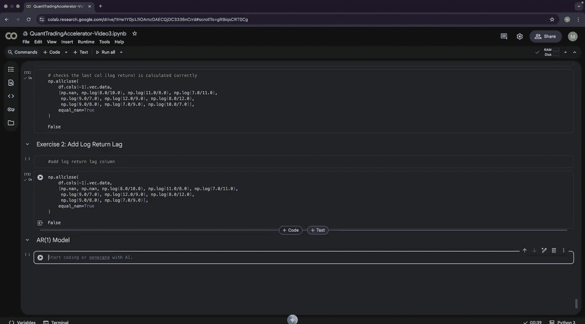

# MemLabs【中英⚡量化交易加速器｜Quant Trading Accelerator】 p03 P3 - Part 3： Vectorization [BV1UrreB1E8B_p3]

Welcome to part 3 of this quant trading accelerator。The second par was all about the arrays。

 and now this is the extending on this part 3 vectorization。

 which is essentially array on arrays on steroids。In this video。

 we're going to build our own data analysis library from scratch。

While learning all about effectization。So before we start， we need to do a bit of。

We need to do effect algebra。Be very comfortable working with affect。And to do that。

 I'm going to just copy and paste。This vector class。 So we're gonna， we're gonna model。A factor。

As a class。 And there's gonna be some functions here。 I recommend that。

I'd rather go through each one individually because it would be quite boring video。That when I。

 if you're interested to know how it's implemented， is then to refer back to the class。

To see how it it's implemented by just， it's here for you and。嗯。

But we'll go back to this class when we show， I'll show you examples。

So the first thing we will need to do is specifically is to look at is factor scalar algebra。Okay。

And so we're gonna create a factor using our vector class。And we can pass in an array。

And essentially what it's doing under the hood is creating a nupy array and it's essentially just a nupy array with just some convenience like methods for effect algebra and also statistics。

And now if I print this out， you see we've got a vector right And so a factor scalar algebra is when you take a vector and you add a scalar and a scalr is just an individual value。

 so it's not an arrayw row。It's just yeah， you just call it a scalar。 So for example。

 one here is the scalar。 So if we we add it and you notice essentially what it's doing is is it's looping over the array and adding one to it。

I mean so essentially what is doing this is doing one plus one。Then two plus one。A three+ one。

And you notice it's just more concise。 So itd be really。Noisy if I just had the notation out there。

 so it just makes it very concise。So that was addition， right， so we can also do。Do effect -2。

 for example。 And again， what it's doing is it's doing 1-2。wo minus。2。And free minus， too。Okay。

 and you can see that can I give us the exactly the same results。So that's and it can also be。

 you could also put it have it on the where the scale is on the left hand side of the operation。

And you can also do， for example。Multiple multiple location， okay？

And may be wondering why are we learning this and the reason is because our data analysis framework is going to be working purely on factorization and I'm going to show you the reason why later in terms of performance。

So that's and then I'm gonna just show you can also。Dide as well。Okay。

 so that's the N I just wanted to just show that what it's doing actually behind the hood。

So for example， we have。And this is very important as well when you're doing these operations。

 it's creating a new array， so it's not。Replacing the vector what what's called， it's not in place。

 So it's create always creating new and so it's essentially can treat this as what's called immutable。

So for example， this is essentially what it's doing for like the factor addition right。

 so for example。So the very first example we did like plus one。

 it's essentially doing this E plus one。And then fee。And that's essentially the code， right。

 so you can see。Just from a visual perspective， it's more concise。 and it's very clean。 Where here。

 it's very explicit and。So one of the good choices of factor algebra。

So now I just want to actually just show why I'm going to call this。

This is like a buzzword or marketing of vectorization。Is the power。Of。That was right。Fectorization。

Okay， so we're gonna， I'm gonna give an example。 So， for example， this one is gonna be 100 million。

Okay， we're gonna create two vector or arrays essentially with the first array。Is gonna be。

I in range， essentially this is cr just。An array of ws。With us a length of 100 million。Then the。

V2 is going to be。Factor。AndWe're going to pass in this python list into this。

 and it's going to convert it into a nuier array for us。

 So I'm just going to run this It may take a while。 So while this is running。I'm now going to。

To benchmark， so for example。What we're going to do is we're going to benchmark that code that we wrote。

 which is the Take effect and plus one plus so effect scalar algebra。

And we're going to do this it's going to do for x in V1。Why a pen？X plus 1。

And then we're just going to print because if we， if we don't we're just gonna print out the last 10 elements because otherwise it'll print out 100 million So this is what we'll do。

 Okay， so it's looping over just the python list， it's adding plus one to it and then then we' just displaying the last 10 elements。

Okay， so if I run this。And as it's running， you can see it's going to take a it's already taken a few seconds。

 Okay， so while it's doing that。Okay， so now it's 8。3 seconds。 Okay。

 so now we're going to use our our class。To do exactly the same。 And you can see both。

 So we're gonna to say y equals。 and we've got V2， which is our plus one。

And then we're just gonna do。Print out the last date，10 data points。Okay。

 and now let's let's benchmark this。And you can see it's already done in under second。 So。

 so not only is it more cleaner code。But it's also really faster。

 And this is because it's using factorization。 And the， so， for example。

 let's just have a look at see like the performance gain of it。 So we have。8。3。 How much is that 8。3？

Divided by4 point。 How many second half sets 4，3，2。So it's yeah， just。

 just under 20 x performance improvement over。 and， and the two reasons for this is because。

The vector is working with what's remember we said homogeneous array。

 so because it knows it's always， for example， here it's all integers。

 that it knows that each element is an integer that it can run specialized CPU instructions to parallellyze the calculation。

 So rather than just do it like one individually it does in parallel。

 just like how GPU's work where it's all paralyzed， but obviously not on a larger scale as GPU。

So that's the hopefully you can see this。 And so one of I want to just document this。

 which is where the speed comes from。And the speed comes from。From S IMD。

So if you're incur to know more about。How it does it， then this is Google this， and as you can see。

Some CPU instructions for how it does this。 Okay， so now we've done。We've done vector scalar。

 now we're gonna do vector vector algebra。Okay， so it's very important that your， the vectors of of。

 are the same length If， if they're not the same length。 Then you， you can't do any algebra on them。

 So， for example， we have X here。An X。It's just gonna just be。A sequence here。

 And we will see y equals another factor。And by the way。

 if you ever use anything like MAlab or Mathematica octave。

 then this is you'd be comfortable with this。And then， -1。2。And then， -2。Okay。

And I'm going to just run this。And now we can do the exactly the same like operations。

 rethmetic operations， Okay， so for example， I can do x plus y。

And you can see what it's doom behind the hood。Is this iss doing one plus。Wang。And it's two from x。

Plus， the this element here。-1， so we can just say。I'll just make it more explicit， though。-1。

And then it was the next is free from X。 and then the， the third element。On the y is2。

And then the last element in X is4。Plus， oh that should be my bad。 That should be a plus。And。Then。

 that's plus。Months too。Okay， and we should run this and we should get the the same code。Okay。

 so you can see that。And again， they can do all of operations。 Okay， so for example。

 we can do x minus y。And we'll just make it more explicit like the calculation。 So we do one。-1。

And then，2。Minus，-1。And then， free-2。And the 4-2。We run this。

And you can see we get the cycle of the the， the same results。 Okay， and let's just do。Jither。

Multipplication， so we do x。Times y。바 me。And essentially， whats， again。

 what it's doing is is doing this is doing one。Times one。Two times -1。

Because of the inner secularulism。Which it has been free。Times 2。4our times minus。Q。😔，Can I run this。

You can see we got second the same operations。And now what we're going to do is vectorize statistics。

And for example， if you're working with high frequency data sets。

 it's really important that you calculate very quickly and so a lot of the like for example。

 creating statistics from your data， it should all be factorized so we're going to have a dedicated section to this。

So factorize statistics。So for example， let's say we have log returns。

And remember log returns are essentially just the returns in log space。And。We the oops per cat zone。

Let's just say that for portfolio， that the， this is the。The， the returns。

 log returns for our portfolio。And the-0。01。And we're going to calculate the， the， the the mue， the。

 the， the average， the me so and。Dot mean。And I'm just going to， to print out the， the mu。

 But I just want to show what it's doing。 Like， for example。 So if we go go to the class here。

 there's a method here called。Mean， okay， so essentially it's just calling nuys mean。

 We're passing we pass the underlying array and we pass into to nuy mean so。

All the because the reason we're doing know with nus because it it effect rises it。

 So it'd be really， really fast。 And also just before， I just wanted to just show the。

 the code for to do the。The effect algebra。 And this is all the code to do it。 So， for example。

 heft when it was。In line， we used like the the plus operator。 This is essentially what it was doing。

 So if you're curious to see how it's implemented， then this is。

 this is what's called operator overloads。So， but anyway， we'll go back to our statistics。

So that's the the， the mu， right。 And then now we can do this。

 We can actually start calcs statistics from it effectized。 So， for example。

 we've got the log returns and we want to see that the difference between the。

The log returns and the mu， the average to see how much they deviate from the average。

So you can see here that we've got the now the distances and。Now。

 what we want to do is we're going to， to， to square them。 So， for example， by squaring them。

 we're going to turn them all into positive numbers。And the the the larger the。

 the distance from you， the more it it's amplified。 So if they're all， if。

 if they're quite far away from the mu， then they're going to be amplified even more away from mu。

And the way we're going to do this is we're going to take race to the power。

And we're gonna raise it by the power of two。Okay， so that's the the you can see now what was a negative number is now squared。

And this is essentially what's called scientific notation。

 So it's just a very concise way for writing this。And so now that's the。

 now what we're going to do is we're going to take the， the， the average。

 So what we're going to do is。Take the average of this。 And this is， again。

 all factorized opera opera。Factorize operations。 So we're always working with factors。 So。

 for example， now we， we've got the the， the average。Squared difference。

And now what we're going to do。 and essentially， this is what's called the variance。

So if I print out Var。You can see is it's exactly the the same code here。

 So it's just and it's got these convenient sta methods to to calculate it。

 So if we have a look at the the the code here for factorization。Let's have a look。Fence， are get it。

 So this is。 so again， we calculate the mu。And then we just we calculate the mean oops。

Of the the squared difference from you。So that's how it's all calculated。

 you can see here we're not using any loops here whatsoever。

 So this is so you get two wins you get that its you can write more concise code and it also allows you get huge performance gain from it。

And this is really factorization is like。Very， very important for working with high frequency data sets。

And now what we're gonna to do is we're gonna do this。 We're going to。Gonna take the square roots。

And when you take the square root of the and we're going to just do the the variance here。

 So for example， we're going to take this here。Okay， so that's the， the。

 what's called the standard deviation。 This is the， the math for it。 But obviously。

 I've made it convenient。 And then， for example， it's essentially this iss square roots。

Its lock returns。Ferance。YouConsider see it's exactly the same number。 and， but。We don't need。

 We can also just call S S T E。Not sexually transmitted disease， standard deviation。

 This now we call this。It they will give you the exactly the same value。

 So it's just a convenience method。 And we have a look at again。

 we'll go and have a look at the the calculation for this。 and you can see。

This there's no special foody magic here。 It's just purely factorized calculations。 So， for example。

 we calculate the， the variance factorized and then just take the square root of that。

 And then that gives us our standard deviation for the vector。So that's how we can do。 for example。

 we could work with like huge data， large data sets and。

Calculate the statistics very quickly because of this vectorization。

And just whileca we've just mentioned mu when also the standard deviation。

I can now introduce some financial applications so we can do the factorized version of the sharp ratio。

So， factorized。Sharp pressure。So， the vector is。So let's just have a look at。

 Let's just say I've got some portfolio lock returns。Okay， and。I'm just gonna。01。

 So let's just say that the returns。 This is the returns on our portfolio。

 So it went up by 1% in log space and again，1% and。Then let me just20。2。And 0。01。Okay。

 remember of Lock returns they have this property called time addivity。

And the time addivity allows you to sum the log returns up。So， for example。

 this is our total compound rate growth rate for our portfolio。 so you can see it's 3%。

And we can also calculate the mu for it very quickly is it's just the mean。Oops。

We can calculate the mean， and we can also calculate the standard deviation。

So then we can see the standard of deviation。 Okay， so essentially the sharp。

The basic version of sharp is you take the mean。And。There's actually with the sharp。

 you have this thing what's called the risk free， you have to factor in the risk free rate。

 but with in high frequency high frequency trading。

 quant trading was where it's usually intraday trading。

 you don't factor in the risk free rate because you don't hold it long enough to accrue any risk free rate。

So。And essentially。This is mu over the standard deviation。

 so this quantifies what's called risk adjusted returns。So the the higher the number。

 the more risk we're reducing like returns， like how stable the returns are， essentially。

 So for example， here， this is 0。68。 but just I think it'll be more concrete。

 if I show you another example。 So it's going to be a portfolio which has the sum of a same compound rate of 3%。

 but is going to be less stable， okay。So， let's just。

So I'm now just gonna choose now what you gonna do。Portfolio locker returns。

 I'm just going to override。To give you some new newances。 So we're gonna say 0，1%。So。And this time。

 sir is， it goes down。Fe times by1%。And then on the the last time step。It's going to go up by 6。Okay。

And if we have a look。Por log returns。Dot some。We look at the sum that it's it gives us the same compound growth rate of of 3% cent。

 But obviously， the what this standard deviation will be much higher。

 So the standard deviation is just a measure of how much。It deviates from the the mean。

 So you can see here that we'll calculate the mean again， and the mean should be the same。

So it's exactly the same mean， but we're going to say here that the standard deviation is a lot higher。

So if we look at the standard deviation。can see now， like， it's nearly three times。

Larger than this one。 So now， if we calculate the， the sharp for this。And also as well。

 usually what you do something called annualize the sharp rate。

 but I'm not doing this for just this basic example。

 So you can see here that so let me just reiterate that the sharp ratio。

 the higher the number the more stable the returns are and even just like empirically if we have look at both these like if I gave you these two portfolios。

 which one would you you choose， you would choose this one because it doesn't have hardly it just has one small drawdown right whereas here has like quite big drawdown and it goes up by let's say  six% drawdown So drawdown is like when your equity you go into say negative equity。

We'll discuss this later， but you can just see if just intuitively we can like this is more stable returns like this is majority negative and there's like a huge big price increase。

If we were gonna choose， like to invest in what portfolio you choose this one。

So and essentially it's just quantifying this。So now we've introduced like a factorized sharp calculation and now we can actually start building our own data analysis library。

So， we're going to。I'm going to add a new section。Build a data library， so。

This is I'm thrown you in the deep end here。But I strongly believe， like。You have really。

 if you build things from first principles that you really understand how。Pas and polars really work。

 So again， we're not going go be incredibly boring to go over all this code。But。

If I use a certain function and I really recommend looking to see how it's implemented。

And now we've got a column and essentially it's just let me just just make it clear what it's doing as well。

 So it's essentially just a wrapper over our factor to class and it also you have to provide like a name。

 a string and' essentially its all the same calculations。And now。We can create a column。Like this。

So for example， we could create a column hair court trade P&L。And let's just say these are。

 So the penals， your profit and loss。 Let's just say we， we， we've， we have four trades。

 First trade made $2。Then the， the second trade lost $1。And the third trade， won$3。And then。

The fourth1，1，$150。Okay， we can just print this out and you can see here it provides us that the name of the column and also the underlying data and the data is essentially this num array。

So， and we essentially we want to model several columns and put them all together as a table。

 But we're going to just call rather than call it a table。

 We're going to keep to the same nomenclletcher of pandas and polars。 So they call it a data frame。

 So we're going to also call it a data frame。 And I'm going just。Ounce of magic。

 I'm going to just copy and paste。This code here。 And again。

 I'm not gonna go over the each code individually， but really just recommend as if I。

You see a code example and you're curious to know how it works。

 then to find the method and to see how it's actually implemented。

So now what we can do is we can actually start to build tables。And。So， for example， I'm going to。

gonna import We're gonna use。Like date times。Then we get time deelta。And so for example。

 if you want to use like a library either through the Python SDK or the like any third party library。

 so for example， when we go into the machine learning。

 we're going to use the some third party libraries， this is how you import your libraries。So。

And just this。Essentially， we're importing these functions from this date time module。

 So we're going to first column。 We're going to create a column I'm going to call it time。狗屁。

And we're going to。Create what's called a loop comprehension。

And it's essentially just like an inline array。So。For example， we're gonna start from。1 October。

And we're going to use this time delta。😔，And we're going to say that days equals I plus 1。

But I in range of we're gonna just do 7 here。Okay。And now we're going to create our second column。

our second column is going to be price。 And I'm just going to， yeah， just copy and paste and。Numbers。

 I'm just guy。To save time， I'll just paste them here。 Okay， so that's our columns。

 And now we're gonna create a table。哦。Data frame。To be more exact。And so。Time。AndP we're passing。

And we're gonna just print out。So you can see here。 and this is essentially what Padas is doing it。

It's very similar。 There's like just a bit of a difference in how the the memory structure。

 but it's very similar to this。 So this is what's called like a column order。Data frame。 But I'll。

 I'll go into the difference between column order and row order， which comes from linear algebra， so。

But you can see here， this is the table。And so one of the things we're interested in doing of a very common functionality is to shift。

 And when you shift the data， for example， because our machine learning model or just any model that we're going to use。

For example， we want to predict， let's say the， the， the future price， maybe from the previous price。

 So this is what's called like auto regression and。

So what we're going to do is to take the price like。1。And it's。Shift。

And then we're gonna print our price， like one。So you can see here。It's shifted the values。 So。

 for example。This was on the first element now it the second element。

 and because obviously there was no previous element then it just represented as an NN。

 so I recommend to have looking to see look at the code how how it does this。So that's the the code。

 and now we can do is we can append this。So you can do table append price like one。Oh。

because I didn't wrap it into a as a column。Okay， so then we're gonna call it price like one。Okay。

 so now or now we， we'll print out the table。 So， you know， you see， we've got like。

3ree columns now got the price and price like one。 And you can see it just， you can see that the。

You can see like on the same row， you can see that what the previous price is。

 So when we pass this into like your machine learning model。

 we have to get it in what's called row order form or row major。

 So essentially what we're going we're not going to use price。

 and there's several econometric reasons why we shouldn't use price。

But we we'll maybe discuss this in a future video when we go into more the econometric。

But the so for example， we can try and predict the price based on the lag， the previous price。

But we're going to look into the the log return instead of the price。

 And that's what we're going to do now。So。We're going to。Take the price。And we're going to。

 to div division。Price， lag1。And this is just gonna。

 this is essentially just the the ratio between the price and the price， like one。

So it's literally taking this number and divided them by this number for each element， okay。

And but we can also。Write it like this as well。Because we've done what's called this is what's called operator overload。

And this corresponds to， let me just say， specifically。 sorry， this is in column。

 So here we go to true div， essentially this。We overload this operator so we can do this。And so。

There's exactly the same calculation， but just。Use an operator overload。

 And so now what we can do is we're gonna to crack， we're going to now create a new column。

Essentially what we want to do is build log returns。And first what we need to do is calculate the。

 the， the ratio。And then we're going to create a column out of it。 So I'm going to call column。Ria。

And we're going toend it to the。Rsure call。And then we're going to just print out so you can see。

Had the ratio share。So we're just dividing price。Divided by the price lag1。

 And that gives us the ratio， right， So we're halfway there to calculate and log returns。

And to to create to the lock returns。 now we're gonna。Now， we need to create a new。

Make this more explicit。 So as say generate。Auto regressive。The lock returns。😔，And with our models。

 we want to predict the future log return from the previous。Log returns。 So the， the。

 the premises is that the there may some predictability looking at previous log returns to predict the future log return。

呃。So。We're going to create log returns and to create log returns， we can just。

Takeate the ratio column and call the the the logar。 So we're just gonna take the logar of the。

 the ratio。Oh， now just want to call that。Loberturn。And I'm just going to print out。

 So this is our log returns。And。Again， what we're gonna do is。Make a column out of it。

I going to call it lock return。Okay， and then we're going to append it to the table。And then table。

Okay， so now it looks quite busy now， so。I just added the ratio just to make it very clear like the natural progression of how we calculate the log returns and imagine right this was like 100 million data points。

We can do this calculation very， very quickly， which is because it's vectorized。 So this is like。

Help essentially professionals。Do data analysis， They ensure that make sure that all the calculations are factorized。

So now we， we've calculated the， the law returns。 Now what we want to do is because it's going to be auto aggressive is we want to。

Model the， the the the first lack。 So， for example。We're going to do this。We're going to。L return。

Likeck one。Kong。I create a new column。 Lo return。Like warm。And lock return。C。

And we're going to use the shift。So just like we did with the the price lag。

 we're going do exactly the same， but with just lock returns。And then we're going to， again。

 we need to。Appendant。So it's going to add it to the end of the table。

And then we you gonna print it out。So。Our data is now ready to to do forecastcent or predictions now。

So this is what's called an auto regressive model， because what we're going to do is we're going to。

Predict。This this is what's called the target。 This is what we want to predict based of this in traditional statistics。

 this would be the the independent variable， but the machine I think we call it target and this is our feature or the the dependent。

variableable。 independent ferwell。We going essentially， we want to from this number。

 we want to predict。The， the， the log return for each row。So that's we we're all pretty much got。

Everything already ready to start on the next video， which is to do predictions forecasting。And。

 but before we go into， there's just a very important。Because at the moment。

 I just need to go into about matrices。 and maybe so in the in the next video we'll go into more forecast and prediction。

 but to do this we need to get comfortable with mates or and so。I'm just going to just。

 I'll just need to introduce column order， the difference between column order and row order。

So for example， or column major。Order。Cn。So in linear algebra， they call it column major。

They just started。So for example， a column order。Is， for example。

I'm going is essentially how we've structure our data at the moment is column order。 So， for example。

 like this。And then， the matrix is。Is like this。 So then MP array。X。Mus why。Okay。

 and then if I print this out。You can see here that if we take the first element。

It's the the first column。If we take the elements here， it's the second column column Okay， so。

 but we。The majority of machine learning libraries or expect it to be what's called row order or row major。

And row majors are exactly the same data bit just structured completely different well not completely different。

 but just in a different order。And this is what's called row major。Okay， so。

I'm just going to now show how it's represented， how it should be represented when we pass it into machine learning libraries。

 So， for example。We're going to。This is exactly the same data。

 But we're just now this is what's going to be called row major， so。Eachch。

We're gonna combine them each row。 essentially， it's like a row level。

So now I'm just going to add the here。For。But now when we take the first。

 rather than being a column vector。It's going to be a row vector。 So this pertains to the first row。

 Then the we look at the matrix 2。The， the， the second。R。

 and you can see that not just most well just do it for the， the rest。 So matrix。2。Mattrix。Fe。

 and that's the the last one。 So because for example。

 this is like we're going to pass them into our machine learning library and it needs to know like。

 for example， the the features for each row。So it's important that we put things in row order and I'm just going to make this more explicit now。

 So for example， how can we create features So that's what we're going to do now。

And to create the features。With个。I've created a functionality to， to extract the， So， for example。

We've got。 So we， we denote the model input as X and。We're here。 What we're doing is。Now。

We're passing this in。 And this is gonna。 I've made it this。 again。

 this is what's called operator overloading。And now it's going to put it in row order。 So。

 for example， now。You can see here， but in in practice you remove this NAN。

 there are some machine learning models that it's fine with handling nullles， for example。

 gradient boosting trees， the're perfectly fine to work with like。Nolls essentially， but in practice。

 we would drop these before running this for training a model。So that's our features。

 And we denote them by X。 And you can see here it's a row order。

 So for example we had some more lags。 and actually' that's what' going to be your one of the exercises is going to be to create lags。

 So the yeah， so that's the X。 And now we need to oops。We need to create the targets。嗯。

To create the target， we can set we we denote the target as y。 And this is what we want to predict。

So for example， the table here and what we want to predict is the log return。

And if I just print this out and you can see here this is the log return。 So essentially from X。

 we want to predict y。 So essentially we're all really good now to start actually building a model so。

Now we're going to go into the exercises。The first exercise。Is to create locklock returns。

So I want you to have a go doing this yourself so I'm just going to copy and paste this because。

It be quicker。And they just。Okay， so his。A price time series。 And I want you to create log returns。

And from this now， you can see here， that's the data。 And then。I want you to implement it。

And I want you to make sure that it's factorized。And you can do it as a one liner。

 So I did it very painfully。 like from the ratio， whereas I would like you to do it just like in one line of in a one liner。

 So that means like in one line of code。And then just to make sure that you're calculating it correctly。

 then it should pass this test here。And essentially。

 because we're working with floating point numbers that you not， for example。

 you may not get the exact floating point number because there's a lot of imprecision in floating point numbers。

 but we want it to be close to a certain what's called an epsilon like a very small number。

 this just allows us to do it。 And so for example， we want to just make sure it's the last column that we're interested in and to say like it should this is the math it should be calculate and it should be this should equal true。

So that's the first exercise。 And now the the second。Exercise。Is to do this。No。Yeah， exercise two。At。

Lock return， lock。And the lag， remember， it the， is the previous log return。

 like the previous value in the time series。 So， and you're going to add the the code here So add log return lag column。

Okay。And。To make sure that is calculated correctly， that's what it should equal。Okay。

 and now the third one is going to be quite tricky。So this is。Way more advanced。

 So it's really remember by saying that we want to remove the nulls that the N A Ns and the nuns from the the data set。

I factorized。Filter， so we want to filter the data out， but we need to do it in a。

 in a high performance manner。 So we want it to be a what's called vectorized filter。

 So we don't want to write any manual loops to filter the the the data， so。

What we're going to do here is do x equals。MP correct。And this is the data， right。

 So this is very common。 Like we especially if we're creating lags and。

Log returns is that we're going to get a time like a a factor。Where the first elements are N A Ns。

 So， for example， 0。1。M 0。2。0。2。0。1。And。Essentially what I want you to do。

Is we're going to implement a method， I haven't really introduced methods。

 but essentially a functional method is just you have an input and you implement some code and you can return an output。

So。And at the moment， I'm just going to just retard this as completely wrong。

And it's not going to drop the， the data。 So， for example。But I wanted to drop the data。

 So I wanted to do if I drop N A M。And I pass the data in， it should equal this。啊。呃。Actually。

 we yeah， maybe we， we'll do this。 And yeah， we're gonna actually， we're not going to。

 to do this one。So。Willll do this another time。So that's the end of the video。

So the next part is we'll actually start looking at the the model。 Now。

 we'll look at what's called a closed form model。 So it's not machine learning， but it's， well， yeah。

 you can actually can call it machine learning。 We're gonna just gonna build a basic what's called an autoregressive one。

 maybe if I write it down here。 So the first thing it comes from econometrics。

As we're gonna build an AR 1 model。So that's the， the next part。 Okay， thank you very much。

This course is free， thanks to my paying Patreon supporters。

 If you're getting value from this series and want to help me create more。

 please consider joining them on Patreon。 You can also support me by Bu mere coffeeoff on Bu meercoffee dot com。

Links on my channel。 detailstail page。

