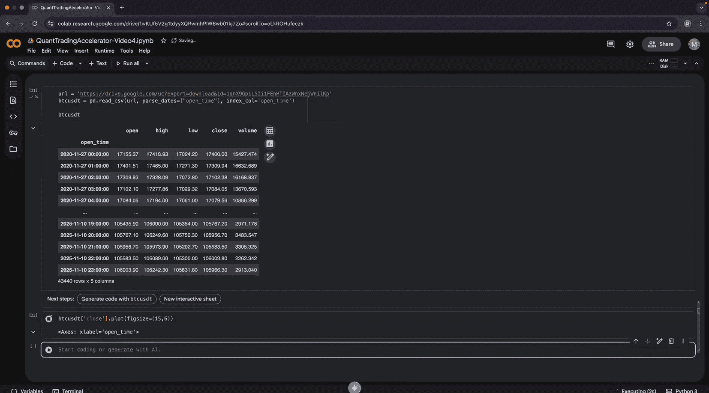
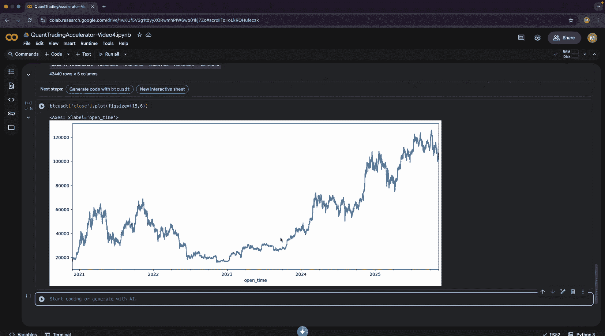
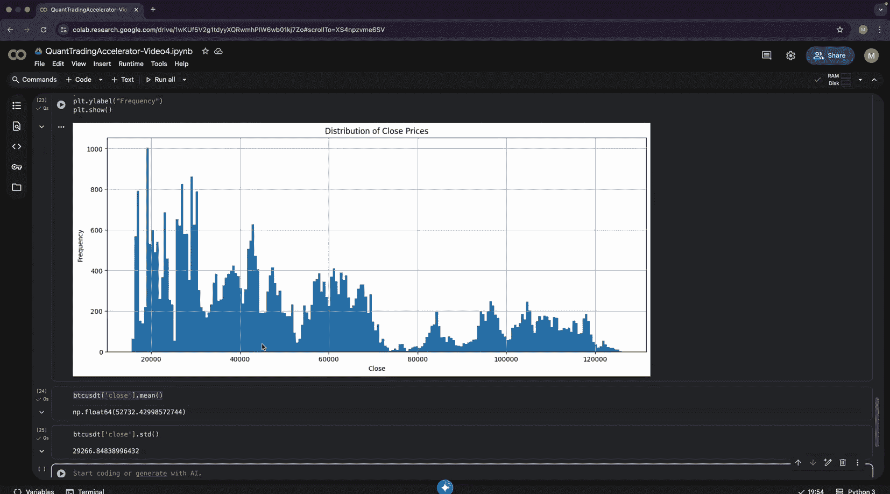
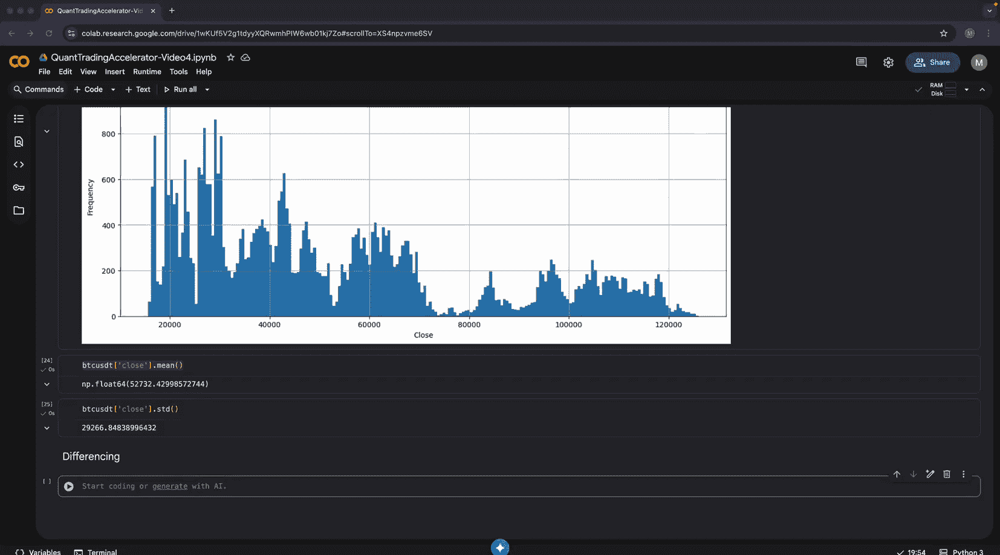
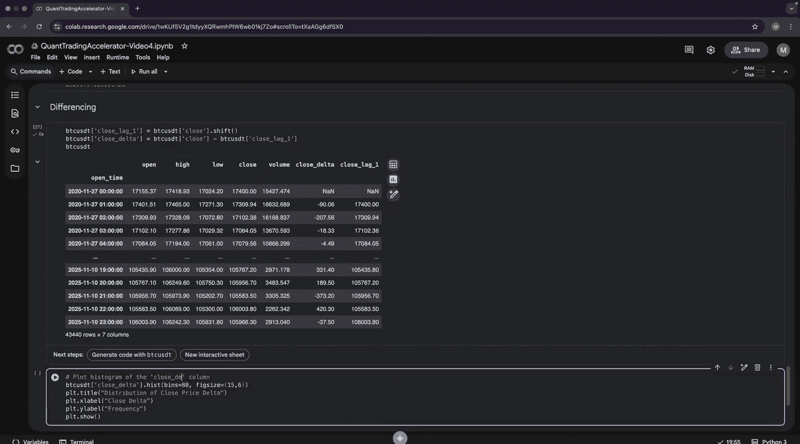
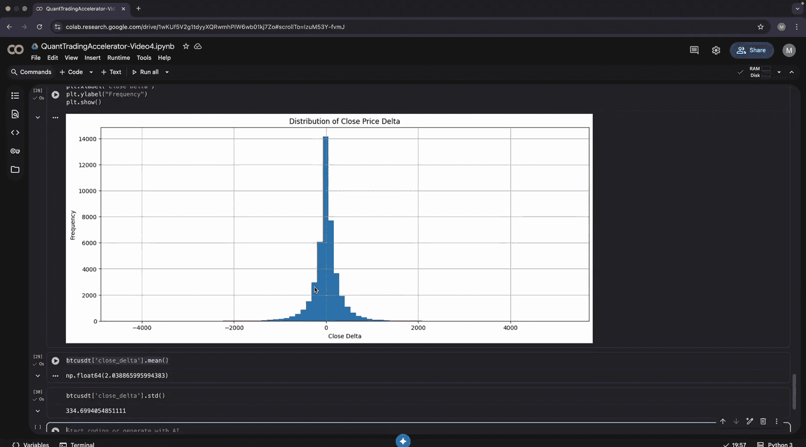
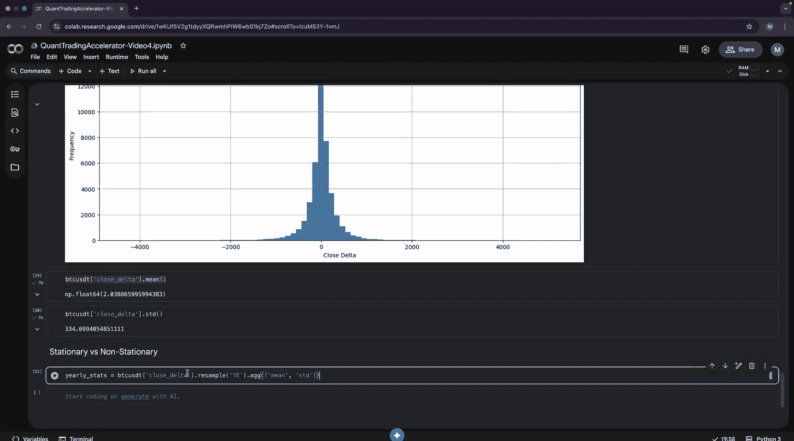
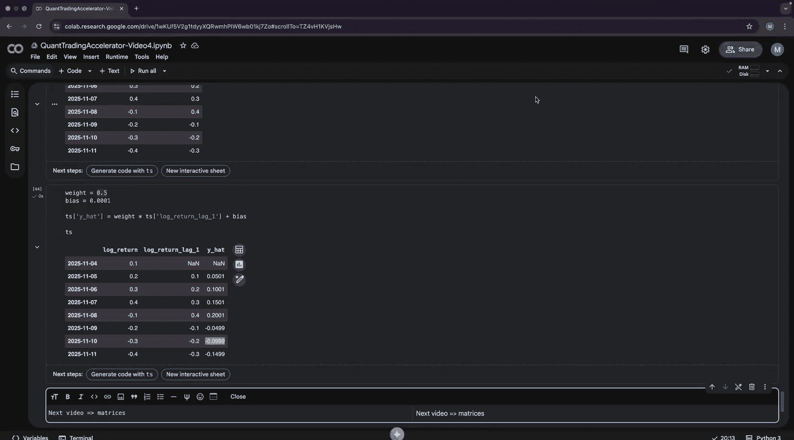

# MemLabs【中英⚡量化交易加速器｜Quant Trading Accelerator】 p04 P4 - Part 4： Time Series [BV1UrreB1E8B_p4]

Welcome to part 4 of the the quant Tra and accelerator In this video。 we're gonna。

 it's all about the time series in the previous videos we've been building up to this video。 We we。

 we' focused on arrays and。Then we looked at factors。 And now we're looking at the time series。 And。

 so the goal of this video is。To get some basic statistics of for analyzing time series。

 I'm also going to look at some some time series fundamentals。

And then once we've got a good foundation in time series。

 then we're going to use some econometrics to model the fundamental trading dynamics and this is why I believe econometrics is a very good foundation for quantitative trading because it allows you to model these two fundamental dynamics。

So we're going to start off with statistics。So。I't write this down here。😔。

One that the most important measure is for central tendency。And there are two。 os there are。

 there are two。Common measures。And the first one is the mean。And the mean。

 So let's just have an example。So what the mean。I'm just going to import anump。

And I'm going to create a time series。Trade pinal。So each each element represents an individual trade。

So， for example， here， we're gonna have。It so first trade made $10。 Second trade made 11。

And we're just gonna get it a few， right。 And then we're gonna do this-400。7。$10。$11。$11。$8，$10。2。

Okay， and we're gonna take the， the mean of this。And this basically tells us， like。

 what's the expected value of each trait。So we see here that it's it's a negative number， right。

 the only caveat of the mean is it's sensitive to outliers。

 And I'm going to show you like an example， right。So now we're going to look at another measure of central tendency。

 which is the the median。 And this basically looks like， okay， what's。

 what's the the middle number essentially。嗯。And we're gonna just the code for this is know if we just use the nuie to calculate the mediumn。

The trade piano。And you can see here， this is why I chose this， because。

The median is a positive number， but then the mean is a negative number。

 So the reason for this is that the median is not sensitive to outliers。

 it just finds like what's literally like the middle number when you sort it and take the middle number whereas the mean is calculated differently so it's more sensitive to outliers and。

You either want to use the mean or the medium depending on if you want to factor in outliers or not。

So that's the two most common measures for central tendency。

 And now we need to to measure what the spread or the dispersion。I'm going to put both spread and。

How far the values deviate from the the the the measure of central tendency。Oops。

 I but this is a text。Okay， so， and the most common measure is the， the standard deviation。

And I'm not going to go over the mass of it。 So I really encourage you to actually just。

Look at the maths of this and the algorithm behind it。

 But I just wanted to show the the practical applications of them。So for example。

 and this standard deviations， both these the most。

 the central tendency and spread dispersion gives you a really good foundation。So， for example。

 I've got two portfolios。 Let's say portfolio a。And let's just say it mix。A dollar。And again。

 this is a time series。And I'm just going to。Get some numbers here。 Ha gun to copying paste it。

 bit quicker。Okay， so here's portfolio a。And。If we look at the these are like trades， okay。

And we look at， if you'd sum them up， or'll see。The portfolio and。Okay， so it's made$6 dollars。

And if we look at the standard deviation。hi measures。How the， actually。

 we look at the the mean of it as well。So we look at the mean of this。Portfolio， a。Okay， so it 0。6。

And if we now look at the standard deviation。A portfolioo a。So here the。

The deviation is around 80 cents， so that's the measure of dispersion from the central tendency。

 but we're going to look at if this doesn't make too much sense。

 don't worry because it should make more sense once we further in the video。

So now what I'm going to do is I'm just going to give you an exactlycycl it。Same portfolio。

 like a different portfolio。诶。But the both add up。 if you add up the。

The values here that the both all add up to 6 as well。

But you'll notice that these values look kind of like extreme。

So now if we measure the standard deviation。The portfolio B。

You see here that it's a much higher number。 So this tells us that。

There's a higher spread of numbers from the central tendency。

 And this sort of makes sense because if you look at the values， these values are sort。

Deeviate quite strongly away from the， the central tendency， whereas like here。

 the values are don't really fluctuate too much。 Where here， the the numbers are more volatile。

 right？ So that that this is what it is measuring。And with this just the the mean and the standard deviation。

 you can calculate what's called risk adjusted returns。Okay， so risk adjusted。 maybe if I。

 So what I'll do is I'm going to。So now I'm going to introduce pandas so pandas is a data frame。

 data analysis framework is the most common one。是。We have been building sort of our own one。

 but it would just be too much code to to， to write all the functionality。

 But you be able to be really comfortable by now working with pandas because we've gone over vectors and factorization and vector algebra and arrays。

 So now we're working with pandas。 It should be really intuitive。

 like what we're doing like behind the the hood。So for example， here I'm going to just run this。

Is the second the same data， but we're just now representing what's called a data frame。

And a data frame is essentially a table。 And you can see here its more visually you can compare each element in the time series。

 So this is time a time series for portfolio A， and this is a time series for portfolio B。

And so now we've got it in a data frame， it just makes it a lot easier to。

To calculate and benchmark each portfolio。 So what I'm gonna do now。Is I'm going to， to benchmark it。

 so。I'mm creatington。 I never。Data frame here。 it's called benchmark。And I'm now just going to。

Run this。St。To know what it's taken。 So Okay， here we go。So。Essentially， I've just。

Calculated just the。TheThe mean and the standard deviation。 Okay。

 so you can see here that the portfolio A and B。We've calculated the the total sum。

 So the total P And L， the boths like earn $6。 just it a toy example。

 They both have the same central tendency。 So the both here its 60 cents on average it makes。

But here is the key distinguishisher， which is the standard deviation。You see with portfolio A。

 it has a much lower standard deviation because the numbers that the P&L values in the time series is less volatile。

 whereas here it's a much higher number because there's much higher deviations away from the central tendency。

 which is this measure here。So and essentially what we can do now is calculate what's called the the the sharp。

 we're going So what we're going to do here now's do benchmark and to add new columns into pandas。

 this is like the notation for it。So it's even that's kind of smart that。

Knows what I want to do here。So now we're gonna do run this。 I can see it now。

So this is what's called the sharp and。Essentially the sharp just tells you it's just is a measure of the return over risk and so we're quantifying the return as say the average of the expected P&L and then over the standard deviation of the P&L here。

So， you can see here that。The sharp here is much higher than it is like this is pretty much like 0。

 right。Whereas here it's is at much higher value because the， the standard deviation is。

 is much lower。 So this is a really good measure for measuring like。

How much risk you you want you want to take and how much risk is being reduced。

 So the higher the sharp， the more stable and consistent your profits or returns are。

So now we've got just we've so that's just like the basics some of the basic statistics。

 Another very important measure for a time series is the the correlation。Okay。

 and the the either the， the correlation is either positive or negative。So that do pause。系。Oops。

 I maybe just。Okay， so I'm just going to give you like an example here。

So this is an example of like a positive correlation。 So the， the correlation measures how。

 for example， two time series move together。 Do they move like positively together or negatively together or does。

 for example， if one time series goes up， the other one goes down。 So this is like。

This is what is essentially how they move together。 So， for example， here。

 if it's a positive cor positive correlation， this means that they move up together and move down together。

 and， for example。You could even have what like， here's like an example of like a perfect correlation。

 But in practice， you you you never see a positive like a where it's 1。0。

 So the strongest correlation is either-1 or one。 but in practice you you never see it because in real world is。

 is never。As strong is this。So now we need to look into negative correlation。And also again。

 I really encourage you to to。To look at the mass of this。

I'm not covering it in here because I'm leaving this as like an exercise to work out the mass and trying to do the calculations yourself manually really gives you a very good intuition behind how it's calculated。

So now let's look at with the negative correlation， okay。So here when X it goes up y goes down。

 So we say this is a negative correlation because as x is going up。

 y goes down and you can see here this is quite a strong negative correlation。

 So for example one fundamental trading dynamicy is called me version， which is。We'll see this later。

Just for now， just think of negative correlation that if x goes up， then y goes down。And then again。

 like for a。Here's an example of a。Perfect， negative correlation。 But in practice， you。

 you'll never see this。So now we've just got a good understanding of the basic statistics needed for time series analysis。

So now we can look into time series。And what I'm going to do is， I'm going to。

Maybe if I just take this。Okay。Okay， so I've just， I， I just created some data。

 So this is data for Bitcoin dollar， the perp contract。

 It doesn't matter too much what the actual underlying instrument is。 So， and this is a time series。

 And it's got like， for example， here。 it's got an index。 And this is like an hourly time series。

 So each in row represents an hourly interval。 And this is。Prricing data。 So， for example。

 this is a very common time series， open high low clothes。 And then you' got volume as well。

 So with this time series， I just wanted just to show some。Some characteristics。

So one of the and important， let's just look at the plot first。

So I'm just going to plot the the closing price as a time series。

Okay， so we can clearly see like there's like a trend here that's going up。

 especially like from 2003 to now。

And。What we want to do is I want to plot the， the histogram or the distribution of the close price。

And I'm just gonna copy and paste this code here。And you can see here， this is the distribution。

 And essentially， what it's doing is it's like it's countant how many like this is like interval。

 like the the range， right。 So it tells us like how many occurrences at the particular price so。

Price us on the X。 and then the frequency it's on the Y scale。 So you see here like。

 but that the problem with this is that there's multiple peaks。

And it also doesn't make too much sense。 For example， if we're gonna， if I look now at the。

 we're gonna， I want to look at the central tendency， so。To I want to look at the mean essentially。

 Okay。 So I'm just gonna see what it。The central tendency is。So it's telling me that this。

 the central tendency is around this $52000 mark。 So roughly around like here。

 But it really doesn't make that much sense because this is not the like you can see visually。

 this is not a。Essential tendency， if it's a essential tendency。

 it would be the highest peak and really you can see like here。

 the highest peak is just below the the 200$20000 mark so。And also， if we have a look at。

 let's have a look at the dispersion。 and it's probably going to be huge。

So this is what we're going to do now。😔，Okay， so。That there's a standard deviation of 29 over $29000。

 which is huge， right？ And that's because if you just look at the， the range of the prices here。

 so many。This is why say in econometrics， they don't just analyse the the prices。

 you analyse the returns or the differences。 So this comes into the next section differentcing。

So we want to to take the difference in the time series。 And when we do that。

 you'll see now if we plot the distribution。

Okay， so maybe I just go over the this code what it's doing here。 So I'm creating a new column。

 and it's called closed Delta。And I'm saying close Delta equals the current close price。

 which is here against the previous close price。So actually。

 just maybe if I make it even really more concrete like what it's doing， maybe if I just do this。

F take the closed delta。Bck。If I call it closed like one。😔，Okay。And iss basically this。And now。

 I can just say that。The different， I want to take the difference between this。

 And then this will be a bit more intuitive。Okay。So。You can see， here。And is really good to。

 to model the closed deelta as well， because we're more interested in rather than just the app the absolute like the。

 the price。 We're more interested in how that the price movement and it we so。When we predict this。

 it's either going to be a negative or positive number and。You can see here that this is like。

 for example， this is how it does the calculation。 it's close minus close like1。

 And you can see like the is moved down by $90 right。

 And now if we look now we're going to do is look at the distribution or the the histogram of the of the closed delta。

Thats the close delta。

Okay， and you see here now， there's only one peak。 So this will be the the central tendency。

And so now what we're going to do is to。Calculate the， the， the mean and the standard deviation。

So what this is telling us is that the expected。 and this is more usable because we know that there's only just like one peak here。

 and this is like。By taking the difference， it makes it more of a of a statistical distribution。

 with just like one peak here。 So the peak here is like saying it's on， on average。

 it moves by $2 positively。Per per hour。And we can also now just look at this。

 the the standard deviation。And we can see that the standard deviation is way much lower now。

 So rather than being like over $29000 standard deviation， it's just 334。 So yeah， and。

By looking at the price movements it's。You can analyze like， okay， like。

What's the probability of it going up by， let's say， $100 or $500？

诶。But yeah， and one of the key things， though。Is this concept of stationity。

 Because in a lot of textbooks， you'll see that that they'll say that by taking the difference。

You're making it stationary。 And I'm just going to go over this concept of stationery versus non stationary。

And this is quite a controversial topic。And then。Oops， maybe。P us a text。😔，So essentially。

 what stationary means is that the statistical properties of the time series are constant over time。

 So they never change。 So， for example， more concretely。 So for example， here。

 the mean never changes， but and theres there's quite a lot of text。

That textbooks that say that if you take the the difference。

 it makes it stationary or weekly stationary， and it doesn't necessarily mean like， so for example。

 I'm going to just show an just empirical evidence that if you take the difference。

 it does not make it stationary。 So for example， here and I'm going to print out yearly starts。

So you see here that I'm just grouping it by year。And you can see that the the mean and the standard deviation are not constant over time。

 so。This， you could say this is weekly stationary， but how do you quantify weekly stationity， but。

The key thing here is that even though if you take the difference。It makes it more predictable。

 but doesn't make it necessary more。Stationary。I think that's maybe another video for itself， but。

Yeah， so just bear in mind that if you take the difference， it doesn't make it completely stationary。

 it still can change over time。And so yeah， so that's the。

 the concept of a non stationery stationery。 I actually will maybe put a link because there's a very good article about。

Stationity， non stationity and memory and' some really good arguments and also some。

Code to back it up。Anyway， so with that。Now we need to go into likes。Okay， so what will do is。

We're going to take the closed delta， and we're going to create what's called lags。

 So it's very common in conometrics and time series analysis is you want to predict。The。

 the future values in the time series from the previous known values in the time series。

 So we want to predict essentially closed Delta， and we want to predict it from the the previous lags。

 So this is lag 1 represents that the previous hour。 lag 2 represents。The previous second hour。

 third hour， fourth hour， etc。嗯。We're gonna run this。 And so。Now， what I want to do is just to。

 to print out and just show。What， what it's actually doing， Kim。So。

You can see here that the you take we're always， we want to make it like。All the， the data。

 all in one row。 So， for example。This value here corresponds to this value here because it takes it from the previous value and so forth。

 right， So like the un lag2， it takes it from lag 1 and so forth。 And but in in practice。

 we want to remove all these。Norll values or N A N values。

 And the way we can get rid of them is by this drop N A。Because when we pass it into the models。

 actually， some models like， for example， gradient boosting trees。

 they they're not sensitive to to to nullles or N A Ns， but。Linear models， neural networks。 they're。

 they're sensitive。 So we typically remove these out。So yeah， so now we've we've dropped， let's say。

 the the data you can see like here， this is like the first row， there's no nulls at all。So。

We're gonna go into another topic now， which is serial correlation。

And serial correlation is looking the correlation between the values in the time series。

 So more specifically。We're going to be doing this。So we're looking so。

Don't worry about these values。 So just look purely on these values here。

 So you see here that the the correlation between lag1 and closed delta， it's a negative value。 Okay。

 so that means when lag1 goes up that close delta goes is a negative will go down and phi versa。

 So if the lag goes up then this goes down and an interesting observation is that this correlation decays over time。

 So you see here this is like。0。01 and then 0。007。 And you see its it decays slowly。

 So this tells us that the strongest correlation is from the the previous value。

So and this is sort of like models what's called like mean reversion。

So if a me version is essentially。If the the previous value is down。

 then it's more likely to go up and vice versa。And that brings us to。

This concept of called auto regression。Okay。And we're gonna to just be。

 there's several models of auto regression。 And what we're going to be focusing on what's called a first order。

Auto regression。Or model。Because this is quite a long winded name， it's abbreviated to AR1。

We're going。 I'm just going to explain what this is。So imagine I've got a time series。

And its log returns。So this is our time series of lock return。And you know。

 from the previous returns， essentially the returns put in log space and by putting it in log space。

 then they become additive。So this is the time series of lock returns here and you can see it's hovering right between positive and negative。

 positive and negative， okay？And so what we're going to do is we're going to。

Take the look at the pre。 the， the first lag。And that' essentially， what autoag does is。

 is like making a prediction。From the the， the previous lag。 So what we're going to do is from this。

Black is to predict the log return。 So this will be our model input。

 and this will be our model output that we want to predict。

So we're going to model the relationship between the log return and the log return like one。And the。

 the model definition of the mass of， of A R 1 is the following。So I'm just going to say。

 we're going to say that why。Is our T， S log return。Okay。And why， like one。A equals。Time。

 so is lock return。Like one。Okay， and。We also have a weight。And we're gonna put that to。0。

 just for now。And also， in a bias。So this mod only has two parameters。

And we're saying that we're going to model the relationship between。

W and y lag1 as the following is the weight。Multiped by a Y like one。 So that's the previous value。

 plus a bias。And so for example， if the bias is going to just bias the prices by a certain amount。

 so just imagine like if the weight is zero here， then it's essentially y is just going to be the bias。

So that's the， that's the model definition。And the reason why econometrics this model is very powerful is because a is its simplicity。

 but because it can model the two fundamental trading dynamics。 And now we can go into what they are。

So， the fundamental。Trading dynamics。And if you've done any trade in yourself。

 you probably know what these。But I think the might might be called patterns or I'm not sure what they're called。

 but。And this is essentially， maybe if I add another text， The first one is meme reversion。

And then the second one is momentum。And essentially。

 memer version is essentially modeling what comes down。

 must come up and what comes up must come down。 And momentum is like what comes， what goes up。

 stays up and what goes down， stays down。 And this is like the fund。

 If you actmatically broke it down， then this is like the two most basic trading dynamics。

So now we're going to look into just mean reverse first。Okay， so our what I'm going to do is like。

 we're， let's just say。In the next video， I'm going to go over how we say calculate these weight and bias。

 And this is essentially what's called like mathematical optimization。

 because you want to mathematically choose the best optimal parameters for the weight and the bias。

 So we're just gonna say here the weight and the bias。

 I'm just gonna give you like a very small epsilon here。

Epsilons are essentially just a very tiny number。And we're going to say that why hat。

 so why hat is our prediction of why。This is the actual value of why。

 but we want to make a prediction， so we denote it as Y hat。And we're gonna to say and essentially。

 just regard it as our prediction。 Okay， so it's going to be the weight。Multiped by。T， S， log return。

 like one。Plus， the bias。So。Now this is our prediction and now what we're going to do is just to print it out。

Okay， so you can see here that if we look at the。We're modelal。

Input to our model is this log return lag1。 And it's it wants to predict log return。

 So we don't know what this is。 So we always like， know like what the current value is。

 And we want to predict the next time step。 Okay， so and you can see here that it models it quite well because you can see like if we look at the what's called the directional accuracy。

 which is。Essentially just looking at the sign of the of the return against the predicted against the actual。

 you can see they're both like positive number。 And you can see here that this is a negative。

 so it's moved down and it's predicted correctly that it's moved down and exactly the same here。

 So it's predicted that it's going up and it has actually gone up。

 So obviously this is a toy example。 But this iss just to emphasize this me version behavior。

 So this log， this time series is reversing around a mean hovering around roughly around the zero mark。

 right， And just this basic model， we can model me version。

So that's the first like trading dynamic and the second trading dynamic is the is the following momentum。

Oops。太短。T。And so with momentum， what I'm going to do is create a new time series that exhibits momentum behavior。

So you see how。if if the previous log return， it seems to be like。Consistently going up。

 And then it goes down。 So， and then if you look at the the lag。

 So what we want to do is predict the log return from the the lag。 Okay。

 so what's very important is that。The extremely important is the， the how it models it as。

The weight is a negative number， So it inverses the， the， the sign of the。Of the the lag。

 So if the lag is negative， then it inverts it to a positive。 and then as a bias， right。

 And this is where the meanme re。 So with this A R1 model that， if the weight is negative。

 then this exhibits meanme reversion behaviour。So that's a very important note， is the。

The weight interprets the trading dynamic。So now we've got the log return。 So now we're gonna do is。

Look， so we're gonna， let's just say， we've done some math machine learning or some form of mathematical optimization to work out the most optimal weights。

 And now。Let's say they noted here that the weight is positive now。

So it's essentially saying that this the， the predicted future log return is by essentially like a positive decay of like one plus bias here。

 So let's have a look and see。Compare it。So。We look at like one。It moved。

Because the weight is a positive number and it stays positive here and you can see that it's predicted correctly。

 okay。And it has done for the several。 But then only when it actually starts to change the。

 the momentum， maybe like esion change。 So esion changes。

 like essentially the statistical properties change。And now it's like going down。 Okay。

 so the first one here， it gets predicts incorrectly， But you can see from the following ones。

 you can see here that it's predicted it to be to go down and it actually has gone down。

 And for example， here， it predicts it's going down and it has gone down。

 So this is how it models momentum。 So if and again。

 the weight really interprets of its memeversion or momentum。And that's the end of the the video。

 So in the next video， we're going to go over to the next video。Is going to be matrices。

And we're going so essentially mates are two dimensional arrays。

 And this is sort of the the heart of machine learning。

 And so we will learn some linear algebra as well。 And then we can actually start to do some machine learning。

And yeah， and please like and subscribe， and I'll see you in the next video。

This course is free， thanks to my paying Patreon supporters。

 If you're getting value from this series and want to help me create more。

 please consider joining them on Patreon。 You can also support me by Bu me a coffee on Bu meer coffeeoffee dot com。

Links on my channel details page。

