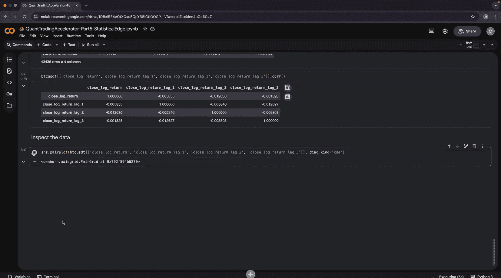
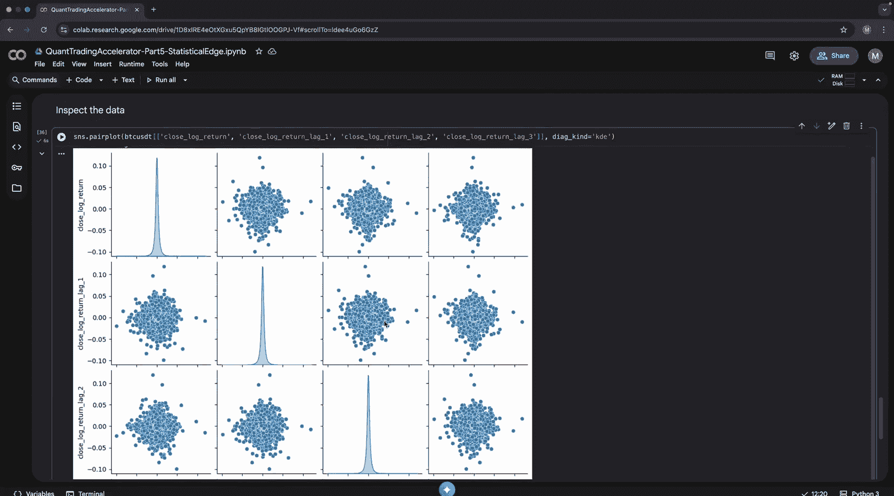
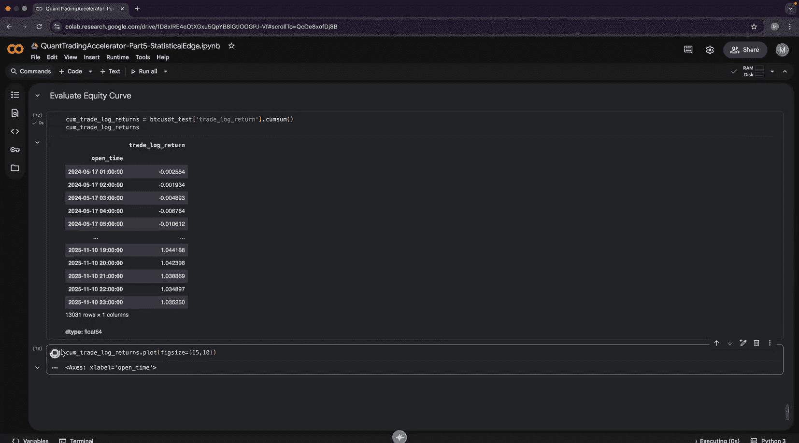
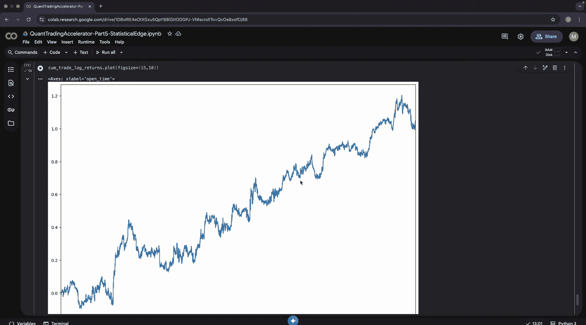
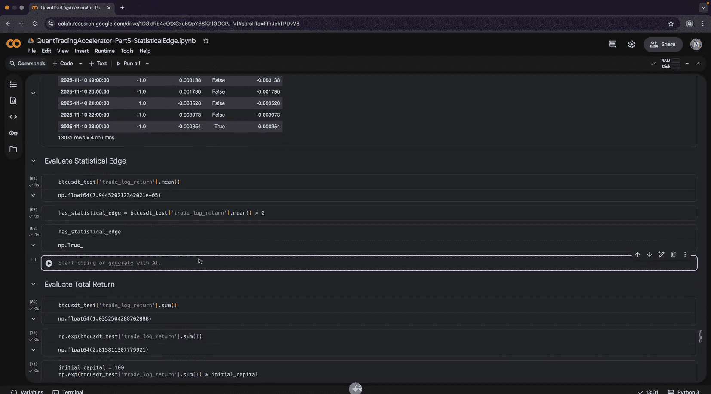
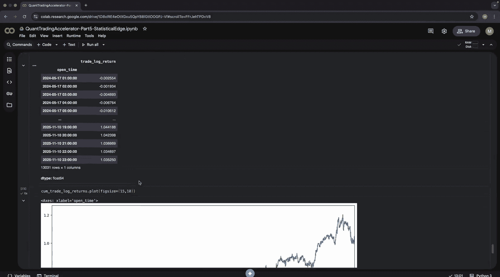
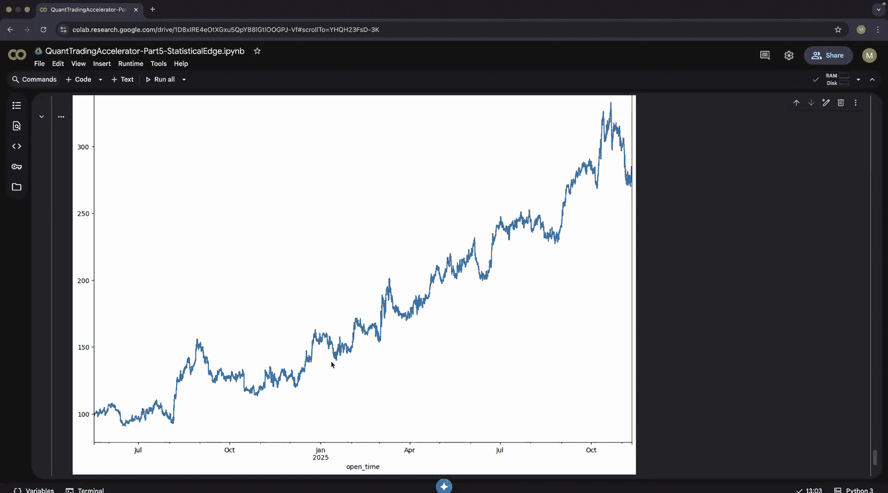
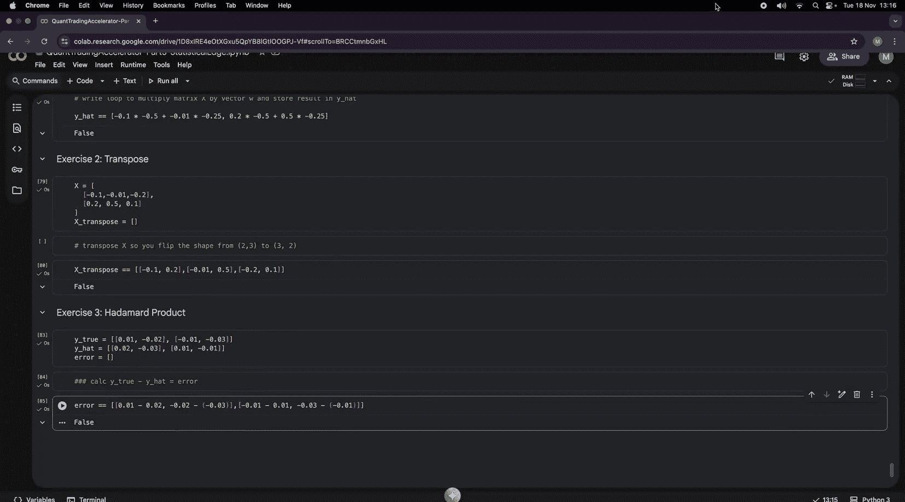

# MemLabs【中英⚡量化交易加速器｜Quant Trading Accelerator】 p05 P5 - Part 5： Statistical Edge [BV1UrreB1E8B_p5]

Hello everyone， so welcome back。 This is part5， which we will be discussing the statistical edge So the key goals here is that we're going to learn some key matrix algebra operations which are fundamental for building our model We're not going to learn the whole subject of linear algebra。

 I do recommend to take like a linear algebra course or maybe I'll like there's a really fantastic video series that I can。

Send so if you want to learn more about linear algebra。

 but the key goal really is how to create a measure statistical edge and also another really important goal is to show how you can make money with just a very tiny statistical edge and the key lesson there is like the win rate does not equal the alpha。

And then， yeah， we're gonna actually build our first alpha model as well。

 So the whole series so far has gone from for like learning one dimensional arrays。

Fectors and operations that are based on ours。 then we've gone into time series。

 and now we're gonna go into matrices with matrices， we can model multivari。

 So that's multiple time series or once because we will with our models it just won't be just like one time series。

 We maybe want to model like several time series。 So we need to be very comfortable working with matrices。

 And once we're comfortable with that， then we can actually do like forecasting predictions。

And just the key goals of this series is to。Develop knowledge a domain knowledge for building models。

 And with the models， that's how we create our statistical edge。 And then the strategy。

 then we'll go into the strategy， which is。How to execute the statistical edge。

 So that's the we're going to go into these。 we're already now tackling models。

 but then we're going to go into some more model topics and then go into strategy。

So the first thing we need to do is to import our libraries。So we've got here again， we've got nu。

 which is for numerical numerical computing。 it's just very fast factorized calculations。

 we've got our data analysis library pandas were this is our data visualization library to plot some data then our machine learning library and so we're using Pytorrch and I've had some feedback as well saying why use Pytorrch it seems way to like you can just use likesy kit and thats a valid point but with the machine like for example。

 we can just build like a linear regression and torch when it gives us so much control over the whole process of training So like for example。

 if we' were researching to find what's the best way to to build a profitable model we want very fine grainined control over the whole process and Pytorch gives you that。

Flexibility in that low level API， but it's still very like Python code。

 And you can like still just write like you see like machine learning library and like just 10 lines of code。

Anyway， so we need to now discuss matrix algebra。 So I'm going to go over this quickly。

 So this is only just a purely a subset of linear algebra。

 I'm just teaching you just the bare minimum just to to so you can understand the key operations of machine learning。

And so we need to just go over like what is a matrix。And a matrix， essentially。

 in terms of code is just a two dimensional array。 So， for example。This is like， a matrix here。

I'm just going to。F6。Second。and9。 Okay， so this is a two It's essentially just a two dimensional array when we think about it in terms of code。

And。For example， if we want to access like the first element， So this would give us the。Like。

And itll gives us， gives us an array。 So to get like an individual element。

 which we call like a scalar， then you would do have to also then index it again。

 So then we can get like 0，1。 If， for example， we want to get yeah。Just the other elements。

 Then we can do it like this。 So sp tedious， but。Then。Just to make it crystal clear。 So then it's2。

 And then if I want to do it for。The next form。And so forth， I could even do for， like， for example。

You can then go into the next row。So that that's， that's a matrix， okay， and。

There are some very important operations that we need to be able to do。

 and one of them is to do what's called matrix scalar algebra。 So I'll just write this down matrix。

Scalar， algebra。And we've already discussed like scalers。In previous videos。 So， for example。

 essentially what we want to do is like， for example， in this example， we want to do matrix。whatever。

 so for example here， this matrix， we we want to add one to it if we're gonna do it manually。

We would have to do something like this so we just say， like okay。

 the number of rows is the length of the matrix。It's nice that its what to complete it。And。

That want to so we want to work out what our M is and。So we'll just do this。

 So in mathematical annotation。 you， you'll see like a matrix being defined as like n or n。 So。

 for example， here， like number of rows。 So when you see it like a mathematical notation。

 then this is essentially。What it represents。And like to do this， we can loop over。Range of M。

And then for J in range of N。Okay， and then。Matrix， I。J， so we this again， it's two dimensional。

 So we need to to get the to the individual element。 And then we're just going to add one to it。

 Okay， and then we're just gonna print out the the matrix。

So you can see here like it started from one and now it's done plus。

 but this is like extremely tedious if you're having to do these like operations so。

 and I just showed you like essentially what essentially it's done just to make it super crystal clear。

So that's essentially the operation that it's done。 So it's just added one to each individual。

Element in the matrix。But。You you don't a， there's two reasons why you won't want to do this because it's not it would be extremely tedious and unproductive to write these manual loops。

 And also in terms of performance， this would be terrible。 So， for example。

 nuy does has like specialized code to do matrix operations extremely fast。 And this is， again。

 factorization。So for example， we can do this。 We can do it。 for example。

 we can represent So exactly the same code。I'm just。

 I'm now I'm just gonna represent it as a nupy array。 Okay， so if we now print out a。

So you see this is like an array and it kindly displays it in a more matrix notation。

So that's the matrix and。What's really nice is that instead of having to manually do the loops， we。

 there's really nice abstraction that we can just use like mathematical notation， which is just like。

 okay。 so you can just do treat this。And this gives us essentially the same。You see here。

 and it's way much faster as well as imagine this is like a huge matrix。

The performance difference is， night and day。So and then also as well this like this just very important。

Part is like this as。Okay， and we can also do like。Miply multiply as well， so。You can see a here。

But that's matrix scalar。 So that's an important operation and。

The most important operation is the matrix factor。How would班。

So we need to be able to multiply matrix by a factor， and。This is very fundamental because。

Essentially we're going to be doing this， which is like X。Multiplied by our weights。

 And so x is our matrix。And we need to multiply it by effect， which is our weights。

 And we want to make a prediction and the predictions is the Y hat。 So we'll have a matrix。

 even if it's a univvariate， we still need to to model it as a matrix。

 So this is like the very fundamental operation。 So it's。

It's important that we understand the mathematics and the algorithm behind it。So， again。

 we're gonna model。We're going to use an input。So for example。

 here I I've got which is maybe just print out。So we've got a matrix here of let's say log returns and we've got some weights。

And let's just say we've used machine learning to， to work out the most optimal weights。 So。

 and then we're just going define that。'm going show this。Okay， and essentially。We。

 what we want to do is what's called like a dot product。Okay， so we take the X。

 and this is essentially matrix multiplication with effect， Okay， so then。

And this gives us the predictions for each row。 So calculated it's multiplying each of these two elements with this and summing them up together。

So essentially， what it's doing is， is doing this maybe if I just copy and paste itll be quick enesium。

And you can see this is exactlyly the same。 So I'm just putting the， the individual weights。

 weights 1 and weight 2， so。Imagine these as like lag 1。 This is lag 2。 Okay， so the with lag 1。

 this is the weight for it。 And for lag 2， this is the， the the respective weight for it。

 So it's just multiplying this say， make it more concrete。 This is say log return。

 We're multiplying it by this weight。 And plus the， the value。 the the lag 2。

Value and multiplying it by weight2。 So that would be our first prediction。

 And this is our second prediction。 And then our third prediction。

 So this is like very fundamental for for machine learning。

 And then also we add like a remember that we add we add a bias。

 And so I' was going to put this here。 But in a mathematical notation。 this would be like a B。

 And so essentially like our model is going to be the mathematicalmatics of our model is this。

Is we're going to do a dot product between x and our weights， which is。

What we're going to work out is like， what's the optimal weights And then plus the the bias。

 So essentially we' just add。 And you see what what the bias just does， it just adds this tiny。

 likes say epsilon number to to it。 And so， for example。

 this could be just a very tiny negative number， but the bias could skew it to be turned into positive。

 So。And also is what if let's say if it， the， the white like if it's。

This dot product is zero then essentially it's just the bias。And so。

 but there's a very unimportant operation that a distinguishment。

 which is broadcast and does not equal a can。Broadcasting does not equal matrix multiplication。

 So every really common gotcha， I'd say， is this。So， for example， you may be tempted。When you're。

To do this。And this is not matrix multiplication， even though this is the multiply sign。

 but this is something called broadcasting。 this， this is like totally different， so。

Just got to be careful when you're， for example， the API that you're using to represent your matrix that you're actually doing matrix multiplication and not broadcasting。

 So， for example， in Numpy， this， this is how it's done。So now we just now。

 understand some very basic fundamental operations of matrices。 And now we can sort of go into。

Dive deep into machine learning。 And so the now the next part is， which is I'm just going to。

This comes up。Is to we're now going to work out how to， how to。Develop。A statistical edge。

It's cool edge， using machine link。can't see。Okay。And。The whole the， yeah。

 maybe if I put another text in here。So the， the idea is that we're going to predict a future log return。

 and so essentially the statistical edge。Is the。maybe it was just copy and paste this。

Is the following right？Is this that the statistical edge equals like a good forecast。

 So essentially it's like the expected value is positive， but we'll go into that in more detail。

 So the first thing we need to do do is to download some data。

 So what we're going to do now is download some what's called open high low closed prices。

 This is just a very， very basic data set。 but I just want just to show just like with a basic dataset set you can still make good predictions。

So we're gonna download the perp data。And so we're going to use Bitcoin dollar perp contract。

 It's like a future essentially like it's like a futures contract that doesn't roll and futures are great for speculating because it gives you a very quick ability to bet if its the price is going up or if better going down and you can also leverage。

There's a bit out of scope to go into the details the mechanics of a PEp contract。

So now we're just going to download the data and load it into a Pyon， as， a pandas data frame。 So。

 and this is an an hourly time series。 So you can see like each row represents an。An hour。

And you've got the open price。 That's the price it starts at。

 And then the highest price it reaches in this time period。 and then the lowest price it reaches。

 And then the price that it close that。 So at just right the end of this time period just before the first hour here。

 then it closes at this price。And this is the trade and volume for that respective time period。

 So that's the。The whats called O， HLC data。 It's just a very basic data， most like。

Firms will be using high definition， high frequency order book data and trade feed data， but。

We're just going to just want to show that even just with a very basic data set that we can still make developer a statistical edge。

So the first thing we need to do， which we've already discussed in previous videos is to create the log return。

Okay， so this is I'm not going to go over it again because I've done in previous videos。

 but essentially we want to measure the log returns because they have this property called time addivity and they can also model compound growth rates。

But yeah， this is just the， I just recommend to， if you're interested。

 just look at an econometrics book and it or explain the。In more detail。

So that's now we've got the log returns。 And now， so this essentially what we want to predict is we want to predict this closed log return。

 and we're going predict using the previous。Log returns。

 So this is what's called like an auto in econometrics。

 is what's called like an auto regressive model。 So we'。

 what we're essentially looking at is say like the， So what we're doing here is we're just shifting。

The data to say， okay， lag1。 So for example， what what I data， what we want to do is， let's say。

 make using this lag， Sa like lag1。 we want to make a prediction to predict this log return。

 So this is that the price movement， the actual price movement。

 And that was the previous price movement。 So we want to predicts。The， the price movement， this one。

From this previous one。This previous log return。 and that's essentially that this。

Came from the previous ones， so for example， here the price。Return was this。 Okay， this number。

 And you can see this now for the next time period that it's now the lag 1。

 and then for the previous one in the next future time step， it's now lag 2 so。

That's essentially what we want to do。 So essentially， what we're predicting is like， if we buy。

At this time and then close it just before the the next time step。 what's our return。

So that's essentially what we're modeling， okay？And we're just going to look any just free likes。

To the behind。You could actually like do even more。 And so another。

 So if we just look at the correlation。 So we in the previous video， we discussed correlation。Okay。

 so if we now look at the correlation here。 So we， we've got these like lags。

 and you can see what's quite interesting is like the。It's not decaying， so for example。

The strongest correlation here is actually lag2 and not like wall B， this is negative。

 so this means that when lag1 goes up， then closed log return typically goes down and vice versa。

Okay， so and now we just what I want to do is just to inspect the like visualized the data because I just want to show you essentially what we want to do。

And to do this， we're gonna do it just going to inspect the data。Okay， this might just take a while。

And。

So this plot is going to show us the distribution for each variable here。

 So we're gonna see we've got closed log return， log return。

 and then the the lag 1 and lag 2 of it and then lag 3。 And you can see here that it's plot in the。

 the relationship visually， the relationship between say log return and its previous lags。

 And you can see here there is really no。What we call like there's no polynomial that we can model to represent this。

 there's no like clear like， okay， this is a linear relationship， Okay。

 this is a quadratic relationship or this is like there's no polynomial that we can that's。

It's so obvious that we know， okay， how to model this。

So this this is the problem with financial data is extremely noisy， so this is why， for example。

 linear regressions are quite good because it just makes the decision space， you know。

 to buy or to go long or to go short， it's a linear curve。

 it's a good like approximation with the presence of noise。

So that's the so and and also here as well， for example， this is。

 you can see here that there's only one peak here。And unfortunately。

 you can't see like other properties of the distribution here that， for example。

 the we in the previous video， we looked at like the， the central tendency and then the dispersion。

 the standard deviation。 But then there's， there's other。What's called moments， which is like。

 for example， ketosis， like how。Fat other the tails， essentially of like。

 And that essentially models like extreme events。 And then there's also a skewingness， which is okay。

 Is the distribution skewing to one size。 So is it like more trend like skewing more to， let's say。

 positive or negative。Anyway， so that's the you can see like a visual visualization and see visually why it's so hard to predict these lock returns。

So now we've discussed that now， for example， I just want to just show like， okay。

We're gonna to model了。Like a matrix， okay so。So from this is our values。

 and this will essentially turn into a matrix。 So using the previous returns。And。

Now we can see this is now in a matrix notation， so this is now ready to be passed into a machine learning model。

And another important。Characteristic is to to look at the shape and the shape tells us the dimensions of the the matrix and you can even get it into like three dimensional matrices。

 which are essentially actually n dimensional matrices， which are called tensesors。

 but we're not going to cover those。And then， for example。

 now what we want to do is to create a factor。Of what we want to predict。X is the model the input。

 and then essentially what we want to do is predict this。 and then we model this as a， as a factor。

And if we just look at the， the factor here now。You can see this is just， again。

 it's just a one dimensional array。 And we look at the shape of it。You can see okay。

 and for this to be able to multiply， you have to ensure that this has the the same。

These two numbers match。 But anyway， so now we're going to go into， so。

What we're going to do now is to do forecasting。 So we're now going to predict。

The future lock return。And we're going to do this。 and we're going to do it fire regression。

 So regression is where we predict a real valued number。 So like it could be a floating point number。

 It can be an integral。あ。And in pre in the next video we're gonna to do is we're gonna do forecasting。

 but using a classification， which is we're gonna to classify being up or down。

 And with classification， it also gives you like an associated probability。But anyway。

 we'll discuss that in detail in the next video。 So the what we're going to do now that what's really important is to split。

I'm just going to put it down here to split training and testing data。

And essentially we want in sample data and out of sample data。

 and it's just very important that we do this in the correct way。

And I just want to just visually just show you roughly what it looks like。 So for example。

 with a time series like， for example， it's really important that you preserve what's called the temporal order。

 which is just the the natural order of the time series。

 So what we want to do is to to learn the pattern on let's say that weve only got8。Data points。

We want to， to teach our model using like the， the first five。Data values。 And then we want to say。

 okay， is there persistence in this pattern。 And we will then use for testing is the out。

 So this is called in sample， This is out of sample。 We want to test Does this pattern persist。

 for future values in the time series。 And it's really important because， for example， if I just。

Taughtt or teach。A model just on all the this time data。

 I don't know if this will work into the future， so。

I don't know if this pattern is persistence or not， especially because the data is so noisy。

 And this is never really important thing as well， is that we don't want to， for example。

 there's like there's a library calledsych and there's this thing called train train test split and be very careful using that because I think by default。

 it's to shuffle the data and you do not want to shuffle time series data because you'll get amazing resource and you think you're a genius and you think。

 okay， you go off to the race you start to trade it and then realize that it's like hemoaging money And that's because of data leakage because for example。

 if I mix the data。 So， for example， if I just like randomly picked like。T 0， t 5，6，7。

 And I just tested on T like。It would， it would see data in the future that it would not know at that time。

 So it's always very important that if we're passing any data that we don't have what's called data leakage。

 it doesn't see data they wouldn't see in the future because you're going to get these like。

Impressive results， but it's purely done because of like a data leakage。Anyway。

 so that's just really an important step and then so for example we can just it's very easy to split by time because that's something we want to do。

 for example， we want to split it at T4 here so at T4 we put this into train and then the most recent for testing。

And so for example， we can just do it like this。So。

Essentially what this code is doing here is we're passing our matrix， oh actually that should be X。

And oops。And then。We're deciding okay what whats？What ratio should our train size be and then returns back this like tuple。

 which is the first part is the train and then the next part is the test so this is what we do so we pass in our data frame and we say okay our train size is 0。

7。And by the way， this is what's called like a default value。 So for example。

 I don't have to add this explicit value。 It was just by default， for example， I just passed in this。

 then by default it's just going to to split it like the test size would be 25%。So。

So now I can just run this。 And now I just want to show like。

The the underlying data now that've split it。So you can see here it starts the beginning is 20201127。

 and then the end of the the training data is the fifth on the 24th。

 So and then the most recent data that so that's the data that we're going to be using for learning a pattern。

And then。Once。It's learnt a patent。 then we want to， to test it。

 and we've got acquire an extensive range of data here， so。

So you can see here that's just one hour next is for our test。

And then it goes all the way down to the 10th of the 11th。

And so then that's what we going this is our out of sample。And so now we've split it。

 now we' can actually go into the meat of developing a edge， which is to develop the train the model。

And。It's a train model。Just to make it and a really important property that we need is the reproducibility。

 which is if Ive run this code and you run this code， it should produce exactly the same results。

 It shouldn't just be like you run it and then hey。

 I get completely different results and so what I'm going to probably do is I'll just copy and paste and then go over the code and this is our machine learning or training So I'm just going to go over what does each one do So we you don't need to import the library but anyway。

So we've got the reproducibility settings， so we're going to set what we need to set what's called a seed and this just is to ensure that all the non deterministic algorithms sort of is reproducible。

So we're just setting several big seeds here。 It's just kind of overkill。

 but I just just in case like you change any event that' still reproducible so。

We're setting these Cs here。 if for example， if we you weren going into GPUs or multiple GPUus。

 then there's this Kuda， there's another like for example， in Kuda N N。

 there's this like deterministic flag that we can set， but we don't need this。

AndSo once we've got the reproducibility settings， then we actually want to start to create tensesors。

with Pytorch， which is the machine learning library we work with， it works with tensors。

 So even though we're still working with vectorors and matrices， we need to。

 it needs to be treated as a tensor object。And so。Essentially what we need to do here is define what our input feature is and so we're just going to create a very basic model。

 just one input feature。And it's going to predict the the log return。 So this is the predictors。

 and this is what we want to predict。 and we want to model this relationship as a linear regression。

And then we need to split the the data into Plytorrch tensor。 So this is the code that does it。

 there's just one thing important detail I need to mention here is this un squeezeque we need because。

This is just we we need to add this like column dimension。

 but otherwise it'll complain and say this is the incorrect shape。

 So it's important when you do like matrix Al matrix algebra operations is that the the dimensions of the correct size。

 So this is the just to make sure that it's。It adds this column dimension to it。And so now。

 and also that's why I just recommend is just to print this， like print this out like。

Before the squeezing and then with this unsqueezing。

 So you can really have a good understanding of what it's actually doing behind the hood。

 And so now we need to define the model。 So this is the number of input features， one in our case。

 So this is what we call like a univvariate model。 And we're just going do simple linear regression model。

 especially if you're starting， you need to walk before you can run。 So before you want to。

 for example， like for example， if it's an extremely competitive scenario。

 let's say market making it would be advantageous to look at more complex models because you know just squeeze in a tiny like amount of Ev is game changing。

 whereas but for example， with our models， we just want to start with just something very basic and you can still be very profitable and there's actually quite a lot because we're using pytorch how we calculate the weight theres a lot of。

For opportunity。Anyway， so now we're gonna get with， this is the the model。 And so this is this。

It's already baked into pietorrch， so we don't need to to manually like create a model here。

 we can just represent this linear module here。And now we're going to use something called hubber loss and hubber loss so this is essentially measuring the loss between the error between our prediction and the actual value and there's multiple ways to measure loss there's some very common ways which is like mean squared error and that's like squared difference which is very sensitive to outliers and then another very common one is what's called mean absolute error which is where it's not sensitive to outliers which is you're not square and you taking like the absolute difference。

So。There's a balance between this is that something called the Huber loss。

 so I recommend to Google it and look at how it's defined。And。And again， if we're just usingsykt。

 we'd not be able to control like how。We't have this great flexibility。

So we're gonna use something called the hubber loss。 I really recommend it。 It's。

 it's a nice balance between mean square error and mean absolute error。

 And we're gonna use like a very。Basic gradient descent optimizer。

 So this is essentially is how we optimize our model。 I don't really want to go likeca I've already。

 I'm already spent quite a lot of time to go over the matrix。 But maybe in a future video。

 I'll just go over the the mathematics of the the sarcastic gradient descent。

 But you could if you just take a machine learning Of course。

 it'll cover this and probably do a better job than I I could。

 And then you got the thing called the learning rate， which is like。

This is what's called a hyper parameterameter。 but we're just going leave this the learning rate as this value at the moment。

 But if we're really like fine tuning things then we， we can。

 this is one parameter that would be interested in optimising。Anyway。

So now we can go into the meats and bone of the training which is the training loop so essentially it's just I'm looping over and there's this thing called an epoch so after each time I go over each the whole up we're doing what's called a full batch gradient descent so we're taking advantage that all our data is in memory。

But for example， if we're trying to build like a large language model。

 we not be able to fit all the data into memory so we would need to do like a like a half like a small batch。

 essentially like， for example， only just 64 batches at a time or 32。

 but because we've got all the we can load all the data into memory at once。

 we're going to take advantage of that by using what's called a full batch gradient descent。

And essentially what we need to do because the gradient。

 it adds a cuit like it's additive these gradients。

 So what we need to do is always just to reset the gradient。

 So it doesn't accumulate them by default。 So， for example， if the gradient is one and it it adds。

 let's say another one to it， then it's not now too。

 So it's just very important that we just zero out the gradient and the gradient is essentially just how the process of learning essentially is。

嗯。Anyway， so this is the most important part which is our prediction。

 so we pass the training all of the training data into the model and it makes the prediction for every data point。

 every row essentially in the training set and it's represented here as a factor and this factor represents all for every row essentially in the training data the corresponding prediction。

And now the most now we're going to use the criterion。

 which is our hubber loss to measure to quantify the loss or the error between the actual values。

 which is widetrain。 So this is the actual values in the training set。

Against the our predictions and to quantify that lot or the error。

And then we need to do something called back propagation which is we need to compute the gradients of the loss with regard to the parameters。

 so once we've done that， then we can update the model parameters using the computer gradients。

Once we've done that， then we that's the whole process done and what we do is like for every every 500 epochs we're going to print out the loss and then right at the end we're going to look at our model and see what the the final parameter weight is and what the final bias is。

So I've run this now。This might take a while because I've probably been talking quite a lot。😔。

Hopefully it hasn't the kernel hasn't restarted Okay here we go Okay so you can see here that the loss is actually quite high and you'll see as it starts training that this starts become a smaller and smaller number and in practice typically you have like you want to okay maybe I should discuss or not okay okay there's a point in time where we want to stop because then it starts to overfit。

 especially when we have models that are more complex like a neural network。

 they'll be like a cutoff point with where okay。It's overfitting so it's not generalising。

 so there's a certain cutoff point and it's like to work out this， it's both an art and a science。

So anyway， so that's the， the key machine learning algorithm。 So it's what it's only  one，2，3，4，5，6。

 and like  eight lines of code。 So it it's not。Extremely complicated。So。

I just want to just also then just。Do this， which is just just to print the the code out。

 is just to show like the the weight of the bias。 And you see here that it has this requires grad。

 So this is is represented as as a tensor。And now that we've we also another important thing would to do is that。

 for example。If we want to reuse this into the future and maybe like deploy this into production。

 we need to store it onto disk and so that to store it onto disk we can just we call this torch do save and this essentially the state of the model is saved as a dictionary and a dictionary is just like a hashm or just yeah。

 anyway， it doesn't matter how it's stored， it's just that we restore it。And now once because。

 for example， we like deploying it into production。

 we can then just like once we load up the training system， we can just load up the the model。

And then execute it。So。Now what we want to do。Is to evaluate the model。

 So that we don't know yet if this is a good model， like。

The loss hasn't measuring the loss doesn't tell us like， is this a profitable model or not。

 So this is what we want to do is and this is we want to evaluate the model。

With of respect to profitability。Out of sample。And remember that we're look we're going to use now use the testing the most recent data to say。

 okay， does this pattern persist or not。And what we need to do is to add back our the data。

 So we're going。We're going to do this。 We're going predict， make a prediction。

Using the model with new with its parameters that it learned， the weight and the bias。 Oh。

 I should maybe just point out that it's negative and the beauty of linear regression is extremely interpretable。

 So I know I can look at this and I can say okay why has it decided to trade and I can see straight away that because it's a negative number。

 then this is a mean reversion behavior。 So for example， if lag1 is positive。

 then I know that the future log return， it's going to be negative and vice versa。

 So I know because it has a negative weight and that it's mean this is modeling some mean reversion dynamics。

So now what we're going to do is look at the outer sample of data。Okay。

 and we're gonna have a look and see that it's a tensor。And don't worry about there's this grade in。

We will remove that， so the next golf thing is to detach it。W hat detaach？

And I think it does probably explain it。 It doesn't explain it。 So when you detach it。

 you're gonna remove this gradient from it。 So now you can see that the gradient function is removed now。

 so。But we now want to， because we're going to add it back into our data analysis library。

 we want to convert it back into a nuy array。 And I just want to quickly just show you， though。

The the shape of it。So we need to do the reverse of the unsqueeze and the reverse is just squeeze it。

So what we want to do now is to。ピ。Is to squeeze。And we can see now you can see here this is like a row vector。

 and now this is a column what's called like a column vector。

Don't worry too much if that does make too much sense。 Just the。

 the most important thing is that you see that the shape is different now。 So， for example。H gone。

My mouse is just not moving。So。I just wanted to show the the。

 the shape because that'll make it more clear and understandable。

 So now we've gone like the the shape was this， it's now gone from two dimensional to one dimensional。

 So now we， we've squeezed it。And now that what we can do now is to add it into our testing data frame。

So now we can see here， now we've added it。To our test data frame data set。 Okay。

 so we've made predict， so we haven't this is completely out of sample。 Our。

 our model has not seen any data， the most recent data。 So it hasn't seen this。 So we can say that。

 okay， it is。And this gives us like， okay， does this pattern have persistence or not？

So and you can see here， for example。Maybe I just explain it so that's the actual price movement as a log return。

 so it moved down here and it predicted it goes up by this amount okay and so for example。

 here for the next hour it predicted so for example we would lose money here because we predicted the wrong direction here。

And for example， here， we predicted that that it went up， and our model predicted it went up。

 So we would actually make money here on this。 So we need to create a column to know if we won or not if if our prediction is correct。

 and this is what's。We need to say like what direction did we bet did webet going up or did webet going down So。

 for example， we're now going to add what's called the directional signal。

And another key important thing I just， because I'm talking in trading lingo and。I'm。

Just aware that some people may not have any trading background that the。For example， if we're gonna。

 we're going to encode that one equals to go long。And to go long essentially means betting。

Price going up。So if you hear anyone says I've got long position。

 that just means that they're betting that the price is going up。And then。On the upside。

If we're gonna to encode it's either going to be -1 or1。 and that means to go short。And short。

 as as essentially you you're betting the price going down。And with these future contracts。

 perp contracts， they allow you very easily to speculate both up or down with actually out without owning the underlying asset。

But there's a bit out of scope。The but what we were we're modelling the what's called the perp contract。

 which is， I think is much better than fus because they don't have this rolling property。 But anyway。

 the key important thing is that we're go one is to go long。-1 is to go short。

And so now what we need to do is to encode this directional signal。 So to do this。

 we're going to maybe I sure I'm just going to copy and paste it a bit easier。Okay。

So now that's our directional signal。 And I'm now I'm just going to print out and just to make it super crystal clear to see what it's actually doing。

So essentially what we're doing is is we're taking the sign， the mathematical sign of our prediction。

 and that tells us the signal that we're going in。For example， here。We're predicting it's going up。

 so the directional signal is one。And it actually went down。 So we actually lost there。 for example。

 here， our prediction， like if we encode it， that's just that the sign is 1。0。

 And and it actually does go up。 So that here we actually did win vice versa here。 for example， here。

 this is the the prediction is to go short。 But actually， the price went up。

 So we would lose money here。 So we need now need to to encode did。

Did each individual trade win or not？And to do that， we're just going to。

 and this is what's called the directional accuracy。

Now what we're just going to do this is the body weights。The directional。I say。Okay。

 let me just take it。And oh is very important because he may see some papers。

Especial like econometric papers that just mentioned as D。

 and that's essentially if you see any like my code or。

D8 and you what we're talking about is the directional accuracy。

And to model to quantify the directional accuracy， and essentially the directional accuracy。

 is's just the win rate。And so for example， this is how we do it。

 So I'm going say is1 equals the directional signal equals the sign of the what we're trying to predict or the closed log re return。

And now， what we can do is just to。Go over。Okay， so we've got like our actual values。

 that this is what the target that we're trying to predict， the future log return。

 This is our predicted。Value of this。And we want to know like the， the， the encode。

 the directional signal。 And then want to know， has it one or not。 So， for example。Here。

 we haven't won because it predicted to go long and it went short。And， but for example， here。

 we predicted to go long and。It does go long， so。That's and just if it is a good example where it's negative and it wins and it's negative。

 Okay， yeah， here's a good one。 So， for example， here， it's predicted。The price is going down。

 going short， and it actually does go down。 So it wins there。

 And you're gonna to see something very interesting now。 So I'm now going to。I have this with。Okay。

 so this is really interesting。You'll be shocked by this。 And you may even go， okay， this is rubbish。

 I'm going to close the video and dislike it。 So just bear with me。

 because if I show you the the directional， the win rate or the direction accuracy。

 you can see here it's only 50。7%。 Sos not even 51%， it wins under the time， it's just a very。

 very tiny edge。 Well， very tiny amount that it wins。 and it's like dangerously low。 Okay， So。

 but if we now， so for example， we just looked at the win rate。 and we' just like， okay。

I'll throw this away as rubbish， okay， but bear with me here because you'll see that the win rate is not the key performance metric。

 You want to look at the expected value and then the scaling like how many times So you can have like a very tiny edge。

 but if you trade lots and lots of times。You can make huge returns。Anyway， so。

Now that we've got the direction accuracy。 And I I'm just going to。

Hopefully you haven't closed down the video。 and so now I want to do is to add the trade returns。

So at the moment youre gonna say， okay。Something's a bit fishy here。So。

Now what we need to do is to add the trade return。And the trade return is essentially。

TheWhat's the actual return that we make， And it's essentially we take the。

 we multiply the directional signal， multiply it by the target。 so and。

It'd probably be easier if I just show the like what the calculation it's actually doing。So。

 for example。Were predicting it it's going up and it's actually gone down。 So we've lost money here。

 maybe put is one as well。Just to make it crystal clear。Okay， so essentially。If we've won。

 then this is going to be positive。 So this means we've made money and a very key important thing is that we're working in returns because then we can work out。

 okay， it's not like a concrete value like $10 or we can see， okay。

 how much money will we make if we invest it like $100。

$10 a million so it's just allows us to know to model the scalability of it。So and again here。

 so for example。'sFalse then it's negative right So that's essentially what it's doing because like for example。

 if we predict if the signal let's we okay so for example here。

 the directional signal is minus1 and it actually has gone down if you basic maps if you multiply two negative numbers you get positive So this is why the tray returns positive here。

 Okay so now we we've modeled the actual like on each individual this is what's important it' this of round trip。

 So at the beginning of the time period we open a position and just before we close the position just before the next time series data points So we just basically open a position at the beginning of every hour and then closing until before the next So just literally just before and you would reopen with a new position。

So essentially that's what we're doing。So。That's the， the trade return。

 And now we need to evaluate the statistical edge because this is the most。

Important thing because it's very， I don't know if it's just human intuition that we just always look at the win rate because I don't know it's just like for example。

 there's like this interesting property that if you ask to get a number between one and 10。

 most people choose like three and seven and they're prime numbers and this is just natural。

 so maybe it's just a natural reason that we look at the win rate。Okay。

 so now we're gonna to evaluate statistical edge。And we， this is。To do this。

 we want to calculate the the expected value。 The expected value is essentially just the the mean。

 And you can see here that it's positive and literally just the the heuristic to know if we've got a statistical edge。

Is this？ It's like， okay， is the mean greater than0。 And then that means we have a statistical edge。

 But there are some good statistical edges and there's some bad statistical edges。

Maybe that's for another video， but then we can just now re print out。Has statistical edge。

 you can see it's true that it does have statistical edge。

So now what we want to do is to evaluate the total return So for example。

 if we investedfested X amount of money， what's the total return that we would make So that's the next thing we're going to do。

Evaluate total return。And to evaluate the total return。We can just。

 because these are log returns and they have this property of that you can add them up together。

 then we can model the， the total rate。 So here the。The sum here is 1。03， and that's a free la。

Addd up all these log returns。 So remember， it's only just winning just 50。7% of its trades。And。

If we。For example， hair。And now what we need to do because they're in log space。

 we need to convert them back into into normal returns or simple， what's called simple returns。

And you can see here that it's a huge number。 And so， for example， if I， if my initial capital。

 let's just。let's just I start with very humble beginnings， right。 and I just started with $100。

And just to emphasize that。Okay I' I'm assuming majority of our students they're not going to。

 And also there's actually a capacity because you can't just trade like billions on each trade because you're。

Your edge will be lost， essentially。 So there's like a capacity anyway。

 that's a bit too much details， but。Now what we want to do is to do this。

 which is to essentially just multiply this。By B our capital。And this tells us like， okay。why or not。

I told you。Okay， so。You can see here that if we invested 100， we'll end up with $281。

 So it's not more than 2 x。 And thats there is a caveat to this。 So we need to include fees。

 but for example， anyway， we'll discuss this later。 but I just see that's a huge amount right。

 and it's very counterintuitive because we're only just making like 50。7% win rate。

And so now what we want a very important metric or just like say visualization or data analysis is to evaluate the equity curve。

Which how。But here's no only need to evaluate the equity curve and。

The equity curve is quite a good visualization， and we can model to see like， for example。

 these properties called like drawdown but。Let's just go over。Okay。

 so I'll just explain what's going on here， right？With log returns。

 it can model like if you reinvest your money。How much you make And you get this like compound growth。

 So this is why the beauty of log returns because we can model this compound growth。

 And so we do something culative some。 So essentially， for example， for here。

 it just adds the maybe a phone。She。As this slope， yeah， is slope returns。That it adds the previous。

Trade log retentionation。 it's a bit misleading。 but this is not the trade log returns。

This is the cumulative trade log returns。 So essentially it's just summing up the previous trade log returns at each time step。

嗯。And then you can， at each time period， we can model like the compound growth if we。

 if we reinvest the the money。And now one do is to just to display this equity curve， so。

I just going。

Okay， so。This is what our equity curve looks like。 It goes into， so you can see it's。

It's going up like even though it's only winning  50。7% of the time to just under 51% of the time。

We've got this like sort of linear growth。 So， and the key maybe did I go into this。

 Did I show the haven't actually gone into， Yeah， okay。

 I just wanted to go over like the the calculation as to why so I've gone over the statistical edge。

 but we've calculated the meanme， but I just wanted just to show。

Like if the reason why is because it has a very tiny edge， as maybe I'll do that in the future video。

 but essentially。

Our winds are just， just a tiny amount bigger than our losses。 So just a very tiny。

 tiny statistical edge where that。We have here and then this is why we have this， but there's a one。

There's one caveat to this， which is we haven't added transaction fees。

 And this is where we essentially was called piss on my bonfire because this would be amazing， right。

 this， So in in practice， this this model can work。 for example， if we have rebates。

 But I'm gonna go talk over that later， just what I want to do， though， is。

So that's this is the equity curve in log space。 So this is。

 but I just want to show like in concrete， we usually rather like say， for example。

 if I invested $100。Okay， what's the actual equity curve。So this make it more concrete， right。

 So we start at 100。 And you can see it like shoots up till 150 at a certain time point。

 And I think this is where theres a huge crash。 And so this model does well when there's like extreme price movements。

 But you see its like shoots upright。 So this is， but this is gross。

 We haven't factored in any transaction fees。

AndAnother important metric that we need to evaluate。

 which is the the sharp ratio and the sharp ratio is just like a model of like。

How much risk is there in this？I want to put this down， evaluate sharp ratio。

And this essentially modeling risk adjusted returns。

 like for what returns do we make per unit of risk。And then the mass behind it。

 Maybe I just copy and paste this bit easier。 It's essentially just this。

 This is essentially informal what we're modeling。Is the returns over the risk， and。

We're going to do this， and we can calculate it is just。The mean over the standard deviation。

 we know what the standard deviation is because that's like a common or a measure of dispersion from the central tendency。

So you see here， but the problem here is that it's in our this is like an houroy sharp ratio。

 it's not we need to annualize it into annual sharp ratio and to do that we need to multiply it by like an what's called an annualization factor。

And annualize it because for example， if I have a model that's say I trading in minutes。

 it's going to have completely different sharp characteristics。

 but we want to measure that like independent of the what we call like time horizon。 So， for example。

 we can measure it consistently between arbitrary time intervals。And to do this， we need to do。

This annualization。Can to。And u。 And I've had a few people mention me say， hey。About， you know。

 why do you do this so forth， It would be a good point time to， to explain it so。So for example。

This is the secular same， but this is the sharp ratio for like on an hourry level and we want it on an annual level because then we can just consistently measure it between like for different intervals。

 right？So essentially what we just need to do is to multiply it。 So for example。

 we just need to work at like what are T so we do is we multiply it by the square root of T。

 I think mathematically they is N capital n， but that's more of a pedant observation。So。

The T here is essentially because were trade like for example。

 we're trading parps and parps you can trade 247 every day。Essentially， there's 365 days in a year。

 And because this is an hourly trading model that we we're making a forecast every one hour and we assume that we're going to trade every one hour。

 Then it's 24。 So R T is just the number of trading days in a year。

 multiply it by the number of hours in day。 And that's our T。

 And then we just take the hourly sharp ratio and then multiply it by an factor。

 And that's how we can analyze the the sharp ratio。 So yes。

 we are multiplying scaling the sharp ratio。 but we're scaling get proportionly to our time horizon so we can have it's just so that we can compare this against。

 let's say we go even more low like predicting on a minute level that we can consistently compare。

Our trainer model that's in hours against minutes in any arbitrary time scale。

 like for example or days， so that's the reason why we do it， it's not like an academic exercise。

And yeah， and just the。Just to， to piss on the bonfire is get really excited to think， okay。

 I can start trade this and， you know。WeWe haven't factored in the transaction fees and what's called like net returns so and that's where you include the transaction fees。

And it's quite common in some well。When I was looking at academic papers at the time was that some papers don't even model the transaction fees。

And so in this really important that we do model the transaction fees。 And so what we're gonna do。

 Maybe if I just copy and paste this。Okay。So。And it really depends on what type of like say。

 for example， we could actually make， we could actually use this model。 So， for example。

 if we're like running this as a making strategy， which is essentially we're adding liquidity。

 not taking away liquidity。 the fees are usually lower。

 And let's say we have a really good relationship with let's say we're just trading lots of volume and they actually like。

 let's say we apply for like a market maker and some exchanges will even like say， okay。

 we will pay you to。Toama can make。So you actually make money。 So this is。

Makes our expected value even more increases actually， so this is feasible。

 but it depends if it's a maker or a taker strategy and even， for example， in some exchanges。

 you may not be able to run this even as a maker strategy， for example， finance the purpose exchange。

The， they strangely say like， okay， if you。Have a limit order you pay the same fee as a taker fee。

There was you would not make any money there。And then you just maybe sure what it take is。

 So it take is that you're taking away liquidity and there will be typically there would not be as a raw fund there would not be like because we trainers on such a short time frame that the the fees would decay the edge to a point where it's like you've inversed it。

 So essentially what happens is your win values get reduced because the fees like really decay the。

The winds and then the losses get amplified and typically what happens is your positive Ev turns to negative Ev。

And this is why， for example， this could be， you could do this。

 but typically as like as a making strategy。 So， but yeah， we we will。

I'm not sure if we're look into making， maybe we'll look into making， but maybe a much later date。

So I think that's yeah， okay， so maybe just go over the so we've gone over the model。

 we haven't so the next videos。Is that we're going to do this is we're going to look into classification which is so we've looked at regression。

 but we haven't looked at classification and classification is where we classify into labels more specifically we're going to look into classifying and it as a label like it's going up or if it's going down and with classification you get an associated probability So for somebody get a probability of it like okay what's it probability of it going up and we could potentially use this for our strategy It's like okay deciding when to buy or sell or。

Yeah， anyway。 so then once we've gone into classification。

 then we're gonna go into cross validation and also some back testing。

 because we haven't gone over some of the back testing performance metrics。

 So that will be the next part。 And then after that， we're going to into strategy。

 where're actually like use this model to build a strategy And there from some very important decisions。

 And the strategy is also equally as important as the model itself。And oh yeah。

 So let's do I I didn't do exercises this last time， becauseuse I would couldn't really think of。

Some good exercises。This time， I do have some。Okay so some exercises just to build up being comfortable working with meatrices is to do the following to the first exercise。

Is to do the dot product， to implement the dot product。And I strongly believe to understand。

The mechanics is to actually start building your own。Algorithm for it。

 So what we're gonna I'm just going just copy and paste this code。So。

And I want you to write a manual loop。Right， manual loop。To do the dot product。

And that the dot product is basically you're multiplying x by y so。And。

To know if you got the correct result。嗯。Okay， so what we want to do is to。Is it to pass this test？

So the moment it's false。 but we that's the the code。 obviously don't just。

This has to be done as a loop。 a few people have posted that， you know， they just pasted this and。

 but yeah， it has to be in a in a loop。 Okay， and then the next one。Exercise。2。Is to transpose。

and this is quite a common。Matrix operation is to transpose。So。

And to transpose is essentially flipping the。So， for example， we look at the shape as you're。

 you're flipping the， the， the values of， of the shape around， but。So， then。

I'll just make it more concrete is that this is what you want to do。

 So the shape of it at the moment is2 free。 and we wanted it to make it free to。

And just in case you're not sure what then。What I'm asking you to do。

Is that I've got the example of like what it， what it looks like when when it's transposed。呃。So yeah。

 so then we see， look here， it's false。 And then another important operation。

 and we should be able to be able to do it by scratch is the Hadamard product。Okay， let me just。Okay。

 with the Hadamard product。え？Essentially， what we're going to do is。

Let's just assume that we've got our predictive actual values and then the predicted denoted as Y hat。

 and we want to measure the error， and we're going to measure the error as the difference between them。

 So essentially， what I want you to do is to calculate the the error。嗯。Why is this not。Okay。

 here we go。So that I want you to write a loop to calculate the difference between this matrix and that these two mates。

 and this denotes the error， okay。And。And this is what the， the value should be。

So if we look at the error， then yeah， error is not defined， Oh， couldn't。So， so yeah， there's that。

 I think you may have some issues with like floating points。Precision， if I do。

 Im I'm just gonna run it myself。 Just。 there's a nuy to， to。To factor in like imprecision errors。

 But yeah， that that's roughly the。The code anyway。So yeah， that's the， the whole video。

 Thank you for watching and see you in the next video， cheers， bye。

This course is free， thanks to my paying Patreon supporters。

 If you're getting value from this series and want to help me create more。

 please consider joining them on Patreon。 You can also support me by Bu me a coffee on Bu meer coffeeoffee dot com。

Links on my channel。 Details page。

