# MemLabs【中英⚡量化交易加速器｜Quant Trading Accelerator】 p06 P6 - Part 6： Classification [BV1UrreB1E8B_p6]

Hello， everyone。 Welcome back。 This is part 6 of the quantant trade and accelerator。

 So in this video， we're going to be focusing on the classification model。

So the first video just a quick recap， we looked at the arrays， then we looked at factors。

 which is essentially algebra on top of a arrays and then looked into time series， mates。

 and then in the previous video we went into the model。And more specifically。

 we looked at a regression model。 and in this video， we're looking at classification。

 And so this is a quick taxonomy of models。 So， for example， we the previous video。

 we did a regression， which is you're predicting a real valued number。And in this video。

 we're going to be looking at a classification model and this we need to predict a label。

 essentially， and what we're going to look at more specifically is like a binary classifier。

 it's either one or the other。 So we're more specifically we're going to predict okay if it's going to go up of it's going to go down and with a classification。

 you get a label， but also the associated probability of it of that label。 So for example。

 here is predicts it goes up and with a 75% probability。

And just remember the the whole purpose of this series is that we make a model with a statistical edge and that output of the model which we denote as why hat that prediction essentially。

 is then passed into strategy。 And then that strategy biases to decide or the direction how to place the orders and what price。

 what direction and what yeah， what size that's important and then。

You have to execute the orders somewhere on an exchange on a broker platform。

So that's just keep that in mind that that's the bigger picture here。

So the goals of this is one is to learn the classification model。

Second is going go over some common mistakes that can affect the the performance。

 And I've got like a good example of one here。 A few good examples， actually。

 And then the third goal is going to how to evaluate the profitability of a classification model because just remember that the win rate is is not indicative of profitability。

 So you could have like。A model that predicts， like， say， 60% of the time。

 But if its losses are bigger than the wins， then you know， the expected value could be negative。

So we're just going to evaluate the profitability because just being able to predict the directional accuracy doesn't doesn't necessarily mean it it's more profitable so。

Then the fourth goal is I'm going to introduce this test statistic which complements a classification model。

 which is called excess predictability， but I like to call it the Gco statistic because it came from Alex Geker。

 who's the probably the smartest quants he's the founder of X T X。

 and he wrote a very good paper and we're going to to use that test statistic for。

ForFor this excess predictability。 And then finally， we're going to learn about decomposed returns。

 We're gonna。Because with returns， you can actally decompose them and this complements the classification model。

So now that we know what the goals are let let's crack on。

 so we're going to import our libraries we've already discussed in previous videos what they all do。

And now what we're going to do is we're going to load the the， the data。

And I'm just going to just copy and paste this in。Spay with me。Okay， so maybe if I just do this here。

So， load。对着。And。So again， this data is exactly the same data that we've been using previously。

 it's Bitcoin dollar， future slash it's called a PERP contractor it gives you ability to trade 247 and it gives you ability to speculate。

 we're actually owning Bitcoin so it's just a very good way to speculate and also to hedge but we're not doing any hedging care this is more for speculating。

Anyway， so that's the data which you should know and were gonna first thing we need to do is to create the log returns and I don't I should this should all be muscle memory to you now so you should be able to do this with your like your hands yeah eyes closed So that's the log returns And now what we need to do is create the lags and I don't need to explain them because we've already I think every video we've gone。

Talked about lags。So these are the lags， so essentially just a quick recap。

 the lag is the previous log return in the previous time step。So that's the， the lags。

And now what we need to do is now we can go into is to actually create our target for the classifier。

I'm just going to call that create binary。Classification。Target。And with our target。

 we need to model， like up and down as a number。And so what we would select tech or。Yeah。

So what we need to do is。What we want to do is if it's one。

 then that represents that the one label represents that long where essentially just means that the price moves up。

And0， if the， if the price moves down， we just long and short respectively。

 the reason why we don't use -1 because this is a probability space。 So it should start from 0。

And so what we need to do now is to create the target because essentially what we're mapping here is the direction so I just I call I'm just going to call this this so essentially what I'm doing here is calling this dot map and map is essentially just like you know we've been doing loops where this allows us to say like loop over all the elements and it passes this function which is called a lambda or also called anonymous function and the enormous function just allows us to say okay what we want to do to each element and we still want to keep it to be like a column or a vector essentially so this is basically saying that okay x is our input which is the individual like each closed log return it says okay it should be one if the log return is is greater。

than zero else it should be zero。 so because we can't use the sign function here， unfortunately。

 because that's minus one or1 where we want it to be zero or one。

 So we just use this map function and it just it just saves a hell of a lot of time and this is actually like an idiom from functional programming。

So if you're in I， I'll also just recommend to to learn a bit of functional programming because it's a very good。

Mind exercise how to， to model code。So。Yeah， so this is the map function。

 And so now we've got our our target， which is the log return direction。Okay。

 I'm actually not too sure whether that's a good And maybe tell me in the comments if you think this is a direction。

 because the direction it should be -1， potentially。I'm not too sure if it's intuitive or not。

 so let me know in the comments。呃。Then we need to。Do this。

So we can just see here that if it's a positive log return， it's one， but if it's negative it's zero。

 so we can just empirically check that it's done its job。Okay。

 so now that we've created the the target。 now， a really common mistake is。

Just to run this and think， okay， it's amazing。 It predicts very， very well。

 And so one of the first things we want to do is to， to check the。The balance， the target balance。

And what I mean by the the， the target balance is to。Its to check the value though to， to check。

And the underlying data is the data itself balanced between zeros and ones， Because， for example， if。

 if it was just like a completely trending per market and that maybe there's any about one or two。

 then。We don't know if that actually has any predictive power or what we call discriminative power。

 because all the data is one。 So， for example， if all the data， if all the。If all the data is spams。

 for example， then how do you know that it has it can really predict spam emails because all the like 99% of the data is spam？

So this is one of the key lessons of this video is to learn about this discriminative ability。

And so here we can see it's actually very well balanced。 It's not perfectly 50，50。

 but in real world you you'll never ever see like a 50，50 balance， but it it's in my eyes。

 this is a well balanced data set。So， so that's the。TheThe balance there。 So we also now， again。

 this should also be like muscle memory to you guys now， which is to。Split。Data。

Into training and test。 And remember that we're doing this in what's called temporal order。

And essentially what this just means is that just to， just to reiterate again。Is that。

Maybe I don't encode code。 That's why。That's better。

So just remember that it's very important that we split by time and we don't mix， like， for example。

T 0 to t 4 is strictly our train set， and then everything but after T4 is our test set。

 So and because we want to see if this pattern iss into the future with an outer sample data set。

 So train is what the data that we're going to for learning the pattern and the test is our outer sample to test if that pattern persists in the near future。

And to do this， we're going to again use the same code that we used in the previous video。

 which is this time split。 It's very trivial to create。so， and again， just remember。

 just be very careful if you're using it's very popular the the psys train test split because by default it shuffles and we do not want it to。

 to shuffle。 So I really recommend just to， to use this function。Okay， so here， here's our data now。

 And so that's the train。 you can see here。 it starts at 202011th， and it goes all the way to 2024。

 So it it's there's a fair bit of data here。 So 30 over 30000 rows。And now out a sample。

 I'm just going to。Sheeng。So that's all the way from 2024。

 all the way to the 10th of the 11th of November 2025。Okay， so now what we want to do is。Check the。

I think it was我。The I， that's very important。 is like because we split it is also to check the。

 the balance as well， because that's also very important。 So let me just put this。

Quer to if I just paste it and type it。 So we wanna check the classification balance of the。

 maybe make a bit more of。Of string。Test split， because we just also just want to make sure that it's。

The the。The target labels are still balanced after the train test split。So。

What we're going to do now is check。Here， so we can see this， this not huge gap here between the is。

 is well balanced。 So that's fine。 And it also as well。If the， if there was issues。

 then we would have to do something called stratify。 and that essentially means。

Change the data set and to make them balanced。 And there's actually loads of different ways of how you can。

 for example， add in a credit card for。 There isn't， you know。

 that's like a naturally imbalanced dataset set because there's any a small percentile that are credit card for。

 So there's lots of different techniques， how to to deal with this any imbalances。

 but that's out of the scope of this video。 But if you're really interested in recommend to take like an ML course or just。

Yeah。Maybe even some basic ML courses won't cover it but。Yeah， just explore。

 just maybe Google or ask chat GPPT about how to deal with imbalances。🤢。

So now we can see here and again， it's quite nice because just from a split thats there's a good balance here。

 but even in the test set and in the train set， so we know that there's no imbalance here so。We're。

 we're off to the races now so we can actually start to， to train the the model。Okay。

 so that's what we're going to do。 And I'm just going to copy and paste。Cause it's easier。

Maybe I'll just go over the code as this。As I'm running it。

 So it this is pretty much the same code that we used in the previous video。

 We set the we w to make sure it's re re reproducible。 So if I run it and you run it。

 we get the same results。 So all the non deterministic code。Has some determinist。呃。Ability。

 so essentially， we can just reproduce the， the code。

And so the feature that we're going to use so this is the input to our model。

 so we're using in a logistic regression， by the way。

And we'll looking to more into the code of that later。

So we're going to just use the lag free of the closed lock return。 and this is our target。

 Remember it's just zeros and wands。And this is just some boilerp code we don't this is just to convert it into ptorrch tensors。

 remember we need to to unsqueze to get it from a column vector to a row vector。

 So there we go if you're not too sure what this is I go over it in more detail in the in the previous video。

Now we need to define the model， which is the logistic regression。

 is a bit confusing or misleading because。It says regression。 So you think okay。

 but this is a classification so。It is a classifier， but it's called， I do not sure why。

So the and it's， it's a linear model essentially， it's pretty much the the same。

 I just wrapped it into as what's called like a module here。And。Thus the code for it。

 It's just a linear layer。 So it's this W X plus B。

 which you should all be familiar through the previous video。 So we' go inient sorry sorry。

 create the model。And now we need to create a log function。 and we can't use。

The previous errors that we used in the previous video， because theyre， they pertain to。Regression。

 so we need a different。Loss function specifically for classification。 and even more specifically。

 there's one that we can use just purely for a binary cross entry a binary classification。

 And remember， binary is just like is either0 or one。

And so we're going to use this binary cross entropy with logics。I recommend just to。

 to chat G this and to explain what it's actually doing in the mass behind it。

 It's a bit out of scope。 and again， we're going to use our very trusted。Optimizer。

 which is the stochastic gradient descent。 And we're gonna so essentially this is the the training where it actually does the learning。

 And again， in like in the previous ones， we have to zero out the gradients because by default。

 they accumulate。 So on every training group， we always want to reset them to to0。And。

Then we make the prediction。 That's what we call the forward pass because you pass data into the model。

And it's predicting these logicitts。And then。The compute， the loss between the。

 the logics and the true binary values。 So logics is just like the the。

 the zeros and ones essentially， so。The back proper data。 So then it has to compute the the loss。

 right， So it's using this cross binary cross entropy to calculate the loss。 And now we need to。

Updates the parameters with respect to the to the loss to compute the gradients。

 And thus this backward step。 So you go forward with the new data。

 and then it's going to update the model。 This which is this optimizer step to update the model parameters and。

So each training loop， we call it an epoC。And every 500s， we just want to print out what the。

 the losses is like and all the losses should always like be minimizing。 And interestingly。

 for example， if you want to maximize something， then either。

Take the reciprocal or just you might just have to do some maths just to make it turn into a minimization a problem or loss。

And then we just print out that the final weight and bias。

 And then what we do is then it is wouldn't you explain so？Because when you。

In not of I explain in previous videos。 But when you're like testing that you can just turn off the。

 you can use this no grey gra saying there's no gradients here。

 So it's just to save memory and computation because we don't need to， we're not training。

 So we don't need to calculate gradients。 So when it calls this， it doesn't。

It doesn't need to calculate any gradients at whatsoever。 So again。

 we need to convert it into logics。 And this is。We need to convert into probabilities。

 So he uses this function called the sigmoid function。

This is quite common in machine learning as what's called like an activation function。

 So this converts it into a probability， essentially， from 0 to1。 So it normalize it to 0 to  one。

 I recommend us also again， just to go over。The math， math， the math behind it。

And that's the sigmoid。 And then we want to so the probabilities。

 we want to convert it into like the hard of binary predictions。

 So we say if the probability is greater than or equal to 0。5。There'll be a1。

 and it'll be 0 otherwise。 And then we just convert this into a float。 So there'll be a probability。

 But then we when you convert it into a float， it false， itll be 0 true be 1。

 So that's our y predicate binary。And then we just want to calculate some basic metrics。 and the。

 the most basic metric for a classifier is the， the accuracy， which is。

Also called the directionional accuracy in our case。

And we also want to count the number of bicyclals。 So as you can see here。

 the loss keeps on decreasing， and then it sort of stops。Decreasing to a certain point。

 then we get this。 So this model is essentially immune immune reversion because reverts the that。

 for example， if the previous return was negative， then it's gonna to predict a positive return。

And vice vera。So this tells us。It's a mean refresh model。You say here that。

It's predicted only like the accuracy is only 50 point。50% just under 51%。 Okay。

 so it's not that much better than just a random guessing。So， but and again， we。

 we shouldn't dismiss it straight away。 We should just evaluate the profitability of this model。

 So that's what we're going to do。So， now， let me just。Okay。

 so this is the evaluate models' predictability。 And now we want to。

 the first thing we need to do is to add the outer sample predictions into our data frame。

 So maybe if I just make that bit more explicit。And what we're going to do is maybe if I paste this。

Okay， just to， to reiterate。 So the。The binary is the， what the actual。Clas the label。

 predicted label is so zero， if it predicts it's going to go down and one。

 if it predicts it's going to go up， so it's just either going to be zero one discrete set。

And we're predicting。 And then the the the associated probability is this one here。

 So just to make it super concrete， I'm just going to to print it out。

 maybe that's a bit more clear and cleaner。 So you can see here， that's our， that's the actual value。

 And this is what we predicted。 So we predicted here。 it goes up with a 50。8 probability。

And you can see here got it incorrect。 But for example， here， it predicted it goes up and it has。

 and the probability was just a little bit more 50。85%。 And but you see here。

 there's something just even looking at this。 It looks a bit strange because I'm just looking for an example where it was -1 and there doesn't seem to be。

 So let's investigate that。 And that comes into a。The next key point or lesson。😔，So。

What we want to do is。Al yeah。 So what we want to do is。Check the。

Let's look at the So this is what we want to do。 first let's encode the directional signal， right。

 So let's quickly just do that。Incode directional signal。Because we've got if it's， we want。

 essentially， we just want to map the zeros to to -1。

Because it's important for calculating the probability that we take the the sign of the predict future log return。

So now we okay， and I'll just make it super clear as well what， what we're doing here。Text。Okay。

 so what。We're going to encode a new column， and it's going to be one。 if we're going to go long。

 and that means we're betting that the price goes up-1。 It's where we go short。

 which is essentially we bet the price goes down。And to do this in one very nice， clean way。

 we can use our。Nice nuy library where it has this like where function。

 So we're basically telling it， okay。This would be an array of Booleions。And because remember。

 this is a vector and this is a scalar。 So let's just make that very clear。 That's a factor。

That's a scalar。And when you do a factor operation with a scalar， you get a factor。

 and so it's basically going to go through each element and say， okay。

 does it equal one and it'll be of a true or false And if the element is true， we're saying， okay。

 this is the value it should be if it's true， and this is the value， if it's false。

So it's just a very terse way of expressing this because it'll be extremely tedious and also not very high performance。

 If we did this manually imagine we had like a huge data set， then it wouldn't。Be fast enough。

 So this is gives us a， It's very concise and also give it's the most high performing because we're using nupy here。

 So now that's the， the directional signal。 We should also be very comfortable with that by now。

And just to show what it's actually done。So if I look at this here。So you see weve got the target。

 which is the closed log return。 and we're looking at the why。Pret binary。And we're going to say。

 okay， the directional signal is -1， if， if this was0， but it's not。 now we we can investigate why。

 So now what we want to do。Is to predict oh， so evaluate。The directional distribution。

 And essentially， this is just what what I'm trying to say here is， okay。

 how many times has it predicted up and how many times has it predicted down。

 What's the distribution， Because you're just looking at this。

 It just seems it's just predicting everything is going up。 So let's dive deeper and find out。So。

What I'm going to do is to。Look at Okay， so， And you can see here that。

It's only predicted its is going to go down four times。 And the rest of it is to go up， so。

This has no discriminative ability。 Okay， it may just have a very small， tiny。Like statistical edge。

 But there's no predictive power here because it's just， it's just equivalent of just a heuristic。

 which is buy and hold， like just basically just every hour， just by go long。

 And that's essentially what the model is doing。 So there's no really predictive power here。

But let's I will just want to show you， though， that。The equity curve， because the equity curve。

It will look identical to the， the actual underlying price。 Let me just。 one I was gonna do is to。

Go over， evaluate the model's profitability。Ca it could still be profitable， right， but。

And I just want to make it very clear。 and it's also a very good visual lesson。So， for example。

 here we we're calculating the trade log return。 Remember how we know how to create the the trades log return is you take the multiply the。

 the directional signal against the。The close log return， okay？

And now what we're going to do is just to do the cumulative sum and remember that the log returns are time additive。

 so when you do a cumulative sum of them you're modeling the compound growth of your strategy。

And then essentially compound growth is if you reinvest all the profits from the previous trading period into the next trading period。

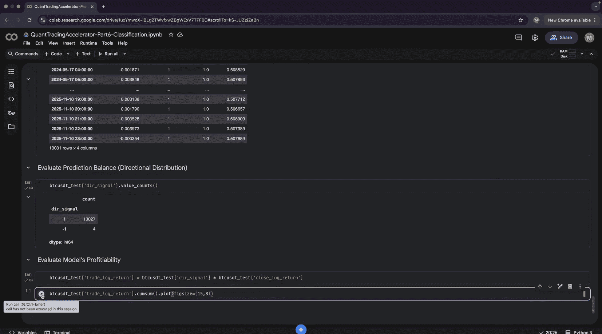

And so now， if I open this up， see that's the equity curve that it looks like。 Okay。

 and here's like the huge gotcha like moment now。 So I'm now going to show the underlying price like the the closing price time series。

 So you see here it this is the close。 And you're going to see something that it's pretty much identical。

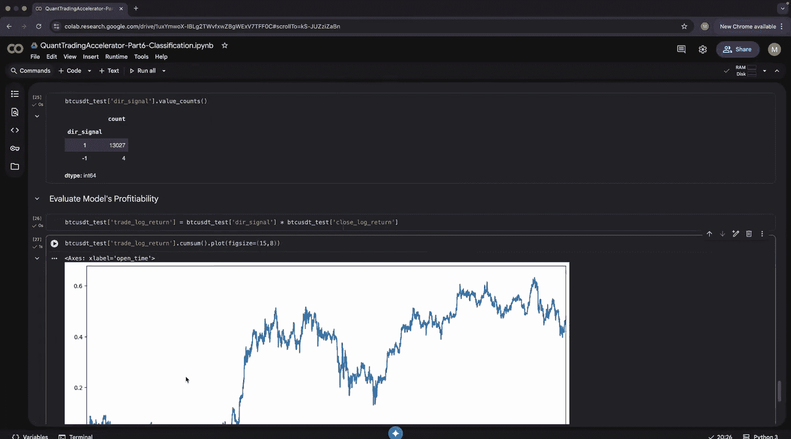

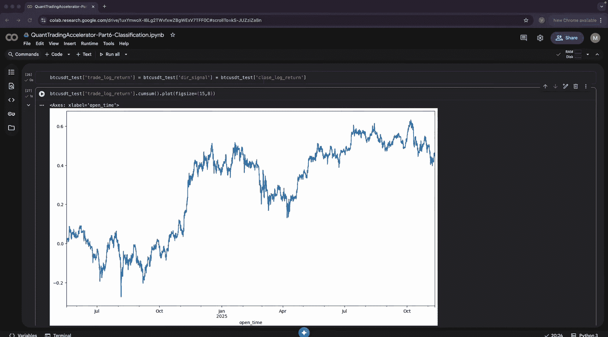

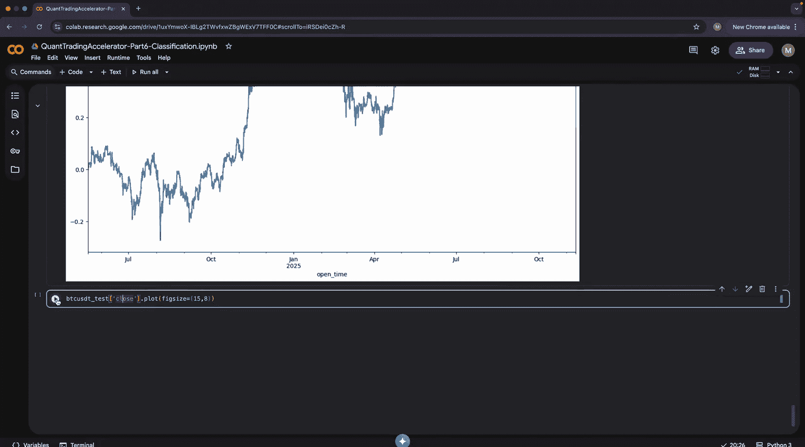

To our equity curve here， it's literally just one for one。

 And the key reason for that is because like a model is just predicting to go up all the time， so。

Luckily， this would work because the market regime that there's a positive trend here that is trending up。

 but if this was， let's say negative that it would be losing money and there's no predictive power because it just depends on where the underlying price is going。

 so luckily it's made money here just because there's a positive trend。

So we need to go back to our model， go back to the drawing board and create a new model。

 because even though we've got a small tiny statistical edge I really there is no predictive power in it so we need to go back to the drawing board and that's what we're going to do。

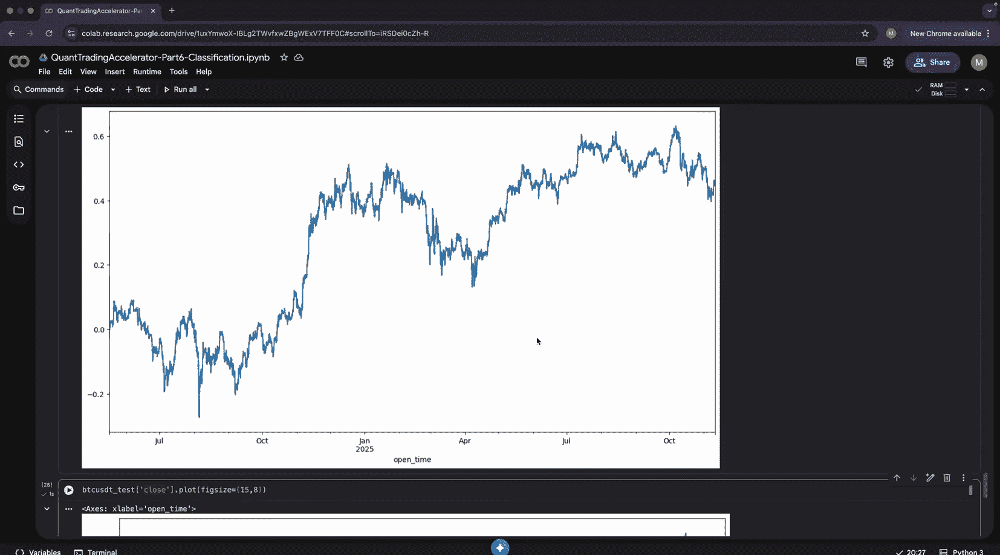

So the next part now is that just to make it super clear。I have just put this。

So the key lesson from this is this。Or maybe if I put that as code。Ill text， sorry。

And it's this like empirical law， which is no discriminative power， equals no predictive power。

 So if it can't discriminate correctly， then there's no predictive power here。 And you can see here。

 okay， it is profitable， but that's not predictive。

 we want something that's both predictive and also profitable。

So now what we're going to do is we're going to research a new model。

And we just want to make sure that there is discriminative power there and also， you know。

 it's also profitable as well， so。We're going to try a new model。Okay， and。

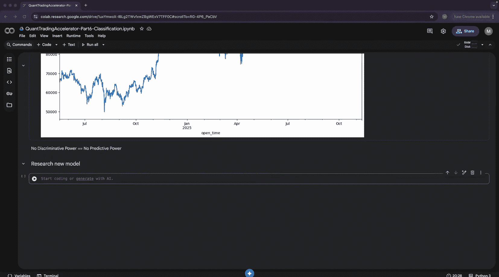

Okay， so I'm gonna， this is the code。 So essentially it's，s exactly again。

 we're gonna be using a logistic regression。 but this is， we're gonna to use the previous。

 instead of just using lag free， we're also going to use lag 1 and lag 2。

 and there's just one small difference is that I'm using a standard scalar because。It's sensitive。

 I think I'm not sure if I did it in the previous model。But。

Because I'm now working on aotive variant with a multiple。 I I want to scale it， essentially。

And this is essentially normalizing get to。I don't have the best way to describe this So it's just like it calculates the mean and calculates the standard deviation and it just scales it to much shrinks it to a smaller number because with machine learning it's very sensitive to small numbers and you get something called vanish ingredients but then if it's large numbers let's say like a huge price movement a $200 and then another feature is like I don't know what moves up by only moves up by one or 2 there's huge imbalance there and you get something called explode ingredients。

Yeah， maybe a bit out of scope， but that's just the reason why we're using this it makes it nicer for training because if you have it in different scales then you're putting in the same scale is a cycle like return like what we do returns。

 we just make sure everything's on the right scale。あ。But machine and context we use， we use like。

These scalrs and there's all different types of scalrs， this is just like the most common basic one。

And what's very important is that we need to do the。The scalar on the train and also on the test。

 So we create a scalar scaled version for both train and test。 And then we again。

 we we'll make the pietor and again， it's all exactly the same。

 I just increased just because we've got more features now that I've've increased the training time。

 So the only big difference is that I've just scaled the data and I've also。Increase the。

 the training loop size。 And it's all exactlyly the the same code。 Maybe I I should。

 should have run it while talking about it。 But as you can see here。

 it's it's decreasing and the what we're talking about maybe in the pre in the next video is like when to。

To turn off， like， when do you want to stop learning。 And there's like this concept of like。

 called early stopping。 Okay， so now the model has completed。

And because we've got the reproducibility settings that we should all have the same result。

 And you can see here， and this is also has is modelling moonversion dynamics here。

 because all the the weights here are negative And but you see here。

 the most influencing feature is the most previous and the weights are decaying。 So and this is。

It can be interpreted as the most recent value is the most important for this model。

 and then it's got like a tiny bias here as well。So and then we can see here that it has a directional accuracy of 52% and I also added this thing called the confusion matrix and because this just allows me to see straight away。

 okay， the distribution of of the predictions， I can tell we'll go into this in more detail actually。

So。Now， what we want to do is to evaluate the performance， not the profitability。

 but just the the performance。 So this is what we're going to do。Let's put this as。Text。Okay。

And we wanted， I'm just going to create the confusion matrix again。

And you can see here it's a two by two matrix or two dimensional array。

And what I'm going to do is just to extract all the。The values from it。 And I've just so。

T N equals true negative， maybe hypothesis。So true negative。 So this means that it predicted it as。

Negative and is actually is negative。And then， false negative。

Is where it predicted it to be negative， but it was naturally negative。

And then the same with hair oops。For true positive， this is where it predicted。 And。

 and in regard to negative and positive negative is if it went， maybe if I may do that true short。

Or down。 Yeah may put down。So this is where we predicted it's going down。 and that's a false down。

 And this is like a true up。And。But her false。Up。So。False op where it predicted it's go up。

 and it's not actually up。 Okay， so that's the， oh God， I did it the wrong way here。 That should be。

 sorry， my bad。 that should be。That's up。Just make sure that's。Tw up， false down。 true。 Yeah， Okay。

 so here we go。 So now we， we've got these encoded as in variables。

 And there's lots of different metrics we can calculate from these， like。

By breaking it down actally as these four variables， we can just， just to show like。

 we can calculate the win rate。By using these variables。 So let's just do that now here。

 just to show break it down。And so， for example， oops， evaluate the win rate。And we can do this。

 And essentially。You're just saying， like。T， P， T P plus T， N。 So that's the true positive。

 plus true negative。Divided by。 And then we add up all the， the true positive。

 true negative plus false positive plus false negative。 Okay， and then we。

You can see here we get 52%。And like in machine learning context。

 this would be a very bad classifier。 like， but because this is financial data， it's， this is。

 we're gonna see， okay， if it's proper or not， but in a。

If you're taking a machine learning course and you're classifying hand digits。And you had a 52%。

Win rate of predicting， you know， that the， the digits correctly， you'd just scrap it in the bin。

 but with financial data。It's different。 And you should have know this by from the previous videos。

 It's more important that we have a strong， expected value。

And so now we want to do is to evaluate the up predictability。

So how well did it evaluate predicting up。So let's do this now。😔，Okay。

 so evaluate the upper predictability and to predict the up predictability。

That's a bit bit of a tongue twister。So it predicts 51% so。Out of all the ups。In our predictor space。

 it's only predicts only 51。65 per of them。 Okay， so it's very tiny， right。

 But now we want to see like， okay。The what we call in machine learning is called the precision。

And that is the， essentially， it's evaluate the accuracy of it。 like， so when it did predict up up。

How well did it， you know， how well did it predict essentially like oops。So we go， you got the。

 I evaluate the up。Accuracy， and it's just instead of being false positive。

 we're interested in false negative。Okay， so when it has predicted up。

The accuracy of it it of when it does predict up， it means that 77% of the time。It's accurate。

So hopefully that's clear。 So you got the like has predicted of all the times the actual underlying data has gone up。

That is predicted 51% of them。Okay， but when it has predicted it to go go up。

 it's like got 77% accuracy。 So what this tells us is that。If our model is predicted up。

 we've got like a 75% confidence percent confidence that it actually is going to go up。 So。

 but now let's look at going on it from a down perspective。Okay。Maybe just， okay， so we。

 it's just exactly the same statistics。 but we're just looking at it going down， so。Now。

 we want to evaluate the down predict down predictability。And this is pretty much the same。

 So we're just doing true negative。Over the plus。True negatives plus false negatives。

 So the space is like the all the true negatives and the false negatives。

 So you can see here is actually。Out of all the times it went down。

 it predicted 53% cent of them correctly。So it better has a better accuracy or predictability for going down than for going up。

 okay？But。Now， let's see， like when it has predicted it to go down， how accurate are those。

 So what we want to do is to predict evaluate。Down accuracy。Okay。So you see here that when it。

 if it predicts us down， it only 25% of the time， it gets it correct。

 So we can't be too confident when it goat bring it。

Predicts it's going to go down that it actually is going to go down。So， but it's quite promising。

 fact， for example。 So now this opens up a new kind of one that we could potentially go into。

 which is called meta learning。 So basically， you could take。Several different models， like。

 for example， this predicts going up quite well。 But if you have a model that predicts going down。

 you could essentially like additive additively add them together to build like what's iss called meta learning。

 because you're building we're taking the predictions of those two models and combining them together。

 So if we have a model that predicts going up well， we have a model that predicts going down well。

 we can combine them together to make them even more predictive in theory。Anyway。

 thats meta learning is a better outer scope， but I just want to just to bring that up。

 So now we're going to go into now we want to know is the directional balance and to create the direction to calculate the directional balance。

Is we're gonna， we want to calculate the short ratio， and the short ratio is essentially。是。

That's the short ratio。 And then we are going to print it out。And while that's running。

Were also now going to add it for the directional balance。The long pressure。Okay， so23%。Yeah。

 it's 25% are shorts， okay？Both。Positive， like correctly predicted and not predicted correctly。 Okay。

 and now if we look at now we're going to do a exactly the same， but with the long ratio。Okay。

 and then we're going to print it out。Okay， so that's 76%。 So 76% of the， it's it' long。 And then。

 for example， we want to and understand the， the directional imbalance。Then we can just do this。

 which just my。Dction and advance。 Then we just， it's just the ratio of short over long。Okay。So。Yeah。

Thus the the directional imbalance。 and what we're also interested in is we want to quantify。

 you know， when I was talking about the discriminative ability。So。Machine learning。

 scientists will use。Something called R O C， receivership ownership capital。

 can't remember exactly receivership ownership characteristic。 And essentially。

 it tells us and it's normalized as well。 So it's from。I think it's from0 or minus1。

 I can't remember at the top of my head。But it is， yeah， it is zero evaluate。No you should put this。

R I C。Okay。And it's probably better if I just show the code， rather than just。

So this just tells us quantifies the discriminative ability， right？ So， for example。

 if it was less than 0。5， this means it's worse。 And maybe I'll just put this as a heuristic here。

 If it's less than 0。5， how we can interpret it， is that it's worse than random guessing。Okay， so。

In terms of trading， this just means that you bettert off just using a R N G。

 a random number generated， then actually like。Using that model so。And then， if it's 0。5。

Then that means it's just。Just as good as random guessing。Okay， and if it's greater than 0。5。I would。

The higher the number。The more discriminative ability it has。 And then if， for example。

 if it's just  one point， let's just say if it's just 1。0 okay。This means， as perfect。

Discminative ability。Discriminate ability。This means like， for example， if you're trying to predict。

Animals， right， and there's 1。0。 that means like。It predicts perfectly。All the animals。

 So it's not like it's really good at predicting。IHses， but it's terrible predicting cats。

 So this just basically means has really good discriminative ability。

So and that's why we want to quantify this because remember in the first model。

 it was just issue you just predicting up。Anyway， so this is the the R O C。

 and we can also just we can also make it more visual as well。 So for example。There we go。

And we're just going to plot this thing called the R O C curve。And just to make it more visual。Okay。

And I just recommend as well to。To go over this， Google this。

 chat GT this to go over it in more detail。The orange line is basically our random guest line。

 And if the for a perfect one， the， it'll be like。Here， so the more it's over。Here。

 the more is better than random guessing。 So you can see here that the blue line is just。

 just to the left slightly than the orange line。 And this corresponds with this like 51% A U score。

 right？ So it's just saying it's just a little bit better than random guessing。

 But we know that to create a profitable trading strategy。

 You just need a model with just a very tiny statistical edge。And we've got like of。This A U of 0。

 well， actually，51。8。 but that's just the main key。 And for example。

 if we had the blue line just underneath the orange， that means it's worse than random guessing。

 So we know that we have a little tiny edge here。So that's the R OC。 And now what we do。 So we just。

 we've just。Been evaluating the model's predictability。

 but we haven't evaluated the model's profitability。 So now that's what we need to do。Okay， so。

Let's just make it very clear what we're doing now。And just like in previously， what we want to do。

Is we want to。Put this back into our our data frame， our test data frame。 So this is the。

The labels that we predicted and then the associated probability。

Let's just make it more concrete by sharing。Theatural data here。So for example， here the actual。

And you can see here now we can actually see a few where it's actually predicted a0 the label a0 label being short or betting going down。

 Okay， so for example， like here， it predicted it's going up correspond with the one and that's the associated probability。

 And so for example here， this predicted with a higher probability and it won this trade。

 for example。Un let's have a look where it predicted it。 so look for example here。

 it predicted it's going to go down， but actually it the sign here is positive。

 So it means it went up and that was the associated probability， right， 49%。

 And that's essentially 49% that it's going up。And yeah， and so， for example。

 here's a one that went and we predict went and goes negative or to go down and actually has gone down so。

That's the。The labels。 And again， what we need to do。

 which it should be like obvious now to you now is that we need to encode the directional signal。

 So let's do that。 And it really should just， it should be able to。

Do this like the the back of your hand。So the add directional signal。And to do that， we do this。

So again， it's exactly the same code。 And we， we， we're calculating the directional signal where where the。

Predicted if it equals1， if that's true， then we set it to1， but then if it's false。

 then rather than being 0， it's minus-1。 So essentially what this code is doing is just replacing the zeros with minus1s。

あ。🤧我旁边。And as you can see now， now， for example， when we predicted it's going down。

 represented as the zero。The directional signal is -1。And again。

 so literally is just that's the effect。 It's just replaced the zeros with -1 and the ones still remain the same。

 So if it's the label is one， the directional signal is one。

 Okay so now that we've got the directional signal。

 now we can actually predict the add the the trade returns more specifically， the trade log returns。

So let's do that。 So add trade log returns。And again， this should just be。

Muscle memory to you got to you now。 So that's the。 And now we just wanted just to。Print it。

 and I'm just gonna。Show what we've done here。 So we're just multiplying。

 It's just the product of the directional signal， which is essentially the sign of our prediction。

Multiply it by the actual y value， which is in our sense， it's the close log return， okay？

And you can see here that。Where it's negative as mean basically we've lost money from from this trade。

 So， for example， here， it predicted it's going up and then the label was up and it's got like a very tiny probability of it going up right。

 but it's actually。Went down， and it went down by this amount。 So now iss negative this amount， this。

 so。And now let's look over an example where， let's say where we actually want money。 So。

 for example， here。We predicted its， it actually has gone up， and we predicted it's gone up。

 and it has like a 51% probability。 So it's， and it has gone up， so。

That's how much we've made in terms of as a log return。 And let's see another one， for example。

 where it's predicted。 Okay， so， for example， here， it predicted it went down。

We encoded it as minus so yeah，0 is to say it's going down。

 We encoded it the directional signal as minus1。So if we're multiplying -1 by the closer log return。

 then essentially we're just changing the sign。 And in this case。

 this is how much we lost from this trade in this time interval。 So yeah， that's the。

 the trade log returns。 that， but that should。Be trivial now to。If you。Watch the previous videos。

And now what we want to do is to add compound growth returns。

 So remember from the previous videos that the I think that even said it in every single video。

 the log returns are what's called time additive。 So if you add the log returns up together that gives you the compound growth and that basically means if we reinvest the money in each from each time period we get the compound to growth rate like trade return。

So this is what we're going to， to do Add the compound and。

And it's essentially because the log returns are additive that we can just add them up cumulatively。

 Okay， so that gives us our come trade log return。And now we can actually display the equity curve in log log return space。

So we can do this now。😔。

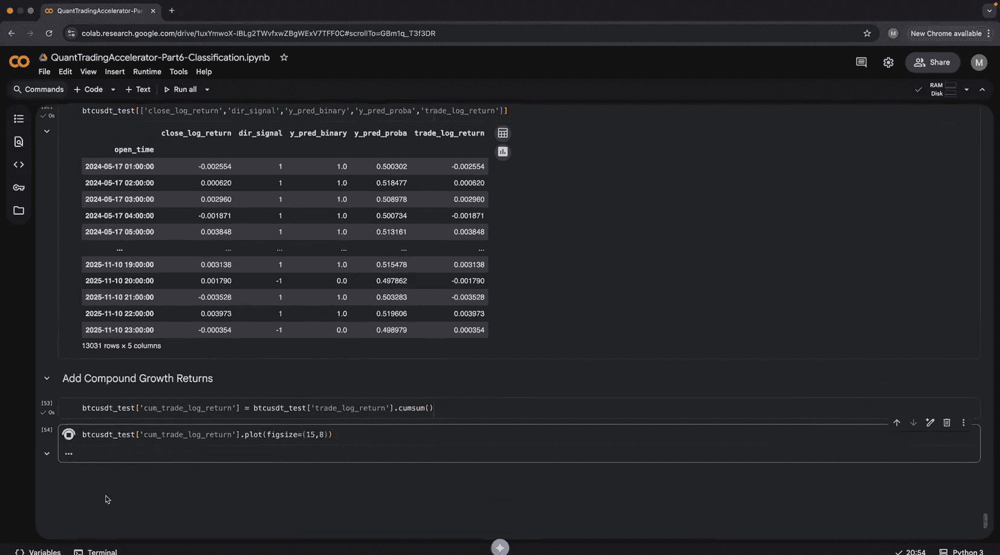

So you see here。It's just winning 52% of the time， but you can see that there is a tiny edge。

And maybe put this as an exercise isca in the previous video。

 I didn't aally broke down the expectedor value。 I just said， okay， I have a positive Ev。

 but we didn't actually decompose it and to say， okay。

 what was our expected value for the winning trades and then the the average losing trades。

 So we can break down to see why it had this tiny edge。 maybe I I had as an exercise for this one。

 because I think it's very important to understand why it has a statistical edge rather than just like。

 say， okay， calculating the mean。Essentially the expected value and we want to be able to break it down。

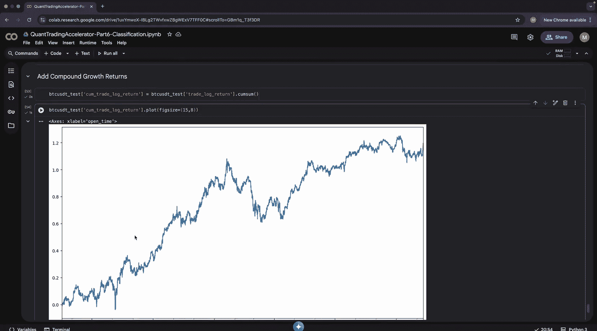

Anyway， so， but you can see here just with a tiny， tiny edge。 you can see like it's profitable。

 right， There is drawdowns。 like， for example， here。

 it does go into what we call like negative equity。 and there is is kind of volatile。

 but this is so much better。Then now if we look at the， actually。

 maybe we can do this if we have a look at the。The actual underlying， you can see， it's completely。

It does not look the same from， like from the previous model。 So if I do that now， close。To plot。

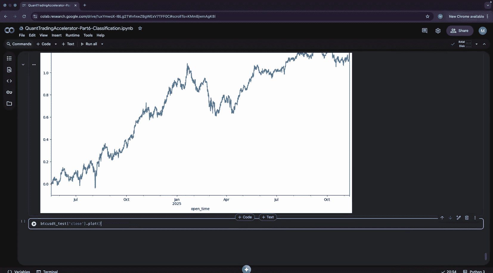

And I put the fixed size in here。Oops。

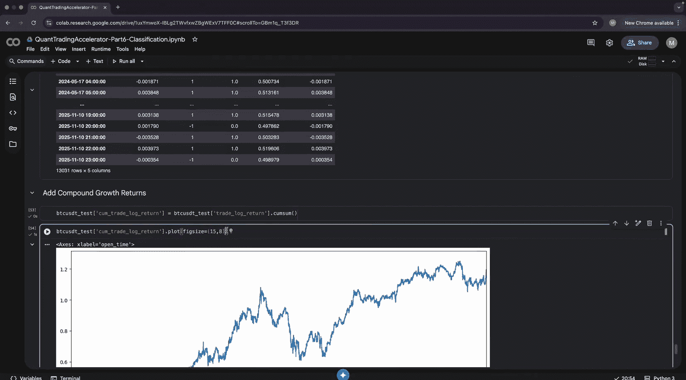

So the figure， the fig size just tells you what the size of the， the figure。

 I just like to make it bigger。 So you don't have to squint at the， the screen。

 It's just nice and big for you。So that's the close， and you can see here。That it is not identical。

Okay， because now we've seen that there's a bit of balance now between predicting downs and ups。

 it's not just purely or the whole signal， directional signal is just purely ups。

 has has a good balance between downs and ups。 So it's not essentially like a buy and hold sort of like strategy here。

 And yeah， so you can see that's the， we can do the comparison。 and you can see like。

They're completely different time series now。And so now。We actually want to display。

 So that's the equity curve in log returns space。 But we want to make it a bit more concrete。 Okay。

 so what we want to do is to display the equity curve。 And again。

 we're just going start with very humble amounts， right， because I just want to。

To show that you can make money， it's not like you have to use huge amounts of money。

 And because we're using returns。It's completely independent of the scale， right？And actually。

 with these sort of like quant high frequency trading strategy， there's also like a capacity。

 So we can't just like， for example， place like $2 million or $5 million trade each hour because we're gonna move the markets。

 It depends on how much liquidity is available on the order book。But anyway。

 so what we're going to do is to set the initial capital。 So we're gonna say， okay。

 we're going to start。 our first trade is going to be going to start 100。 Okay。 And again。

 also need to iterate as well。 This is just gross。 We haven't evaluated the net。

 And but we're going evaluate the the net。

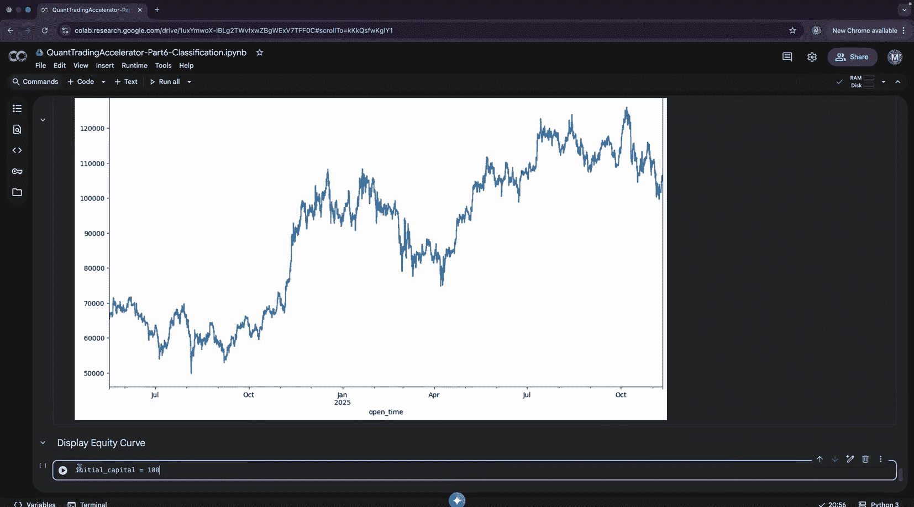

Per now， when we look at the strategy， because the whole goal of this for the model is to a model that has a statistical edge and then we'll look at like。

 okay， can we make a strategy out of it？Okay， so now the next thing we're going to do is to do this。

Is to calculate the trade gross P。 Okay， so we， we want to convert the log return into a normal。

 simple return。 So we just take the exponence of it， and then we multiply it by the initial capital。

 And now we get the the， the gross Ps。 So you， you'll see it is exactly the same。Curve。

 but now just is a different scale now， because now we've run this。

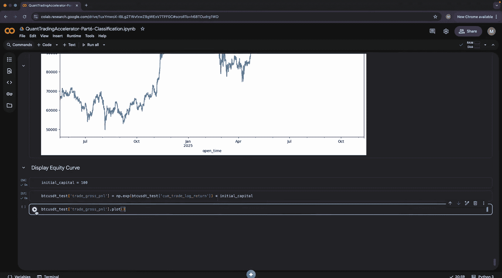

I should maybe if I make it bigger， as well。

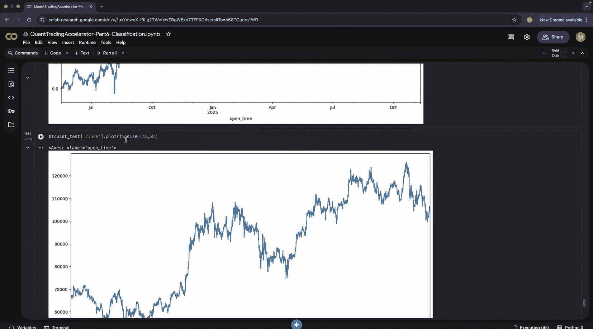

So if I put this。うし。So it may just make that bit bigger。So it's exactly the same scale。

 but the Y axis values are different right。 So this is saying like if you start with 100。

 it might just go down to I don't know， that's about like $90。

 but you can see over time that's from you know most recent data if we use this and let's say in a perfect world。

 we didn't have fees。 then just with a very tiny win rate of 52% we can make considerable amount of money。

 So。

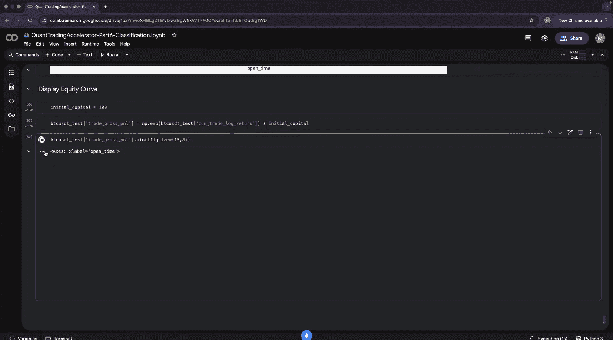

It's also that's just another key lesson here as well It' like you have a tiny statistical edge。

 but if you do like trade a lot， so just imagine a coin tos like you only have like win like expected value of just like1 cent and you only toss the coin every day。

You won't make money， but you won't lose money， right， But if your。

Tossing that coin millions of times a day。 That tiny edge adds up。

 And it's the exactly of the same concept here。 We have for just a very tiny edge。

 but we're making lots of trades because we're making a trade every hour。

 And imagine if we scale this， like to say， a trade every minute。 And again。

 still holding for an hour。 then the frequency scaling we magnify even more。Anyway。

 so that's some food for thoughtt。Now we want to evaluate the sharp ratio and we did this the sharp ratio before。

嗯。Okay， so that's it without being annualized， right， But and again。

 remember from the previous video， this is an hour and if I want to compare a strategy or model that's in。

 I don't know， seconds or days， weeks。It's going to be a completely different scale。

 So this is why we have to annualize it。 So it's independent of the the time horizon。

So now this is where we go into to annualize it。 So I had a very good question in the comments saying like。

 okay， why are you it was a very good question。 Why are you scaling like this？

 And just so yet it's very clear why I'm doing that。 It's not to。To skew。

 making the results look better is just to。Annualize it so I can compare this against。

 let's say a weekly the sharp of a weekly strategy or a daily strategy or even a monthly strategy or a second that is all annualized to years。

So yeah，'s， that's essentially why。 Okay， so now were， let's just run the code。 So you see。

 it has a very news like it doesn't have a high sharp。 And you can this。I explainedplain right。

 because there's huge amounts of drawdown。 And in high frequency trading。

 it's very typical to have like very high sharps， like double digits。

 So I know there's lots of you Google its and like it's on it's not。

 it's rare to have like a double digit like over 8 And that's totally not true in industry because you'll see like double digits。

 I've seen like。1， that's 40。 And that was just like printing money， like every day。So。Yeah。

 that's the sharp。 But you see here， like， if you can tolerate these like drawdowns。

 then this is a very good str like model。 Okay， it doesn't have。 It's not the highest sharp， but。

That's another important part as well it's like the sharp doesn't always correlate to high returns right because essentially you're just reducing the risk you're reducing your drawdowns you can if you're comfortable so if company're not using leverage。

 then you may want to youre fine using this because you can tolerate these drawdowns and if you know you've got statistical edge then you know okay over time you'll make money right。

So that's the sharp ratio of this classification model。 and and again。

 we just want to evaluate the the total compound return。And to do that。

Evaluate total compound return。Okay。Total compound return。 So you see it's like 3。3 x returns， so。

So that means like， if we want to evaluate the， the gross。Piano。Let's just do that。

 The PL stands for profit and loss。Because we have to use。X amount of money， right？1到。

We're not just like。You know， a business doesn't work on like。When you， you submit your returns to。

 for your your company annual reports， you don't。Report in percentages we have to report in hard。

 concrete numbers。So let's say we just used our initial capital， which was 100。Oh。Sorry， I。Oh yeah。

 sorry。 that did print out。 Okay。 So with that $100， it's like just over free exit to 330， Okay。

 But there is a caveat here。 So I just don't want you think this is like because we haven't factored in fees and the fees depends if we're running as a maker strategy or a taker strategy。

As a rule of thumb， if we're going to run this as a take a strategy。

 this will actually have a very high negative sharp。

 So basically means it consistently and stably like loses money。 So。

 but if you run this as a making strategy as in you're adding。Liquidity， you' place limit orders。

 You pay a much lower fee and even some exchanges， if you have a good。

 if you have a relationship with them， they， they will actually pay you to add liquidity。

So you could even make even more like even it's more lucrative， right so？

This is why I'm not just evaluating the gross profit and loss。 I'm not evaluating net。

 because when we go into the strategy， then we'll wellll use it for a take and we'll see that we can't make money out of it。

 And then we'll we'll decide what other model can we use。

 So typically we'll have to extend the the time horizon。So yeah， so that's。

 And now we so we've covered pretty much all the goals here， apart from the the last two。

 which was now we're going to go into now。 So now we're going do is what's called evaluate the excess predictability。

 And this is。Similar to the R O C curve， right， is saying like， okay， what's the。

 what's the discriminative ability， But this is more respect to profitability。So。

 and I call this the Grkca statistic because its from a， actually。

 I'll put a link to it because it's a very good read and。It's basically it's allowed it's a。

 it's like it's a benchmark to compare how much predictable it is compared to just like random a random guessing strategy。

 Okay， so it's basically taking the difference and seeing like， okay。

 what's the excess predictability， So it's saying like how much more predictability is the than just a random guess。

So the first thing we need to do for our Gco statistic is to create a benchmark strategy。Oh， did I。

感じして。Stor here。Okay， so we're going to create the benchmark strategy and that's just a random guess strategy。

 okay。So I'm just going to copy and paste and maybe just go over what it's actually doing。Okay。

 so we're using what's called an R And G random number generator。

 And this is what we call like has a uniform distribution。 So has a。It's gonna either be 0，1。

 And it's a 50，50 probability of each one。 Okay， you could mess around this。 like， I du't know。

With different type of distributions。 But just for us， this is just fine。 So this is what it's doing。

 It's generated integers。 It's either going to be 0，1。

 But the problem is we need to convert this into directional signal。

So if we just multiply it by2 and take 1， then we normalize it from 0 to1 to minus1 and one discretely。

Okay， so that's now we've got a random directional signal。Bmy， and now we again。

 we just wanted to do it exactly the same this would be really obvious and trivial now for us now。

It's just to calculate， okay， what's the the for the random？I mean， for the random trade is， okay。

 what's the。The trade return on it。And now just to show what it's doing in here。嗯。

We've got the just very important again， just for reproducibility and passing in the seed from the previous model。

 So because if I didn't have this and you run this and you run it again。

 you could get completely different signals right？ So I just want to make it that we all consistently have the same random direction signals。

So。Let's just run this now。Okay， so you can see。Maaz some money， loss of money。

 And we just want just to evaluate the performance of it， right。

 So we're just going to print out the equity curve in log space。オッケ。

So you can see here that its actually， you know， starts to make some money just like with a random guessing。

 but then at the end， so。It goes into negative equity。

 so basically you're losing like your initial capital and then it goes back up but still below zero。

 right？So that's our excess。 also， that's our benchmark， right， So this is what we need to beat。

And so essentially， the excess predictability。

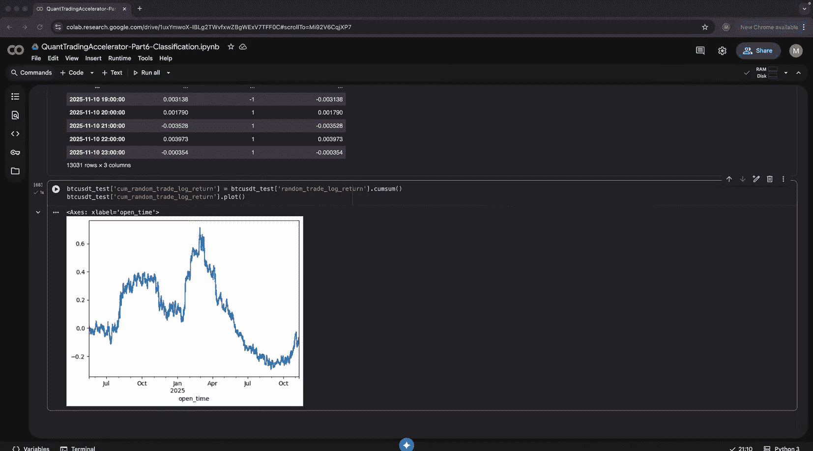

Is this。 But what Alex Geko does， he also then。Divide it。

 And he does what's called like normalizes it to， I think it's like from -1 to one。

But I just don't want to make the math really it complicates the math and I just want to keep things simple。

 but we're not going to normalize it， but。InIn the paper， he actually does not like scale it。

But anyway。So now we've run this。 And this is the excess predictability。

 So this tells us like how much more predictable over time it is over a random number guess。

So you can see here that there's actually at one point where the random number is better than our。

Our model， right， it was just at this point here。 So when it's negative。

 that means that it doesn't have any excess predictability。 It's negative。

 So the random number getting strategy。Has better predictability。But you see here that。It increases。

 right。 There's a bit of a huge drop right， and that。Corresponds to this， but it's still positive。

 So this means that like 99% of the time， it has access predictability。

So we're doing better than just random guessing。m actually， one of the exercises is， you know。

 excess predictability with respect， like changing the benchmark。 essentially。

 we're gonna So rather than just doing a random number。 we're gonna just do like， okay。

Where you just buy like each time period you buy it and then say， okay。

 what's the excess predictability with respect to the it's called huddle。

So that's the and we just because that's over time。 And then we want to see what the final result is。

 And you can see like it's over 1。25 here。 So huge excess predictability over just a random number guessing。

 I think it's a quite nice statistic to compare just against a random number guess。 So it's like。

 you know。Doesn't actually have good。Predictability。

So that's now we're going to go into decomposition and it's quite interesting because。

I'm not sure if it like it's maybe let me let me just explain it first。

 and then I'll just go over who actually created it and so。Maybe if I take this code here。So， text。

So it comes， I believe that the guy who created his。Well I've seen it reference。

 I'm not sure if he was the invented it or you know。But， can you reinvent this， but yeah。

 he modelled that he is trying to do predictions this guy goes Stanislav Ana Atev。

And he was actually Alex a funny interest in， he was Alex Geko's PhD supervisor。And he。

Mod like he created a paper where he models the return as the sign。

So it's either going to be one or minus one。Multiped by the absolute size of the return。

 And then is' just， so actally， he's decomposing it。 Okay。

 and this is why I'm telling you about it now because we've built a classifier， right。

 And it's predicting the sign。And if we could then extend our classification further by predicting the future absolute size。

Okay， and it's， it's basically just to make it very concrete whats。What this is。Okay。

 think of it in like as a factor， right physics。啲未必费。Text。The sign of the return is the direction。

 so that tells us whether the price is going up or if it's going down， okay？

And then the what's called the absolute size， Maybe if I make it clear。

 what is absolute size as well。 So text。Okay， and that tells us the magnitude， right？😊。

And the premise is it gives you more predictive power if you decompose them and it can capture some say like nonlinear behaviors。

 just using like a linear logistical classification and a linear regression。

 you can model some nonlinear behavior。🤢，So that's the the premise of using this what's called decomposition。

 So let me just make it a bit more concrete， right， Okay， so， for example， absolute。

 if I say minus10。It's 10。 Okay。 And if I say absolute of 10。Its 10。 So it just basically， if it's。

 if it's a negative number， it flips it to positive。 So this is。

 this is essentially the maths for it。 Okay， this absolute。 That's what what it means。So。

 for example， if we predict the direction as equals minus-1。And the magnitude。As5， okay。

 then it's just direction multiplied by magnitude。Oh。About。Ted too long。 Okay。

 so there we get the -5， right， So this how we've like decomposed， so。In the so in a future video。

 what we might do is to actually we'll make it as an exercise。

 but maybe in the future we'll create a decomposed。

 we'll predict the future decomposed future log return of God that's a longwined word。

 but basically we're going to predict we're going to use our classifier。

 but then we're also going to predict the magnitude。 So the absolute size。

And we're going to also compare that to say， okay， compare the excess。

P predictive ability compared to just using， let's say。A normal classifier。And then， okay。

 so that's the， the， the video。 I think it's already gonna， this is already。Already quite long。

 So maybe I just mentioned what we're going to do in the next videos。

So that's the the end of the video。 So I hope you you find that very useful。

 And so in the next videos。What we're going to do is。Want text。Is well。Maybe is this。Okay。

 so in the next video， we're going to go into back testing。 and we've already covered some。

 we're going to go into more specifically。 We're going to go into cross validation。

And we're also going to look into some other test statistics that we're interested in。Okay。

 and then after that， now we've done back testing， then we can actually start going into strategy。

Okay， so then because now we've built the model and we've back tested it and we've cross validated it and we've got some we know like test statistics with respect to profitability then。

We can actually start to make a strategy out of it。

 so there'll be that's the pipeline now for this series。Okay， so for the exercises。 So now we。

 we're getting into rather the other ex exercises were like very toy。 Now。

 we're actually going into into more hardcore exercises now， so。And， they can。The bit harder is。

 it's not like a true false。 It's just have a go at trying to do this。 Okay， so the first exercise。

Okay。It's like， okay。X， oh。Repela text。Is excess profitability， Okay。

 So what I'm interested in is for you is to create a test statistic called excess profitability。

 May Rogers。Okay， and what you want to do。Is to compare。The model's profitability， Okay。

 it's return over the return of a buy and hold。Because， okay， it could。We want to know， okay。

 is it actually worth our time？To deploy research， build， deploy。This。Model or trading strategy。 if。

 if it's actually just much simpler just to buy and hold。 So that's what we're interested in。

Yeah just call it excess profitability， we could have discussion over what's a better name， but yeah。

 anyway， so that's the first exercise。And now， then the second exercise。So exercise2 is okay。

 we're now going to。 So I was talking about the decomposition of the， the the returns， right。

 So why won't you do is to create a regression model。For future。Absolute。Size of lock returns。Okay。

Okay， so that's what we're going to do， right。Yeah， I'm hoping now if my course is a success。

 that you should be very comfortable to build your own regression models now to create your own features and your own targets。

And so what I'd like you to do is to create a regression model to predict the future absolute size of the log returns。

Just make it concrete。 So what we've done already is to predict the， the sign， right。

 Now we want to predict the absolute size。Also as well I'll put the paper to this Stan love and to knife so you can see。

 but it's very academic and。Yeah， so maybe I just make this comment that a lot of academic papers。

Like favor rigor over。Simplicity， or just explain things simple because I've dont know。

 it's just in the court just look more so we could have a huge discussion over this。

 and there could be even a flame more over it。 But anyway。

 just be careful with just reading the papers because it's very long winded and but maybe get chat UT to to summarise it or yeah。

 anyway。So that's your second exercise。And then the third exercise is， okay， so now。

Is based on if you finish exercise 2， and that is to use a classification。Use classification model。

And the， the regression model in exercise 2。To predict。Future。Decomposed。Loquita。So essentially。

 remember that the。We now have a model。 We have two models， and it should be able to predict move。

T is to predict this rights。That's essentially what we we can now predict。

 You've got the classification to predict that， which is in this code here。

 But now once you've got exercise 2， you've built a model to predict this。

 So now you can predict the direction and the magnitude now for exercise free。Maybe fight also pets。

Text。Okay， that's better。Okay， I think that's。Very， very thorough。Video， so okay。

 so I thank you for your time and。See you in the next video， cheer bye。

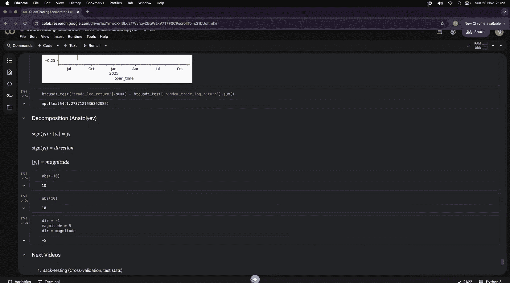

This series is available for free。 thanks to my incredible generous supporters on Patreol。

My goal is to keep this channel independent from sponsors so I can create the content I truly believe in。

If you feel my work brings you value， please consider supporting the channel by becoming a Patreon member。

 You can find the link in the description below。

