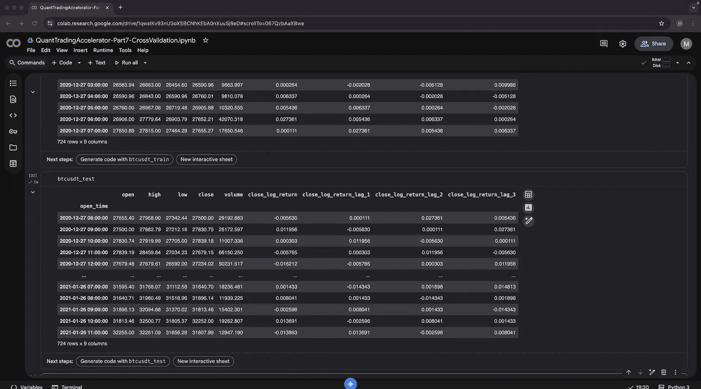
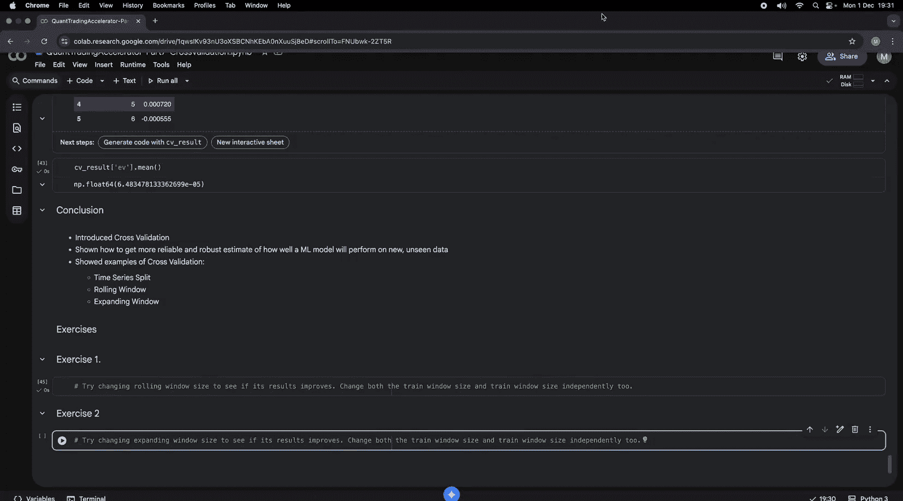

# MemLabs【中英⚡量化交易加速器｜Quant Trading Accelerator】 p07 P7 - Part 7： Cross Validation [BV1UrreB1E8B_p7]

Hello， everyone。 Welcome back to the to the series。

In this part we're going to be doing cross validation so just to recap of the whole series。

 we looked at the array， then we went into the vector， looked into the time series。

 which essentially represented by a factor， then we looked at matrices so we can represent multiple time series。

 which we call multivarit time series， and then the previous videos。

We looked at the the model and we looked at both as a regression and as a classification。

 And now this is all about making sure that the model that we've trained is robust and reliable。

 And this is the subject of cross validation。With cross validation，'s essentially there's free。

 essentially multiple ways。 there's more there's like multiple ways to skinner cat。

 There's multiple ways to cross validate our time series data。

 you just got to be very careful though just using if you just like use I think it's like kfold。

 for example， we always want to preserve the time correctly。

 remember we want to keep things in what's called temporal order。

 So we just got to use cross validation methods that are Pacific for time series data that still preserves the temporal order。

Anyway， so that's all other way， so that the key goals of this video is to show how to get more reliable and robust estimates of how well a machine learning model will perform on new unseen data I've had quite a lot people come with comments that they tried my model but they tried to have different test sizes and they get completely different results when they changed it for like say new data points or change the train and test size split and this is what we'll look into as well like okay how can you make your model more robust and less sensitive to an individual train test split。

So the first thing we were going to do and also as well the another goal is that we're going to compare the model performance。

Using the different cross validations to see which one is better in this case。

 And there's no such fingers like one is better than the other。

 It really depends on the distribution of your data and other variables。Okay。

 so the first one we need to do as always， is to import our libraries。

I don't think I need to go through each one individually。So I'm just going to let that run。

This bridge is going to take a while because it's just stcing up the the kernel。Yeah， so this is。

The problem that we're trying to solve in this video。Is that， for example， if you， if you change the。

 the train test size ratio， it can be very。 Your performance can be very sensitive to it。

 So we want like a more robust method to ensure that our model performs well on new unseen future data。

 So this is the the classic。Time series。Split， so， for example， we always use like the most。

 the oldest data for training and the most recent for for test。 So we never mix， like， for example。

 T 5 within like here。 So it's always preserving the the time order。

 And the main reason for this is because of like we don't any what's called data leakages。

 we don't want it to train on data that hasn't seen。

 So that's why this is like in classical statistics。 This is called like in sample out of sample。

So what we want to do is I want to just show you just like sort of visually with ASCI art is the expanding window。

And let me just。This in here。Expanding window。And the expanding window。

Is where essentially we increase the window size， the training size for our train set。

So I just gonna copy and paste this。And there， there you go。You see it much better visualization。

 So you， for example， in the first fold。Our test size is like two， there's two data points in here。

 okay， and then for the next one。It increases right。 So， for example， here。

 it's now increasing like from T 1 to to T 1 to T 4。

 And we're move also just moving as well as you can see the the window as well。 So it's， it's。

 it's like a sliding window， but we are expanding the the window each time。 So。

This is what was' called expanding window because the training window size is expanding。Okay。

 and now I just want to quickly just show you again， using the， the power of ASI art is the。

The rolling window。And again， there's， there's no。Really。

 there's no one better method better than the others。 purely just based on several factors。

 mainly like the distribution of your data。Okay， so I'm just going to copy and paste it in here。Okay。

 and as you can see here in this example the training and the test window size is fixed。

 but it's just sliding across rolling across right so it starts with the first two data points as training and then the next two data points as testing and then for the next fold then rather than being T1 and T2 it's now T2 and T3 and also the。

The test hasn't changed the the the size， but it's just changed which data points。

 And as you can see here， it's， it's not mixing training test data。

 It's just always purely the the trains， the oldest data set。

 and then the test is the most the future data set。So that's the rolling window， right？

 And these two combinations provide you a good way for finding like a robust。

 robust and reliable machine。Model， mean say machine learning model。

So now what we want to do is rather than just we can actually start building and we're going to。

Create the by hand， the expanding window and the sliding window。

 And there's also another one as well， which is we're just gonna vary that the time series split。

 But the first thing we want to do is just to， to， to load the data。

So I'm just going to make a comment here that we're going to。Load the data。 So again。

 we're gonna still use the same data as we have done for the， for the previous videos。

And I'm just going， to copy and paste。And just in case you。

 you're watching this video from the start， like， from the start and you haven't watched the previous videos that essentially this data is just Bitcoin dollar。

 The per what's called the perpetual future contract。

 It just allows you to easily speculate up or down and。This is like one hour time series。

 So each row represents an hour time interval。 Okay， and it's just standard。Open， high。

 low closed prices。Okay， so now we've loaded it。 So this should all be muscle memory now to you。

 So the first one we need to do is to to create the log returns。And if not sure what log returns are。

 I recommend to go through the previous video。 so you're in sync and ready to， to watch this video。

Okay， so that's our closed log returns。 And now what we want to do is to create the legs。

Because we're going to be using an auto aggressive model。Okay， so now we've got our log return。

 So that's what we're going to be predicting。 And these are the inputs that we that we're going to use as to predict which we we denote as the features。

And now we're gonna to do because we're gonna be looping， training lots of models all the time。

 which is and I don't want to copy and paste code。 So what I'm going to do is I'm going to the training loop that we've been using so far。

 I'm going to create it as a function。 So we can reuse that and don't this is really good software engineering practices that you should if。

 if you see yourself copy and pasting code。Change it so it can either be as a function or in a class or just so that you don't have to copy and paste。

So Ill just making a note here has a create training group。

And maybe I'll just quickly just go over what it's doing just。But分。Let me just copy and paste this。

So I'll just briefly go over because I've done in the previous videos。

 So essentially it's the it's the Pytorch training group。

 It's just looping this number of times which's just the number of epochs。

 It's what's called a full batch gradient descent， which is good if you' got a very small data set that you can fit into memory and our data set small and aesthetic that can all fit into memory。

 but obviously if you are like working with。Tick level data， like getting。

Rs essentially per like multiple per second。 and with very large， lets say， a long historic data。

 Then this is not feasible， but just with a small time series that we have。

 then this is definitely feasible。So， we。Essentialially we reset all the gradients because they're accumulative。

 so we always want to reset them to zero， then we do we make the predictions which is called the For past in machine learning。

 we compute the loss and we choose the function to quantify through the loss。

And then we do what's called this but back propagation。

 which is to compute the gradients with respect to the parameters。

 because it's a logistic regression， then it's just our just our weights and our bias。

And then we just， we update the model parameters using the computer the gradients。

 and then just for debugging and just for， for。Yeah。

 it's useful if to print out like every iteration just so you can see your how the training is doing if it's like。

The perform that the loss is not increasing or if it is steadily increasing。 And yeah。

 and then we've added this。 Oh， this is another important thing。

if I did this for both equals true flag。 and that's just if I want to essentially just print out these。

 these statements。 So if I if because later on you'll see that would just's it will just be noise。

 So yeah， so that's just that flag and it's by default， it's true。Okay， so that's the loop。

And now what we need to do is to， like， this should be bread and butter to us。

 which is to create the the oops。Is to create the time series split functionality。Oops。Serious。

And I'm just gonna make of thisca I've got this being on a copying paste just to explain why we're。

 we're doing this， but this should be。I think I've covered this multiple times in this series。

So remember， we just essentially it's just to keep her in sample and outer sample that preserves time order。

 time order。Thereny plural。Okay， and now I'll just show the， the code。So。Thecyclist same code。

 as in the previous videos。We have a default of like 75 so essentially saying that 75% of the time of the data should be used for training。

 So the the first 75% of the data is used for training and then the the remaining is used for test so the train is our。

In sample。 and then the test is our out sample。 But we'll just keep to machine learning terminology here。

So we'll just say call it training test set。And the first thing we want to do as well。

 is just to empirically check that it's split correctly。 So maybe if I just。

Just cook and paste this a bit quicker。Okay， and so the first thing we need to do is just to check。

Tra data set just to see the the the time stamps on them。So， and then we also want to check。Okay。

Okay， so you can see here it starts from 2020， and it ends in 2024，5th，17 at midnight。 Okay。

 so now we just want to check here。So you see here the it starts correct because it's this the next in time interval is in one hour's time。

 So that's correct。 And you can see this is until the 11th。So that that's， that's correct。Okay。

 so that's the underlying data。And now what we want to do is to actually start training the M L model。

 I just wanted to show you how we can use that function function to， to do it。 So what's our do now。

Train M L model。嗯。What I do。I'll just maybe just copying pastes。Because it be quicker。Okay。

So I let this run。 So maybe while it's run now I just go over what it's doing。 Okay。

 so we're dis specifying our features， which is the auto regressive lags。

and then the this is our target， right， So we just say how the number of features。In Pytorch。

 this is our linear regression。 So this is essentially the the mathematics of it。

 And so we specifying the number of features。 and it's only got one output。

 We're going use the hubber loss， which is a nice balance between mean squared error and。

Movingve in absolute error。The mean absolute error。 So it's just a nice balance in between。

 So So and then the next。Part is the optimizer。 So we're going to use the SGD。

And then the number of training iterations， we're going to use 5000 because Pytorch expects all the data to be in tenss。

 we need to move the data into tensesors。And then we click on the rerun this functionalities we pass our model。

 pass our loss function， we pass what the optimizer we want to use。

 and then we pass our data that we split manually and so we see here okay this is the weights that it's learn。

And so now what we want to do is to retrieve。 we want to do get the predictions for the outer sample。

 which is the in the test， right。So maybe if I just make。I write a hair。And the code for this。

 and also， we're going to be。Wanting to know the， the test prediction。

 So well make into a function as well，ca we we don't want to be copy and pasting things all over the place。

So let me just run this now。 So you see here this is just a really important thing。

 We're going to get back a two dimensional tensor。 So we want to to change the shape。

 So that's that the two dimensional tensor。 and we want to reduce it down into a one dimensional tensor。

 So this is what the dot squeeze1 does。And yeah， this is。

 I recommend if you don't understand what this's doing just put into J G。 essentially。

 we put it in valuation mode。 so makes it more efficient。 Like， for example。

 if this is like a neural network， then it wouldn't run it might have some layers called dropouts。

 which are sort of like a form of what's called regular。

 making your model less sensitive to noise but yeah this is totally out of the scope。

 But we'll see later on maybe in the series or in future videos why this is useful。

But maybe definitely not in this video。Anyway， okay， so these are the predictions right。

 But what we want to do is put it back into our data frame so we can do analysis。

 So that's what we're gonna do next。 So maybe if I just。Explicitly write what we're going to do。

So this is essentially our Y hat。 and if you watch the like the introduction video。

 then you understand what the hat Y hat is essentially saying what are predicted values of what we want to predict。

And we want to put them into here and then compare them against what was the actual values。

So just to make it very concrete that these are the Y hat is our predictions。

And then the actual values is what we're predicting is the closed log return。

 So we want to compare closed log returns against Y hat。But。Thes another for essentially。

 these loss functions， you know， for example， we're。

 we're minimizing these loss functions to reduce the error right， But it's， it's Hu loss。

 It's mean like say， well， let's just say it's mean squared error。 We're just reducing the。

 the squared differences， okay， but。We need to evaluate。 that doesn't。

 We can't interpret if it the model is profitable or not。

 So we really need to evaluate the profitability of the model because the like the mean squared error or the mean absolute error doesn't。

 It's not indicative of the profitability。So let me just put this。this is a header。

So now we need to evaluate the profitability of the model and and I'll just make it a note。Okay。

 and we're gonna， again， we， we don't want to be copy and pasting the code everywhere。

 So what we're gonna do is we're going to。Factor it into a function。

And this is the function So maybe I'll just quickly go over。 Okay。 So it's called vow profitability。

 So we pass in the model。 We pass in our test and it's important that we pass the。

 the test data set and then the。The the the test input。 and then it runs this test model predictions。

 which gives us our Y hat。 Then we put it into the data frame。

 And then once we've got the the predictions， we want to take the sign。

 the mathematical sign of of Y hat for each value。 and that's going to be used as our directional signal or trading signal。

 essentially， because if it's one。It means that we need to bet going up。 Well in trade Lo。

 it's called Long。 And if it's -1， we need to go short。

 which is trading Shigo to bet the prices going down。

And then we need to just calculate the trade log return so the how much money we make in log return space。

 so we just essentially it's very simple， we just need to multiply the directional signal。

 multiplied against the closed log return and then essentially this tells us if we make money or not on each individual trade。

And also， just because the the log returns are time additive， we can take the culator sum。

 and that represents our equity curve。 And then another just a useful metric is like。

Did the trade win or not， And then it's it's a simple predicate that you was just tested if it's。

Greater than silver。But the most important thing is we want to know what the expected value of our trade is。

 So this obviously it positive， then this means on average， each trade we make money。And。

So that's that's our metric for our cross validation。 is the expected value of the trade log return。

Okay， so maybe if I just run this。So this tells us that we have a positive E V here。

 So that means that。If we trade this that will make money on on each individual trade， not maybe。

 And then for example， once you've got the law of lo numbers kicking。

 then this is where the expected value kicks in。So now what we need to do is to。

 we want to put this all together， right， because we're going to be。

We don't want to be manually copy and pasting all the code together。

 so this is what we're going to do so。Going to create a function to evaluate the model's profitability。

 so。I's going to train the model。 and also then。Get the test predictions and then evaluate the profitability of those predictions。

So essentially we're just wrapping up all that we've done together。 So this is the the code。

Maybe if I I'm just going to make a note here just。So if you'll look， if you go to look at it。

 then you can。Understand what it's doing。Okay。So that's our function。 So now we can easily。Passcent。

 maybe I just say what it again， it's just yourre passing in our。

 our train data set and our test data set and。The size of this depends on our our heuristic for the for the cross validation。

 So this is sort of to make it generic so we can try this with the rolling window。

 expanding window and the the time series splits。And then so is' essentially just the the code that we've just been building。

 but just wrapped all together。So I recommend just to go over it just， to see what you're doing。

 Okay， and now we just first one we want to do is just it to experiment with one of the cross validations。

 So one of we're gonna do is to hang on。Is to do this。

So we're going to try it with different train test splits。 Okay， so what we're going to do。

 I' just going to just make it very clear what we're doing。So。

We're going to define and I recommend for you to to try and change the features here and to experiment。

 So what I'm doing is is I'm implicitly defining an auto aggressive free model。

 So in the previous videos， you should know now。That what an auto aggressivegress model is。

 So essentially， we're just looking at the the three previous lags to predict the the closed lock return。

And so now let's just try it with like different splits。So， for example， I'm going to try with just。

Okay， with the train size just only been 0。4。 So the the the the remainder is used as test。

 So there's more test data than is training size。 And I'm just gonna just do this like just manually just to show you。

 okay， what about if it's like a 5050 split。So you see here that。It's all positive D Vs here。

 but of a varying degree。And。And I'm just gonna do this。Just increasing。Each time。

 so' is going to put 0。7。And you can see that all。 so this seems to be not so sensitive。

 this model to， to the the。The varying， the train size。But now let's just try it with 0。8。Okay。Okay。

 and so if we use the train size of 80%， leaving 20% left for testing， then we get a negative E V。

 So we we don't have an edge here。 whereas with the previous ones， we do have statistical edge。

And now let's just try it for 0。9%。Okay。And I just thought I'd go up in practice。

 you would never go up to like 0。8 or 0。9， but just out of curiosity。

 I was just very interested to know。Okay， so we've got some， some figures here。 and so。

We've got negative edge when the train size is like over 80%。

And now what we want to do is I just want to。 So we've done that manually。

 It' would be very painful if we had to go manually and to do this， like what I've just done now。

 So we， you know， using the power of programming， we can just build our first cross validation loop。

So this is what we're going to do now。Okay。Okay， so now this is the loop， and I'm just going to。

 to run it。 And what while it's running。 So essentially， I'm just looping over。呃。Train split sizes。

And I'm just splitting the data by time。 and then I'm just evaluating the model profitability。

 getting the expected value。 And then I'm adding it into this array here。

 And I'm also adding the train size as well。 and then me。 And then I'm I'm just。

Puttting it together in computer science， you call this concatenation。

 So put an all together and put it into a data frame because then it just makes it very nice to display the。

 the underlying date results。So now I just print out so I can see that this is essentially what I've just written below。

 but just in a more presentable way and then without many looping right imagine like for example。

 my deelta size here was 0。1 but imagine if I wanted to do 0。05 or 0。

01 I had more fine control fine grained deelta size then you know there'd be even more copy and pasting essentially so。

We're just auto it。 And you can see here。 And now what we want to do to get the cross validation result is just take the mean of the。

 the expected value to see， okay， if， you know， how robust is this like to different。Training sizes。

And we can factor this in now。 So this is telling us that it is positive on， on average。

 So this tells us it's quite robust to the changing the training size。

Then you could even argue that we can actually remove these two because we would never like go over like more we definitely love for someone 90%。

 but。It's you， your preference， essentially。Okay， so that's the cross validation of time series splits。

 but now let's look at some other methods。And more specifically。

 let's look at the rolling window cross validation。So， maybe if I just。Mention this。

 put a header for it。Okay， and。Now we' just what I want to do is I just want to print out just to show you the the underlying algorithm behind it。

 Okay， so there's 4344 rows。And。I'm just going to use this。Which is like just hours in a month。

 I'm just approximating that there's 30 days in in a month。Now。

Then it's I just want to know the ratio。So tell me the the windows， the number of windows。And okay。

 so now I want to do。Is to do this I want to。Loop， I just want to show the， the。

Indices of the rolling window， Ca I think this will make it maybe hopefully more intuitive。

 like what it's actually doing。 So this is the。I'm just printing out the indices of the data frame。

 so you can see。What what it's actually doing。 So if I just loop over this。

So you can see of the expanding window that the， the train。呃。For the rolling window， we start at 0。

 and the training starts at 7，2，4， and then the testing starts。 Well， actually， it is just0 is 7，2，5。

 But because this is an index and we're using。The Python indices that。

 they're not overlapping essentially， but then we're using the next time window size for the testing So you can just see here essentially this is the indices to filter out our training data or to extract our training data and this is the indices start and end indices for our test window and you can see it's just increasing by 724 for each of these indices。

And so this is rolling window。So yeah， I just encourage you to look at this code。

And what we're going to do is like just show like maybe a bit more concrete and understandable if I show like an example。

Okay， so。We're saying that from。To 0， from 0 to 7，2，4， this is our training。 And then from 7，2。

4 to 1448， that， that's our test data set。 So， now we have to look at the。The underlying data。

You can save。724 rows。And if we have a look at。Test。You can say that it's。It's not overlapping。

 There's no here。 it's the next tick or we could time interval in the time series。 and again。

 it's 724 rows。So hopefully， that's more intuitive as to what it's doing。 But we want to。

And just we can use off。Because。Our function event model profitability is independent of the。The。

 the algorithm to， to split the data， we， we can。We can pass it1。

So even though we're now using rolling mat window， we can still use our， you know。

 evaluate the trainer model and evaluate its profitability。Okay， so I'm just gonna let it run。

 And then let's see what it is。 Okay， so it has a positive expected value。 But so， but it' positive。

 So that's the the main thing， right。And so essentially， we can just loop over using the algorithm。

This outgrown hair。We can then， just。Extend on this to actually make it a rolling window。

 And this is what what it is， so。I recommend just to essentially just looping over like the main important thing is。

 which we've gone over is the calculating the indices and the rest is。Fairly trivial。Okay。

 so now that's our vow vow rolling window。And what I want to do is to to pass the the data。B with me。

😔，I didn't call the function。Okay， so that's。 And now if we will do well， it's evaluating。

 I'm just going to print out the results。And also， what we want to do is to print out the average expected value。

So we call this。Okay， so here's our results。 So this is or maybe window numbers， not correct。

 Maybe W iteration number。 maybe。 So you can see here as it's rolling that it's。It's had。 it's not。

 There's a few that have been negative， right。So this is not as robust as the the previous method so。

But let's calculate the the meme， right。So we see on average that it's positive。

 just a small positive edge on average， using rolling window method。So that's the rolling window。

 And， and also as well just。This is， you can experiment。 And actually。

 this is one of the exercises experiment with the window sizes。

 You may want to increase the window size here or make it even smaller。 So， yeah， that's just。

It'sAn interesting idea for you。Okay， so now what we want to do。Is to evaluate the expanding window。

Okay， and with the expanding window， I think it'd be better if I this this should be a bit more intuitive。

Then the with the rolling window， you can see， okay， always starts at。0， for example， here。

 but it doesn't always have to be。 You could。 there's no。

Fixed rules of how you define your cross validation algorithm。 But so for example， here。

 it starts with you know the first window and then the the next fold is that it's the training window is two windows and then it's free windows 4。

5 etca right and the test window is always like of a fixed size of 724 and again。

 you can customize this tower you want and that's what that will be one of your exercises at the end。

Okay， so that's that。 And now what can do。 So that's the。Algothm to to calculate the indices。

 So now we know how to do that。 Then we can just put put it all together to create a function to。

 to do it。 And actually is， well， what I might do。嗯。Is I'll add this to。The， the。

 the public code repo。 So if you want to exp experiment with this， I'll add it into the research API。

 if you would like this， please put a comment。 the more comments that I get。

 the more possible that I will do it。Okay， so that's the。Expanding Windows C。

And now we're just going to call it。Okay， as that's running。What I'm going to do。

 So maybe I'll just explain we're pattern the， the， the data frame， the features， the target。

 the window size and the number of iterations。 So that's essentially what it's calculating。 Okay。

 so that's we're gonna print out our。Result for the expanding window。And now we want to。

 to calculate is the。The， the average EV。And essentially， just if it's not very clear。

 essentially what it's done is saying what's the average statistical edge that we have on each for。

 for using cross validation。Okay， so we run this。 So I think this is roughly the the same as the rolling window。

 So now we've we've used three methods of cross validation。So。

 and that really concludes cross validation。 So just to maybe it's a conclusion。啊。

And want to put that。S me if I。Summarize it here。Okay my5。Copent paste this。😔，Okay。

 so this is our sort of conclusion of。Oh。Okay， so we've introduced cross validation。

And we've also just shown like practical examples of how to get more reliable， robust estimates。

 especially if if your model is very sensitive to the time series split。

 And I've showed like free examples of this。 And also as well， there's no right or wrong answer or。

Methodd to do cross validation。 It really just depends on your data。 So， for example， if。

 if rolling window is really more， gives you a better results。

 then you want to make sure when you deploy it that you're always use。 And let's say， I don't know。

 your， your window size is like two weeks， then you want to make sure that when you deploy it。

 you want to use the the most recent two weeks。 And then after two weeks in production。

 then you re releasele your， your code So re。P retrain your weights。

 or you could just even do it on a， on a weekly basis as well， so。Yet， that's just some ideas。 Okay。

 so。Maybe now as well， that I will do some exercises just so you can experiment with cross validation。

 so。I'll leave us exercises， the the following。So the first exercise。Is to experiment。With the。

 the rolling window。Okay。And essentially， what I wanted it maybe have I put this here。Is to do this。

So I want you to try and change the window size for rolling window to see if you can get better results。

 So you don't have to at the moment， I've hard coded it that the the train and window sizes are the same。

 but you could have like， for example， the train size。

Train window size is larger than the test window size。Like， for example， rather than。You know。

 the the train rolling window and the test rolling window to be one week each。

 it could be that I don't know that the train window size is。4 weeks。

 And then the the test is only one week or two weeks。

 just to try and experiment with different sizes and make the window， Yeah， make。

Refactor it so that the train and train window size can be changed independently。 At the moment。

 it's hard coded。 So that's quite a good exercise for you to do。啊。Then， the next one。

Is to do the following。Size 2。We're going to do exactly the same， but for expanding window。So。Again。

 at the moment， the expanding window is hard coded。

 So the training window and the test window size are， Oh no， sorry， that's not for for expanding。

 it's not。 I just want you to， to， to oh maybe I put this。

I want you to try different window sizes for your expanding window and also don't do it manually write an algorithm to do it。

 And again， just do like what I did。 I just collect all the data and then have a look and see。

 So I think one of the key lessons here is to automate as much research as possible。

 don't be doing this like manually So if you see yourself it looks like okay。

 I'm copy and pasting lots of stuff， write an algorithm to automate it。Okay。

 so that's the end of the video。Please like and subscribe。 And also， your feedback is very important。

 So please let me know your thoughts on this video。 Thank you very much， cheerers， bye。

This series is available for free。 thanks to my incredible generous supporters on Patreon。

My goal is to keep this channel independent from sponsors so I can create the content I truly believe in。

If you feel my work brings you value， please consider supporting the channel by becoming a Patreon member。

 You can find the link in the description below。

