# MemLabs【中英⚡量化交易加速器｜Quant Trading Accelerator】 p08 P8 - Part 8： Strategy [BV1UrreB1E8B_p8]

Hello， everyone。 welcomelcome back。 So this is part 8。 This is。

 we're going to be doing strategy in this video。 So in the previous videos。

 this is sort of like the the。Where we've progressed so far。

 So we worked all the way from starting we've just the most fundamental concept。

 which is just an array。 and we've built up to time series， matrices， we've looked at models。

 And now this is a really key video。 So this is probably with just the model itself。

 this is also is equally as important。 This is about the strategy。

 And so the key of this accelerator。Is to to a one is to build the the model and the model gives us our prediction。

 a prediction to the future forecast， right？ That's our statistical edge。But。

We need to execute that edge。 And it's just like a good analogy。 is like， for example。

 if you have a card counting system in Poca， it could be really good， right。

 But you give it your friend whose who's a gambler。

 And he decides to blow all his money on the first game。 And， you know。

 maybe the edge is only just you win 55% of the time。

 He loses all that money and starts to blame you Oh your system strategy sucks。 But in truth。

 it was just poor execution because he didn't size his bets correctly。

And this is why strategy is just equally as important as the edge itself。

 So you could have like a really good model。 But if you execute poorly， it can just evaporate， so。

This is a really， really key lesson。 So I just really want to emphasize this is very important。

 So yeah， so this is the strategy and what does the strategy strategy do it does So it takes the forecast and it creates orders There's a lot more detail that goes into this。

 For example， what type of strategy you're running and know are they limit orders are they market orders but we won't go into into these security of this We'll just look at a very basic strategy that we can make with our model。

呃。Then that the next part is we need to execute the the orders。

 We need to send them to the exchange or send them to the the broker。

So the key thing is the key goal of this video is to build a strategy based on our classification model。

 So that was the very last model that we made。 we're just going to use this for the time being。

And then the the the key decisions， the like to build a strategy。

 there are like three key decisions that you have to make。

 the first one being is what are entry and access signals。 So this is essentially saying what， what。

When do we enter in a trade and when do we like。Open a position。 And when do we close a position。

 There's many different ways you can do this。 And I'll just like categorize them into into two。

 Then also as important as the trade sizing。 So remember that the example。

 if I gave a really good card counting， poke assistant a friend who's a gambler he blows all the money because he goes bankrupt on the first game because he oversized。

 So we need to know， we need to find out because what's the optimal trade sizing， because。

 for example， if you just trade small amounts at the same time， you're not going to make much money。

But then if you oversize， then you know， you run the risk of ruin， right。

 So there's like a sweet spot for the trade sizing and leverage。

 we need to discuss leveraging because this can amplify our profits， but also equally。

 it can amplify our losses。 So it's really important that we use leverage proportional to the statistical edge that we have。

So I just want to like give like a taxonomy of strategies。 This is a very loose taxonomy。

But you can categorize them into two types。There's making。

 which is what most like high frequency trading firms are doing， what you call it market making。

Where you're essentially adding liquidity onto the exchange so they post orders onto the order book and they're adding liquidity and for providing liquidity。

 they get compensated for it。 and this is more feasible to do like as an intraday trading strategy because the fees are very low。

So any edge that you have it it's not eaten up by your fees and actually in some exchanges。

 you actually get rebates for so it's like negative fees。

 so essentially the exchange is paying you to provide liquidity。So。

Even if you just have a very tiny edge and you， you can and if you're making lots and lots of trays。

 it all adds up。So and then so that's like making and then you've got like taking strategies and taking is where you're taking liquidity away from the order book and usually there's a higher fee。

me， there's usually a high fee for taking， so。It's， it becomes like infeasible to， to， to run like。

 I don't know。 if you're trading on a like a a two minute or three minute level， you can't。

Run the these， you can't run like a trading strategy worth taking because the fees will just like di diminish like any。

 any return。 So it essentially it will like your。magagnify your losses。

 and it will extremely decay your profits。 So it becomes infeasible。

 So we have to be careful like what strategy we use at right the right time。

 So that's really important that you。嗯。Model the， the net P And L。 So you。

 you factor in the transaction fees。 So in the previous all the videos so far。

 we haven't done this because different exchanges have different fees。 So I don't want you to。

To put you off。 And we're just looking at gross。 but it's just very important。 We also have to。

 at some point， factor in the， the transaction fees。 But we're not gonna do it right now。 anyway。

 So that's our。So what we're going to do now is we're going to load up our just build and train our classification model so that we first we just need to get the create the model that creates the the edge and we'll just go over just from like previously right。

 So the first thing we need to do is to load our libraries。Okay。

 so I'm just gonna copy and paste because it's。'll save time。Okay。

 and now what we're going to do is we're going to load the the our data so far。So I great。

 So that's loaded。And I'm just going to。Load data。And I'm just going to copy and paste and this so its。

And this is Bitcoincoin dollar。Pap contract。 So it's essentially a future， like a 24，7 future。

And because it's a feature， we can easily speculate if it's going up or if it's going down。

 you're not trading the the actual spot instrument。So。That's the data all loaded in。

 You can see here it starts from 2020， and it goes all the way to the the 10th。Of November。Okay。

 so that's the the， the data。 And first thing we need to do is to create our input and output to our model。

 And remember， from the last videos， we're always looking at price movements and more specifically at log returns。

 So now this is what we need to do is to add。Locrants。And by now， you should know the。

 the reason why we want to use log returns。 And maybe if you join the video。

 just started from this video， I really recommend to start from the the beginning because this may。

I' going to explain in detail in in this video。Okay， so that's the the log returns， right。

 and what we need to do， because we're building an auto aggressive model that we need to。

 to create the the lags。And the lags are essentially， as you remember， the。

 the just the the previous values in in the time series。So we just shift， essentially。

 we're just using the the panda shift。 And also remember what's important because it's a linear model。

 it's sensitive to to nulls that we， we drop the the nulls out。

 So this is what essentially what we're we've got。 So this is our target， the closed log return。

And we want to， we're going to use these lags to predict the， the log return。So now we'。

 we've got our， we've structured our model input and features and targets。

 Now we can what we just need to do， though， is。We need to encode it into a binary classifier because it's a classification model。

 we need to。Classify into two labels。 If the price went up or if the price went down。

So this is what we're gonna do now。Okay， so I'll just make。I had to hear。Okay。Ha just made as a text。

Okay， so the idea is， is that。We encode it as one。 and that means that it's like a going along that the。

 the price moves up and 0， the price moves down。 So we're not using -1。

 We have to map it to a probability space。 So it has to be in between 0 and 1。

So now that we've done that， now we can we， we， we can do this。

 So what I'll do is we're going call this the。Encoded it。

 we just call a closed log return do D IR direction。

 So the the easiest way is just we use this map function and the map is essentially goes to every single element in the in this column closed log return。

 this is lambda。 So it's like what's called an anonymous function。Inside the enormous function。

 we're saying， okay， it's a uninary function。 we， we take the individual element and we。

 we map it to one if it's greater if the x is greater than 0 L 0。 that's essentially it。

 So that's what we do now。 And just remember in in the previous videos for classification。

 It's really important to to look at the distribution of the the the the classification target。

 because。If we go back to the previous video， we talk about discrimination， discriminatory ability。

 right， which is。You know， because， for example， if it's like an unbalanced dataset set。

 we don't know that it has any predictive ability， right。 So let me just show you now。

So we can see that there's zeros and ones frame， but we're interested in more like， okay。

 look at the balance right so we can just put this in here。Check directional balance。Okay。

 and what we'll do is we're gonna take。Close。Notith， very good。What it completes。

 And we're just gonna do values count because it's discrete values。 We can do this。

 we can just essentially give us like a。O， what have I done wrong here， my bad。It didn't go to。

There we go。 So we can see here that there's not a huge imbalance here。 It's pretty much 50，50。

 right， balance。So this tells us that we've got a good balance of ups and downs。

 So if we have some excess predictability， we can clearly see。 So for example。

 if this was like like 90% ones and zero oneands。 then we don't know， actually。

 there is any it's going to predict one all the time。 And we don't know， okay。

 does it have any discriminatory predictability right， because it's just predicting want。

 So we you know， it's essentially predict， you know， you could just take the the the average right。

 the average and say， okay， it goes down。 So that that's essentially why we're looking at the the balance。

Anyway。So what we need to do now just like before is to split the data。And Ill just。

 maybe just copy and paste this。And。Okay， and we also。

 then I'm just going to show a visualization of the of splitting the data。

 And this is what's really important like in statistics， like in sample， out outer sample。

But in machine learning。You call it train and test split。

So we're going to and it's really important because it's a time series that we respect what's called the temporal order。

 which is the you preserving time， so we don't mix like T5 of T0 because we only want to see a Pacific time point strictly cut off by time。

So to do this， there is like for example，s kit that you can use。

 but I really recommend just to do it yourself because it's a lot easier and also the default parameter first the ps kits train test split it's to shuffle and shuffle will basically won't preserve the time order。

 So you'll get amazing results and you think that the model is amazing And then when you actually go and deploy into production you lose money you're on in writing。

 it's actually because your leak in what's called data leakage。So anyway。This is very easy to do。

 And， and just to point out why I'm doing it， I'm taking a copy because。保面。If I don't take a copy。

 it's going to complain about you'll see these like warning errorsers and just to make it that we don't get these warning errorsers。

Okay， so now we just want to just do like in a quick empirical check just to make sure that it has split the data correctly。

It's always good practice to do， like a quick， like。Over the shoulder check。 Okay。

 so we can see here that it'， you know， it starts here and and it ends on the fifth。

 So now we're going to look at the test。 And so the test should be the next hour time interval。

So it should start at。5，17，0，1 oops。So you see here， like， that's the。

 the the next step in the time series is the test， so。

There we go So that we've split the the data up。And now what we want to do。 And you can see here。

 it's quite a， you know。A comprehensive data set right is's， is's， it's got a long time range here。

 you know， from 2024 all the way down to 2025 on the November。Okay， so that's split。

 And what also just want to do is because there's actually。

 we just want to check is maybe I'll write this down。We want to check。The direct， the the the。

 the classification balance。Post split。So， for example， with classification。

 you have to be careful that you split when you split that the balance is still like roughly 50。

50 is is a balance both on your train data。Enjo your test data。So let me just give you the let。

 let's just have a look。 So maybe I just copy and paste this code here。Okay。

 so you can see here this is the the test is nicely balanced。You know。

 there's only just a doubt of just under 100。Now let's look at the the the train。

 And and in case you it's not there are special， for example。

 then I would recommend Ive called it's coll in machine learning what they call it。 the stratified。

 I think it is。 So basically it will split it， but also in that the。

 the balance of your your classification target is balanced as well。 So。Yeah。

 you can use like a stratified split while preserving time order， I believe。Okay。

 so that's we can see here。 Yeah。 so， luckily for us that， you know， it's all nicely balanced。

So this also tells us it that our data， you know， it does' not like a huge regime shift， right。

 It's not like in proportionporting im balance in one one direction。Okay。

 so now what we need is now we know that we split the data correctly and in our data is nicely balanced。

Now， what we want to do is to train the model。Okay， so a what I'll do is I will copy and paste。

And maybe just go over the， the the the code。Okay， so。We just intro， because。If you run it。

 we always want the same， obviously there's we want to have like reproducible models right results。

 So we have to just to ensure that if we're using the same seed that you get the same results that that if I run it and you run it。

 we both get the same results。So that's what where the seed comes from。 And then this。

 these are the features。 So we're gonna use this is gonna use the， the the。The first free lags。

And then we're saying the target is the close log return direction。Because the the， the data is。

We want to use what's called a scalar。 And this like scales it down into。A smallermal number。

 So then this makes it nicer for， for the machine learning。 I recommend to。

 to have a look into these， because， for example， when you're doing neural networks there， you。

 you should be using these because you get a lot of problems like with。

Blowing up gradients and or even vanishing gradients as well。

 So I recommend to if you're not familiar with them， get comfortable with them。

They're not that complicated and you can actually even do it yourself to master。

Overly complicated Okay， so and then what we need to do is just come because the pi torch works with tensors and it doesn't work with nupy arrays。

 then we just need to convert them into tensors and yeah。

 but I go into more detail in the in the in the previous video。 So if you if you're a new viewer。

 welcome and encourage you to start from the beginning anyway。So here's the model。

 it's a logistic regression， it's very， very basic and we choose our loss function and what our optimizer is。

 then we run the training loop， we check the trained parameters and we have then evaluate it with our test data。

And then we just check the， we， we're checking the， the directional accuracy。

 And then we also print out this like confusion matrix as well。 Okay， so let me just run this。

 Maybe I should have run it before as was the。Discussing it。So you can see here this is the loss。

 and with a machine learning model you're always you're minimising the loss right So as you can see it's running and you can see here。

 okay， this is the number of test samples， the number of by signalsals and this is the confusion matrix I go over this in the previous video。

 So watch the previous video if you don't remember。And the direction accuracy is 52%。

 And you should know now by known by now that you shouldn't be discouraged by like just a very small win rate。

 because if you're making lots of high frequency bets that that small edge really adds up。

So now that we've done that， now we just want to just do is that's the sort of。

 we've checked the predictability， right， but we need to。Check， okay， how profitable is it though。

 Because， you know， we need to make sure that there's a positive expected value。

And so what we're now going do if I just。Mention this now is we're gonna check the。

The the model's profitability。So we've essentially just measuring here some of the performance metrics like the directional accuracy accuracy。

 the precision， the recall。 But now we just want actually， you know。Check actually， like， you know。

Does it make money or not， essentially the model。Okay， so what we're gonna do now is we're going to。

 maybe if I。We need to put the， because we split the the the data frame into trainer test。

 we can plug the， the predictions back into our data frame。So the binary is the label know。

 zero or one for short and long respectively。And。The， this is the associated probability with。

 with that， with that prediction。So maybe if I just quickly show what it looks like and then。

Just to refresh your mind。Okay， so you can see here。 This is was the actual price movement。

 So you see the first row， it， it moved the price moved down。

And we predicted it was going up and with like a very small probability of it going up。

 So we lost money， though。But then on the second row。

 we see here that the price movement does move up。 and we predicted it goes up。

 and it was a stronger probability of it going up。 So we would make money there。

 So that's what we need to do now is then to。We will need to encode this。

 as first thing we need to do is to encode the directional signal。

And I'm just gonna make a note here in code directional signal。

 And the this should all be like muscle memory to you now， like to be able to。

 to create the directional signal by now。And what I'll do is I'll just copy and paste it。

And I'll explain what it's doing right。 So we're just using this where clause from nup because it's factorized and it's very fast。

 So we're saying basically if the binary if the label is one， then we want to map it to1。

 but if it's0 for example， there's only two discrete values so it can either be one or the other so we know that okay that if it's not one。

 then then we need it would be0 and we should map that zero to minus1。

And so we want to do this because this allows us to calculate the trade lock return very easily。

 So let's just quickly just do a quick。Over the shoulder check just to give you some intuition like what wallet's done。

Okay， so you can see here that the the direction is one。 And there's a few times where it went one。

 But so that's the signal。 So you can see just to make it very concrete。 For example。

 the prediction here was 0。 So basically saying that the price is going to go down and then it went up。

 So we actually lost money there。 So we need to to map this our direction signal to the actual。

 how much we would actually make。Okay， so let's do this。 So oh。

 first one we need to do before we to calculate the trade log return。 and that is， maybe。

Is to evaluate。The prediction balance。I we call this the directional distribution。Okay。

 and we can just use the value counts。That we used for when we checked the the distribution of the target。

And you can see here that obviously it's not 50，50， but it's more biased towards up than it is down。

 right？So we can see it's not just purely just betting like one all the time because that'll just be the equivalent of like a buy and hold strategy。

Okay， so now what we can do is to to create the evaluate。Trade lock returns。Okay， and to do that。

 just you should know this like at the back of your hand by now。Because we've done it so many times。

Is is this right you're taking the directional signal multiplied by the the closed log return。

So if we predict the sign correctly， then but if we don't predict the sign correctly。

 then it'll be negative。And now what we want to do is just to print out the， let's look at the。

The the equity curve for it。 So we do because remember that log returns are additive。

 So when you add them up， you're modelling the， the compound trade return。 So this is modelling。

 essentially， if we reinvested any profits into the into the next trade。 So you see here， you just。

 and this is typical of like a high frequency trading strategy。

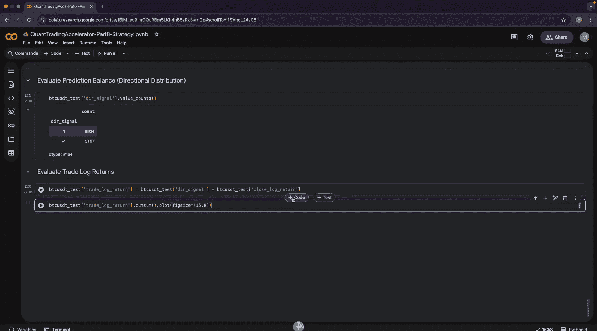

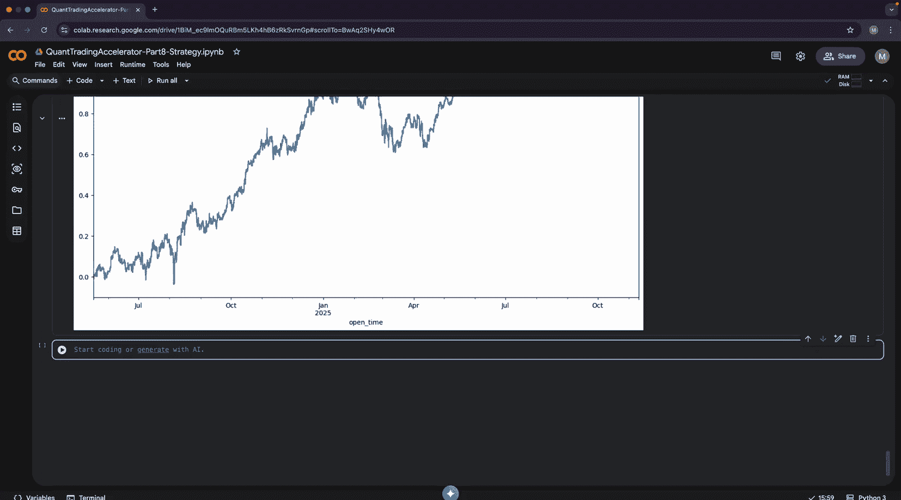

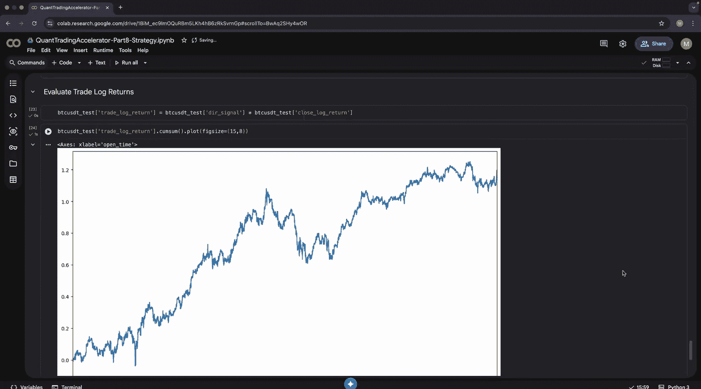

We just got win just a very small amount， but we're making so many bets that it just like accumulates。

 right？So but in terms of high frequency trading， this is maybe I think the sharp I I want to calculate's about two or three and that's look actually quite poor for like a high frequency trading strap。

 but this is just a basic tool basic model that would be I just want to show。Okay， so。Now。

 what we want to do is I just want to just show you the， the actual underlying。The price。

 the Bitcoin dollar price。

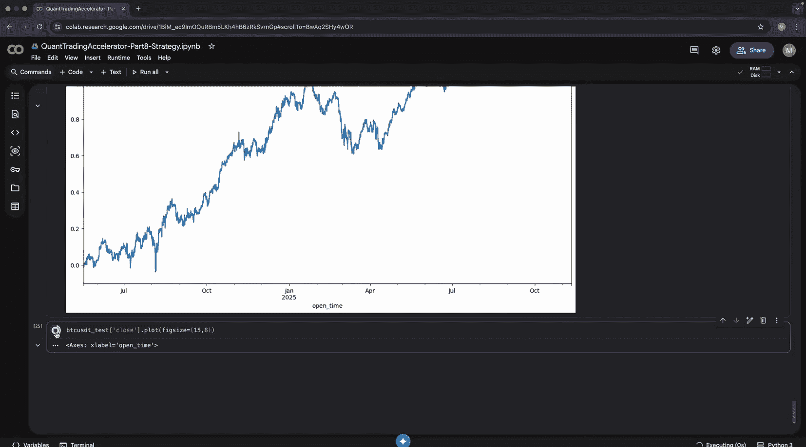

So you can see here that， you know， there are for example， when when it goes down that， you know。

 we still make money when it goes down and also when it goes up， there are just just any point was。

 for example， this。This momentum here that it。But you can just the main important thing。 it doesn't。

 It's not like a want。 It doesn't look identical to these two time series are not identical。

 I think that's the best way。 there's in econometrics。

 there's much better ways on quantitative measures of measuring this。

 but it's out of the scope of this this video。

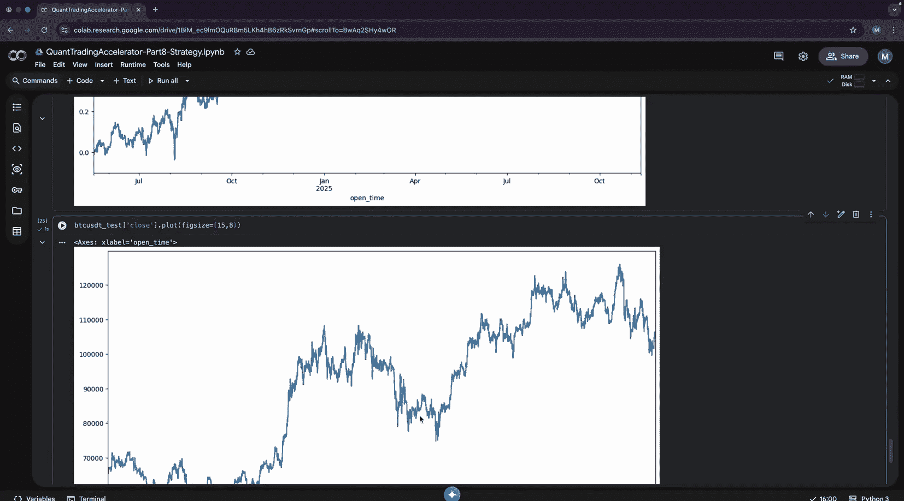

Okay， so now， that's our model， right， So now we can go into strategy。 So maybe we put this。Strategy。

Okay， so。Now， the first thing we want to do is we need to work out what our entry and exit signals are。

 So if I make a note of this。Okay。And。What do you now。It's time base， pre base， okay。

So this is a very loose categorization of entering signals。 There's time based and predicate based。

We're gonna focus on。 I'm just gonna show you like a time base， right， so。Maybeify crater。Time based。

And time base， essentially， we're using time as our entry and access signal。

 And this really complements our。Da train analysis， right， because our time series is mapped by time。

 So every hour it intervals right。 So， for example。

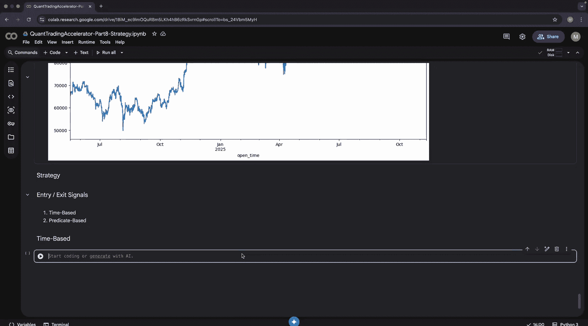

It really comp。If we use a time base， it really complements our model because our we're modelling。

 Okay， what's the price movement in in the next one hour， So， for example。

 we can say that our entering E X signal is like。On the hour。

 So we would open a position at the start of the hour。 And then just before the the next hour。

 we close the position and then reopen a new position。

 So we call this like a round trip trade where we at the beginningner of the time interval。

 we we open a position。 And then just before the end of that was start of the new time interval。 So。

 for example， at 0，1，5，9， that we would close the position。 But。So that's like an example， right。

 And this really， really complements your， your machine learning model。 So I strongly recommend。

 especially as well， because you can then do something called frequency scaling。

 So that that that's my。My personal preference here is like to。

 to go over time because it just really complements your， your。Time series modelling。

But there's things you can go。 So for example， there's， you can do what's called predicate based。

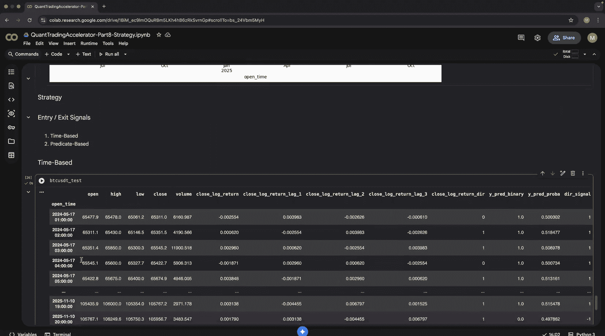

Just give you like an example， right？ So， for example， there are like example。

 If you type in like statistical arbitrage in Google， you'll see like。

Signals that no professionals use。 So， for example。

 when it deviates certain amount from a move average， then if it's below， then that indicates a buy。

 And if it deviates by a certain amount a certain amount of standard deviations above。

 then that's your cell。So the， the problem with these types is it doesn't make enough trades and。

It's quantitative， you can measure them， but you just don't make as many traits and it doesn't really complement the sort of time series analysis right because。

Yes， I don't have the best way to elegantly describe that， but yeah。So you essentially。

 you just have less trades， and it doesn't。It's not congruent with like time series modelling。

 I would say。 So it's better to trade more and maybe of a smaller edge than it is to make a few trades。

 So， for example， we're looking at the it could only make about 10 trades if we' using like a creditcate base。

 whereas here， we'll make it like we'll making huge amounts of trades。So。That's the。

 the big difference， I'd say。 But let's just say， like， you could even do a predicate based。

 Let's do this。 And maybe I'll just。We can do something like this。 We can filter it to say， like。

 okay。We only want to trade when there's a greater than 60% probability or a less than 40% probability。

 So remember， if it's less than like。If it's like less than 40， it means like it's a shot。

 a very strong probability of being going down， and it's greater than 60% iss a greater probability of it going up。

Okay， so the first one thing we want to do is to， is to create our mask to， to filter the data out。

So and again， we're still going to do it by time and then by using time。

 it just makes it very easy to model this。

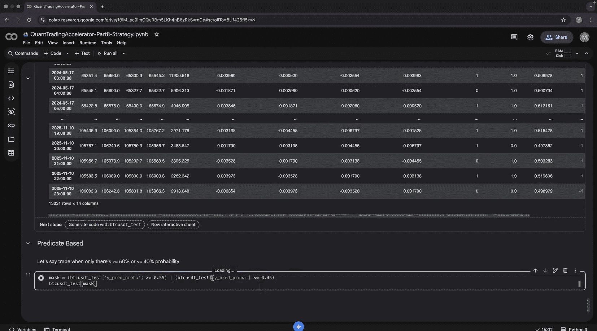

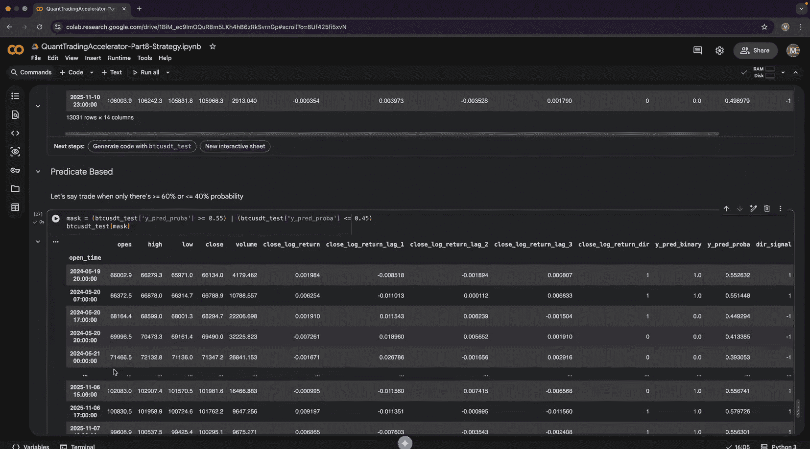

Okay， so we've applied our masking。 You can see the number of traits。 So， so rather than。

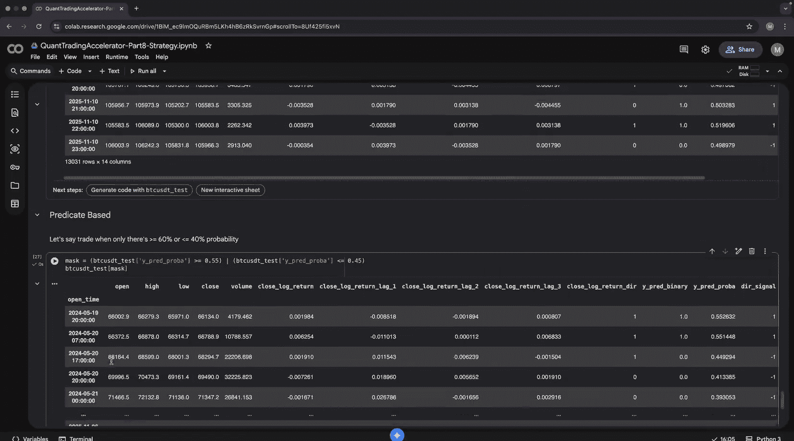

Essentially，13000 trades were only making。

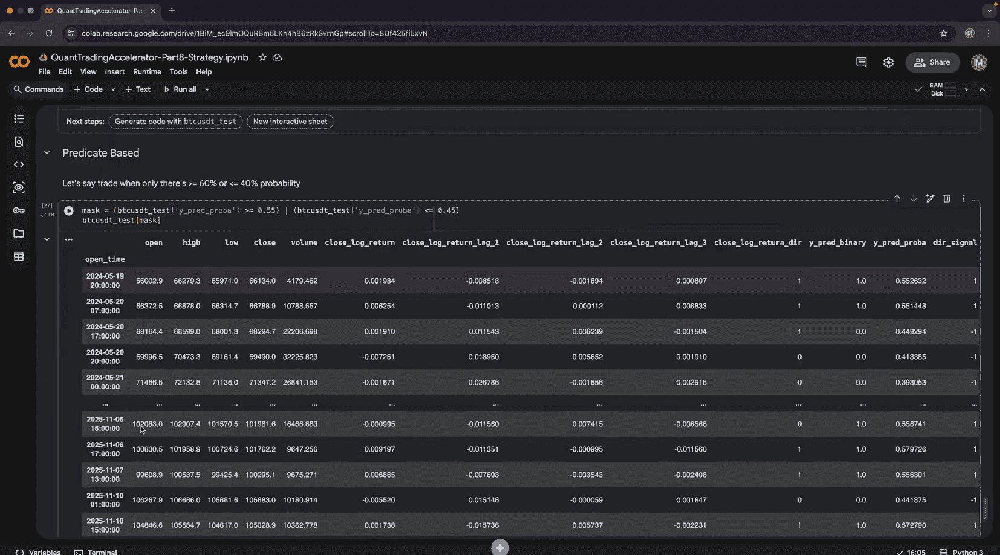

817 trades， Okay， but。Let's have a look and look at the equity curve and see， okay。

Does filtering the。The， the， the data or like a a predicate doesn't because we trade less does actually make it more profitable。

 And Let's have a look at the equity curve。

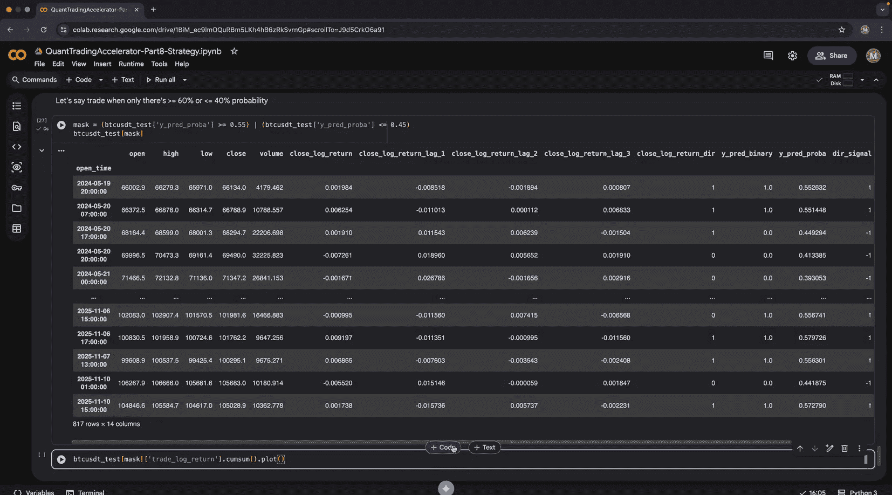

So using this， you can see that there's。It doesn't。 if we compare the equity curve from previously。

 you can see here like we have more draw down， like more drawdowns。 we don't make as much money。

So in this really。Emphase the lesson that it's better to trade more than it is to trade less。

Even with just a very tiny edge。 But we haven't， for example， in our classification model。

 we haven't done， for example， we haven't looked at， okay。

 how like I forgot what it is a machine learning area under the curve A O， A O C。

 which is essentially looking。Looking at， okay， how， how does that probability map to to real world。

 like confidence interval， essentially。 So we haven't done that sort of analysis， but let's just say。

We have and it does map quite well。Were still that we， we obviously， we， we're making money here。

 but we have we're not making as like as much。 So， again。

 this really emphasizes that we want to trade as much as possible。 And this is why I really like the。

 the time based and you'll never I've never seen any literature to。Show you this， but this is。

Very common。In professional settingss。

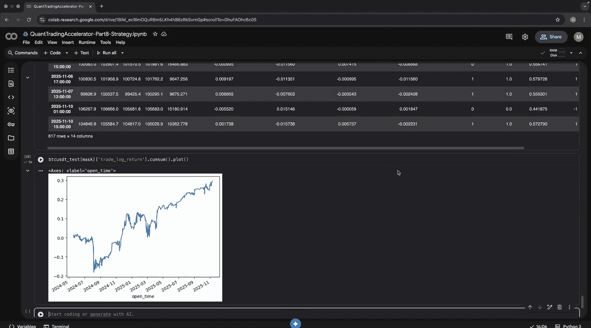

Okay。So that's that。 okay， now we need to work。Treat sizing。 Okay。

 so now that we've discussed the entry and exit。 And， and hopefully。

 I've given very good arguments to why to use time based。 And you。 and you， you grve with me though。

Okay， so now the next thing we want to do is to look at trade sizing。

 And there's several different ways to do this。 like， again。

 a very loose categorization is that it can even be static。 So， for example。

 you just always trade in a certain amount。 So imagine like your poker table that regardless how much money you make。

 you always just place like a $10 bet。 maybe it's just a certain proportion of your total capital。

 So let's say you go to the casino with $1000。 So you only trade for every gain only like $10 or $5。

 right。 And it's always consistently $5。 So that's we call that like static sizing。And。

 and example in our trading context， it would be like we always trade like $10 or $20。

 And then the other one is dynamic。And with dynamic。

 the whole video could be dedicated to dynamic trade sizing。 It could be a linear function。

 It could be a nonlinear function。 It could be a function biasing based on your edge。

 It could be bias on your probability of winning， like for example， Kelly criterion。

But what we're just going to do is my， because we're using log returns。

 we're going to use what's called compound。Compound sizing。 And， but don't worry。

 we'll I'll explain that later。 So， okay， so that's trade sizing。So hopefully that's intuitive。

 what that is。 Okay， so now let's just have a look at。

 let's look at our strategy where we use static sizing， so。Pt sizing here。Okay。Okay。

So let me just explain what we're doing here， Right， So we're saying that the， the pre trade value。

 So this is like。Trade analysis， essentially， right， So the。

 the beginning of the trade this is the size that we're going to use。

 So we're saying we're going to trade with 50。 like our trade size is $50。 So。

 and you can see here that our trade size is always $50。

And remember that with the because it's a log return。

 we need to convert it back into a simple return。 So to do that。

 we just take the exponent and then ingates the the log。 And then we need to multiply it by the size。

 And that gives us our post trade value。 So you can see it here like the trade log return。

 We lost money。 And you can see here that we start with 50， and we end up end up with 49。8。

 So And but you can see。You always， this is the the amount is always 50。 So， for example。

 we're not really。Reinfestting our profits。Into the the next trade。 And so it's always 50。

And for example， if you're losing money， essentially。

 this is like a form of what's called leverage'cause you're borrow money。 So you only start with 50。

 but it's just a very dim very。It's very small amount of of leverage， potentially。

 unless it was like， you， you don't have an engine then， you know， then it's， yeah， anyway。 But yeah。

 so that's， that's that。 So now what we want to do。Is to calculate the trade growth peer now。

 And I know there's a few comments in why you calculate the net。

 And we will do that when we off look at a particular exchange。

 haven't decided what exchange we'm going to to trade on。

 And that's actually one of the exercises to add the net fees。

 And you'll see which is left us an exercise。 if you maybe。Use it as a taker fee or let say。

 like using a take fee。 you'll notice you'll see a very strange result。

 but I'm leaving that as an exercise。Okay， so let's trade the calculate。Let's do this。

 So we will calculate。Trade gross piano。Okay。嗯。I much a。Can just re that。 So essentially。

 the trade gross P now is we just take the post trade value against the pre trade value。

 And that tells us the， the， the round trip gross P now， like for that trade。

And then we are gonna print out。 And then that should make sense， right？ So for example。

 we start with $50。 We lose， So this is the the return。 And because we specifically losing $50。

 then this is proportionly how much we， we lose to respect to the pre tradede value。 So we。

 we lose 1 $12 cents here， right。😔，And so now we， we calculate the gross P L and that has doesn't。

 remember， it doesn't include the fees。 And again， leaving as an exercise。

 and you will see some very strange results。Okay。So that's our。

 And now we just what want to do is to print out the equity curve and like the realized。

E equityquity curve， like if you use $50。So you see here if we use  fifty。

Ignoring fees that we end up roughly of just an over 1 hundred and10。 So it's。

 it's a good rate of of return， Right And remember， it's just winning 52% of the time。

 But if you know that you have a small， tiny edge and you're making lots of bets。

 then this is where like it can really add up。Okay， so that's the equity curve。

 And you can see we don't have。 we never have huge negative equity drawdowns where we， we end up。

Wayer less than we start with， right。 So you can see like from the start， we have an edge。

 you can see here， I think this goes roughly just maybe 54， sorry，$45，$48。

 maybe it goes down to here。 So yeah， okay， so that's the， that's for static sizing， right？ now what。

 let's have a look and see how much money would make if we used dynamic trade and trade sizing。

 right。So as I was telling you， I've got a video introduction to quantitative fine and that goes into more detail。

 actually forgot to add the in that video to add the compounding trade sizing。 so， for example。

 let's go into it now so。And I， I just want you， just as a。If you believe。That dynamic trade sizing。

Will give you a better P L， gross P L than static sizing。

 And I just want to see if let's say if your intuition is correct or not。Okay， so we're。

 we're gonna to use。I'm make it new to this。Is compounding。 So there's many different ways to。

 to do this。 And I remember I could like。Have like a two hour video on on this， so。

We want to do compounding trade sizing。 And this is quite intuitive as well。

 because essentially it's just we we reinvest the money that we make。

 And this really complements our log returns because this is what log returns is modeling compound growth。

So we're gonna use compounding trade sizing。 So let's have a。Let's have a look。

So the first thing I want to do is to just to print out。

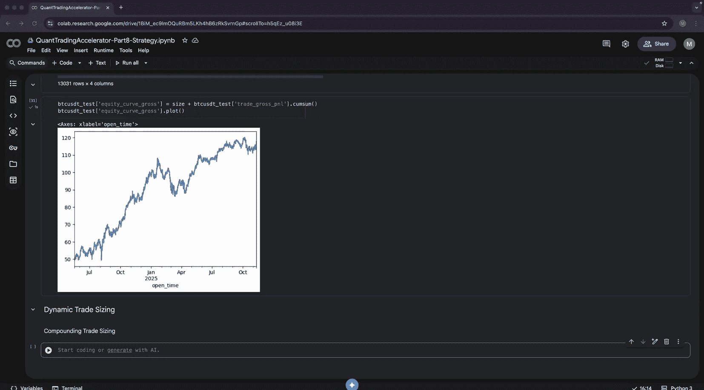

At the moment。You can see here that our pre trade value is always 50， right， but。

W and if we just reinvest the， the money， Like， for example， we lose the twist，12 cents we own。

 So that's the value that we would start us of next trade with。 But now， let's just see。Let's。

 let's model this。So the first thing we need to do is to。wait that。Before I do that。

 there's one important thing， which is I just want to to。To get these， the statistics。 So。

 for example， I just want to， to show yeah， let's do this iss just to show the， the average。

I could then we could compare this。So maybe I do this here。Okay。

As I just wanted to get some of the the metrics， right， so。And I want to， also。Just。Okay。

 so now I just want， to say it， okay， that's how much we we end with if we start with $50。

And then we just want to look work at what the the the return is as well。嗯。

So that's the return that we would make， and。We obviously， I've shown you the。The。

 the equity curve as well， so。What we're now going do is to add the So with the compounding trade sizing。

 So this is our， our benchmark， essentially。 So this is like， okay。

 does compounding trade sizing improve these statistics。Okay， so now what we're gonna do is to。

 maybe I add。Compound log return。And the beauty of log returns is that when you add them together because of the timeitive time addivity property that they model compounding。

So essentially， this really simplifies the， the mass and makes， makes it a one liner。 So。

 for example， for me to， to create the， to model the compound trade log return。

 I don't call it compound。 I just call it come。I just all I need to do is just to calculate the cumulative sum。

And again， if you're not sure what this is， go to my previous videos because I go into this in more detail。

Okay， so now what we need to do is to work out the first we need to do is work out the post trade value。

Okay， so that's the post trade value。Okay， and now we need to work at the pre trade value。

 And because we're， we're using the previous amount from the post from the。

The post trade value from the previous trade。 then we just need to just shift it。

 But there's going to be one slight caveat to that。

 which is because when you shift the first row will be in NAN。

 So let's just empirically check this and make provide more intuition like Okay。

 so here's the trade log return。 Here's the cumulative right。

 So essentially we can see like if we use compounded trading。

 then this is like that the final amount our log return is。Just so this is， you can see here， like。

 for example， there's an N A N here。 So we want to， to take care of it。

 And then we can go into in more detail。 So what we can do here。Is we can do this。We can。Okayay。😔。

So we're going take the pre tradede value。 And this fill N is like basically saying for any N Ns。

 And we can reason easily that it's only got one。 So we it's not like there's multiple ones we know that it's any one。

 And we're just going to fill it with the original。Size， the initial capital size， which is 50。

 And we gonna up what's called in place。So there we go。 So now what we want to do is to。

 is to modify just cup and paste it is to really。Look at it now。 So， yeah。

 now we can see what's happening， right， As you can see here， by using compounding。We。

 like our trade size is because we've got an edge that it's， it's a pre trade value is growing。

Because we're making like money from our statistical edge， and we're re。We're reinvesting that money。

 So， for example， let's have a good one， right？ So for example， we can't sit here。 So， for example。

 here it started it made just roughly under a dollar， right。 So then it reinvests that amount。

 for the next trade And you can see here that okay， it lost money。 So then it starts with this value。

 right。 But you can see here we started our pre tradede value was 50。

 And now pre tradede value is 165。 And this is the what's happened with with compounding， right。

 But you know， we want to， you know， does actually is actually better。 And the best way is to。

 to look at the， the。The profitability metrics。So that's what we're going to do now。Okay。

 so what we'll do is we'll。Again， calculate the trade growth P now。Oh， that should be a pen。Okay。

 and we look at the。That's that Now， we're gonna look at the oops per。Triade grace panel main。

So you can see， I think that the little one was it was about 55 basis points。

 and this is 88 basis points。Now。What we need to do is also， you need to look at the， the sum。

And that tells us the， the， the total read term。Okay， so that's 3。3。And we want to say， okay。

 what's the the final amount？ So we take the sum by the size。

And you can see it was roughly just under 1 and 10。

 And you can see here by compounding just why I really need to emphasize it's exactly the same statistical model。

 The edge is exactly the same model。 But we're just executing completely differently。

 And you can see that we generate more money。 And this is why this is the key takeaway from this。

 And hopefully you can see this now is that the model is important。

 but the execution is just equally as important。 And you don't see much。

Literature or even YouTube or anywhere that talks about the， the execution size。

 mainly because it' it's。It's some on some firms alpha。

 and they don't want to give like practical tips on like how to improve your alpha essentially。 So。

 yeah， this is， but it's important to know。Okay， so that's the now we want to do is just look at the the actual return。

 right？We can just do this。 But my dear， it's just exactlyly the the same。 But what we want to do。

 though， is。Is look at the equity curve。And we just I my remove that。Okay。So again。

 just because the trade log returns are， are time additive， that we can add them up。

 And then that gives us our compound return。 And then we just multiply it by 50。 And then you go。

 So you can see here， but just want to just reemphase。

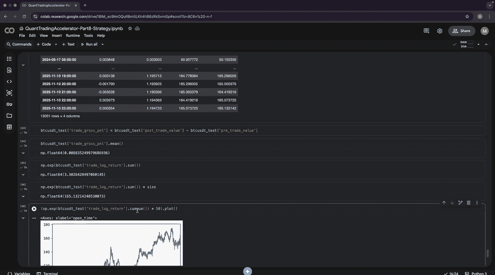

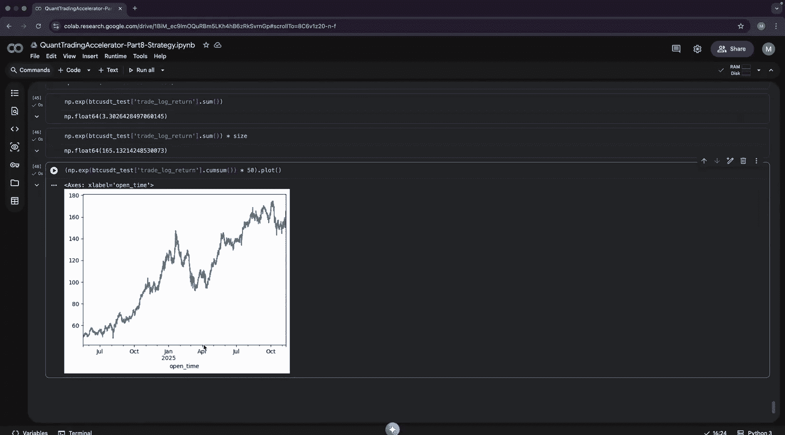

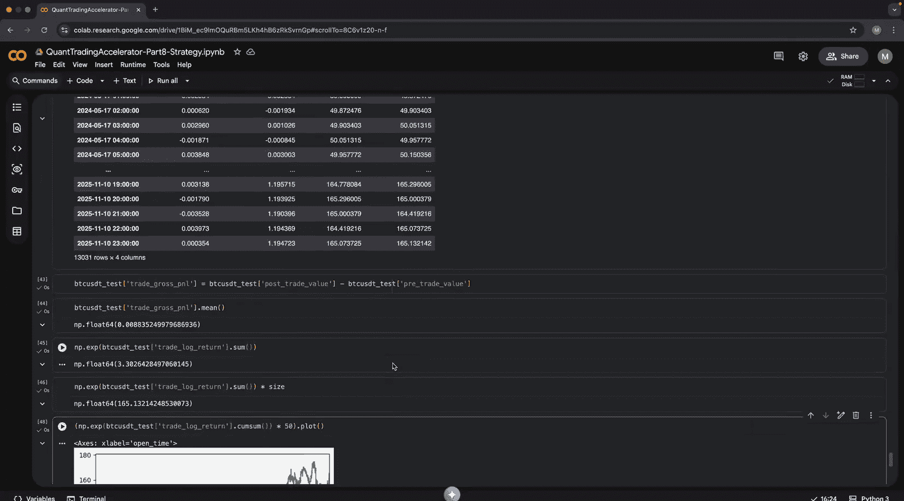

It's pretty much the same equity curve。Ri。

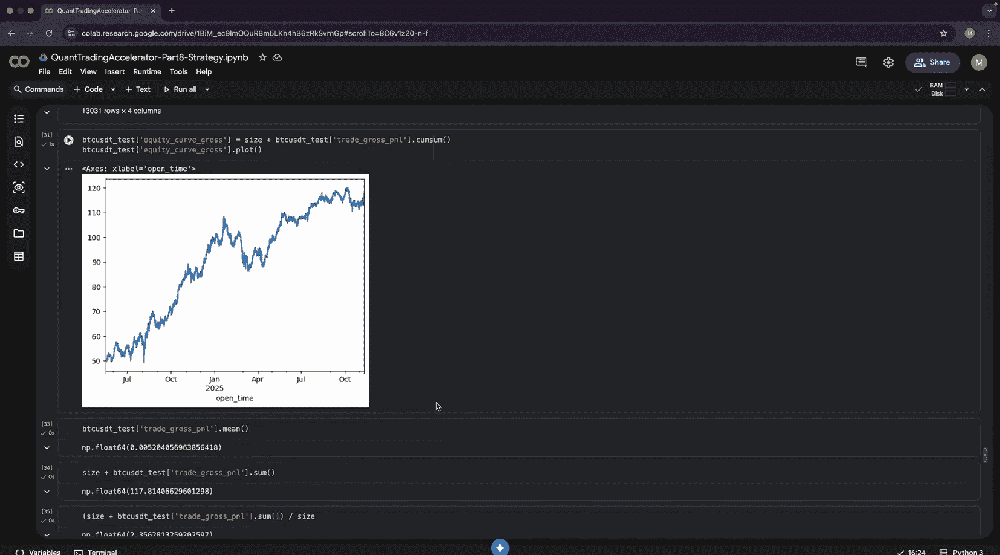

But the， the key difference here is this it just。

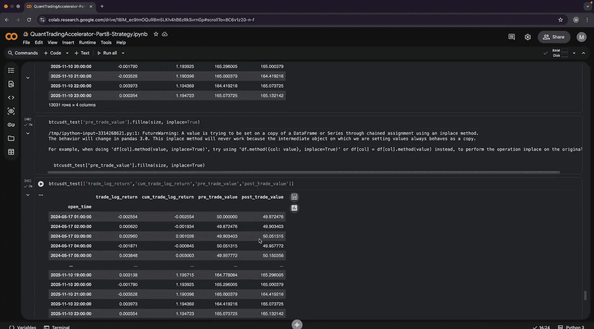

Is magnified。So。The losses are a bit more magnified。And but obviously， the most important thing。

 it makes more money by re compounding， right。 So hopefully I I've given you a very good motivation to to use compound sizing。

And again， goes it really complements the time based。Entrying， entering and access signal， honestly。

This all has to be automated。 You can't do this man。 like you would have to。

 if you're like manually trading this same encryptto， which is 24，7。

 then you would need to be looking at your screen without sleeping and trade in every hour。 So it。

 it's not possible for， a manual trader to do this。 this needs to be automated。

 But then once you've automated it， you can trade 24，7。 And then you just， you can just， you know。

 look over it and you can。But that's another key important thing that that these type of high frequency trading strategies。

It has to be automated。 So maybe if it was like。Every 12 hours。 then yeah， you could just。

Do it manually。 You could tell semi automatic。 You could like have them system to give you， Okay。

 based on the model， like， okay， the， the prediction。And it tell you。

 okay what the trade size should be and won't like the time give you the time and then you can just place the trade manual right。

 But you know by the time you enter that trade in， that could just be like 30 seconds and so it's much better that it's all automated and to be honest。

 it's not too hard to write the python code to implement this logic but in the next video we'll look into that we actually create the implementation of this。

Sorry。Okay， so now。I should have should have， we've got two really good arguments for using time based entry and exit signal and really good arguments。

Empirically， good results to show that we should use compound sizing。 Okay。

 so now I want to discuss about leverage because this is another key。

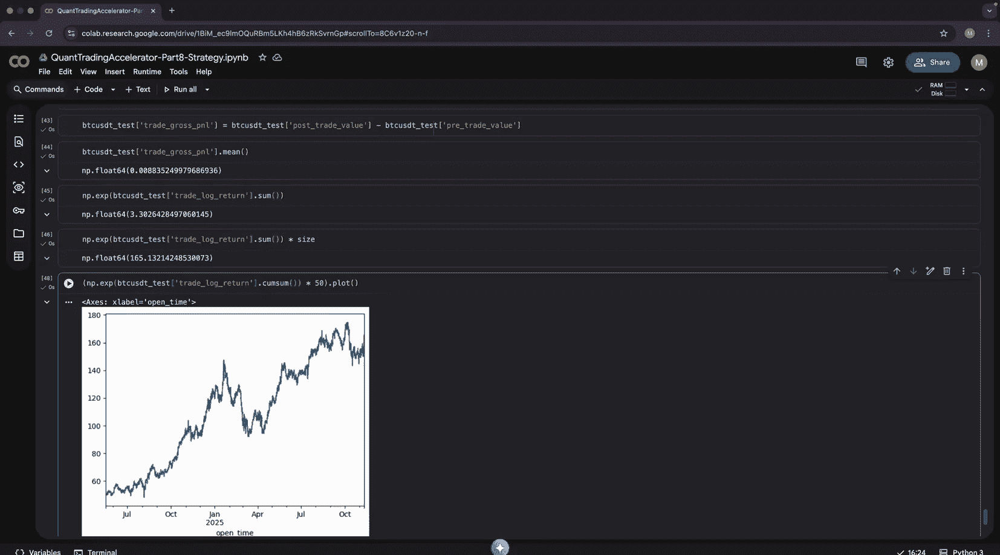

Factor that distinguishes professional trading from like， essentially gambling， because。

And I'll just give you like an example。 So maybe we go into this。And this is， for example， why。

 for example， retail traders。Losing a lot of money and even some， say professionals as well。

 because they haven't， but there's a sweet spot to leverage。

 If you don't have an edge and you use leverage， it's just gonna amplify your losses。

 So you're gonna， you're gonna go to to0 very quickly。 So anyway， so adding leverage。

And leverage just is like essentially you're borrowing money。 So for example。

 when you do margin trading， you're only trading a certain amount of your capital at the whole time。

 And basically it allows you to to trade more money than you actually have。 But， you know。

 there's with great power I don't it's Star Wars or something with great power that becomes great responsibility。

 So with this great power you have to be really responsible and smart about how you use leverage。

So for example， let's say， you know， I'm a student and I've only got $50 right and I'm thinking about using leverage and I'm just very cautious about using leverage so I just want to use 2 x and there are some crypto markets that allow you because it's。

Unregulated and you。The exchanges allow you to have like over 50 x。

 And this is an insane amount of leverage because more leverage you use。

 the more the price moves against you。 and he takes a small amount。 let's say a Bitcoinco dollar。

 right， any， and he needs to move down by 10， let's say've used $50 x leverage and he needs to move down by like $5。

 and moving by $5 is very common。 It like。A day that could be like 200 times。 it， it does this。

 So you need to be extremely， even， for example， you have a edge。 you still just can't use like。

All the leverage in the world， because you'll get things like drawdowns。 And when the there's like。

 and when the drawdown， when you use so much leverage。You。

 you only need a small amount of drawdown for it to be liquidated。 So， and again。

 there's a sweet spot to the， to， to the leverage。Okay， so。Let's just say you've got leverage of 2 x。

 conservative。 So it's a conservative amount。 Alright， And let's say your trade。You've made a trade。

 right， And， and you've made it $10。With。L， essentially， you're multiplying。Your profits。So if。

 if you made $10 on， on your 50。 But then if you instead used $100， you haven't got $100， but you。

 you， essentially you' borrow and get your then you've， you've made $20 instead of 10。

 So youre think， okay， great， I'm gonna just use as much leverage as possible。

 But just remember that the opposite。 So that's the profits。 But then。When it comes to your losses。

 it also amplifies your losses。 There's the symmetric property， right， where。It's also。

 let's say you lose more than you win。 Like， let's say that， you know。

 you've got a negative expected value and。Your trades， you've lost $20。

And now your losses have been amplified。 So essentially is。Amplifies your profits and your losses。

 so this is why it's really important to have a edge， a statistical edge to use leverage。

And this is why like for example， Sha is quite a good。You want to increase leverage to， to the how。

High or proportional to your sharp， which is your risk adjust risk measure of risk adjusted returns。

Okay， so。That's the sharp。 So I just the， the key takeaway here is just don't think it's just be very careful with just using leverage。

But。If you we'll see it when we do the conclusion， you'll see like a really good why you want to use leverage。

Okay， so and essentially to calculate， you know， the， the leverage。

 we just need to work out what's our pre trade and post trade values。 You know， essentially。

 they're just， you're just magnifying them， right？ So， for example， here's our post trade value。

 And now we just， it's exactly the same as for。To calculateal it for the compound， right。

But this time， we're just， and just yeah， just a key point is that we're using the cumulative trade log return。

 So that's modelling that the compound trade log return。Okay， so now we've got the pre trade value。

 And remember， I've filled fill NA。 but instead of just size， it's multiplied by the leverage。 So。

 So now， and then we can add the the trade gross P and L。Let me find this in here。And again。

 it's just the delta between the post and pre。And now let's have a look。

 because you'll say with the leverage。 And remember。

 we've only got when he' starting with a very humble amount of， of $50。Okay， so you can see here。

The our pre trade value is 100， not 50。 And but you can see here that it's also magnified or loss because without the leverage is it is just roughly 12 cents。

 but now it's 25 cents loss。But because we've got an edge。That we know that， okay。

 is magnifying our profits because with the edge plus the leverage we'll we'll listed an empirical check。

 But we can see here just by just looking at the post the final post trade value that when we start with 15。

 we've got 330。 So this is。Phenomemennal， right？So what we need just to do now is to just to do some calculations now。

 So maybe the first one we want to do is look at the equity curve。And again， we'll just。

Look at the equity curve。And just remember， we were doing 50 times the the the leverage， right。

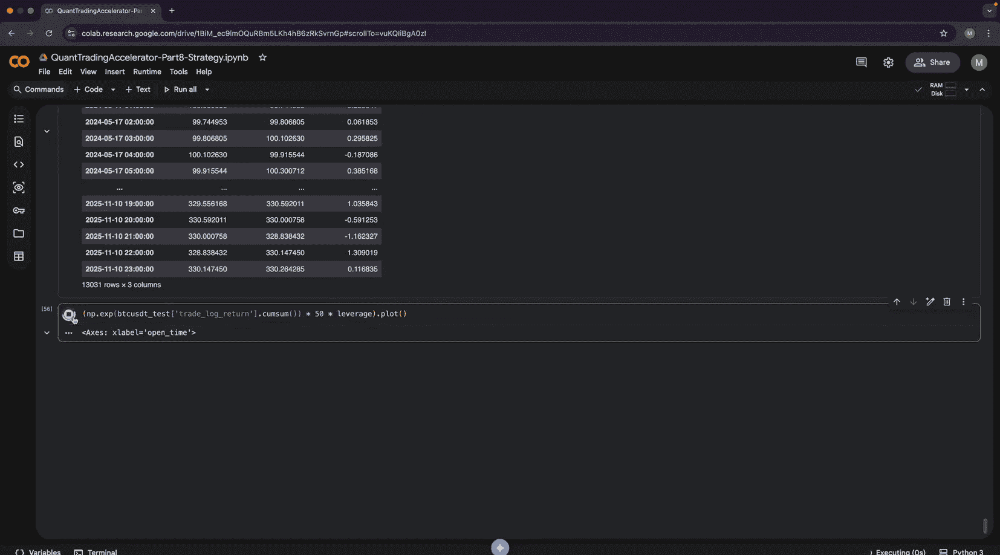

So for example， if you don't want to use leverage you you can just。

I think it's a good practice to multiply by the leverage generally。

 but if you don't want to use leverage， just just keep it to 1。0。

 just leave that as like the the default value if you want。

 So you can see here' theequative looks pretty much the the same right。

 but the key difference is is the the magnitude right， so。え？We the。

 the profits are magnified and also the losses are magnified proportionally。 So but you can see here。

 the main key thing is that， we won't make way more money。Here。So just like 300， right。

 And now let's look at the if we calculate the actual return， right， let's calculate the the return。

We've like just over 6 xed our money， Or $50， right？ Obviously。

 this is not real world because we haven't factored in transaction fees。 But just imagine， right。

 you had market you were given market rebates。So basically the market is paying you to provide liquidity。

 So if you provided if you wrote instead of a take strategy that you wrote like a market makinggan algorithm over this。

 you would make phenomenal returns because A， you've got statistical edge and B。

 you're making money from from each trade So this would be even more and this is why like high frequencyequ trading firms like make huge amounts of money because did just have a very tiny edge。

 they're making huge amounts of trades in some cases they don't pay very nominl fees。But so yeah。

 this is and this is the really the key。 so we need we can conclude now， right？

So now I'd say the conclusions now you should be like， okay， I really should focus on， you know。

 look just as much as you're focusing on the model。

 you should be focusing on the strategy and your your。

 there's so many different functions you can use for。

 This is just the tip of the iceberg there's more different alpha possibilities here and how you execute。

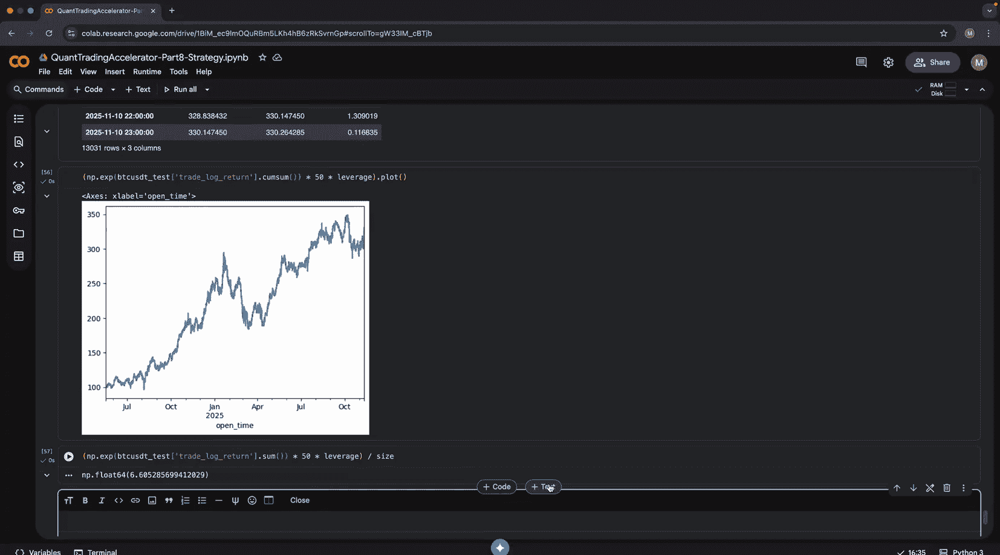

Okay， so I will write the conclusion。Okay， so in conclusion。And let me if I put this here。发。

So the first one we did， we evaluated the entry in X X signal。 right。

 We looked at both time based and predicate based， and hopefully you can see that the。

 the time base really complements our time series analysis and our machine learning because each row represents a time interval。

 so。It just。It just complements our data analysis。Okay。

 and then we looked at trade size and we looked at static trade sizing and then also dynamic。

 And we we by using the dynamic size。 and you can see that it really。

Excuse the pump but compounded our our return， right。

 You can see that by reinvestfesting' exactly the same model。

 but just by executing by compounding increases our profits。Our gross prophets。

And then we looked at leverage and leverage where you essentially you're borrowing money。

 And this magnifies your profits and also magnifies your losses。

 And there's like a sweet spot for your leverage。 You can't just use like 50 x leverage because just a very slight price movement against you can wipe you out。

 So there's like a sweet spot。But again， if this is like your first， I I don't。

 I never recommend using leverage if you， if it's like your first ever trading strategy。

 it's better just because you gonna have loads of production issues。Yeah。

It's better to just use a very normal amount if you ever put anything live and then once you've got the confidence and you've got production experience running and。

You basically streamline a whole process。 then you can start using leverage。

 but I just want to show you the the possibilities here。

 and you can see we made phenomenal returns with just only winning 51% of the time。So。

 and that's another key lesson， which I should be like drummed for every single video， which is like。

 don't focus purely on the win rate。 because， for example， if you just focus on the win rates。

 you would have discarded this and okay， thrown in the bin。 But yeah。

 so that's that's a really important thing。 So， and I would say like the the to maybe I put the key takeaway here。

And I'll even put like a chapter to this。Because it's like the T， L D R。Is this a the key takeaway。

Soir， the wait to make money。With an algorithmic trading is this。I made it here。 Okay。

 well maybe if I put that a text。Okay。With this。And that is your alpha。

 It's not only just about your edge， right， It's also the execution。 Basically， this is。

Your alpha is this。 But let's just say， yeah， let's just maybe put it's this， right。

 So it's your statistical edge。Moote， and is the product of the execution of the edge。Okay。

 but then we can just break down execution into two terms。 And it's just the a product。

 right of compounding and leverage。 And I really believe like。

If you have an edge and use compounding and you use like you find this sweet spot for leverage。

 there's phenomenal returns you can make here。So that would take what is the real key takeaway。

Don't just be spent all your time focusing on the best model and then put it alive。

 and you spend zero time researching for the best execution。

 You should be spent Once you got the model， you should be spending as much time as possible to back test and optimising your execution。

 So， and there's a really good book， Ed Thorpe。 He has a really good book on like。

Maybe put in in the link if you're interested。Goes over edges and execution as well。Okay。

 so that's the， that's the video。 So now I just。I have got some exercises， so。

And the problem now with the exercise is because。It's very hard to to write exercises for for this type of stuff。

 so。This is more of like a freestyle， like。Type of exercise。 So the first thing is， I want you to。

 to， to research。I iss this？Can we run this as a taking strategy， So， for example。

Look at your favorite crypto market or aid crypto market and have a look at what their taker fees are。

 right。And see if you can run this with one hour time interval trading in your。

It your your preferred exchange and to， and have a look to see if it's profitable。 So essentially。

 what you need to do is to calculate the net P And as the net P And L。

 So it's basically the gross P And L plus the transaction fees of the the entry trade and the exit trade。

 So you need to factor in So， for example， don't just factor in just the entry fee。

 but also the exit fee。 So the round trip fee。And yes， see if， you know， is。

 is this even feasible with as a take us as a take a strategy。

 Remember taken is where you take it's essentially a market order and usually pay。Higher fee than。

A maker fee。 Okay， so that's what you're do。 Maybe if if it's too high and you have a look at different fees and look see。

 okay， where is actually feasible。Okay， so that's exercise one。yeah。

 maybe if I just make a note here for you as well。About the， the face。Okay， so that's。给。어때。Now。

 the next one。And again， it's exactly the same。 But when just now， we're going to。

I want you to evaluate it。 So for you， as a making， you， you usually typically pay less fees。

 So I'd like you to evaluate the， the net P And L for。So it's exactly the same， say，$50。

 but just how much would the fees be for， for making And is it more feasible And but there's a bit of a caveat to this。

 because this assumes that youve， you get filled exactly the at the。Yeah。

 there's a there's a caveat to this。 It's not like a perfect simulation because you may be filled a completely a different time than specifically。

 like just in one hour's time。 but it will get me if if you， yeah， I don't go to too much detail。

 but。It will just give you a very rough， but it's not indicative of， yeah。Okay。

 so the the next thing to do。Is to do this is the exercise。Ex size free。

Is to to do this right So for example， the time series at the moment is on a one hour interval。

 but how about trying changing it to like8 hours，12 hours， even one days。

 seven days build a different model， resample it so you're changing the time interval。

And then to see， okay。Is this more feasible to run it as a taking strategy？So， and you'll see。

 you know， how does that once you resample it。Does this affect。

 Does this magnify your profits or loss or not， say， So， yeah， there's some exercises， but yeah。Okay。

 so that's the end of the video。 Thank you very much。 Please like， please subscribe。Yeah。

 and I'll see you in the next video。 Thank you very much。 cheers， bye。

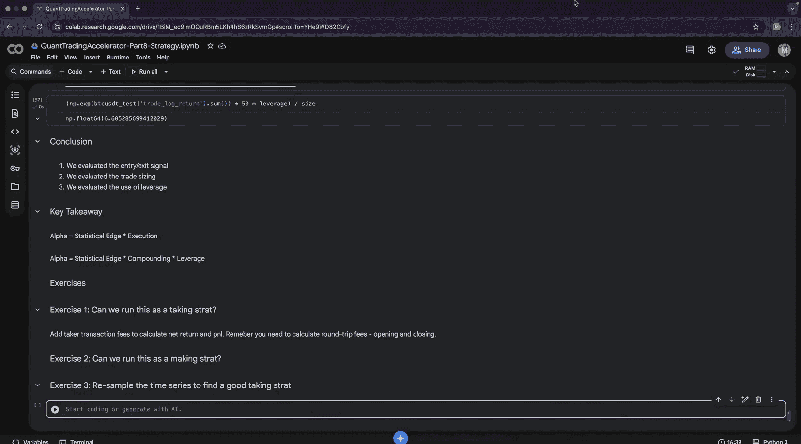

This series is available for free。 thanks to my incredible generous supporters on Patreol。

My goal is to keep this channel independent from sponsors so I can create the content I truly believe in。

If you feel my work brings you value， please consider supporting the channel by becoming a Patreon member。

 You can find the link in the description below。

