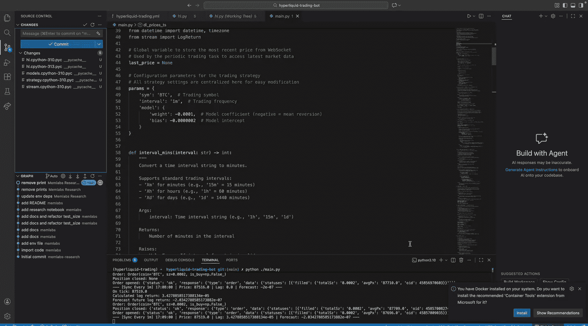
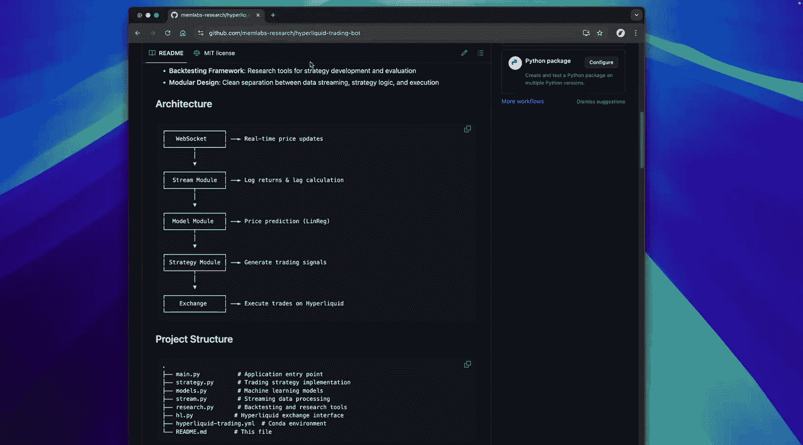
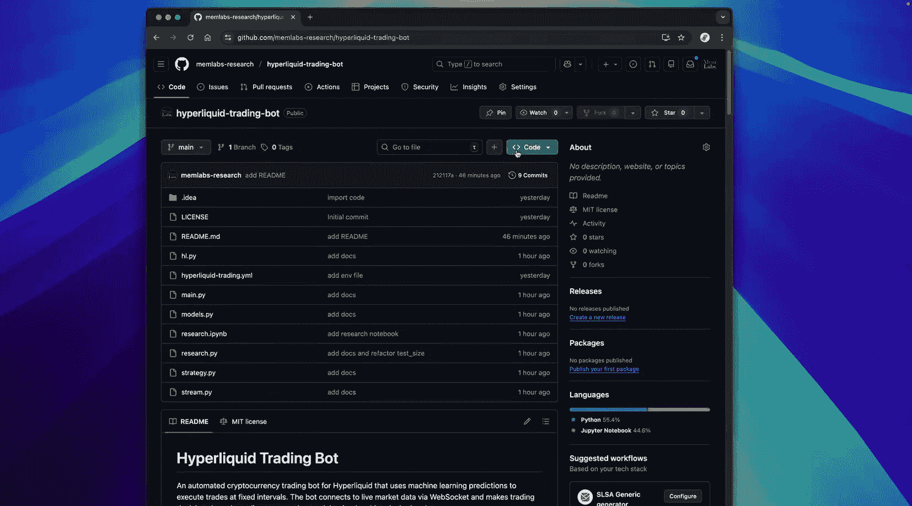
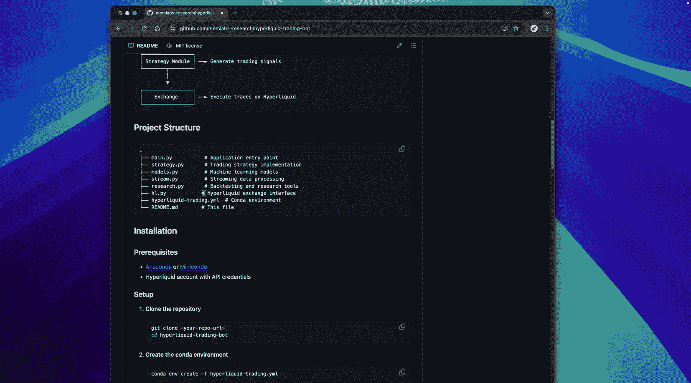
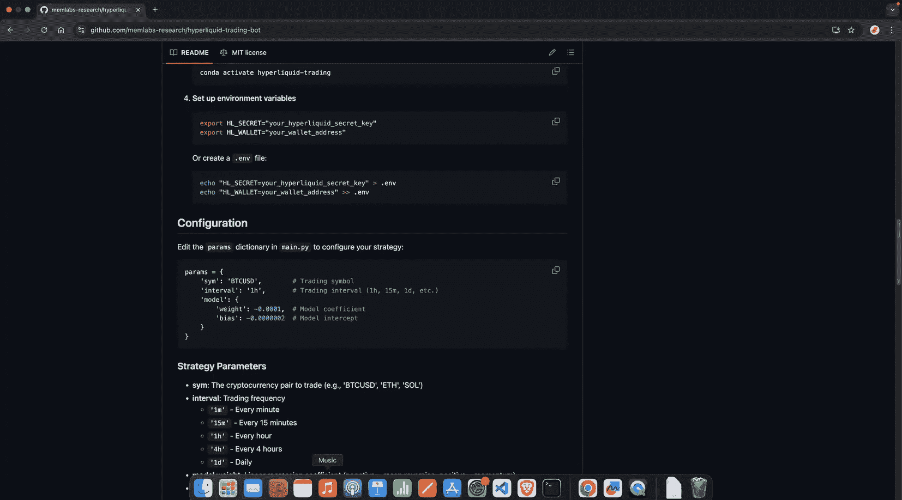
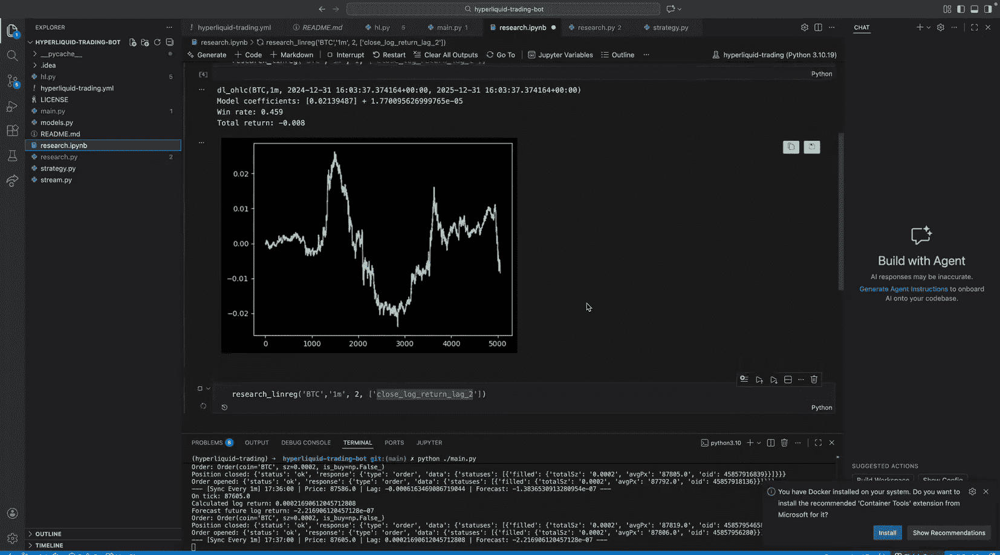
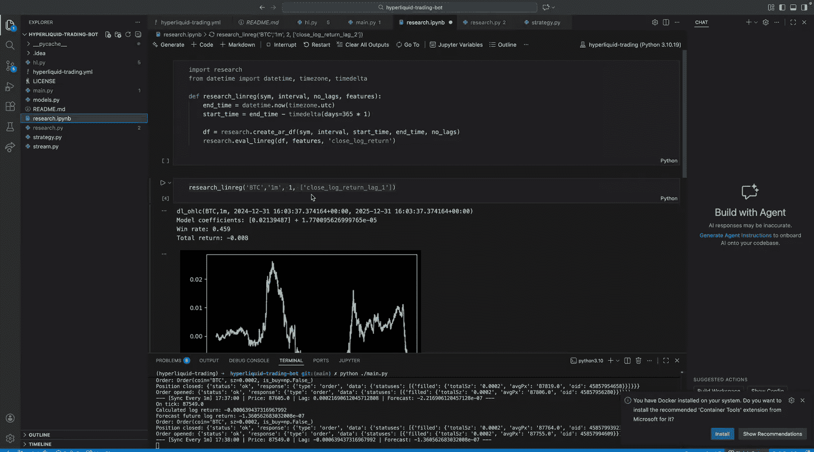

# MemLabs【中英⚡量化交易加速器｜Quant Trading Accelerator】 p09 P9 - Part 9： Trading Bot [BV1UrreB1E8B_p9]

Hello everyone welcome back so this is the final video of this series so this video is all about putting everything that we've learned in all the videos and putting it all together to actually build something and actually implement it so what we'll do today is go over this So what we will do is。

I'll show you what we're going to do Okay， so Ive created this。

GitHub project， you can clone it。 And if you follow the readme， you can get it set up and running。

 There's you've got a there's like。

You need to I've tried to make it very clear an easy step through how to do it。

 but you need to set up your environment variabless and then if you want to change the parameters which you will have to do with based on your research。

 then you just need to change whatever you want to trade the frequency of your trading。

And also the weight the in the bias。But we're going into this in more more detail， right。

 So and this is just like a foundation to build upon right。 So。

 but we'll go into this in more detail。The， the key thing is that there's the the project structure。

 Okay， so if we're go into the， the mobile if I just make it a bit bigger。

The project structure， so the main application is the main not pi。

 but then we've got these modules and the strategy is all in the strategy part。

 we've got the models in the modules part this is an important part is the stream because essentially we're going to be streaming data in from the exchange and then when we receive a new data point from the stream。

 then we want to make a reaction okay and in our instance we want to make some trades。

We will make a prediction and then based on that prediction。

 place some orders and then there's some we're going to be doing it for hyper liquidquid。And this。

I've created like a module here have some of the the specific implementation。

 But the idea is that we can sort of loosely change the we can easily change the connection。

 And so just to give you a very rough way of how you can build it。 And this is again， this is purely。

A foundation to build upon right。 So it's a very， very basic like trade and strategy。

 there's a lot more that could be done。 But it it's really like the final really。

 it just applies everything that we've' we've learned so far and actually put into practice。

 So actually it may be even better to to work from this video And then down below。 And then。

 but you should be able to have all the skills to to build it anyway。 So that's yeah。

 So this what's really important is that。That you clone the repository。

 you create the condo environment。 So it's in you have to ensure you have to condo。

 I recommend the mini condo because it doesn't install like。

5 gigs of libraries that you'll never use activate it。

 set up your environment variables and the secret is essentially the private key for your for the your trading。

 and then the wallet address。 and you just have to ensure in hyper liquidquid that you're using not the API address。

 but your wallet address。 So this is if people are familiar with hyper liquidquid is in your top right window。

And yeah， so onceve you've done all that。Then you good go。 So let's look look into the code。

 I' actually just got it running now。 And I can show you， like， for example。

 I've so I've got the the parameters here。 This， by the way， do not。

 this is trading just against the the test net。

I just this will not make any money。 This is like trading on a one minute basis。

 It's making a predict。 I can go over it in more detail。 So for example。

 it guess it worked out what the current log return is forecasts the future log return based on this。

 So this is what's called like remember auto aggressivegressive model AR1。

 So we're just looking at the previous lag。 we make a forecast or the future log return。

 And then based on that， we place an order。 And you can see here。

 we actually close the current position and open new on。

 So even if there was like we haven' an edge with this。

 would won't make any money because of the transaction fees。

 And this is running this as what's called like a take a strategy。Anyway。

 so maybe if I just go over some of the the code right maybe the would' think where I can start from say maybe start from from main。

 So the idea is that you clone this and you your goal essentially is to work out， okay。

 what interval do you want to trade at and what's the the optimal weight and bias。And then。

 for example， once to do this， I've created this very nice method。

 so you can just experiment with different methods。

 and this does the machine learning and you can see for example， here like the model coefficient。

 the win rate and the total return and actually displays the equity curve and it does also does the split correctly as well。

 So it like a time series split。 So like just trains on the most historical data and it leaves the most recent data to test。

 but I've just displayed the whole equity graph because it's important that you see the equity graph。

 not just for your test， but also for your training just put it together So you can see like here like for one minute doesn't make any money with these parameters。

 but this is again， this is your task really is to work out like build a profitable machine learning model once you you've worked out all the parameters。

 plug this。Into， into here and then run it and see how it goes。

 I really recommend to not trade anything like。Minute level， I think our is fine。

Maybe Ill just show you like the accepted time intervals that you， for example。

 we're getting the data， the candle data from hyper liquidquid and they have like a Pacific amounts that we can retrieve and these are them so you get it for one minute。

 three minute， five minutes， 50 minutes， 13 minutes， one hour， two hours， four hours， eight hours。

 12 hours， one day， three days， one week and one month。呃。So that's the the accepted time intervals。

 So and also if you accidentally pass a bad one， then it fze an exception。

 So as you can see as we're doing its running every one minute here but yeah I don't want to go into two details。

 I just want to go into the main concepts really。 So maybe if I just go into the actual code there's like a web sockets。

If I show you all this and yeah， I really recommend to， yeah， this is what what this does right。

So this is the main application point， you load the credentials for Hy liquidquid。

 and we initialize the exchange connection， we create the trading strategy。呃。

Then we run the web socket listener because we're listening we're streaming the pricing data we're actually more specifically we're listening to the trade feed and we're taking okay what's the last traded price and this is essentially like how these candles are created so they just aggregate this trade feed to say okay。

Produce these like open， high， low clothes。 but we're just interested in like the the。

 the last price。 And you can actually see it globally defined here as go here。We put at the top here。

 So this is the global variable to store the most recent price。

 So this is what gets updated in the Web socket。 And I'll show you this as well。

 And is's what's really important is the。Ability to reconnect because if you're streaming from web socket。

 there's always like errors that you could have like it could be like a disconnection on their side。

 it could be connection issue it could be a software issue。

 but you need the ability to reconnect and so this is what it does as well So it has this like a back off where it waits to until it reconnects。

 So yeah and then this is where this handle reconnection photos with expenditure back off。And so。

 yeah， this is the。So maybe we just go into this now。Yeah。

 this is creating the maybe I'll go to the the training strategy。

 So this it's just a main loop right。 There's essentially like two。 Yeah， this is。

This is using what's called asynchronous like like computing。

 So essentially it's like running two threadres。 One is doing the trading logic and one is listening to the web socket and So think them as like tasks right。

 like a chef chef won't just always be working on like one ticket like one order essentially he'll be like maybe。

 you know， for example， if there's like two tables and they've ordered chicken and the guy。

 the chef is ordered like specifically if a chicken。

 he won't just cook one chicken and then cook one chicken afterwards like sequentially。

 he'll just do it like in parallel rights， and this is sort of the same concept where like is's running two tasks at the same time。

And with this eight but I really recommend it to have understand what this asynchron is because it's very important when you're working with like IO based like programming because essentially it doesn't block and it allows to do other things as well so yeah this is the code。

And let's just maybe going to connect and listen。 So this essentially。Connect to the Web socket。

 Hy liquidquids web socket。 We make a message to say， subscribe。

 And what we're interested in is the the。嗯。For the trade feed essentially and then we just loop and this this is like a perpetual loop and it just loops over and the message is like a JO So we process as JO and then this is where the last price gets stored。

 So that's all it does。 we're just listening to the web socket to get the last traded price。So。

 and that's one task that's running at the same time。 And the other one， which is the。

But if I look here now。Its the trade periodically。 So this is the one that gets this gets called So basically it just works out the delta for when it should sleep。

 So， for example， if this was for the next minute， then it will calculate okay。

 when is it when do you need to periodically rerun this again So this could be one minute， one hour。

 one day and then it calculates it so then it does this sleep。

 So it waits until the next trade in interval。And yeah， and then。Once if we haven't， for example。

 we want to just make sure that the last price is defined and it is so then we we basically we have this called strategy and the strategy what it would do is just give you the result of the trade So it prints out essentially the interval。

 the time executed to the second level the price the lag So this is essentially the model input is the lag and the forecast it used and also just as just like as a debug just I also have a good point as well ideally in production you should use like log files and have like different levels like info debug but just for simplicity I just use prints but you would do this like more professionally than you would use logs anyway。

So that's the the the trading logic for for trading periodically because this is what it's doing。

 It's trading every one minute in this situation。 So now let's go into what you want to go into is the rather rather than go into the strategy。

I'm going to stream， because this。This is the backbone of the strategy。

 and it's all based on this what's called an abstract base class。

 And essentially this is I just think of a good analogy here。

 but this is basically like saying like okay what happens when we receive a new piece of information what do we do and we make sure that our class extends this So if you ever done like Java or just any or rust or something this is like allows to do polymorphic code So for example if if you would like modeling cars right and you had like a honk function like a function good hounk。

 all the different cars will have different implementations of it。

 but you want to reference them by like say car right So this is essentially what we're doing here again。

 if you're not sure what this is then just put this into chat GT and get it to explain it probably do a better job than I could do So yeah。

 so this is the base class it's tick。And this is basically saying once we've got a single piece of incoming data。

 how what should whatever implements this？How should it react so and the key here is for when you're streaming。

 just imagine like Netflix， right？When you watch a film on Netflix？

It doesn't download like the whole movie which is I don't know say 10 gigabytes right it streams it into a buffer and so you just watch it just downloads just like the next two minute of the movie each time so for you it's like seamless you don't notice that you actually just stream the movie in and to do this you need like a buffer like a fixed sized buffer and this is what we call。

In trading like a sliding window。 and so the data structure for this。

 this is very important is DQ because this gives you constant time。

 if imagine if this is a very large queue， let's say。Window， you're like look working on like a。

 on a tick by tick。 So， for example， you could have like 2000 ticks per per second。

 right or per minute。 you know， to remove from the the beginning， like if this was an array。

 that would be an O N operation。 And then this adds， you know， if it was like a million。

 let's say window mini， then that would be really expensive。 But this just the Dku makes it。

A constant time operation。 Don't worry if you don't understand what， it's just more going into the。

 the pant detail here， but it's just something to to， to be aware of。 So maybe just like。

Rather than just go over the class。 So this is basically， yeah， this is this is like a good example。

 right。 So this is a cr window size for。 I add 10 to it， then 2020 then 30。 Then I call 40。

 And it removes the oldest one， which is 10。 and this allows us to stream the prices in like what's the last。

 let's say，5 known prices。 And we want this for calculating the log return。

 So because we're gonna be running it periodically。

 we want to like always track like the last two prices。

 And this is where log return comes in because and again， this。Models extends the the tick class。

 So I have to implement this on tech， otherwise， it will complain。So for example， here。

 like it's an empty log return， I pass in 100， it doesn't do anything because it needs two prices and I pass in another price and then it gives me the returns the log return and you can see here I'm just set up a window of size to and on tech I add the the price onto the window and I check to see if the window is full if it's full。

 then I calculate the log return So this should be like textbook to you now you should be able to calculate this in your sleep。

And then。Yeah we won't go into legs this is more like if you want to do more advanced strategies we're just so yeah。

 that's that's the the class。 So that's just really important that you fully understand this and also recommend to do is just to experiment is like create a notebook and just like play around with it just like to see that's the best way to understand how something works just like do empirical checks to see how it。

Well， it's。The behavior is what you expect it to be。 So yeah， and there's nothing。

 And also if this was like a more production level。

 I would have like loads of test cases testing like edge cases。

 but this is purely for like educational purpose but in production。

 if you're writing something seriously， then you would have like a very rigorous amount of unit tests but Ive purposely refrain from doing that。

Okay， so that's the strip。 I know what we probably want to go。 Okay， You probably want to know， Okay。

 here's important。 Okay， so this is the where you put your machine learning model。

 So this could be like your pie watch bottles。 I just。

Because just for I don't want add loads of dependencies。 I just created a linear regression model。

 This supports a univerate to multivariate。 So what I mean by that。

 you can have multiple inputs or just one single input。 So and it。And it's just very simple， right。

 I'm just passing the in the constructed， the weights and the bias。And then this is the prediction。

 So this makes the prediction based on this input X， and you can see here。

It's just and what's quite nice as well is that it can handles both one dimensional and two dimensional。

 So for example， if you're just passing a scalar， it still work。

 but if you're passing in like a vector。Imic， then it still also works。 And again。

 it's just the the dot product plus the bias， the dot product of the input and the weights。

So this is the model， but this is essentially what we've been doing。

 but in Py Toch I've just done this and this is purely for inference purposes。Yeah， so it was just。

 just to show like how you can create like a very lightweight model， right？ it's just。

 and it's just some basic mass。 So that's the model。 And now we'll probably go into the strategy。

So let's just have a look here。 So this is the core strategy right I' just called it a basic taker strategy。

 So remember I think we've discussed a bit of like a taking a makequi。

 So taking is where you're taking away liquidity there's like a very loose taxonomy of like strategies。

 which is if it's a straight taker thenre you're taking away liquidity， you're placing market orders。

 but it was a maker which is like if you're like a market maker type of thing。

 you're mainly working on the order book and you're adding orders to the limit orders to the order book。

 but this is just a basic taker and this is because it's the most simple strategy you can build essentially。

What is is and it's also based on this machine learning model， linear regression。

So we pass in the exchange， which is what we need， which is the class is the code to do the placing in the orders to close positions and open new positions we're saying okay。

 what's the coin that we're going to be trading， what's the model that we're going to be using and what' so at the moment were we've been talking about like compounding trade sizes right？

But just for simplicity， I've just used like a static sizing so you can pass in like what your static size is and the idea was this because I just want you to use like very small amounts of money just to experiment right and then you pass in the lag which is how the feature the unate feature is calculated and then I've just put leverage but we're not actually going to be using that。

And yeah， which initialized the。The the code， but I think that the most important part is the the on tech。

So if we go to ont here。So this is yeah what it does right， it does the feature calculation。

 which is okay， calculating what the current log return is and then based on that current log return。

 it predicts the future log return。So it does the model prediction Yeah actually yes。

 but if I just show the that code， So this is where we create the feature which is based on our log return。

 but this could be like okay， you could be looking at like prices or price delta。

 but this is I've just purposely done log return。And。Yeah， this makes the prediction on the model。

 this is our Y hat。So we're taking the current log return and we're making a prediction and so then I just print out as well。

 as you can see like for example here， that's the current log return that's being calculated and it's now like this is the forecast right。

 so it' predicting the price movement went down and it's predicting that the price movement is still going to go down。

And then what happens then is once you've got the prediction。

 then the like the strategy part of the of this class converts the prediction into an order。

TheSo this one is just a basic one。 But this could potentially， like， for example。

 place multiple orders。 And I just print out the order just to show the order details。

 once it's created the order， then executes the order。 And this is where it can it calls it to the。

We'll look into it later， but then all I do then is then do like a。

I just summarize it so then we can just log it accordingly。So yeah。

 that's the code so maybe I just go into because we've already looked into the model dot predict。

 which is just the dot product of the weights and the input and here it's just a lag is just a scalar right so it's just the weight times the lag plus a bias。

But let's just have a quick look into strategy。So this is where it takes converts the the prediction into an order。

 And this is essentially what it does。 right， So it looks at the sign of the the forecast and it goes。

 okay， if it's one， then that means it it makes a prediction going up。

 So we can say it's a by or a long else， if it's false， then it means that it's we're。

Betting get going down。 So we call this short。 And then I just。

 I've just abstracted it into like an order， right， and that's important， right。

 So that's the coin that we're going to be trading， which is pass a parameter to this strategy。

And this is the size。And that's a static size， which is again pass as a parameter to the strategy。

 and then we pass in this is by based on the sign of the forecast。

Okay so that's the strategy part and this is the execution so the execution here closes any existing position because and again this is for example。

 if we if I previously we betterted it going up and we made a new position to better go up。

 we may want to not close the position so this is just like a very primitive way。

 but there may be more better micro optimizations here。

Then we open up a new position in the specified direction and size based on the order that's passed in。

So thiss the order here。 and then we just print it out。 and if there's an error。

 then we catch it and just print it out because we if we didn't have this catch or then it would potentially crash and we would have to manually like restart it。

 So that's really the the code and there's a bit more to it。

 but I think this is the the main premise of it really just。And what else is that I can show at okay。

We've donestream then the main。 So yeah， that's pretty much it。 It looks really complicated because。

 you know， there's lots of code， but it's just very tiny。 Once you understand， if you just。

Break it down into the small light。 Look， you also notice that it's just very simple code just built on top of laid on top of each other。

 And I think this is quite a nice， like that。Like this。

 this is like a good way to think of it's like how it's all being passed into so you've got the web socket that's streaming data into the streaming components and this gets passed into the model then the model goes into the strategy and then exchange。

So that's like a good way to to to think about it。 And yeah， that's pretty much it。

 And let's just see if there's anything else that I should put。

 Yeah so you can see here it's running， right。 this is important。 It's running against testnet。

 There's a way to put this into production。 I'm not going to。

 because I'm just bit worried about people just going in just like。

Create without doing any research and speaking of research， this is what is really important right。

I've given you just a very nice easy framework how to research and find your own parameters right So for example here I've got okay so let me just show like an example。

 So this is just like this is the research particle。

 So this is just to speed up your research right so you don't have to copy and paste code and and again this code should all be know like the back of your hand to now because we've been doing this like pretty much like every video right So this should be second nature to you。

And so what I've done is just created a research notebook。So that you can actually work out， Okay。

 what's the what works。 And it's just a one line。 You can try different interval。

 try a different number of lags。 So for example， now， okay， let me just show like an example。

So now I'm you going to say， okay， I want two likes and I want to use the second leg to say， okay。

 is there any predictability in it？So I just， oh， okay， I should have this hyper liquidquid。 Yeah。

 there we go。 So another important point is there's this file， right。Install。

That tells you the dependencies so you just pass it in so if you just follow the readme。

 you'll create it very easily， so yeah if you just clone it create the environment and then just activate it and then it takes care of things so you don't have to manually install them so that's the how to speed things up。

So。Yeah， and I think this is like a very good foundation to build upon oh。

 let's just have a look at it's just running care now。Som sure what's the。Taken long， but he pretty。

Yeah， but that's that's it。 So you can just experiment with different parameters。 Yeah， and yeah。

 also if you experiment and you've got some good results post on the Discord and show with others。

 Okay， and I think that's it。 So thank you for watching and getting all the way to this video。

 congratulations and happy New Year as well。 So if I hope you have a good 26 and yeah， cheers。

 Thank you very much。😊。

This series is available for free。 thanks to my incredible generous supporters on Patreon。

My goal is to keep this channel independent from sponsors so I can create the content I truly believe in。

If you feel my work brings you value， please consider supporting the channel by becoming a Patreon member。

 You can find the link in the description below。

