# 《动手深度学习｜15.773 Hands-On Deep Learning Spring 2024》中英字幕 p02 -02-2_ Training Deep NNs (cont.); Introduction to Keras_Tensorflow; Application -BV1ELraBoEtg_p2-

Okay， so let's get going。 today， we're got to talk about how do you actually train a neural network。

 right， Because that is sort of the heart of the game here。So just to recap， we looked a last class。

At what it takes to design a neural network。 and we made this very important distinction between the things that you are handed by your problem and the things that you have agency over that you have control over。

 and we noticed that you know the input layer for your problem， The input is the input。

 the output is the output。 you got to do something with the output， something that's expected。

 but everything that happens in the middle is actually in your hands and in particular。

 we noticed that we have to decide how many hidden layers we want， we have to decide in each layer。

 how many neurons to have， and then we had to decide what activation to use。

 even though I'm kind of cheating when I say that because I told you very clearly on Monday that for the hidden layer activations just go with the re activation function。

 you don't have to think deep thoughts about this but the other things around choices you have to make and we will talk a bit later about how do you actually make those choices。

😊。

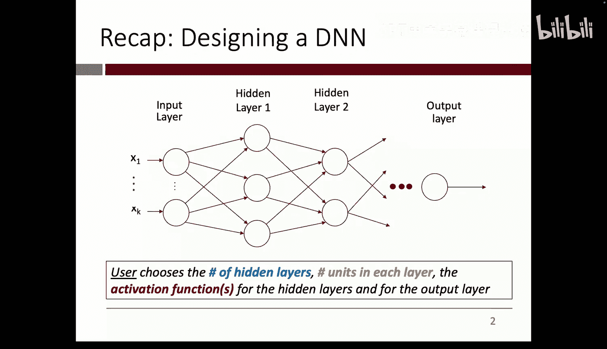

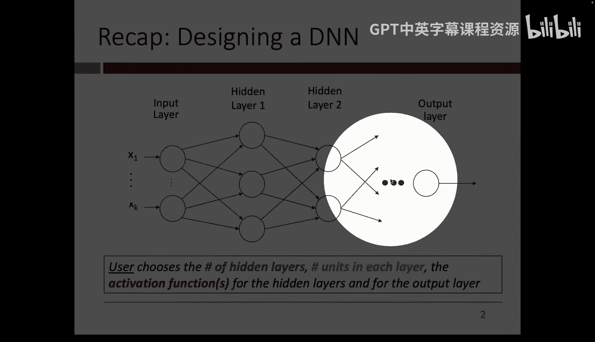

Okay， now the rule of thumb。The rule of thumb always is to start with the simplest network you can think of and if it gets the job done。

 stop working on it。😊，If it's not good enough， make it slightly more complicated。Okay。

 so that's sort of the， you know， like the meta thing you have to remember always when you're designing these things。

Okay， so that's sort of， you know， what it takes to design a deep neural network。

 So what we will do in this class is we'll actually take a real example with real data。

 And then we we will think through how we will design a network to solve this problem。😊。

And while doing so， we will cover a whole bunch of conceptual foundations， such as optimization。

 lost functions， D and descent and all that good stuff。😊，Okay， allright， so the。

 the case study or the scenario here is we have a data set of patients made available with the Cleveland clinic。

 And essentially， we have a bunch of patients and for all these patients。

 The setting is that they have come into the Cleveland clinic and they have not come in with a heart problem。

 They have come in for something else。 Maybe they just came in for the physical。

 And we measured a whole bunch of things about them。 Okay， and the kinds of things we measured， or。

 you know， demographic information， like what's their age， gender。

 whether they have any chest pain at all when they came in， blood pressure， cholesterol， sugar。

 so on and so forth。 right， Do you get the idea， demographic information and a bunch of biomarker information。

 and then。😊。

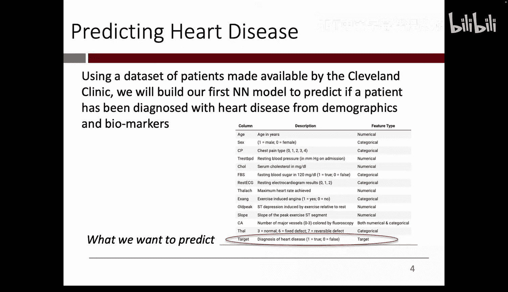

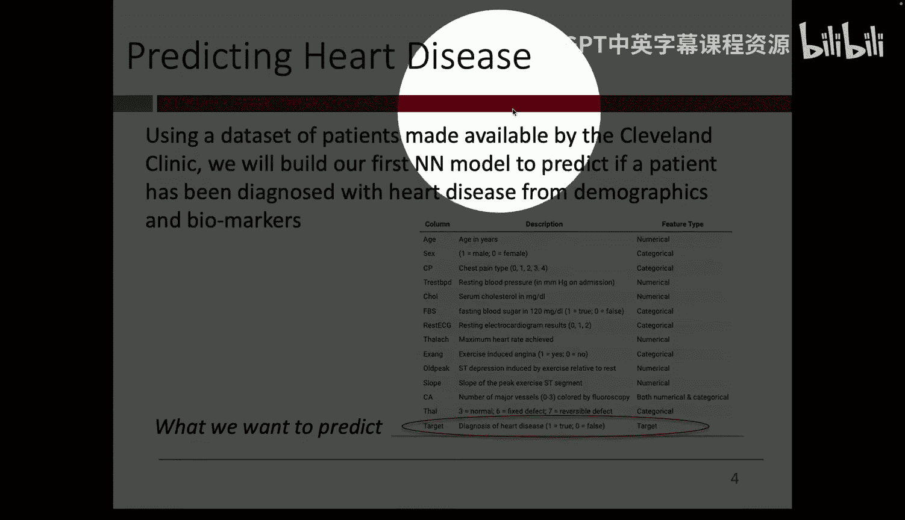

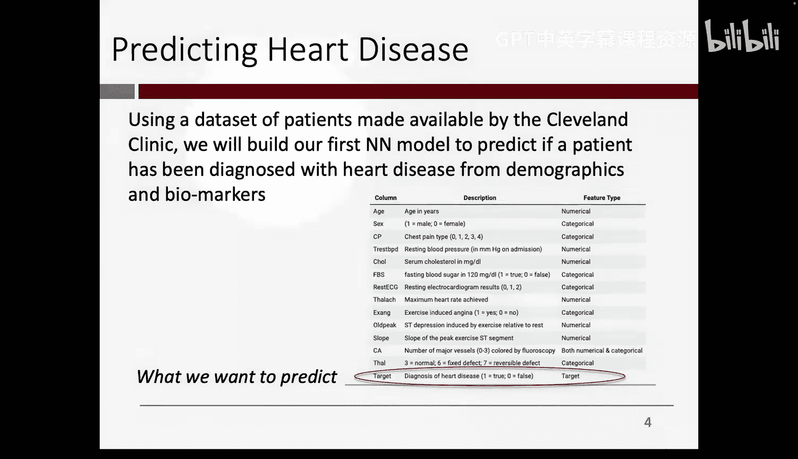

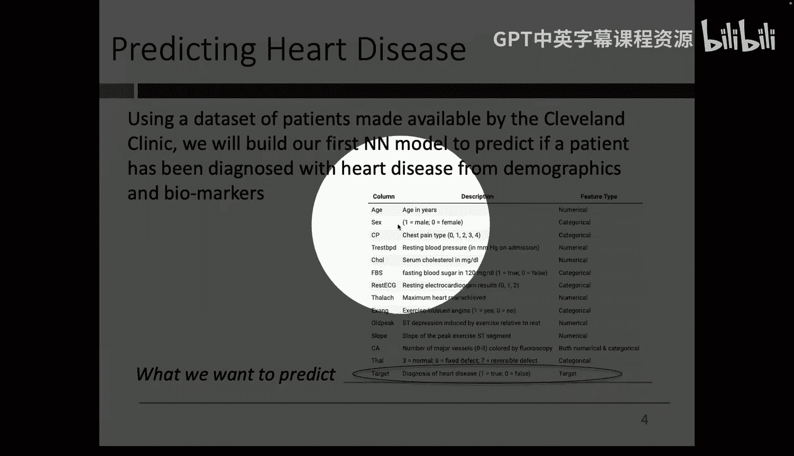

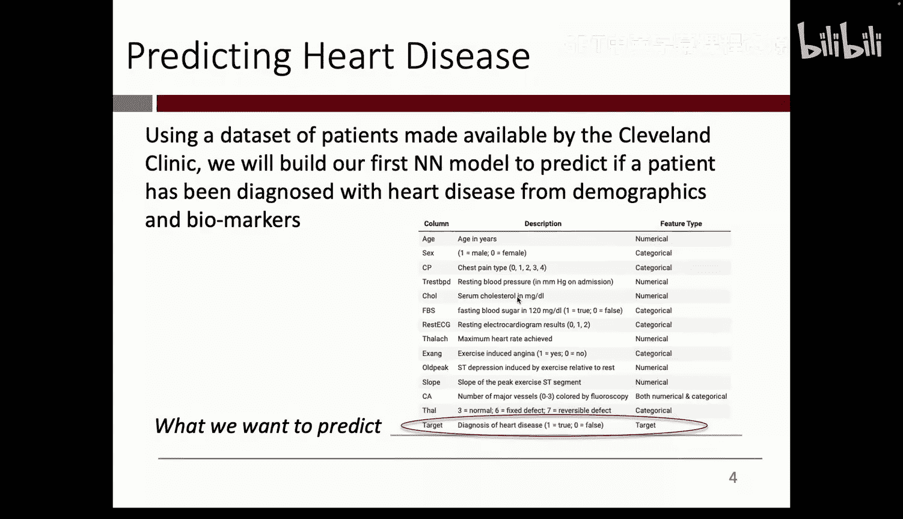

What the Cleveland Clinic did was they actually tracked these people。

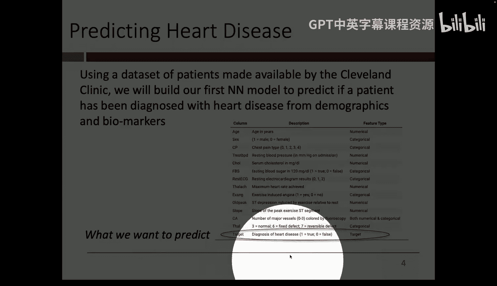

And figured out in the next year， did they get diagnosed with heart disease or not。Okay。

 in the next year。Which means that maybe you can build a model。 I when someone comes in。

 even though they didn't come in for a chest problem。

 maybe you can predict that something is going to happen to them in the next year。 right。

 It's a nice sort of classic machine learning setup。😊，Allright， so this is the thing。

 So what we want to do is we can totally solve this problem using decision trees neural。 I mean。

 sorry， random forests and gradient boosting and all the good stuff you folks may have already learned from machine learning。

😊，But we will try to solve it using neural networks。

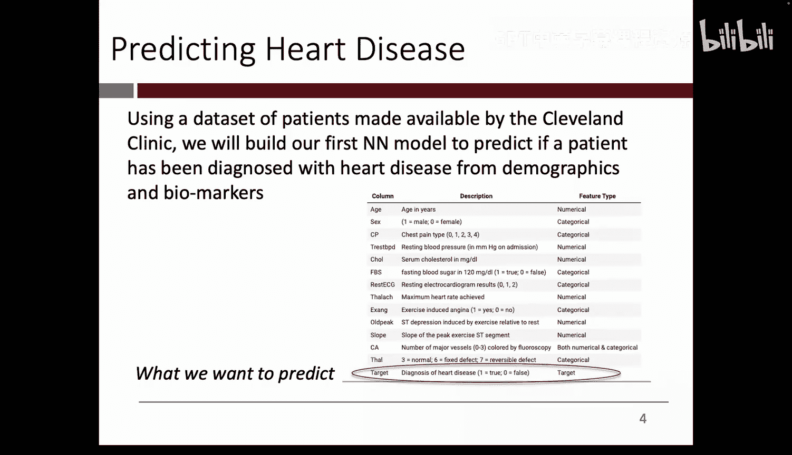

This is an example， of course， of what's called structured data because this is all data sitting in the columns of a spreadsheet right So working with structured data is the way we warm up our knowledge of neural networks。

 And then we will do things like working with unstructured data starting next week with images and then later on with text and so on and so forth。

 Okay， Any questions on this。😊，O， yes。Just connected even to last time's class where we took the same example and first it was a logistic and then we did a neural network so the probability in case of 1 was 0。

85 then was 0。22 and here as well how do you know when to use what？Usually in textbooks， you know。

 when to use logistic or when to use something else。 but in this case。哦。

When do I complicate it to neural networks Vi in this case maybe just doing random It's a great question when do you use what so I think there are two broad dimensions that you ought to think about。

 one broad dimension is how important is it that you need to explain or interpret what's going on inside the model to perhaps a non technical consumer。

😊，The other dimension is， how important is sheer predictive accuracy。In some situations。

 predictive accuracy trumps everything else， in which case， just go with it。 In other cases。

 explainability becomes a big deal because if they can't understand， they won't use it。

And in those cases， it's probably better to go with simpler models， such as decision trees and。

 I mean， not your decision trees， maybe even random forests， certainly logistic regression。

 Those are all a little more amenable。😊。

But that said， even complex black box methods like neural networks。

 there is a whole field called mechanistic interpretability。

Wwhichch seeks to try to get insight into what's going on inside these big black blocks。

 so the story isn't over right， but that's just the first cut way you sort of analyze the problem。😊。

Okay， so。Let's get going。 So if you want to design a network。All right， so we design the network。

 So we have to choose the number of hidden layers and the number of neurons in each layer。

 Then we have to pick the right output layer。 So here。😊。

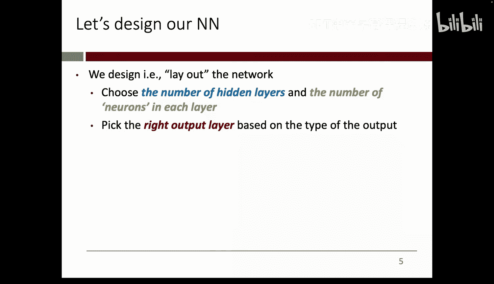

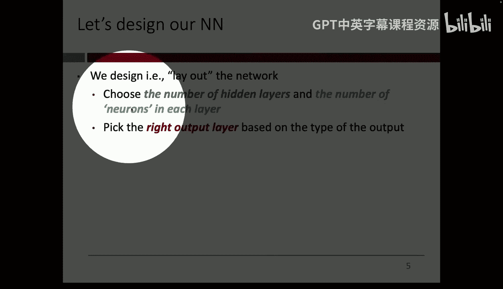

What I did is the simplest thing you can do is， of course， just have no hidden layer。

So if you have no hidden layers， what is that model called。是す。Yes， logistic regression。 Okay， so。

 of course， we want a neural network。 So I'm going to have one hidden layer because that's the simplest thing I can do。

 And then I'll confess， I tried a few different numbers of neurons in this thing。

 And when I had 16 neurons， it actually did pretty well。😊，Okay。

 so there was some trial and error that went on before I landed on the number 16 right and for some reason。

 people always use powers of two。 so we us them do that。😊。

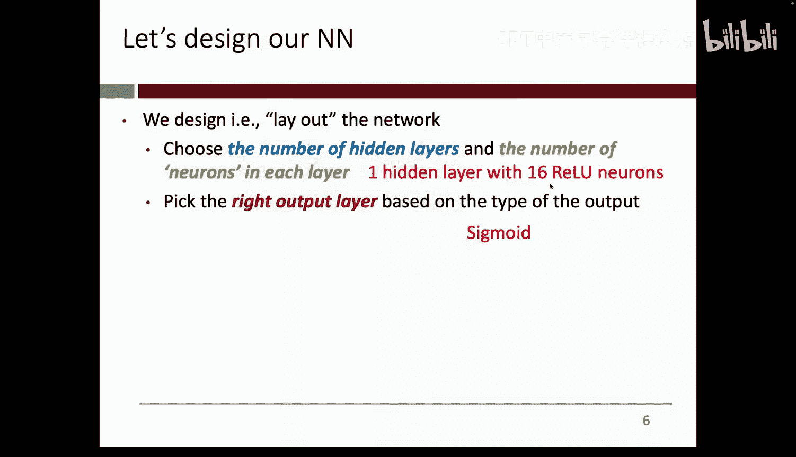

So I tried like 4，8，16， and 6 was really good。And as turns out， when I went about 16。

 it sort of started to do badly。😊。

And it started to do badly because something got overfitting。

Wwhich we are going to talk about later okay so yeah 16 and then by default I use reose okay so 16 relu neurons and then here the output is a categorical output right heart disease yes or no one or0 classification problem which means that we want to emit a probability at the very end therefore we will use a sigmoid。

😊。

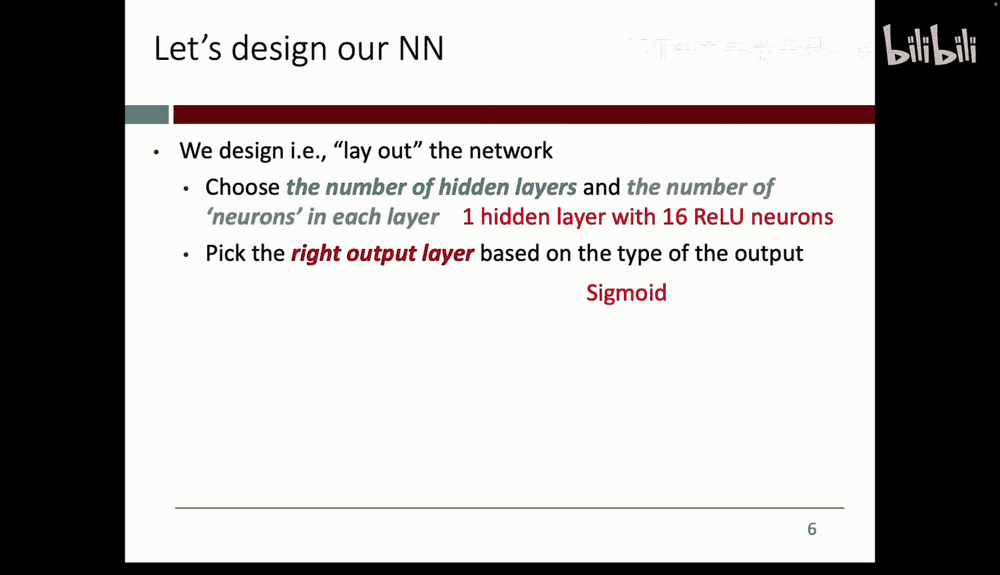

Okay， so so far， so good， right， any questions？😊，All right。

So we are going to lay out this network visually。Okay so we have an input and so I just have have an input and as you will see here。

😊。

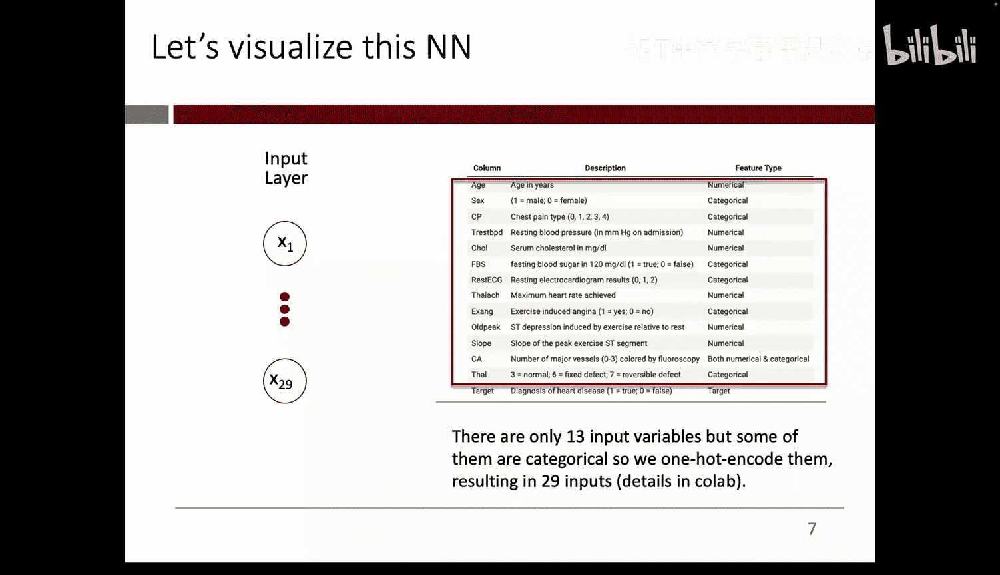

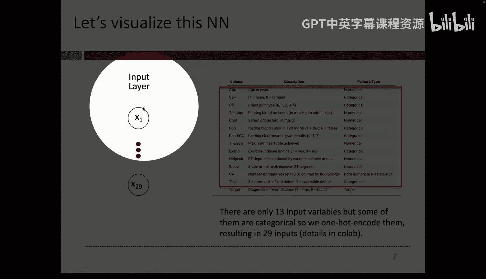

X1 through x 29， that's our input layer。 And you may be wondering，29， where did he get that from。😊。

Because there doesn't seem to be like 29 rows here of independent variables。

 So it turns out there are only 13 input variables here， but some of them are categorical。😊。

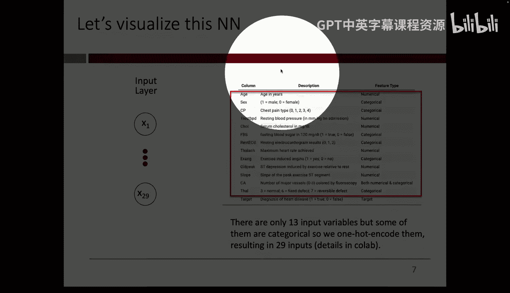

So what I ended up doing is to take each categorical variable and one hot encode it。Okay。

And when you do that， you get to 39。 I'm sorry，29。And when we actually do the collab later on。

 I'll show you exactly how I want encoded it， but that's what I'm doing here。😊。

That's why you have 29， not 13。Okay， now， obviously， we have decided on these hidden units，16 units。

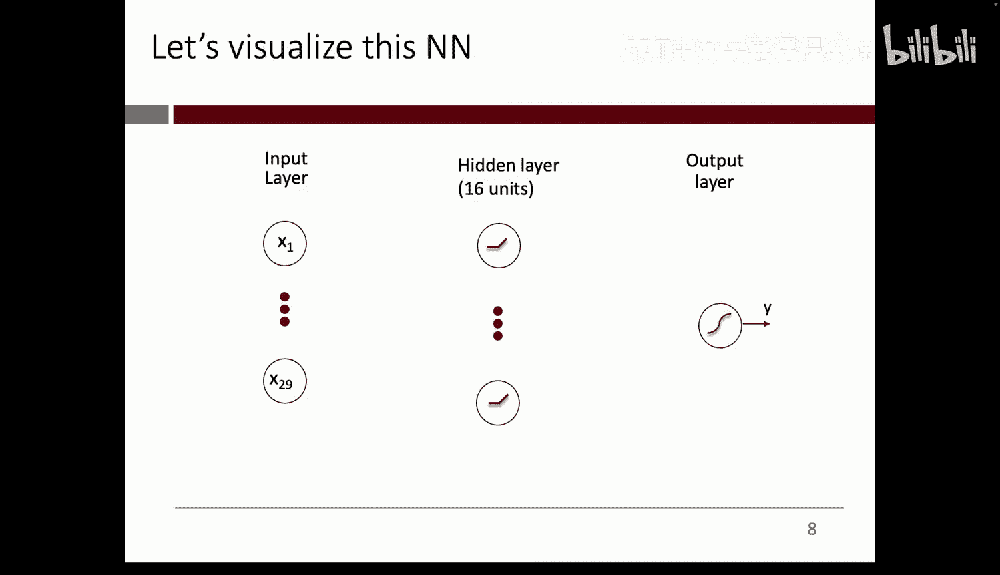

With nice re here， And then we have an output layer with a little sigoidite。😊。

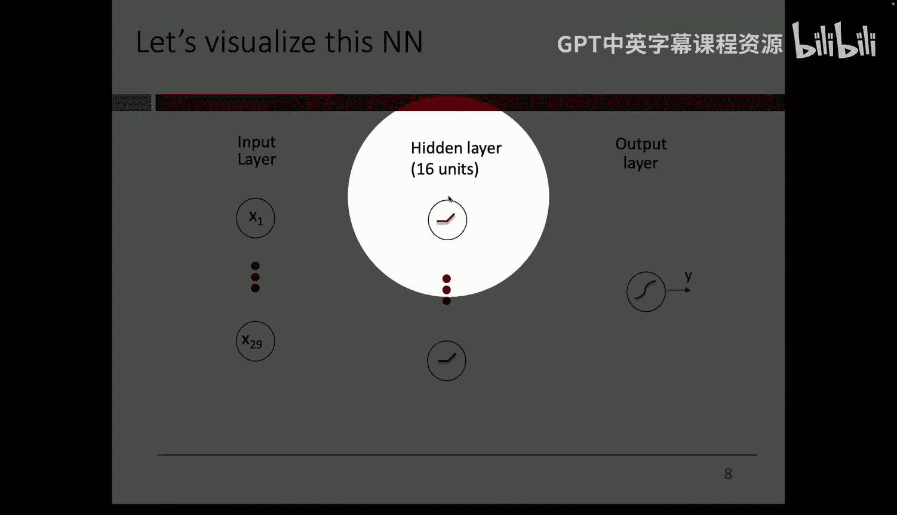

And I got bored of trying to draw all these arrows。 So I just gave up and said。

 assume there are arrows。Okay， between all these things。Good。呀。Yeah， I'm sorry。

 I think you already mentioned this。 but why 16 units。 Y 16。

 I tried a bunch of different numbers of units。 And at 16， the resulting model did well。

 So I just went with that。 and the logic of why is a。Oh why relu， Yeah。

 So there there is just a mountain of empirical evidence that suggests that Relu is a really good default option for using as activations in hidden layers。

 There is also a really great sort of theoretical results。

 and I'll allude to some of them when we actually talk about gradient descent。😊，Yeah。Sorry。

 quick question。 You mentioned in the input layer。 how did you get to 29 again when you had like 13 variables So some of those 3 variables are categorical variables like cholesterol。

 low medium high right And so I took them on one hot encoded them。 So if it had like five levels。

 I would get five columns now。呃，要。And by the way， folks， just like yeah。

 just like please use a microphone so that people on the live stream can hear your question。

 go ahead sorry， just one question。 So the vectors， since we didn't represent them。

 are we assuming like every x is connected to all the units。

 correct And this is also a parameter that we have to decide or that ends up being the default。

And we will see deviations from that assumption when we go to image processing and language processing and so on。

 But when you're working with structured data like we are doing now， that's the default。😊，Okay。

 so let's keep going。So this is what we have。So remember what I told you in the last class。

 whenever you're working with these networks， get into the habit of very quickly calculating the number of parameters。

😊，Right， just do it a few times。 The first few times so that you really know code exactly what's going on。

 Okay， so yeah， how many parameters do we have here。

How many weights and biases You can work through it。 Okay。

 can you don't have tell me the final number。 You can say x times y plus Z stuff like that。Yeah。65。

 you have 48 weights and 17 biases。 Okay， and how did they come up with that So for the weights。

 you have like for the first layer， it's two times 16 and for the second connection it's one times 16 and then the biases the 16 hidden plus the outputs。

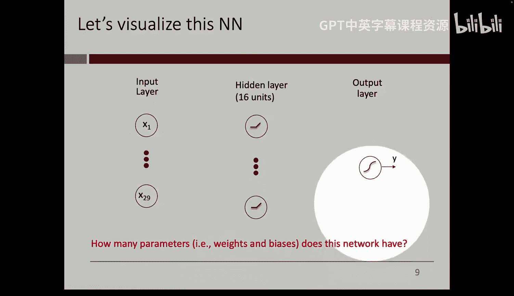

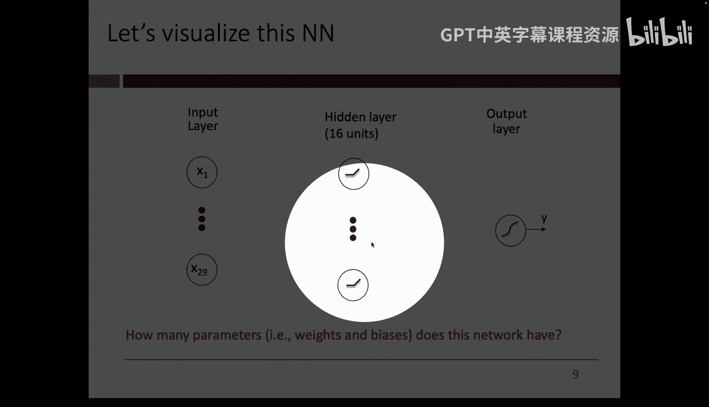

Okay， any other views on this？29 into 1629， okay，29 into 16 and then 16 into plus I mean 16 there and then biases 16 biases and one bias correct。

 so the way it's going to work。Is we have 29 things here，16 in the middle， So 29 into 16 arrows。

And then for each of these fellows， there is a bias coming in。So that's another 16。Plus。

 you have 16 times one。Which is here plus there is one bias for this one。So the total is 497。

So you can see here there is something very interesting going on。

 which is that when you go from one layer to another layer。😊。

The number of weights is roughly on the order of a times B。The number of units。

 And so that's a dramatic explosion， the number of parameters。Right。

 and that's something we have to watch for Leron to prevent overfitting。O。

 that's where the explosion parameters comes from。 the fact that each layer is fully connected to the next layer。

Okay， but we'll revisit this later on， O。So what I'm going to do now is I'm going to actually translate this network。

 right， the one that we have laid out graphically into Kaas code。😊，To demonstrate how easy it is。

Okay， so I will give a fuller intro to Karas in Tens offlow later on。 But for now。

 just suspend your disbelief。 We'll just try to do in Kas as if we know Kas。 Okay， so let's try that。

 later on we'll get into all the goy details and train it in collab and so on and so forth。 Okay。

 Allright， so。😊。

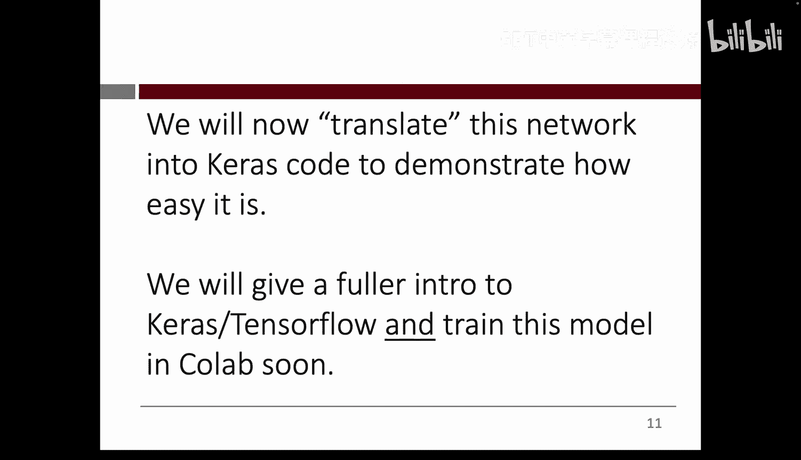

So the way we typically do it is that once we have a network like this。

 we typically start from the left and start defining each layer in cares one after the another。

 so we flow left to right so lets take the input layer the way you define an input layer in cares is really easy。

😊。

You literally say， canra start input。And then you tell Ks how many nodes you have in the input coming in in this case it happens to be 29 so you tell it the shape shape equals 29 and the reason why we say shape as opposed to length is because as you will see electron。

 we don't have to just send vectors in， we can send complicated things in to Kas。😊。

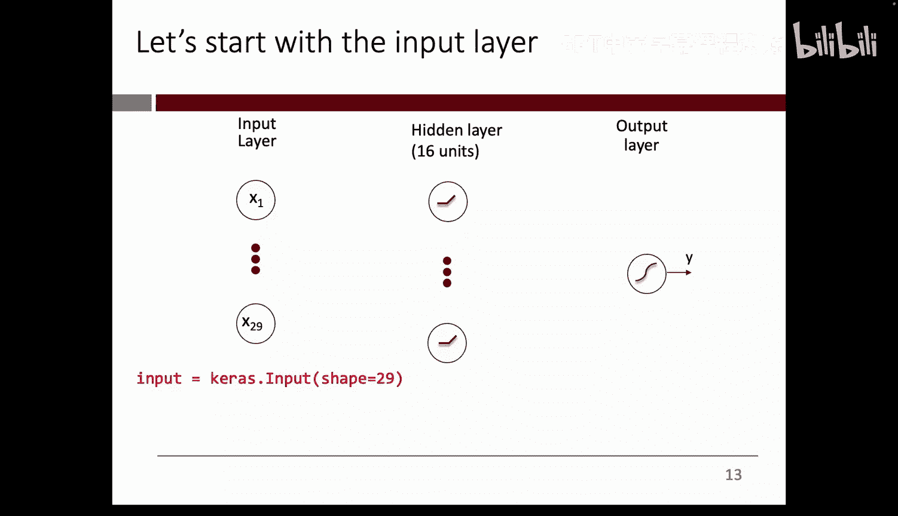

And those complicated objects could be matrices， it could be 3D cubes。

 it could be 4D tensors and so on and so forth。 So it is expecting a shape。😊。

Right what is the shape of this thing you're going to send me in this particular case。

 it happens to be a nice list or a vector。 So it's 29。 Okay， that's it。 So we write this down。

 This creates the input layer。😊，And we give it a name， And the name here means。This layer。

 whatever comes out of this layer， has a name input。Okay。Good， next。Yes。

 theres further the shape of the input， as I mentioned。Right there。Then me go to the next one。

 And here， and we will unpack this the way you define。A layer is typically a hidden layer。

 Kera stood layers do dance and all this stuff。 Okay， so what this is is it， first of all， it says。😊。

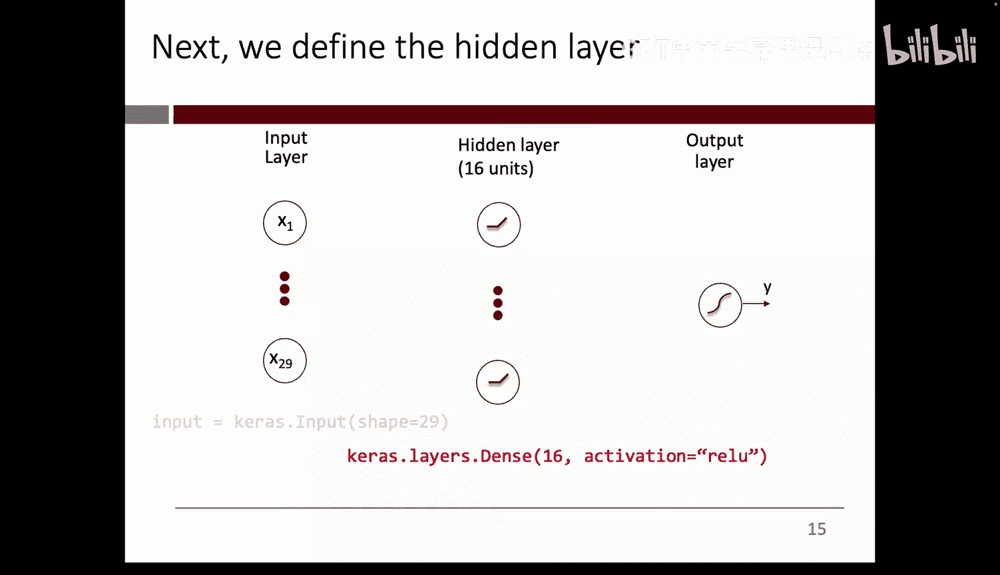

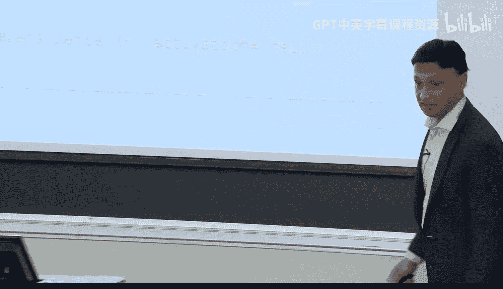

I want a dense layer by dense layer， I mean a layer that's going to fully connect to the prior and the later layers。

😊，Fully connect。 That's what the word du means。 Okay， numberumber 2。

 I want 16 nodes here in this layer。Okay， finally I want to use a reello。😊。

See how compact and parsimonious it is， And that is the appeal of Kras。 It's very easy to get going。

So the moment you do that， you've actually defined this layer。But what you have not done。

Is you have not told this layer what input is going to get。😊。

Because as far as this layer is concerned， it doesn't know that this other layer exists。

So you need to connect them， yes。Do we need to define for the reello where the bends are。

 like where you take the max the re of the bend is always at zero Okay， thank you。O。All right。

So that's what we have here。And then what we do is we have to tell it you want to feed this layer。

 the output of the previous layer， so you feed it by taking whatever is coming out of this thing。

 which is called input and you basically stick it in here。😊，So the moment you do that boom。

 it's going to receive the input from the previous layer。😊。

And because this one's output needs to go to the final layer。

 you need to give a name to their output， So you give it a name。

 I'm just calling it edge for because it's coming out of the hidden layer。😊，You' just a video。

 but you can got anything you want。Now， what we do， we go to the final output layer。😊。

And this is what we use。 The output layer is just another dense layer。

That's why I use the word dense， but we say hey， give me just one thing because I just literally just need one unit here because I need to emit just one probability。

😊，And the activation I want to use is a sig mind。😊，No。可以。And once you do that， you。

Have to feed it the input from the second layer。 So you stick an edge here。Now。

 we have connected the third and the second layers。And after you do that。

 you given a name to the output coming out of that。 well just call it output。 you can call it Y。

 you can call it output， you can call it whatever you want。😊，O， so at this point。

 what we have done is we have mapped that picture into those three lines。That's it。Okay。

But we aren't quite done yet， there's one little thing we have to do。

So what we have to do is we have to formally define a model so that Kas can just work with this model object。

 it can train it， it can evaluate it， it can use it for prediction and so on and so forth。

 so we tell Kras， hey， create a model for me， Kra start model。😊。

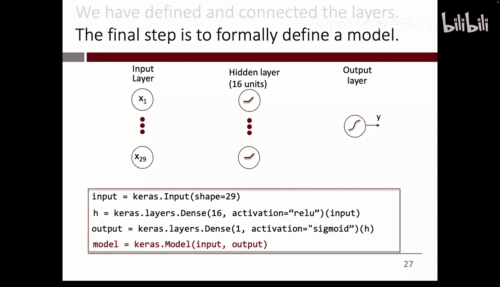

And basically， where the input is this thing here and the output is that thing there。

 And then the whole thing we'll just call it model。

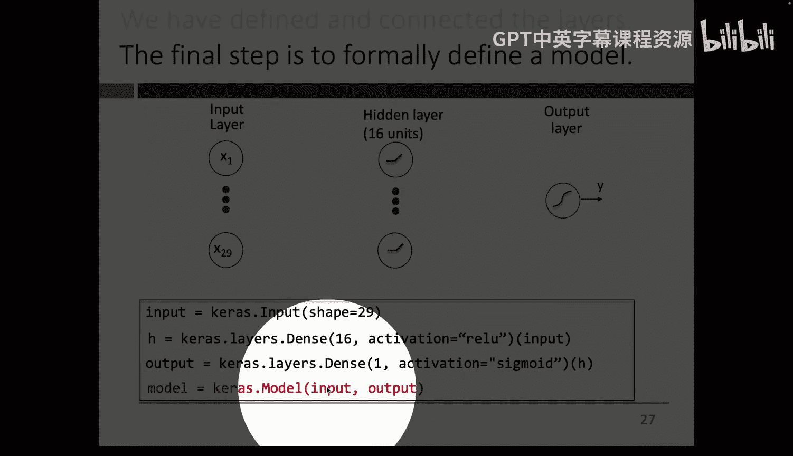

Okay， so that's it。We are done。 That is the whole model。 That is I son's journey fancy， right。

 a neural model for heart disease prediction。 That's pretty cool。😊，Fourt lines。

And we will show how to train this model with real data and so on and so forth and use it for prediction after we switch gears and really get into some conceptual building blocks。

😊，We a question。Can you define a custom activation function that is not in the list of Kaks library。

Yeah you can define the question was can you define a custom activation function。

 you totally can in fact， I mean， the kind of flexibility you have here is incredible。

 and these innocent four lines unfortunately sort of hide the potential that's possible here。

 but I guarantee you in two to three weeks， you folks will be thinking in building blocks like Legos。

😊，So you， you know， I'm so happy when it happens， So they'll come to my office house and say。

 you know， I want to create a network where I have a little network going up on top。

 A one going in the bottom。 then they meet in the middle。 Then they fork again。 They split。 I'm like。

 unbelievable。😊，It's fantastic， and you're going to be doing this in two weeks， I guarantee you。😊。

Yeah， in the case of a multi class classification problem。

 are the output nodes equal to the number of classes， correct？

So we will come to so this is binary classification and the question is for multiclass classification。

 let's say try to classify some input into one of 10 possibilities， we will have 10 outputs。

 but the way we define it is going to be using something called a softmax function which we are going to cover on Monday。

😊，So for now， we just live with binary classification。

Is there a default activation method in Kaas or you have to put something。 that's a good question。

 I believe the default might be re for hidden layers， but I'm not 100% sure。 double check that。啊。

Just to get a clearer understanding， when you said that beyond 16。

 when you tried working on those neurons， the performance worsened。

That is where you were playing around with initially two and then maybe four and six and eight。

 exactly。Could use themic。Do we need to define each of the hidden layer when the model gets more complex when we have more than one layer like have like 25。

 so what we typically be good question if you have let's say 100 layers right do you actually have to type in each by hand and cut and paste No。

 you can actually write a little loop， which is automatically create them for you。

And so basically what's going on is that this little output thing you see here。

 this variable this output could be the result of 100 layer network with all sorts of complicated transformations going on and then finally it pops up as a little thing called the output and what Kara will do is itll be like okay this model has this input and has this output but boy this output came from incredible transformations applied to the input and Kas will process all that very easily for you you don't have worry about it。

😊。

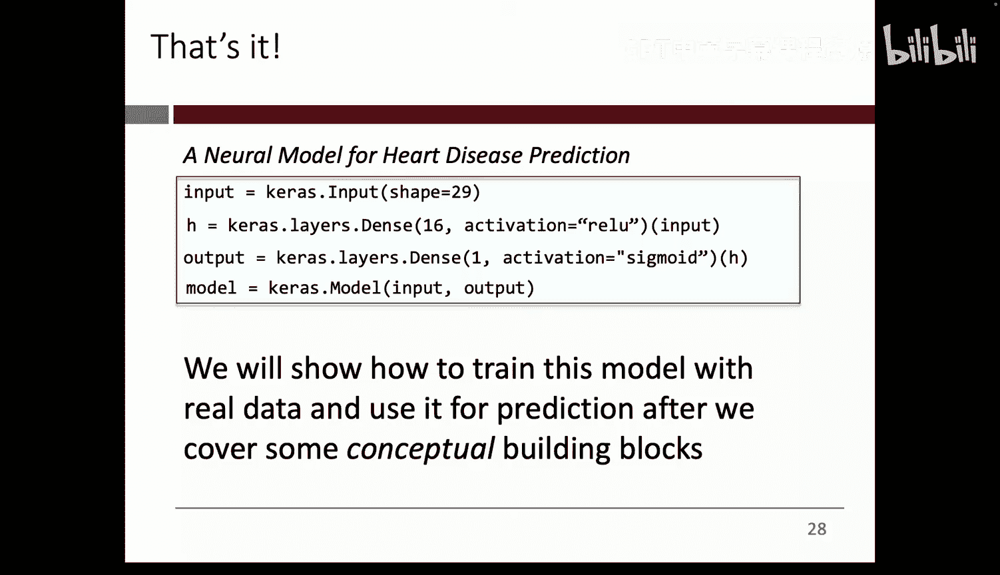

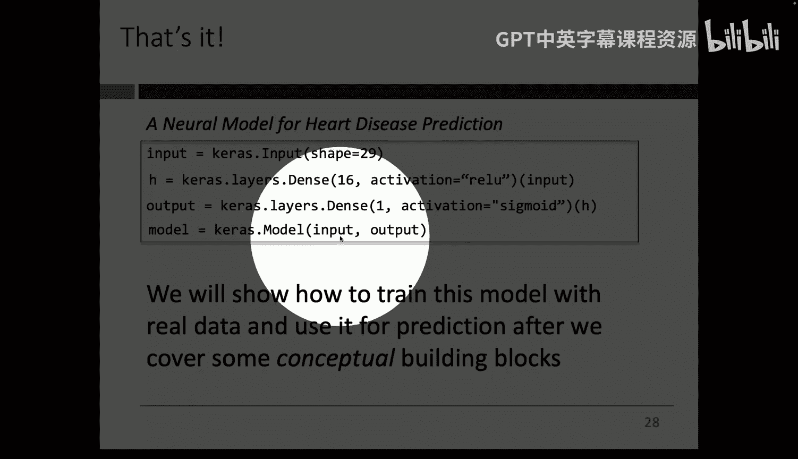

It's really a beautiful example of the power of abstraction。😊，And you will see that as we go along。

Now， let's switch gears and say once you have written a model like that in Ks。

 how do you actually train it？Okay， now， training is something you' have been doing a lot right So for example。

 when you have something like linear regression right where you have all these coefficients。

 you need to estimate you have this model， then you have a bunch of data。

 then you run it through something like LM。 if you use R。

 And what it gives you is actual values for the coefficients right，2。8。0 and so on and so forth。

 So the the role of the data is to give you the coefficients。😊。

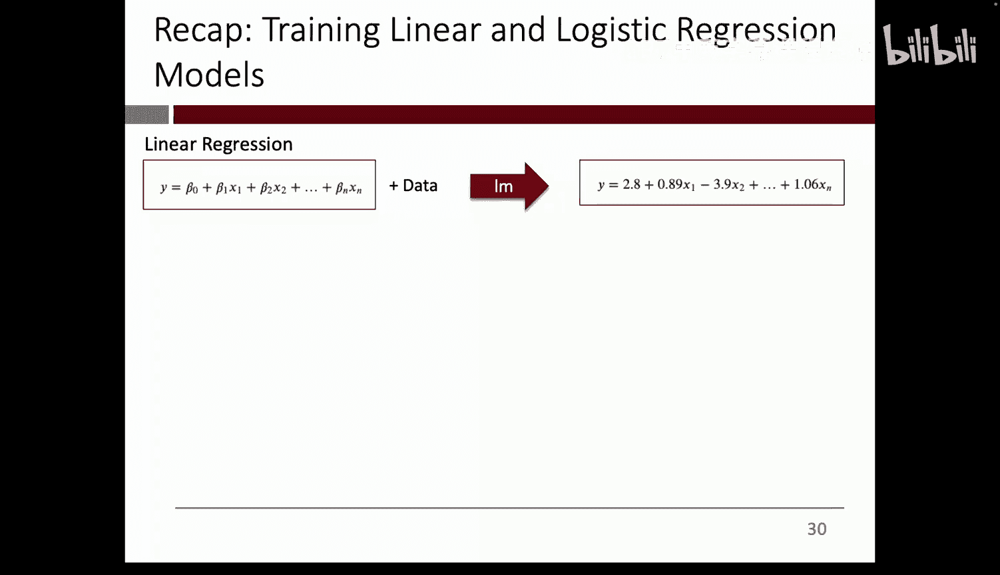

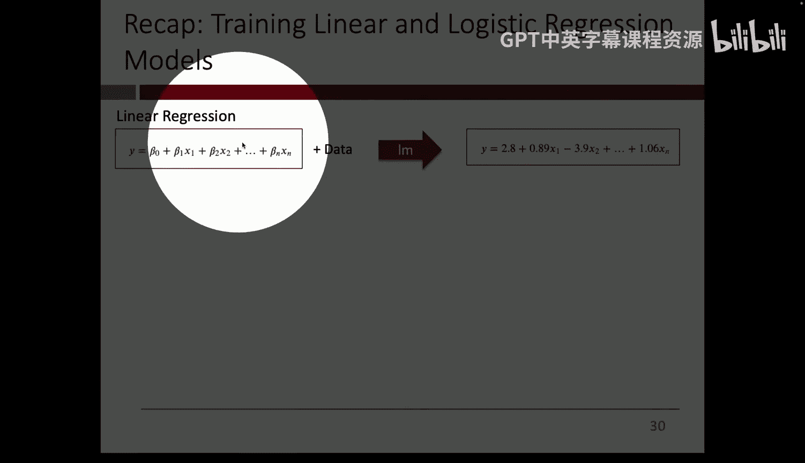

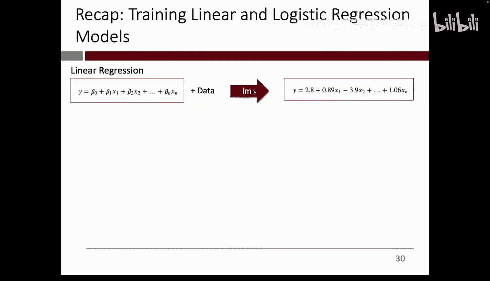

，Or you can think of the coefficients as really a compressed version of the data。OkaySimilarly。

 if you do a logistic regression， you have a model like that， you add some data。

 you run it through some estimation routine like GM or psyit learn or stats models。

 pick your favorite tool， then you'll come up with something like that。

 So basically what's going on here is training simply means find the values of the coefficients that so that the model's predictions or as close to the actual values as possible that's it okay And so and to find the one that is as close to the actual value as possible a whole bunch of optimization as well you don't have to worry about optimization when you do the regression linear or logistic because it's all done under the hood for you。

 but for neural networks we'll actually get to know how it's done。😊。

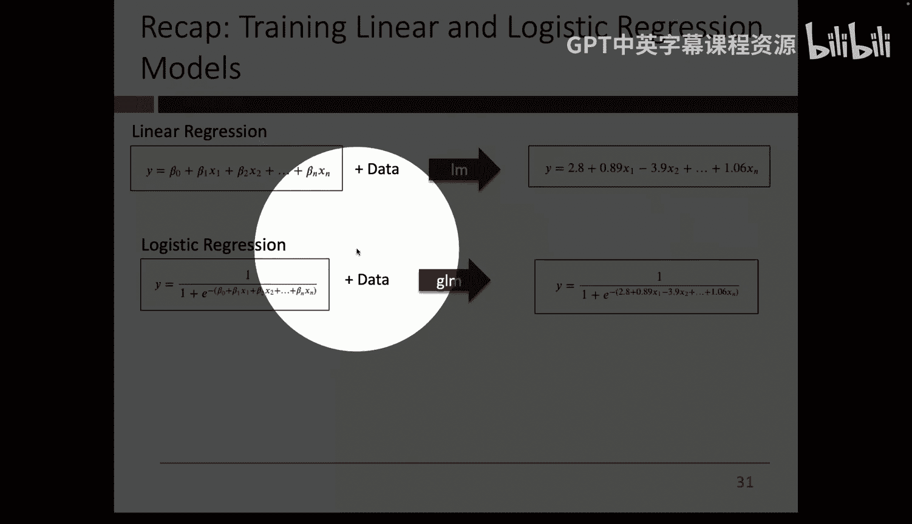

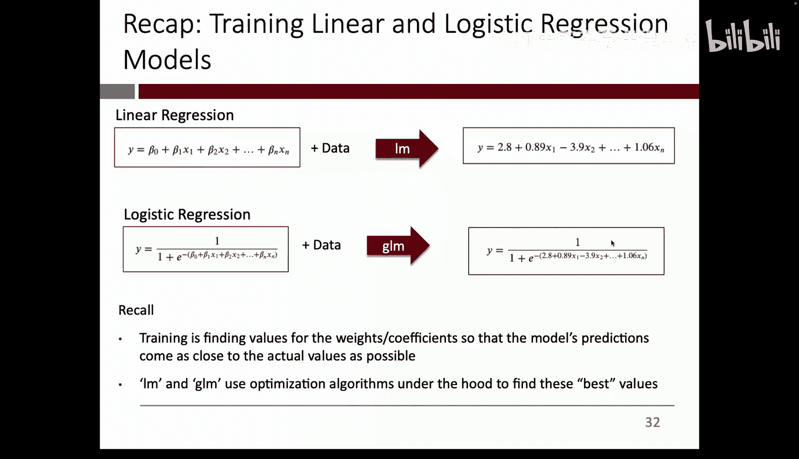

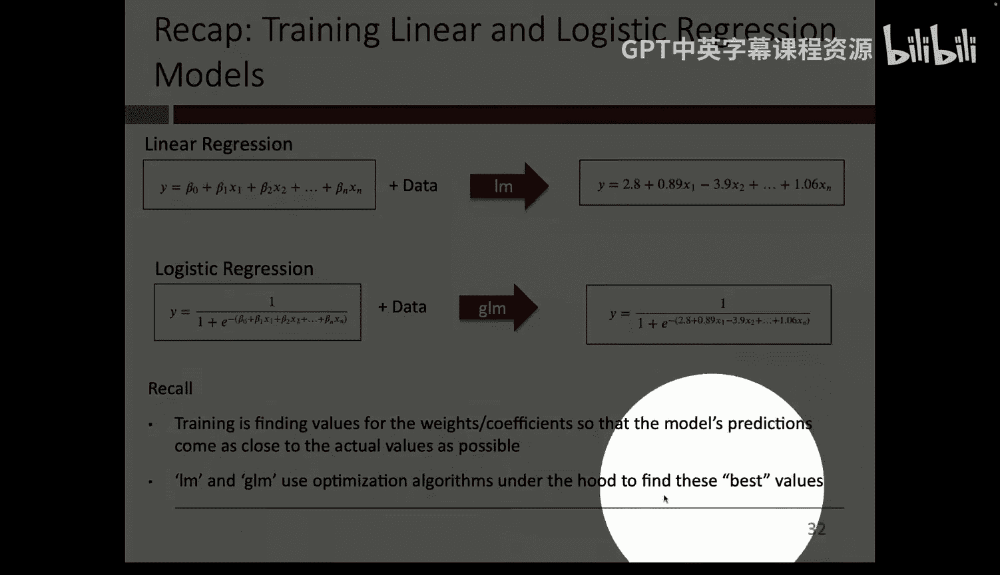

我每是怎。Okay， so training a neural network， a deep neural network， given G 4。

 it's basically the same process as what you do for regression。😊。

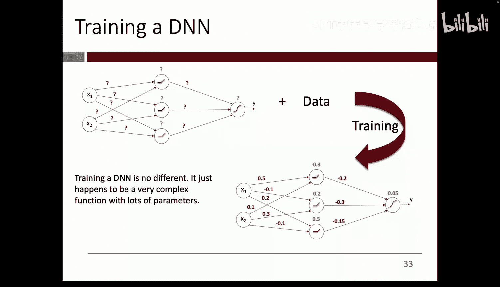

You basically you're just a very complicated function with lots of parameters。

 but ultimately you have a network with all these question marks， you add some data。

 you do some training and boom you get some numbers。😊，You may get into this。

 but are we determining the architecture of the network before we train it？Yes。

 because if you don't define the architecture。Kas doesn't know how to actually calculate the output。

Given an input。 And unless it knows input， output pairs， it can't do anything more with it。Okay。

 so the essence of training is to find the best values for the weights and biases。😊。

And the way we think of the best values is that we basically set up a little function。

 and this function measures the discrepancy between the actual and the predicted values。 Okay。

 and I use the word discrepancy because the way you define the discrepancy。

 there is incredible amount of creativity in the field。😊。

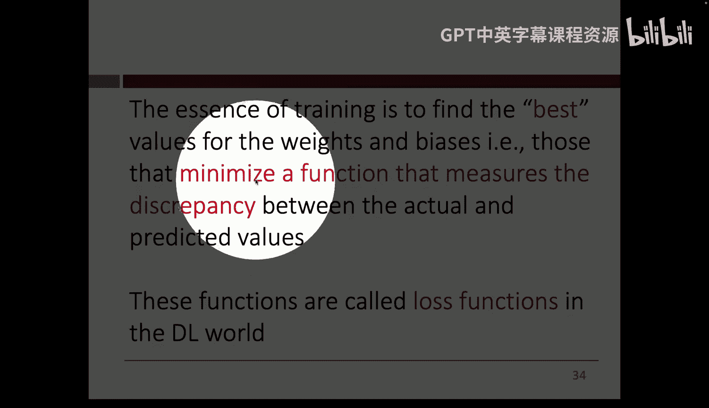

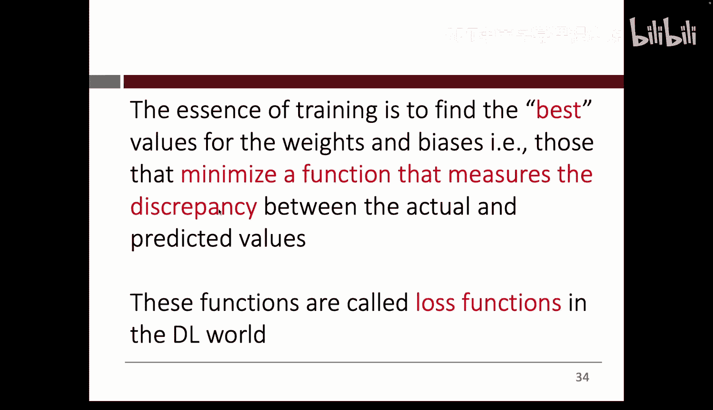

In fact， a lot of breakthroughs in deep learning come because people define a very clever measure of discrepancy。

 And then turns out it actually gives you all sorts of interesting behavior。 Okay。

 that's why use the word discrepancy as opposed to the word error。 because when I say error。

 you might be just thinking of something like predicted mind is actual。😊，That's too limiting。

Prediction minus is actually is too limit。 That's why you over discrepancy。

 So so we basically define a function that captures the discrepancy between these the bacterial and the rate values。

 and these functions are called loss functions in the deep learning world。😊。

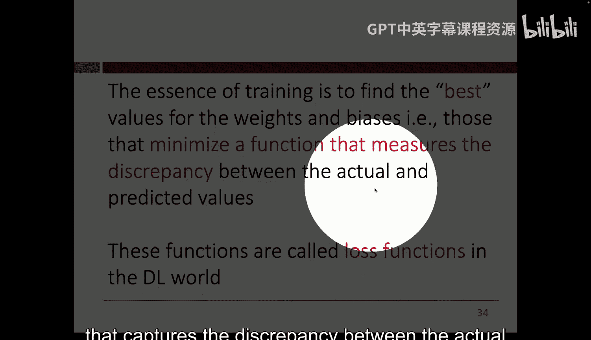

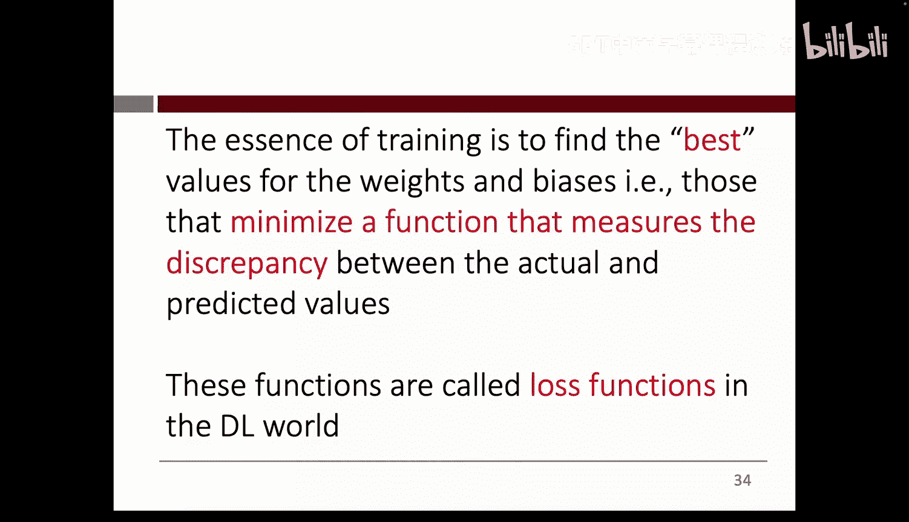

And every paper that you read， you will find interesting loss functions。

 There are hundreds of loss functions。 Enous research created goes into defining these loss functions。

 All right， So these are loss functions。😊。

And so a loss function is a function that quantifies as discrepancy。

 So let's say the predictions are really close to the actual values。 the loss would be what。😊。

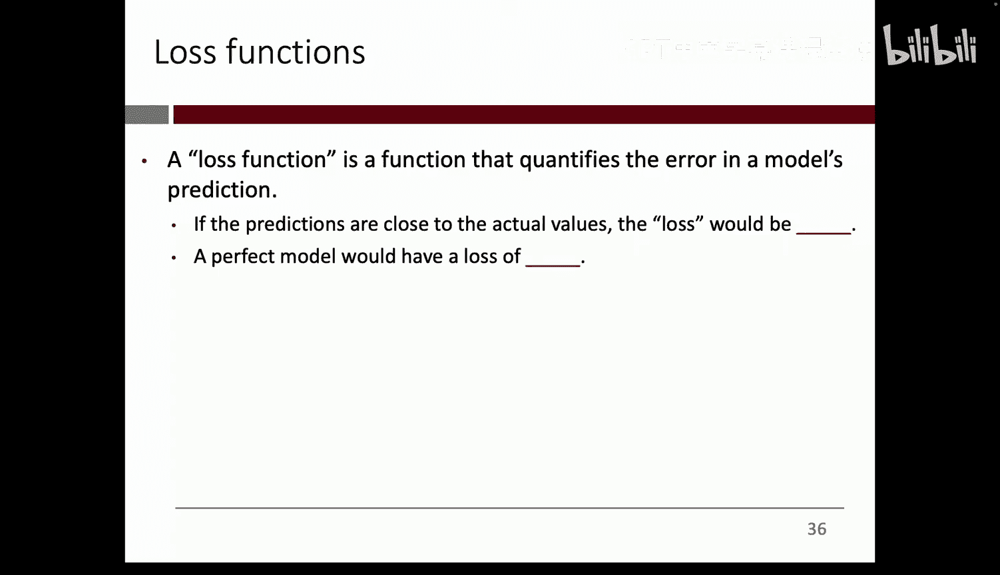

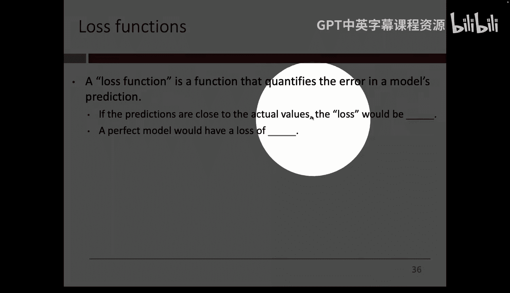

very small。And if you are a perfect model。Perfect crystal ball。 What would the loss be。Exactly 0。

 right， exactlyly 0。 So linear regression， we the loss function we use is called sum of square  errors。

😊，We didn't call it loss function because we were not doing deep learning， just linear regression。

 but that's basically the loss function， right so。The loss function we use must be very matched very properly with the cleaner output we have。

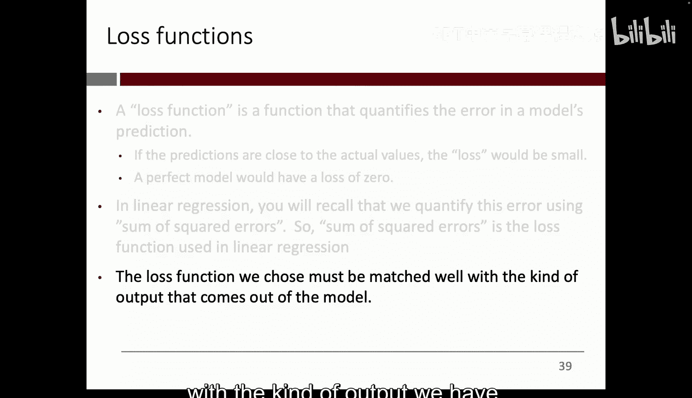

So if your output is a number like 23 right you' are trying to predict like a product demand for next week for a particular product and predicted value is 23。

 the actual value is 21， it's okay to do 23 minus-212 as a discrepancy right the error but for other kinds of outputs it's not so obvious what the correct loss function is what the correct measure of discrepancy is and so here。

😊。

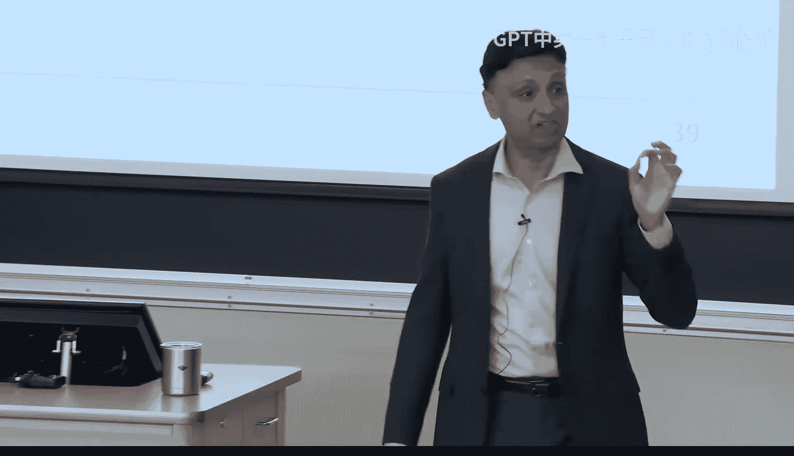

But the simple case is regression。

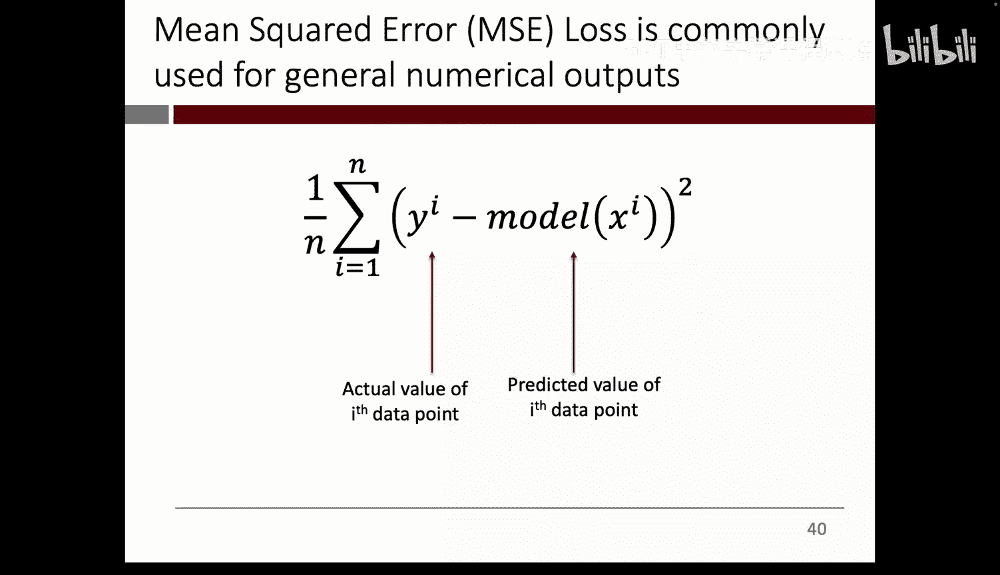

Right the Y I， the I here by the way， is a superscript， which stands for the Ih data point。

 the Ih data point。 So what Im saying is that okay for the Ih data point， this is the actual value y。

 and this is what the model predicted。😊，I take the difference， square it。

 and once I square it for each point， I just average all these numbers to get an average squared error I。

e mean squared error MSC， so this is sort of like the easiest loss function。😊。

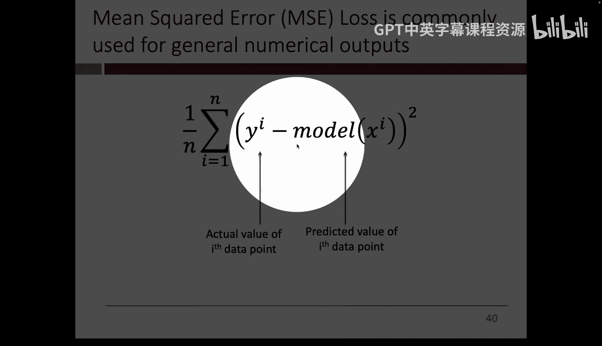

Okay。Now， let's crank it up a notch。In the heart disease example， the heart disease。

 the neural prediction model。😊，The prediction is a number between 0 and 1， right。

 It's because it's coming out of the sigmoid。It's a fraction。 The actual output is a 0 or1。

 One of the two， right， It's binary。So how would we compare the discrepancy。

 how would we measure the discrepancy between a fraction and the numbers0 and 1 right what is a good loss function into the situation right is the key question so let's build some intuition around this。

😊，And let's see if my little daisy chain iPad thing works。I'm doing it on the iPad。

 so the people on the live stream can see it。 Otherwise， the blackboard is a little tough for them。

Okay， so let's have a situation here。Okay， so lets say let's say that you have a patient who comes in and let's say they have heart disease。

 Okay， So for that patient， y equals1。😊，The true value is one for that patient。

 And now you have this model。Okay， and this is the predicted。Probability from this model。

Can people see my handwriting， okay？it could have never been a doctor， right。So0， okay，1。

 it's going to be between 0 and 1 because of probability。

And then this is the loss we want to set of have， right， This is the loss。 So for this。

 this patient actually had heart disease。 Y equals  one。

 So let's say that the predicted probability is pretty close to one。😊。

What do you think the law should be？什么。So small。Sorry， close to  zero， exactly。 So here。

 if the prediction comes here， want the loss to be you want the loss to be somewhere here。

But if the predicted probability is pretty close to zero。

 even though the patient actually has heart disease， what do you want the loss to be？Really high。

Because it's screwing up badly， So you want the loss to be somewhere here。So basically。

 you want a function that's kind of like that。You want the loss function shape to be like that。

High values of probability should have low losses。 Low values of probability should have high losses。

 yeah。

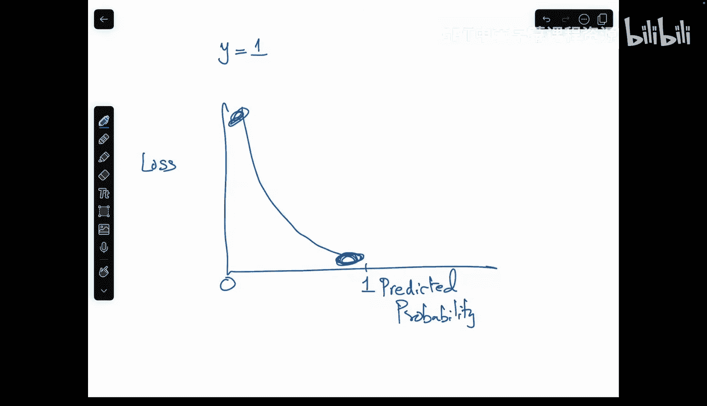

I understand it has to be yeah， so it can be linear， it can certainly be linear。

 but basically what you want to do is the more it makes a mistake。

 the more harshly you want to penalize it。

So basically what you really want is something where if it basically says this person's probability is say the probability。

 the predict probability is say one over a million。😊。

Basically， kro， you want the loss to be like super high so that the model is like。

 it's like a huge rap on thenuckles for the model。 Don't do that。

That's basically what we are doing。 And I'm sort of demonstrating that dynamic by using a very curved and steep loss function。

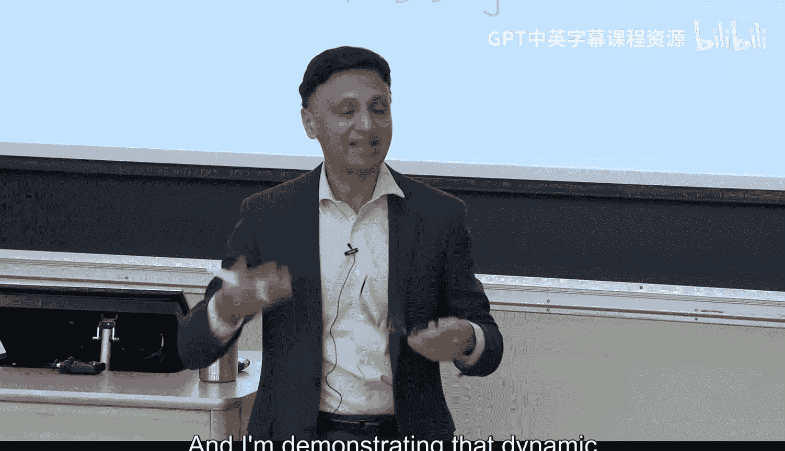

But you can absolutely use a linear function。 totally fine。

 It won't be as effective for gradient decent later on for a bunch of technical details。

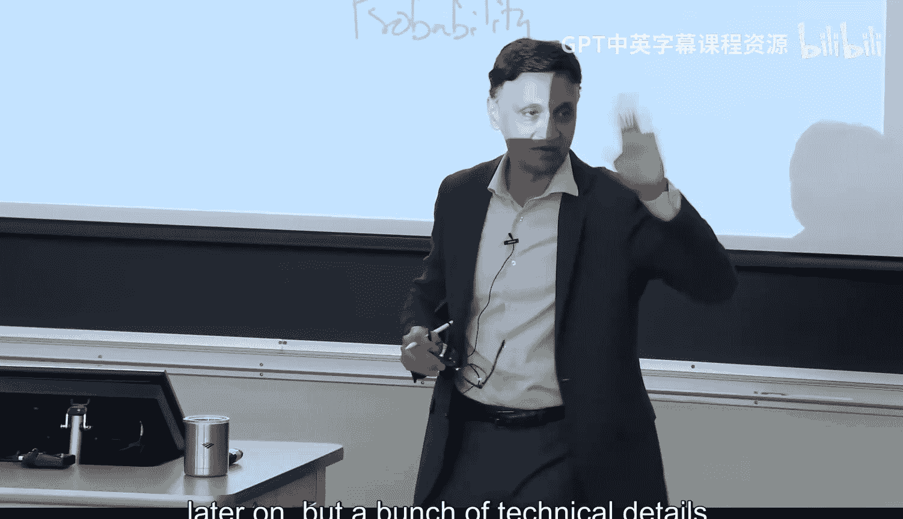

Are you good with this？Allright， so now let's look at the case where a patient does not have heart disease。

 y equals 0。Saamme setup， okay。Predicted probability。0， one loss。So for this patient。

 they don't have whatever they are not。They don't have heart disease。

 If the probability is close to 0， what should the loss be。Cos to 0， it should be somewhere here。

 right？😊，And the more and more the probability gets closer and closer to one。

 you want to penalize it very heavily， which means you want the loss to be somewhere here。

 So you basically want a loss ideally， that's kind of going up like that and climbing higher and higher。

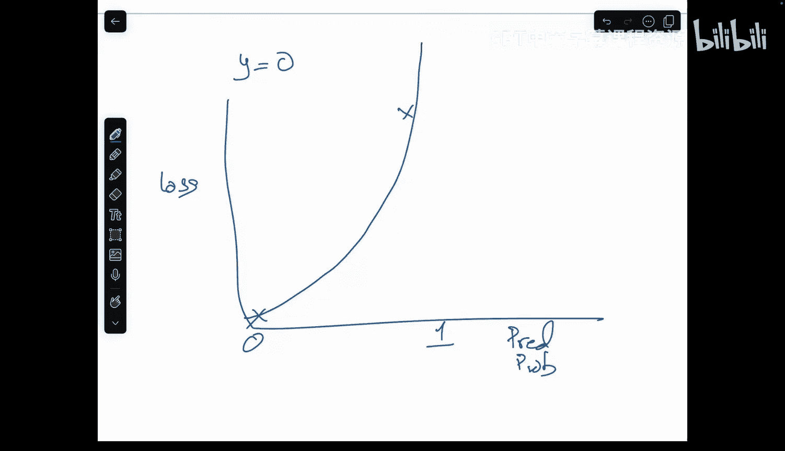

Are we good？Okay， perfect。Because we have a perfect loss function for that。So， just a recap。

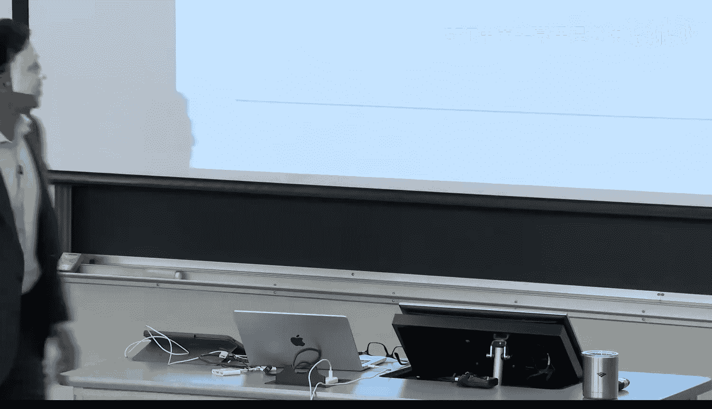

This is what we want。People with for points with y equal plus one。

 lower prediction predictions should have higher loss。 If you want something like that。

 and then turns out。

There's a very little simple loss function。Which literally just uses the logarithm。

 which should get the job done。 So what you do is you literally do minus log off that predicted probability。

That's it。 And that thing has exactly that shape。

And in fact you can see it numerically， so if the loss is 1， it's 0， if it's half， it's 1。

0 and if it's like1 over 1000， it's almost 10， if it's1 over 100 is going to be like much higher right。

 very high losses。😊。

Okay， so minus log probability， boom， done。Similarly。

 this is what we want for patients for whom y equals 0。😊。

turnsur out if you do minus log1 minus predicted probability， it does the same thing。😊，O。

Mathematicians once again， sail with the logm。So seeing somebody。This is what we have。Right。

 for data points of y equals 1， we have this data points of y equals 0。 We have this。

 but it feels a little inelegant。😊。

To say， well， if it's y equals 1， I want to use this if equals 0， I want to use that。

RightTheres this's like an if then thing going on here。 And I don't know about you， folks。

 but if then really irks me。Mathematically， because you can't do derivatives and so on very easily。😊。

But no worries， this MIT， we have our bag of math tricks。So， what we do is。

We can actually combine the both into a single expression。

Okay， like this。And here the Yi again is the Ih data point。 Remember， Yi is either  one or0 always。

 and this model of Xi is the predictor probability。😊，And I've just taken the minus log， the minus。

 and I've just moved it here。

Okay， and I've taken the the minus that was here and just moved it here。 Okay。

 that's why you see it like this。

So， this one is basically。

You can convince yourself what happens。 This single expression will get the job done。

 So let's say there is a patient for whom Y equals one。😊。

What's going to happen is that when you plug in y plus 1， this becomes 0。

 the whole thing will collapse to 0。

While here， y equals 1 just means it becomes minus log probability， which is what we want。Conversely。

 if y equals 0， this whole is going to disappear。And this thing becomes 1-0， which is just one。

 And so it becomes minus log 1 minus probability， which is again， what you want。😊。

Simple and neat， right。So in one expression， we have defined。They perfect loss。

 No if then standard that crap。Good， so now what we do is that was true for every data point。

 but we obviously have lots of data points， so we just add them all up and take the average。😊。

That's it。 We average across all the data points we have， so that we get an average loss。

O。This is the binary cross en loss function。Is there a way you can edit the loss function so that you penalize like false negatives more strongly than false models You can do all of them。

 Great question。 I'm just looking at the basic case where we it symmetric。

 you can actually penalize over estimatess much more than underestimates and things like that。

 And if you're curious， you can just Google something called the pinball loss。Okay。

Any other questions on this。So when you see this massive deep neural network built by Google for doing something or the other。

 if it's a binary classification problem， chances are they're using this thing。😊，Okay。All right。

So now let's figure out how to minimize these loss functions。

 because the name of the game is to find a way to minimize these loss functions。

 So now loss functions are just a particular kind of function。

 So we'll first consider the general problem of minimizing some arbitrary function。😊。

OAnd once we develop a little bit of intuition about that。

 we will return to the specific task of minimizing loss functions。😊。

What was everyone doing。Yes， oh， good， bad。You have a bit of a tough interpret headshake。

It's more like I kind of lost you where you said that the loss function and the predicted probability how were they inversely because the understanding was that the loss function is supposed to be the sum of errors we are averaging the errors and when you said no sorry sorry me let us just stop there for a second。

On each point， you define the loss。That's the whole point of the game。 And once you define it。

 you calculate it for every point and average， right So just focus on a single data point。😊。

And so no continue。So now when the heart patient has， there is more probability that they no。

 so when there is a person who has the heart disease。

 you said that you want the loss function to be high。I think I'm going the。

 you want the loss function to be high if I'm predicting that they basically don't have heart disease。

If the prediction is close to 0， the predictor probability is close to 0， then I'm badly wrong。

Because in reality， they do have heart disease。That's why I want the loss to be really high。 Okay。

 so effectively loss is my way of finding out how good my model is instead of saying， okay rather。

 how bad your model is how bad is it， That's really what the loss function is got and you want to minimize badness。

what point of optimization。I guess I don't have a fully like similar to the point raised before I don't have a fully cleartuition of why exactly a log function rather than something that' say。

Flat off small and then really state lighter。 Those are all fantastic things you can totally do it The reason we pick the loss this function because a is easy to work with。

 It has good gradients。 It's well behaved mathematically， but there are many alternatives to it。

 I don't want you to think that this is like the only game in town or it's the only choice for us。

 We have many choices。 really this happens to be a very easy choice。

 which also happens to be empiricalimply very effective。😊。

And I'm happy to give you pointers to other crazy loss functions。

 which can actually do all these things too。😊。

O。Alright， so minimizing a single variable function。

 we will warm up by looking at this little function here。😊，Okay。

 which is what do you call a fourth bubble。

Qutic， right？ Yeah， thank you。 Quatic。 So yeah， it's a quatic function， right。

 And this is how what it looks like。😊。

But you can see that's like a minimum somewhere here， right， between like 1-1 and -2， maybe -1。5。

 Okay， so we want to minimize this function。 It's obviously a tie function。

 a little function with one variable。😊。

The intuition we use here is going to exactly what we use for GD4。

这不要证据。So how can we go about minimizing this function。

What will we do。有。Take the derivative inside equal to 0。 You take the derivative exactly。

 So you take the derivative， right， So when you， so let's look at what the derivative does for us。

But then the second part of what said。second part of what said was set it to  zero。

 setting it to zero becomes problematic。😊，We you have very complicated functions。

 It's not clear at all。 What's going to make them 0， right， unfortunately。

 But the idea of taking derivative is， in fact， the right idea。 So we can go about this。

 We can calculate derivative。 And that actually happens with the derivative。

 You can convince yourself。😊。

And if you plot the derivative， it looks like that。And as you would hope， wherever the minimum is。

 in fact， the river was crossing。Right， curver is 0 here。's crossing the x axis。 In this case。

 we can actually do that。😊。

So let's say you have the derivative。 How can you use it。

Like， what is the value of a derivative， What does it tell you yeah。

Do you use a gradient descent algorithm？ You got pen steps ahead of me， my friend。

I just want the basic answer。Like what what， what， what good is the derivative， like。

 what does it tell you， when you calculate the derivative of something at a particular point。

 the rate of change of the function at the place you are correct， exactlyactly right。 So here。

 what the derivative tells us is that the slope tells us a change in the function for a very small increase in W right。

 And this is just high school calculus。 I'm just doing a quick refresher。😊。

So。What that means is that。

If the derivative is positive。What that means is that increasing W slightly will increase the function。

So， if you're here。You calculate the slope is positive。

 it means that if you go slightly in this direction， the function is going to get higher。😊，Similarly。

 if it's negative， let's say here you calculate derivative is the slope is like this。 It's negative。

 which means that if you increase W， if you go in this direction。

 it's going to decrease the function。

O。All right。And if it's Ken and close to 0。It means that changing W slightly won't change anything。

So if you're here changing it slightly won't change anything。

All right。That's it。So。So what we do is this immediately suggests an algorithm for minimizing GW。😊。

Which is， let's start with some random point W。 And then let's calculate the derivative at that point。

 And once we do that， there are three possibilities。It could be positive。

 negative or kind of close to 0。

And if it's positive， we know that increasing W will increase the function。

But we want to decrease the function。 We want to minimize it。

Which means that we should not be increasing W。 We should be doing what here。Yes， and similarly。

 if it's negative， what should we do here？😊，据す。Exactly， so in the first case。

 you reduce w slightly in the second case， you increase w slightly。

 And if the thing is close as zero， you just stop because there's nothing else you can do。😊。

Okay。This is the basic intuition behind how GP 4 was built。

Which is kind of shocking if you think about it， right， which means that all the。

 the heavy duty optimization stuff that people have figured out over the decades is kind of not used。

This algorithm is what's being used with some， you know， flavors on top of it。 So， yeah。

 so back to this， and you do that。 And then if you have sort of run out of time or compute。😊。

Or right if you're runningner of time and so on， just stop。Otherwise。

's just go back to step tone and try again。 Of course， if it's close there， you got to stop anyway。要。

Is there the concern of a potentially local minimum there coming？Okay， so that's the function。

 It's going。 It's going to find you some point where the derivative is can close to 0， okay。So。

This is called gradient descent。 right， This is gradient descent， this little algorithm。

And this this。This very Powerpointy MBA table can be collapsed into this little expression。😊。

Basically says， talk the derivative of。Multipliied by a small number， which we'll get to in a second。

And then change the old W to the new W is the old W minus a little number times a gradient。

So this little one line formula is basically gradient descent。😊，Okay。

And what you should do just to build your intuition is to make sure that these three possibilities here map nicely to this。

 like this thing will actually captures these three possibilities。😊，gradient descent was invented。

You need to have some historical fundra？A 19th century。19th century， okay， good， very good。

 excellent guess。1847。It was invented in 1847 by Kaohi， the great mathematician。 and in fact。

 if you're curious， you can check out the paper。

I give you the paper here for handy reference。O。So1847。

 So G 4 is built using an algorithm inver in 1847。Which I find like astonishing， frankly。

This little thing is so capable。Okay。So that's gradient descent。 And this little number alpha。

It is called the learning rate and it's our way of sort of essentially quantifying the idea of let's not increase or decrease W massively。

 let's do it slightly。😊，Because a gradient is only valid for small movements around your point。

 If you take a big step， all bets are off。So this alpha tells you how small a steps should you take？

Okay。And typically， it set to very small values like， you know，01。01 and so on and so forth。 Then。

 in fact， if you read any deep learning academic papers。

Where they have trained like a big model to do something。

 right a lot of researchers will very quickly go to the appendix where they have described exactly what learning ratess were used。

😊，Because sort of the learning rate is like part of the IP for how it's built。😊。

It's a lot of trial and error that goes into these learning grades。Okay， so that is gradient descent。

So if we apply this algorithm to GW， our original function。😊，Right。

 we just keep on doing this thing a few times。What you will find is that if let's say we start with the point we randomly pick is 2。

5， we set the alpha for the 1， we run this algorithm， it starts here， then it goes there。

 it goes there， and that finally ends up here。😊。

You like 4 to 5 iterations。 you find some。This is obviously a very simple， well behaved。

 nice little function， so you can easily optimize it。😊，Okay， if you want。

 you can just go to this thing， there's a animation of this thing as well。Okay， so now。All right。

 before we actually go to the multivariable function。

 I want to go to the question that you pose about local minima。

Actually， you know what， I think I may have some slides on it。 So sorry， I'll come back to this。

So lets actually see what we looked at a tall example where there is only one variable。

 what if you have what if it was GPT3， GT3 has 175 billion parameters。😊，175 billion and GP4。

 they haven't published it。 so we don't know It's supposed to be  eight times0s as much。Okay， so。

 I mean， the number of parameters is massive。 So basically， our loss function has。

Billions of variables， billions of ws that we need to optimize over， minimize over。

 So we need to use this notion of a partial derivative。 So let's take baby steps and say， okay。

 what if you have a two variable function right， something like this very simple。

 So what we can do is we can calculate the partial derivative of G with respect to each of these ws。

And the partial derivative would have just to quickly， refresher memories。you take a function。

 You pretend that everything other than W O is a constant。

Then the function becomes a function of just one variable W， W 1。 And then you just differentiate it。

 like you do everything else。 And you you get， you get something。 and that is。This thing here。

And then you do the same thing for W2。 You get this thing here。

 and then you just stack them up in a nice list。😊，This is the vector of partial derivatives。

So how should we interpret this the same way as before。

 basically for a small change in W1 keeping W2 and everything else fixed。

 how does the function change if we change just w1 slightly and similarly for W2 and all the way to w1 and Fbilion。

😊。

Same thing， okay。So now when you have these functions with many variables， many Ws。

 since we have a gradient for each one of those Ws， we stacked them up into a nice vector。😊。

Of derivatives。 and this vector is called the gradient。It's denoted。Using。

Any know what the symbol is called？麻。行。

我 classian。Maybe maybe that's a synonym， but the one I'm familiar with is Nala。

Eelta is the one that's upside down triangle。 But I think the upside down triangle is called Nabla。

 if I， if I recall， am I right。Thank you。He might go too。So yeah， so the gradient。

 we just call it the gradient， and it's written as this。😊，All right。

 so what we do is we simply do gradient descent on every one of the Ws。😊。

Using its partial derivative。Okay， so in a gradient step， we update w1 using this formula。

 W2 using this formula。😊，Finished。We have just generalized gradient desent to an arbitrary number of variables。

So， and， of course， as before， this can be summarized compactly as this vector formula。

We just do this。So what's going on here is that。啊。W 1。Old W1 minus alpha times。The function G。W1。

 then W2。W2 minus alpha。G by W2。 And then all we are doing is we just tacking them up into a vector。

What about。inus alpha。 And this vector。It's like that。So this can be written as just this vector W。

 the new vector。Wld vector minus alpha and the gradient。And you can see if it is， G3。

 this vector is going to be 175 billion long。Okay， but whether it iss 2 or 1，75 billion Who。

 It's the same thing， right。O。So yeah， so that's what we have here。

 I'm really thrilled by the way this whole iPad business is working out。😊。

A a little worried about it。 Okay， so if you look at two dimensions， this function。

 And if you actually look at， if you plot the function， this is W， the first w， the second W。

 And then you this is actually the loss function。 That's that function GW。

 And so youre want to find the minimum here。 And so this how gradient to single illll progress。

 If you starting from this point。😊，Or you can also sort of look at it from up top down into the function。

 and that's what this picture is。 and it shows gradient decent starting from there and working its way down from here all the way to the center。

😊，Okay， so。All right， local minimum。 So now gradient descent will just stop。Near hopefully a minimum。

 right， But the problem is， it may not be a global minimum。 It It may not even be a minimum。So。

 so let's see what I'm talking about here。Here are some possibilities。

So let's take a simple function。 let's say， this is GW。 This is W。

 And turns out this function is actually looks like this。O。So， you can see here。Well。This point。

This point here。Is a local minimum。This is a local minimum。So local。These are all。

Whats of local venma here？Okay， and yeah， there's a lot of local minima here， too。

So these are all places in which the derivative is going to be 0。

So if you run gradient descent and it stops because the gradient is reach 0。

You could be in any of these places。Right， so there is no guarantee。

 So this in this picture happens to be。Maybe the global minimum， because it's the lowest of the lot。

Right。But there's no got youre actually going to get there。

 there is not even a guarantee you're going to be in any of these places because you could literally be in this thing here。

Where it is sort of taking a break and then cutting you on down。That， by the way。

 is called a saddle point。 I drew it badly， but the source of coming in started of taking a break and going down again。

 it's called a saddle point， so gradient descent can stop at a saddle point。

 it can stop at some minima。 There's no guaranteeity is going to be global。Okay。But it turns out。

 it has not mattered。So it has not mattered， and there are a whole bunch of reasons why it has not mattered。

Because when you have these very complicated neural networks， they are very complex functions。

 Even finding a decent solution， right to these complicated networks is actually really good for solving the problem。

😊，You don't have to go to the best， best possible solution， and in fact。

 if you go to the best possible solution， you actually run the risk of overfitting。

So that's one reason。 The other interesting reason。 And by the way。

 this is a very hot area of research to figure out exactly。So sort of like this。 empiricalbily。

 what we have seen is that not worrying about local mini global revenue。

 all this stuff has not hurt us because these things are amazing。😊，GP GP4。

 probably they just stopped somewhere。 They probably was't in a local minima。 There I are God。

 It's been running for six days。 We spent $2 million in stop。Right， because these are very expensive。

SoBut that's still so magical。You don't need to get clearly to local minimum。

 But there's another interesting point which which I read about。People basically hypothesize that。

For you to be at a local minimum， just think about what it means。

 It means that you're standing at a particular point in every direction that you look。

Things are just sloping upward。Right。Everything is sloping upward。

 only if everything is sloping upward all around you， could you be at a local minimum。By definition。

 But if you have a billion dimensions。What are the odds that you're going to be standing at a point where every one of those billion difference is going upward？

The Dos are really low。 Chances are some of them are go going up。 Some of them are going down。

 Others are sort of coming down and going another way。 It's gonna be crazy。😊，So in some sense。

 the best you can hope for in these very high dimensional situations is probably a saddle point。

And it turns out， it's good enough。So for those reasons， we are content。

Were just running gradient descent with some tweaks， which I'll get to in a second。

 And it just performs really admirably。Yeah。How does alpha depend on like how much compute you have like would you set the learning rate based on that or not really No the learning rate is really。

Is a measure of， it's sort of like this。When you're at a point where you think that the gradient is looking nice and right if you take a step in the direction it's going to go down。

 and if you further believe that it's going to keep going down in the direction for a while。

Then you're very confident about taking a big step。But if you are like。

 I don't know because maybe I take a little step， maybe I have to go this way。

 I can't go straight anymore。 then you don't want to take a big step because then you have to backtrack。

So those kinds of considerations go to the learning rate。😊。

That's sort of the rough answer to your question。 It's not so much determined by compute and bandwidth。

 and things like that。But again， it's very， it's sort of a complicated thing because sometimes with given a amount of comm compute。

 if you have a particular kind of data， you can have very aggressive learning grades。

 So it tends to be a bit sort of you know， jumbled up， complicated。

 but that's sort of the quick surface level idea of what's going on。😊，O。9 31。By the way， folks。

 this selection is like probably one of the driest in the embas because like I have to go through all the concepts。

 Once we start doing coabs， you know， things get a lot more widelyly。😊。

Okay， all right， so now let's talk about minimizing a loss function gradient descent。

 So here is our little binary cross entropy loss function that we saw from before， right。

 this is what we want to minimize。 So if you look at this thing。

 where are the variables we need to change to minimize this function。😊。

Folks， don't look at yourphones。

with laptop and iPad use。 don't look at your phones。Sorry， we've kind of abstracted。The variable W。

 but just to bring it back， those are actually the weights in the neural networks right the weights and the biases I'm just calling them as weights so the output of these。

Minimization functions are going to be the actual weights center model exactly exactly right。

The whole name of the game is to find the weights。And so for example。

 when you see in the press that meta has essentially made the weights of Lama 2 or something available。

 that's basically what they have done。Itsically publish the wes。

The reason that's so valuable is microphone is。

So if you have a billion parameters， the compute time on that is horrendous and expensive。

 that's why those weights are so valuable The weights of the crown jewel because they are the result of a lot of money and time and smartness being spent。

There is a separate question of why are they making it open source？I'm happy to chat about offline。

Allright， cool。 So what are the variables we need to change chain to minimize is basically the parameters。

 and they' are hiding inside the model term。😊，Because what is a model。

 the model is some function like that， right？😊，If you look at the simple GP experience thing we looked at on Monday。

 we finally figured out that the actual thing that comes out here is going to be this complicated function of all the X's and the Ws and so on and so forth。

 right。😊，And that complicated thing is showing up inside this thing。

收路。know and the ws here are the variables we can we need to change to minimize the loss function。

 and it's important for you to denote and understand that the values of x and y and so on are just data。

😊。

You're not optimizing anything then you this data。What you're optimizing is the Ws。The rates。O， so。

 so imagine replacing the model here with the mathematical expression above。

 whenever this appears the loss function。 And once you do that。

 your loss function is just a good old function of the W's。😊。

The fact that it's a loss function is can relevant。just a function。

And since it's just a good old function of the Ws， you can apply gradient des it as we normally would。

😊，It's no big deal。Which brings us to something called back propagation。嗯。

If you remember nothing else about black propagation， just remember this。

Never use the word back propagation again。 Only use the word back prop。

Up your hip and coal to the deep learning community。Backrup。Okay， all right， so what is back prop。

Backpro is a very efficient way to compute the gradient of the loss function。

So when you have this loss function， and let's say you have a billion Ws。

And you have 10 million data points。 So the little n we saw is 10 million。

That is a lot of computation。And that is just for one step of gradient descent。

So backpro is a way is a very efficient and clever way to compute the gradient of the loss function。

 which takes advantage of the fact that what we have here is not some arbitrary model。

 it's a model that came from a particular kind of neural network which has layers one after the other and then there was an output at the very end。

😊，So what backpro does is。It organizes the computation in the form of something called a computational graph。

 And the book has a good discussion about it。 And so what we do is we start at the very end。😊。

We calculate the gradient of the loss with respect to the output。Then we move left。

 We calculate the gradient of that output with respect to the output of the just the prior hidden layer。

Step to the left。 calculate the gradient of the current thing with respect to the previous layer。

 You get the idea， right， It's iterative and it moves backwards。 And by doing so。

 you never repeat the same computation twice wastefully。😊，That's the big advantage。

 You calculate once and reuse it many， many， many， many times。

The second advantage is that if you organize it this way。

 it just becomes a sequence of matrix multiplications。Okay and。

Because sequence of matrix multi implications and eliminates redant calculations， and best of all。😊。

There are these things called GPUs， graphics processinging units originally invented to accelerate video game rendering。

And as it turns out， to accelerate video game rendering。

 the core math operation you do is basically a matrixplication， right。

 some linear algebra sort of operations。 And so someone really。

 at some point had the bright idea for deep learning， calculating gradients and so on。

 We need to do matrix applications。 And here is some specialized hardware that does really。😊。

That does a fast job of mixed implicationss。 Can we use this for that？And they did it。

And all hell broke loose。That's literally what happened。AndThat's why Nvidia is valued at what 1。

5 trillion or something。So， yeah， so they are really good。 And so back prop。😊。

The way you do backpro plus using it on GPUs leads to fast calculation of loss function gradients。😊。

If this thing were not true， this class would not exist。

Because there won't be any deep learning revolution。This is a fundamental， seminal reason。Alright。

 so the book has a bunch of detail。 and I actually did like， I work。 I hand worked out an example。

Of calculating a gradient like the old fashioned way and calculating it using backpro。

So take a look at it。 I'll post on Canva and you will understand exactly where the savings come from。

 where the efficiency gains come from， okay。Becauseless of time， I'm not going to get into it now。

All right， Any questions so far yep。

Sorry Ive followed up to and so we've done gradient descent which is different than calculation of the gradient of the loss function what is the purpose of the calculation of the gradient of the loss function you calculate the gradient because the fundamental operation of gradient descent is to take your current value of W and modify it slightly and the modification is old value minus learning grade times gradient。

Re be cool， right if I say go go back five slides to this thing and just goes back。 product idea。

 Anyone startups。😊，So。So this one。So this is the fundamental step of gradient descent。

So this is the current value at W。You calculate the gradient at that current value。Multiped by alpha。

 do this thing， and you get the new value。And you keep repeating。Right， but GW。That's not。

's not the loss function。 It is a function That is the loss function here。

 I'm just using G as an arbitrary function。

just to demonstrate the point， But when youre optimizing when you're training a neural network。

 what you're actually doing is minimizing a loss function right loss of W。 Sorry。

 I got things mixed up you。

How do we define the initial weights for the neural network？So yeah， the initial weights。

So there there are many ways to。 So first of all， the Irishish is randomly。

But randomly it doesn't mean you can just pick any random weight。

 there are actually some good ways to randomly pick the weights。

 those are called initialization schemes and there are a bunch of very effective initialization schemes people have figured out over the years and those things are baked into care as the default。

😊，So the Karas， I believe， uses something called the he initialization。

 A she initialization or the Xavier Gro initialization。 I won't worry about it。

 Just go with the default initialization。😊，And the reason why they have to be very careful about how these waves are initialized is because if you have a very big network and if you initialize badly。

 then the gradient will just explode as you calculate it。😊，The earlier layers。

 the weights will have massive gradients， or the gradients will vanish。

 So therefore called the exploding gradient problem or the vanishing gradient problem to avoid all those things。

 researchers has figured out some clever way to initialize so that it's well behaved throughout。😊，要。

If using back props and GPUs was so critical， I'm just curious like who first did it and when was this like a couple years ago。

 was it a company， was it Well， GPUs have been used for deep learning， I want to say。

I think the first case may have been in the mid，2005，2006 sort of thing。

But I would say that it sort of burst out onto the world stage and made everyone take notice when a deep learning model called AlexNet in 2012 won a very famous computer vision competition。

And it beat the and it set a world record for how good it was and that's whenever we like hey。

 what is this thing and that's really when it bursts onto the world stage I'll talk a bit more about it when I get into the computer vision segment of the class。

😊，But you can Google Alex Ne， and you'll find a whole bunch of history around it。

Hypothetically then is it true that if we could get to a global minima？

That would mean there would be no hallucinations。HahaGood question。 So if it is perfect。😊。

If you get to a global minimum， first of all， global minima doesn't mean the model is perfect， right。

 it may still have some loss。嗯。But。Global Minma is going to be on the training data。

You can imagine that the test data， future data has its own loss function， right？

So what does minimum here may be minimum there。 That's the problem。

Is that a comment？Just saying that that will mean that also you can be overfaing exactly exactly so if you overdo。

 if you find the best thing in the training function。

 chances are it doesn't match the best thing of the test data so on the test data you're actually doing badly。

Okay， so come back to this。

O now the final twist to the tail here， we are going to go from something gradient descent to something called stochastic gradient descent and stochastic gradient descent or SGD is the workhor for all deep learning。

😊。

And finallyni enough， S GD is simpler than G D。

Okay， just what he thought it couldn't get simpler， right。

O so so for large data sets computing the gradient of the loss function can be very expensive right needless to say because as to be done at every step and the cardinality of the data is really big right and you may have billions of parameters it is just very very tough to compute it even with back。

😊。

So the solution is that each iteration， When I say iteration。

 I'm talking about this step of gradient descent。Instead of using all the data。

So of calculating the loss function by averaging the loss across all n data points and then calculating the gradient of that thing。

 What you do is you just choose a small sample randomly。 You choose just a few of the n observations。

 and we call it a mini batch。 So， for example， the number of data points。

 you may you may have 10 billion data points。 But in every iteration you may literally grab just like 32 or 64。

 something really small。😊。

Aly small。O。And then you pretend that okay that's all the data I have， you calculate the loss。

 find the gradient， and just use that here instead。😊。

Okay， so this is called stochastic gradient descent， just strictly speaking。😊，Theoretically。

 S GD uses just one data point。

But in practice， we use what's called the mini batch 302，64， whatever。

 And so mini batch gradient descent is just loosely called stochastic gradient descent as GD。

So an SGD， as it turns out。

You can see it's clearly very efficient， right， because it's just processing a few at a time。

And in fact， if you have a lot of data and you calculate the full gradient of the loss function。

 it may not even fit into memory。It's really problematic。But their T， it says。

 I don't care whether you have a billion error points or a trillion error points。

 Just give me 32 at a time。And you just keep on doing it。嗯。Turns out。

 because not all the points are used in the calculation， this only approximates the true gradient。😊。

RightIt's only an approximation。 It's not the real thing。 It's only an approximation。

 but it works extremely well in practice， extremely well in practice。

 And there's a whole bunch of research that goes into why is it so effective。😊，And you know。

 people are discovering interesting things about S GD。

 but we don't have like a definitive theory as to why it's so good。 yet we have some interesting。

 you know， research threads that have happened。

And very tantalizingly， very tantalizingly。

Because it's only an approximation of the true gradient。SGD can actually escape local minimumma。So。

In the， in the true loss function， you are at a local minimum。But in SGD's loss function。

 when you're doing S GD， you're reaching the the minimum of the SGD loss function。

Which actually may not be the actual loss function。 So as you're moving around。

 you're actually jumping from local minima to local minima after actual loss function。

I know that's a mouthful。 I'm happy to tell you more。

 It's just a side thing that I just want you to be aware of， okay。😊。

One of the reasons why S GD is actually affected。 It's almost like you work less and you do better。

How many times does it happen in life？ This is one of them。Okay， now， S GD comes in many flavors。😊。

Many siblings， it's got a lot of siblings and variations。 It big family。

 and we are going to use a particular flavor called Adam。As our default in this course。

 And I'll get back to it even you get into the cos and things like that。

All right。By the way。You know how， you know， all these pictures I've been showing you a nice little function like that。

 a little ball and so on。😊。

This is a visualization of an actual neural network loss function。

You can see like the hills and valleys and the crackags and so on and so forth。Okay。

 and you can check out that paper to get more insight into how they actually， you know。

 came up with this visualization。 It's crazy。😊。

It's complicated。Yeah。

So for S GD， do you perform the its onto you minimize the loss function for each mini batch and then move another mini batch。

 Yeah， so what you do is you take each mini batch and then you calculate the loss for the mini batch。

 you find the gradient。

IUse the gradient and update the W。 Then you pick up the next mini batch。 batch each mini batch。

 one iteration， each mini batch， one iteration。 because if you do a lot of its under one mini batch。

 First of all， you're never be sure that you're gonna find any optimum solution because you're not guarantee of any global minima。

 And secondly， it's much better for you to get new information constantly。

 because what you can do is you can revisit their mini batch later on。😊。

RightAnd that gets us to these things called epochs and bat size and so on。

 which will get into a lot of goy detail when you do the collab。 So let's revisit that question。

 It's a good question。😊，Yeah。When you do the back prop process， it's not I made sure。

It sounded like you started from the layers that were closest to the output and you went backward。

 okay， and my question is， are you doing that once or is it looping multiple times and then just once so for each gradient accomplished in endure once？

Why why does it want to start from the layer that's closest or why do you want to start it from the layer that's closest to the output。

 Yeah， so basically， what happens is， let's say that just for argument that you will go in the reverses direction。

You will discover that a lot of paths to go from the left to the right will end up calculating certain intermediate quantities。

 including the very final gradient sort of item again and again and again。😊。

The same thing is going to get calculated again and again and again。

 So by starting from the end and working backwards， you just reuse stuff you already calculated。😊。

So that is sort of the rough idea。 But if you see my P。

 I've actually worked out the example and you demonstrate what I'm talking about。By the way。

 this grade， the back prop is just a sort of a。我嗯。Like in calculus。

 we have something called the chain road。You calculate the derivative of a complicated function。

 you calculate thelib derivative of like the outer function then the inner function and so on and so forth。

 The backdrop is essentially a way to organize the chain rule to work with the neural network layer by layer architecture。

 That's all。😊，No。Sorry， is it here to say that once we are finding like the local minimum。

 we are not optimizing to all the GWs because like this local minimum is coming like from different curves from different lines so。

Is that fair to say when we are using stochastic gradient descent， Yes。

 so in stochastic gradient descent， when you take， say 32 data points from a million and you're calculating the loss for that 32 data points。

 you're basically trying to do a gradient step。Right，The w equals W minus alpha gradient thing。

 You're doing it for that that 32 points loss function。Right。

 which is not the 1 million points loss function。 That's why it's approximate。But the approximation。

 instead of hurting you， actually helps you because it helps you escape the local minima of the global loss function。

😊，So it's sort of an interesting and somewhat technically subtle point。

 which is why I'm not getting into it too much， but I'm happy to give pointers people are interested。

 yeah。When you say you initialize the weights， you initialize for the whole network or just the end layer and then go backwards like you' to everything in one shot。

Because if you don't initialize everything in one shot。

 what's going to happen is that you can't do like the forward computation to find the prediction。

And so they are done independently and the initialization schemes will take into account， okay。

 I am initializing the weights between a layer which has 10 nodes and on one side and 32 on the other side and the 1 actually play a role in how you initialize。

😊，Okay， so the summary of the overall training flow。😊，Is that， you have an input。

It goes through a bunch of layers， you come up with a prediction。

 you compare it to the true values and these two things go into the loss function calculation you got a loss number right and you do it for say 10 points or 32 points or a million points and this loss thing goes into the optimizer which calculates the gradient and once it calculates the gradient it updates the weights of every layer using the w equals w minus alpha times gradient formula gradient is formula and then you keep doing this again and again and again。

😊。

This is overallflow。This is how little network is going to get built for heart disease prediction。

 This of G4 was built。😊，And this how Al For was built。An alphago was built。这可いだよ。I mean。

 it's astonishing， frankly。If you're not getting goosebumps at the thought that this simple thing can do all these complicated things。

 we really need to talk offline。There was a hand raised here。Sorry， just quickly。

 This is for each miniva， right， so。My question is， if you came with different weight for it miniva。

 how do you。I did that。like okay， this wave is the perfect combination for this mini batch。

 but you have way a different way for another mini batch how you combine those two No at each point what you do is you find the you find you start the wait。

You run it through for a mini batch。 You come up with a loss function。 You calculate the gradient。

And now using the gradient you upgraded the weight now you have a new set weight， right。

 which is the updated weight called it W2 instead of W1。😊，Now。

 W2 is using a network and to take the next mini batch。

 it is going to use W2 to calculate the prediction。😊，And this。

 this whole flow will become a lot clearer when we do a collapse。Okay， so we have three minutes。

I don't want to go into regularization overfitting in three minutes。

 so let's have some more questions。要。Can you use any activation function as long as it gives like positive values for like x squared or mod X or something。

 You can use a variety of activation functions。There is。

 but there's a whole literature on the pros and cons of various activation functions that you could use。

But in general， you have to make sure of a couple of things。 One is that when you do back prop。

Bradient is going to flow through the activation function in the reverse direction。

And the activation function should actually sort of make sure the gradient doesn't get squished。

It shouldn't get squished， it shouldn't get exploded。

So those are some considerations these are technical considerations。

 but those are those consideration that be taken into account。 If you can take those into account。

 then you're okay。That's sort of the key thing to keep in mind。That's， in fact。

 why the Relu is actually very popular， because as long as the value is positive。

 the gradient of the relu is just one， right because。😊，So if you look at something， oops。

Or is it frozen？

Jinsted。So Saudi livestream。If you have something like this。The really was like that， right？

So the gradient here。There's always going to be one。Which means that as long as value is positive。

 whatever gradient comes in like this， it just like gets multiplied by one and gets pushed out the other side。

 so it doesn't get harmed or squished or anything like that。

 So that's one reason why the re is very popular because it preserves the gradient while injecting almost like the minimum amount of non nonlinearity to do interesting things。

😊。

嗯，呀。If you have a high number of dimensions， can you do mini batching on like features dimensions instead of just observations。

 keep the same number of observations but just take a small sample of the number of features that you're actually using Oh I see I see So you're saying let's say you have 10 features instead of taking all data points or 10 features what if you have choose five features and just use them and do to this thing。

As long as you can actually compute the prediction。With the prediction， you may need all 10 features。

Or you need to have some defaults for those features？😊。

And by if you define default for those other five features， you basically using all all features。

So that's the key thing。 Can you actually calculate the prediction。By moneyping。 And typically。

 you can't。All right。O， folks，9，55， I'm done。 Have a great recipe your week。 I'll see you on Monday。

😊。

