# 《动手深度学习｜15.773 Hands-On Deep Learning Spring 2024》中英字幕 p03 -03-3_ Deep Learning for Computer Vision – Building Convolutional Neural Network -BV1ELraBoEtg_p3-

OK。All right， let's get going。Today is going to be packed。

 I'm going to spend the first roughly half of the lecture on actually building a model a careass model in coab to solve the heart disease problem we saw earlier。

 and then switch gears halfway and then talk about how to solve image classification。 Okay。

 So we're going to do two collapse today。 I've been talking about coab collab right。

 I've been teasing you will actually do co today。 Allright， so summary a baby well， by the way。

 I've shut off the lights in the top because when I switch to coab is' going to be much better for you folks。

 particularly the folks in the back to be able to see it。 Okay。

 but I hope you can see the slide right now。 Yes。😊，Okay， great。

 So this is just a quick recap of what we did last class。 you know， broadly speaking。

 training in neural network essentially is no different than training other kinds of models。

 We have a bunch of parameters， i。e weights and biases and we need to use the data to find good values of those weights and what does good mean typically it means that we define some measure of discrepancy between what the model predicts for a given set of weights and what the right answer is。

 what the ground truth answer is and then we try to find weights that minimizes discrepancy。

 That's it。 And this notion of discrepancy is called a loss function right So the broadly speaking。

 the overall training flow is that you define some network， it has an input。

 it goes through a bunch of layers， you come up with some predictions， you take the predictions。

 you take the true values and then those two go into the loss function i。e。 the discrepancy function。

 and then you come up with the loss score and then you send it to the optimizer。

 which proceeds to calculate the gradient of this loss function with respect to all the parameters and then it updates all the weights using the gradient。

😊。

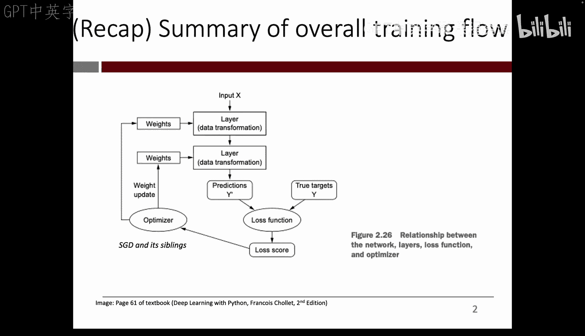

And then this process repeats。

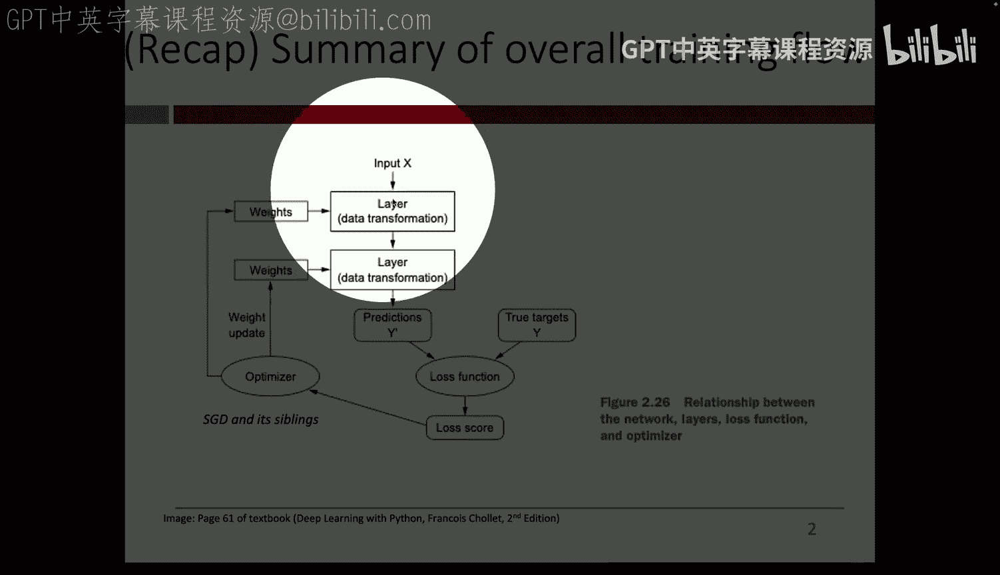

That's it。 So that is a training flow。 Okay， quick recap。 Now。

 we also talked about the optimization algorithm we are going to use。

 which is called gradient descent。😊。

And gradient descent， as you noticed， in each iteration。

 every data point is being used to make predictions and therefore to calculate the loss and then to calculate the gradient。

😊。

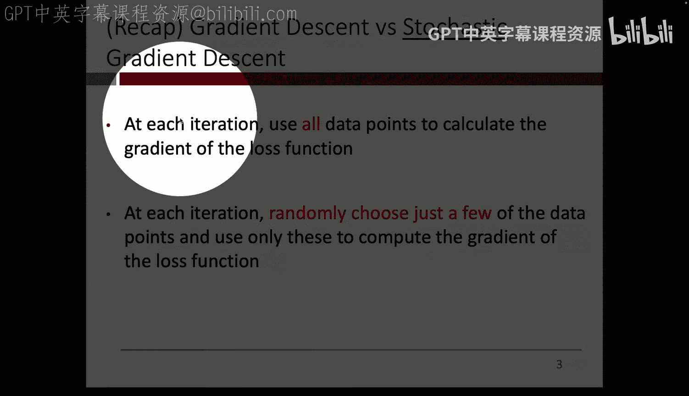

And then we pointed out that gradient descent is actually not as good as something called stochastic gradient descent。

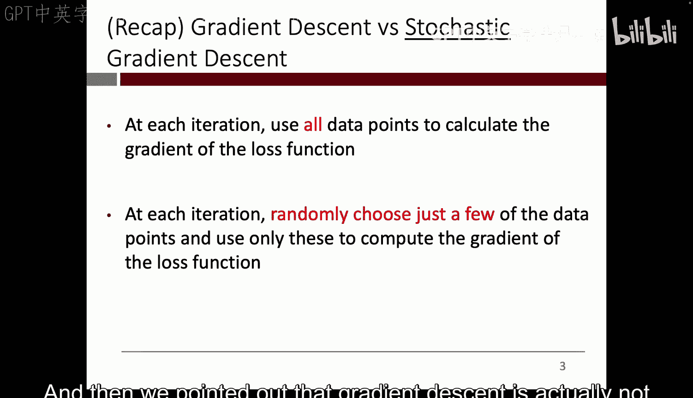

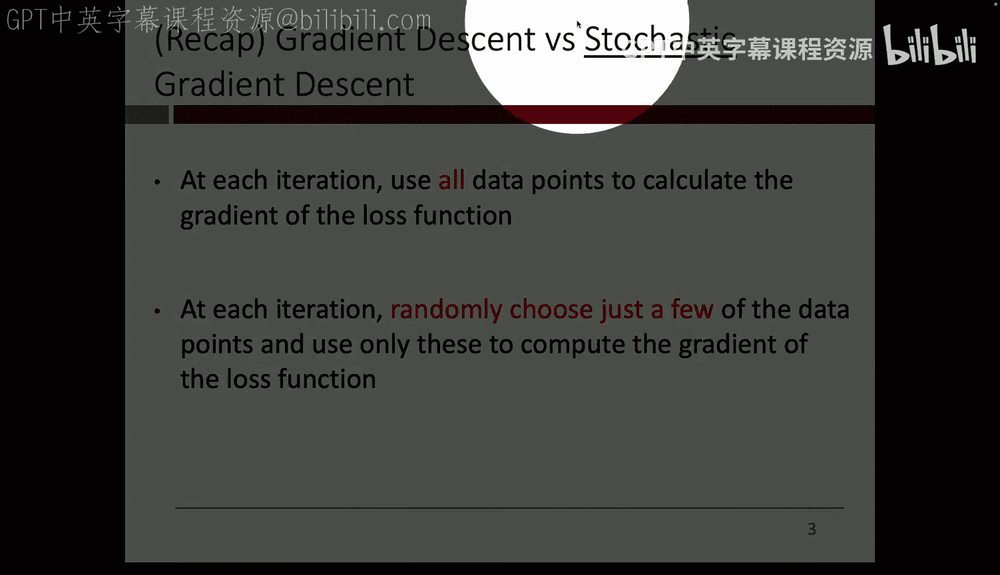

Sttochastic gradient descent， where we， instead of choosing taking all the points。

 we just randomly choose a small number of points。Pretend for a moment。

 as if those are the only points we have。Make predictions， calculate loss， calculate gradient。

 and go on。

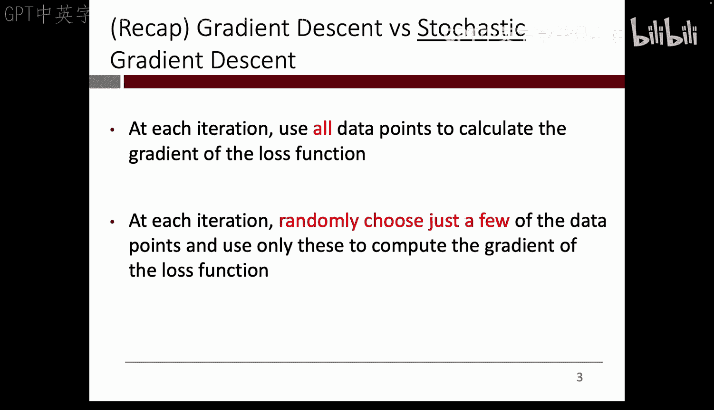

So that was the basic idea behind stochastic gradient descent。

Right， two different kinds of things。 Now， what it means is that when we actually start training the model。

 as we will in a few minutes。

The way， because we only take a few points at a time， we have to be a bit careful in what's going on。

 And I want to make sure you clearly understand what the differences are before we actually get to the coab okay and。

All right。That is the notion of an epoch。An epoch essentially just means that we make one pass through the training data。

All the training data， we make one pass through it okay and so what is one pass is that if you have something like gradient descent。

 one pass means every data point is sent through the network， we calculate its predictions。

 calculate the loss， calculate the gradient， right？😊。

We run every training sample through it。 We calculate the gradient， which is just this thing here。

 right？ I mean， I will sometimes say D of lost D W， derivative of loss with respect to W。

 Sometimes I might use this Nala symbol。 These are all interchangeable。 Okay。

 so well calculate the gradient。 And then we update using some version of this。 Okay。

 but we just do it once at the end of the epoch。😊。

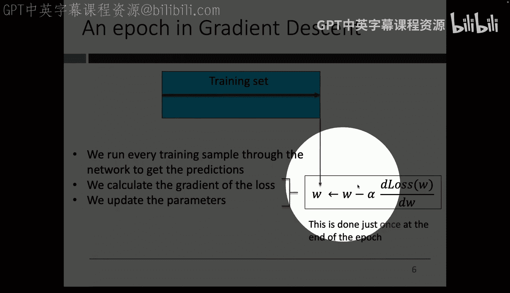

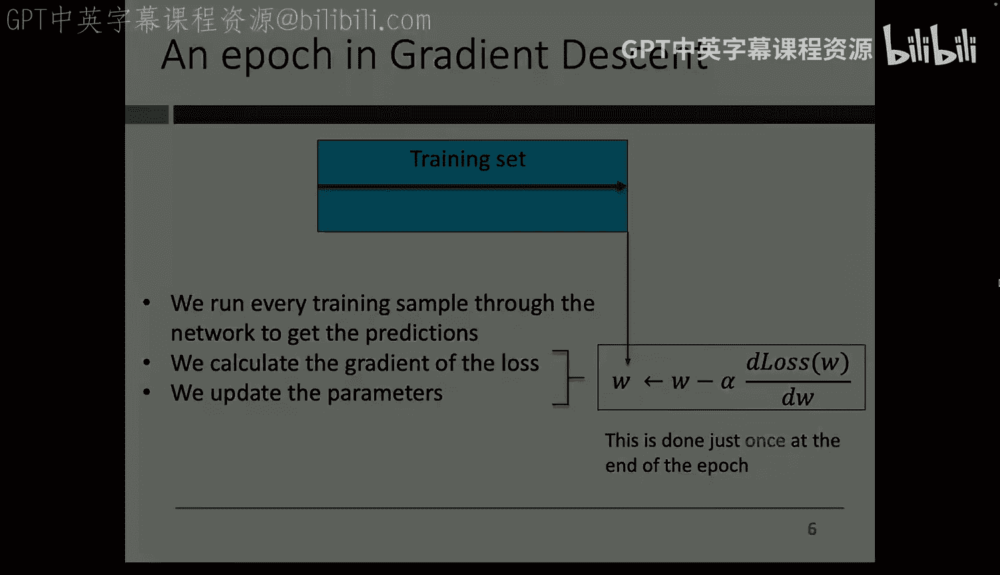

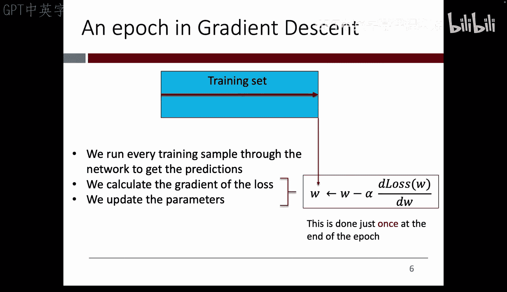

Because if you have 10 billion data points， every one of them flows through。

 you get 10 billion outputs。 and then we calculate the epoch just one。 at the end of this thing。

 we calculate the gradient and update once， one update per epoch。😊。

Yes。😊，Now， in stochastic gradient descent。

What we do is that we process the data and batches。Small numbers of points at a time， right。

 And these are called technically speaking。 They are called mini batches。I don't know about you。

 I just get tired of saying mini batches。 I'm just gonna say batches。

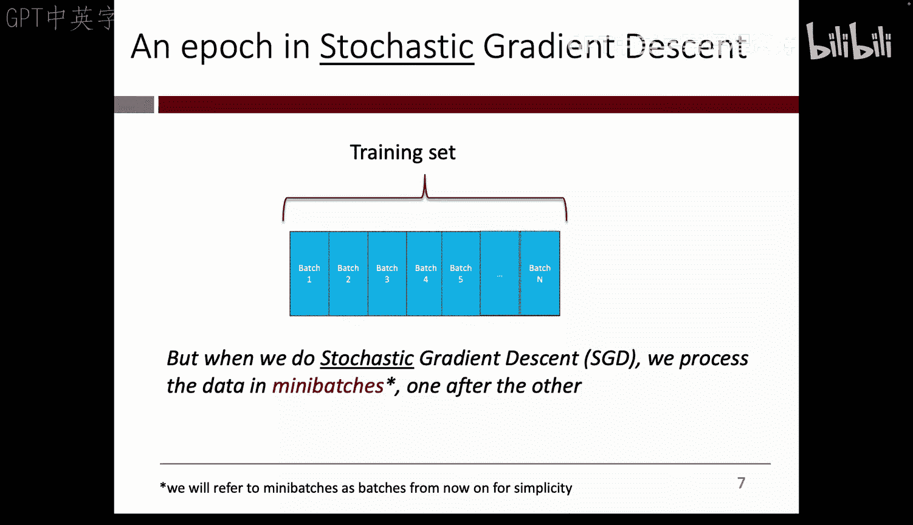

From this point on， okay， and in fact， that is widely done in the literature。So well。

 so we'll have to process it in batches。 So we take the training data。

 and then we divide it up into batches。 batch1， batch2 all the way till the final batch。😊。

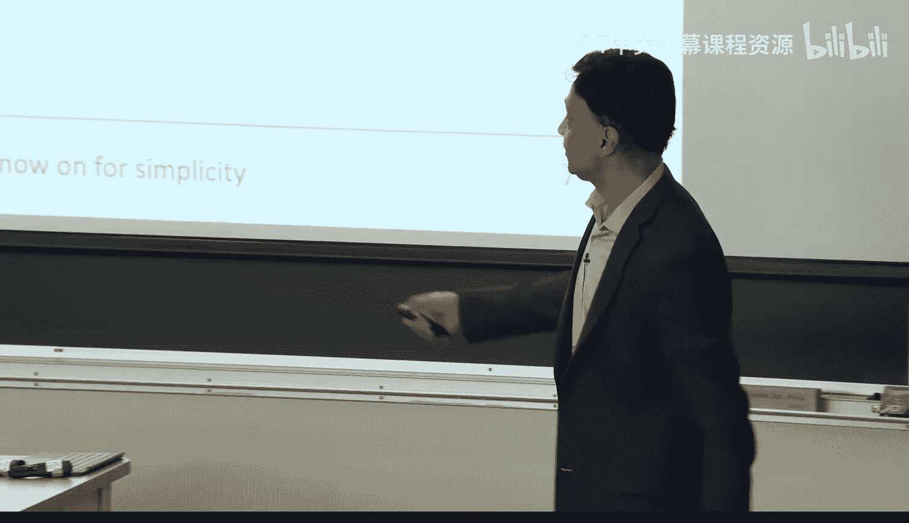

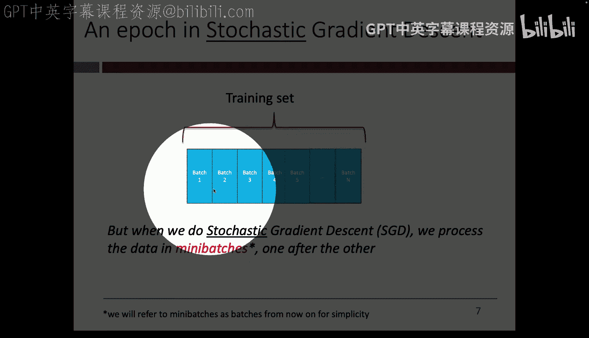

And so what we do is we， for each batch。We basically do gradient descent。For each batch。

 we take batch1， and then we run just the training samples in that batch。

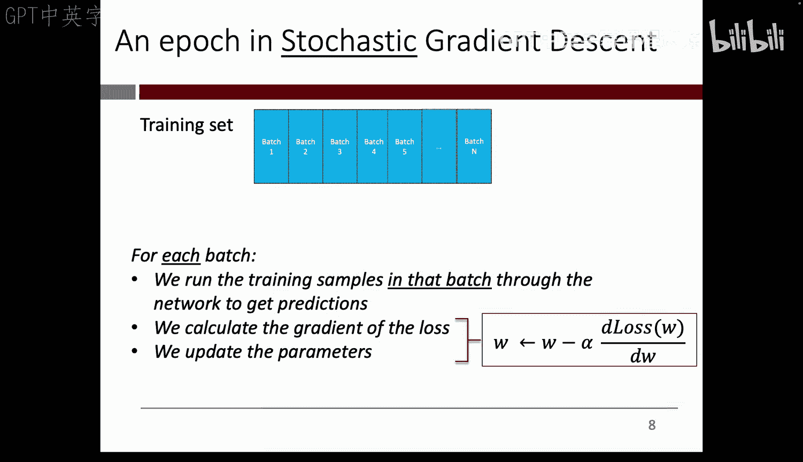

Through the network to get predictions， we calculate the gradient。 We update the parameters。

 and then we go to batch 2， Then we go to batch 3 and so on and so forth。 So pictorially。

 this how it's going to look like。😊。

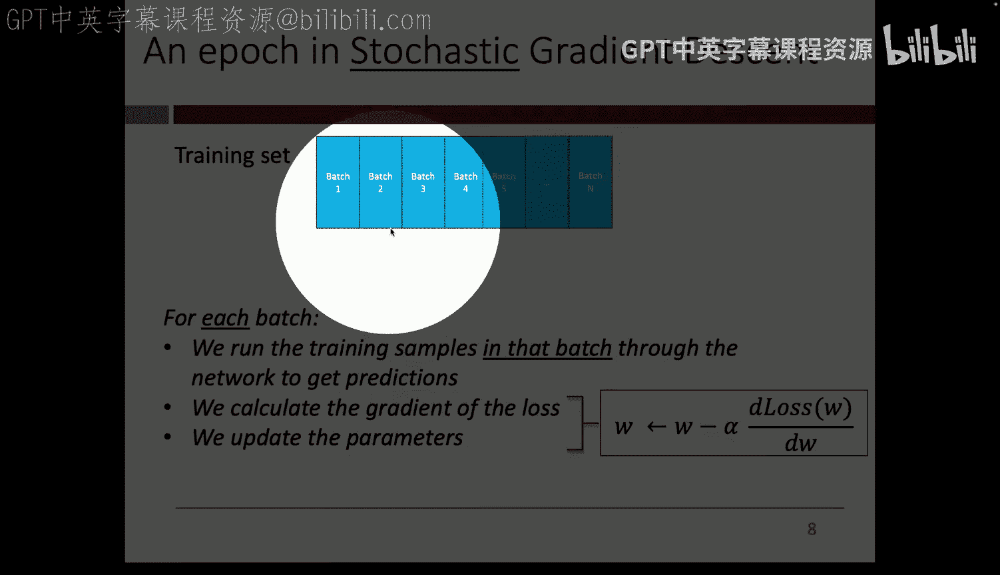

Right， let's say the first batch is， say，32 points。We take those3 points， we run through the network。

 get all the stuff out。 we calculate the gradient， update the weights。😊。

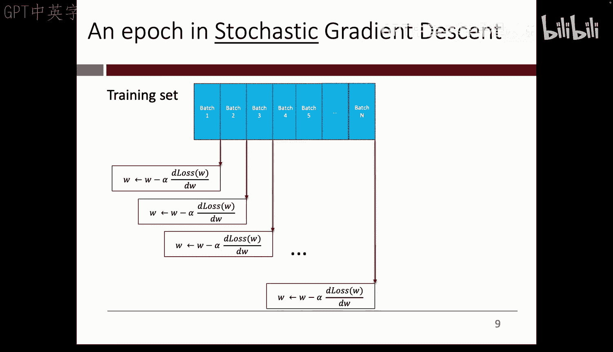

So when we now get to batch2， the weights have changed。We have been updated。

And then we do the same thing with batch2， batch3 and all the way till we get to the end of the thing。

 And when we are done with this thing， this whole thing is called a what。😊。

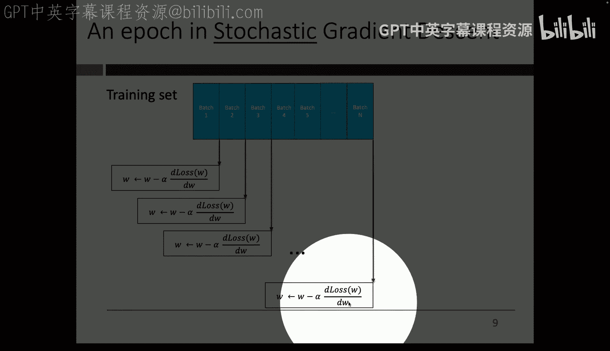

And epoch。This whole thing is an epoch。

Okay。😊，Alright， now， so the question， of course， is that if we have a bunch of data points and you're going to run stochastic gradient isnt on it in。

 in a particular epoch， how many batches are going to be there。

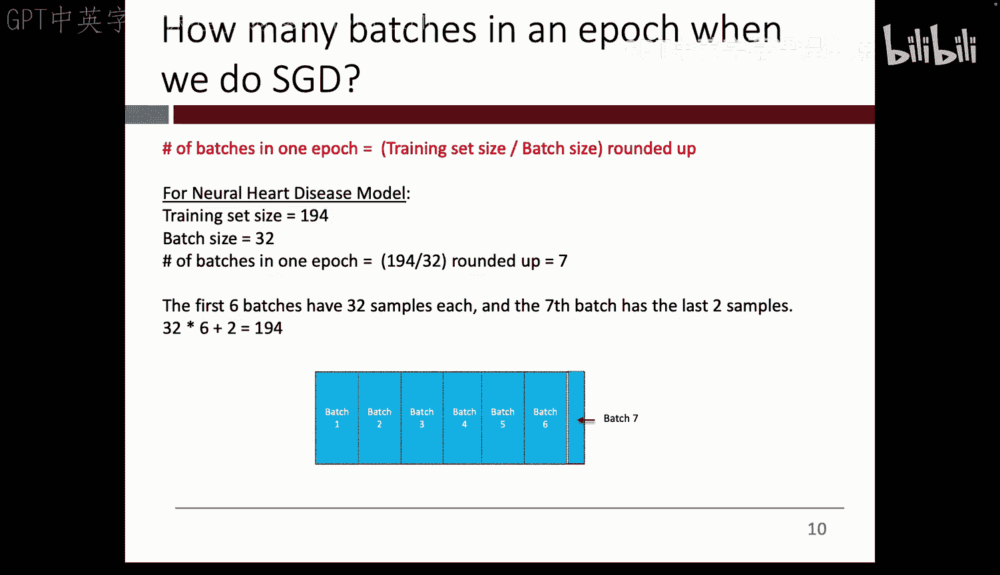

Okay， how many batches are going to be there？Now， Kas is going to calculate all this stuff。

 You don't have to worry about it， but you just need to understand exactly what happens。

So my philosophy， by the way， is that you have to know the details of what's going on。

 If you don't know the details， if you haven't figured out at least once。

 you will not actually be able to think new and creative thoughts for a new problem。

Okay， it's because the concepts are not manipable in your head yet。O。Please use the microphone。

So when we talk about SGG and we are talking about， we are really taking some part of it。

 is it what we are saying is that we only take some variables。

 obviously taking some part of the data， we are taking some roles。

police outright So that data points that means a batch exactlyact。 So for example。

 let's say you have 1 thousand data points， right， thousand rows of observations。

 thousand patients in the heart disease example or 1 thousand00 images that you're trying to classify you takes let's say 32 of those images。

 32 of those patients and that's a batch。 Then you go to the next 32。

 then the next 32 and so on and so forth till you run out of patients or runner of images。

And each greater of time you are updating with the weights and it means you keep correcting it or moving you're basically updating the weights of weight。

And what we are calling the eO is ultimately the integration of loss function that we are trying to do。

Now， an epoch， see， the， the thing to remember is that。Here。

 this whole thing is called an epoch because we have to do one full pass through the training data。

 but within that epoC we update the weights many times。

 basically we update the weights as many times as we have batches。😊。

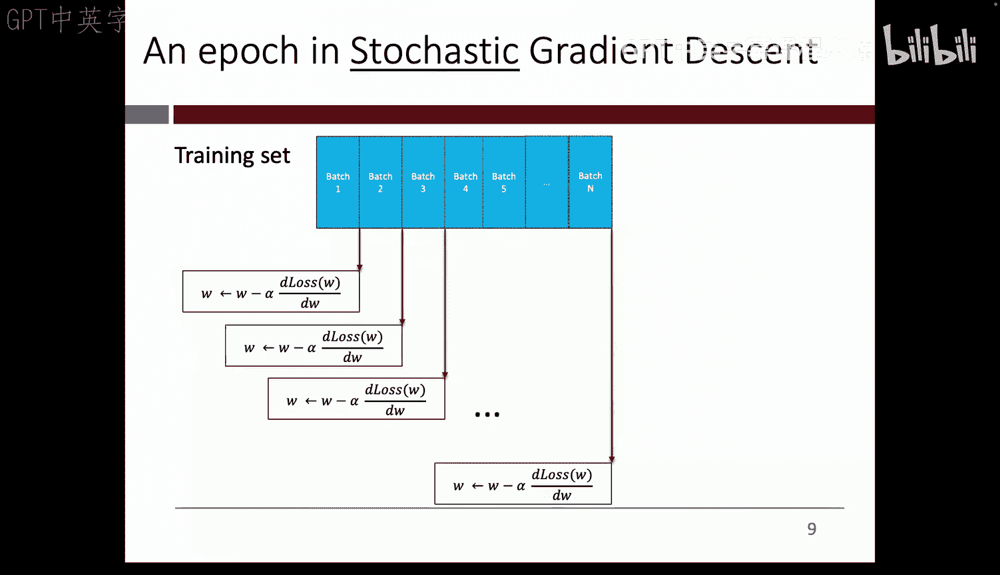

2呃。So to go here， let's say， for example， basic idea is that you take the training tab。

 you're divide by the batch size and you choose the batch size。😊。

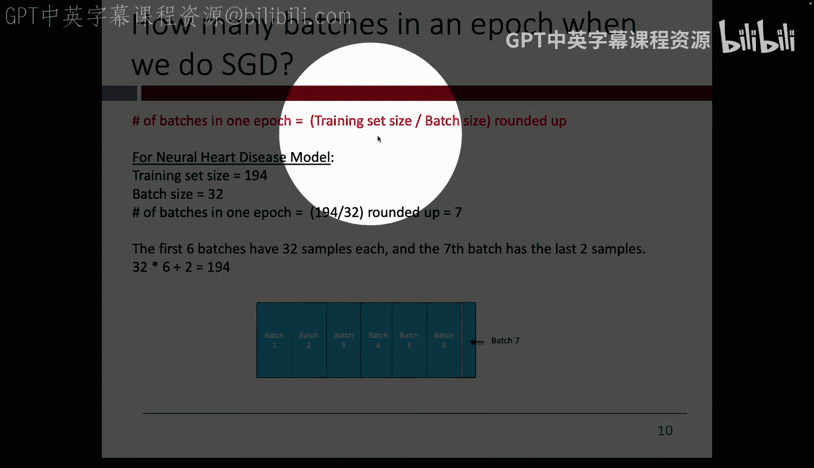

Okay， you choose the bad size and we'll talk about， well， how do you choose that later on。

 You choose the bad size。 And once you choose size， just divide it and round it up。

So， for example， as you will see in the collab， a training set is going to be194 patients。

And then we are going to choose a batch size of 32。

 and we typically tend to choose batch sizes of 32。

 64 and things like that because it actually aligns very well with the nature of the parallel hardware we are going to use。

😊。

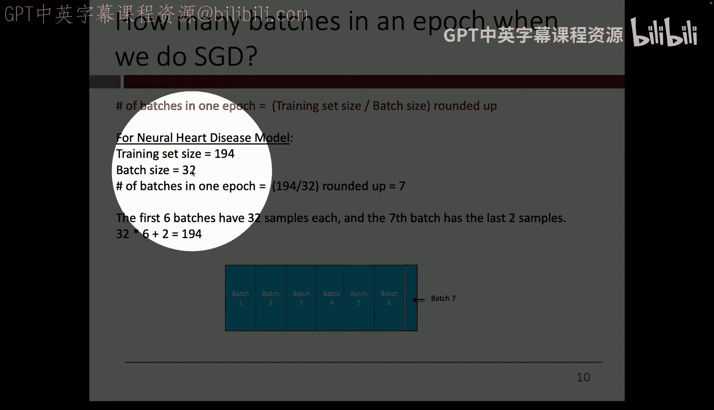

Okay， and so here，32 and so on。 So divide 1，94 by 32， you get 6。 something。 You round it up to 7。O。

 and so what that means is that the first six batches will have 30 dose samples each。

And then the final batch has only two samples left。 And that's O。 It can be a nice。

 little small batch at the end。

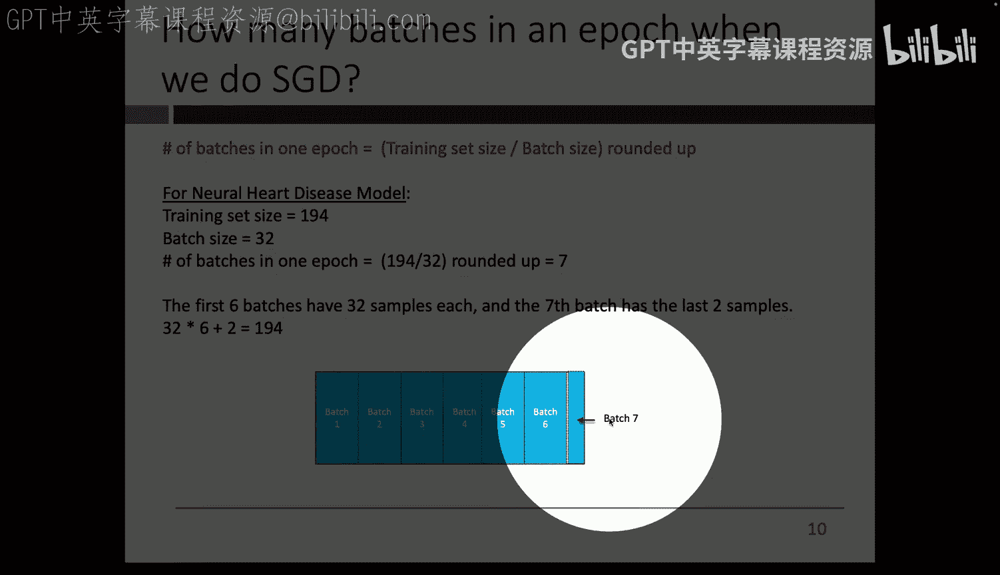

There's nothing that says that everybody batch has to be the same size。

That's it， epochs batches。And are you like for each batch， you run through the whole network。

 like all the layers， or like each layer is one batch。For a batch。

 you run it through the entire network。 So the way you think about it is that you take a batch。

 right， Just momentarily， you assume that's all the data you have。Just run it through the neck。

Because unless you run it through every layer of the network， you can't get a prediction。

And unless you get a prediction， you can't calculate the loss。 And unless you calculate the loss。

 you can't calculate the gradient。 unless you calculate the gradient， you can't update the weights。

Last thing， but if you're using like all the data， just doing the gradient descent。

 then you just go through the network once what is exactly so in gradient descent。

 one epoch is one pass and one weight update。In many in stochastic gradientian descent。

The number of updates you make is equal to the number of batches you have， which ends up being。

 you know， some。The training set divided for the batch size round。

So just to confirm。 So initially， when we introduced the concept of batches。

 the whole purpose was not to run through all the data and be able to do some prediction from a subset。

 So now the advantage is that after batch1， we are using more accurate coefficient to run through batch and so on that's the advantage of it exactly something perfectly said。

 That's exactly the advantage。 So we take a small amount of data。 And we say， hey。

 we know this is not all the data， It's just a small subset of the data。

 So therefore it not going to be super accurate。 It's going to be approximate， but it's okay。😊。

So we still tend to move this in the right direction。

So instead of waiting for the whole thing to get done and then updating it。

 We're just going to update it as we go along。All right， yes。Building out our question。

 is it that doing this process plays easy。Render a more better solution， or requires less number。不。

And the reasons for both are in the previous lecture。😊，是。

And I'm saying that instead repeating it just because I'm like very pressed for time today。

 That's why。All right， cool， so that's what we have。 Are we good？😊，Okay。

 so now we come to the last step before we actually fight up the coab。

 which is over foottting and regularization。 So if you remember from your machine learning background。

 when your model gets more and more complex。😊。

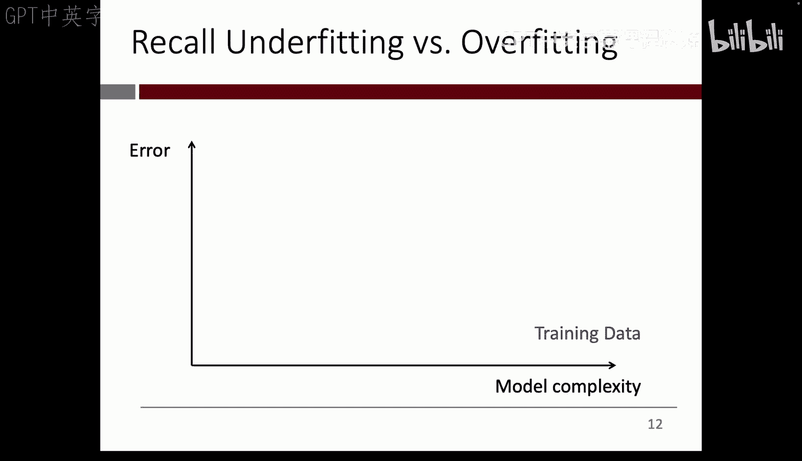

Right。

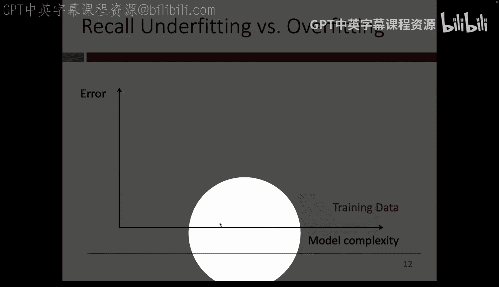

If you know， using use a simple model， then you use a more complex model and so on and so forth。

 what happens to the error on the training data typically。

What happens to the error on the training data。 So let's say you have a simple regression model。

 you get some error， and then you have a regression model in which you use all kinds of interaction terms。

 You use logarithms and this and that and make it super complicated。

 What do you think is going to happen to error on the training data。😊，Right。

 basically it's going to go down as a model gets more complex， correct？😊，Now， of course。

 comes the punchline， which is what do you think is going to happen to the training data？

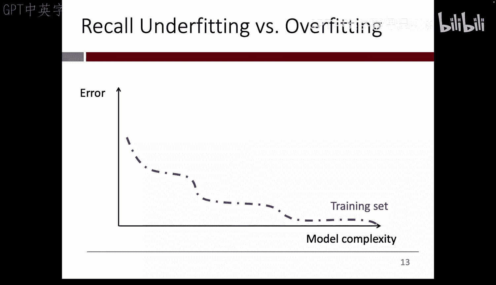

I I sure I do the answer。Basically， what's going to happen typically。

 at least conceptually is that it's going to get better and better at some point。

 it's going to bottom out， and it's going to start climbing again。

 And so we typically refer to this phenomenon here when it starts to climb again as overfitting because the model is essentially fitting to the idiosyncrasies of the training data as opposed to generalizing patterns。

 And then in this thing， we call it underfitting because it can still。

 there's a lot of potential to improve。 And we really are hoping to find this sweet spot in the middle。

😊。

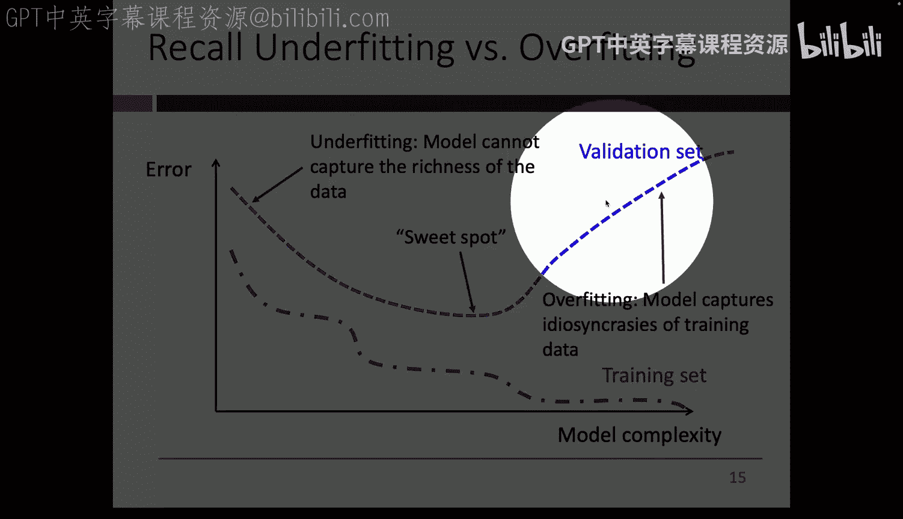

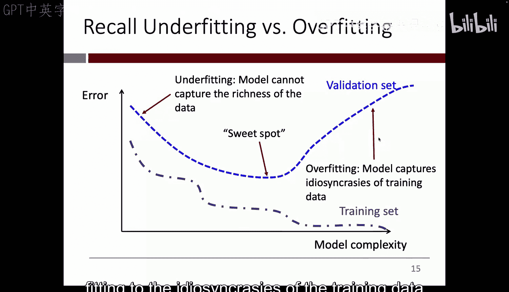

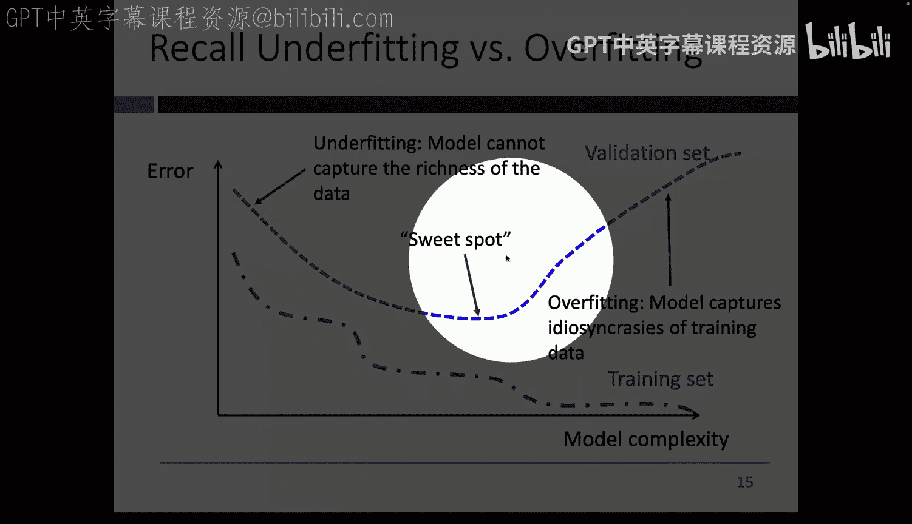

RightThat's the basic idea of overfitting underfitting。

 And the way we and to relate this to neural networks， as you see， as as you've learned so far。

 you have to learn smart representations of the input data。 And to do that。

 we I have argued that you need to have lots of layers in your network， the more layers you have。

 the better things get G3， for example， has 9 to6 layers。 if I recall， more layers the better。

 but more layers means more parameters。 more parameters means more complexity to the model。

 And therefore more chance of overfitting。😊，Okay， so it's really important in neural networks that we think about regularization。

😊，And regularization， you will recall from your machine learning background is the way we handle the risk of overfitting and try to find models that fit just right。

O，And so several regularization methods have been developed over the years。

 and we are going to use only two of them。 The first one is called early stopping。

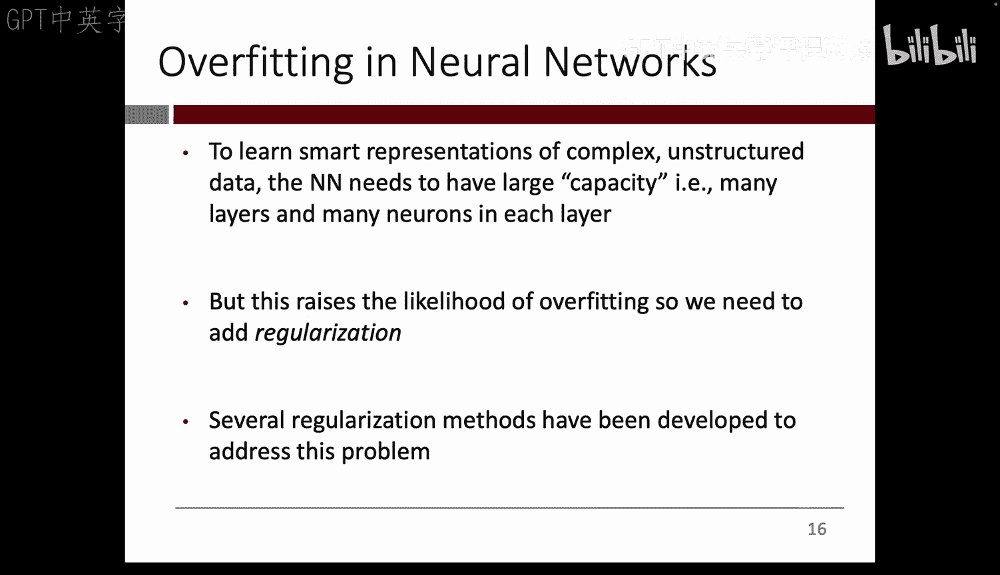

And this is， this has been famously referred to by Jeff Hinton。

 who is one of the pioneers or has hes more colorfully known one of the godfathers of for deep learning。

 who he also won the tuuring a few years ago as the sort of a beautiful， free lunch。 right。

 That's what he calls it。 So the idea is very simple。 We take a validation set。

 we take the training data。 we split it into a training and a validation set。 And then we just keep。

 you know， doing gradient descent， The training will hopefully keep on getting better and better。

 lower and lower error。😊。

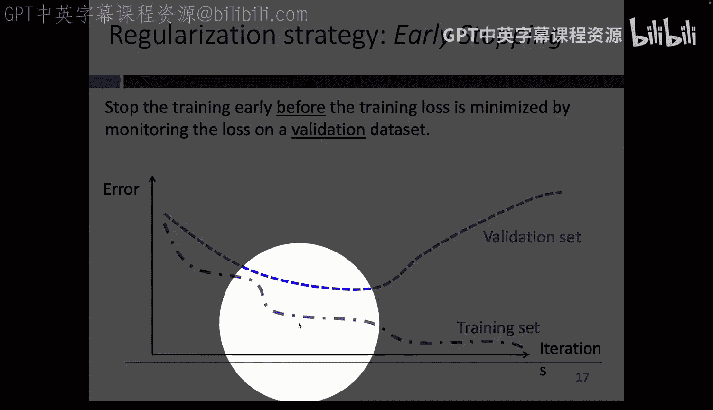

And then we just keep track of what's going on in the validation set。 And then at some point。

 if it starts to flatten out。

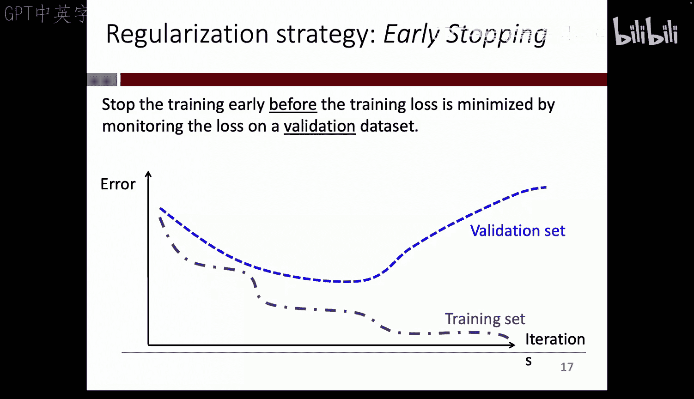

And start to climb。 We just say， okay， that's when we stop training。

RightAnd what we're going to do in the collab is actually run it through the whole thing。

 see where it flattens out。 And then if you say， okay， that's why we should stop。 But， of course。

 you don't want to go all the way to the end and then go back and say， well。

 I want to stop at the 10th epoch。 And there are ways you can use K to be very efficient about this。

 But the fundamental idea is you take the training data。

 split it into training and validation and just track what's going on in the validation set。😊。

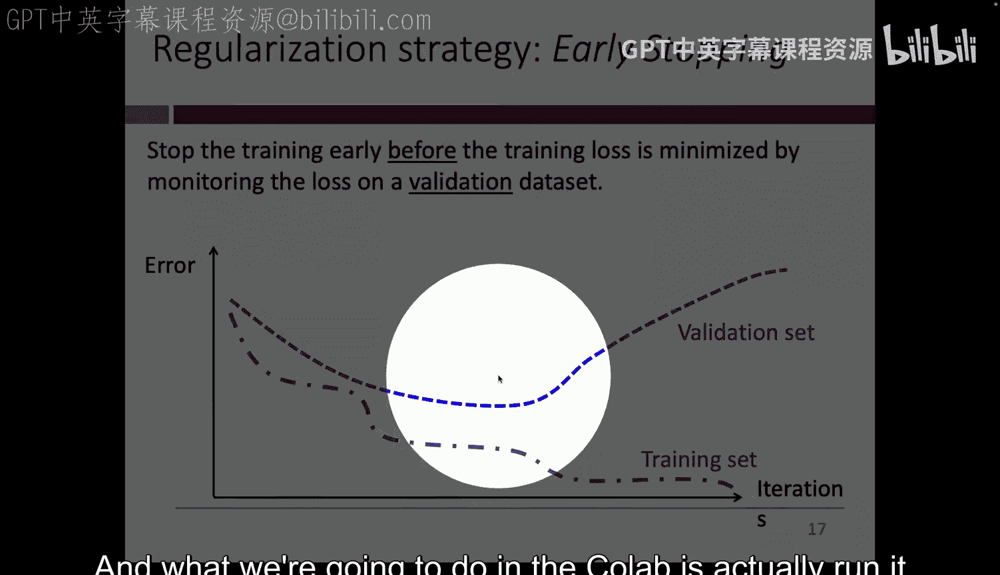

To see whether this kind of bottoming out happens。 Okay， so this is called early stopping。

And the other way we are going to do， right， is called early stopping。We're looking for this spot。

The other thing is called dropout。And I'm going to come back to dropout when we do on Wednesday's lecture because that's the first time we're going to use it。

 And so I'll come back to drop out and tell you exactly how it works。 It's a very。

 very clever strategy。 But we will not use it today。 Well use it on Wednesday。 Okay， So in summary。

 what do we do。 We get the data ready。 We design the network number of hidden layers。

 number of neurons and so on and so forth。 We pick the right output layer。

 We pick the right loss function。 We choose an optimizer。 As I mentioned earlier。

 S GD comes in lots of flavors。 Lots of variations on the theme。 And。😊。

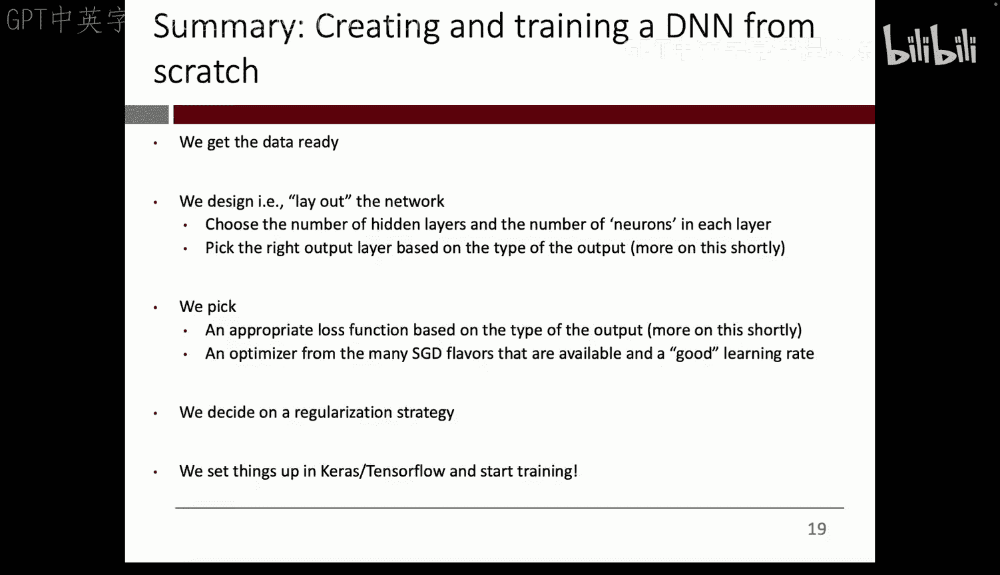

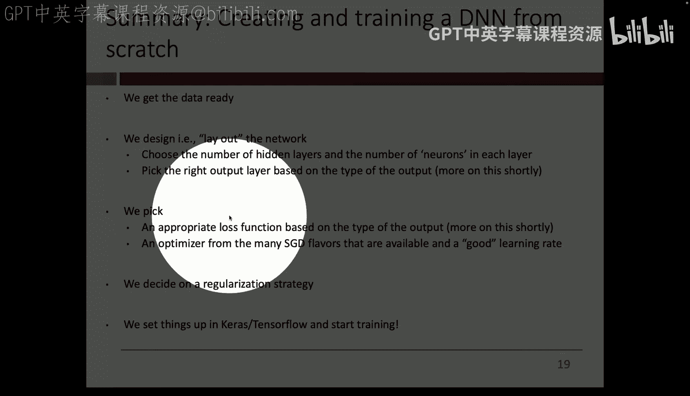

Emically， much like for hidden layer neurons， we tend to use relu as the activation function。

For optimization， we tend to use a flavor of issue called Adam。Okay， as sort of the default。

 because it's really good。 So we'll use atom， as you will see。

 we use typically use either early stopping or dropout。

 and then we just fire it up and start training it can kous and tensor。😊。

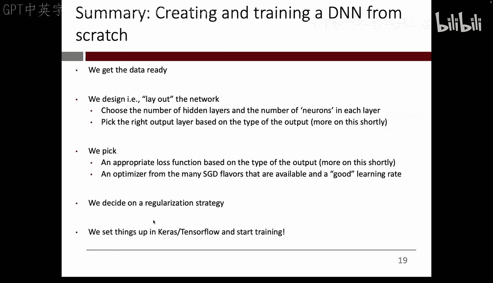

Alright， so that is the training loop。 Now I'm going to switch gears and give you a quick intro to Terraasse and Terras and Kor flu。

 Okay， Ters and Tenor， No， Tensorflow and Ters。 Thank you。 And then we'll actually fight on the cola。

 So， first of all， what's the tensor。😊，Just a quick question。

Then like if you're looking at the validation sets。To quiet overfitting。

 but aren interactive actually overfitting because you're kind of using the validation set and the training set。

No， no， no。 The validation set is never used to calculate any gradients。

 It's only used to calculate accuracy and loss。Yeah， yeah， its kept aside and only is for evaluation。

 not for training。That's what keeps you honest。

And this will become clear when we actually go to the collab。 So what's the tensor。Alright。O。

Tsor is the import data， which are given to the system。 It could be various。喂。催明？4 details。

第 cities世界3。And typically， if we just send numbers in。宝贝这。몇치 거 이 이。Gives the value of the。

The variableable as well as the values of the variables associated with as well as。As说 as to。

Information you want to。You're kind of on the right track， but not entirely。 right。

 It's actually a simpler concept than that。It's like a matrix would generalize with higher dimensions。

Correct， that's also actually correct， but incomplete。

 The reason is because it can be simpler than a matrix。It's not matrix or higher。

 It actually could be simple。 In fact， you take a number。 It's actually a tensor。Alright。

 the simplest case of a answer is a number。The next simpler case is a vector， which is a list。

The next higher case is a table。Okay， so these are all tensors。

 So tensors basically or a generalization of the notion of both a number。

A vector and a table to higher dimensions。

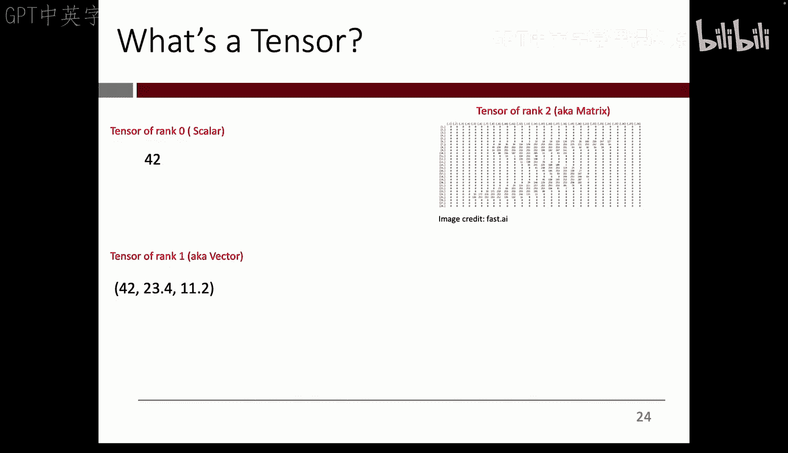

Okay。So。You can think of a tensor。

As having what are called。Every tensor has something called a rank。Right， so。

A number is just a number。 It doesn't have a dimensionality to it。 So it has got rank 0。

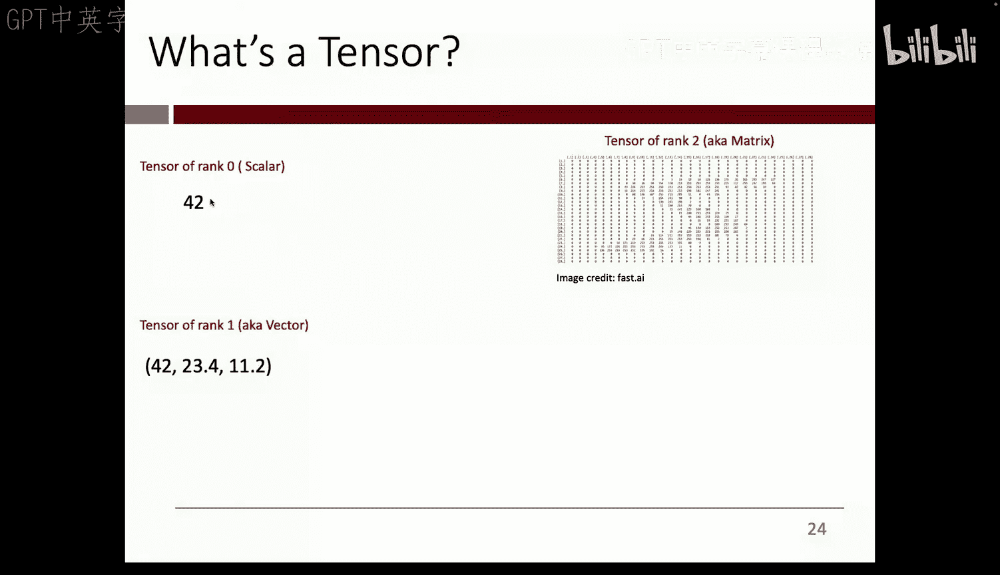

Okay， while a vector， it's a list of numbers， you can sort of write it down top to bottom。

 and it's one dimension， right。

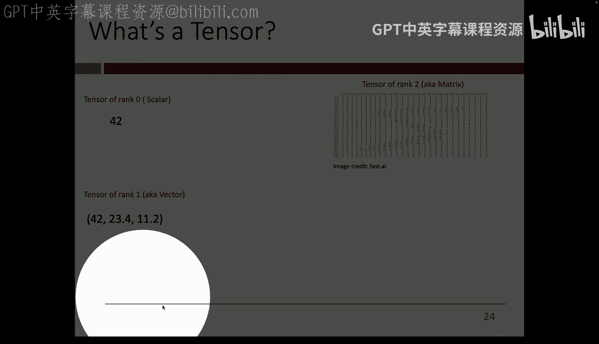

So that dimension， the one dimension is called a rank。 So it's called rank 1。 A table is 2 D。

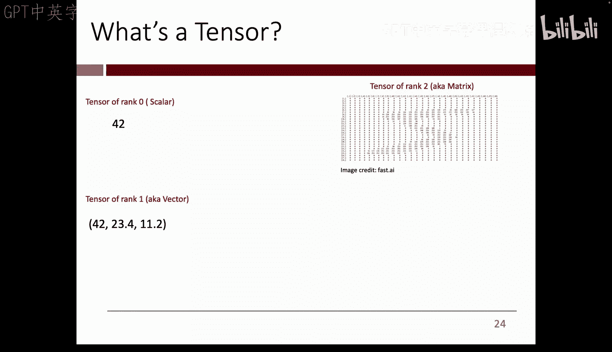

2 dimensional。 So it's called rank 2。

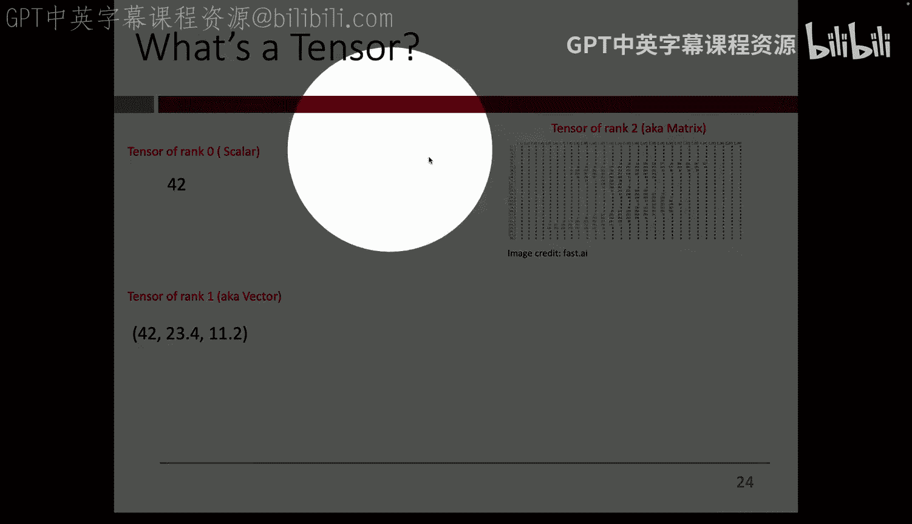

And you can have a rank three， which is just a bunch of tables。A bunch of tables is at rank 3 tensor。

 We also think of it as a cube。

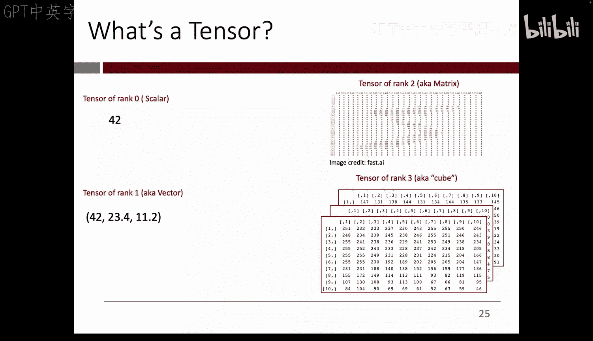

Okay， so these things are very useful because obviously， we are all familiar with vectors。😊。

As you will see very shortly later in this class， black and white gray scale images are usually represented using tables of numbers like this。

 Col images are represented using three tables。

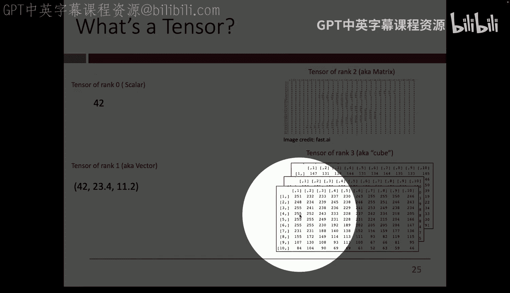

OK。And again， think of what might be representable as you know， a tensor of rank for， meaning。

Every element of a tensor of rank4 is actually a color picture。😊，是效率了。Video， exactly。

 What is a video。 A video is basically a stream of black colored images， a color video。😊。

So each element of that stream， right， the first dimension of the tensor is which frame it is。

 and that everything else is the actual frame。😊，So the way I think about these sensors always is。

Aner， you can just think of it as a。You can think of a tensor as being this array。

 which has all these axes or dimensions。 There's a first one。 There's a second one。 There's a third。

1， right， this is a tensor of rank 4， Okay，1，2，3，4。And so， if you have a vector。Right。

 so you can imagine if it're just a vector， you can imagine the vector actually living like this。

Just a list of numbers， right。But if it's just， if it is just。A 2D， a rank 2 tensor， right。

 which is just like that。Right， which is just like that。So this thing becomes， you know， like that。

 and that thing becomes like that。So for example， if this is a7 comma 3， that means that there are。

Seven rows。And three columns。So you get the idea。 So the way you think about tens is always as if this open square bracket。

 a bunch of things， a close square bracket。 And that's really what a tensor object is。😊。

So what that means is that anytime you have a tensor。Right， anytime you have a tensor。

 how complicated it is。You can always create a bird complicated tensor。

 But if you want to take a list of those tenss， let's say that you have a list of videos。😊。

Each video is a rank for tensor， So which means a list of videos is what rank。Exactly。

 so a pencil of rank， say， 10。Is just a list of rank 9 tensors。So that is this。

 that is the most important thing you need to understand about tensesors。So at any point in time。

 if I give you a tensor， you can just iterate through the first dimension of it， the first。

Aspect of it。 And as you go through each one of these values。 So， for example， here。Now。

 that can do it。So。So， if， if you have the ss here。

And if you want to create a more complicated answer， no problem。So we add another dimension here。

Okay。And now it just becomes this dimension， let's say， has nine values。0，1 9。 So you put 0 here。

 And then what do you get， This whole tensor is a rank for tensor。 And you put one here。

 It's another rank for tensor。 You put a two here， another rank for tensor。 So every tensor。

You take the first element， it just a list， but it's a list of the next down rank tensor。O。

 now this tensor concept is actually something Einstein came up with。And so。

It's simultaneously kind of easy to understand， and also slippery。

So I would actually encourage you to read the book。Which has a really good discussion of tens。

 And the more you practice with it， the easier itll get。So if you feel you kind of understood。

 not quite， you're not alone。It happens to all of us， right。

 You have to pay the price and go through the crucible。Okay。All right。So to come back to this。

That's what we have。And we already talked about a rank fortensa。 It's a video。 So 2。2。

 the text has a lot more detail。 You should definitely read it。😊，So， here。TensorFlow is a library。

And as you can imagine， neural networks， tensors come in and go through the network and go the other end。

 right And since tensors captured everything numbersumb， lists， tables and so on and so forth。

 it just tensors flowing from input to output。 Hence。 It's called tensorflow。

 And it gives you a couple of things just really， really important。 which is why we use it。

 The first one is that itll automatically calculate gradients for you of。😊。

Arbitrally complicated loss functions。

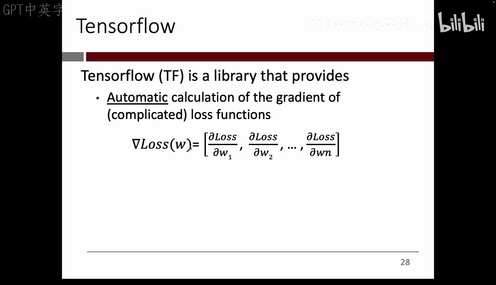

You don't have to calculate the gradient because calculate the gradient is very painful， right。

 Itll automatically calculate the gradients for you。That's the best part。

 You don't have to use the chain rule。 You don't do anything。 The second thing it'll do。

 it gives you all these optimizers， including SG and all its variations。

 So you don't have to worry about the optimization itself。

 It'll just you can just pick and choose what you want。 Third， if you have a lot of servers。

 it'll actually take the computational load and distribute it across all those servers。

 people here with the Cs wagon know that parallelizing computation is actually a very difficult problem。

😊。

There are things which are called embarrassingly parallel， many things are not。

And it's actually quite tricky to figure it out。 You don't have to figured it out。

 Tensorflow will figure it out。Okay，And then finally。

 I talked about the fact that there are these things called GPUs， graphics crossing units。

 which are parallel hardware。 And so itll， even if you have just one computer， but it has GPs。

 there is a particular way in which you have to take your computation and organize it to really exploit the fact that you have a GPU。

😊，And so Tensorflow will let you do it for you out of the box automatically。

 You don't have to worry about any of that stuff。 Okay， so those are all the advantage of this thing。

 By the way， TPu is called a tensor processing unit。

 It's something that it kind of can think of it as Google's GPU came up with their own variation on the theme。

 Okay now Kra sits on top of Tensorflow。 Tensorflow this is the hardware you have。

 Tensorflow sits on top of the hardware。 Kra sits on top of Tensorflow。

 and it basically gives you a whole bunch of convenience features。 So， for example。

 it gives you the notion of a layer， We already saw Ks do dense is a dense layer， right。

 it gives you the notion of layer。 It gives you notion of activation functions and so on and so forth。

 It gives you easy ways to preprocess the data。 E ways to train the model report on metrics。

 you know， calculate validation loss， validation accuracy training laws。

 all the metrics we care about。 and then it also gives you a whole library of pretrain models that you can just use and adapt for your particular problem。

😊。

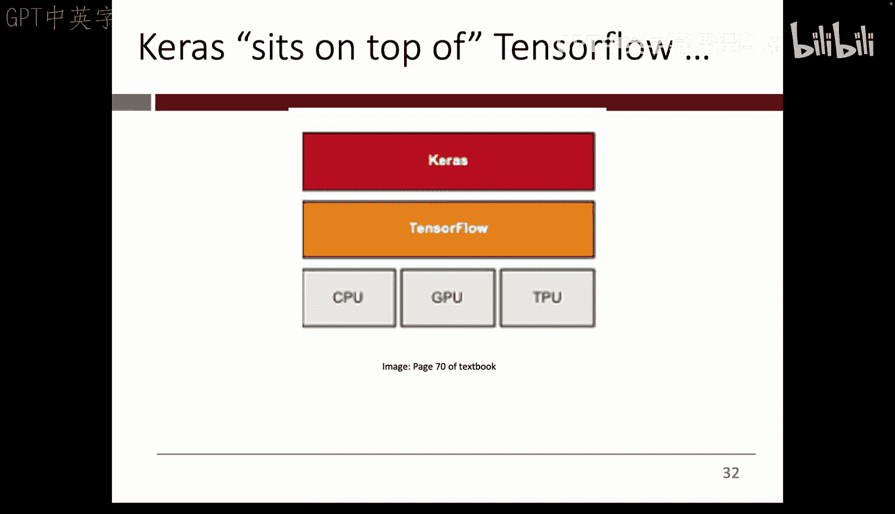

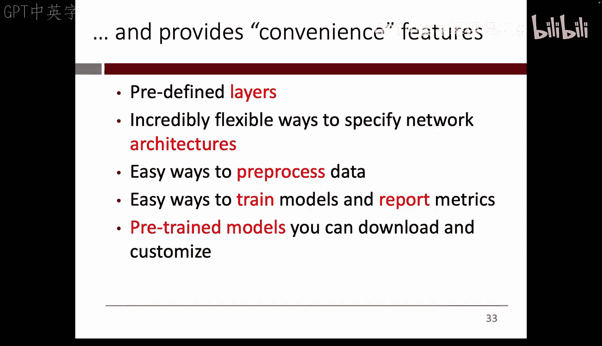

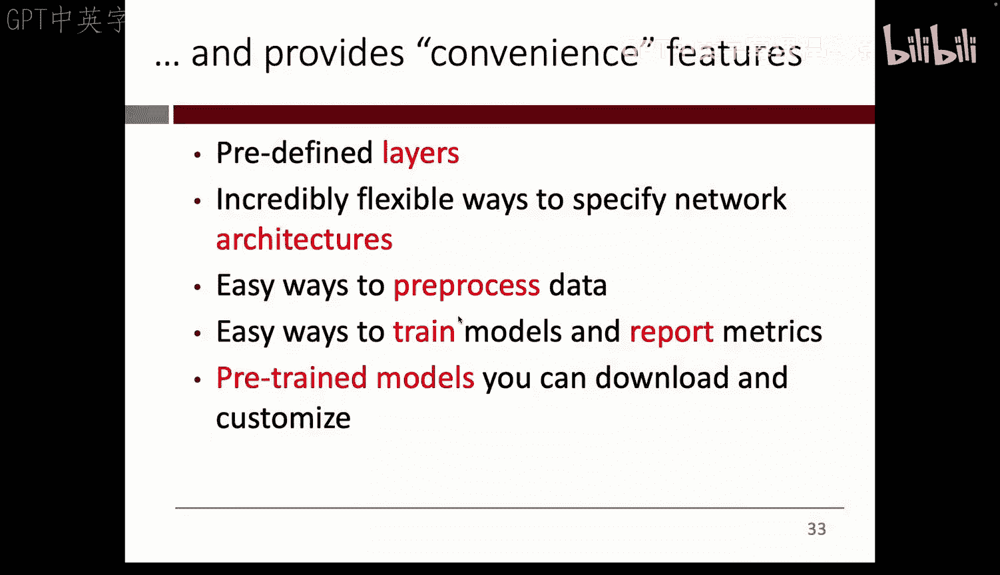

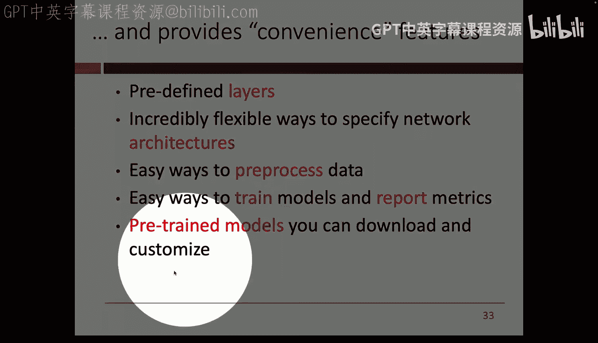

So it gives you a whole bunch of conveniences。 and that's why it's very popular。 And by the way。

 you know many of you might also be familiar with Pytoch。

 which is a fantastic framework as well for deep learning。

 and the reason we chose to go with TensorFlow for this course rather than Pytoch is because we wanted to make the course sort of accessible to folks who don't have a ton of programming background on before coming to the class and Pytoch is a bit more demanding from a CS perspective。

 it requires more knowledge of object orient programming。

 which is why we decided to go with Tensorflow and cares because I think it's actually as powerful in many ways and it's a little easier to get going。

😊。

Okay， so that's what we have here。 And one other thing I will mention is that there are three ways in which you can use ks。

 There are three kinds of APIs， sequential functional subclassing。

 and well almost exclusively use the functional API。😊。

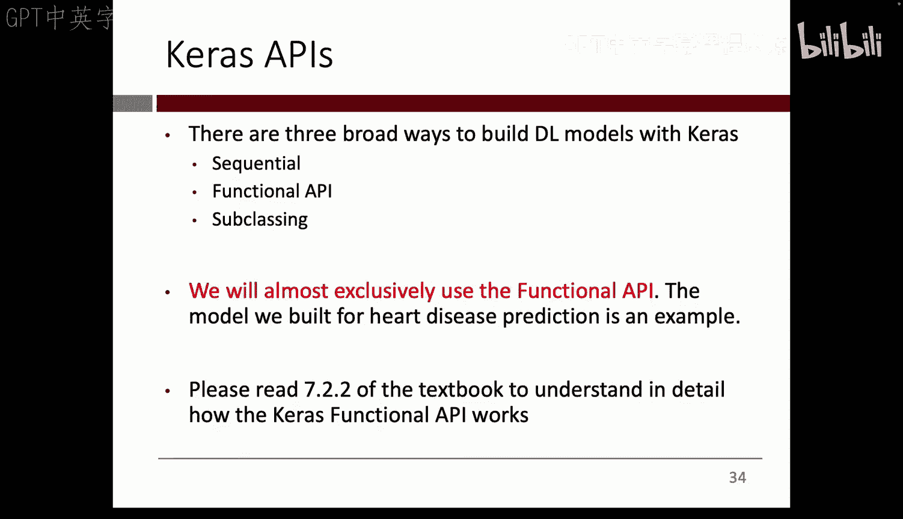

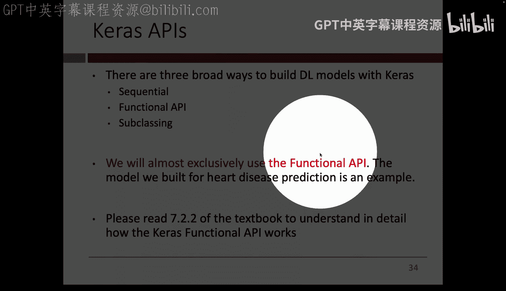

And in fact， the model we built for heart disease prediction uses the functional API。

 And so just read 7 to2 of the textbook to understand detail how the API works。

 I find in my own work， the functional API is basically all I need。

 I don't need to do anything more complicated than that。 And as you will see。

 as you work on the homeworks and on your project that it's sort of a beautifully designed Lego block environment for doing these things。

 And you can create very complicated models very easily。😊。

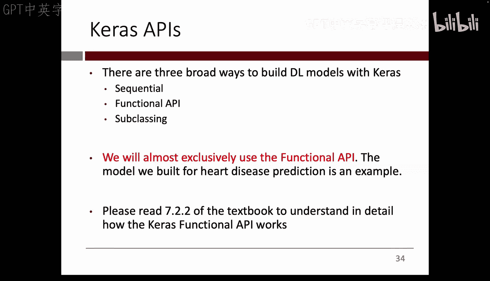

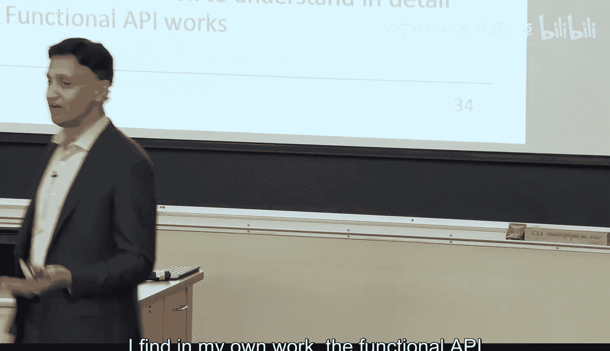

O， there is a whole bunch of stuff here on these websites。 So check them out。

 The lots of collabs are are available。So now， if you go back to the neural model for heart disease prediction。

 This is what we came up with the last class。 right， we had an input layer。

1 dense layer with 16 neurons， re neurons， an output layer with a sigmoid。

 And then boom that was a model。 So let's train this model。😊。

And so the training checklist is that we have already done this hidden layer of 16 neurons， sigmoid。

 we need to use an appropriate loss function based on the type of output。

 what loss function should we use。😊。

What is the output here？It's a binary classification problem。So what should the。

 the last function be。You to heard it somewhere？你超知到。Because the output is a sigmoid。

 You the loss function。Etoric cross entropy。Okay， remember， if if you're predicting a number。

 an arbitrary number， you can use something like mean square error。

 If you're predicting a probability， which has to be compared to a 0，1 output。

 which is what binary classification is all about。 we use binary cross entropy。😊。

So that's what we do here。 So we do binary cross entropy。And then we will go with Adam， right。

 And then we'll use early stopping to make sure we don't overfi。Okay， I know this like， okay。

 I promise this is literally the last slide before I go to the call。

I feel like one of those used cars has been， wait， there is more。

So anyway， so don't worry， if you don't understand every detail of what I'm going to go through。

 I'm going link to the collab as soon as the class is over。

 but once you get your hands on the collab， make sure you actually go through every line in the collab。

 what I typically do when I'm trying to learn something new is I'll actually cut and paste。😊。

Right。I won't do that。 I won't actually cut and paste the cord and run it myself。

 I will retype the code。If you retype the code， as opposed to cutting and pasting， trust me。

 you'll learn a lot more。So I strongly encourage you to do it that way。

And so all the collabs you're going to publish in the class。

 the first thing you should do is you should just make your own copy of the notebook。

Right， copy to drive。 And then if you are using anything other than today's coab， right。

 anything involving national language processing or， you probably should use a GPU。

 So just going to go in here， choose the runtime to be a GPU。

 And then you start your notebook and you're done。 And the second time onwards。

 you can just go directly to the step。😊。

You don't have to do all this stuff for that particular notebook。Ive got numerous tutorials。

 like 50 videos and so on on how to use collab。 Just， Just do that。

 I'm not going to spend time on it here。All right。Okay， so I just ran it a few hours ago。

 I'm not going to run every cell now because it's going to take some time。

 It's going to get in the way of the class time， but I'm going to just like know go through it slowly and explain what's going on。

 So here this is just an introduction to the data。 We already saw this introduction in the last last week。

 We have whatever 303 patients， heart patients。 We have a whole bunch of variables here。

 age demographics and a whole bunch of bioma information。 And this is a target variable。 Okay。

0 or1 heart disease。 Yes or no。😊，And so， by the way， just some technical preliminaries here。

Basically， every time we load these things， we're actually gonna load these packages。

 So you can see here these are the two key things we need to do。

 We import Tensorflow first and then from within Tensorflow。

 we import ks that's what these two lines do here And then and folks have done data science and machine learning a bit before you'll know this。

 we will actually load like the three packages that would just most commonly used which is nuy pandas and matpllib Ny because it's very easy for manipulating matrices and arrays and tensors。

 pandas because oftentimes you get some data from somewhere you need to massage it and wrangle it to a point where you can actually feed it into ks So you need pandas for that and matpllibb because you just want to plot you know these loss curves and accuracy curves to see whether early stopping is needed。

 So that's why we use it。 So we import all these things。

 And then I guess the other thing you have to remember is that when we are training these deep learning models。

 there is randomness in the process which enters in a few different places。😊。

So clearly the starting values for these weights are going the weights are going to be randomly initialized and therefore that's obviously a source of randomness now we talked about how you take when you're doing stochastic gradient and descent you take all the data and then you randomly choose batches right from this data till we finish a whole past through it well。

😊，That we immediately to raise the question。 Well what do you mean by randomly choose。

 So typically what we do in practice is that and carera will take care of all this for you。

 you basically take the data and just shuffle it once randomly。

 and then you just go first32 next next or next like that。

 okay but it is a source of randomness And then when we split the data into train validation testing and so on。

 particularly if you want to look for early stopping and overfitting we need to again split the data randomly and that's another source of randomness。

 And then when we do dropout， which we will talk about on Wednesday again。

 dropout has a little bit of a random element to it。 And so that's another source of randomness。

 So all all this means is that if you're working with these models and if you want to build a model and you want to hand it off to someone so that they can reproduce your results。

 well you better make sure that you sort know make it easy for them to replicate what you have。

 and the way you do it is by sending setting a random seat for all these things And the way you do it is by having this little handy function here set random seed and of course。

😊，You know， I use 42， like just like everybody should， right， So okay， so that's that， by the way。

 just that's just a pop culture reference to this book called the Hitchhikers Guide to the Galaxy。😊。

啊。I 42， you know what I mean。Okay so by the way， the question inevitably comes at this point okay if we do exactly this we actually get the exact same numbers that you have in your version of the notebook and the answer is hopefully most of the time。

 but it's not guaranteed so this is called bitwise reproducibility it's not guaranteed due to certain hardware things and device drivers and stuff like that so we won't get into all that stuff and which is why as you see here I have a bit of a fingers crossed thing。

😊，Allright， cool。 So that's what we have。 So as it turns out， Francois Shalet。

 who wrote the book the textbook， he actually made this data available in a pandas data frame。

 So we read the Cv file into this data frame right there。 And then it and it's 303 rows。

14 columns And you can see here we'll take a look at the first few rows。

 And these are all the rows age， gender cholesterol， blah bh b， blah， blah。

 And then this is the target variable right there。 And one of the first things I always do。

 when I'm working with the binary classification problem is to quickly check whether the positive and negative class are balanced or not。

 And so what you can do is you can just quickly check to see what percent of the data points is 0 versus  one。

 And you can see here， 72。6% of the patients don't have heart disease。 That's a good thing。

 Of course， And then 27。4 have heart disease。 So it's not it's not 5050 or roughly 5050。

 It's a little thing。 So by the way， quick question， what is a good baseline model for this problem。

😊。

Suppose you couldn't use anything， any complicated thing。 What's a good baseline model。啊。Yes。

 just pretty zero。Yeah， why would you do that？

Maybe give you sendingending to。Because 72。6% is sort of the higher class。

 higher class of the higher percentage you just predicted you'll be right on those 72。

6% of the cases， you'll be wrong on the rest， which means that your accuracy of this model is going to be 72。

6% and so any fancy model we build better know it's got a better than this otherwise it's not worth its weight in layers so all right so we'll come back to this later So the first thing we want to do is we want to preprocess it because this data set has both categorical variables and numeric variables and so it's usually convenient to just to group them into two different groups so I have listed all the categorical variables here on the numerics here and then we have the pre-prosing here we have to take the categorical variables and we have one hot encode them。

😊，And the reason is that， unlike， say， a decision tree model。

 a neural network cannot handle categorical inputs directly。 It can only handle nu inputs。

 which means that we have to numericalize every categorical thing that comes in。

 And there are many ways to do it。 But the standard way to do it is one hard encoding。😊。

And for the numeric variables， we need to normalize them。 and I'll come to that in a second。

 So pandas hass this get dummies function here。 and you can just run this thing。

 and it'll just hot encode the whole thing。 So once you do that， this is what you have。

 So you can see here previously。😊，Let's say Tal was had three values fixed normal。

 reversible or something。 And then you go to the one hot encoded version。

 And now we can see here Tal fixed Tal normal Tal reversible。 That's three columns， right。

 That's the one hot ending in action。Okay， now。The other thing to remember is that neural networks work best when the numeric inputs you send them are all in a relatively small range。

 they shouldn't have a wide range of variation。 And so the standard practice is to standardize the numerical variables by standardize。

 I mean， typically subtract the mean divide with the standard deviation， we should do that。

 but before we do so， we should split the data into a training set and a test set。😊。

RightAnd why do we want to split into a test set Because at the very end once we've built the model and done all the things we want to do with it。

 we finally want to take out the test set and evaluate it once so that we get this true measure of how it's going to perform in the wild after you're deploy so you want to divide it to0 and say 80% training and 20% test set。

 So the question is， why should we do the splitting now before we do the normalization。😊。

Why can't we just do the normalization and then do the splitting。嗯。All right。

Because then youre。Poliation set is also somewhat dependent on your test results as well as。Correct。

 because the test set。Has now essentially sort of has been influenced by the training set。

RightThat is the the the modeling process， part of the modeling process。

 the splitting under the splitting， also the the the standardization。If， if the standardization。

 which is part of the process， uses information about the test set。

 while the test set not really kept away from anything， is it。That's why we want to split it。

 lock away the test set somewhere and then proceed with the modeling。This， again。

 this like machine learning 101， which is why I'm going through it pretty fast。 Okay， so we。

 we do this sampling function， take 20% of the data and make it the test set。

 and the remaining is going to be the training set。 And when we do that。

 you can see the training set is now 242。😊，Rows， while the test is 61 rows。

 and any of these data frames you'll know that the shape attribute gives you the dimensions of the number of rows in the columns。

 That's what we're doing here。 And now that we have done that。 we have done the split。

 we can calculate the the mean， the standard deviation。 So I calculate the mean here。

 I calculate standard deviation。 these are all the means。 And once I do that， I just do。😊，You know。

 each column minus the mean divide the standard deviation。 And then once I do that， I get。

 I save them in the train and the test data frames。 And you can see here now。

 all the numbers are all very sort of smallish，0，1-1 can around that range。

 And that's kind of ideal when you're a network training， okay。😊，Alright， so at this point。

 the data is entirely numeric。 And then we are ready almost ready to feed it into Ks。

 And the way you do it is you take a Ny array， you take pandas data frame and then you convert it into a Ny array and then Ks is happy to take it。

 happy to deive it。 So so we use this thing called to Ny。

 which I think is as descriptive as it gets in programming。 And then you see it as train and test。

 Now， train and test or two Ny arrays with exactly the same information。

 And now we can feed it into Kas。😊，Alright， now， I guess there's one other thing we need to do。

 which is that in this data frame， train and test are independent variables， all the features。

 as well as the target， the01 target。 they're all in this。Right。

 and we need to now take it and just take the dependent variable。

 the 01 column and split it out and keep the x and the y separately。 That's the whole point of it。

 right because you need to feed the x do the prediction and then compare it to the actual y and calculate the loss and so on and so forth。

 So So the target column is our y variable and it column number 6 from the left。 If you count it。

 you can see it。 So we just， you know， we delete it from the train and test。

 And now we have 242 rows and 29 columns 29 features you will recall from the network that we made way back。

 It had 29 inputs right，29 nodes in the input layer。 And that's where the 29 is coming from。😊。

And so now we just select the sixth column， which is the target and make it the y variable， right。

 train Y and test y。 And that is， of course， a vector which is 2。

42 long in the training set and 61 long in the thing。So at this point， all we have done is。

 to be honest， votinging preproces。Okay， we haven't actually got into the action yet。 Finally。

 let's do something。 So， and we started a single hidden layer since it's a binary classification problem。

 we'll use sigmoids， as we saw earlier。 And this is the model we created in class。😊，Last， last class。

 this is the model we created。O。😊，The only difference between that model in this model is that I've actually given names to these layers。

 And this name thing is totally optional。 If you want to give a name， give a name。

 it's just a little easier to interpret later。 Okay， you just cosmetic。 Okay。

 so but I've just put it here。 And once you build the model you should immediately run the model dot summary command。

😊，Because it gives you a nice overview of the model， right， What for each layer。

 it tells you what the layer is， It tells you what's coming into the layer。

 meaning the shape of the tensor that's coming in and what's going out and how many parameters the layer has。

 And it turns out this layer has， sorry， this network has 497 parameters。😊，Okay。

 and I have told you repeatedly the first few times。

 just hadn calculate the number of parameters to make sure it verifies。

 So we should just make sure that it is， in fact，4，97。 So let's hand calculate it。

 And you do basically， it's basically what's going on here。29 inputs times 16， right， all the arrows。

39 times 16 arrows， right， And then you have a bias of another 16。

 That's why you have this expression。 And then the next one is 16 times 1 plus one bias for the output sigmoid。

 and you get to 4，97。😊，Okay， just make sure you follow this later on when you work with the Koab。 we。

 we did this in class last week。And you can visualize the network graphically as well by using the plot model function。

 So we do that here。And let's say it gives you the same information。

 but in a slightly easier form to consume。 And when we work with larger networks starting on Wednesday。

 you will see that being able to visualize the topology of the network is actually quite handy。Okay。

 we finally come to actually trying to train this thing。 And so what loss function should we use。

 We need to， We need to use binary cross entropy。😊，Right there， what optimizer to use。 Well。

 as I mentioned earlier， we will use atom。Aam。All right， Adam。

 and then and then the final thing is you can ask Kaas to report whatever metrics you care about。

 These metrics are not going to be used in any optimization。

 just reporting it to you and the most common thing people report out for binary classification is accuracy。

 So well just go with that metric。 And so So what we do is we tell Ks take the model we just built and compile it with this choice of optimizer。

 this choice of loss function and these metrics and this compilation step what it does is it essentially Keas will take this information and take the model you have built and itll reorganize the model in such a way that the parallel computing distribution of computing across many servers and so on。

 that's what's happening in the compile step。😊，Organizing it so that reorganizing the model so that it becomes amenable to parallelization and distribution。

 That's what's going on。 That's why you actually have to do something called the compile step。 Okay。

 And once we do that， we are finally， finally ready to train the model。 And to do that， we have to。😊。

Decide what the batch size is that we're going to use。 Remember using some flavor of S GD。

 which means we have to choose what is a batch size。

 And typically what people do is that 32 is a good default for the batch size。 Like if you。

 if you're not just getting started with something just use 32。

 And there's a whole bunch of literature on what the right batch size should be for the number of data points you have the size of the network and so on and so forth。

 My philosophy is start with 32。 and you can always try 32，64，1，28， It's kind of like， you know。

 oftentimes what people tell me researchers tell me is that just use the biggest batch size that doesn't make your machine die。

😊，Right if if it a memory， it's probably good。 Just try the biggest size size。

 we'll just start a third。 It's a tiny problem。 It's not a big deal。

 And then we also have to decide how many epochs through the data do we want to go through。Right。

 how many epochs and you know usually 20 to 30 epochs is a good starting point。

 And then because this is a tiny problem just for Ks。

 I just said to run it for 300 epochs just to see if anything。

 any oldfi is going happen and then whether we want to use a validation set。

 of course we want to use a validation set right so we will use 20% of the data points as a validation set so that we can look for overfitting underfitting。

😊，Alright， so with these decisions made， we finally， we use the model dot fit command。

 Model dot fit is what actually trains the neural network。😊，Okay， and you have to tell it what the x。

And it this。You have to tell it what the dependent variable Y tensor is。

 We need to tell it how many epochs to do this， what the best size to use verbo sequences one just means like just you know put a lot of descriptive output as you do this thing and then validation split means you know。

😊，Take 20% of the training data and sit it aside as your validation data set。

 don't use it for training because I want to measure overfitting using that。So that's it。

 So you do that thing。 Itll run for 300 epochs。 And this is the reason why， you know。

 I decided to just not actually run it in class。And so you keep on doing it。You see a lot of output。

 And finally， we reached the end。Okay， now let's take a moment to understand what's being reported。

 So I'll just take this one line here。 So this E there is there is these two。

 there is a pair of lines for each epoch。 And then here it's telling you， you know。

 it actually uses in the in this 300th epoch， it used 7 batches。7 out of7 batches， right。

 So you do 7 batches。 And if you， you will recall from the math we did in the class。

 that it' is actually 7 batches where the first six batches are 32 and the last batches just a couple of examples。

 But we have 7 batches。 right， This is the 1，93 by 32 rounded up。😊，So that's why you have 7 here。

 And then it tells you how long it took it for that。 And then this is the lost value。

 This is the binary crossinpy lost value on the training set right on that particular batch right that it calculate it。

 this is the accuracy that you report 98。4%，98。5% accuracy on that batch。

 and then at the end of this epoch using whatever weights were available in that network。

 it actually calculate the loss on the validation set， which is the 20% the data we have a aside。

 And then this is the accuracy on that validation set。

 Okay So that's what each of these numbers mean now looking at these wall of numbers is kind of painful。

 So usually you just plot it So and the way you do that is if you notice here。

 I'm not gonna go back here。 So I said history equals model do b bla blah blah and that history object has a lot of information that we can use for plotting and diagnostics and so on。

 and that history thing history object。It hass another object called history， history， dot history。

 which is a dictionary with all these values。 And that's what we are going to plot。

 Was there a question here。

哦这。表 ready。that's going be a secondSo basically we have a training and then a validation and a test。

 The role of the validation set is to figure out things like early stopping， Should we stop here。

 should we go back And as you will see later on if we use hyperparameters you know we will try different values of the hyperparameters and figure out use the validation set to figure out which one is the best one But once we are done with all that we will finally have a model。

At that point， we open the safe takeout the test set and use it just once with your final final model。

 not because you want to improve the model， but because you want to have a realistic idea how it will do when you actually deploy it out of the real world。

😊，呃，呀。Can we use how can we instead of accuracy， can we use other metrics？whether itYeah。

 you can you can do whatever you want you can use like I said， it's not used for training。

 So there is no mathematical implication of what you choose right you can choose error rates。

 accuracy， F1， F beta， you can do whatever you want and Kra， as you will see。

 has this dizzying list of possible metrics you can use for reporting。

The key thing to remember is that you're just reporting these metrics。

 You're not actually using them for any training。要。Mycha question should respect to validation。

We counterrating data set。そ。When we take our political validation。data for。

Are we taking out from the training set or correct from there that level or we go to each batch and take out 20% take it out from the training set So it means the batch size the number of number of data would be available for calculating the batch size will produce correct and in fact。

 once we validate take out the validation set， whatever remaining is 193。

And then we divide data into patch， and then every input that the validation and the data gets different。

Now， once you take out the validation set at the very beginning。

 you keep it aside and then you only evaluate at the end of each epoch what your loss and accuracycur is on that validation set。

So you don't have cross validation。No， we are not doing any other stuff。

 We are just taking it out once and were just evaluating the end of every epoch。Okay， so。要。

It's that to this。I know both about similar questions， but just to reconfirm， so here're my。

Training model is giving me a loss of 0。0860。 My validation model is giving me 0。660。

 That means I'm already crossed。So when I。Have to actually test the model that is the midpoint which I date。

 and that is the model which we get deployed is product。Rightect， and as to， okay。

 what do we do to get that model， Do we actually have to go go back to the beginning and run it for a few epochs or can we do something smarter than that。

 We'll get to that。不要。Is't the validation set different？Is a caught or is it？It's the same。

 So what you do is you have a training set before you do any training。

 you take out 20% of it keep it aside， you take whatever is left over that you divide that into mini batches and then start running it through each epos。

 But at the end of each epoch， you just evaluate the quality of that resulting model using the validation set。

😊，What's different between。

Is it just the way makes a change it's the division into the different？啊。No。

 so in the difference in each epoch is the weights have changed。

So after every mini batch the weights have changed at the end of one repok。

 you have gone through all the data points you ever had right in the training set。

 And then you come back to the beginning and you do it again。😊。

How do you identify the sweet spot what's coming？Yeah， allright。 So I'm going to keep going。

So we have this here and so you just I mean there is little bit of matpllib code。

 so what we do is we just plot the training loss and the validation loss as a function of the number of epochs and as you can see here。

 the training loss is these things here and it's steadily going down as you would expect。😊。

The validation loss goes down here。 And then at some point。

 it kind of flattens out and then maybe gently starts to rise。 Okay。

 So do you think there's all fittinging。there seems to be some level of overfitting here。

 But the thing you have to always remember is that。

The binary cross entropy loss is a loss function that is convenient for you because it sort of captures the thing you want to capture。

 the discrepancy。But also， because it's mathematically convenient。

But what you may actually care about in practice is something like accuracy。Right， so I always。

 that's why you are reporting out the accuracy when we do these things。

 So you should also plot the accuracy to see what's going on。 And really。

 you should look at the accuracy and figure out overfitting and underfitting and all that stuff。

 So let's just do that。 So I have here overfitting。😊，Okay， so this is how it looks like for accuracy。

 accuracy， of course， as the model gets， you know， as you do more and more epos。

 hopefully to get better and better for training。 So you can see here。

 accuracy actually climbs all the way up to the mid-90s right there the low 90s here the validation gets to this point after like I don't know 50 epochs maybe and then it kind of flattens out and then strangely it climbs up again a bit later。

😊，RightSo now， the fact that the accuracy actually got better at the very end。

Suggest that maybe we can live with this overfitting。

It's not the end of the world right so you can you can certainly what you can do is you can go back and say。

 you know what， no， I'm gonna to be a pureist about this around 50 epochs or so。

 I think that's when it actually flattened out for laws。

 So you can just go back and just restart the model and run it only for 50 epos。

 not 300 and then stop and just use a model for everything from that point on。 Or you can say。

 you know what， It's okay。 I can live with this thing。 And so that's what we are going to do here。

 Let me just stop for a second。 There's the question。😊。

Yeah， for originally when we were starting half same time。But we were going to do 300。

It is over 20 to 30， so when it comes to validation of if。I see No that's a great question。

 So the question is I said start with 20 and 30 epochs as a rule of thumb here。

 I'm just going with 300。 and because I'm going with 300。

 I can actually see some potential evidence of overfitting But if I had done only 20 to 30 maybe you wouldn't have even seen that What happens next right I that the question Great question So what you should do is when you look at these curves if at the end of 30 epochs。

 you find that the validation losses continues to drop。😊。

Then， you know， maybe there is more room for it to drop。 So you you continue from that point on。

 The thing about Kaas is that you can actually run the。

 the the fit command at that point and itll continue where it left off。

 It won't go to the beginning again。Right， so you can run 10。 Okay。

 the validation is still getting better and better。 Okay， run for another 10。

 It's getting better and better。 Run for another 10， getting better and better。 run for another 10。

 Oh， it starts to climb up okay， okay， now I can go back off。 That's what you。😊，Alright。

 now all this manual stuff， I'm going through it just because to build intuition。

 there are these things called callbacks in Ks， which we'll get to later on。

 in which you can actually tell it， hey， when the validation loss， you know， stops improving。

 stop everything or when it stops improving， save that model for me somewhere。😊。

So they don't have to go back and read and everything。 It It saved it for you。

 And you can just pick it up and use it， yeah。What's the intuition behind？The accuracy。왜け。

Because accuracy and loss are related， but they' are not the same thing in particular。

 So it's a really good question。 also kind of a profound question because accuracy is a very discrete measure right So if a particular point we are predict its probability to be say 0。

49。😊。

You're going to say， okay， that's a zero。 No heart disease。But if it goes to 0。51。

 because that's heart disease。So when you go from 0。49 to 。51。

 the binary cross entropy loss will change very， very slightly where the accuracy will go from 0 to 1。

 dramatic jump。 So it's very jumpy and discrete。 And that's why it tends to be a proxy。

 but sort of a crude proxy for loss。😊，So that's part of the reason。 And I can talk more offline。

Okay， so yeah。You mentioned that if you are furious， you could then stop up the。

This case I was when I running and stop there。 I was wondering。

To see the history of the motherarch take away at E 5 and。Or it would be certain。You could try it。

Yeah， you should just try because what happens is that ultimately what we care about is how it performs on the validation set。

 right here， it appears to perform better on the validation set， right， if you stop at 50。

 but only for the loss for accuracy， actually， if you wait till the very end， it gets better。😊。

So my thrust tends to be， what is the measure that' is closest to the real world deployment。

It's accuracy， so I tend to go with accuracy。😊，Pinary cross entropy is a beautiful proxy。

 but an imperfect proxy for the thing we actually care about in the real world。

 which is error rate and accuracy。😊，That's why I didn't walk work。

A he' is telling me one thing I can't attempt believe that。All right， so here this is what we have。

So once we do all this， we have a model。 and we now we may to evaluate to say， okay。

 if we actually deploy how good iss going to be。 So use this thing called the model or evaluate function。

 So you take the model or evaluate function。 Now we use the test and the text x and the test Y data。

 which we split at the very， very beginning and never use from that point on we run it and we ran it last night it came up with a 83。

6% accuracy for the model And remember our baseline model which just predicts everybody is a 0 is going to have a 72。

6% accuracy and this little neural network gives you 883。6 which is pretty good。😊。

RightSo it's actually few。 It's be the model， the baseline model， which is nice。

 And I guess there is something here about， you know the fact that we did bunch of preprosing outside ks and then we send stuff into cars。

 You can actually do all this preproing inside ks automatically。

 And there are layers for that And I have linked to a bunch of stuff here。

 So that's it as far as this model is concerned。 I know we went through it really fast。

 but please go through it afterwards and make sure you understand every single line。

 change each of these lines， rerun it， see how the output changes。

 That's how we build some intuition。😊。

Okay。All right， computer vision。As I do。Just one question for。

 is there a way to build a model that we have less false positive or less positive。

Oh yeah yeah you can do that but there are so you can report on all those things very easily。

 but there are more complex loss functions which will take the asymmetry between the false post to false negative account you know so the short it's possible。

😊，Alright， so first， let's just talk about how you represent an image digitally。 Okay。

 And so these are how grayscale images are represented。 black and white images。

 So the basic idea is very simple， every picture you have it's got every location in that picture is a pixel and the picture pixel basically has a light intensity。

 the amount of light at that location， and that light level is measured from0。

 no light to blinding white light， which is 255。 And so all the numbers here， if you take this5。

 for example， you can see a lot of no light， like all the black regions， those are all zeros。

 Okay and then wherever there is white light， there is a number and more the mode of light。

 the closer it gets to 255。 Okay， In fact， if you just step back and squinted this。

 you can actually see the5。😊。

So that's it。 That's how， that's how black and white images are a prison。 Very simple。

OK now yeah。is why you say amount of light which。还。So here， basically， what we have is the computer。

Takes whatever。 So when you send an analog， you take an analog picture， there is。

 there is a process by which you take that analog picture and read it in。

 and it gets mapped to a scale between 0 and 255。 That's it。That's all。

 So you can think of it as like a relative scale， a normalized scale between0 and 2，55。

 And so it just roughly maps the amount of light in that location。

 the exact like lumenments to the number mapping。 I don't know how they do it。

 My guess is there like a di number of variations on that。😊，But， for our purposes。

 just think of it as it's a normal scale， which runs from 0 to2 55。Alright， so， if you look at。

 so that's what's happening。 Every is a number between 0 to55。 boom， boom， bo。 Okay。

 so if you have a color image。

Each pixel of a color image is represented by three numbers。

 and these numbers measure the intensity of red light， blue light and green light， because red。

 blue and green， if you mix them in the right proportion， you can get whatever you want。 Okay。

 so and so each light intensity is still a number between 0 and 55。 And that's what you have。

 which means that now you have three tables of numbers。 And one table of numbers。 And by the way。

 just some lingo here in the deep learning world， These colors are G B， red。

 blue green or sometimes refer to as channels。😊。

OK。Allright， so this is what we have here。 This is a picture of C court。

 And then if you take that little thing here， red， the red table， the green table and the blue table。

So for this picture， these three tables is a tensor of rank what。But。All right。

 any questions on this？So the key task in computer vision， obviously。

 the important thing is image classification， right， the most basic task， if you will。

 when you're working with images is you have an image and you want to take whatever you take the image and figure out。

 okay， you have a list of possible objects the image could contain。 And you're figuring out okay。

 which of these possible objects exist in the image。

 right The dark cat classification is like the canonical example that we all know and love。

 And that's what we will solve later today or on Wednesday。

 But there are many other tasks that you need to be aware of。

 So when you actually not just classify an image， but you also localize where in the image is it。😊。

Right， it's not just him to say sheep。 You want to figure out， where is the sheep。

RightAnd that's called localization。 And the way you do localization is you put this little box around it。

 and then you output not just whether it's a sheep， yes or no， but the coordinates of this box。

 the top left on the bottom right， for example， if you put the coordinates。

 you can actually draw a box around it。 So you you output the numbers。

 the coordinates of where this box is in the picture。😊。

This is called localization。Now， this is object detection where you may have lots of objects going on。

 and you want to pick up every one of them and you want to localize it。

Okay， this object detection。 So here we have gone in there and said， okay， sheep 1 sheep 2， sheep 3。

 and each of these sheep has a little box around it。

By the way， you know， self driving cars， the the camera vision system is constantly scanning what's coming in through the cameras and doing object detection constantly many times a second。

 pedestrian box， you know， zebra crossing box， doggy box， stroller box and so on and so forth。😊。

Then we have this thing called semantic segmentation。

 where we take every pixel in the picture and classify every pixel。

 We are not classifying the whole pixel。 We are classifying every pixel。 So we are saying， okay。

 all these gray pixels road， all these pixels are sheep and all these pixels are grass。

 Every pixel is being classified。😊。

So we are taking an image instead of giving one classification for every pixel。

 they are solving a multi class classification problem。😊，O， every pixel is classified。

 And just when you think it can't get more complicated than this。

We have something called instant segmentation。Where not only are we classifying every pixel。

 we are distinguishing between the different sheep。

So every pixel is classified and different instances of the same category need to be identified。

So these are all some of the most， sort of， I would't say， popular， most prevalently and useful。

 most prevalent and useful categories of image processing problems that are unmen to a deep learning system。

Alright， so let's go to image classification。 and we're going to work with this application called fashion Mnist。

😊，So the idea here is that you have 70，70000 images。With clothing items across 10 categories。

 you know， like boots and sweaters and tshirts。 And you get the idea，10 categories of clothing。

 we have 70000 images like this。 And then we'll build a network from scratch to classify all these things。

 You know， with pretty high accuracy。 So these classes， by the way， you know。

 this is a very balanced data set。 So 10% of the data is， you know。

 sweaters 10% is boots and so on and so forth。 So a naive baseline model would give you what accuracy。

😊。

10%， exactly。So we need to build something that's better than 10%。

 And I'm glad to report that a simple neural network can actually get you close to 90%。😊，哦。Right， so。

So this is the simple network that we have。

The input in this case is a 28 by 28 picture。28 by 28 picture。啊哎。So far。

 we have been feeding vectors into our neural network。 Now， we have a picture which is 28 by 28。

 It's a tensor of rank。😊，Right， it's a table of numbers。What do you do， How do you feel bad。

It's a no， each image is a table of numbers。 Let's just take a single image。What do we do， How do。

 What do we do with the table。Andm into a vector。Exactly， and that's called flattening。

So we take this table of numbers and we flatten it into a vector。And so， so what we do is。

 let me just。O。So we have。Back28。So what we can do is we can take each row， right？

You can take this throw and then write it like that。The second row， oops。I write it like that。

The draws here。

Like that。 you get the idea。 So you take eachtro， just rotate it and stack it all up， right。

 and string them up。 It becomes one long vector。 So this called flattening。Okay。

 so that's how you take this thing and make it into one long vector。

So when you do that，28 by 28 is what is it 7。7，84。So we get 7， so we get a vector。

 This is the flattened input。 and you get 7，84。 It's a vector that's 7，84 long。

O， after the flattening， we have not done anything complicated yet。

 We have literally taken the numbers and just reorganized them in a different way。

Okay， and once we do that， now we are back in our familiar neural network territory。 right。

 We know how to work with vectors。 So we just need to pass it through a hidden layer。

Right， and。This hidden layer， we are going to use re neurons。 and I tried a few different values。

 And it turns out that 250 neurons does a really good job。😊，Okay。

And so I'm going to use twoistic neurons here。And then we need to now think about what the output layer should be。

Now we run into a problem because the output layer， before we saw for the heart disease example。

 it is just 0 or one， right， here there are 10 possible outputs。It could be a， you know， boot。

 a sweater， a shirt and so on so，1 possible categories。

 So we need some way to handle something with many more than， you know， one binary output。

 many possible output。😊，So the way we do that。This is， by the way， pay attention to this。

 because this is actually how GP4 works。Okay， so what we do is。Here's what we have。

 We know how to output 10 numbers， right， If you want to output 10 numbers， no problem。 We just。

 you know， we have， we can easily output 10 numbers by just using a linear activation。

 We also know how to output 10 probabilities。😊。

each one just needs to be a sigmoid。 But here we can't use 10 sigmoids as the output。 Why is that。

Why can't use 10 s。Right， so here when the output comes， we need to figure， okay， is it a boot。

 a sweater， a shirt and so on and so forth， There is only one right answer。

W whichch means that we need to actually figure out which of these tend is the right answer。

 which means that we need to produce probabilities， but they have to add up to one。

Because only one of them can be true。So that's the key thing。 They have to add up to one。

 That's the wrinkle。 If not for that， But we just use Tenigma。

RightAnd the way we do that is something using something called the softm function or the softm layer。

 And the idea is actually very simple。 We have these 10 outputs in the very final layer。

 which is just linear activations。😊，And then we take each one of these numbers， and then。

Pn it through the exponential function and then divide by the total。So when you do that。

 two things happen。The first one is when you take these numbers and run it through。

 say you take a1 and do e raised to a1， you now get a positive number。

And now you have a positive number divide by the sum of a bunch of positive numbers。

 And they are all you can see here。 you can confirm visually that they will add up to one because you are literally divide taking each dividing with a total。

 So they will add up to one。 There's another option， right。😊。

So this is called the softmax function， which means that you can take any set of 10 numbers that's coming out of the network and convert them into probabil that add up to one。

And so， by the way， the G4 reference。When you actually put a prompt in G 4。

And it starts giving you the output。 Every word is emitting， right。It's actually a token。

 but we'll get to that later。 You imagine it's a word。 Every word it's emitting is actually。

 it's doing a 50，52000 ways softm。😊，Think of it as every word in the language。Is a possible output。

 So it's a vector， which is 52000 long， but it's actually a softm。

And it just picks the most probable word， and emits that。

So this notion of a softm is actually very powerful。😊，But we'll come back to that later。So。

 to summarize。If you have a single number， you can use a simple output layer， a single probability。

 a sigmoid。 you have lots of numbers。 just have a stack of these things。

 And when you have a lot of numbers that have to add up to one， that had to be probabilities。

 use Somax。😊。

So yeah。Ihy we chose probabilities instead of just number。I late。Sorry。

 only because you can't force the network to give you ones or zeros。

it is going to produce what is going to produce。Un force it to be exactly one of0。

It'll give you some number。 The best you can do is to tame that number so that it comes into a range that you like。

 like between 0 and what。So here， very quickly。

We have we have a binary classification example， like yes or no， this is the one hot encoded version。

1 or0， this is what we saw in the hot disease example。😊。

have something like this example， fashion M list where you have all these different possibilities。

 Then you can encode it in one of two ways。 You can encode it just using integers like 0 to 9。😊。

Right， this is called the sparsse encoded version。Or you can do a one hot encode version of the output。

Right，You can have a one car and controversial output and。

Depending on how your data comes in to you， comes into your collab。 right。

 Just pay attention to this。 And depending on what it is。

 you have to pick the right kas loss function， so。So datata comes like a 110 thing。

 which is exactly what we had in the hard this example use binary cross entropy。

 if your data comes in this form where it's sparsse encoded。

 you use sparse categorical cross entropy。😊。

And then if it comes in this form， you use categorical cross entropy。

RightThese are all equal and things。 It just depends on the data that you get。

 how it happens to be encoded by the people who sent it to you。they send it this way。

 use this loss function。 If you send that way， use that loss function。Now。

 as it turns out in our example here， the data is actually coming in in this form。

 So we'll use this thing called the sparse categorical cross entropy。

And categorical cross entropy is a generalization of binary cross entropy。

 which I'm not going to get into the mathematical details。

 but in the intuition is basically roughly the same。😊。

Okay， so this is what we have。 If this is your output layer， use mean squared error。

 if this is your output layer， use binary cross entropy。

And if you still have a stack of these numbers， you can still use mean square error。

 And if your output is a soft Mac， use categorical cross entropy or sports categorical cross entropy。

Okayk， so let's actually run this in collab。啊。Alright， so this is what we have。 Can folks see this。

 okay。So this is the data set we saw earlier。I have it on here as usual， right， we have。

 we load Tensorflow ks。 We load our usual three packages。

 and then we set the random seat for reproducibility。

 And it turns out that the fashion in data is actually available in Ks。

 you're not to go find it somewhere and bring it in。 It's actually available in Ks。

 It's one of the standard data sets。😊，We luck out so we just actually load the data right using this load data command and then if you do that and for us Kras has not only made the data available。

 it has already split it into a training and test set。😊，So if we don't know how to do the spliting。

 Okay， and the reason they do that， why would they do that。

They do that so that different people who are building algorithms for that particular data set can all be evaluated using the same test set。

Otherwise， if I split it one way and say， hey， look， how well I did that。 Like I don't know。

 how did you split it。That's the reason。 Okay， so here， and you can see here that we have。

The input data is a tensor of rank。3。The first and basically another way to think about a tensor of rank 3 is just a list of rank to tensors right so here you have 60000 images。

😊，60000 images。 and each image is a 28 by 28。Squire。Of numbers。

Each image is a 28 by 28 table and then of course the output is just what category it is。

 a number between 0 and 9， so you just have 60，000， it just a vector of 60，000 numbers。😊。

So there are 60000 in the training set， oops， and then there are 10000 in the test set。

 same structure，28 by 28。 That's what we have。 So if you look at the first 10 rows of the dependent variable Y。

 you get these numbers 9，0，3，3 like that， are numbers from 0 to 9。

 So if you look at the fashion M Github site。 this what it refers to0 is a t-shirt。

1 is a trouser and so on and so forth。 and 9 is an ankle boot。😊，Alright。

 so when I'm working with multiclass classification problems， I always， you know。

 do a little thing here to help me figure out that9 corresponds to an ankle boot and so on and so forth。

 It just makes it a little easier to work with this stuff。 So I create this little list。

 And then turns out if you。😊，Okay， what is the very first data point， What is it。

 What is its y value， It turns out to be an ankle boot。

 So you can actually look at the raw data for that image， which is just a 28 by 28 thing。

 And these are the numbers you have。I think's called these 2，50，2，33。

 lots of zeros and so on and so forth。So you can actually look at the first。

 visualize the first 25 images。 I have a little bit of code here。

 which visualizes that just Matt block lip code。 And you can see these are all the images。

 It kind of smallish this。😊，My friends is an ankle boat。It's like， okay。

 can the network really make any sense of this thing， It looks very blurry。 and I don't know。啊。呃。

This is actually a better ankle butler than that。 Okay， sorry， I'm getting distracted so。

So this is what we have here。Okay， we are at 9，55。 I'm gonna stop。

 So you folks are not date for your next class。 So well continue this journey on Wednesday。

 and then we'll go on to color images the next class as well。 Thank you， folks。 Have a good one。😊。

