# 《动手深度学习｜15.773 Hands-On Deep Learning Spring 2024》中英字幕 p04 -04-4_ Deep Learning for Computer Vision – Transfer Learning and Fine-Tuning; In -BV1ELraBoEtg_p4-

Great folks， good morning。Welcome back。 I hope you all had a nice weekend。

 and I hope you had a chance to watch the video walkthrough I posted yesterday。

 It's going to save us some time today。 So let's get right in Today is going to be super packed。

 You're gonna go from not knowing anything about convolutions。

 perhaps for some of you to actually knowing how convolution networks work and actually to build one。

 a demo it in class。 Okay And this demo is actually worked pretty well for the last few years that I've taught the class。

 But you never know because it's a live demo。 It may not work。 We'll see。😊，嗯。Valentine's Day， gods。

 may， may they be with us。Okay， so let's get going。 So fashion amist。

 we saw previously Ie as in the walkthrough， the video walkthrough that a neural network with a single single hidden layer can get us to some an accuracy in the the high 80s and that thing that network actually didn't know what was coming in as an image right it literally took the stable of numbers and just took each row and then concatenated all the rows into one giant long vector and then sent it in。

 So the neural element did exploit the fact that the input data was sort of known to be of a certain type which is the clue for how can we do better。

😊。

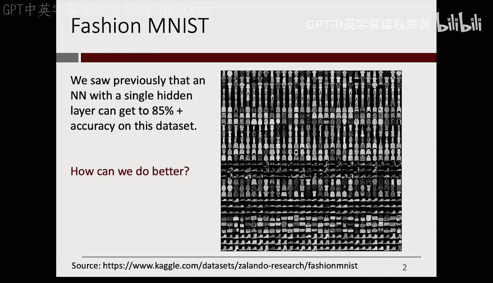

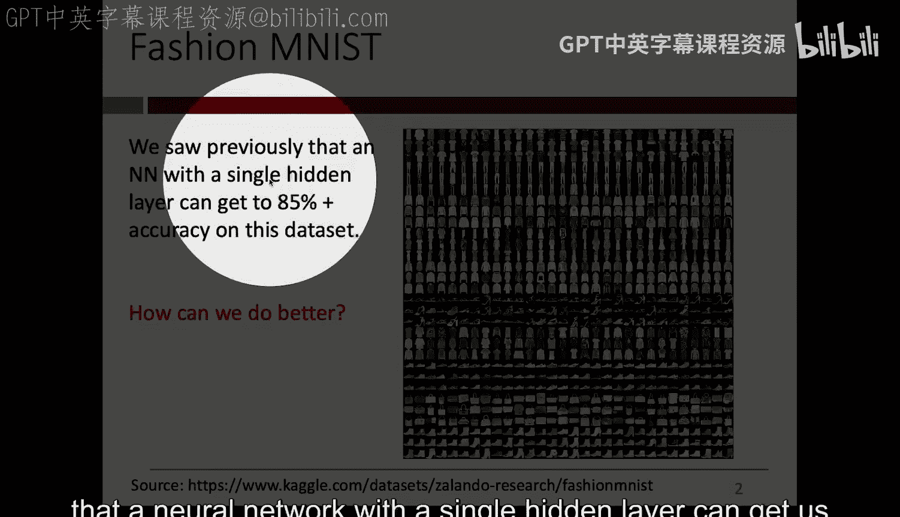

So let's just spend a few minutes on why what is it about images that we have to really pay attention to as opposed to any arbitrary vector of numbers that's coming in。

😊， so when we flatten the image into a long vector and feed it into a dense layer。

 several undesirable things can actually happen。😊，What are some of them， Any， Any guesses。呃，要。

Did you lose the proximity of one pixel to other ones that would be around it？

Right so if you take a particular pixel then let's say that the picture shows a thirt。

 if there is a little pixel in the center of the t-shirt knowing that the surrounding pixels are related to the pixel in a way because they are all part of this concept called a t-shirt would certainly be helpful right so to put it more technically spatial adjacency information is very important and we need to somehow take that into account。

😊，Okay， all right， what else， What else might be going on here。啊啊。some metadata about it。

 like the red of the dimension to the resolution。Oh， I see。

 So if you actually had structured data about the image， such as， you know， various characters about。

 that might be helpful。 True。 now， but let's just focus on the case where you only have the raw image and nothing else。

And under that constraint， what else might go wrong？Or what else might be suboptimal。Okay， well。

 the first thing that might happen is that we have we may have too many parameters。 So let's take。

 So this is， you know， this these numbers are from my， you know， older iPhone。

 I noticed that when I take a color picture with my phone， it's a 3000 times 3000 roughly grid。

 right？ So the picture is actually 3024 pixels on this axis，3024 on that axis。 Okay。

 so that gets us to roughly 9 million pixels。 But remember， there's a color picture。

 which means there are three channels。😊。

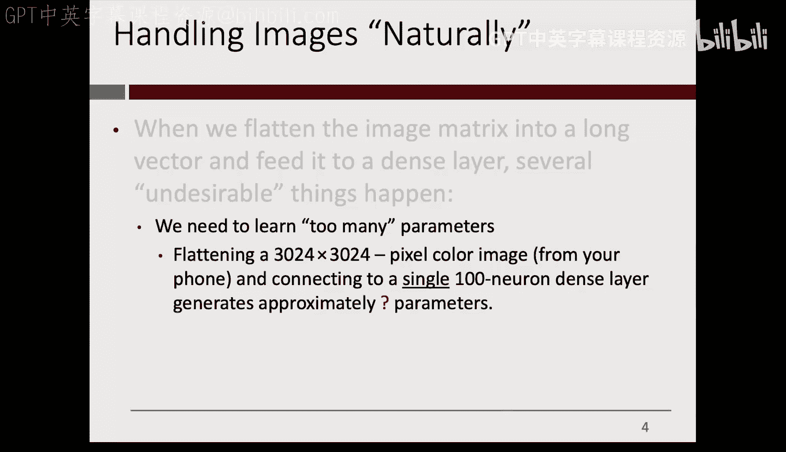

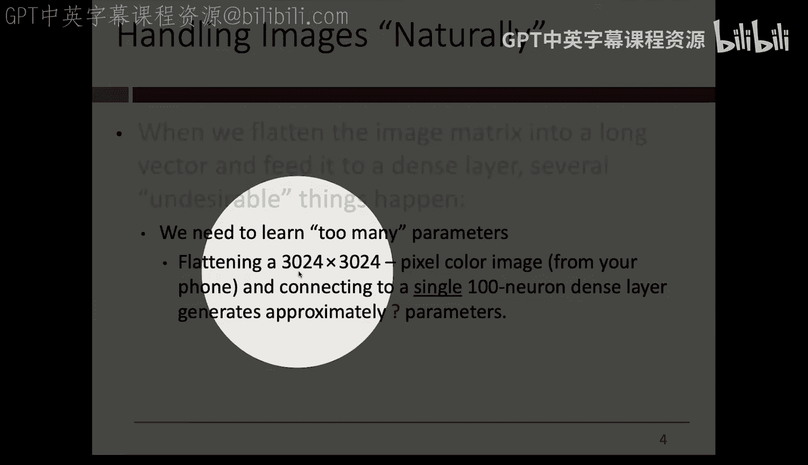

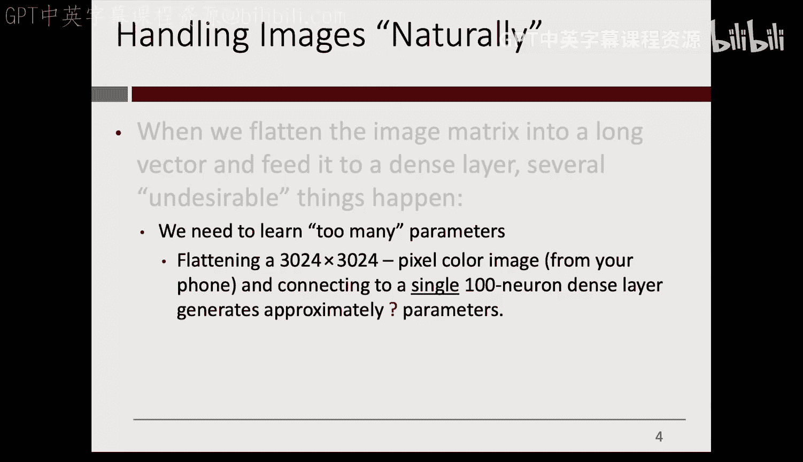

Which means there are 27 million numbers。Each of which is between 0 and 2。

55 from that little picture。 Okay， and now let's say we connect it to a single hundred neuron dense layer。

😊。

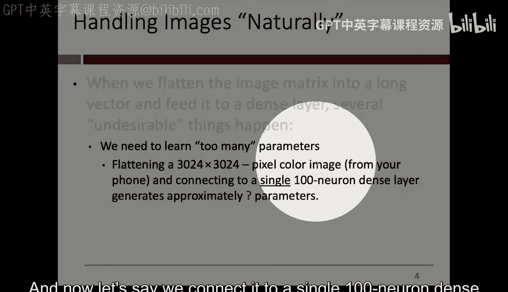

A single hundred neuron dense layer。 How many parameters are we going to have just in that one little part of the network。

Could the mumbling be louder？Yes， roughly 2。7 billion because 27 million parameters times 100。Right。

 roughly， of course， forget about the biases for a moment。 right， It's 2。7 billion。2。

7 billion parameters。RightDo you think we can actually get 2。

7 billion images to train any of these things。So that we don't know where it。Right。

 tooo many parameters。 we have to do。 You have to be smarter about this。 This's not gonna to work。

Right， that's the first problem。So this clearly is computational demanding。

 very data hungry and increase the risk of overfitting。Okay。Next。We lose spatial adjacency。

We literally are ignoring what's nearby。So that's a huge， huge factor。 There is a third factor。

 right that we have to worry about。Which is that， let's say that。

 you know the picture has a vertical line。😊，On the， on the top left side。

 And it has some other vertical line on the bottom right side。

What this sort of dumb approach is going to do is going it's going to learn to detect that vertical line on the top left。

 And it's going to independent of that。 It's going to learn to detect the vertical line on the bottom right。

hi doesn't make any sense what you a vertical line is a vertical line。

 So you want to be able to detect it wherever it happens。😊，Detect one's reuse everywhere。那说你你都。

So this， by the way， is called translation invariance。 Translation is mad speak。

 but move stuff around。You take a line and it moves around。 It doesn't matter。 It's still a line。

 Let's， let's， let's figure it out。So these are the the three things we need to worry about。

 So we want to learn once and use all over the place。

 We want to take spatial adjacency into account number two， and number three。

 let's just find a way to make sure that we don't have billions of parameters for simple type problems。

😊。

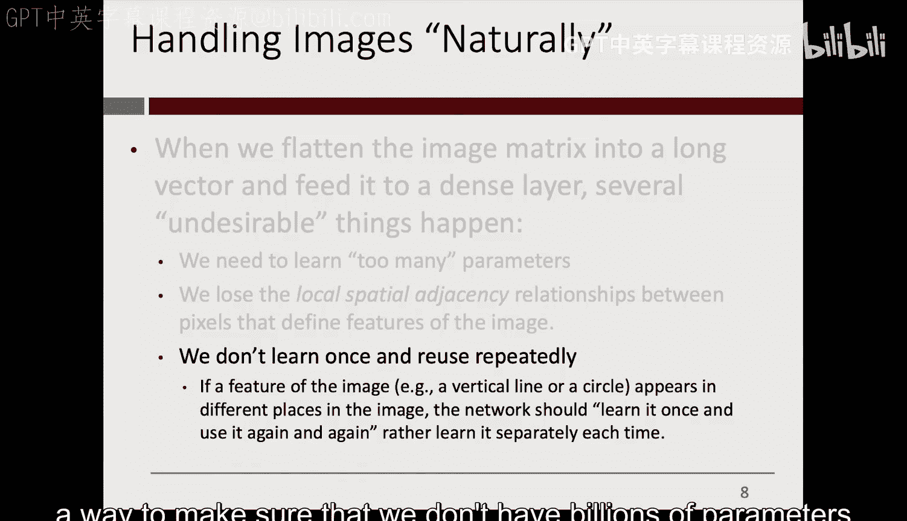

Any questions。Yep。你是什。Just because here're。

It would have happened。 So the question was， is it a problem because we are compressing the image or would it have happened anyway。

 dance would happen anyway， You can take any picture that is going to happen right。

 because I'm not making any assumptions about how the image is coming into me。

Whether it's compressed or not and so on and so forth。Okay， all right。So， convolutional layers。

Were developed to precisely address these shortcomings on their amazing solutions， as you will see。

 very elegant。😊，Allright， so the next， I don't know。

 Half an hour is going to be me defining a whole bunch of stuff。

Before we actually get to the fun collabs and so on and so forth。 So just a important perspective， I。

 I have a PowerPoint。😊，2 collabs。And an Excel spreadsheet and maybe even a notability file to cover today。

Okay， so， but hang on for the next 30 minutes because it's going to be a little concept heavy before we get to the fun stuff。

 stop me， ask me questions because we do have time。 Allright。

 a convolutional layer is made up of something called a convolutional filter。😊，O。

 that's the atomic building block。

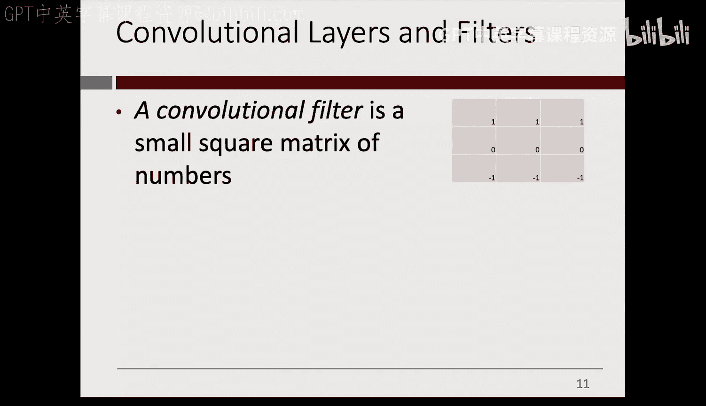

A convolutional filter is nothing but a small matrix of numbers like this。

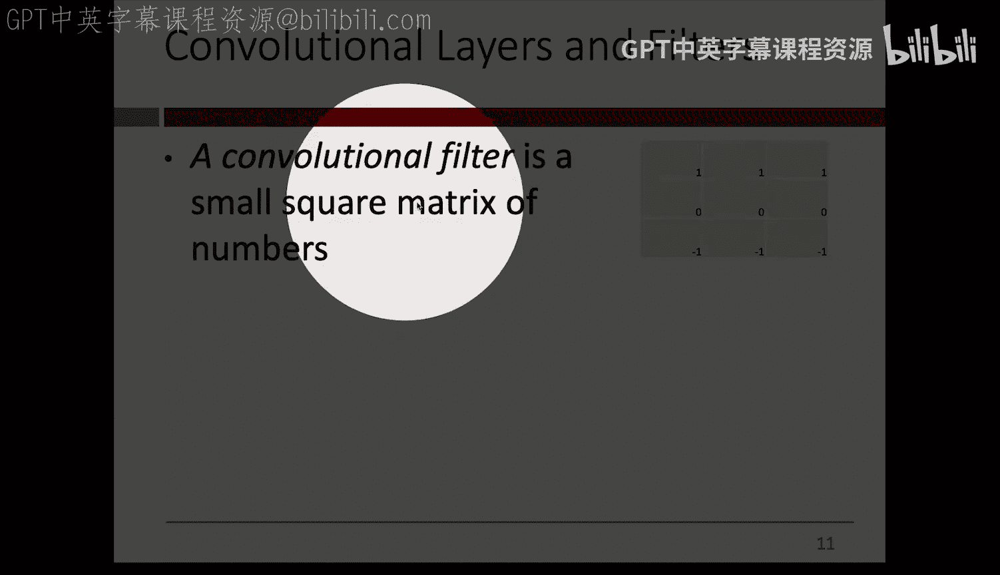

It's just a small square matrix of numbers。 That's a con filterta， okay， now。

A layer is just composed of one or more of these filters。All right。Filterters and layers。No。

The thing about the convolutional filter that makes it really magical is that if you choose the numbers in a filter carefully。

😊。

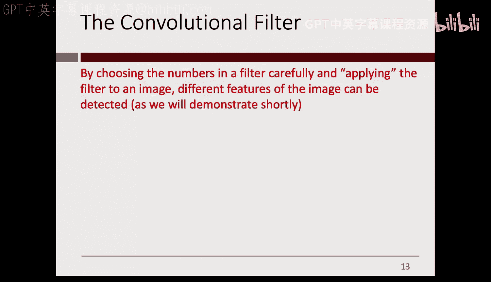

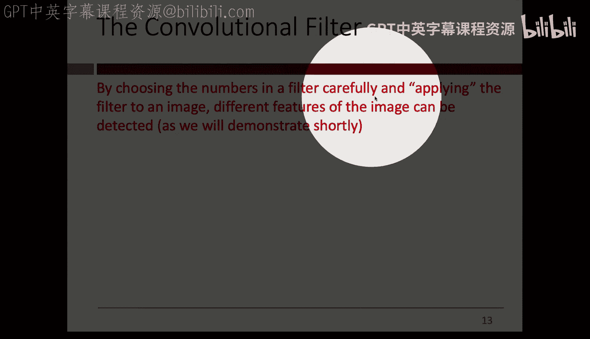

And then you apply the filter to an image， and I'll get to what I mean by applying the filter。

If you choose the numbers carefully and you apply to that image。

This little humble thing has the ability to detect features in your image。It can detect lines。

 curves， gradations and color， circles， things like that。 Okay， It's pretty cool。 and so。😊。

I'm going to claim， and I'm going to prove shortly that this little humble filter with the ones and zeros。

 it can detect horizontal lines in any picture you give it。😊，Okay。

This thing here is going has ability to detect vertical lines。right。

So I will demonstrate how this thing actually detects all these things。

 And then we will ask the big question that's probably in your minds already。

 Where are we going to get these numbers from。No， sounds great。 Rama。

 Where are we gonna get the numbers from， Okay， and we have a beautiful answer to that question。😊。

Alright， so let's go。 now I'm going first explain to you what I mean by applying a filter to an image。

 And then I'm going to give you examples of how the filter works for detecting vertical and horizontal lines。

 So， alright， so let's say that this is the image we have。😊。

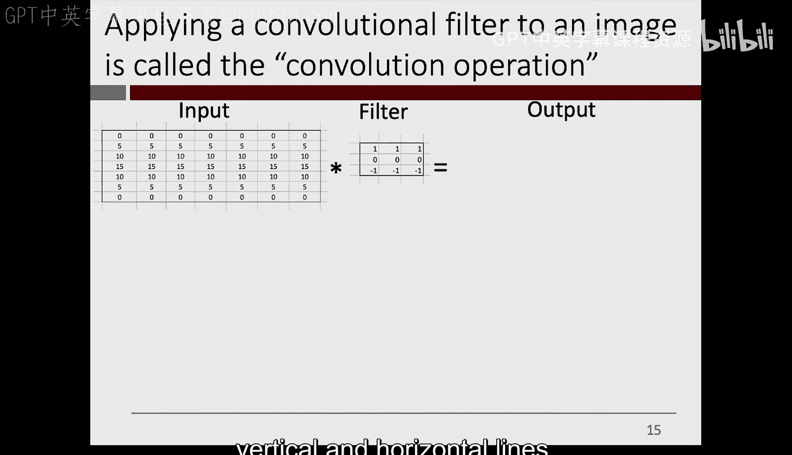

Okay， again， an image。 I assume it's a gray scale image。

 So you just have a bunch of numbers between 0 and 55。 Okay， so thats that this is the image we have。

 It's a little tiny image。 And this is the filter that's been magically given to us by somebody。😊。

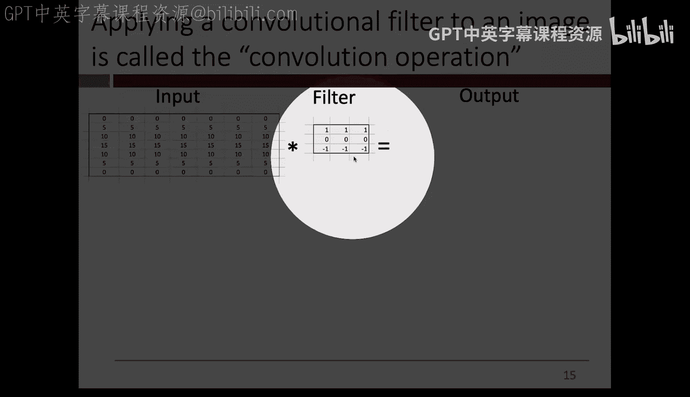

And what we are trying to do in order is to apply it。 Okay。

 so what we do is that we literally take this filter。B little one。

 And then we superimpose it on the top left part of the image。 So you have the image here。

 You take this little filter， and then you move it to the top left so that they are sort of right on top of each other。

Okay。Once you have it right on top of each other。You have these matching numbers。

 You have three numbers in the image。 There are three numbers in the filter。

 and they are all matching each other right on top of each other， right。

 So you have 9 pairs of numbers。😊，And then what we do， once we overlay it。

 we literally just multiply all the matching numbers and add the up。😊，O。

 you just multiply all the numbers and match them up。 And you can confirm later on that， you know。

 the the arithmetic I'm doing is actually accurate， okay。😊。

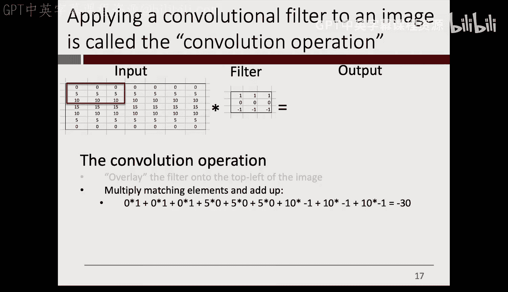

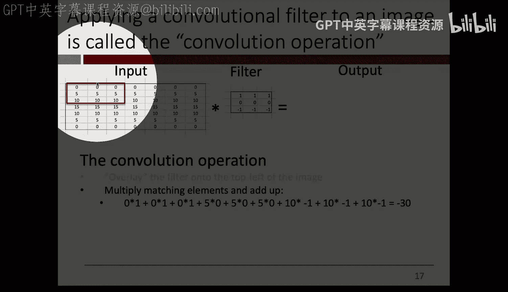

Once you do that you'll get some number。喂。

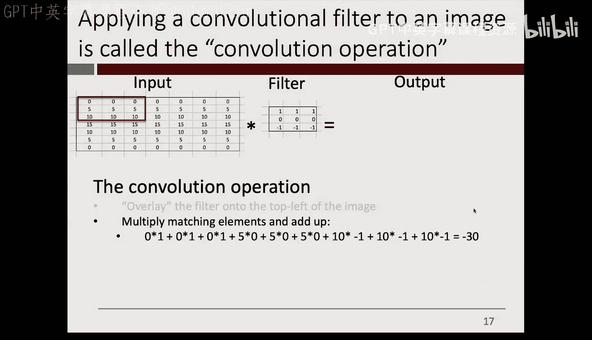

嗯。Once you get that number。What we do is we go to good old friend Dreello。

And then we just run it through a real。Now， in this case。

 all that effort comes to nothing because it's 0。 That's O。 Okay， so 0。

 And this number becomes the top left cell of your output。😊。

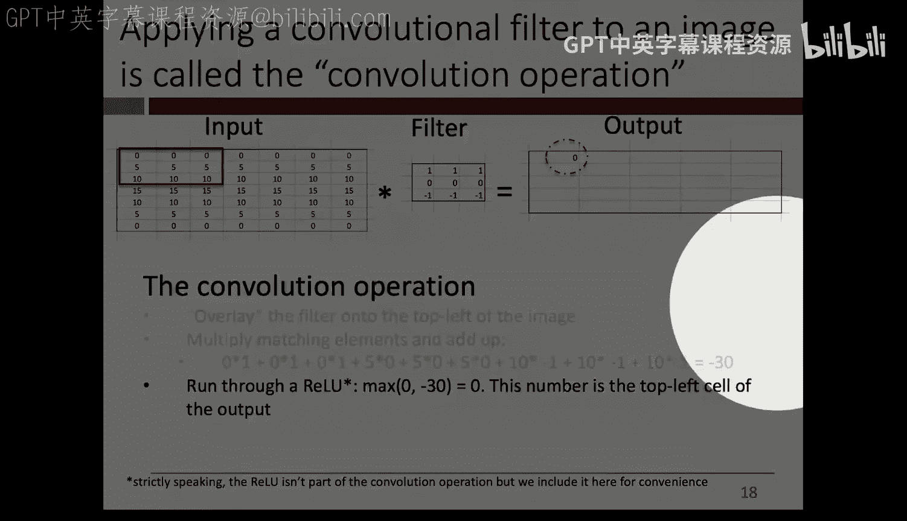

So this is called the convolution operation。O， and we want't get it away called that and so on and so forth。

 There's a long and rich and stied history of these things。But this is the convolution operation。

And once we do that， you sort of can now predict what's going to happen， right。

 We take the same exact operation and we just move it to the right。

We move this little3 by3 thing to the right and repeat the exact same process。Mching numbers。

you know， multiply all all the matching numbers together。 add them up， run them through a re。Okay。

 and then boom， you get the， you get the second number here。

And you keep doing that till you reach the very end， you fill up all these numbers。

 Then when you then you come to the top of the second row。O。😊。

And you keep on doing that till you reach the very bottom。So this is what I mean when I say。

 apply a filter to an image。Okay。😊，Any questions。O。Microphone， please。Microphone。多长工分。这一块。嗯。

the filter doesn't so you start with the left， and then you keep on going at some point。

 the right edge of the filter is going to match the right edge of the image， and then you stop。Yeah。

 now， there are some nuances here。So， for example， you can actually add the whole image。

On its borders so that you can actually go outside the image， and it'll still work。Okay， number one。

 the number two， new ones。 instead of just moving one step to the right every time you finish。

 you can move two steps to the right。Right and that's something called a stride so there are a bunch of pesky details here。

 but Im just ignoring them because this basic default approach works well amazingly well almost all the time。

😊，Okay， alright， so that's， that's， that's the mechanics of how this operation works。 Alright。

 now I'm going to switch to a spreadsheet， which shows this really beautifully。😊。

Courtesy of the fast AI people。

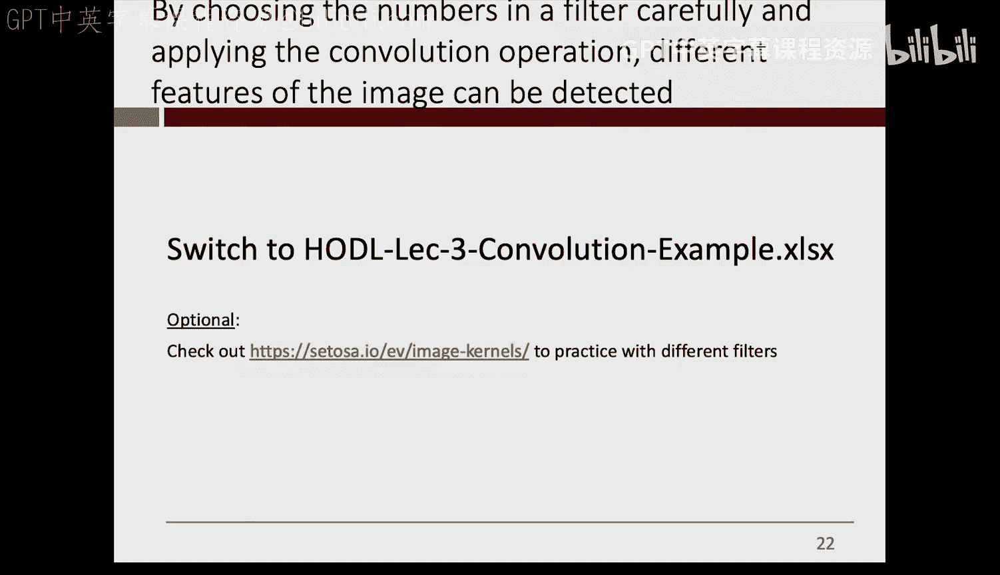

Alright， so what I'm gonna to do here。Because the big spreadsheet。

 I'll upload the spreadsheet after class I see it。 So all I have done here， rather。

 all they have done here， thanks to them is that they have essentially created a table of numbers in Excel。

 as you can tell。And they have just put some numbers， most of the numbers are 0。

 but these some of these numbers are all more than 0。 they are like 。8。9 and so on。

 Basically all they have done is instead of working with numbers between 0 and 255。

 they are just dividing all the numbers by 55 so you get fractions and just they just put the fractions on the table and then then they have used excess very cool conditional formatting。

😊，To essentially mark in red all the values that are high right if the number is closer to  one。

 the more reddish it gets。😊，and when you do that， the three obviously pops out。😊。

So there is a three in the image。 Yes， okay， good。 So now what we are going to do is we're gonna move to our little filter here。

😊，You can see the filter。RightAnd I'm claiming this detects horizontal lines。

 And so and this table here。Sorry。😔，This table here is the result of applying that filter to that three。

O， and you can see here， I'm looking at the top left cell here。嗯。Look at the top left cell。

 The formula is nothing more than。You know， multiply all those things and add them up。

 And then once you add it up， run it through a max of 0 command that， which is just the re。😊，Okay。

 basically admit it。So， we do that。And this is the output。

 And the output is also conditionally formatted to show you where things are lighting up。😊。

And you can see， only the horizontal。Lines of the three are lighting up。Everyone see that。So， you。

 now you understand the filter， in fact， is living up to the claim I made for it。Right， similarly。

If you look at what's going on here， this is a vertical filter。 the same thing。 you apply it。

 Only the vertical line is lighting up。Right， now， what you can do is。

I would encourage you to do this， you know， after class， you can look at all these numbers here。

 for example， and then ask yourself， okay， why is that lighting up。

RightAnd you will discover that what's actually going on is that it's looking for edges。

 It's looking for， you know looking for rows in the table where there is some nonzero thing in the first row and zeros in the second row。

😊，And by choosing the numbers carefully， you multiply the ones with positive numbers and you multiply the zeros with zeros。

 and then youll come up with a positive number and thereby you detect an edge。😊，Right。

 so what I would encourage you to do is use the this Excel thing here。Alright， so here is。

 here is the cell we have。 So let's trace its。Recience。So you can see here。These numbers。

this is what it is processing that is a grid it is being processing to come up with that big number and you can see here in this grid these are all these numbers are here and then these numbers are a lot lower than these these numbers because there is an edge。

😊，The numbers are a lot lower。 That's why you can see the horizontal part of the three。

So what this filter is doing， it's basically saying， well。

 the stuff road that I'm catching here has the ones。 The middle has zero。

 The rest are all minus ones。So the small values are going to get very small。

The big values are going to get very big， and the overall thing is going to be emphasized。

So that's the basic idea of edge detection。Spend some time with it with Excel。

 and it itll become clear to you what I'm talking about here。All right， cool。 So that's that。

Allright， by the way， I also have there is a little very cool sight here。😊。

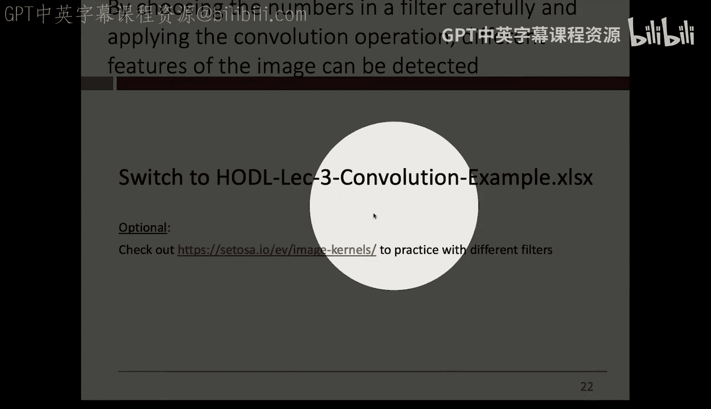

In which you can actually go in and punch in your old numbers and see what it detects， right。

 a lot of edges and curves and this and that。 It's very cool。 So I encourage you to try it out。😊。

So the key thing here I want to say is。By choosing the numbers in a filter carefully and applying this operation。

 different， different features can be detected。 Allright， Now。

 I mentioned earlier that a convolution layer is composed of one or more of these filters。

 So one or more of these filters。 And so you can think of each filter as a sort of a specialist for a particular feature。

😊，Okay， so it's a specialist。 Maybe it's， it specializes in detecting vertical lines。

 horizontal lines， you know， semicis， Qua circles。 you don't know， right。

 You can imagine either of them as being specialists。😊。

Given that modern images could be very complicated。

 they may have lots of interesting features going on。

 You probably want to have lots of these filters。Okay but the key。

 the key is that you don't have to decide upfront， hey， you filter。

 you better specialize in technical vertical lines and you on the other hand。

 do not stay in your lane， do vertical lines， right， you're not going to do that。

You will let the system figure out what it wants to figure out。O。

 so there is no human bottleneck in doing this。And I mentioned this because there used to be a human bottle link。

 you know， before deep learning happened。And so。Now。

 let's just make sure we understand the mechanics of what happens when you have two of these filters。

 not one。 So this then put image as before， this is the filter we saw earlier。

 and this is another filter we have。

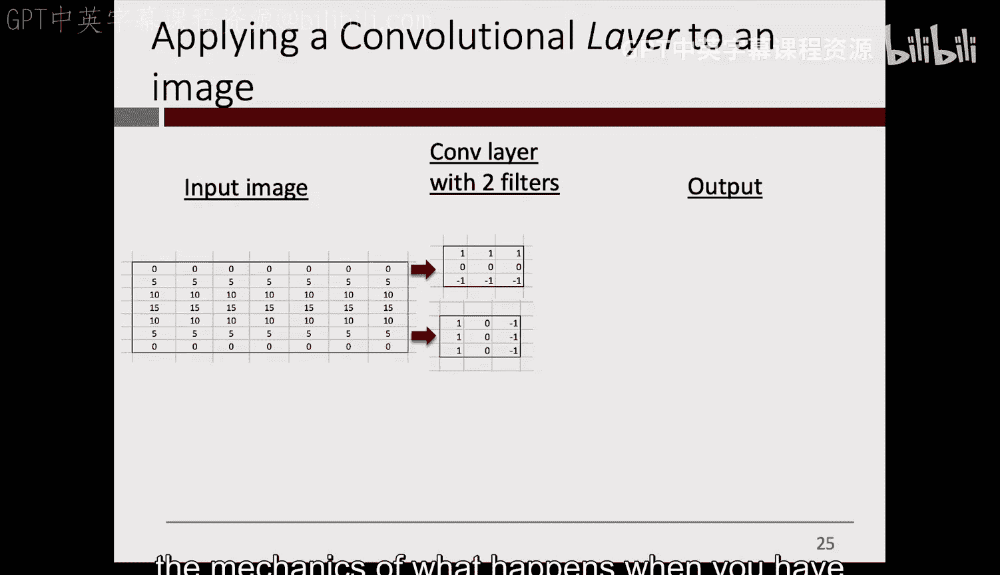

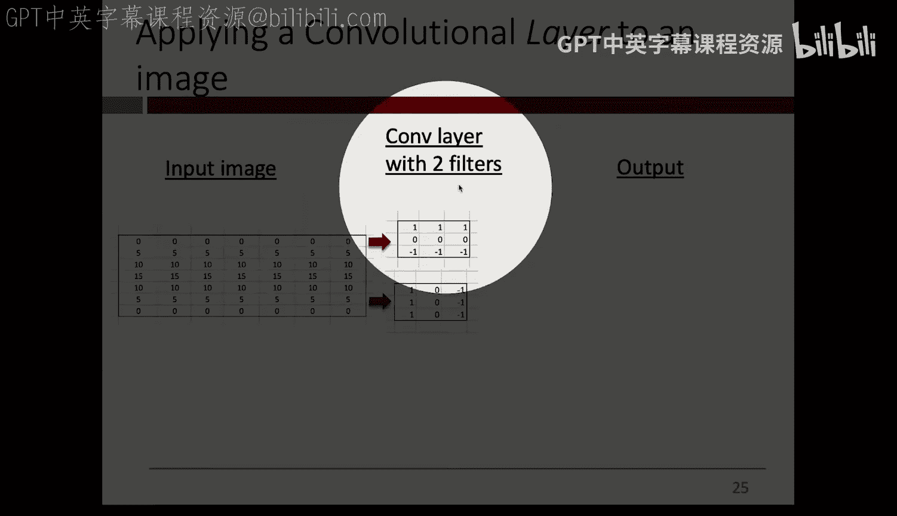

The thing is， we just run them in parallel。 We take each filter。

 do the operation come up with an output， Take the other filter。

 do the operation come up with its output。 And then when we do that， the first one gives you that。

 The second one gives you that。 And this output is a table of sum。' a， it's actually not a table。

 What is it。😊，Roo， please。It's a tensor。 Thank you。 It's a tensor。

 And so these two5 by5ime can be represented as a tensor of what shape。😊。

And there are two right answers。5 by 5 into2， correct。

 So you can either think of it as 5 by 5 times 2 or two times 5 by 5。 They're both fine。

Which one you go with is actually ends up being a matter of convention。Okay。

 so now youve begin to see why we care about tensors。Imagine if instead of having two filters。

 we have 103 filters。😊，The resulting tensor is going be 5 by 5 by 103。O。Good， all right。

 now let's look at the slightly more complex situation where you have not a black and white image。

 a gray scale image with just a little table， but an actual color image。😊，Okay， so。

 so we know how to apply a filter to a 2 day tensor like this and to get that。

 But let's say we have something like this where it has three， right， It's got three channels， red。

 blue green or G B， It's got three tables of numbers。 So this is a tensor of shape 6 times 6 times 3。

 Let's say， and you want to apply this three by three filter， just like before to this thing。

 You want to apply the convolution operation。 How is that gonna work。😊。

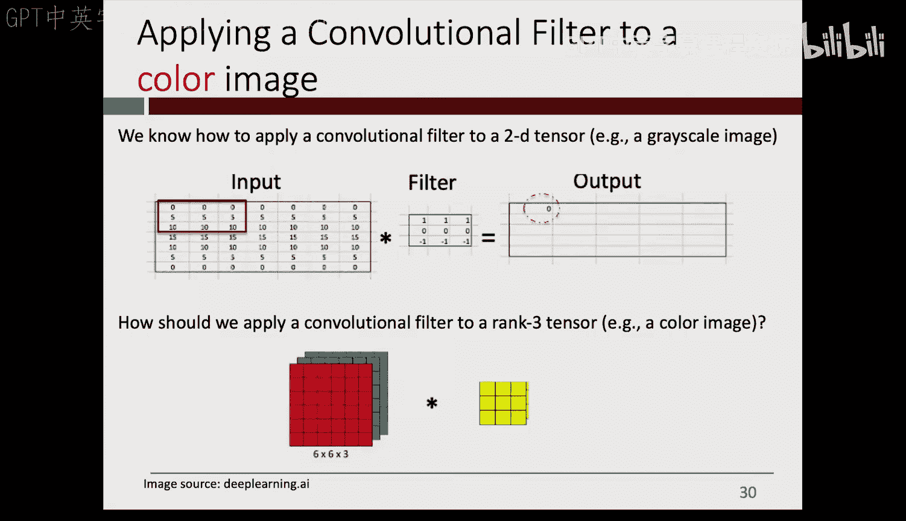

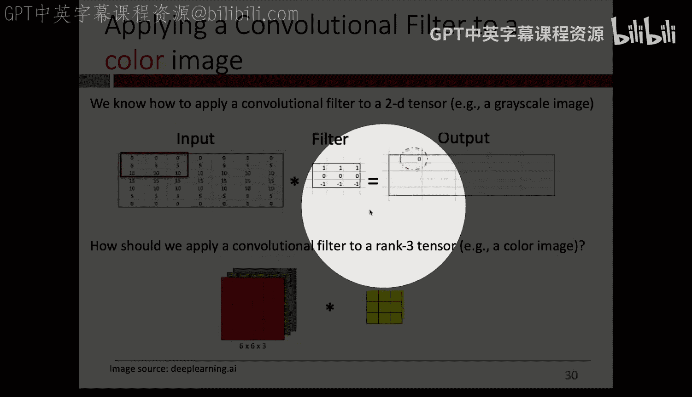

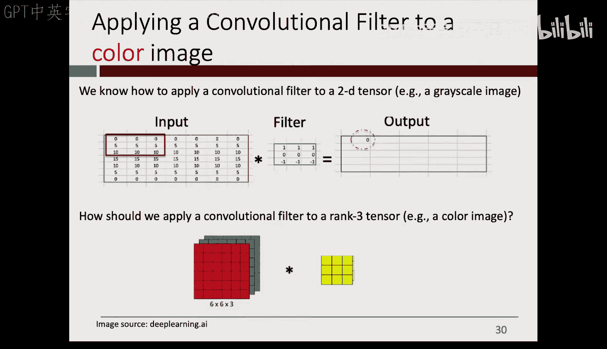

Do we just like apply this to each we first apply to the red， Then we apply it to the to the green。

 then we apply to the blue。 Should we do that。

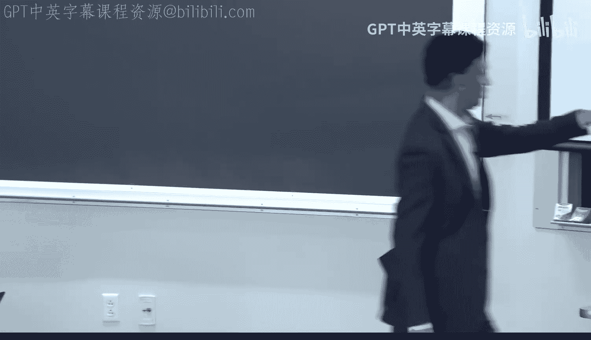

Or is that a a problem with that approach。Yeah。Could you use the microphone， please。

The problem with the approach， I think， would be the same as what you said earlier that it wouldn't learn。

Lines are probably the same as China。Like the location of the lines are probably Sandy's channel。Yes。

 the location of the line is going be the same thing because that line， if you will， is sort of the。

 the aggregation of information from the three different channels， right， But the problem here。

Is sort of slightly different。Which is that。If you do them independently。

The network has not been informed。That these things are all part of the same underlying concept。

As far as concerned， it's just like three things。 It's just going to process them independently。

 So we need to somehow change the filter so that it understands like what is at this pixel location。

 the three numbers under it are G B， they are actually the same part of the same thing。

 underlying thing。So what we do is actually very simple。We just take this filter and make it 3D。

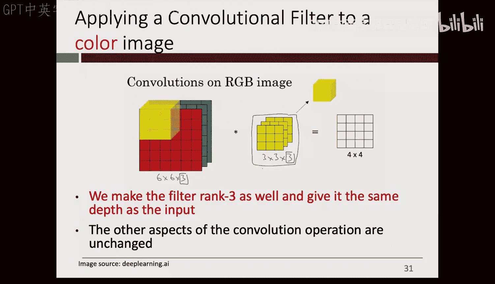

So we take this filter instead of having just one of them， we just make it a cube like that。

 three times。

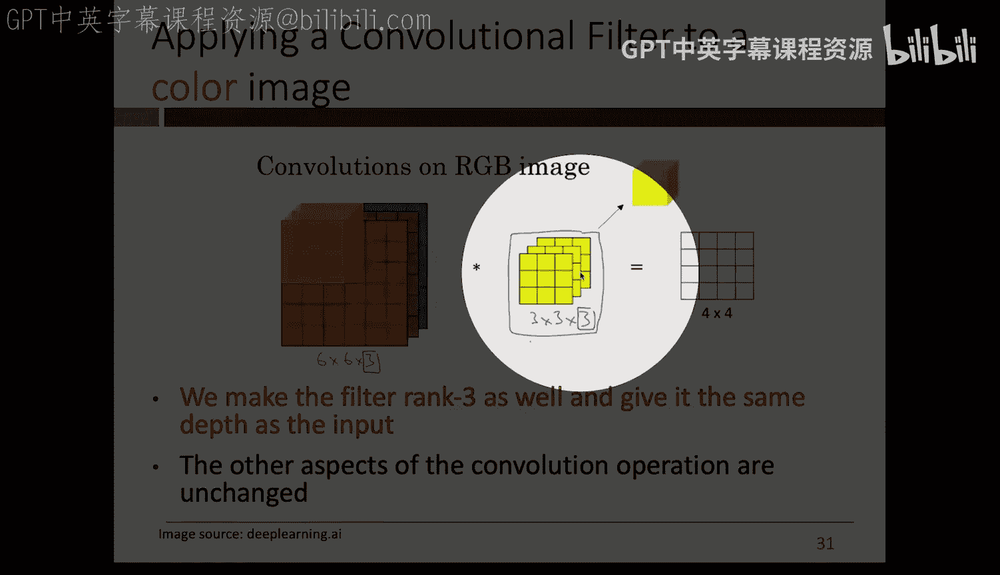

And once we do that， you can imagine taking this thing here and essentially doing that。😊。

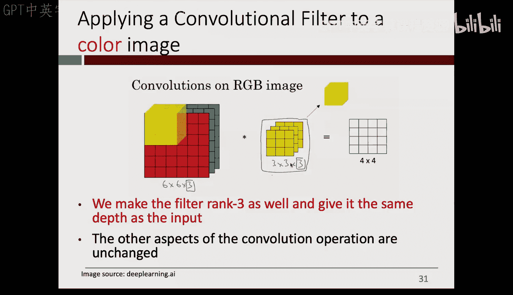

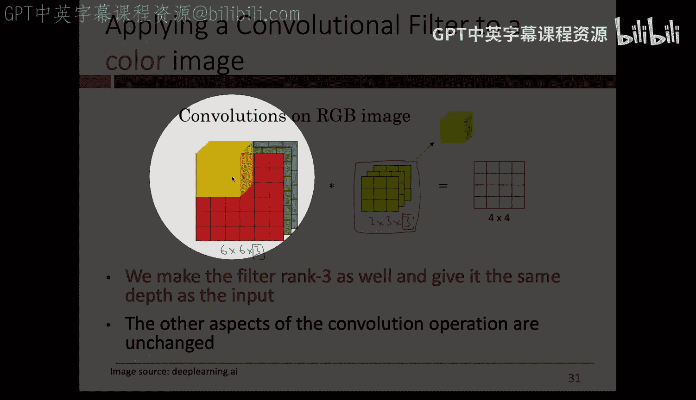

Okay， now， instead of having， you know，9 numbers in the image and9 numbers in the filter。

You have 27 numbers in the image，27 numbers in the filter。 but you still match them up。

 multiply them， add them up， run them through a re。By the way。

 I tried to get Chad GPT to give me a picture like that。Just completely bombed。I like 3，4。

5 different variant。 just gave up。 Then I found this nice picture in deep learning or AI。

 and I used it。😊，So then if you put different numbers in each。Is that like？I to。I'm sorry。

 he said if you put different numbers。Players of。That was。Different adapt。

Would that be like filter processing？Yeah， you， you believe。Yeah， you will put different numbers。

 In fact， you， you have 27 numbers now。But we haven't gotten the question of where these numbers are coming from。

 So just hold the thought till we get there。Okay， so any questions on this。Okay。

 you literally take the 2 D thing and make it 3D。 You basically give a depth and the depth just matches the depth of the input。

😊，So if the input is like you know， 10 deep， your filter is going to get 10 deep。😊，ok。嗯，Yes。

Rather than。Increasing the rank order of the pencil by one is there any instance？Instruction layer。

不允し。这科学。Intermediate。That for。Yeah， so there is a lot of stuff in the research literature。

 which tries to do things like that。 I'm just describing like the the the most basic approach to doing this。

 And as it turns out， this basic approach is extremely extremely powerful right And of course。

 researchers try to， you know， go from the 95th% thing to the 95。1%。

 So they meant like all sorts of crazy， complicated stuff， which is all good for us， humanity。

 But for practical use， is good enough。😊，How do you convert the3 by3 J into a single。公開法デたです。我不是拒别。

Yeah， so we are coming to that。 I think we have a slide here。 Actually， we dont。 never write。

 I'll answer that。 So， so here you have one filter， right， You have 1，3 by 3 by 3 filter。

 which plugs into this thing here。 And then it gives you the4 by4 at the end。😊，Right。

So for one filter， we know that by doing this operation， we get。N at this 4 by4。

Let's say that you have another filter， which is also 3D。You do that thing。

 You'll get another 4 by 4。And if you have 10 filters， you will get 10 of these4 by4。

 which then gets packaged up into a4 by 4 by 10 tensor。😊，Remember， whether it's 2D，3D，10D。

What is coming out is always to。Because ultimately。

 when you apply all this operation at each position， you just have one number。And then ultimately。

 you just do all those things。 You just come up with a table of numbers always。

 So the what's coming out is always a 2D number table like that。But when you have lots of filters。

 you have lots of these 2D tables， one after the other。 And therefore。

 they get packaged up into a tensor。

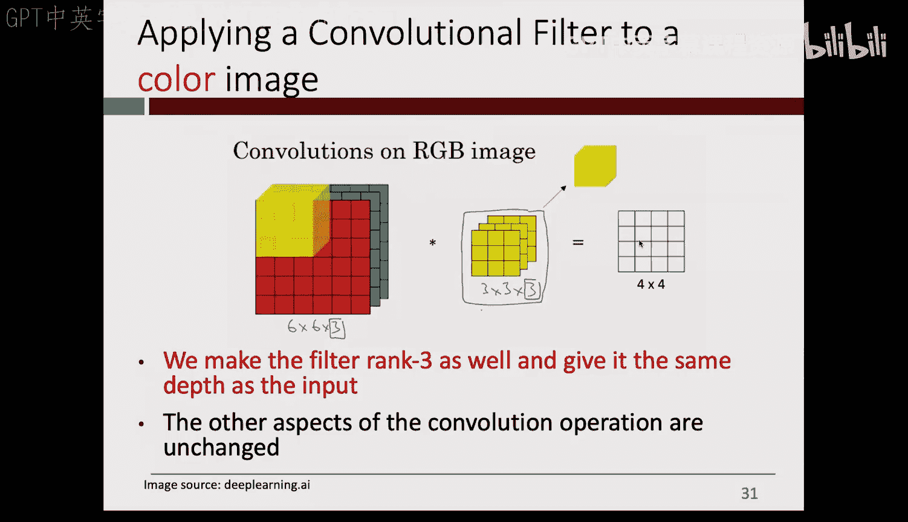

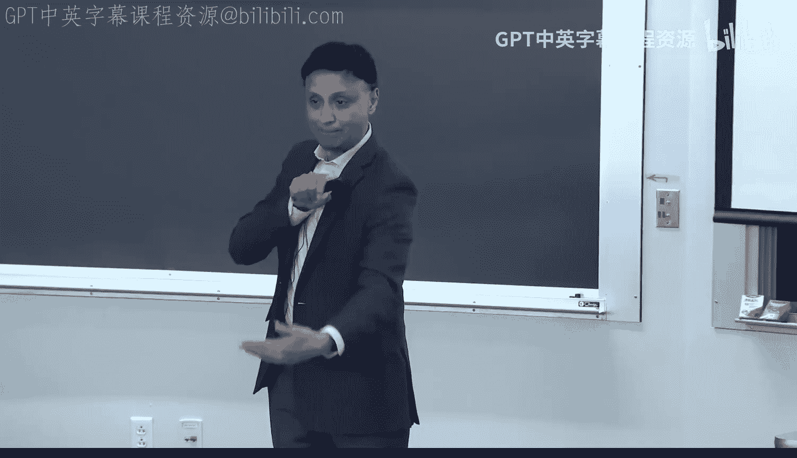

All right。So。Textbook chapterer 8。1， has a lot of detail and intuition， which I think is really good。

 So please try it out。 Okay， And folks， by the way， this convolution stuff。

 it sort of it grows in the telling。 So I would encourage you to revisit it， revisit it。😊。

A few times。 And then it slowly becomes part of your muscle memory。

It expected just to understand all the new ones is like one shot。Do it a few times。It become。

 you know， wide into your， into your head。Okay， so， all right， the big question。

 These seem excellent。 but how are we supposed to come up with these numbers， Now， in fact。

 traditionally， these filters are actually used to be designed by hand。😊。

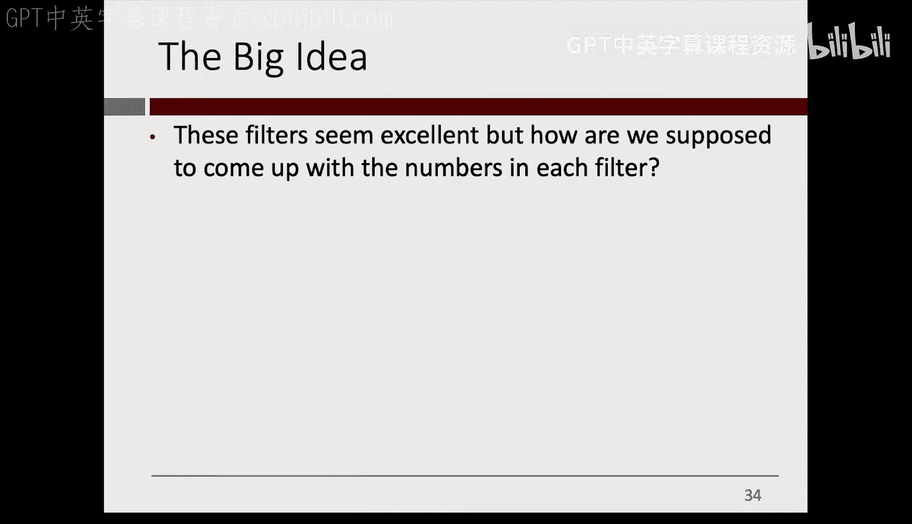

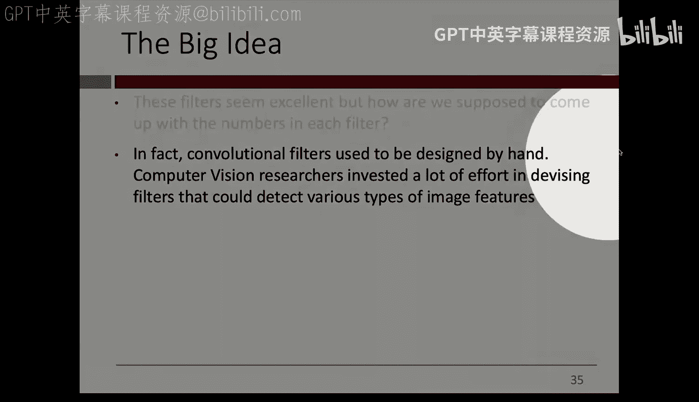

Computer vision researchers would invest， you know prodigious amounts of time and effort and talent to figure out you know the the right kinds of filters to use for various specific applications。

 So if you wanted to build an application which would look at say MRI images and figure out， okay。

 what kind of features should I extract from this MRI thing to be able to say， you know。

 predict the the evidence for a stroke they would actually， you know， hand design the filter。

 try lots of different values and then come with I got the perfect filter。

 But let's thing here So that's the way it used to be done。😊，And now。

But as we figured out how to train deep networks with lots of parameters， right。

 we figured out things like re activations， stochastic gradient descent， GPs， back prop。

 things like that。 You know， this big idea emerged。

 Why don't we think of the numbers in the filter as just weights。😊。

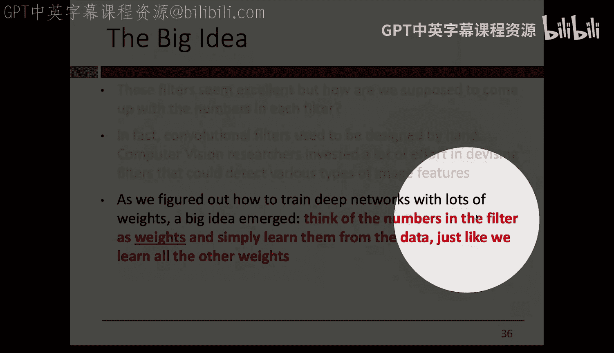

And why did we just simply learn them from the data using back。

RightJust like we learn all the other ways， what's the big deal。I a simple idea。And it feels a。

 I don't know， blinddingly obvious in hindsight。I'm sure it was't not obvious in foresight。Right。

 this was the breakthrough。 This was the key breakthrough。

And now it's actually possible to do this because a convolutional filter that we have seen is actually just a neuron。

The underlying arithmetic of it is just a neuronal arithmetic。

 And so it just happens to be a slightly special one。

 It's actually even simpler than a regular neuron。 And in the interest of time。

 I have one or two slides in the appendix which tells you exactly why it's a neuron。 So check it out。

 But just take my word for it。 it's just a particular kind of neuron。

 And because it's a particular kind of neuron。 And we know how to work with neurons。😊。

You know how to work with neurons， which means that our entire machinery。Players， loss functions。

 gradient descent， S GD， blah， blah。 Everything is immediately applicable。

We don't have to invent any new stuff to make it work。All right。

Do you initialize the data they between applications or just because the network has different size of just computer vision versus of them do you do it differently or？

我说的是天当是。Yeah， so the initialization。 Sos， it's a good question。

 Let's come back to it when we get to something called transfer learning。

 which I'm going to get to by about 9，30。😊，All right， so。That's it。 Allright。

 So this turn would be a huge turning point in the computer vision field。

 And this was the massive unlock in the year 2012， This computer vision system that used this technology called Alexnet burst out onto the world stage because it crushed the competition in。

 you know， in a competition called Inet and the previous best score was 26% error rate and this thing came in and had 16% error rate。

 Its the kind of thing that if you see you'll be like， that's must be a typo。😊，Right。

 because every year， the improvements like very little half a percent，1%。 And then this year was 10%。

 And that that is because of this approach。O。So， allright， now。

 one other thing I want to come talk about is that with every succeeding convolutional layer。😊。

This particular convolution， any particular convolution filter。

 it's basically implicitly seeing much more of the input image as we go along。😊，Right。

 which means that if in the very beginning， if this is the input， right。

 this little convolution fit this number here in the first layer。

 let's say only sees like the top of the chimney or whatever of this house。😊。

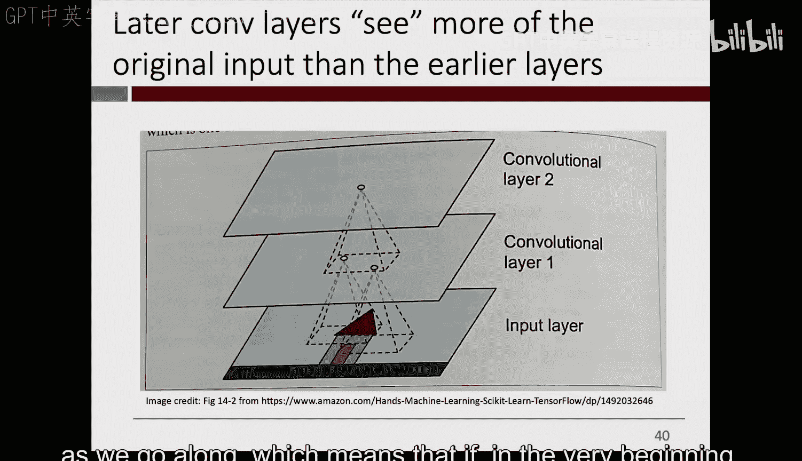

But then the next layer， remember， the next layer is input is this particular layer。😊，And so。

This particular little thing here is getting information from this whole square here。

And every one of the points in that square is actually something big in the original picture。😊。

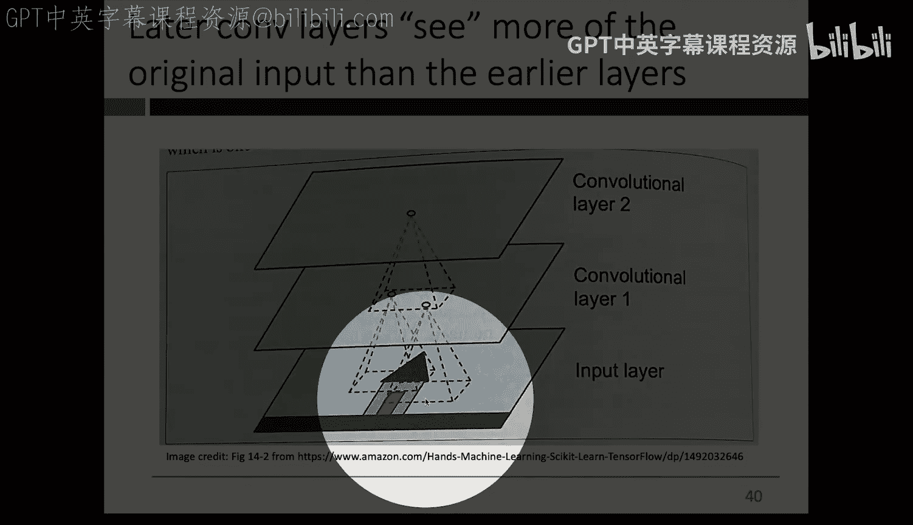

So with every additional layer， you're seeing more and more and more of the image。

And this is a key part of why these things work because you're essentially hierarchically building a better and better understanding of the image。

😊，It is the hierarchical understanding， the hierarchical learning。

 That's a very key part of the unlock。And so if you look at networks and what they're visualizing。

 this actually， you know， a phase detection deep network visualize as to what it's learning。

 You'll see that the first layer is just learning lines and edges and so lines。

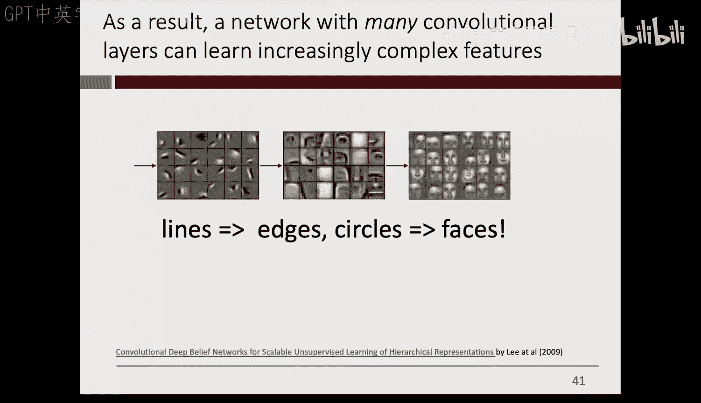

And the second layer is actually learning edges。 Look at this thing， right。It's。

 it's learning to put these lines together。Get some sort of edge here， another edge here。

 This looks like 3，3 quarters of of somebody's ears。And that。

 these things are now being assembled to get whole faces out。

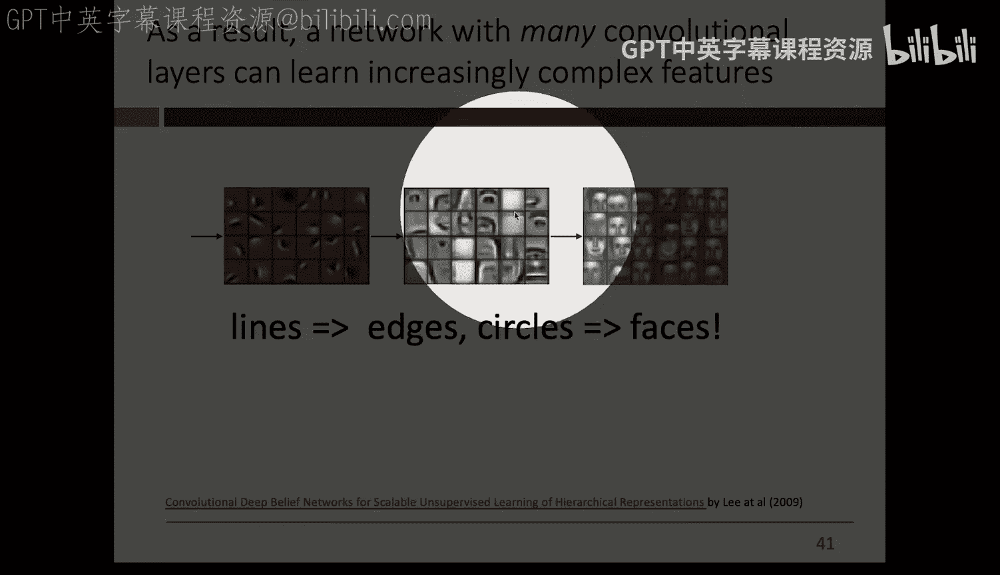

And imagine the researchers who did this work。 They build the network iss doing really well on directing faces。

 And they， okay， let's see what it's actually doing。😊，And then， this picture pops up。The goosebumps。

Okay， so pulling layers。 The next one。So。So far， you've talked about convolution layers。

 This is the second thing。 Second building block。 And then we'll get go go to the collapse。

 So pooling layers are also called sub samplingamp or down sampling layers。😊。

And so the idea is that every time a tensor is coming out of these convolutional layers。

We try to make it slightly smaller。Because the act of making it smaller will force the network to try to summarize and learn what's going on in this complicated thing that's coming into it。

 Okay， so I will describe the mechanics first。So let's say that this is the output of a convolutional layer。

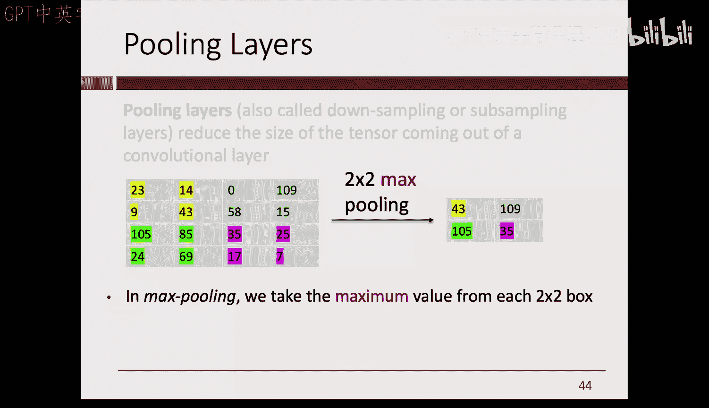

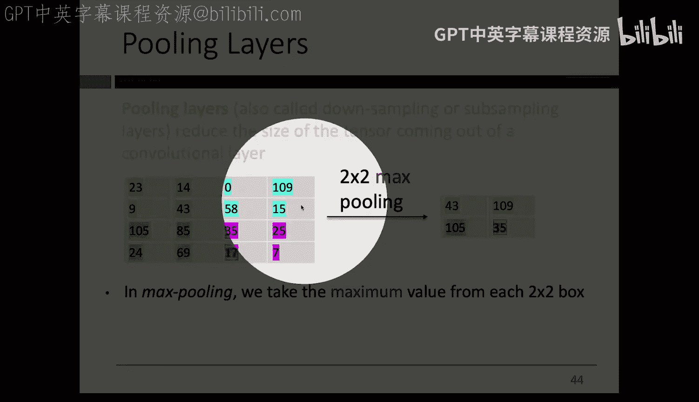

This this four of them， 4 by 4。 So what we do is that there are two kinds of pooling。

 max pooling and average pooling。 This is called max pooling。

 And the idea is really simple In this max pooling layer， there are no wage parameters to be learned。

 It's just a simple arithmetic operation。 We basically take。😊，We take this。

 we basically superimose a 2 by two empty grid。

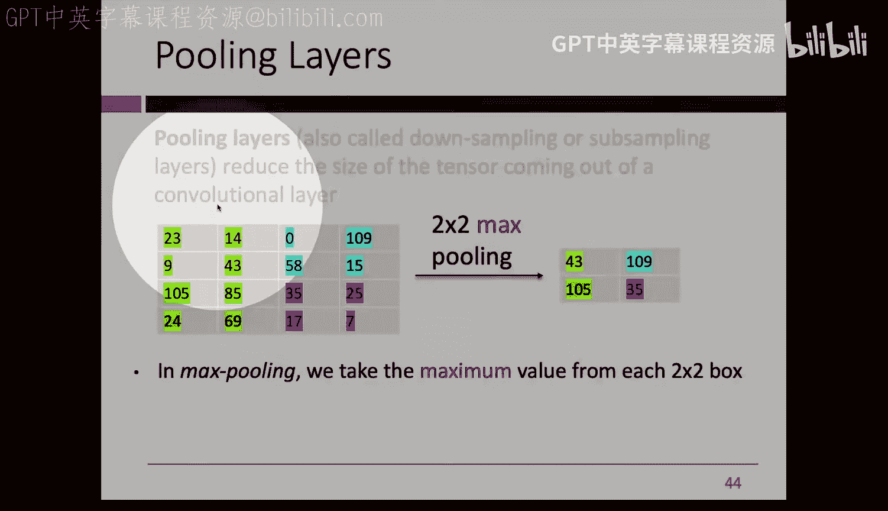

On the top left。 And then we say， hey， what's the biggest number on the among these four numbers？

 Well， the biggest number is 43。 Gom， O， I'm gonna stick a 43 here。

Then I move my two by two to the right so that it overlaps with these numbers in blue。 And I say。

 hey， what's the biggest number here， Okay， that's 109。And I move it down。

 What's the biggest number here，1，0，5， stick it in here， Big number here，35， and I stick it in there。

 That's it。 This is Max Poing。

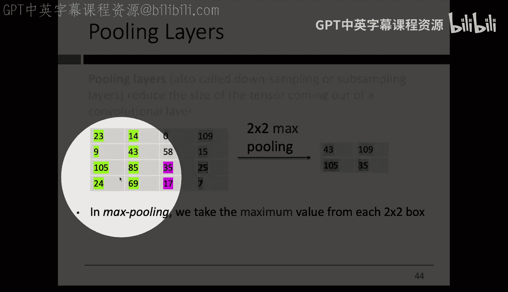

Similarly， there is this thing called average pooling。

 where instead of taking the maximum of these phone numbers， we just average the phone numbers。

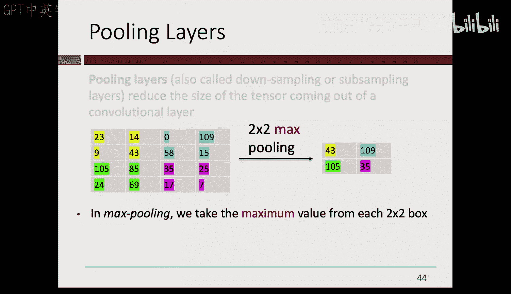

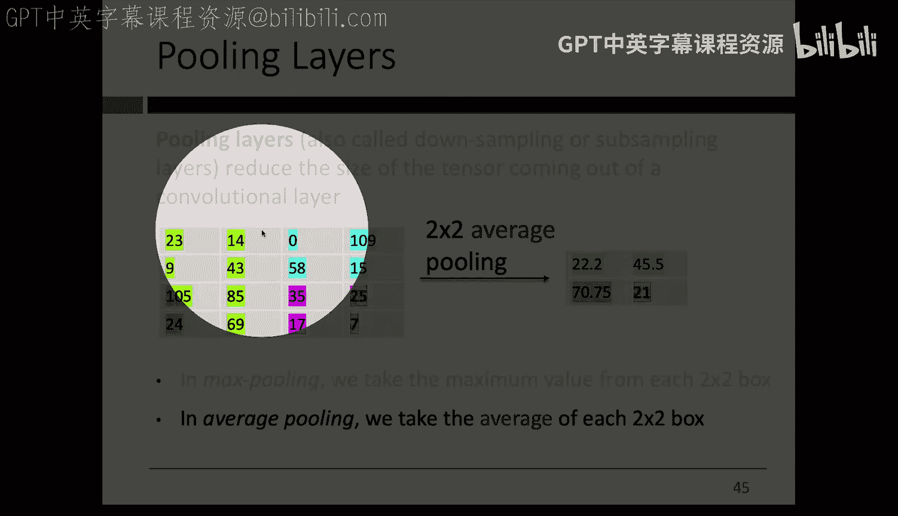

Okay， the average of these four things in yellow。他买单。

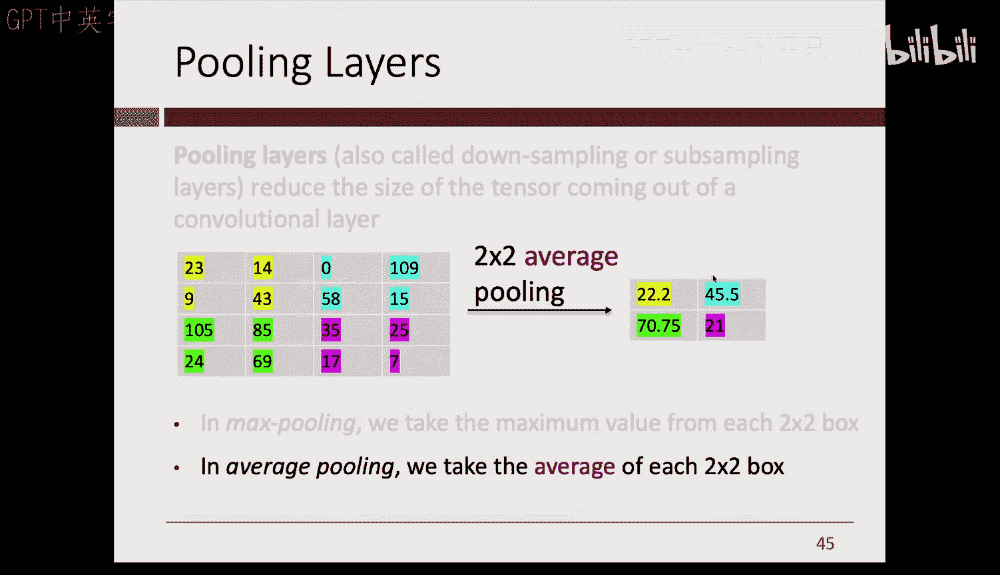

The average of these four numbers is 22。2。 The average is blue numbers is 55。5。 you get the idea。😊。

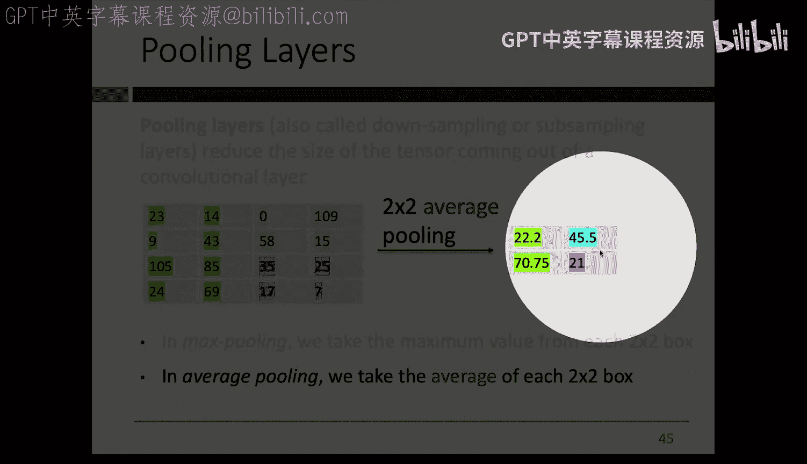

That's a max pullinging， and average polling now。As you can see， when you go， when you apply poll。

 the number of entriess drops significantly。Right， the number of entries drop significantly。

And the output from this layer just fit to the next layer， as usual。Okay， there's nothing， you know。

 crazy going on。So it's a way to shrink the output from one convolutional layer before it passes on to the next convolutionary。

 you interject with a pulling layer。Now， I have actually a uniform I say so myself。

 a very nice handedwritten explanation of what pooling does， the， the effect of pooling。😊。

And unfortunately， I can't get my iPad to actually show on my laptop。

So I'm not going to be able to do it， but I will record a walkthrough。I posted。 Check it out。 Okay。

 but the intuition that I try to convey with that thing is that， oh， sorry， I'll come back to this。

 So max pooling acts like an odd condition。 It basically says， I have this big picture。😊。

So in the four things that I'm looking at， if there is any number， which is really high。

That means that some feature is being detected， right？

The numberumb is really high coming out of a convolutional layer。

 That means that something somewhere fired up， lit up。

And so I'm just looking to see if anything lit up in that part， if it did， I'm going to say， yep。

 something lit up。😊，Nothing lit up。 Then I'm going say nothing lit up。So in， in that sense。

 what is it thing you can imagine it's like acting like an or condition。Anything fired up。

 anything fired up， anything fired up， anything， Yes， O， Otherwise， no。And so。Sadly。

 I can't switch to notability。So it acts like a feature detector。

 So if you have lots of things going on in a particular picture。

 you want to be able to summarize and aggregate all the things that are going on so that you can say if you may have a big picture with lots of things lighting up here and there。

 But you want to step back and say， you know what， in this picture， the top left。

 nothing lit up the top right， something lit up， bottomom left。

 something lit up and the bottom right， nothing lit up。😊。

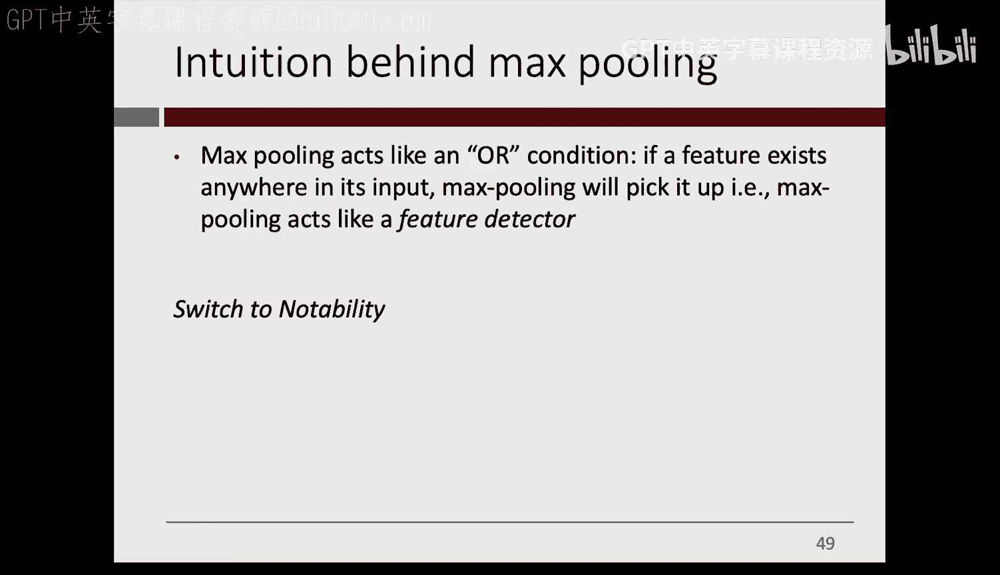

So you're operating at a higher level of abstraction。That's the effect of polling。

But don't you use special。You don't， because the what you're actually saying is the top left has this thing。

You already know it is in the top left。And they already moved up to that level of abstraction。

So the fact， for example， if in the top left， there is a human eye。And there is a circle detector。

 It is going to fire up and saying， hey， in the top left， there is an eye。

Yep lit up so you're not looking at the pixels anymore。

 you' are already operating at a high level abstraction and that's so we get around it。

 but this proceeds slowly and incrementally， which is why you have these big networks。😊，All right。

So now， as we saw， Sun' successive convolution layers can see more and more of the original image。

 The max pooling layers that follow them can detect if a feature exists in more and more of the original input as well。

😊。

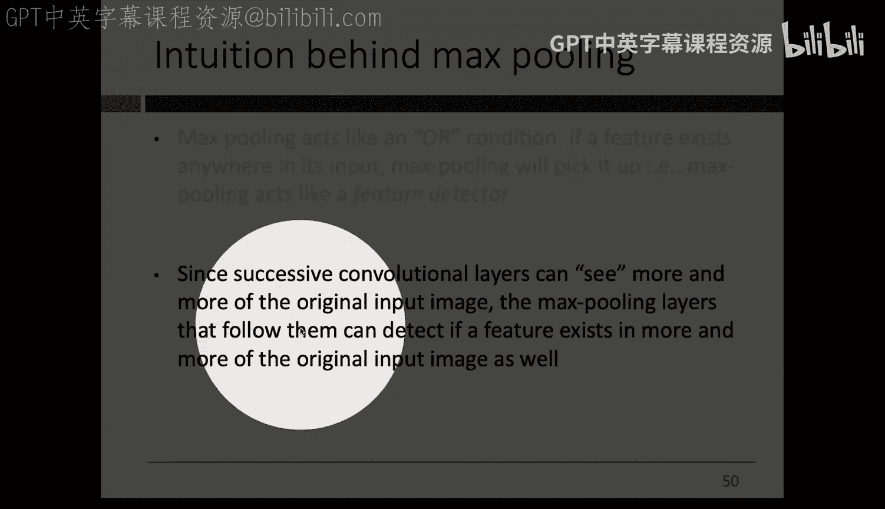

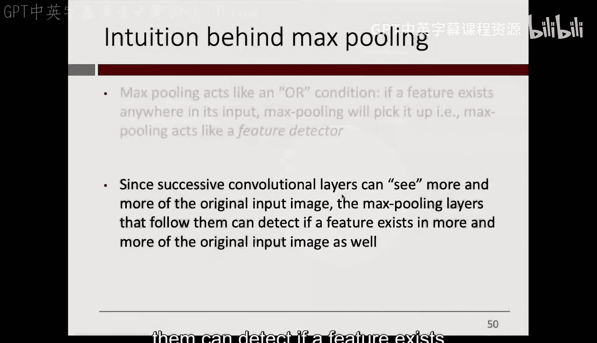

So by the time you get to like the seventh and eighth，9 and layers and so on。

 this thing is actually really smart。 It's operating at a very high level of abstraction。😊。

is you can think of it as it is basically like tagged all the features of their image at various resolutions and it can work with it。

😊。

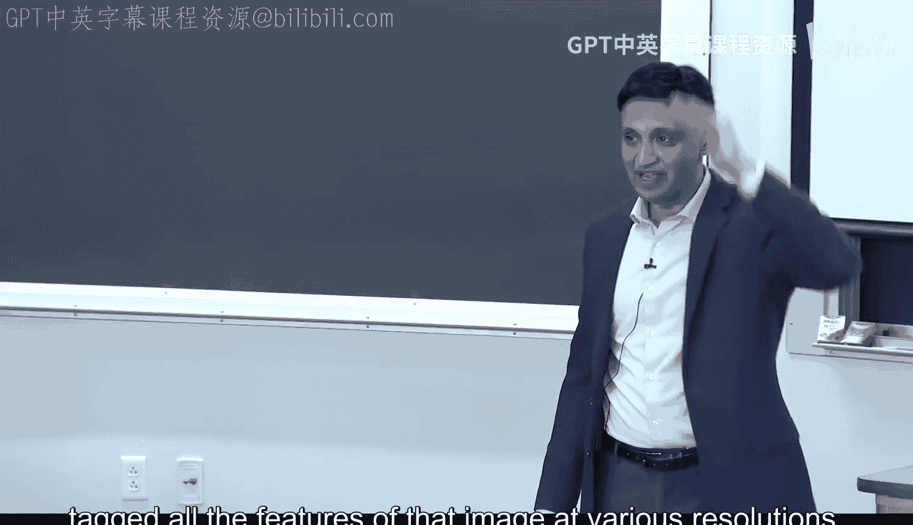

Is there a trade between doing great policy as opposed to adding additional convol layers。

 I'm thinking if you had a video it would turn it into a black and white static images in a sequence as opposed to。

Showing in a colored video with the talk。There is a trade off if your particular data set and input has there is some very important domain knowledge that you want to encode。

When you set up the network so that the network doesn't waste its capacity。

 learning things that you know have to be true。 then yeah， modify the input。But if you're not sure。

Right then you want to just the network learn whatever it can as long as it' is focused on predicting accuracy as well as possible。

 then just let it be。😊，Allright， so that's a basic idea。 And again， I'm sorry。

 this notability thing is is is not working。 but take a look to really understand how this max polling thing business works。

 Okay， Oh， I think I skipped over this。So when you have something like this。

So this， let's say， is a tensor coming out of some convolutional layer， and it size is 2，24 by 2。

24 by 64。 Then you apply something like a pooling。 The thing I want to point out is that the pooling will work with every slice of the tensor。

😊。

Okay， so if the tensor is 224 by 224 by 64， it has a depth of 64。

 which is basically like saying it's got 64 tables of 2，24 by 224。

 and the polling will work on every one of those tables。😊，Which means that。

The 64 will you'll still have 64 things at the very end。

 It's just that every one of the things of the 64， the 2，24 by 24 will shrink to 112 by 112。😊。

So each table shrinks due to pullinging， but the number of tables does not change。Okay。

 so by the way， this。Link here。beautiful explanation of all these things with a little bit more complexity as well。

 from a course start at Stanford in like 2018 or 2019 or something I forget。

 So just check it out if you're curious about this stuff。 It's really good。😊，Okay。All right。

 so that brings us to the architecture of a basic CNN。 And so what we do is we have an input。😊。

Okay， we take that input。 We run it through a bunch of convolutional and pooling layers。

 So this is a convolutional layer。 And then we pull it， which is why it has shrunk in size。😊。

AndThen it goes through another convolution layer。 Then we pull it， which is shrunk again。

And then it keeps on doing it。 So we have a series of these things These are called convolutional blocks。

 So a con block is typically， you know， want to do convolution layers followed by a pullinging layer。

😊，So you have a series of convolutional blockss。Okay， and the thing to notice is that。

As you go further and further in the network。The blocks will actually get smaller and smaller。

 because of。

Max pooling， right， you got smaller and smaller， but theyll get longer。

 they will get deeper and deeper。😊，O。And they have empirically figured out that that actually that model of reducing the size。

 the height height and the width， But then making it deeper tends to work really well in practice。

And so。In fact， my apologies to the live stream that I can't use iPad。 I'm going do it on the。

 the board。

So let's say that you have a picture。Which is。Coming in as 224。2，24。 And then you have， say。

 three of them。Because it's a color picture。 So you have three of them。

Can you folks see this。 Okay， All right， So right， let's say this is the input coming in and restNe。

 which is a very famous network that we are actually going to work with in a few minutes。😊。

When it actually gets done with all this convolution polling business。

The final tensor that it has is actually of shape。😊，7 by 7。But it is 2048 long。Okay， so it。

 it has gone。 It has processed something which is 2，24。

24 times 3 to much smaller heightened width just 7 by 7。 but it's got much deeper，2048 layers。😊。

This this this is a numerical example of what I am talking about there in terms of as you go along。

 things get smaller but deeper。

Right。当。Yeses。Is the reason that it gets deeper， because each。

because each layer has a single feature that is picked up and then it gets stacked。

 It's not so much that each layer has picking up a single feature。 It's more that basically。

The way I think about it is that。The the the number of atomic features that you may want to detect or probably not that many。

 right， lines， curves， gradations and color and things like that。

 But the way in which you can combine these atomic features。Epic real world things。

 is's combinatorial。It's sort of like， I have 10 kinds of atoms。

 How many molecules can I make from it。You can make a lot of molecules from do and Arabs。

 which means that you better give the network the ability to capture more and more of these possible things that the real work had come up with。

😊，And so every， as the depth increases， you have more filters and every filter has now have the ability to pick up some combinatorium combination of what's coming in。

😊，Sorry， a quick question related to this story right now。

 like our model is being trained to detect specific features like a line。

 a color or something of this。But still it doesn't have meaning to this， right Like still。

 they don't know if that。Org is a sun or is it eye， right。So， yeah。

 so we don't tell it what to learn。 It just learns。

 All we tell it is make sure that you minimize the loss function。 Now， once it is finished learning。

 if it's a good network， it has good accuracy， then we can introspect。

 We can peek into the internals and try to understand what is it learning right And sometimes you like you saw the face detection example。

 It's actually learning interesting things like basic lines and edges and then slowly you know。

 more complicated shapes。 and then finally like entire human faces。

 Sometimes it may not be understandable。😊，And the way it's doing this is by constructing features。

 not by learning。Like， how do you figure out what it's learning， Oh， I see。

 So I'm going give a reference in just a few minutes。Readthe the paper。

 That was one of the first ones to actually visualize what what these things are learning。

 And that'll give you an idea of how it actually works。 And I'm also happy to talk about it offline。

 It's a bit of a tangent， but it's a really rich tangent。 So if， if I keep talking about it。

 I'll end up spending 10 minutes on it， So I'm going back off。😊，Okay。All right。

 So now once we do that。Okay， now we are back in familiar territory where we take whatever tensor is coming out from these convolutional operations and pulling operations。

 And then we just flatten them only now into a long vector。 And once we flatten them。

 we can connect them to some good old dense layers。😊，Like we know how to do。

 And then we finally connect them with whatever， you know， output layer you want right In this case。

 this example is using some multiclass classification of classifying images to what kind of automobile or whatever it is。

 So it's like a softm。 So this is a gentle framework。😊。

我K。Any questions？要。Can you explain again how the death。Increases exactly like。Oh。

 the depth increases because you decide what the depth is。So when you add a convolutional layer。

 you decide how many filters it task。 So you just keep adding more and more filters。

 the later on you go in the network。So it's video cancer。 So remember。

 the number of neurons in a hidden layer is in your control， right，  Similarlyly。

 the number of filters is in your control。 It's a design choice。😊。

And we design it so that the later we go， the more depth we have。Laer。

Each of those layers has a different filter applied to the end。Yeah， a layer is made up of filters。

 And so the depth just comes from having lots and lots and lots of filters。

 And you get to choose what they are。Alright， so now。

 let's go to the fashion Mnes collab that I did the video of walk through on and then actually solve it using a convolutional network。

😊，All right， cool。 So at this point， I'm going to zip through some of this stuff because， you know。

 the preliminaries have to be done， import all these packages， set the random seatd here。😊，Great。

 and then， we will load the Ms data set。 just like I did in the collab yesterday。

 we created these little labels。😊，And then we just have these standard functions to plot accuracy and loss that we have been using so far all right now we come to the convolutional thing and so as before were we're going to divide it by 255 to normalize everything to a0 to1 range let's confirm to make sure that the data nothing has gotten tampered with yep we have 60。

000 images each one is 28 by 28 in the training set now。Convolutional networks。

 they expect the input to have three channels， or it expects to have like an additional thing。

 which is like a channel。The color images have three channels。

 but black and white images have only one channel right one table of numbers。

 so instead of saying 28 by 28， we tell this the convolution layer expect 28 by 28 by 1。😊。

It's same thing conceptually， but that's the sort of the format that it expects。

 And so we go here and then we say， all right， there's a thing called expand dimension。

 I'm just telling it to expand its dimension。 And once I do that， you can see here its still 60000。

 but instead of 28 by 28。 it has become 28 by 28 by 1。 same thing。Okay。

 now let's define our very first CNN。So， all right。As before， the。

 the input is just careed that input as before no difference here。 And we tell it the shape。

 And the shape is， of course， just 28 by 28 by 1。 Okay， that's what I have here。

 And then we come to the first convolutional block。😊，So， and this is the key thing。

If you want to tell Kas to use a convolutional layer， you use this keyword， layers con 2D。From this。

 you can probably also figure out that there's a con 1 d and there's a con 3D and so on and so forth。

 which you know explore， it's really good stuff。 but for image processing con 2 d is all you need。

 And now we tell it how many filters you want so we decided on the number of filters So I've decided to have 32 filters and then we also have to decide the size of the filter right the simplest size is2 by2。

 So I'm just going go with that。😊，Right， kernel size is 2 by 2。 And then the activation is。

 of course， Re。 I give it a name， convolution 1。 And then I you the input。 And then once I do that。

 I followed up with a little pooling layer， which I where I use max pool 2D。😊，And max pool 2D。

 you just literally pass the input。 you get the output back。

 It just shrinks everything using pooling。 So that is a first convolutional block。 And you know what。

😊，I know how to cut and paste， boom， cut and paste， I get the second convolutional block。😊。

Okay here is a second convolutional block and I know in just lecture I mentioned that as you go deeper you get more depth to it。

 but this is just a starting point I'm just going to use the same depth not a big deal。

 it's a simple problem， so which is why in the second convolution block I'm still using only 32。😊。

But you can totally go to 64， for instance， to make it much deeper， okay。And once I do that。

 I finally come to the point where I flatten everything into a long vector。

 then I connect it to one dense layer of 256 neurons。😊。

And then finally I come to the softm where I have 10 outputs， right，10 categories of clothing， softm。

 and then I tell careras， okay， take this input and the output， string them up together。

 define a model for me。😊，So that's it， that is a convolution network。

 The new concepts we are seeing here are conf 2D for the convolutional layer and then maxpo 2D for the max pullinging layer。

😊，Okay， that's it。 coming。 So let me just run this thing。

Okay， good， yeah。How do you decide when to flatten and would there everous situation in which we just kind of use the method that we used before and not use CNN。

Well， we already tried it with MS right， We didn't use a CNN。 We just tried it right a bit。It it was。

 is's not bad。 but we are like， you know， can we do better than 85 or 8 or whatever the percent was。

 right， So， but we are working with images。 It's typically a good idea to just start the CNN straight of the bat because you're not losing it。

 You're not giving up anything。So in terms of how many layers you should have。

 my philosophy is not simple and if it works， stop working on it， if it doesn't add bold layers。😊，呃。

要。Yeah still it architecture designs， the number filters size layers on trial So typically is based on trial and error to answer your question。

 But as you will see in the transfer learning discussion we're gonna have soon， you can actually。

 instead of doing anything from scratch， is much better to just download a pretrain model and just adapted for your particular problem。

 That is actually the norm by which people do these things。

 The reason I'm doing it from scratch is because you should know how it was done。😊，Like you。

 it should not be a black box to you。 That's my goal。Yeah。Just from an not perspective。

 I noticed name all of these layers X。 have we should get to name them all the same or actually。

 I'm not naming the layers as x。 The what， What's going on here is I'm feeding it X。

And whatever is coming out of it。 I'm just calling it X。 That's all。

 It's just a notation convenience for me to I'm I'm just calling the input and the output。

 And careas under the hood will track everything and make sure the right thing happens。 Otherwise。

 I have to be like x 1， x 2 x 3， x4。 And then if I want to add a new layer somewhere in the middle between x 3 and x 4。

 I have to call that x 4。 And then Ill change everything to 5，6，7， complete pain in the neck。

 That's why I do this。😊，Allright， so model do summary。It has got 302000 parameters。

 I'll just plot it。Greatai， and I encourage you to hand calculate it later on and make sure the numbers tally。

 Okay for now， let's just go So as before we'll just use the same compilation。

 we'll use at and then we'll train it for you know just 10 epos。

 we'll use a validation spit again as usual of 20%。 so we'll just run it。It's actually going to run。

 And as you will see， condition networks， there is a lot more going on。

 So it's going to be a bit slower to run， hopefully not too much slower。

When it's doing other questions。So if we have a task， other than image classification。

 we still flat a model。正星。Yeah， so this is for image classification， for other kinds of applications。

😊，Typically， you run it through a bunch of convolutional layers and so on and so forth。

 But the output side of the equation gets much more complicated because if instead of classifying just the whole picture into。

 you know， dog or cat， if you have to take every pixel and classify it， right。

 then well you better have an output shape， that is the same dimensions as the input shape。😊。

So for that， we use a different architecture。 It's called unit and so on。

 which unfortunately I won't be able to get into。 But I am planning to post another video walkthrough where I show you how to use the hugging face hub to very quickly build models for the other applications like segmentation and so on。

 I'm hoping to post that tomorrow。 It's an optional viewing thing。 that might help to that。😊，Okay。

 so is it done。 Okay， good， it's done。 Alright， let's plot the thing here。Alright。

 so it seems like training is going down nice and nicely。

 Validation is sort of flattening out somewhere here on the 8th epoch。 Let's look at the accuracy。

Same situation here， The accuracies in the 90s。 Of course， the final question， of course。

 is how it well， well it does on the thing。Whoa，90。5%。😮，It's pretty good。By the way。

 if you're not impressed that we went from 88 to 90。

This is the these applications are the proveial sort of diminishing returns problems okay so what you should always think of is look at the amount of error that' is left and ask yourself how much of that error am I able to reduce so you we had 12% roughly of error left when we had the simple collab yesterday from that 12% we have knocked up two of the 12% to get to over 90 which is amazing。

😊，Okay， and in fact， I think the state of the art on this。It's 97%。So， I invite you。

To take this thing and try different filters and so on and so forth to see if you can get to the like the mid 90s。

It is not easy， but try it yeah。The number of e bookss has be related to the。No。

 the epos is an independent the epoch is just a number of passes to the whole data。

But within each pass， within each epoch， the number。

 the batch size tells you how many batches you're going to process。

 So it is basically the number of examples you have in your training data divided by the batch size that you have chosen。

Right， that number rounded up is the number of batches within each hippo。

And here I'm just choosing 10 because， you know。Sney found something on the Web。 Okay。

 I chose 10 because gonna be fast for me to do it in class。

 And 10 is actually more than enough because you can see it's already beginning to overfit。😊，嗯，要。

This is more of a conceptual question， but is it always the case at a neural network？

Better accuracy machine learning algorithm。 I'm asking more on the case of the heart disease。

 Oh yeah， yeah， great question。 So neural networks are really good for unstructured data。

 like the ones we are having here。 But if you have structured data like the heart disease problem。

 sometimes it actually works really well。 sometimes things like gradient boosting X G boost work really well。

 So if I am actually working on a structured data problem， I'll try both。

 I'm not going axichematically assume that the D is going be the best thing。

 But if you have structured data， it's the best game in。Alright， I'm just gonna。 by the way。

 I have a whole section here on。 Once you build a model， how do you actually improve it， right。

 check it out。 It's an optional thing。 Alright， I'm going stop this here。 Alright。

 So the next thing I want to do is。😊。

So we went from 88 to 90 plus percent， right using convolution networks。 Now。

 let's work with color images。 Let's kick it up an notch。😊，So。I actually。Web script。

All these pictures for you， folks， for your enjoyment。

 web scraped about 100 color images of handbags and shoes， each hundred。

 roughly  hundred handbags hundred shows。 So the question is， with these essentially 200 images。😊。

Can we build a really good neural network to classify handbags and shoes， right。

 It seems kind of absurd， right， because 200 examples， I mean， it's not that much， right。

 It doesn't feel like a lot。 The Mnes data fashion has 60000 images。😊，So there was no， you know。

 even with that， we are overfitting in like 5，6，7，80pos。With 200 images， maybe， you know。

 is there any hope， Obviously， there is hope， Otherwise it won't be in the lecture。 So， yeah。

 so we are going to take this data set and let's see what we can do with it。

 So we will first actually build a convolution network from scratch to solve this problem， okay。😊。

Alright。I'm actually going to run through the code because at the end of it will have a live demo。

 So I would like one volunteer to give me a handbag and one volunteer to give me their footwear。😊，Hy。

 in class。Okay， so all right， unlike the previous data set， this one， actually。

 I just web scraped it。 So I just， you know， it's' I've stuck it in the Dbox folder。😊。

Let's just download it and unzip it。 And once we do that。

 we have to now organize it with these 200 images， so。

I have to do some sort of sort of Voingish Python stuff here。

So here what we are doing is that we have 100 handbags roughly 100 shoes and what this code is doing is it actually creating a directory of saying it's splitting stuff into train and validation and test and then for each of the splits it's doing the handbags and the shoes folder okay so once we do that basically this directory structure is created。

😊，Okay， training， validation folder， test folder， handbags and shows， in fact。

 actually I think you can see it here。😊，See here， handbags and shoes。 And within that， there is。

 you know， train test validation。 And within each of these， there is handbags and shoes。

 So the idea is that when you're working with images， right。

 what you can do is you can just create folders for each kind of image。 right， Let's say dogs， cats。

 two folders with cat images and dog images。 and then just point cares at it。

 Itll automatically figure out those are the labels。😊，That needs to use。

 So it's really convenient when you're working with images。

 And the book explains this thing in great detail。Alright， so when working with these images。

 color images， we will follow this process。 We will read in the JPex。 We'll convert them to tensors。

 And then since I'm web scraping it， they all come in different shapes and sizes。

 So I need to like bring it all to the same size。 Okay， I resize it。

 And then I'm going batch it into whatever。 I'm going to batch it using a batch size of 32 here。😊，So。

 and this utility from Kas will do all that for you， right， very quickly。So basically。

 what it says is that I found 98 files in the 98 images in the training data belonging to two classes。

49 in the validation and 38 in the test。 So less than 100 examples in the training set。

 That's what we have here。Alright， what's the time30。 Okay， So， allright。

 now let's just check the dimensions to make sure got so 2，24，224 by3。

 And the reason why did I pick 2，24，224， As you will see later。

 you're gonna to use something called Renet。 and the renet expects it to be 224 by 2，24 by 3。

 That's why I res it 224，224。 Let's look a few examples of my wonderful web scraping in action。😊，喂。

诶好的。It's pretty violent， right？Okay， so we have now let's do a simple convolution network。

 And before we would take all the x values in fashion abstract and divide them manually by 2505 and normalize it to 01。

 Well， you know what we are actually graduating to the higher levels of ks now。

 So let's not do that right manual stuff is bad。 So we'll do it within kas by using something called the rescaling layer where we just tell it how much to rescale and boom it will do it for you。

 The first convolution block， just like the fashion is 32 second block again，32 max pool flatten。

 And then here we only have handbags which a shoes just a sigmoid is enough right。

 it's just a binary classification problem。 So I'm just using one output layer with a sigmoid。

 and that's our model。 So let's do the model。😊，Alright， model summary。Hundred03。

01000 parameters in this little model。 Okay， let's compile it and run it。 And note here。

 because it's a binary classification problem。 I'm using binary cross entropy。Sam Adam。

An accuracy compile。 And then boom， let's run it。 We root for 20 epochs。ho你。荒。O。

 while it's doing this business， I'm going to shift to the PowerPoint。

So we'll go back to see how well it did。 But the question is， whatever it did。

 we built it from scratch。 So the question is can do better than that。 Okay。

 because you only have 100 examples of each class， and which brings us to something very cool and very powerful called transfer learning。

 And the idea， So the key thing is there are two research trends that are going on that we take advantage of the first one is that researchers define design architectures。

 which exploit the kind of input you have。 So Olivia ask the question。

 if you have a particular kind of input images， do you actually change the input or do you actually change the network。

 as it turns out， here， for example， if it's images， we know that we should use convolution layers。

 because convolution layers were designed to exploit the imageness of the input。😊。

O，Similarly， if you have sequences of information， like obviously in natural language， audio， video。

 gene sequences and so。 these things called transformers were invented。😊。

To exploit them and just spend a lot of time on transformers starting next week。

 So that's the first trend。 The second trend is that researchers have used these innovations to actually create and train models on vast data sets。

 And thankfully， they have made them publicly available for us to use。

 So transfer learning is the idea that if you have a particular problem。

 Let's just take a pretrained network。 somebody may have already create it。

 And then let's just customize it to our problem。 rather than actually build anything from scratch。😊。

Okay， that's the basic idea。 So， so here we have this。 Basically， we have to build a classifier。

 which takes in an arbitrary image and figures it if it's a handb or a shoe。 right， That's our goal。

😊，And so now handbags and shoes are everyday objects。

 And so what you can do is you can look around and see if there are any networks that have been trained by other people which actually have been trained on everyday images。

 as opposed to like MRI or Xrays， specialized images， everyday images。 Of course。

 the first thing you probably do is to see if everybody has built the specific thing you want handbag shoes specific on Github。

 assuming it's not。 Then you do transfer learning。 Okay。

 so now it turns out that there is a thing called imagenet。

 which is a database of millions of images of everyday objects in 10 different categories。

 furniture animals， automobiles。 you get the idea。 Okay。

 and so we can look for networks that have been trained on imagenet。😊。

Okay， let me just go back to the call just to make sure it doesn't time out。Alright。

 so it has finished doing it。 Let's just plot these things。O。

 so there is some outfitfiing that happens around here。The training and the 10th epoch。

 let's look at the。History。So the the training accuracy is actually getting to almost to 100%。

 but we are not in prospect training accuracy， right， We care about validation and test accuracy。

 And that seems to be kind of hovering around in the 80s。

 So let's just evaluate it anyway to see what happens。Okay。

 so it gets to 87% accuracy on this data set。😊，It's actually pretty good。

 given that we only have 100 examples。 So 87% accuracy， but we pretrain the whole thing。 sorry。

 we did everything from scratch。 Okay， now then I'm going there is this whole section about data augmentation。

 which you know what。 do we have time，😊，So。So the idea of augmentation is that when you have an image。

Let's say you take this image and you just rotate it slightly by 10 degrees。

If it's a handbag before you rotated it， it sure as hell is a handbag after you rotated it。Right。

It doesn't change。 The meaning of the image doesn't change just because you rotated it slightly。

 Or maybe you zoom in slightly。 You zoom out slightly。 You crop it slightly。 Nothing happens。

So what you can do is you can take any image you have and you just perturb it slightly。Like。

 write that and then add it as a new example to your training data。It's an unbelievable free lunch。

 frankly。The same thing， actually， same kinds of techniques actually work for text also。

 which would cover later on。This broad area is called data augmentation。It's a great way。

 when you don't have a lot of data to artificially bolster the amount of data you have。

And so and of course Kas makes it very easy for you to do all these things it has already predefined a whole bunch of data augmentation layers for you so here's a little example where I basically take a picture and then I randomly flip it so if it looks like this I flip it this way horizontal okay and then I randomly rotate it by 0。

1 if I if it's 01 degrees or radance you can look up the documentation and then random zoom zoom in and out a little bit but it won't do this for every picture。

😊，You only do it randomly。 Okay， so that only some pictures will get perturbed in some ways。

 And that's how you make sure there's enough diversity of pictures that you have。😊。

So once you do that。You actually take a picture and see what it does。

I just randomly could up a picture so it keeps changing every time。Yeah， look at this handbag。

And back slightly rotated this way， rotated that way。Some more。

 maybe a little bit of zooing going on and so on。 You get the idea， right。

 And there's a whole list of these things you can do。 But when you do those things， make sure。

That what you're doing doesn't actually change the underlying meaning of the picture。

 Its very important。Okay， so， for example， if you are working with satellite data。

Very careful not to do flips of crazy flips。Or even if youre working with everyday images。

 horizontal flips are okay， don't do vertical flips。

RightHow many times will you have an upside down dog picture that you need to classify。

augmentmentation doesn't go nuts。啊。Okay。Once you do that。

 you can actually just insert the data augmentation layers in your model right there right after the input。

 the rest of it can stay unchanged。😊，So this is a great way to increase the size of your training data and here is a model and then I invite you to actually just play with it and train it。

 we won in the interest of time， we won't actually train this model but it's the Q you could just try it。

 It also figures prominently in homework one， by the way。

 data augmentation So you'll get more experience with us Okay so back to the PPT。😊。

That's what we have。And so any network that has been trained on this imaginary thing turns out。

 learns all kinds of interesting features in every one of its layers。

 So here this is the first layer。 And you can see it's picking up sort of gradations of color。

 sort of lineish kind of behavior。 layer too。 It's actually picking up。 Hey， look。

 it's picking up an edge。 Can you see the edge。😊。

Like， like that。AndThen layer 3 is picking up these interesting honeycomb shapes and so on。 Oh。

 it's actually this thing is already already picking up like the shape of a human torso。😊。

It is actually picking up what looks like a labbrador retriever。Oh。Isn't that cute。

Even if you're not a dog person。All right， so the this。

 this the visualization I was referring to earlier to figure out what are these networks actually learning。

This paper was one of the first ones to actually visualize what's going on inside。

 So if you folks are curious how these pictures are actually produced。

 I would encourage you to check this out。😊，OK要。sorry。

 you spoke about images and you refer to classes。T next week can transformers。What about same email。

 which has both text and image， and there'll be white spaced different？His Li To。Image for。

So we'll revisit this great question a bit later on in the course。So the answer is a bit complicated。

 So I don't want to， I want to do justice。 So we come back to it。Alright， so。

 so it turns out this thing called Renet is a family of networks which were trained on this image data。

 and they did really well in this competition that's associated with the image data called Inet。

 And so this is an example of such a network。 So we would expect the weights and the parameters of restnet。

 given that it's been trained on imagenet to sort of have some knowledge about lines and shapes and curves and things like that。

 So maybe we can just use that right So so the idea is the thing is we can't use restnet I is。

 because remember， it was trained to classify an incoming image 0 possibilities。😊。

Here， we only have two possibilities， handbags and shoes。 So what we do is very simple and elegant。

 We do just a little bit of surgery。We take restnet and stop just before the final layer。

 So take my word for it。 this thing here， what it says is fully connected thousand。😊。

Because it's got thousand way， right， thousand objects。

 So what we do is we just take everything except and we swap just before that last layer。😊。

And then what comes out of that layer， hopefully will be like a very smart representation of the images that has been trained on。

And so what we do is we can think of sort of headless wristNe。As our model。And we can take that。

 We can take all our data and run it through Resnet up to， but not including the last layer。Okay。

 you get some tensor。 and that tensor is probably like a very has a very rich understanding of what's going on in the image。

 all the objects and features and things like that。 And then we can just simply connect that。

 We can think of it as like a smart representation for input。

 We can connect it to just a little hidden layer。 and then we have a little sigmoid。

 which tells you handbag or show。 We can just run this network。😊。

Okay， and so since the outputs to the hidden layer now are not raw images anymore。

 but this much higher level of abstraction that R has learned。

 hopefully it can get the job done with hardly any examples。😊。

Okay， and now you can get fancier。 That's the basic idea， but you can get much fancier。

 You can connect up headless restnet directly with our little network with a hidden layer and the final thing。

 And the whole thing can be trained。😊。

En to end。 But when you do that， you must start the training with the weights that you downloaded with Re because that is the crown jewel that's been learned。

 So you want to start from there。 and you will do this in homework one。

Okay， allright， by the way， these pre train models are available all over the Internet。

 There is the Tensorflow hub， the Pytorch hub， and then there is the hugging face hub。

 When I checked it on the 13th yesterday， it had over half a million models available。😊。

We don't know half a million。

I think last year it was like 150000 when I taught the course。 So yes。I was just wondering。

 doesn't give this makes。分じないます。Because you weeks。there is some adversarial risk。

 I'm happy to talk about it offline。😊，Allright， so that's what we have。 So back to Collab。Okay。

 so that's what we have。 This is Renet。 So what we do is， and Resnet is all packaged up。

 It's available for download。 So we download it here。😊。

And you see here that I'm saying use include top equals falses。So basically。

 you were telling ks the top， the very final layer of the thing。 Don't give it to me。

 Just give me everything up to but not including that。 And of course， I think of it as left to right。

 people think of it as bottom to top。 So the very， very top layer don't give it to me。

 you're telling it so that you don have manually go and remove it。😊，Okay。

 and then I'm not going to summarize， well， I'll just summarize some order just show you how big it is。

OK。23 million parameters。Thatnet okay， and I won't plot it because then I'll be scrolling for five minutes。

 So let's just do this now。 So what we're now going to do is we're going run all the data through this thing and whatever comes out in that penult thing。

 I'm going to just grab it and store it。 So that's what this thing does。😊，Right。

 and now we create this a little handy function to do all these things。And once I do that。

 every image has been sent through Renet up to， but not the final layer。

 And then whatever comes up with the final layer， we are storing it。

 And then we are going to create a network where well only feed that layer。

 that information to a simple network。O。So what is coming out of reNe， you can see here。

98 examples in the training data， and each example is now a 7 by 7 by 2048 tensor。😊。

That's what came out of Western。 And you saw。 that's what I did there。

OkayAllright so that's what it looks like。 now let's just create our actual model now right we have our input which is just a 7 by1 by242048 we flatten it immediately then we run it through a dense wave a 256 re neurons and then we use dropout which I haven't talked about yet which I will talk about early next week but and we'll come back to it don't worry about this detail for the moment and then we just run through a sigmite。

😊，Okay， and that's our model。Finished， plot the model。 This is what we have。 Okay， model summary。

So forth。 Allright， good。 Now let's actually train this thing。

I'm just gonna to run it for 10 epos because I tried running it previously。

 and it seems to do a fine job。 but just an epos。 Okay， it's already done。

 It's so fast because we ran everything through this monster retlet thing and basically took all the output values and use them as a starting point。

 right， We don't to run it every single time。 So you can see here。 The accuracy is。😊，Quite high。Well。

 interesting。 So the 10th epoch， something bad happened。So maybe should stopped in the 9 epo。

 I didn't see this yesterday when I was running so much for random reproducibility。

 So let's just run this。 Oh， wow， look， on the test set， it's achieving 100 percent accuracy。

unbelievable。 Okay， folks， now， for the moment of truth。 Alright。

 I have a little quote snippet here to capture stuff from the webcam。Because that last epo went down。

 I'm a little worried it that the demo is gonna flunk。But you know what。

 we all have to live dangerously， so。So here's a little function to predict what's going to happen。

 Okay， now I tried it at home yesterday， by the way。And he's like， yeah， it's a handbag。So， O。

 now let's just do something else。Okay， any volunteers？I want a piece of footwear or a handbag。

Like a backpack， right？I don't know。 It feels like an adversarial example。 But yeah。

 let's just try it。Okay，No disrespect。 I let me， let me go with the shoe first。

 I have a better chance of it working。So it's a pretty big show。 If it can't get this show。

 I'm worried about this model。Allright， so。喂，好啦好啦好啦。Right。Please don't get distracted by my hand。

After。It's a shoe。 Look at that。Few， all right， thanks。Okay， now， let's try that。

 I'm feeling kind of brave now。Thank you。 All right， let's do this。Right。And capture。

But it's better side。

It's a handbag。 glad。I swear every time I do the demo I age a few years，All right， folks， I'm done。

 Thank you。

