# 《动手深度学习｜15.773 Hands-On Deep Learning Spring 2024》中英字幕 p05 -05-5_ Deep Learning for Natural Language – The Basics.zh_en -BV1ELraBoEtg_p5-

Okay， so today we start the， the natural language processing sequence。

And so just to give you a quick idea， we're gonna start with what's called vectorization。

 and then the bag of words model。 And then we'll spend a fair amount of time on a co。

 And then on Wednesday， we talk about these things called embeddings。

 which you'll come to appreciate over the the next couple of weeks form like the sort of the core atomic unit of all modern natural language processing。

😊。

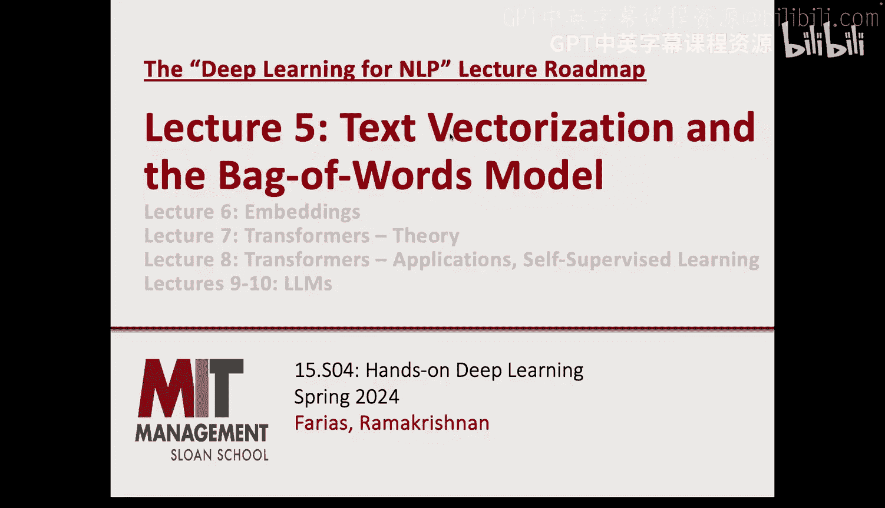

And for that matter， vision processing as well。 And then we will following week。

 we'll do transformers， two lectures on transformers， We'll get into the theory。

 and then we'll get into a bunch of applications。 And then lectures 9 and 10 will be all L L Ms。

 all about L L Ms。 So it's gonna be a lot of fun。 This is one of my favorite segments of the class。😊。

Of course， truth be told every segment of the class is my favorite。 So don't judge me。 Allright。

 so let's get going。 So why why natural language processinging。 you know， these are in some sense。

 the things I have on the slide here are sort of obvious。

 but I think is actually reminding ourselves of how important text is but everything we do obviously human knowledge is mostly encoded as text。

 the Internet is mostly text。 at least this was true till the ad of T talk and YouTube。

 and human communication is mostly text and cultural production， you know， movies， books。

 arts and so on so much of it is so text heavy。 And so in some sense。

 text forms not just a big chunk of all the media that's out there。

 but it also happens to be the way in which we think and communicate and so on and so forth。

 So it's sort of primacy is in my opinion， sort of unparalleled in how we think about the world。

 And so the the tantalizing possibility is that imagine if we had an AI system， which。😊。

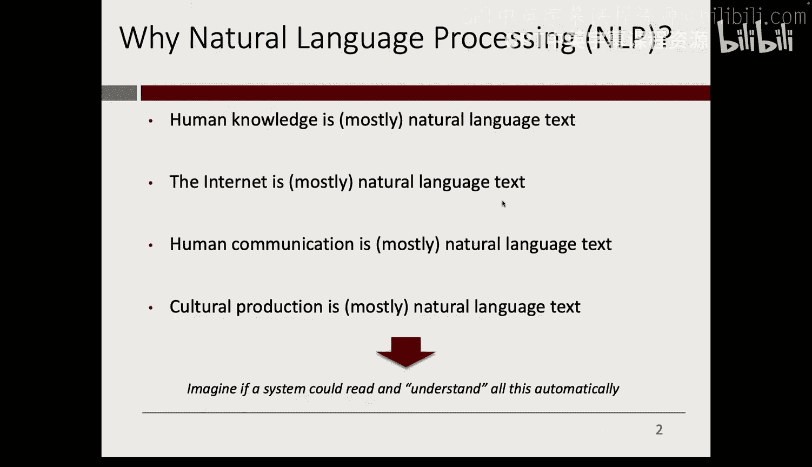

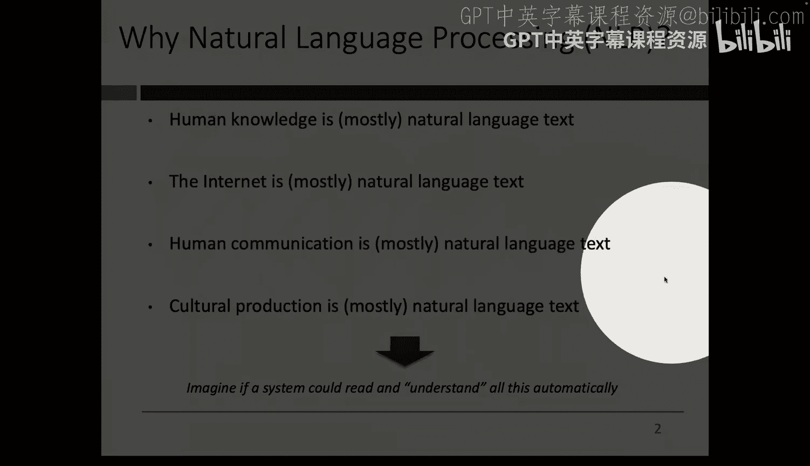

Could just read and quote unquote， understand all this text， right。

 And so you can imagine such a system reading all of pubmed， reading all the medical literature。

 And then coming back and saying， you know， for this particular disease， you know。

 this particular sort of protein is actually the malfunctioning protein。 And for that。

 that small molecule is going dock into the protein and cure the disease。 And you didn't know this。

 It came back and told you that， wouldn't it be unbelievable。😊。

So my feeling is that such things are going happen。

just it's not gonna happen soon enough for my lifetime， but perhaps it'll happen in yours。

Alright， okay， so let's continue。 So N LP is an action all around us。 you know， according to Google。

 apparently， Google Autocomplete， which uses a fair bit of N LP， saves 200 years of typing time。

 apparently， every day。 I actually thought it was， you know， this。

 I wasn't very impressed with this number， frankly。

 because billions of searches are being done every day。 And I'm like only 20 years。 So anyway。

 But I think the more important point is that it made mobile possible。😊。

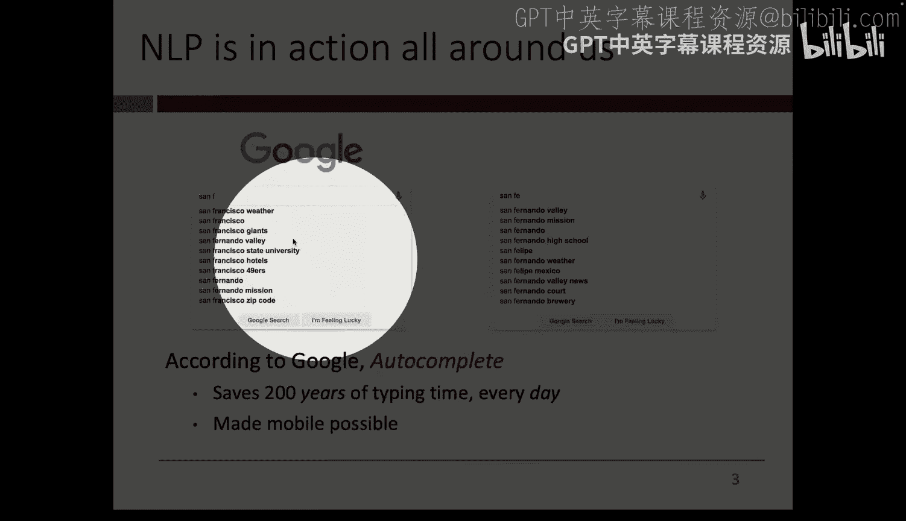

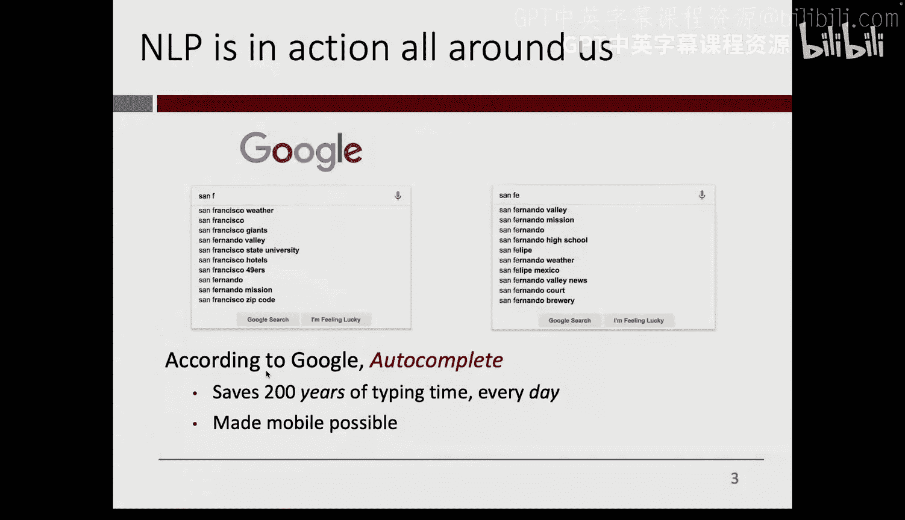

Right， if you， if you didn't have auto complete， people would not be， you know。

 typing and picking on their keyboards。 It's going to be much worse。

 You have had a hugely dampening effect on ecommerce-commerce。 For instance。

 So this humble little autocomp has incredible， incredible impact on the world economy。

And the other thing which I heard about， I'm not sure if it's00% true。

 but it's an interesting example。 Apparently the very first iPhone keyboard that came out， right。

 the soft keyboard， not the hard keyboard。 They had some very basic you know。

 sort of word continuation prediction going on。 And so if if when you start typing T and H。

 Obviously， it's going guess the E is going come next。😊，Right， so that part is old， old news。

 Nothing new there。 But apparently， the E letter in the keyboard will become slightly bigger。

So when your finger goes towards it， it has a better shot of actually connecting with it。

 right So these kinds of things are used to change the U I in real time in a whole bunch of applications。

 And you don't just don't even realize it。😊，Alright， so， and， of course。

 we all know about Lms at this point。 So I asked it and write a lime about the beauty and part of deep learning yesterday And it says in a world where data flows like a stream。

 deep learning is more than a dream， sift through the noise with an elegant po。

 unveiling insides the gle。😊。

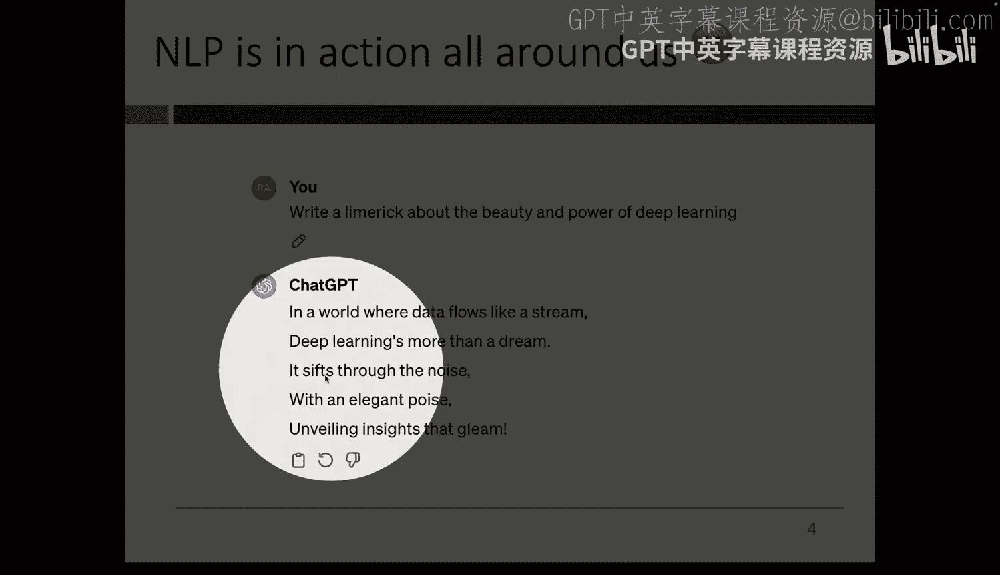

All right。Alright， so let's get back to work。 So N LP has extraordinary potential for making product service and services much much smarter。

 And what I want to point out here is that， you know， even if you focus on this very。

 very simple sort of formalism。 right， A bunch of text comes in。 A bunch of text goes out。 That's it。

 if you take that very simple text text formalism。 This little humble little thing has just an enormous enormous range of applicability。

 right， So obviously， you can send a bunch of text in and ask it to classify it right know。

 sentiment route it for customer support， you can try to figure out the intent of what the person is asking in search。

 you can filter it， you can content filter to make sure there's no toxic abusive stuff going on。

 I mean， the possibilities for just text classification or numerous。

 Okay but that's that's sort of a use case And youre kind of right So no surprise there。

 Now text extraction， we may be less familiar with here。

 And the idea is that you can actually look at a lot of unstructured textual data。😊。

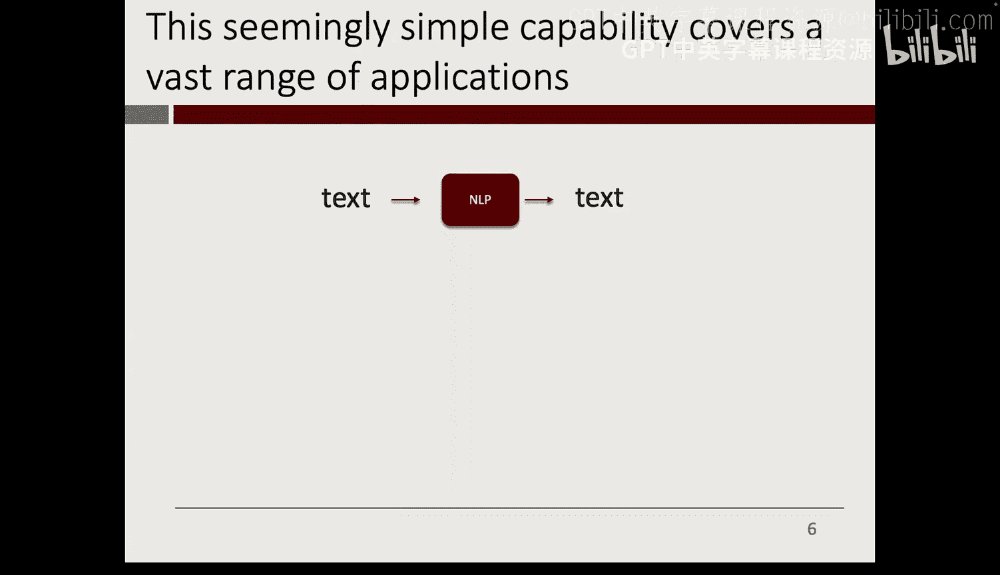

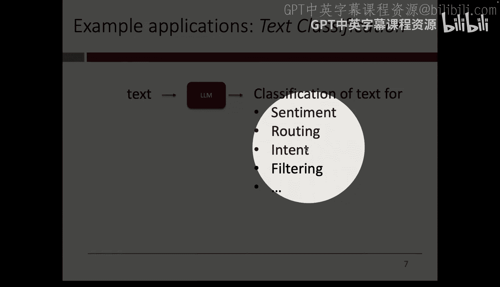

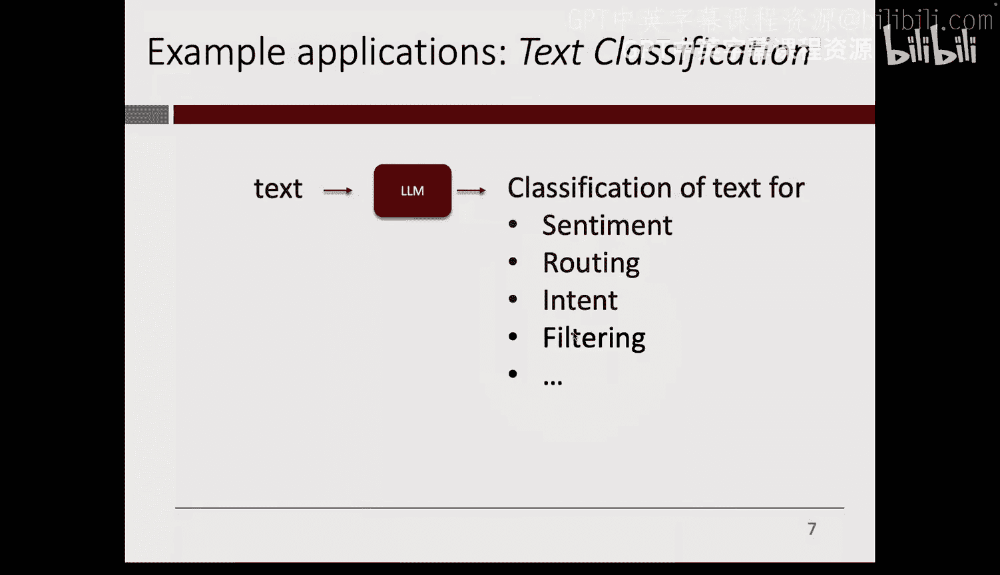

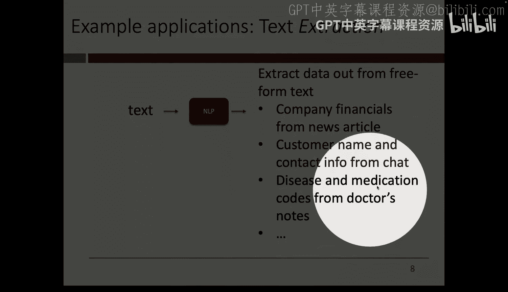

And extract all sorts of interesting entities from it， right，dge hedge fundss use it heavily heavily。

 They will extract all sorts of company information from news articles。

 And then obviously doctors notes， there are a whole bunch of NP startups that will take the doctors。

 the doctor patient conversation， transcribe it and then extract disease codes， diagnosis codes。

 medication codes and things like that。 right So the possibilities for this are enormous。 Of course。

 text summarization。 And we all have been doing it。 to chat G。

 take text in and any kind of summary that comes over the text is just text out。

 Okay and then text generation。 of course， we can take text and do marketing copy， sales emails。

 market so on so forth。 And including troublingly for educators， college application。😊。

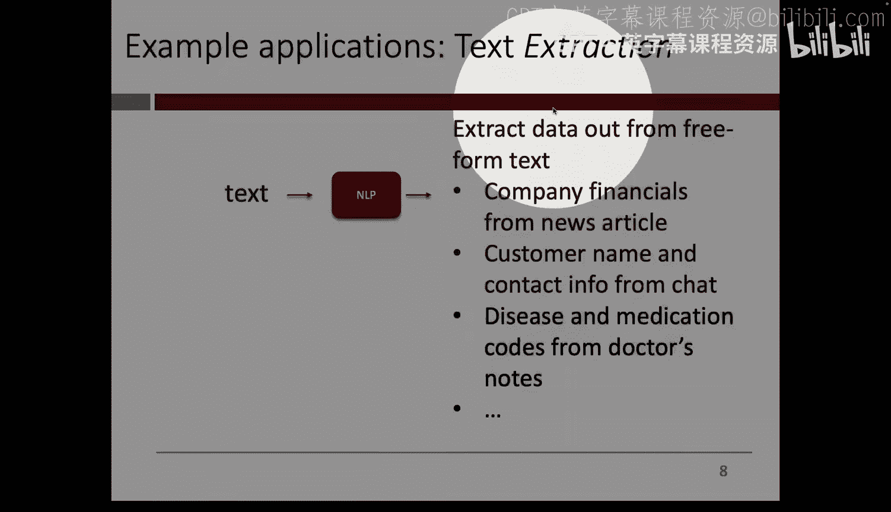

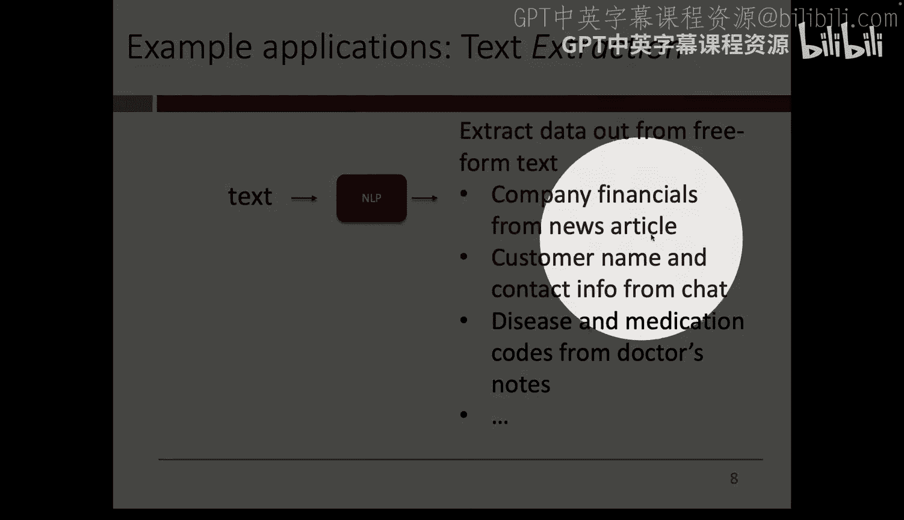

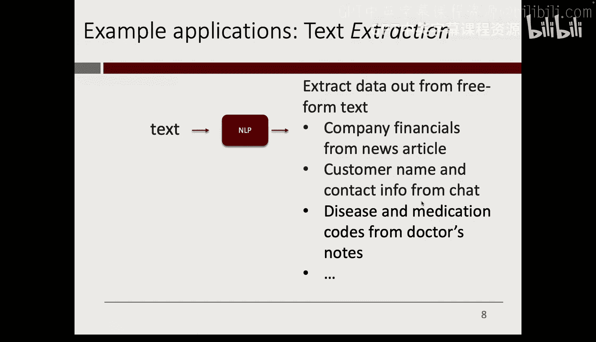

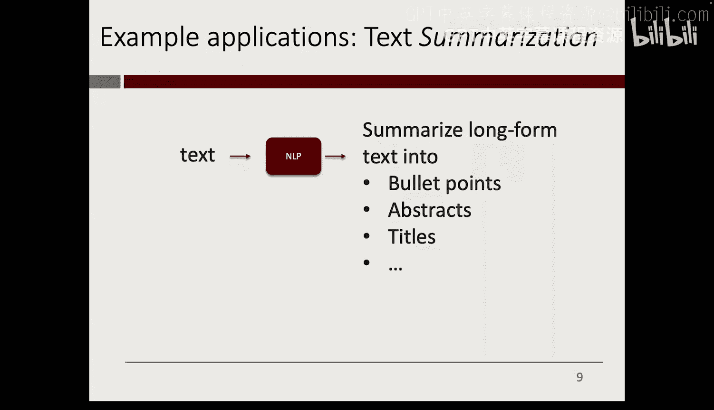

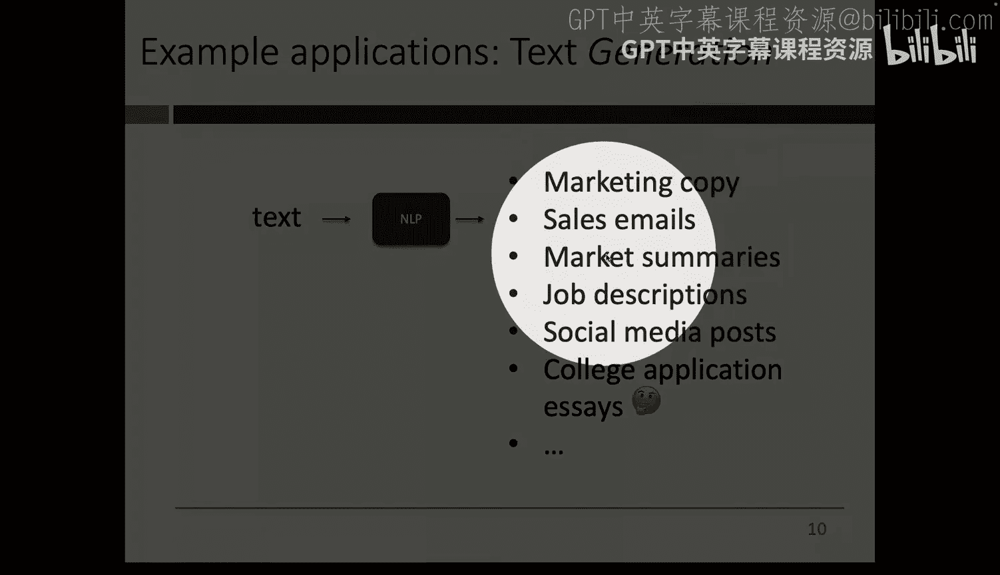

对。Code generation is a more subtle example of text out， because code is just text。 right。

 So text in text also covers text in code out。😊，O。And question answering。

 So you can take a bunch of text。

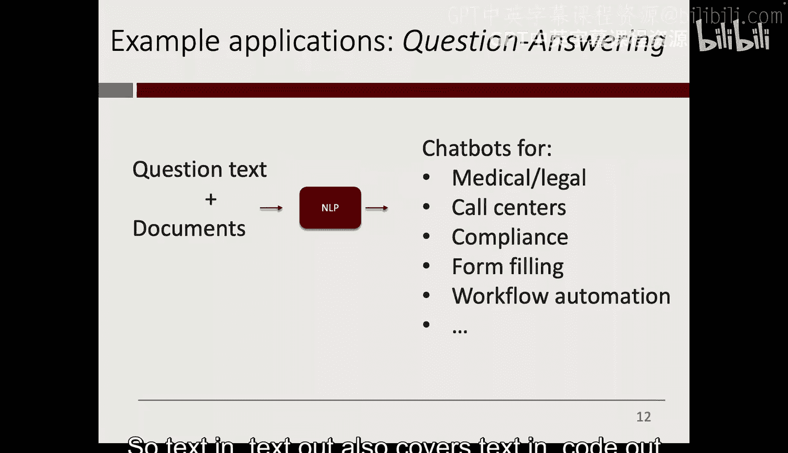

You can take a whole bunch of documents。 You can add a bit of text to it， which is your question。

 And this whole thing at the end of the day is just text Cad。

 And then you can have you can use it to answer questions and therefore create chatbots for all sorts of interesting applications。

😊。

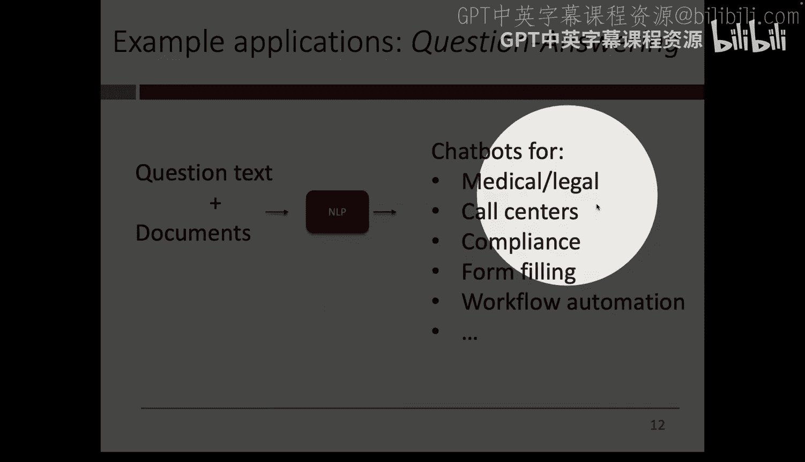

And， you know， if you look at this example， call centers。 thats。

 that is where a lot of money is being spent right now to build these call center chat boards for text and text or question answering。

 And so just if you drill into this， right， If you imagine taking all the call center transcripts and their internal product documentation。

 service documentation， F Qs， etc ce， stick it in， you can start to answer these kinds of questions。

 Okay， yesterday， what are the top reasons why customers were upset with us。

 What interventions made by the agent actually worked， what did not work。😊。

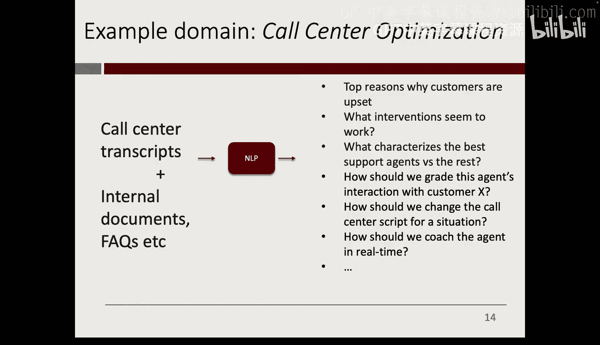

What characterizes the best agents from the rest？How should we grade this particular agent's interaction with a particular customer。

 How should， how should we change the call center script， How should we coach the agent in real time。

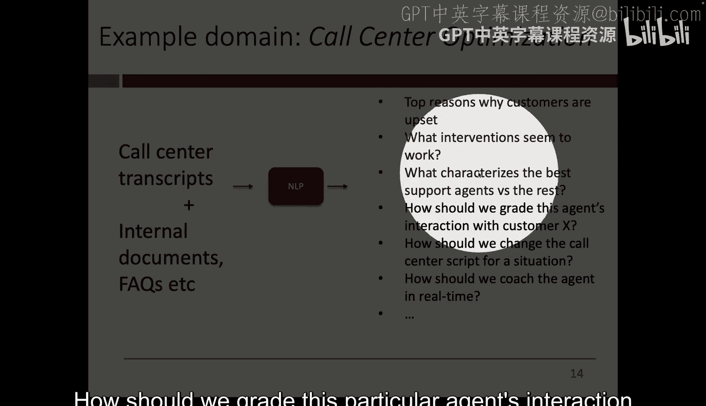

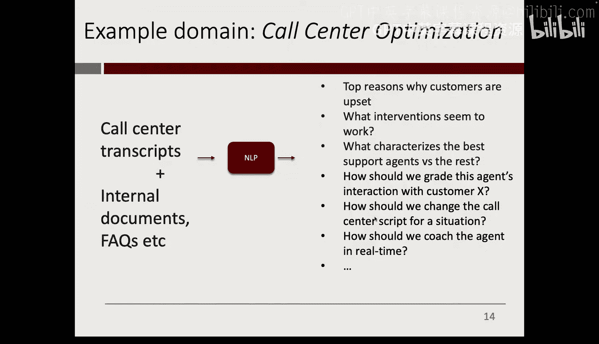

Every one of these applications is amenable to this very humble text and text or moral。Okay， and so。

 and， of course， the potential for is now everybody knows this potential because of the advent of large language models。

 By the way， Google released something called Google Gei 1。5 pro a couple of days ago and。😊。

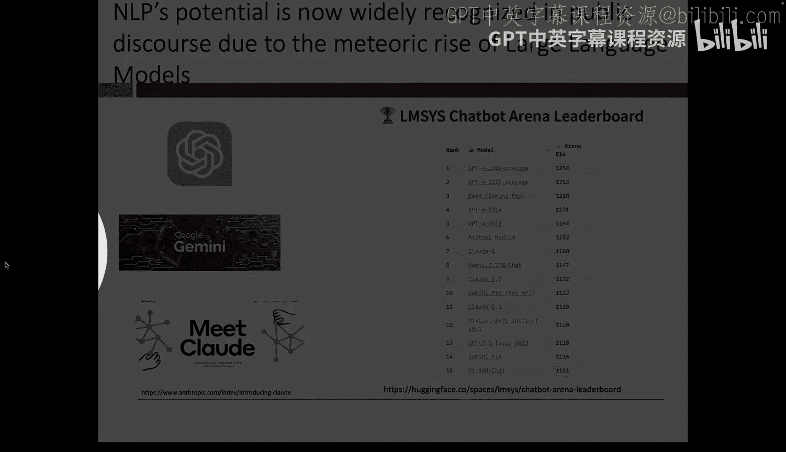

It's incredible。It's incredible， right。 And anyway， we'll get back to that later。

 But the point is that the kind of potential we have is just amazing， even for text and text。 Okay。

 and as you would imagine。😊。

This is all like， though we are calling it language， this is all pramatic English right。

There are lots of multilingual models as well。 There are multilingual models。 By that， I mean。

 models which are specialized to languages， non English languages and models。

 which are truly multilingual， like polylot models as well。 And both of them are available。😊。

Right now， and many， many modern L L M are actually trained from the get go to be multilingual in a bunch of the what are called high resource languages。

 languages， which are spoken by lots of people。 But actually it's funny to ask the question because this。

 this Google Gemini model that I just described。 They actually， so there is a language called Kaang。

😊。

Which is spoken by 200 people in the world。And so a researcher had created a one book。

Which is sort of like a grammar manual for color mon， right。

 because there are no other written works in that language。

And so what they did is they took a whole bunch of English dialogue。

 and this book fed it into Google Gemini 1。4 pro 1。5。

 and it translated into Kaang at human level proficiency。😊，It had never seen it before。So。

 that's an example。of this。啊。

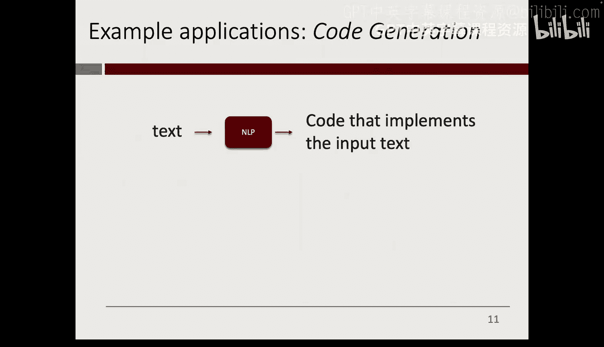

Yes。So the question is， the question text here is all the things you want to translate from English to Kaang。

 The documents here is just one document， S， the grammar book， the manual。

 And then what comes out is a translation。

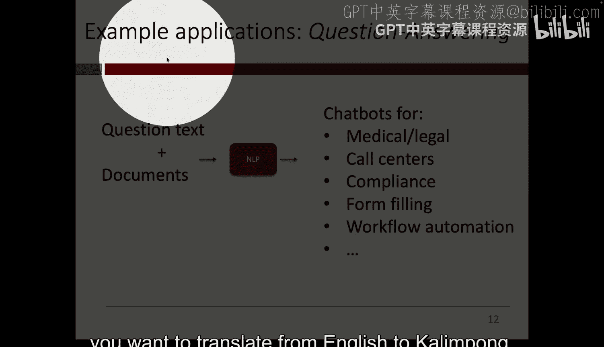

So these models， even when they are not explicitly trained on a different language。

 if you give them enough of sort of grammar manuals and stuff like that。

 they need do a pretty decent job from the get go with no train。It's kind of a shocker。

 Two years ago， people will be like， that's impossible。Allright， so。Back this。Alright。

 and as you folks， you know， may already know。 and maybe you're in fact participating in this gold rush already。

 you know， lots of people are creating lots of really cool companies to take some of these ideas and actually create really interesting products and services out of them。

 So if you're not doing it and if you've been thinking about entrepreneurial stuff。😊。

Here's the word of advice。 Take the plunge。Dismissed， No you're kiding。Alright， so。

 and as you can imagine， enterprise vendors are rushing to add N LP to all their products。

 Salesforce， Einstein now has Einstein GPT。 Microsoft has copit。 I mean， the list goes on。 Everybody。

 everybody is like scrambling and really trying hard to infuse some GT magic into whatever they are doing。

 Okay， Some of it is real。 A lot of it is not。😊，Okay， so let's go to like the artrc of N progress。

 How did we get to this kind of crazy times that we live in。

 So if you look at national language processing， basically efforts to take language and try to analyze language and do predictions with language and so on and so forth。

😊，The first phase of it was just handcrafted rules based on linguistics。

 So these are all linguists who would really understand the grammar of a language。

 And then they would use a deep knowledge of linguistics to figure out all these rules by which you can process and analyze natural language text。

😊。

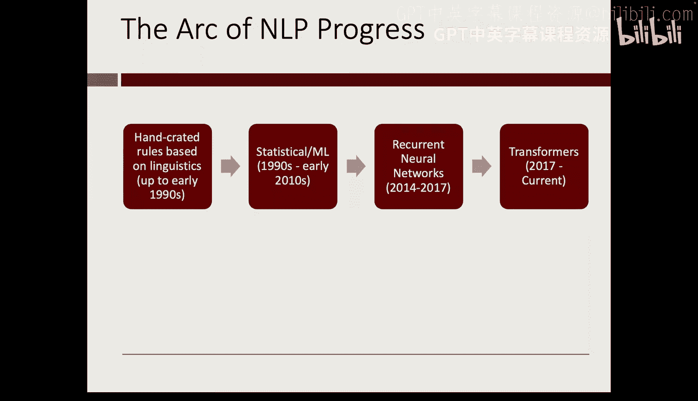

But and then this other thing came along， which is a statistical machine learning approach。

 which basically said， never mind all their complicated knowledge of linguistics and grammar。

 Why don't we simply count things。😊。

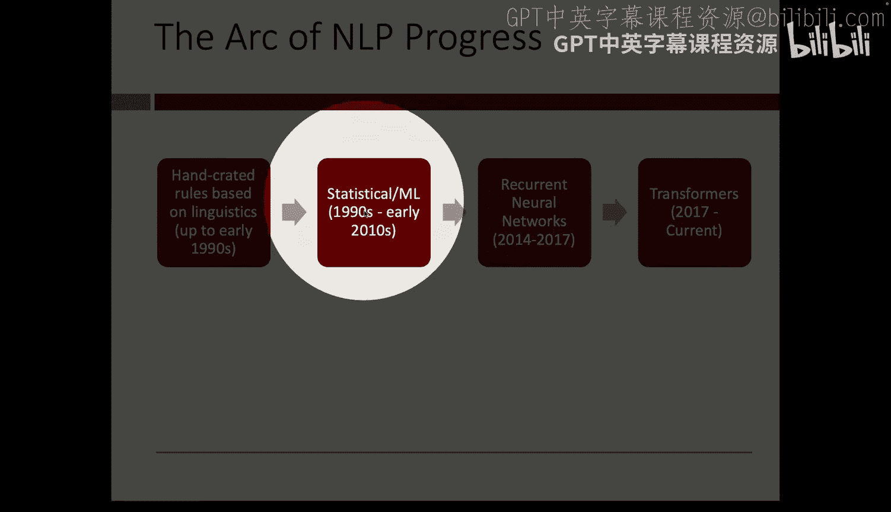

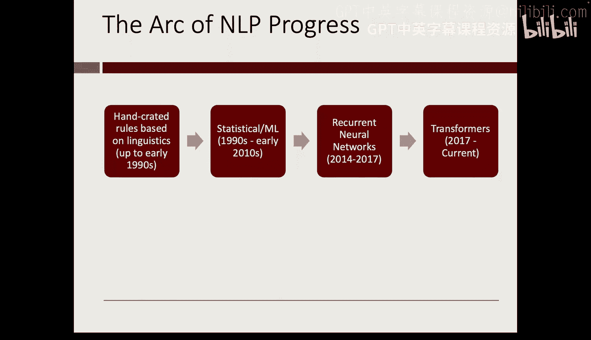

Let's count the number of time These two will co。 Now， let's count that。 Let's count this。

 Business count a lot。 Okay， and let's see if it does， right， if it does for predicting things for。

 say， for classifying， text and so on。 And shockingly， those methods ended up being really good。😊。

They ended up being really good。 And， in fact， they actually got better than the lovingly hand curated。

 linguistically driven rules。 Okay， so much so。 this is a famous quote which says every time I fire a linguist。

 the performance of a speech recognizer goes up。😊，Right， obviously made in jest。

 But there is a kernel of truth to it。

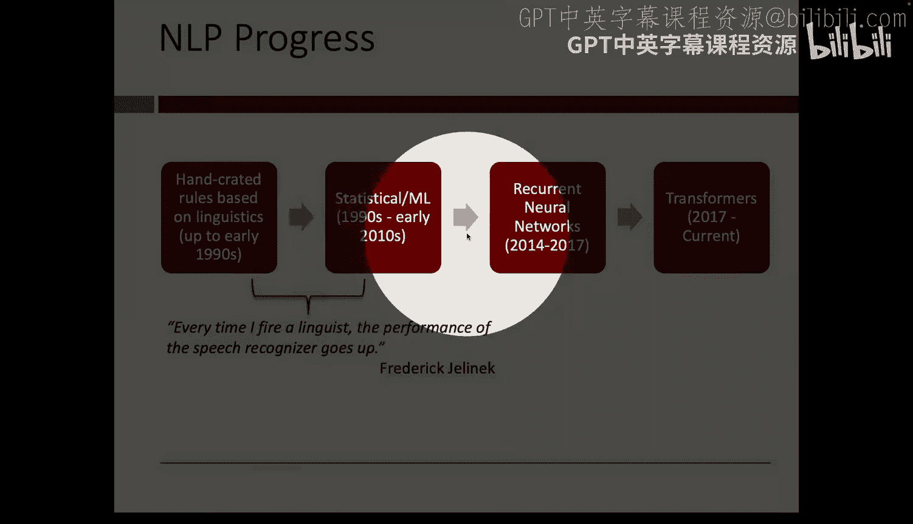

So that was， that's that's that's where we were。 And then deep learning happened。 Okay， in 2012。

 roughly。 And then we had these things called recural neural networks。

 which are based on deep learning， which actually moved the ball forward。😊。

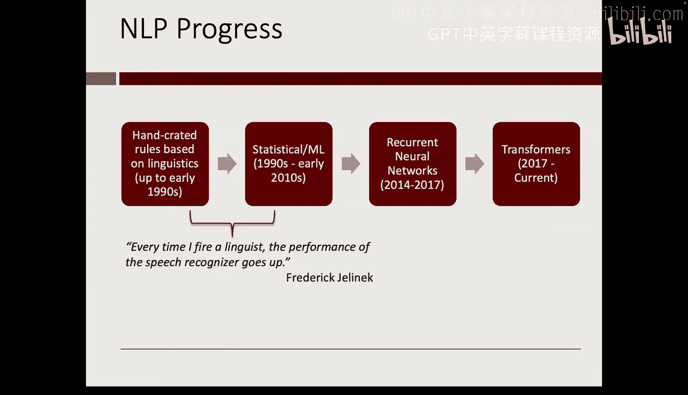

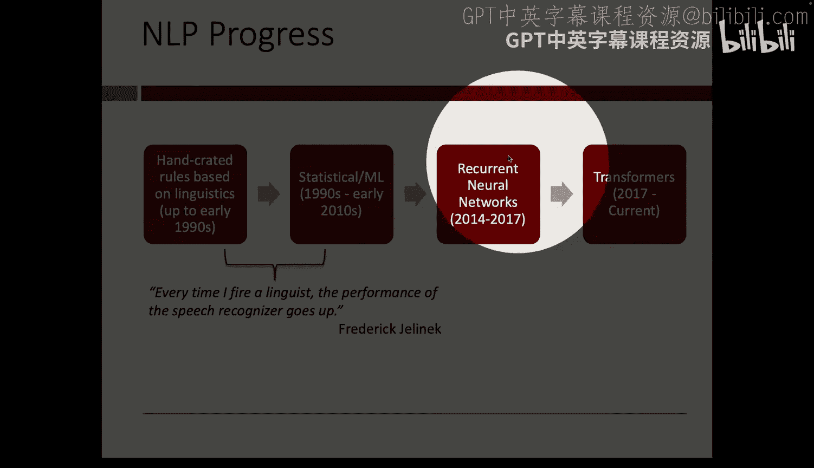

And then， in 2017。Something called the transformer， was invented。2017。

And the transformer replaced everything else。Across the board。

 So we are just going leapfrog directly to transformers in hurle。

 We will not spend any time on recurrent neural networks。

 And that is not to say that they are sort of dead。 There is there's a very interesting work。

 which actually is trying to now revive recurren neural networks to make it work for these kinds of modern LM kinds of tasks。

 but it's still very early days。 Okay， so for now， we'll just focus on transformers。😊，Okay， so the。

 the very high level view of the problem here is that like most things in deep learning。

 it's basically fancy regression。😊。

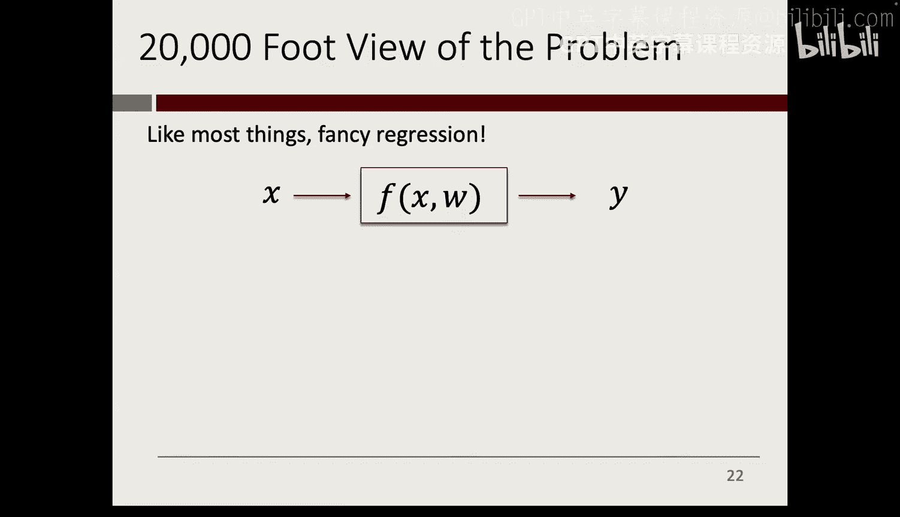

There some variable excerpt comes in。 It goes through a bunch goes this very complicated function。

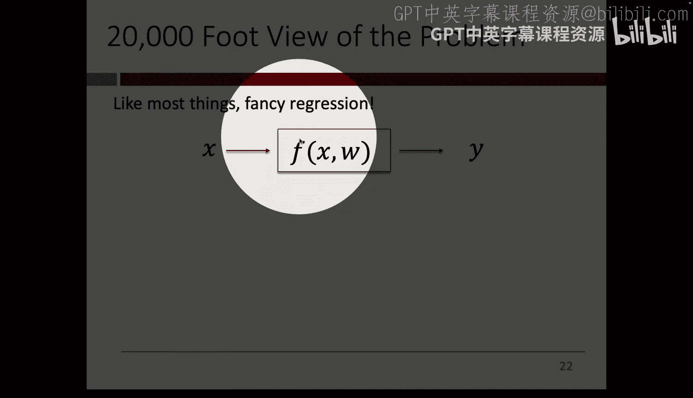

Along with this W， which is the weights。And then output pops and output， right。

 That just the view that you've always had。 And so in this case， X happens to be text。 Y can be text。

 It could be labels。 It could be numbers。 It could be anything else。 The W is the weights。

 and the function is a deep neural network， right。😊。

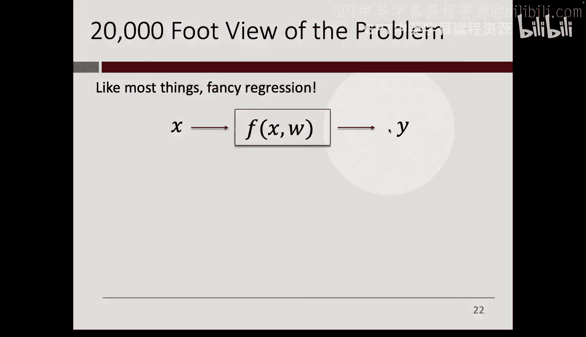

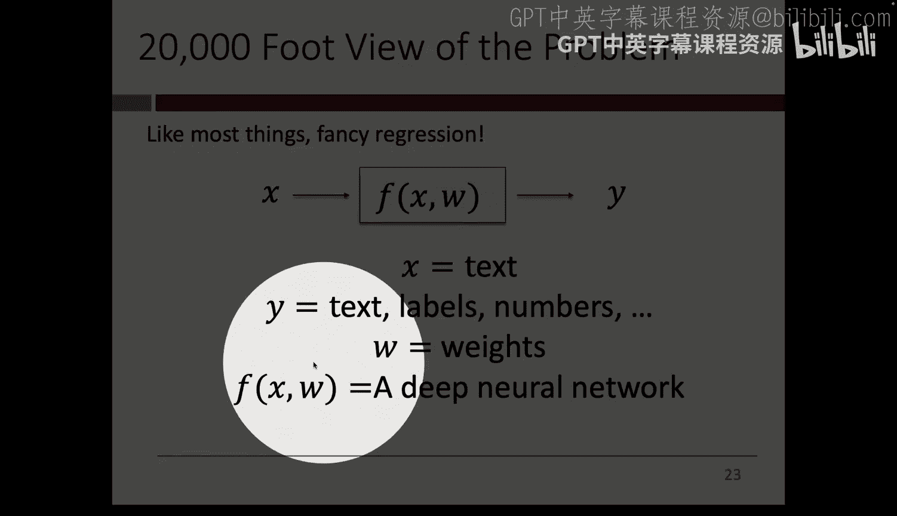

This， at this point， when you look at the slide， it should be like blindingly obvious。

So now the key question here is， how do you actually represent X。That's the key question。

For pictures， for images， we saw that we just took the pixel values。

 which were light intensity numbers between 0 and 2，55。 And you could just use that directly。

 But when when a sentence comes in， like， I love deep learning， like， what do you do。😊。

How do you actually represent it， Because remember。

 we have to numericalize everything that's coming in。So that's a key question。

 and this actually is a very subtle question， very important question。

 And we will focus on that today。And then next week， when we look at transformers。

 we will look at what neural network architecture is best suited to process this sort of text inputs that are coming in。

 right， Those are the two big questions we are going to look at。😊，Alright， so processing basics。

We are going to follow this very standard process。

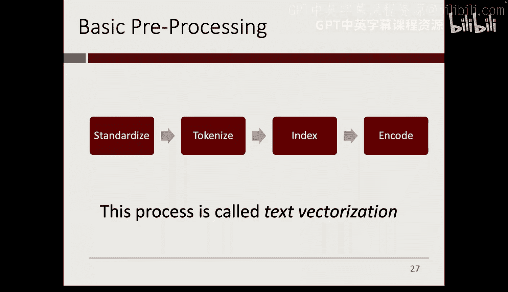

Thiss the process by bitch？We take any， any text that comes in and we do run it through these four steps。

 And this process called text vectorization。 And as the name suggests。

 that we are essentially taking text and creating vectors of numbers out of it。 right。

 text vectorization。 I go through each of these processes one after the other。

 So I just find it very useful to just have this acronym S T I。e in my head like T S T I。e。

 just keep that in mind， it may be helpful。 Allright， so be what we do is the setup here is that。😊。

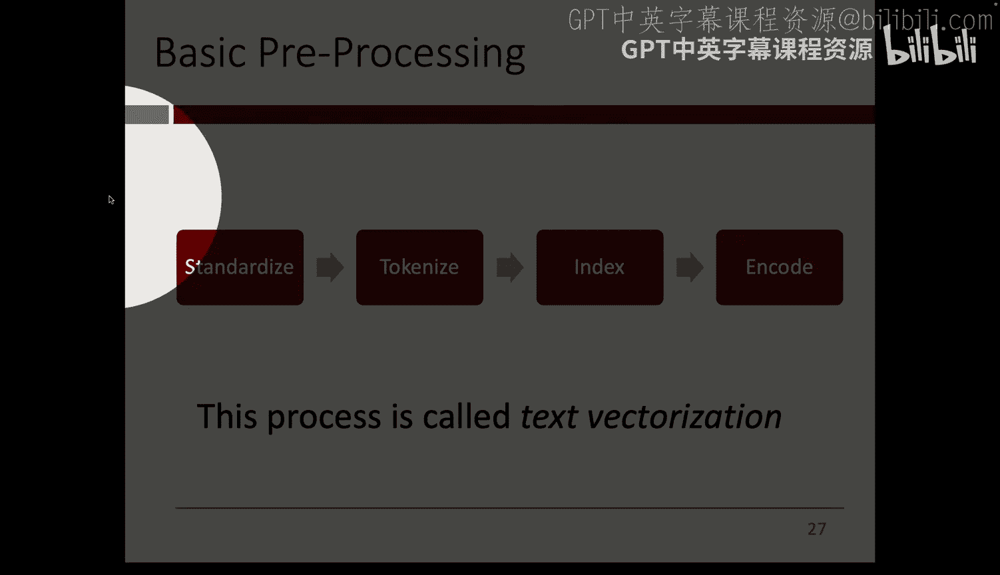

We have a whole bunch of documents。 right， We call it the training corpus。

 We have a whole bunch of text documents， text data。 And as far as we are concerned。

 you could just imagine it as just lists of long passages。 Okay， What is a novel。

 It just a long passage right of text。 So whether it's a novel or a sentence doesn't really matter。

 We just think of them as a big list of strings。 a big list of text。 Okay， that's a training corpus。

 And what we do is we take this training corpus， and we run it through。

 and we apply standardization and tokenization， which I will describe to this entire training corpus up front。

😊，Okay， so we first do this。And， and standardization is basically。

The default for most applications tends to be this。

 which is the first trip capitalization and make everything lowercase。

And then we remove punctuation and accents and so on and so forth。 Okay。

 that's the first thing we do。

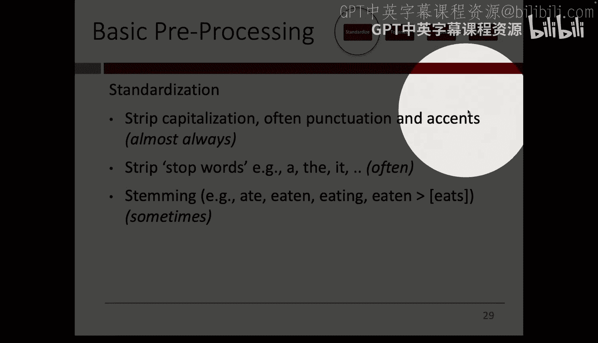

I'll talk about why we do it in just a moment。 But the mechanics of it are。 We do this first。

 Then we look at words like a the8 and so on and so forth， basically filler words， right。

 which which we we need to actually make complete sentences。

 But they may not have any value predicting things。 So we remove them。

 and they are called stop words。 And then finally， we take words very similar。

 which have sort of a same kind of stem or root。 And then we just map it to like a common representation。

 like8， E and eating， E all these things just becomes， let's say eats。😊。

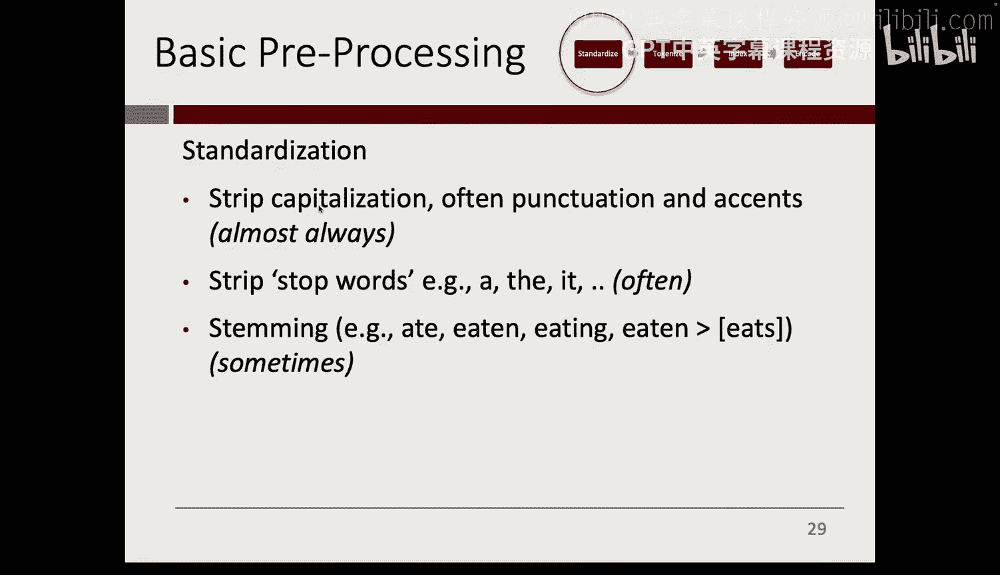

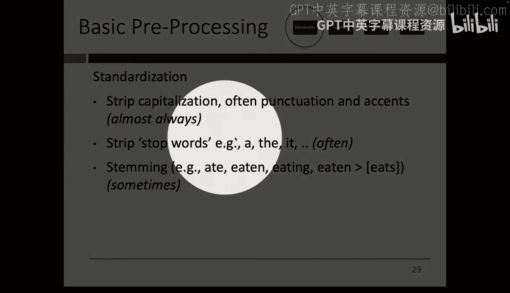

And we do that sometimes。 So this， we almost always do this， we often do。

 And this we do it sometimes。 Okay， now， why do we do any of these things。

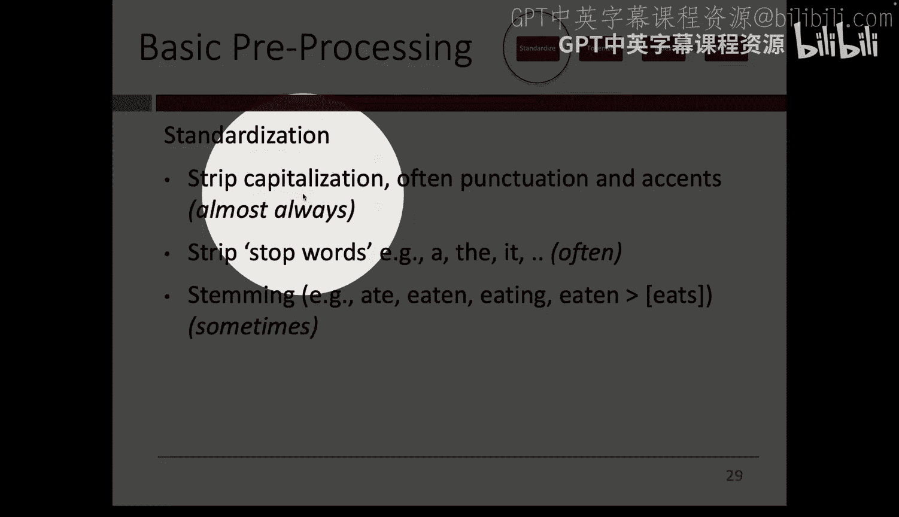

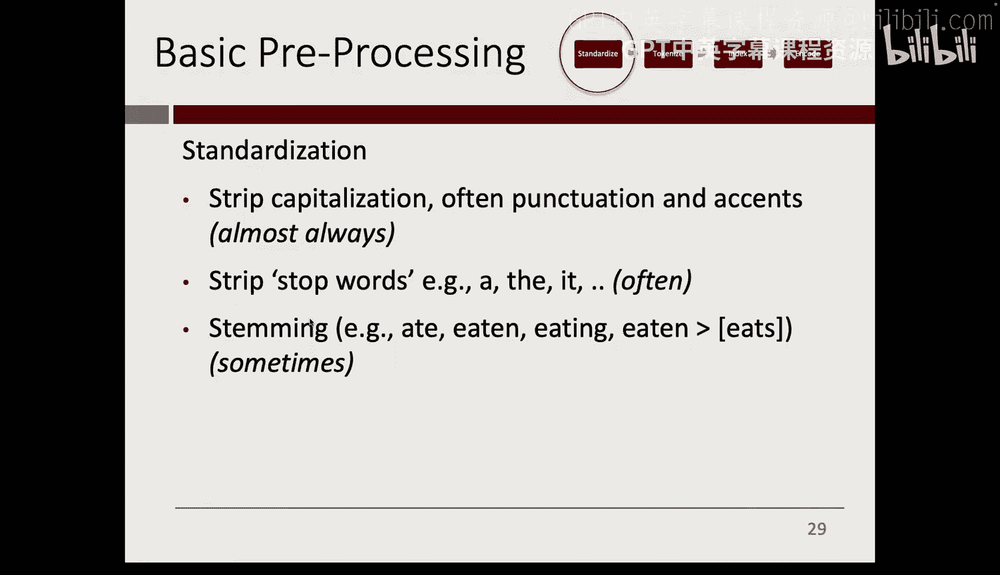

I think we want to try to record。好病。Its the word right it'。With the essential thing。Right。

 so want to try of sort of。That's right。Right， so why do we need to abstract。

 I guess you're absolutely correct。 We're trying to abstract。

 Why is there a benefit to doing this abstraction。

How about somebody from this side of the room。 Oh， yes。たそげ。So I went to。

W is it a good idea to reduce the library the size of the library。Because of the。

 the amount of competition needed。So that is part of the answer。 There is another part to the answer。

Which is。 Alright， let's swing to the right。Does it be。Ex。Okay， so I will go with that。

 But I think the the key thing we want is the， the key thing to realize here is that。

You want the model， much like when you go， when we talk about computer vision， we said， look。

If it's a vertical line， I want to be able to detect it wherever it happens。

I don't want the model to think that the vertical line on the left side is different from the vertical line on the right side。

 and then later realize they are the same thing because， you。

 I wasted valuable capacity learning things， which actually happened to be the same because they didn't know it was the same。

😊，So here， if you， for example， take a word and lowercase it， clearly the case of it。

 whether it's uppercase or lower case， most of the time it's not going to matter for anything you want to predict。

 So you're essentially telling the model， you know the lowercase version， the uppercase version。

 they are not different。 They are actually the same。😊，And the easiest way to tell the model。

 they are the same is just make everything lowercase。So that is the key idea。Okay， and similarly。

 if you look at stop words， the reason is that these stop wordss may not help you predict anything。

 whether a word Er and the showed up in a movie review probably does not affect the sentiment of the review。

And therefore， let's remove it。 So that's a slightly different reason。

Stemming is the same reason as the first one， which is that all these words kind of mean the same thing。

 We don't have to be super precise about it。 And so let' just like collapse them onto the same thing。

 Now that these are all the standard things we do。 that are totally notice， you know。

 important exception to all these things。 Okay， will come back to the exception a bit later。

 But that is the standard thing we do。😊，Makes sense。All right。So if you look at something like this。

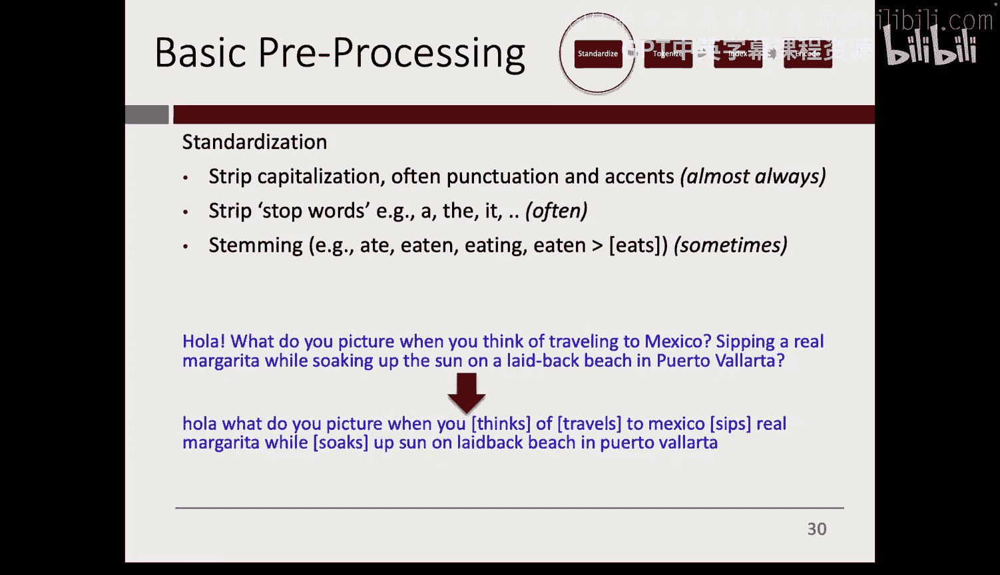

This sentence here， right， Ola， what do you picture when you think of travel to Mexico。

 boom And then you can see here， this is a standardized version。

 like everything has become lowercase。 Like the H has become small H。

 The punctuation has disappeared。 That's part of standardization。 And then travel。

 And you can see here that Mexico M has become small。 Sping has become sips。

 Think think has become things and so on and so forth。😊。

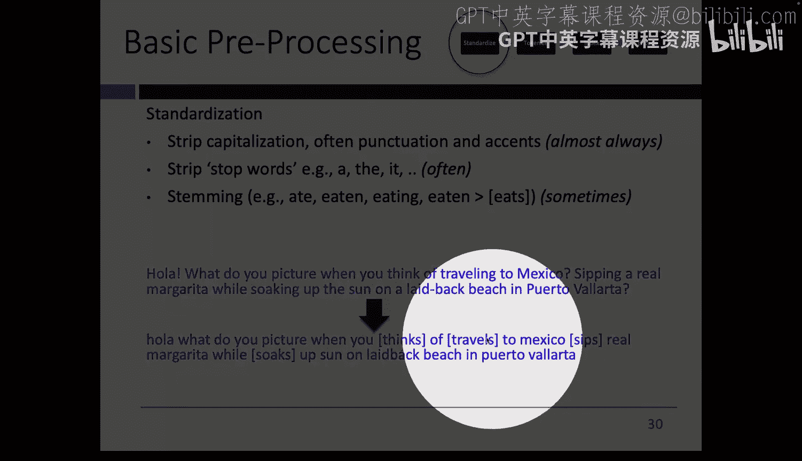

So that's an example of standardization at work。

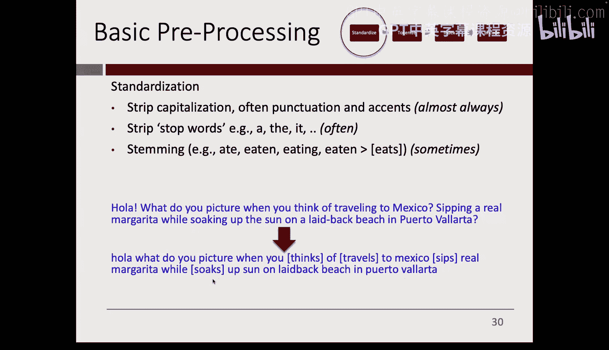

O。The next thing we do is something very important。 and it's called tokenization。

So what we do typically is that， okay， now we have standardize everything。 We have a bunch of words。

 We need to now split them into what are called tokens。

So the most common default is to just think of a word as a token。We just split on the white space。

 right， You take each string and wherever there is white space， meaning actual spaces。

 carriage returns and things like that。 boom， we just split on them and you just create words whatever。

 so。😊。

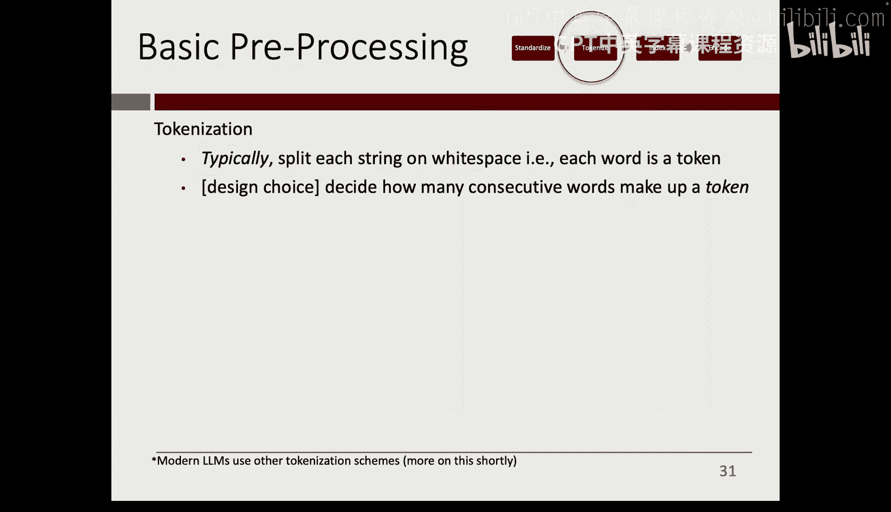

So， for instance， if you have this standardized sentence here。

 you just split it after every word and you get this thing。

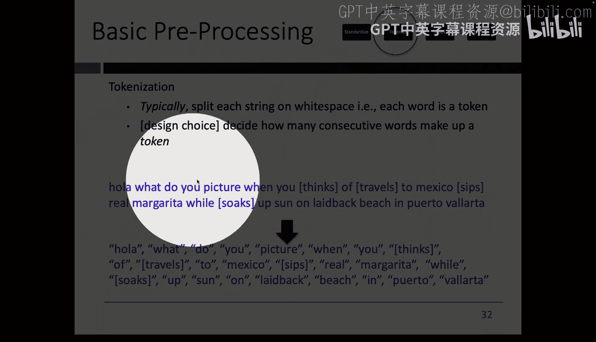

Okay， so each of these is now a token。Now， this has some disadvantages。

What are some disadvantages of just splitting on， on the space between words， yep。

I think we lose any context。Because when look at each word， super perfect。そ weの派に。发所。我さと知ない。Right。

 so， for example， the cat SAT on the mat and the mat SAT on the cat will have the same like set。

 right， Yeah， so you lose the order。 What are some other issues with it。

Her word spot should have to together like Port de Vallarta。That's my name。Correct， exactly。

 So there are compound words， right， like father in law， for instance。That's one problem。

 Another problem is it' lots of non English languages。

 They actually don't have this notion of a space between words。Actually， runs one after the other。

 And it is， and the native speakers know from context out to chunk it and break it。So， well。

 what do we do then。Right，Because you basically will have one word for the whole passage。1 token。

 The other problem is that there are languages。German is perhaps the most notable one in which have very long words。

Right。I saw a word， but I think I might have it in the slide somewhere this like this long。

 which means。You realize that something amazing is happening。

 but the rest of the world hasn't woken up to it yet。 It's that feeling。There's a word for that。

Amazing， right。Anyway， so， yeah， some words， Japanese， for example， there's a word called Commerrebi。

 Do people know the meaning of the word Commebi。有。It means the transient beauty of sunlight going through fall foliage。

😊，There's a word for that。 How cool is that。 Anyway， sorry， I love that word。 So back to this。

 So we have this thing here。 So there are all reasons for which splitting on the。

 the space between words are not gonna work， okay。😊，嗯。So what we will。

 So what happens is that modern large language models。So the what we have described so far。

 despite its shortcomings， is actually really good for lots of NLP use cases。😊。

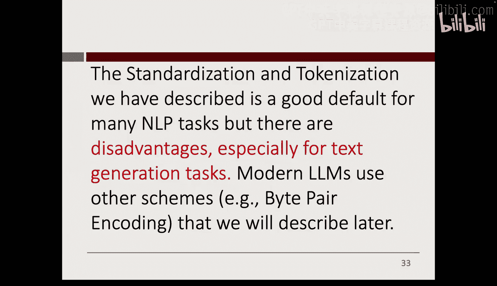

If you want to classify text as good enough， for instance。But if you want to generate text。

 like L L Ms do。It's not gonna work。 It's not gonna to work because， you know。

 when you ask Chap a question， it comes back with perfect punctuation。Clearly。

 punctuation was not stripped。 It comes out with a particular upper and lower case。 clearly。

 that wasn't stripped。You can actually make up new words and ask it to use the new word。

 Itll make it I'll use it。 Therefore， it's not like it can only recognize a finite set。

 So theres a very clever scheme called Bte pair encoding。😊，Right which is。

 which is invented to do all those things。 And I have slides at the end。 And if we have time。

 we'll talk about it。Alright， for now， let's continue this thing。So。

When this is done for every sentence or every passage in our training dataset set。

 we have now have a list of distinct tokens。

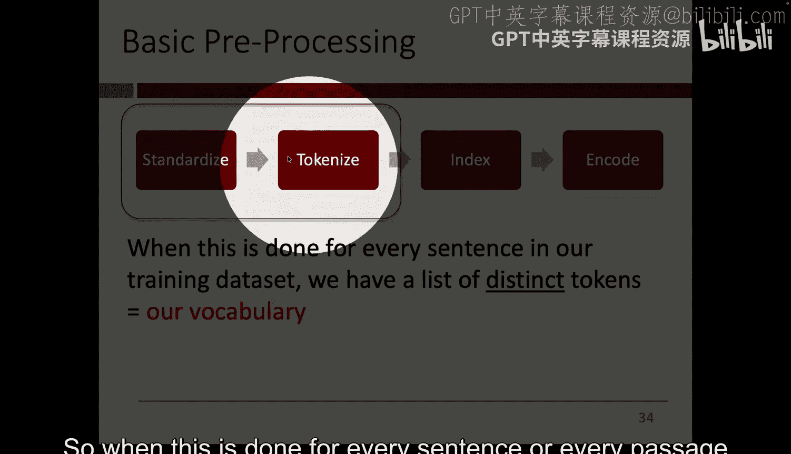

Right， we have a list of distinct tokens in this simple case。

 that happens to be all the distinct words that we have seen， right， That's called the vocabulary。

It's called the vocabulary。So now we go to the third and four stages in this， in these stages。

 the indexing and the encoding stage， we only work with the vocabulary。O。

And so what we do is the first thing， in the indexing。

 we assign a unique integer to each distinct token vocabulary。 So， for instance， let's say that。

 you know， you took a whole bunch of English literature。😊。

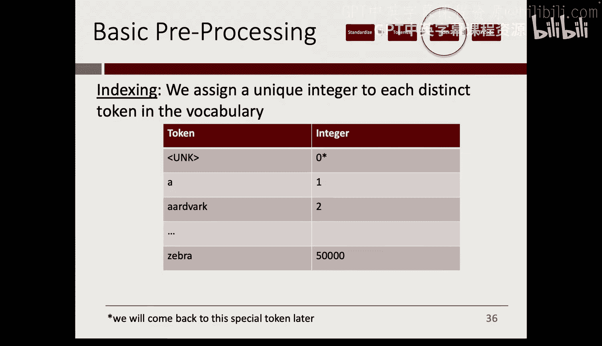

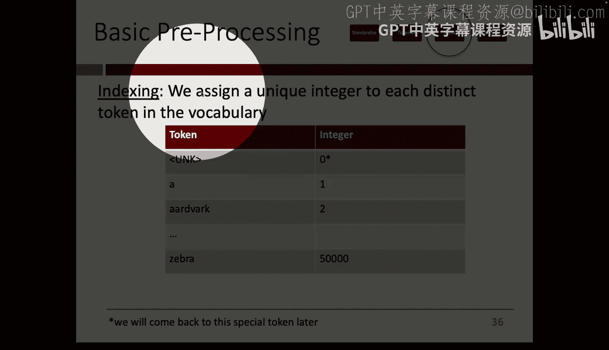

As you training corus and you ran it through， you basically youll come up with the English dictionary。

 right， So it'll have maybe starting with a all the way to zebra， a whole bunch of words。

 And so I'm just putting 50000 here because。😊。

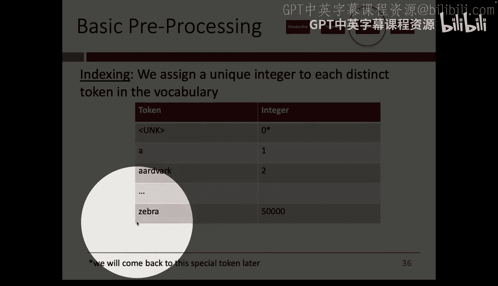

Turs out the GP family uses something called 50000 tokens。 I'm just using 5000。

 It's not the actual number of words in the English language。 which is much more than that。

 So let's say that we give a number one through 30000。

 And then we actually also introduce a special token called Unc。😊。

It's times for unknown。

And we'll come back to this later。 and we give unknown the integer 0。

Okay， so this what， this is what we mean by indexing。 Take the word。

 the tokens you are identified as map to an integer。

Okay， that's the indexing step。

Then what we do is we assign a vector to every one of these integers。Okay。

 and that is the encoding step。 The assign a vector to each integer。

So you have a bunch of distinct words。 under each word， we put an integer on it。

 and then we take the intesger and map it to a vector， yeah。

We used to like。6 one。

Yeah， so， so I'll come back to that。 For now， just assume that we have a token called unknown and the way we are going to use it It will become apparent in a few minutes。

Doesn't mean that's a race to。Let。It's， it's a placeholder for something else。

 which you'll describe shortly。O。So， that's what we have。

So let's say that we want to assign a vector to each integer， in know vocabulary。

And let's assume that we have。Okay， let's say we have 50000。Possible integers。

 because you have 200 possible words。 and you want to assign a vector so that if you take the vector of two different words。

 it should look different。

Clearly， that's the whole point of mapping from integer to vector。They better be different。

 What is the simplest way to come up with a vector for each。Each of these tokens。The same as the。

Sorry， the same as the index is just a vector one。So a vector of zeros and months。Or。

It'sJust a vector with one dimension。Oh， I say。 So God。 well， it's， it'。It's creative。

 but it's a little cheating， right， because you're essentially putting a square bracket around the number and saying it's a vector。

😊，Good try。Just。Right， you can try one heart encoding。So remember。

 the list of distinct tokens you have， you can just think of them as the distinct levels of a categorical variable。

喂。And you can just use one hard and coding for it。So what you can do。

It is the simplest thing is to1 hard encoding。 And the way it is gonna to work is that if you have。

 let's say，50000，50000 possible values， the vector is gonna be 50000 long。

 It's gonna have zero is everywhere。 except in the index value of whatever the token is。 So。

 for instance， since we said unc is gonna be the first， first number 0， It has a one here。 the0。

 the0。 the index position has a one。 Everything is 0。 happens to be the second one。

 So it happens to be one in the second position，0。 You get the idea。😊。

Okay，So this real is0 hard。 We can do the 0 hot one coding one hard。😊，And so。

 so the dimension of this encoding vector， how long it is。

 It's basically the number of distinct tokens that you have seen in the training corpus。Plus。

 one for this unc thing which you'll get to。OK。So that is a dimensional encoding vector。

 which is this is called the vocabulary size。Thiss called the vocabulary size。Allright。

 so at this point。

We have created a vocabulary for the training data， training corpus。

 Every distinct to in vocabulary has been assigned a one heart vector。

 and we are done with basic pre processinging。😊。

O。So all the text that has come in， every token has been map to some1 heart。

1 potentially very long1 heart vector。😊，Any questions on the mechanics of this before we continue on。

打开。Now， let's see if when you get a new input sentence in a new sentence。

 freshly arriving and we want to feed it into a deep neural network。

 how will this process actually apply to the new sentence that's coming in。 Okay。

 so let's assume that we have completed our S D Ie on the training corpus。

 And it turns out we found only， you know，99 distinct tokens。😊，I add distinct words。

 And then we add this unc thing to it。 So we got 100。

Okay， so this are vocabulary。 It starts with unc A and then goes all the way to Z。

 But up there are only hundred of them in total。

Right， and just to be very clear， we didn't bother to do things like stemming and stop word removal and stuff like that。

 which is why you have words like the showing up in this list。All right， so。

Let's say this input string arrives。 The cats are on the mat， and then we run it through S T Ie。

 So the cats are on the mat go through this thing， bo， bo， bo， bo， bo。

Then the output is going to be a table with a bunch of rows。And a bunch of columns， Any guesses。

How many rows and how many columns。

W raise your hands and call on you。you a microphone over。 I would guess1 hundred0 rows and6 columns。

Alright， we'll take a look。Hundred and 6， as well as 600 are both correct。 So。

 so the way I've done it is 6000。 And， the， and that's exactly right。

 So the idea is that this is your vocabulary。😊。

Right， so the word the cat SAT on the mat， once you change the case of it， it becomes like this。

So the the happens to be a one hot vector with a one where there is a the and0 everywhere else。

 I'm not showing all the zeros because itll get too cluttered。😊。

Similarly， cat has a one where the the cat position is and 0 everywhere else and so on and so。

Does that make sense。 So the， the phrase the cat S on the mat came in as just whatever 6 words。

 And then it became this， you know，600 entry table。

Okay， now。What is the best way to feed this table to a deep neural network。What can we do。

It's not a vector。 It's a table。

If it's a vector， you know what to do， just feed it in。 Well just maybe send it to some， you know。

 hidden layer and declare victory at that point。

Yeah，You would like to flatten it。 And like， how， how might you do it。

Larening is a reasonable answer， by the way。

You just have like8 each。哦。Keep the first one show on name too。Yeah。

 so basically you can take all the first columns and then take the second column and attach it under the first column and so on and so forth。

 right， So we can certainly do that。 And that's very akin to how we work with images， right？

 But there is one downside to that。 What is that downside。😊，呃，Yeses嗯。It's pretty long。Like I wonder。

Instead。But the first word， it's。AndFor a second。To when then you maintain the。It just as like。1 row。

Wonder。 So one issue。 So we'll come back to what we do about this。

 But what you're pointing out is it could be very long， right。

 Because if each word is a 50000 long1 heart vector with just six words。

 it becomes a 300000 long vector。Can imagineag take the 300000 long vector and sending it into 100 hidden unit hidden layer。

30000 times 100 parameters。Too much。 God learn event。So that's one issue。

 The other issue is that different length texts that are coming in will have different sized inputs。

So here， the cat are on the mat has 6 times 30000， but maybe the cats SAT on the mat and the rat rat ran over to the cat。

 gives even longer。 We can't handle variable sized inputs。😊。

The inputs all have to be mapped to the same length。That's another problem。

Maybe you can count how many you can sum with all these basically。

each appears since you're the spatial relationship Yes， so you yeah。

 so both you and are on the same sort of trajectory。

 which is that we need to somehow take this table and make it into a vector。 there are many ways。

 like what you folks are describing to make it into a vector。 And turns out。

But this is all the things that we have been discussing so far。 the varying length issue and so on。

 So， So what we can do is we can aggregate all these things。😊，If you just add them up。

This is what you described。 I believe it's called some encoding。And if its of adding。

 you just or them， meaning if you look at the column and say， is there any one in this column。

 If there is any one I'll put a stick of one， otherwise it's 0， it's called multihot encoding。

 So so if you look at this thing， if you literally just go column by column and count everything。

 Okay， there's a one here， one here。 Oh wait， there are two twos here。 So you put a two。

 that's count count encoding multi hot encoding， just looks for any ones and put up put on。😊。

Make sense。So by the way， there are many ways to take these tables and make them into vectors。

 These two happen to be very commonly used， and they kind of make common sense。OK。Right。

 so this aggregation approach that we just described is called the bag of words model。

Bag of words model。 And the reason is that， first of all， this bag that we have has words。

 either it comes within a word exists or not， or it counts how many words。

 how many times the word has appeared， right， count versus multi heart versus some encoding。

 count encoding。But more importantly， and this goes back to your observation。

Is that we have lost the order of the words now。Whether the phrase came in was the cat SAT on the mat or the mat SAT on the cat。

The count encoding and the multi hard encoding are exactly the same。There's no difference。

Because we're just looking for the， the presence or absence of words。 That's it。Gt care in watch。

 which order their peer， right。That's a huge limitation， but shockingly， for many applications。

 it doesn't matter。 It's good enough。So it's called the bag of words model。Alright。

 so this called the bag of wordss model。Now， does it have any shortcomings。

I already talked about the first shortcoming， which is that it loses sequentiality。 The order。

 we lost this order information。Right， we， we lose the meaning inherent in the order of the words。

 What are some other issues with it。What do you mean by。し。Right， so there are lots of zeros。

 not that many ones。 So you have， it's a very sparse amount of information。

 but maybe it carrying around a lot of information to to make it all work。 Now。

 there are some tricks C S computer science tricks to handle sparsity in some clever ways。

 but it is certainly an issue。😊，Now， the other issue is that， let's say the vocabulary is very long。

Each input sentence， whether it's the collected works of Billy of Shakespeare or the phrase。

 I love you。Willll have the same length of input。

We got the same Li input。Because ultimately， every incoming thing gets marketed to one vector。Okay。

 that feels a little sub suboptimal。Clearly， the collected works of initiatives have a lot more stuff going on in them。

Right， so that's the problem。 In particular， very， very small things that come in。

 You'll be spending a lot of compute on those long vectors and processing them。

Now， you can mitigate some of this by choosing only the most frequent words。 You don't have to take。

 you know， I think the English language read somewhere has roughly 500000 words or so。

 But turns out the top 50000 most frequent words are responsible just about everything you're gonna see ever。

And the other 50000 are what's called the long tail。They almost never happen。 You never see them。

 So you can be very pragmatic and say， I'm not gonna take every little word that I see in my vocabulary。

 I'm going only take the most frequent words。 I'm just gonna to ignore the rest。😊。

I'm just going to grow the rest。Okay。But if you ignore the rest。Let's say there is one word。

 Let's take some Shakespeare word， Hamlet。Nothing， let's assume that you ignore the word hamlet。

From your training corpus， you is deleted。Because it's not one of the top most frequent things you have seen。

 And then somebody sends you a text saying， you know， Hamlet was a bad prince。

Analyze the sentiment of the sentence。 Well， when you see Hamlet， what is your system going to do。

It's going to look at the hamlet and say， I can't see it in my vocabulary anywhere。

And if it can't see in vocabulary， what is the only thing it can do。Replace it with。暗k。

So that's where Ununk comes into the picture。So whenever it can't see something in the vocabulary in a new input。

 it just replace with unk， which means that。If you had ignored Romeo or Juliet and Hamlet。

In the in the training corpus， all of them are going to be replaced by the same ac。

 which means that we can't distinguish with them anymore。Is this where。Information comes into。

A hear weird。Interesting question。 This is where harasseration comes up， actually， as it turns out。

 now， as we will see when we talk about L L Ms later， L L Ms actually will not have this unc problem。

😊，Because they use a different organization scheme， which can handle anything you throw at it。

 including new stuff we just made up。So， welcome back。Alright， so that's what we have。

And so what we are going to do is， despite its shortcomings。

 bag of words is actually a really good default for many NP tasks。And in the spirit of。

 do the simple stuff first and do complicated things。 Only the simple stuff doesn't work。

 We'll use it by a birds model right now。 Okay， so we'll switch to a collab and see how it's done。😊。

So here， the， the application we are going to work with is kind of a fun application。😊。

Were going to try to predict the genre of songs。Okay， it's a nice classification use case。

 So we want to take some arbitrary song and then classify it into either hip hop， rock or pop。😊。

Okay， and so， for instance。Right， this is the kind of ly lyrics you're going to see。

 And as you will see in this data set， the data set， just a quick word of caution。

 The data set does have lys， which。May not be sort of， you know， safer work。 as it were。

 So I'm not going to be like exploring the lyrics in the callab。 but I just wanted to be aware of it。

 Okay， so， but it's just some data set that we downloaded from somewhere， right。

 It's got all these lyrics。 Okay， so were going to try to classify each verse that we see into one of three things。

 hipip hop rock or pop it's a multiclass classification problem。😊，Alright， actually。

 what is the simplest neural network base classifier we can build。For this problem。Alright。

 so what is the simplest neural network we can build。But this problem。So remember， what is the input。

 The input is gonna to be a bunch of song lyrics。 It's gonna to be a really long song for all you know。

 right， And we are going to use the bag ofverse model。

 And let's assume for a moment that we will use multi hot encoding。😊，Right。

 willll create a vocabulary from this。For the song， well take all the songs。 We'll process them。

 run it through S D I。e。 We'll do multi hard encoding。

 which means that every song that comes in will have will be a vector。 That's how long。😊。

It'll be as long as the。Correct， as a vocabulary size， right？ So。

 so maybe what comes in is this phrase since it's supposed to be songs， I'll say something。

 which is probably common to 90% of songs。 I love you。😊，Okay。That goes in。

It goes into our STIe process。And then this S T A process gives us a vector， which is x1。

 X 2 all the way to X V， where V stands for the size of the vocabulary。So that， that's a input layer。

All the way。 So knowing what we know now about deep learning， what can we do next。

Can you。Or maybe I'm getting ahead， but wouldn the classifier just be like a baseline would be？Qu as。

本 job。That is the baseline， correct， correct。 I'm just saying。

 I'm gonna come to the club baseline a bit later。 But here I'm saying。

 suppose you need to you wanted to build a neural network model for this。How would you set it up。

Right， and what is the simplest thing you can do with the neural network？How many layers。诶有年。Well。

 then it becomes problematic when it even on neural own network because it could just be logistic regression。

1。Yes。😊，Thank you。I'm being a little squishy about this because there are some people who would be like。

 even if there's no hidden layers。 if you're using relo and this is that and sigise。

 maybe it's a neural network。 And I don't want to get into that how many ages in the tip of a pin argument。

 So， so yeah， we need one hidden layer， right in this course。

 we need at least one hidden layer for it to qua as a neural network。 Okay。

 so let's have a hidden layer。 And we'll have a bunch of relouse as usual。😊，Okay， bunch of Red loose。

And I'll ignore all the arrows between them。 It's kind of a pain。

 And then we come to the output layer。 And what should the output layer be。

How many nodes do we have need in the output layer。3， right， hip hop， rock， whatever pop。 So。

 and then that layer is called what。 What activation function。Soft mask， perfect。 Love it。

 Love this class。😊，Alright，3 things。Rock。Hip hopop。And pop。Right， and this is a softm right there。

And then， it's going to give us。3 probabilities that add up to one。Because the software Mac。

 So that's our basic network。 right， perfectfect， yeah。

Why do you need those probaities， if you just want to identify the most likely genre。

 correct the soft Max just give you a way to kind all performance Ex why do you need soft just take the max value and Oh。

 interesting question。 Why can't we just produce three numbers and grab the maximum number。

 So it turns out finding the maximum bunch of numbers， that function。

Is not very， It not very friendly for differentiation。Ultimately， you want to take this output。

 run it through a loss function like cross entropy and then be able to run back prop on it。😊。

And so fundamentally， back propagation is just differentiation。

 and it requires everything inside of it to have well behaved gradients。

And so this little max function is actually not well behaved。

And which is why we have a soft version of it。 Som， which makes it easy to differentiate。

So I can tell you more about it offline。 But that's sort of the quick synopsis。

So a lot of tricks you will see in the neural network literature are ways to avoid this。

 the problem of having certain the like the obvious choice of function will not be well behaved。

For differentiation， that's why you need to go through all these other mechanisms。

Much like we couldn't just say accuracy。 Why don't we just maximize accuracy instead of doing this cross interviewpy business。

 same reason。Alright， so let's come back here。Right。

So that's what we created on the thing。Right， God that vocabulary。

Ping and so on。 And I， you know， I was playing around with it earlier。 And so I， I found that。

 you know，8 tri neurons were pretty good to get the job done。 So I'm just gonna go with 8 re loose。

8 trill neurons in the hidden layer。😊。

So I think that brings us to the co。Yeah， so let's switch the god up。

Alright， so that's what we have here。 you know， there's a little bit of verbiage here。

 We just describes what I just talked about。 So we'll do the usual things and upload everything。

 import everything we want。 Tensorflow and Kas and the holy Trinity of Nay pandas and Mattportlib。😊。

Said the random seat， as usual， at 42。Those our SD D Ie framework here。

 And the nice thing is that all four of these things。

 S D Ie are beautifully implemented in ks is a single simple layer called the text vectorization layer。

 Okay， which is nice。 So we have the text vectorization right here。 And so in our first example。

 what we'll do is we will use a default standardization， which will just remove punctuation。

 convert to lowercase， we will use a default organizationization。

 which just means split on the space between words， And then we will set the output to multihart。

 right All the things we talked about Ks will just do it for automatically。

 And so output more multihart， standardize this straight by space and boom。

 you run the text vectorization thing。 And once you do it， Kas creates the sexualization layer。

 with these settings and it's now ready to swing into action。😊。

So what a swing into action actually means。 Well， now you need to actually feed it a training corpus so that it can do all the things it's supposed to do and create the vocabulary for you。

 right， So， so and that thing is called the adapt method。 So we create a tiny training corpus for us。

 This are data set。😊，Right， there is a bunch of words from some of these lyrics。

 And then what we'll do is we'll take this layer that we just defined here that we have set up here。

 And then we will ask this layer to actually create the vocabulary using this adapt command， okay。

In the vocabulary， and it's done。 And once it does it， you can actually ask it for the vocabulary。

 Okay， this is a vocabulary。 using the get vocabulary command。 And so， first of all。

 how long is the vab 1717 words，17 tokens。😊，What are they。You can see here。

 And you can see these are all the words。 and you can see it is stuck and un in the very beginning。

 right， It's sort of the default。 By the way， just a little programming tip。

 if you're not familiar with， if you don't have a ton of programming experience， if you want to。

 you know， print these Python objects like listen all in a pretty way。

One trick that often works is just stick it into a data frame。And then， print it。Usual。

 itll print in a much better way。 So you can see it like that。

So you can see here unc arrays blah blah，lah， blah， blah。

 and you can see integer zeros assigned unc token。 By the way。

 how come it pick the word arrays as the second entry。 Why not something like an or。Yeah。

 why not Why not A， How come A is not chosen as a second entry。 Why， why did it pick arrays。

 you think。Maybe， maybe a tri black。Words that。Could lecture on the meaning of this sentence。

But it at this point， it doesn't know what we are going to use it for。

So it has no way to know what word is useful， because we haven't told it how you going to use it。不。

But you're kind of on the right track。 So what Kas does is itll calculate。

 itll find all these tokens and then'll actually just sort them by frequency。So the most frequent。

 as it turns out， in those four sentences we gave it happened to be the word areas。

That's why arrays is starting up on top。 And you can actually confirm this by going to the little data set。

 And you can see here， array shows up appear and how appear twice。 And that's why it came up on top。

 okay。Allright， so that's what we have。And， and now， now that we have populated this。

 we can run any sentence through it easily， yeah。Does't matter that it's on the top or is it just。

It doesn't matter。 It doesn't matter。 The reason why it's helpful laterron is because suppose you tell carers。

 hey， don't take every word you see here。 Give me will the most frequent hundred words。

 I don't want any more than that。 It can easily do that。 That's the reason， yeah。这吧。这的。

This is just a vocabulary。 So basically， you， you give it all this phrases。

 It happen to be just four phrase in our example。 And then it finds all the distinct words and you know。

 does all that stuff。 And then it has created a vocabulary。 at this point， the。

 the training corpus you fed it。😊，Is forgotten。 And the only that has survived this processing is just a vocabulary。

 That's。Now we have to start applying it to any kind of text we want to use it for。So here。

 when you come back here。 So this is what we have。 And so what you can do is you can take any sentence and you can just run it through the layer and to make sure that actually is doing the right thing for you。

 So we will take this sentence。 We will then run it through the text vectorization layer。

 by we just passing that sentence into it。 and then we can just print it。😊。

So now it' is giving you a tensor， there's a multi hot encode a tensor with all these ones and zeros。

😊，So note that this stenor is 17 units long， which is。

 which is a good check because our vocabulary is 17 long。 So it's better match that。 Now。

 recall that the unc token is at the first location。 It's at index 0。

 And it says that this encoded sentence does have an unk word。😊，Okay。So why is that， What is this un。

 Anyone can guess。Well， it turns out to be the word still。 I think， yeah。

 still is not in our vocabulary because if the four sentences。

 which is are training corpus used to build the vocabulary。They had a lot of write and rewrite。

 but there was no still in it anymore。 That's why there is an unc for it。

 We can just double check that by asking Python。 is it， is it the vocaby。 No， it's not。 okay。

 Now the spirit of making small changes the code to understand what's going on。

 which is a very useful trip tip for folks who don't have a ton of programming and knowledge。

Let's say that you send the phrase Sloan， Hddle and D， come on DMD。

I think you will agree with me that none of these words is in the training corpus， right？

 So what will this。What is the multi hot encode and vector for this phrase， Sloan hle D。3。

It's not count encoding。 It's multi hard encoding。Right， it's gonna be 1，0，0。So you can see here。

 or in this case， remember， the vocabulary is 17。RightSo each of these words is going to be a one followed by 16 zeros。

😊，And then it's going to multi hot encode them， which means the three ones in their column just become a one。

So， so you still have only this one。Okay， alright， good。 So now let's see， let's actually get to the。

 the the data that we have this 90000 songs。😊，I understand this little thing here。

We have grabbed the data and cleaned it up， cleaned it up meaning like formatting by not content voice。

 And then we stuck it in this data frame。 is we already have divided into train test and validation for your benefits。

 So you dont have to worry about it。 So turns out we have 4 almost 49000 songs in the training set。

16000 songs in the validation set and 22， roughly 22000 the test set。 Okay， lot of songs。

 It's a lot it's a big data set。😊，So let's just look at the first few。So a girl like on't get ready。

 We met on rainy evening。P alllysislysis through analysis。Okay。

 that I can relate to as a data science person。 But anyway， But by the way。

 this these things are very useful for exploration of any data frames that you might have。

 Colab iss a coab feature。 Just check it out。 So anyway， that's the first few。's the first few rows。

 Let's look at the last few rows。😊，嗯，O。You never listen to me as pop。Nmer Bens is hip hop。 of course。

完毕。So okay， now to go back to the question of okay， what could be a good baseline model。

 we need to understand the proportion of these three classes of songs。 So we'll do a quick check。

 It turns out rock is 55% So if you had to just guess something this naively。

 you just guess everything to be rock。 and you would be right 55% of the time。 So now by the way。

 the target variable， which tells you whether which of these three genre as it is。

 is actually a dummy variable。 So we need to one hard encode that right So we'll just turn that this way using the pandas get dummies function。

 And when we do that， this is white train， which contains a dependent variable。

 And you can see that is one hard encoded now0，1，0，0，1，0，0，01 and so on and so forth， that's it。

 So I think the first， I forget it rock hip pop or whatever it's in some order。

 well get to that later。 So it's one hard encoded as well。😊。

So that is as far as the data downloading and setup is concerned。 Any questions。

要。This kind of goes back to the transfer。Concept， but do you always want to build your corpus based offer？

看。Or could you have like a precompiled？Somebody's already made like a list of。

That's a really good question。 Unfortunately， I'm gonna punt on it for the moment， because。

With modern large language models， a number of these N LP tasks for which you had to sort of roll your own and build your own thing can now be very easily done using large language models without even any further training。

The you pay for it is that you have to use a large language model。

 which means you have to pay somebody an API call and things like that。

 And there are other issues with it， but。We will talk a lot about transfer learning for text。

When we come to a little later in the N LP sequence。 So if I forget， please bring it up again。好。要。

cation on。Good fact。我。

It can time。Yeah， so question is that when when I showed you that tensor。

 the it is actually is written as a continuous number at a float floating point number。

 But we know these are1 zeros and months。 So why can't we。

 why do we have to waste compute capacity by telling the computer that is all big。

 continuous numbers when it just a 01， There are ways to optimize that。

 But these problems are so small。 We just don't worry about。😊。

But when we come to something called parameter efficient fine tuning lecture， maybe ten。

 we actually exploit that particular fact， make things faster。😊，Okay， so that's what we have。

 So we'll， we'll do the back of birth model。By the way， there's a whole bunch of stuff here。

 Just repeats what I've been telling you in the lecture。 So feel free to read it again。

 but we can ignore it for a moment。And now there is a new thing we are doing here。

 So we are basically saying。Look， instead of taking every word you see in these49000 songs in the training corpus。

 it's gonna be too many words。 Just pick the 5000 most frequent words。😊。

Yeah that's what this max tokens stands for。 Okay， And so we tell it。 All right， do this thing。

 Max tokens5000， Sorry not 5005000 and still do multi hard。

 And we are not explicitlyly saying the standardization and all that stuff because the defaults are what we are going with。

 Okay， yeah。😊。

This is for making。Efficient。Don' wastete your time on this。Thousands support。To use them。

 just focus on that。It make more efficient， but there is a related and important point。

 which is that fundamentally， the number of tokens you allow this layer to have dictates the size of your vocabulary。

 And the size of your vocabulary dictates the size of the vector that you feed in。

 So shorter vectors are better than longer vectors。 That's the efficiency point。

 The other point is that the longer the input vector。

The more the number of parameters the network has to learn。

 because the first layer itself is the size of the input times roughly times the size of the hidden layer。

 So this thing becomes 10 times as long you have 10 times as many parameters to learn。

 And given a finite amount of data， right， the more parameters you have。

 the worse it's going to do when you actually start using it in the real world。

 It's going over fit heavily。 That's why you need to be very careful。😊。

OK。要。So you downloaded the data set， are you still using？The7。No no， I that is just for fun。

 I'm going actually build a vocabulary now。 It's coming。 Yeah， good question，😊，So alright。

 let's do that。 So I first， you know， I defined this layer。 Okay， I just defined it。 Alright。

 now we actually build a vocabulary by essentially telling it to adapt the layer using。😊，Essentially。

 the full all 15， basically 49000 songs in the trading dataset set。Right，That's a long list of songs。

 As far as Kas is concerned。 just looking for a list of strings。

 So you just give it the list of strings。 instead of 4， we are giving it for 9000。

 The same philosophy applies。 So we run it。It's obviously going to take a few seconds to do that because it's 49000 songs。

5 seconds。 Allright， let's look at the most common 20。Right we get the vocabulary from our layer。See。

 once you adapt the layer and just built a vocabulary， the layer is sort of been populated。

 Which is all this information。 So you can query it so you can get the v。

 top 20 words onc the most frequent word， No surprise。 U I blah， blah， bh。

 let's look at the last few。😊，Daer， cheddar。Pified。Movinging on。RightAnd then we。

 so once we have done that now we actually can vectorize all the data sets we have using this。

 And by vectorize， you mean take every string and create the multi hott encoded vector from it， yeah。

😊。

Doエテア。stuff like。Yeah we are not strictly doing S IE or to put it differently。 The S stands。

 typicallyy S has lowercase uppercase， strip punctuation， Steming stop word removal here。

 the default in Kas happens to not do stemming， not do stop word removal。

 So we just going with the default。 Thanks for the clarification。😊，And， in fact， in practice。

 what I find these days is that don't even bother with Ste。

Don't even bother it remove the stop It's going to work well enough。OK。So， allright， okay。

 so now each phrase is a vector。 How long is a vector。Song is now a vector。 How long is that vector。

5000， correct， because that is a size of vocabulary， correct。It's Mac tokens long， which is 5000。

 So if you actually look at X， oh wait， wait， wait， wait， wait。 I haven't run this thing yet。

It's going through 49000。 It's going through another what 23000 fine。 So let's run it。O。

 now we can see x train， which is all the training data you have， has is a tensor。

 is a table with 48，9，9，1 rows。 and each row is a 5000 long vector。😊，good。Now。

 we will try the simple neural network that we wrote up in class。So， I know。At this point。

 this code should be sort of second nature。Right， is that cool。It's so easy to write the。

 write the thing。The power of abstraction。 So we take kad input， as usual input layer。 We tell it。

 what is the size of each thing that's coming in。 Well。

 the size of each thing is a 50th max tokens long vector。 So we tell it the shape is max tokens。

 And then we run run it through a dense layer with 8 reus。 Okay， I'm hurrying。😊。

So we get the outputs。 Then we string the inputs and the outputs into a model。

 and then we summarize the model。 That's it。 So we go here。 And this has 40000 parameters。

 And you can see here。Right， when you go for the input， the 5000 times 8。

That gives you 40000 plus the 8 neurons have a bias coming in。 That's another 8。 So you get 4，40008。

And we compile it as usual。 we use atom as usual。 And because now the， the output， y variable。

 the white train variable is now it itself is actually one hot encoded right，0，1，0，0，0，1。

 depending on pop rock and so on and so forth。 We don't use sparse categorical cross entropy。

 We just use plan old categorical cross entropy here。😊，Okay。

 and this was explained in lecture last week。 So you can revisit it if if it's， if it's not familiar。

 we are again report accuracy， right， So let's compile it。 and we have a model。

So we just run it for10 parks with a batch size of 32。

 And because we have validation data already supplied to us， we don't have to tell Kas。

 take the training data and keep 20% of aside for validation。

 We can literally tell it what validation to use。 That's what we are doing here。😊，O看。Alright。

 So it's running。嗯。It's pretty fast。Any questions so far。不要匙。Just some microphone。

How do we decide the max to the electricity to find the number of right。

But we do not know how many words the。 Yeah， So it's a good question。

 How do you decide on this maximum vocabulary。 What you typically do in practice is that you actually。

 you do it without the max tokens， And then you see how long the vocabulary is。

 And then you actually get statistics on how frequently the very infrequent words actually show up。

 And then you typically see like a dramatic fall off at some point。

 And you pick that fall off point and then set that to be the max tokens。😊，All right， so。Perfect。

 let's test it。 Ac is pretty good。87% on the training and 73 on the validation will do it on the test set。

Alright，7 a percent。So we saw earlier the， the largest class of the three way is at rock with around 50%。

 So the naive model is going to get 50% accuracy。 And this little neural network model gets you 70%。

72%， which is pretty nice， okay。😊，So now let's actually kick it up an not and make it slightly more capable。

So the key thing here is that as has been observed in class already。

 When you go with a bag of birth model， we lose all notion of order。Right。

 the word order clearly matters。 And we are kind of ignoring it。

 So what we do to get around it is actually， this is actually really interesting sentence here。😊。

Let's say this is a movie review。 Kate Winslet's performance as a detective。

 trying to solve a terrible crime in small concerts is anything but disappointing。Tricky。

 tricky thing， right， Because if you look at the word separately。

 the word terrible and disappointing， they didn't recommend to make like negative sentimentdi。Right。

 but then if you actually know that the word terrible refers to the crime not to the movie or anything but disappointing changes the meaning of the word disappointing。

 you will see obviously it's a positive review， right， So clearly， the， the。

 the words around the world。Provide valuable clues as to how to interpret that word。

And so what we do is， how can we make our little model a bit more capable of recognizing the context around every word。

 And the way we do it is something called bygrams。 Okay， and what for biograms。

 what we basically do is instead of taking instead of just taking each word。😊，We take each word。

 and we further take every pair of adjacent words。And those become our tokens。

 And because we take two adjacent words， right， it are called bygrams。

 You can take three original words， trigrams。 You get the idea M gras。 Okay。

 so that's the idea of by gras。And so， so， for example， if you had the cat match satellite on the。

Cat SAT on the mat。 You will have the， the cat， cat， cat S， S。 You get the idea。 right。

 That's what we have。 So let's do a little example。 And K makes it very easy。 You literally tell it。

 N Gs equals 2。😊，Bgrams And now from this， you immediately should know that n gra equals  one is the default。

That's why we didn't have to specify it， Okay， so。You run it， and then you do。

Cats head on the mattress。 you are training corpus。 And then you get the vocabulary。

 And you can see here。Right， it has clear all these nice by gras wave。And so that's it。 All right。

 Now what we do is we'll go back to the songs and we actually tell cares to not just take each word。

 but take all the bigrams as well。 and hopefully'll do a better job right。

 of figuring out what the sentiment is。 And now because you know， when you you when you say， okay。

 take the top 5000 words。 that's great for single unigrams， as they are called。

 But when you have bygrams， you have 5000 possibilities， the first word。

 maybe 5000 for the second word。 right， that's a lot of possibility 25 million。 Now。

 most of the 25 million possibilities are not gonna to show up in the radar。

 So you don't need to actually make it much larger。

 But you should make the vocabulary a bit more than 5000。 So here we go with say 20000。😊，Right。

 otherwise， it's the same still multi heart。 So let's run it。

And now we will run this now that the layer has been set up with all the right settings。

 Well ask it to create the vocabulary。 Okay， again， by doing exactly what we did before。

 create the vocabulary。😊，Two seconds。Biggrams， tris， all of them will get much more。

Computer intensive。 That's why you're seeing this。 So， all right， let's look at the first 10 words。

 The first 10 words are all just single words。 And that's not surprising because the single words are going be the most more frequent。

 right。And then look at the last few。Your mom， your God， you shot you hell。对。Allright， let's just。

 you know， index the whole all the data we have， the training validation test sets using this vocabulary。

Perfect， now we come to our second model where we say the shape。

 the incoming shape is not 20000 long， right， because we increase max tokens from 500 20000。

 So each thing is a 20000 long vector。 Otherwise， it's the same。

 And now we will use this thing called dropout for the first time。

 which is a regularization thing that I have referred to earlier that I never really described。😊。

And I will describe today if we have time。 but I'll first run through the whole demo。 So just。

 you know， just you can just think of dropboard just another layer you can insert。

 And its essentially a great way to prevent overfitting。 So I just routinely will use it。

 and I'll talk more about it。 So for now， we have this drop layer in the middle。

 receives the input from the dense layer and then send it to the output layer output layer is unchanged。

 It's a three way softm same as before Okay， And now all right，ll come back to dropout。

 So we'll compile it the same way as before。 And then we we will I will just fit it for three epochs。

 if you're interested after class later on。 you can actually try it for more epos and see if it does better。

 for now in the interest of time and just for three。😊，Right。

I think 72% right was the the single word unigram think we had。

If you are rerunning this code with the same number of P box。

 do you ever expect the accuracy to change。IfIf you were to run this code in your machine。

 you would expect it to be roughly the same， but there are some minor differences due to hardware and device drivers。

Own machine twice would you expect？That's actually a very tricky question because it depends on what else I have been doing in that notebook。

If I start fresh and do nothing but that， typically， I get the same numbers typically， but for some。

 I don't get it exactly the right。Okay， so we come to this。 Let's evaluate a little model。Okay，75%。

 So it went from 72 to 75。 It's actually a meaningful jump just by using bygrams。 Okay。

 and I run it only for three epos。 If you run it for 10， maybe it's gonna do even better。 Alright。

 So that is the beauty of this thing。 Now， let's just actually do a little demo。😊。

We'll try to predict some lyrics。 Okay， I'll try another one bites the dust。It's a rock song。

 I think that's correct。 Yes， O， Okay， folks， your turn now。Somebody， tell me your favorite song。

Ging green from other。I love Aba。 That's awesome。 Alright， okay。😊，Dancing queen。

Rs。

W one in try don't like that。 Let's just go to something without all this metadata。

Right。Alright， I'll just take the first page， okay。

Here。Are we good。All right。You down model， let's predict。Oh， just about。Alright， So， yeah。

 So that's basically the model。 But we have finalists。 I want to get back to。

 You can play around and put your own lyrics in。 Typically。

 what happens is that the last two years that I've been doing this particular lecture。

 I've noticed that the songs are always rock songs for some reason。😊，First time。

 I'm getting a pop song from from a group that I actually like。 So thank you。😊，Allright。

 let's go back to dropout。So the idea here in dropout is that， you know， you have all these。

 the input comes in， it goes through a hidden layer and so on and so forth。 What the dropout。

 So dropout is a layer。And you put this layer， just like use any other layer。

 And what dropout does is that it takes all the things that are coming into it from the previous layer and randomly decides to replace that number with a 0。

That's it。 It drops that number and replaces it with a0。 Okay， but it does it randomly。

 basically it tos a coin。 and the coin comes up pets 0。 If it comes up， test， let it through。

 pass it through。 Okay， And the reason why this is very effective is because。😊。

You can imagine all the neurons in a particular layer。When they overfi to a particular data set。

 the overfitting happens because the neurons essentially collude with each other。Right。

 they sort of collude each other to actually overfi and predict things in sort of a very accurate way。

 So you want to break any sort of collusion between the neurons。 right。

 I'm obviously using sort of like， you know， again， the we are describing it。 But the idea is that。😊。

Any kind of spur correlations in your data。Neurons can pick it up by being correlated themselves。

And so the way you avoid the spur correlation is by dropping neurons randomly。

 just kill the neuro randomly， which means that no neuron can depend on another neuron being available。

I know， it's a been grim。But that's the basic idea of dropout。And apparently。

 the story goes that the， the folk person the team that invented it， Jeff Hinton。

 who won the Turing for this stuff， not for the Doford Robert， just for deep learning。 He said。

 I don't know if it's true。 But he said that apparently。

 he got the idea when he went to a bank and realized that you know。

 very often that bank the folks working in that bank branch that he used to go to kept changing。

Right， they were never sort of the same。 The people would be transferring in， transferring out。

 And it was like， why can't they just leave these people alone， Why does it keep changing。

 And then he got the insight that maybe a lot of fraud happens because the person working in the branch colllludes with the customer。

But by changing the staff constantly， you break the the risk of fraud happening。

 And that apparently was the genesis for this idea。True apocryphal。 I have no idea。

 but it's sort of a fun story， yes。Instead of random。

 if we go to the way historical modelss are built。It's a point。With that。Sharper， as compared to。

The problem is that。These letters are massive。And for you to take each layer and look at correlation with some other layer and so on and so forth。

 First of all， investigating multiinity is a problem。The second thing is， okay， what do you do then。

 Next， in linear regression， you can do things like principle components analysis to get around it here。

 everything is not linear。 There is no easy way to solve the problem。 So if youre like。

 we just solve the problem in one shot using robot。Out idea。Alright， so I had some material on。

Something called B pair encoding， which I will， which I will do when we get to L L Ms。

 And I stuck it in end because I knew that we probably won't have enough time to cover this anyway。

 And that is a very clever organization scheme used by， for example。

 the G family and that allows them to do beautiful punctuation。

 Keep the case intact and then use words that you just made up and things like that。 Okay。

 so we have to one more minute。 I'm happy to answer any questions you might have。😊。

And so initially you went， we are picking like the hidden layer。

 the number of neurons and repeated the8。So so far and all the material has been given。

But initially how， is it more of？It tends to be trial and error。 So that's， in fact。

 what I did when I created the coabs。 So and and you can actually make it a bit more systematic by trying lots of different values。

 And there is a particular package Python package called Kas tunena。 So just Google Kaas tunena。

 And it comes with a very nice co。 And if I have a chance。

 maybe I'll just record a screen walkthrough of doing that。

 And that's a very efficient way to do these things。

 And it comes into the broad category of something called hyperparameter optimization where the number of neurons。

 the activation you use， the learning grade。 All those things can all be tried。

 You can try lots of variations and kas is a great way to do it in the context of Kaas。😊。

Other questions。All right。 I give you 30 seconds back。 Thank you。 See you tomorrow。

