# 《动手深度学习｜15.773 Hands-On Deep Learning Spring 2024》中英字幕 p07 -07-7_ Deep Learning for Natural Language – Transformers.zh_en -BV1ELraBoEtg_p7-

So， allright， so transformers， even though they were originally invented for machine translation。

 right， going from English to German and German to French and so on and so forth。

 they have turned out to be an incredibly effective。

 deep neural network architecture for just really a vast array of domains。

 it has reached a point where if you' actually working on a particular problem。

 you almost reflexively will try a transformer first because it's probably going to be pretty darn good。

😊。

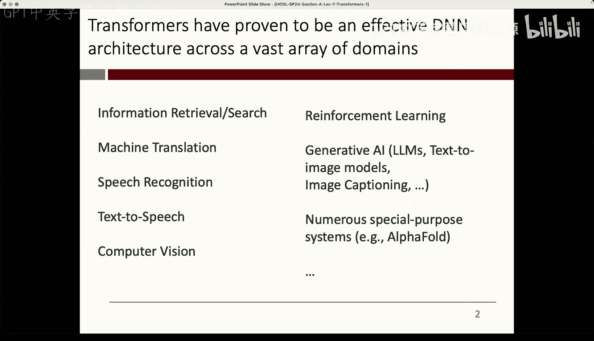

Okay， so they have just taken over everything。 And obviously they have they transformed translation。

 which is original sort of target。 Google search， information retrieval， completed。

 transformed speech or recognitiontion， text to speech。 even computer vision。

 even the stuff that we learned with convolution neural networks。 Now。

 there are transformers for computer vision problems that are actually quite good。😊。

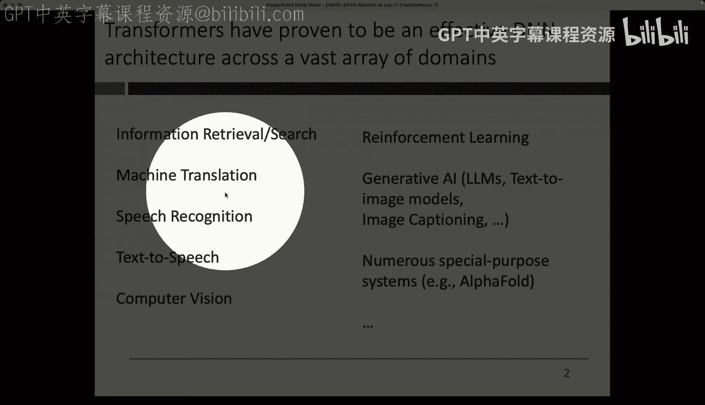

Right which is kind of shocking because they were not even designed for that。😊，And then you know。

 reinforcement learning and of course， all the crazy stuff that's going on with generative AI。

 large language models， multimodal models， everything， everything runs on the transformer。😊。

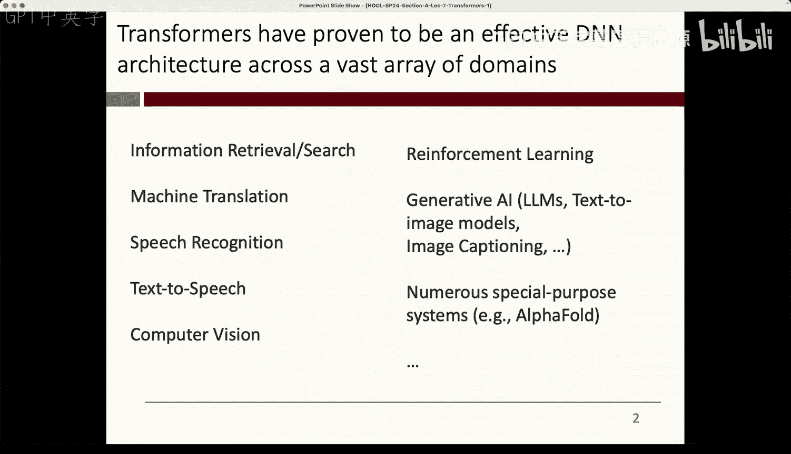

Okay， and then there are numerous special purpose systems。

 And I find these to be even more interesting。 You know， like Al4。

 the protein folding AI is run runs on a transformer stack。😊。

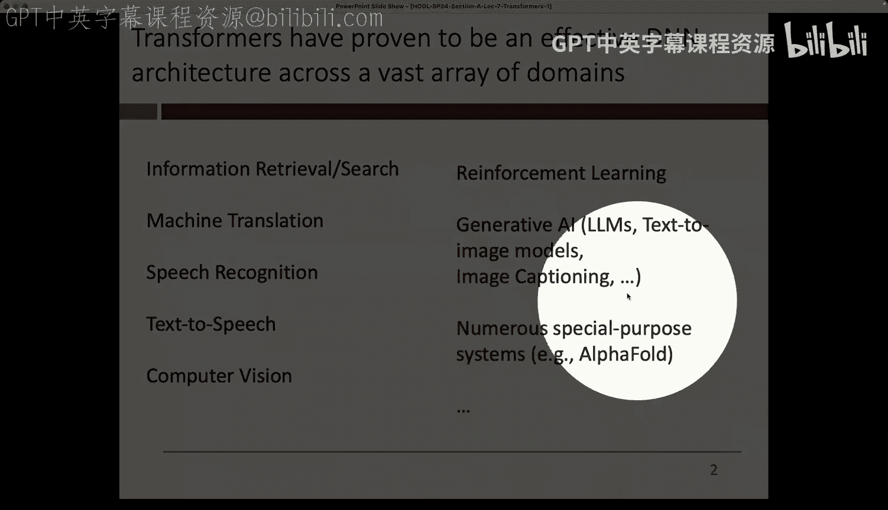

Okay， and I could just list the examples one after the other。So it's just amazing。

 incredibly flexible architecture。 And I think we are lucky to be alive during a time when such a thing was invented。

😊，And I'm not getting paid to tell you any of this stuff。Alright， it's just amazing。 Okay。

 so let's get going。 We will use search or or more broadly information retrieval as a motivating use case。

 So these are all examples where people are typing in natural language queries or uttering natural language queries into a phone。

 And we need to sort of make sense of what they want。 And it's not like， you know。

 write me a limeric about deep learning where there could be many possible right answers。

 It's more like， okay， tell me all the flights that are leaving from Boston to going to Laguardia tomorrow morning between 8 and 9。

 Well， you better get it right。😊，Okay， accuracy is a high bar。So， or， you know。

 how many customers abandon the shopping cart， find all contracts are up for renewal next month。

 you know， tell me the all the customers who ended the phone call to the call center yesterday。

 not entirely pleased with the transaction。 right， the list goes on and on。 And so in particular。

 we will focus on this travel related example today。 Okay。

 find me all flights from Bo Laguardia tomorrow morning。 right that kind of query。😊。

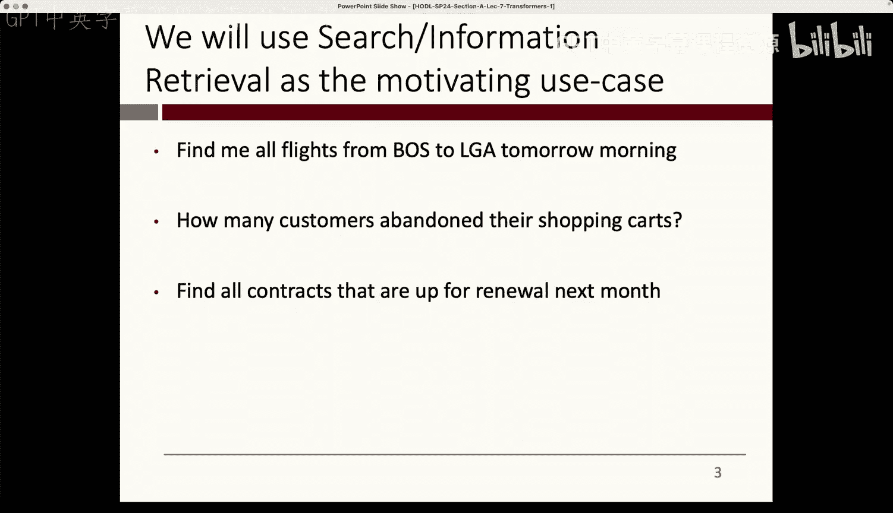

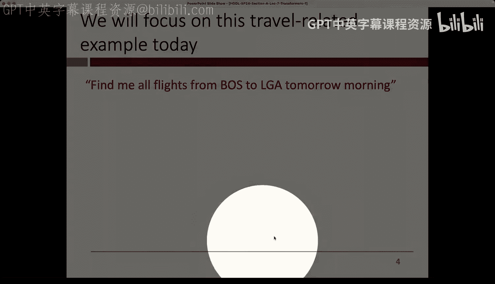

And so in these sorts of use cases， a very common approach historically has been。

 well we will take this you know natural language query and then we will convert it into a structured query by that I mean。

 we will parse the query and we will extract out。😊。

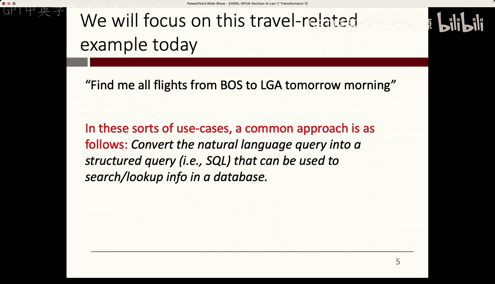

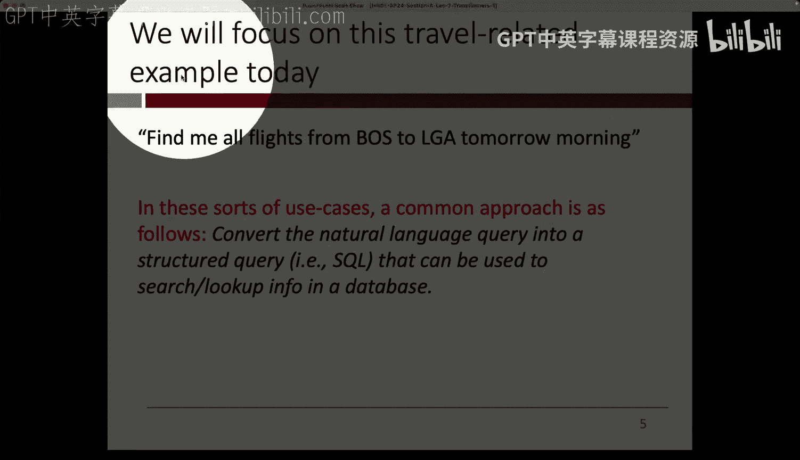

Key things in that query once we extract out those key things。

 we will reassemble it into a structured query like a SQL query right SQL is just one example of a possible structured query。

 There are many very ways to structure queries but SQL is sort of familiar to lots of people so I'm using that so you take the SQL once you have the SQL query youre in a very comfortable structured land in which case you just run the query through some database that you have get the results back formatted nicely and show it to the user right that's the flow。

😊。

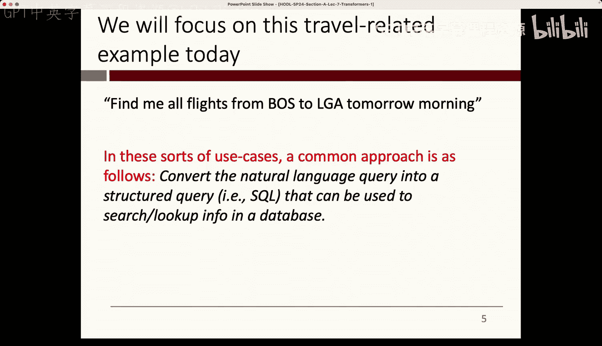

So the question becomes。How do we automatically extract all the travel related entities from this query。

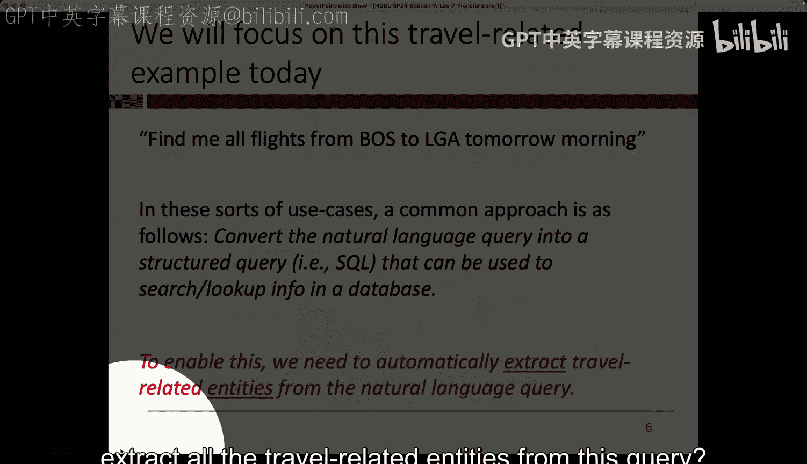

We want to be able to extract boss， LGA tomorrow， morning， flights， so on。

 These are all the travel related entities we want to extract out， right that's the problem。😊，And so。

We will use a really cool dataset set called the Air travel Information systems dataset。

 And I'll explain the data in just， in just a bit。 We'll use this the basis for this example。😊。

And so the way we think about it is that。We， we have a whole bunch of queries in this data set。

And fortunately， for us， the researchers who compiled this data set。😊。

They went through every one of these queries right and we have you know several thousands of them。

 they went through every one of those queries and they manually tagged each word in the query。😊。

With what kind of travel entity it is。Or none of them， right？ So， for instance， So they。

 they call them slots。 So they will take each word in the query and assign it to a slot。

 a particular kind of slot。 And Ill explain what slot means in just a second。 Okay。

 that's the basic idea。 So， so for example， if you have something like， I want to fly from。

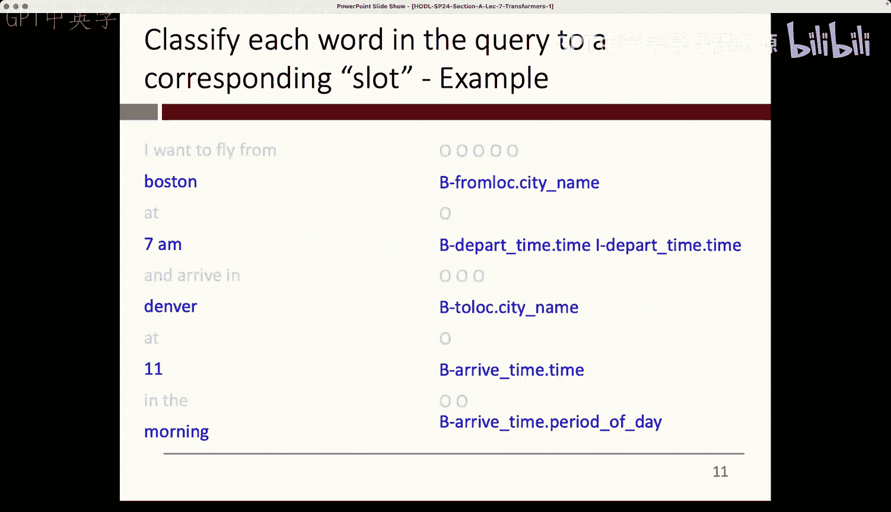

Okay， and this is a flight database。 So you can assume that everything is related to a fly flying。

 So if you have all these words， I want to fly from。

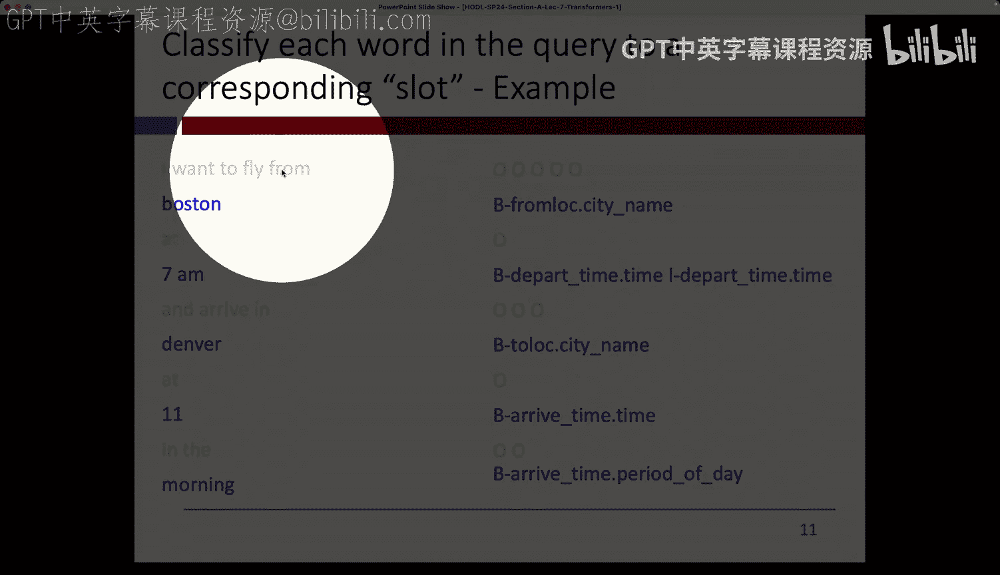

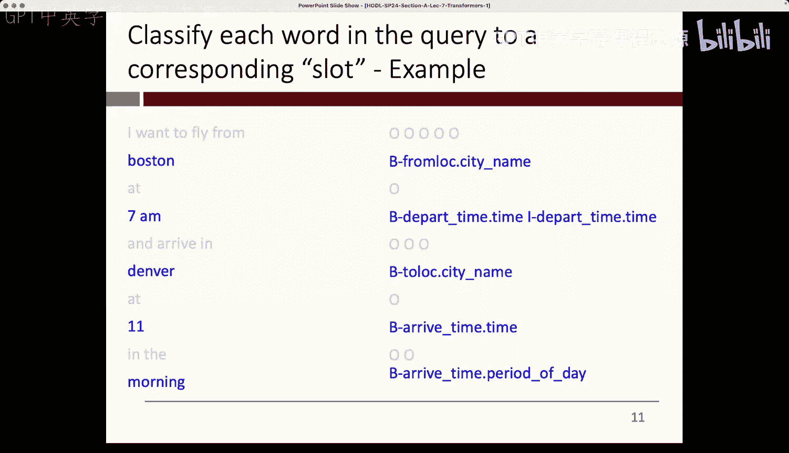

Each of these words， these five words gets mapped to something called the O， which means other。

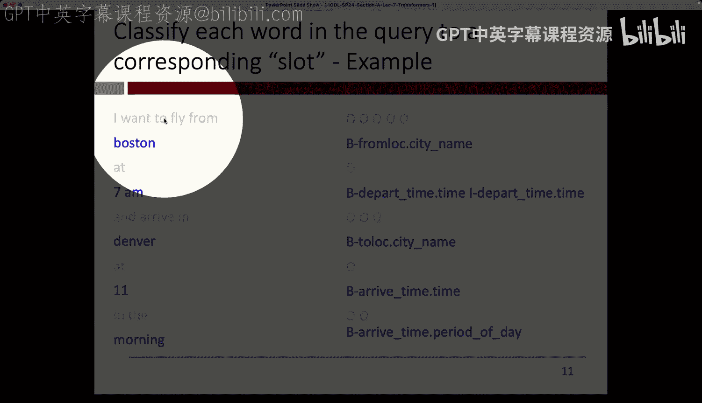

It's the other slot， right， We don't really care about it。 It's the other slot。

And then we come to Boston。Oh， Boston is very special， right， because， you know。

 it's clearly a departure city。 So we actually tag it。 We assign it this label。

 Think of it as just like a classification problem， right， a multiclass classification problem。

 So we assign it to be from lock dot city name。😊。

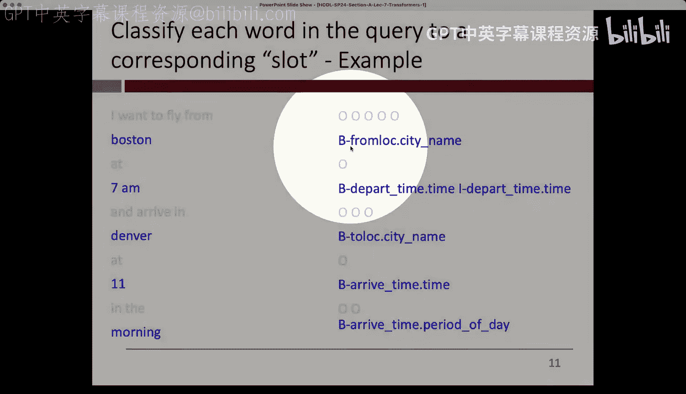

Okay， that is the label you assign it， okay？And then you go to at。

 you don't care about at it is or other， you come to 7 am。And then okay， that is depart time。

 So depart time and then another depart time。 And here you see there is a B and then there is an I。😊。

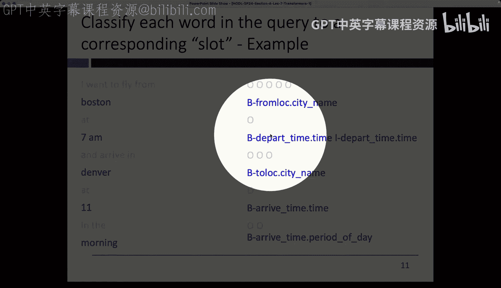

Right so what what we are saying here is that there could be entities who are described using more than one word like 7 a right。

 two tokens。😊。

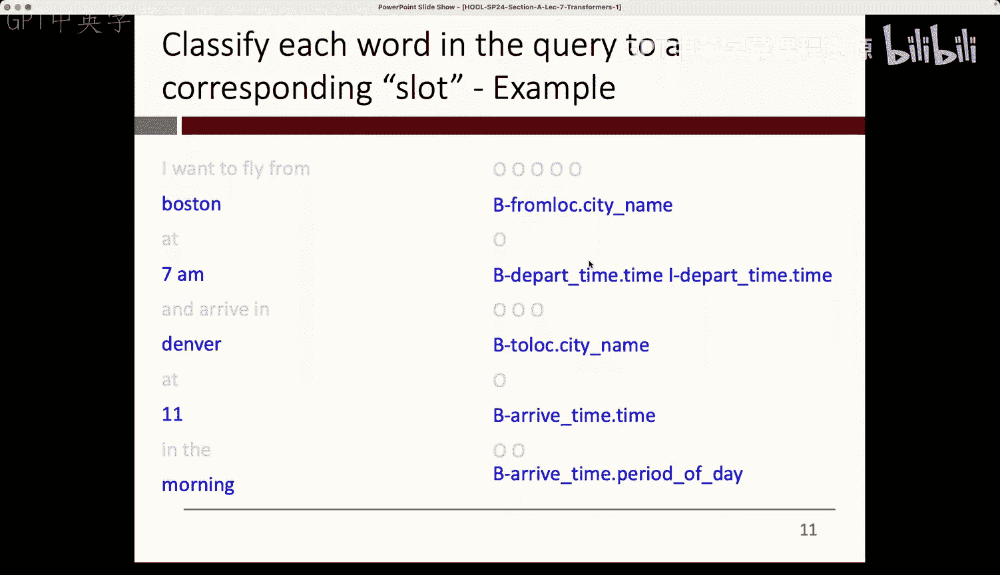

And for that， we need to be able to figure out， okay， the second token is really。😊。

Is part of the first to and together they define the notion of a departure time。

 So what the B means that is that this is the word。

 this is the token in which we are beginning the idea of a departure time。

 and then I means we are in the middle of this description。😊。

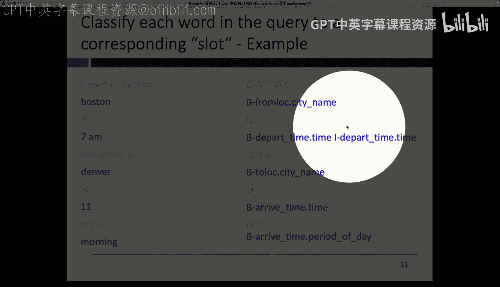

B is for beginningning。So。You can see here。 So there is a B here， and there is an I， B for beginning。

 I for intermediate or in the middle。

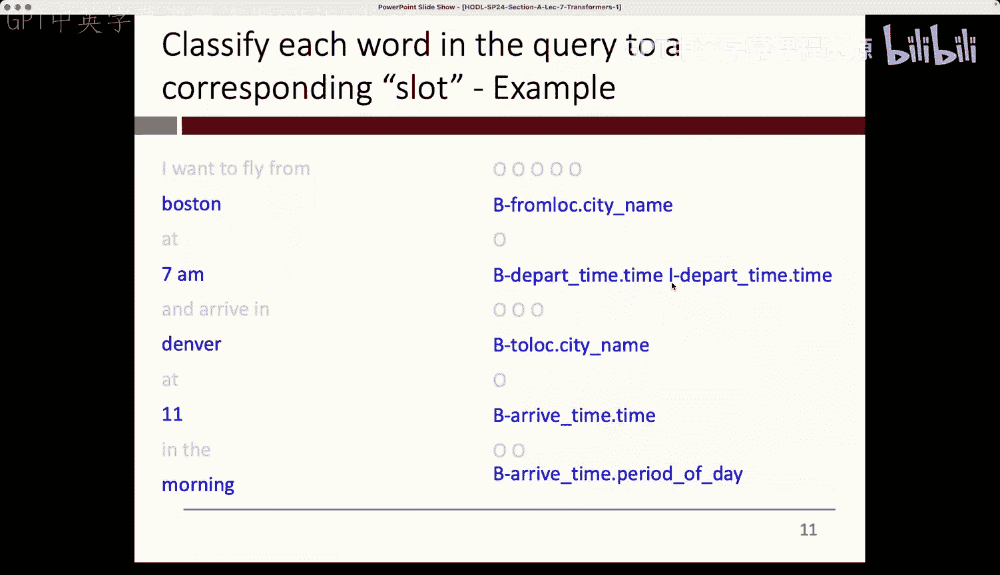

And then at， we don't care 11 B arrive time。Bo， bo， morning， arrive time period。

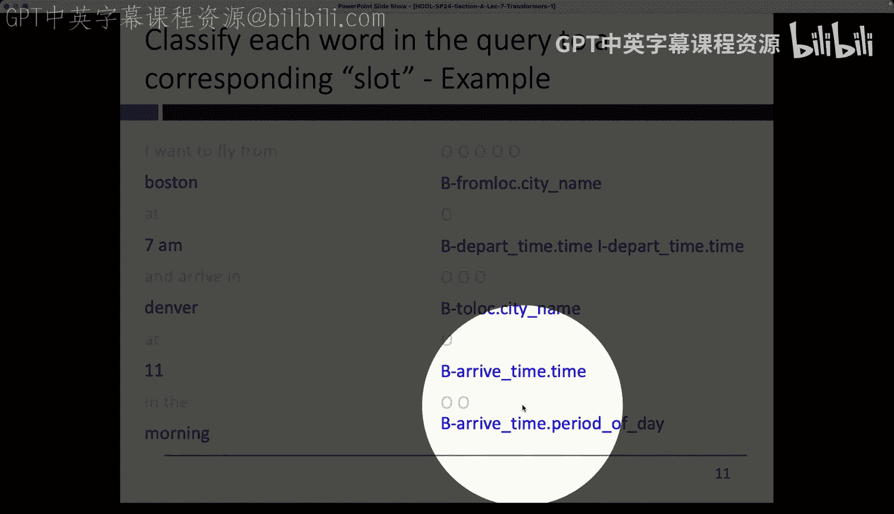

So this is an example of how you can take a sentence and then manually label every word in the sentence with something that's relevant to your particular problem。

😊，And。Turns out， these people。Every word is classified into one of 123 possibilities。😊，Okay。

 so aircraft code， airline code， airline name， airport code， airport name， arrival date。

 relative name。 Now， you get the idea。

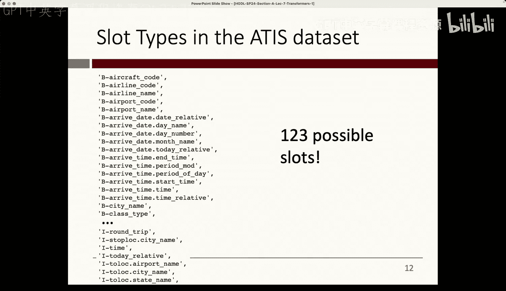

They want a round trip versus a one way。

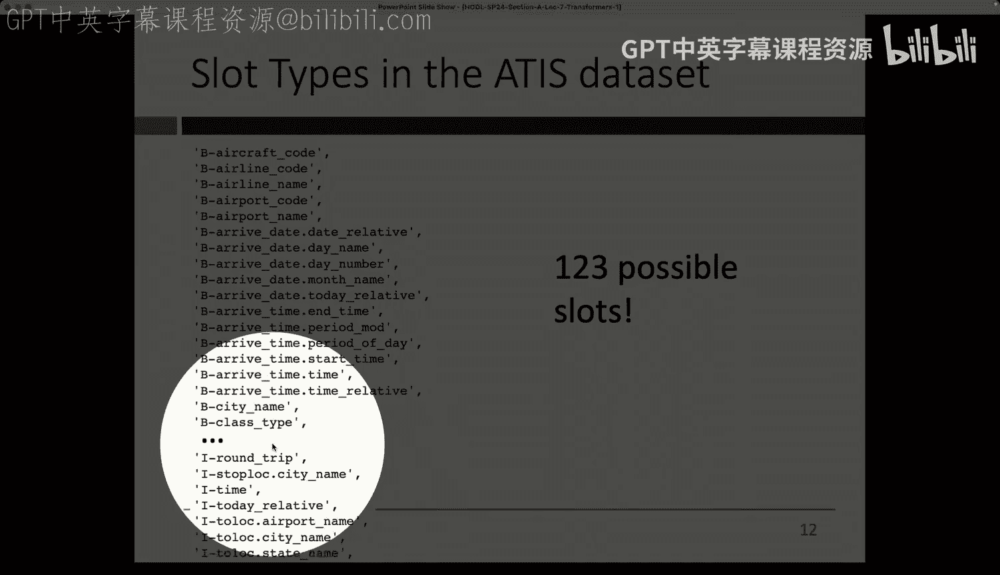

The relative to today， because as somebody say tomorrow morning is relative to today。

 so you need a notion you need absolute time and you need a notion of relative time。😊，So。

 they basically thought of every possibility with these researchers and so every word in every one of these queries is assigned one of these 123 labels。

😊，Any questions on the setup。呃。Did they have to contextualize what comes before。

 Then let's take what where if someone that's from。Boston。

 so that there should be contextization with from Boston So because they did it manually。

 they could just read it and figure out， oh， that's what they mean right Boston is it the departure city and not the arrival city。

 So do they have to to Boston， which is some you know departure city as well as arrival city。

In the particular phrase it is clear from that particular case in the context of it as a human reading it that Boston is a departure city so it just only gets that tag in that sentence in some other sentence。

 if people are coming into Boston， it will have a different check。😊。

I was wondering if my query like the others， basically there is where exactly if my query was giving clientss from Boston at 7 AM。

You mean like a compound query？So this one only takes single queries into our account。😊。

Because most people are like， you know， give me a flight from here to there or what is the cheapest thing from here to there。

 And we'll see examples of queries later。O。All right so that that's the deal so basically what we have this you know this problem that we have here is really a word to slot word to slot multi class classification problem。

😊。

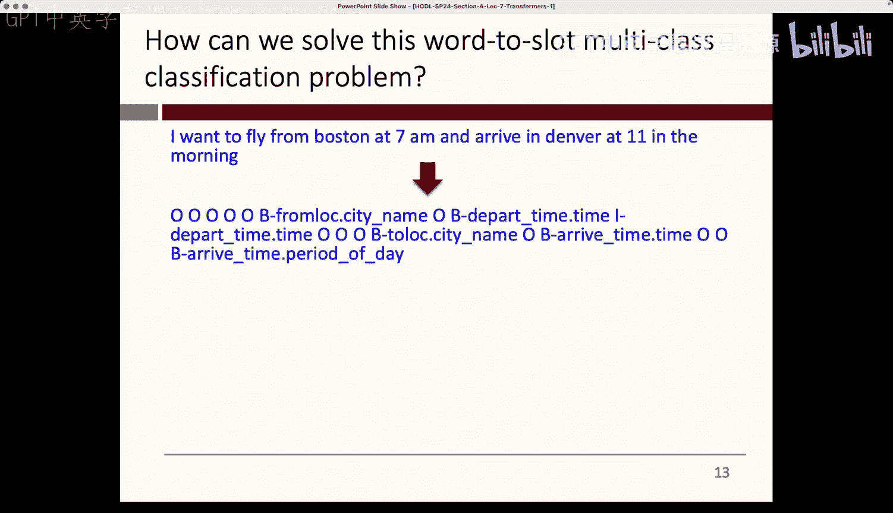

Okay。Because if you look at that that input， we want to be able to take the input and a really good model will then give you this as the output。

😊。

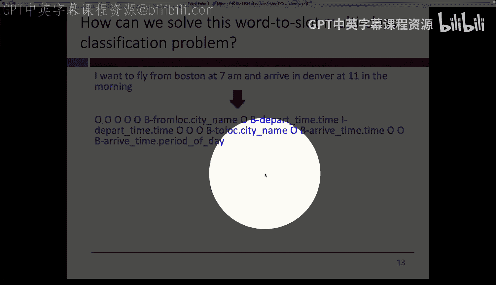

Right， because this is what a human would have done。So that is our problem， okay？So， the question is。

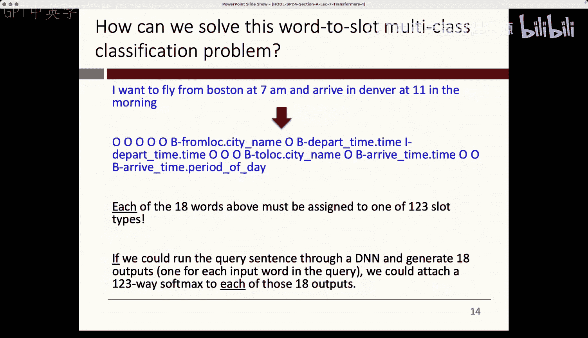

The key thing here is that each of the 18 words in this particular example must be assigned to one of 123 slot types right each word it is not like we take the entire query and classify the entire query into one of 123 possibilities every word in the query has to be classified。

😊。

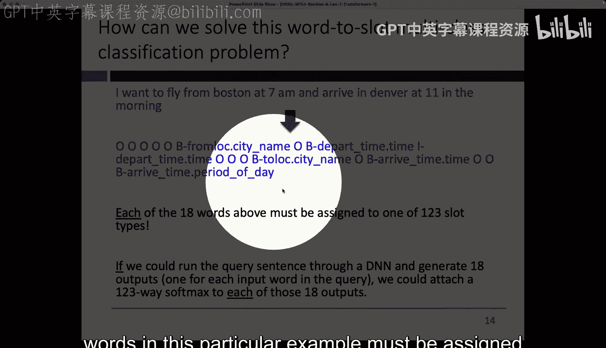

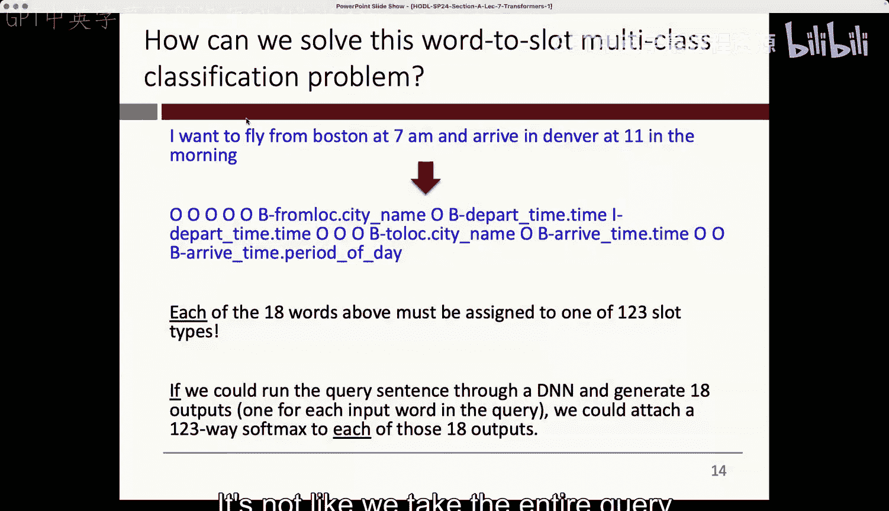

That is the wrinkle。Okay。So now if we could run the query through a deep neural network and generate 18 output nodes。

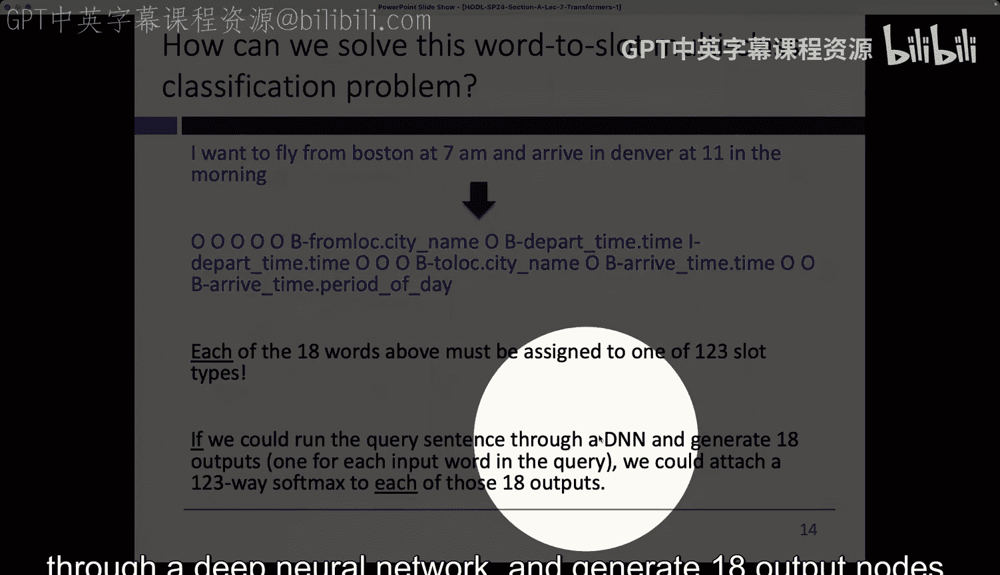

It goes through some unspecified deep neural network。 And when it comes out the other end。

 the output layer has 18 nodes。Okay。Because that is that is the dimensional output that we care about。

 18 in， 18 out， 18 in 18 out， right？😊，And then for each one of those 18 nodes。

 maybe we could attach a 123 way softm。😊，To each of those 18 outputs。But the。

 isn't it cool that we can just casually talk about sticking a 123 way soft Mac onto each one of 18 nodes？

😊，Folks， wake up。You're not easily impressed。 I'm impressed by that。So， okay。So。

 so here's the key thing， right， We want to generate an output that has the same length as the input。

😊，But the problem is， the inputs could be of different length as they come in。

 There could be short sentences， large sentences。 we don't know， right。

Yet we need to accommodate this range， this variable size of input that's coming in。

But the key thing is the output has to be the same thing as the input。

 the same cardinality as the input。😊，Okay， that's one big requirement。In addition。

 we want to take the surrounding context of each word into account right to go to Roook's question when you see the word Boston。

 you can't conclude whether it' iss a departure city in or revversary。😊。

You have to look at what else is going on around it。 Is there a from。

 Is there a two things like that to figure out what how to tag it。 So clearly， the context matters。

And then we clearly have to take the order of the words the dark out。😊。

Going from Boston to Laguardia is very different than going from Laguardia to Boston。😊，So clearly。

 the order matters。😊，Right， so the context matters and the order matters。

 and the output has to be the same length as the input。

So context matters right just a few fun examples。 remember from the last week that the meaning of a word can change dramatically depending on the context and we also saw that the standalone or uncontextual embeddings that we saw last week like glove。

 you know， they don't take context into account because they give a single unique embedding vector to every word。

😊。

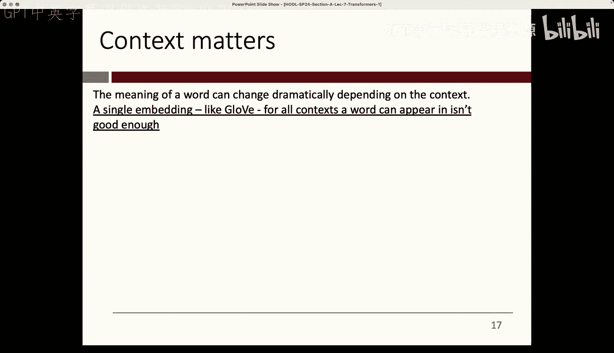

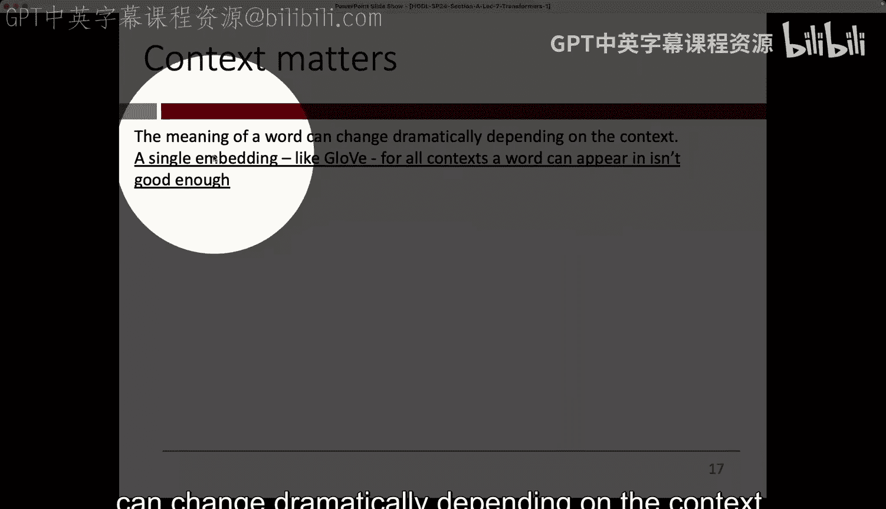

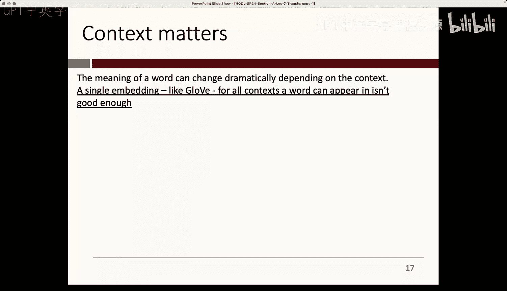

And if a word ends up having lots of different meanings。

 that vector is kind of some mushy average of all those meanings。😊，Okay， so the word C。

 I will see you soon。 I will see this project towards end。

 I see what you mean very different meanings of the word C this is my favorite bank。😊。

I went to the bank to apply for a loan。 I' am backing on the job。

 I'm standing on the left bank and so on。 it the animal， this is actually very， it's a good one。

 The animal didn't cross the street because it was too tired。

 The animal didn't cross the street because it was too wide。😊，Can you imagine。

A deep in the network looking at this word it and trying to figure out what the heck does it word it mean。

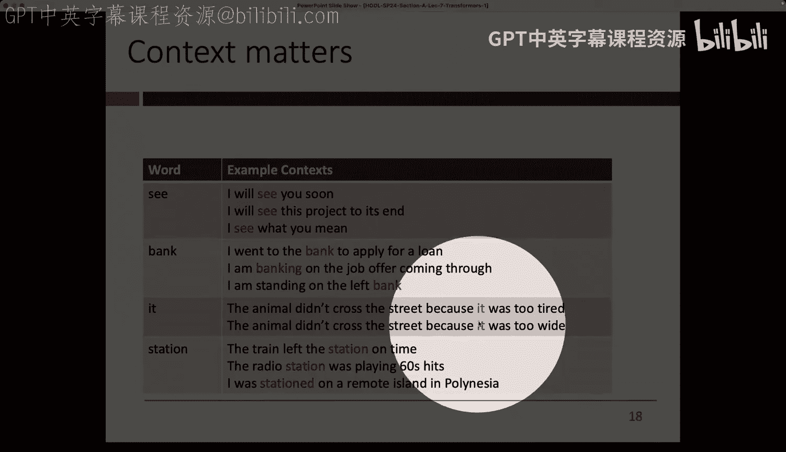

What is a referring to？Tricky， right？And then， you know。

 if you take the word station and I have this station example here because we're going to use it a bit more the rest of the lecture。

 the you know， the station could be a radio station， a train station being stationed somewhere。

 the International space station， the list goes on。😊。

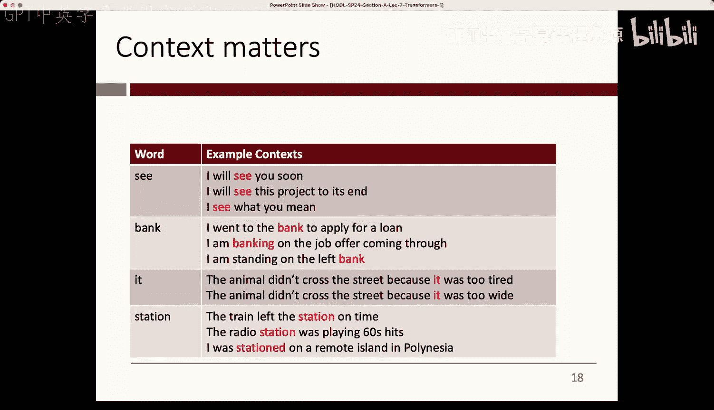

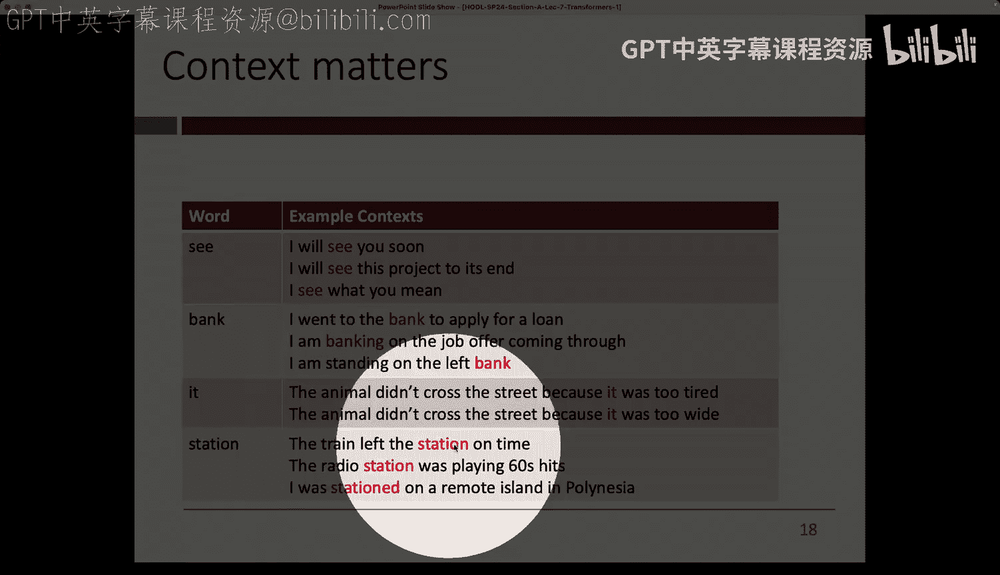

So clearly order matters， I mean， context matters。And。Clearly， order matters。

 You can come up with your own examples。 Let's keep going。Okay。So， the transformer architecture。

Is a very elegant architecture。Which checks these three boxes beautifully。Okay。

 it takes the context into account， order into account。

 and then you know whatever is produced out there is the same length as whatever is coming in。😊。

And the reason is called the transformer。It is because if 10 things come in。😊，10 things go out。

 but the 10 things that go out are a transformed version of the 10 things that came in。

That's why it's called the transformer。Okay。If 10 things came in and like one thing go goes out。

 well sure it's bit transformed。 But what is it， It's some weird thing。

 But when 10 comes in and 10 goes out， the 10，10 is preserved。

 each one is getting transformed in an interesting way。😊，That's why it's called the transformer。

So developed 2017， just dramatic impact。So by the way， the effect of transformer。

 Google had spent a lot of research on machine translation and obviously search。

 and then when the transformer is invented， they took a model called Bt。

 which we will see on Wednesday in detail and then they introduced Bt into their search and the results were dramatic。

😊，And from what I've read， apparently the impact of doing that Brazil。Typically。

 when you make an improvement to search， the improvement is very。

 very marginal because it's already a very heavily optimized system。😊。

And then with the transformer thing came along， there is actually a significant jump in search quality。

 So for example， and you can actually read this blog post which came out when they introduced Bert into search。

 it gives you a bit more detail。 but here so if you if you query something like you know Brazil traveler to USA needs a visa。

😊。

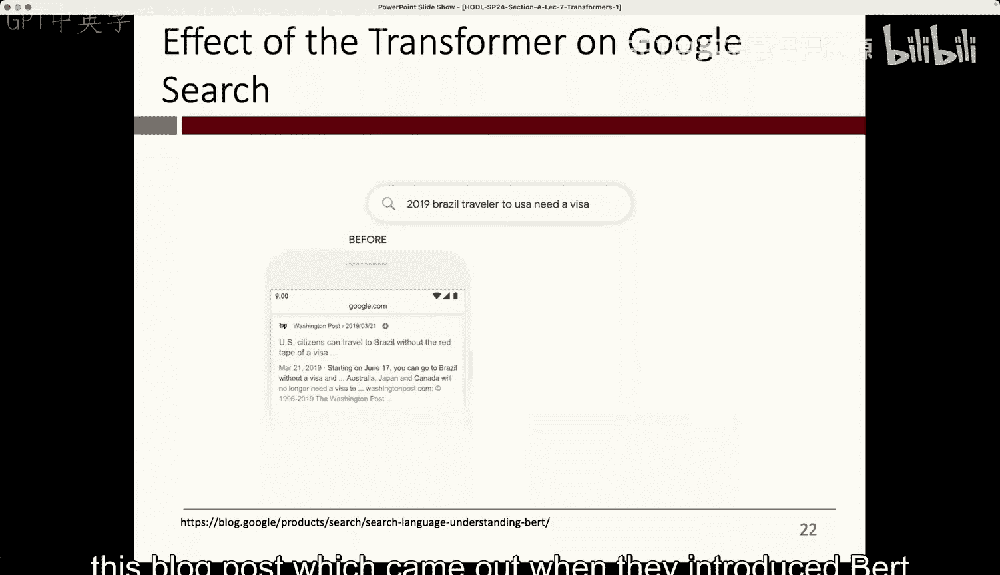

RightYou would think that it it should give you information about how to get a visa if youre Brazilian and I want to come to the US right。

 But it turns out the first result was how US citizens going to Brazil can get， you know， get a visa。

😊。

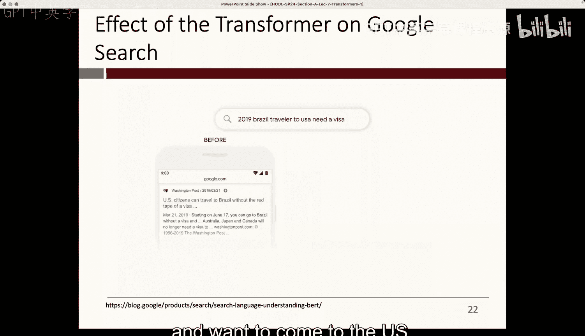

So clearly， it' is not taking the order into account。But once they introduced it， boom。

 the first thing was the US embassy Brazil。😊，And a page on how to get a visa。

So the effect was dramatic。And so this is a seminal paper。Right。

 and it's actually worth reading the paper。 And， and it's worth。 And， you know， this is the picture。

 This， this is like an iconic picture at this point。

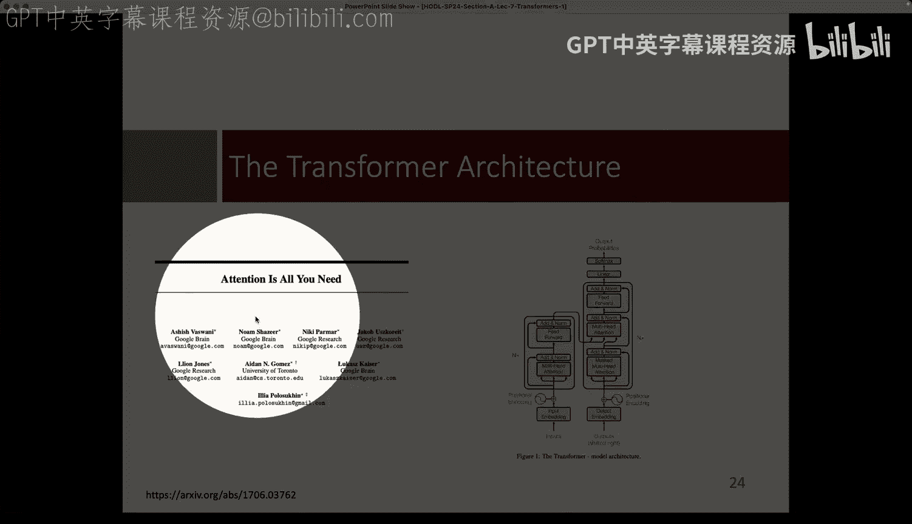

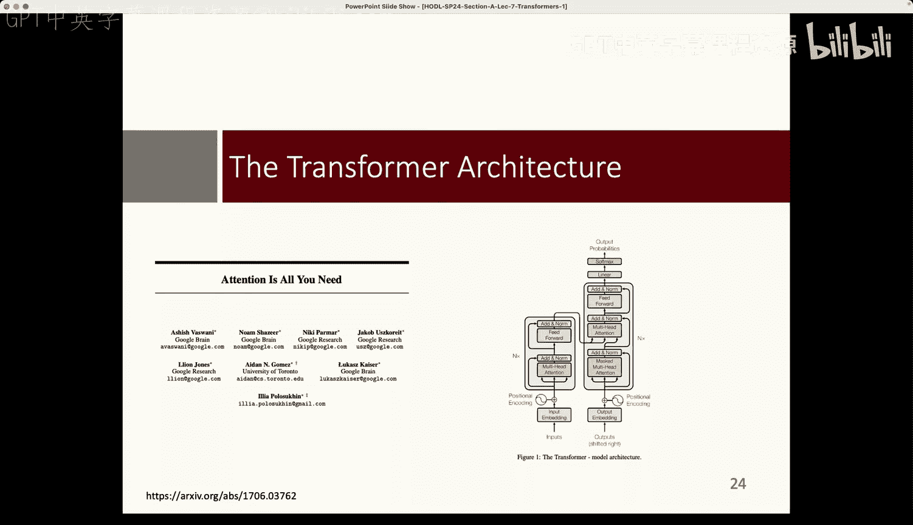

In the deep learning community。 and we will actually understand this picture by the end of Wednesday。

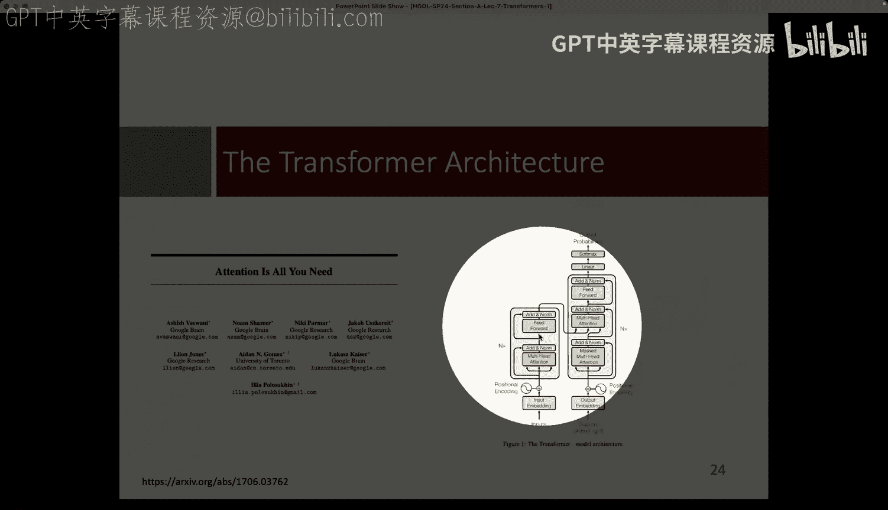

And so， but the funny thing is that when the researchers came up with it。

 they didn't realize in some sense， like what they had stumbled on because they were really focused on machine translation。

😊，It's only the rest of the research community that took it and started applying to everything else and found it to be really。

 really effective。Okay， so we are going to take each one of these things and figure out how to address them and thereby build up the architecture。

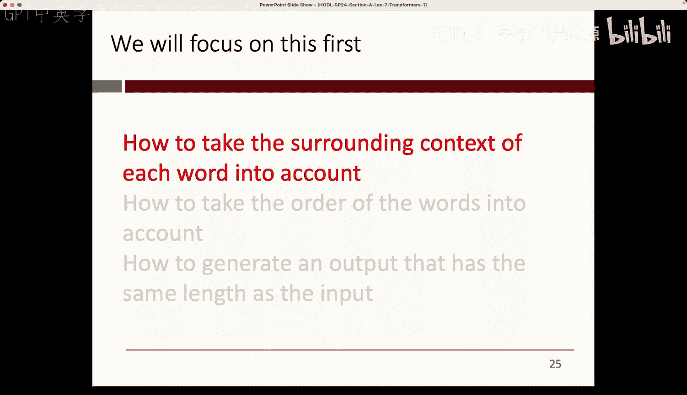

Any questions before I continue。Yeah。Is there any of。to discarding some of those cotton hot by hose。

It goes out surrounding like you have 18。And with discarding all the ones。

 that don't actually matter。Yeah， yeah。 I think that's a totally fine way to think about it。

 Basically what you're saying is it can we have a two stage model。

 The first stage model is like a O non o classifier and the second stage model only goes after the Ns。

 that's a totally fine way to do it。😊，Yeah。But as you can see， if you。

 even if you go with just a simple one stage model， if you use a transformer。

 you get fantastic accuracy。😊。

And we will do the coab in a bit。Allright， so let's take the first thing。 How do。

 how do you take the context of everything around the world into account。So。

So let's say that this is， this is the sentence we have。 The train slowly left the station。😊，Okay。

 for each of these words。😊，We can calculate a standalone embedding， say something like love。 Okay。

 so I'm just depicting these standalone emingddings using these， you know， thing easier。😊。

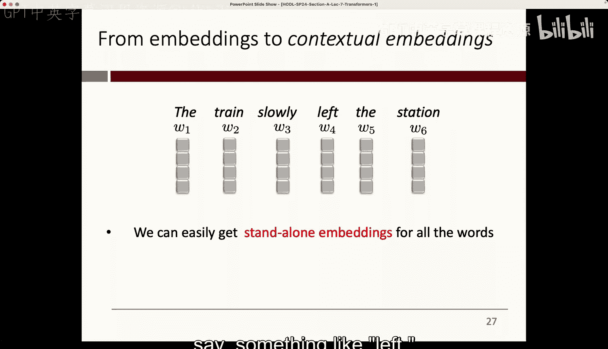

Please appreciate them because it took me a while to get them to do in PowerPoint。

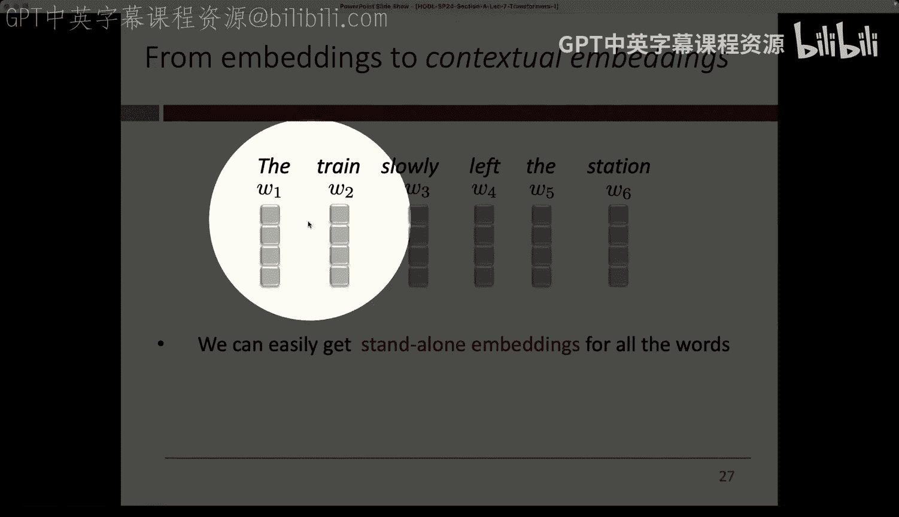

Okay， so these are w1 through w6。 These are the vectors standing up。Now。

 let us say that so we can easily do that。😊，Now， what we want to figure out is we want to focus on the word station。

And since station could mean very different things in different contexts。

 we want to figure out how do we actually take stations embedding and contextualize it using all the other words that are going on in that sentence。

 Okay， clearly it' is a train station。😊，So we need to take the fact that it is a train involved。

To alter the embedding of the word station。 right That's what taking context into account actually means。

So how can we modify stations embedding so that it incorporates all the other words。

 That's the question。

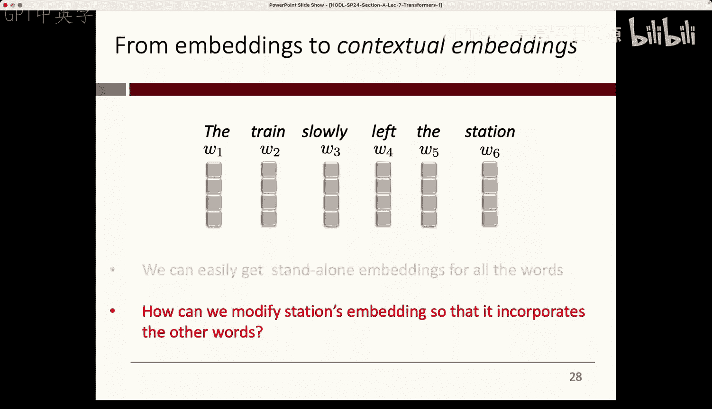

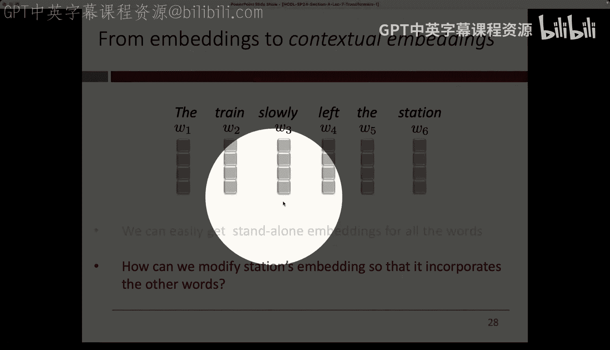

Okay， so when you look at it this way。Imagine， just for a moment。Just for a moment。

That we now some of the other word sentence don't matter， the word the probably doesn't matter。😡。

But some of the other words like train slowly left， probably does matter。And suppose， just magically。

 we have been told。All the other words is the sentence。

 this is how much weight you have to give to them。 These don't give it any weight。

 Those give it a lot of weight okay， suppose we are told that。😊，Or to put it another way。

 and this this is the word that is heavily used in the literature。😊。

Someone tells you how much attention to pay to the other words。

 whether you got to pay a lot of attention or very little attention okay and this。

How much attention to pay is given the form of a weight that you can use， O， so。嗯。

If you look at it that way， from this notion of how which words should I give a lot of weight to and very little weight to in this example。

 intuitively， which words do you think should get the most weight and which words do you think should get the least weight。

😊。

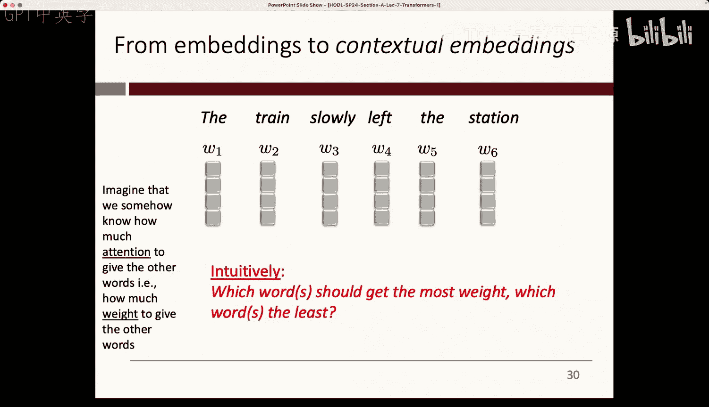

Yeah。T， right。You can do one at a time。Trade， okay， thank you。 Okay， others。Slowly， right。

 So that also seems to have some bearing to it。 What about words that don't really。

 I don't we don't think it's going are going to help at all。The exactly。

 it probably doesn't do much here。 Some context， it actually might make a difference。

 but in this sentence， maybe not。Right intuitively。So。

You should probably have a lot of weight to train， maybe a little to slowly and left and hardly anything to them。

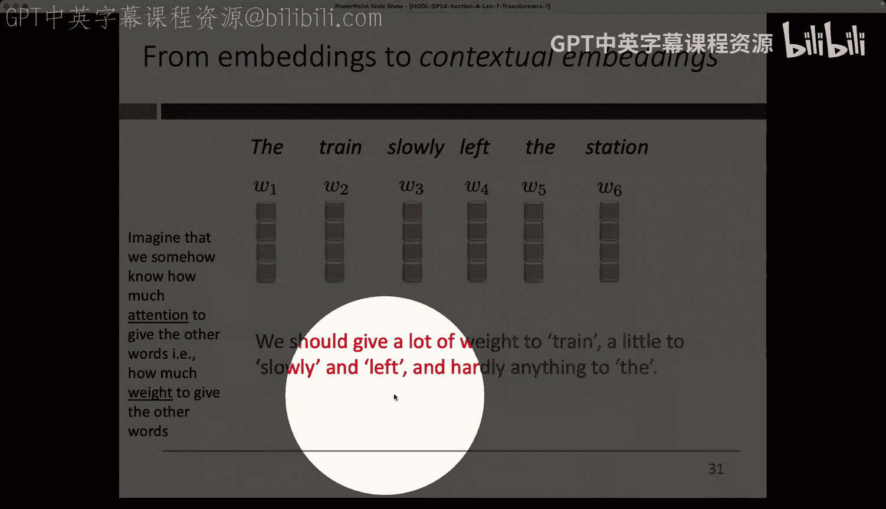

Okay。And so this intuition that we have can be written numerically。

 as maybe we have a bunch of weights that add up to one。😊。

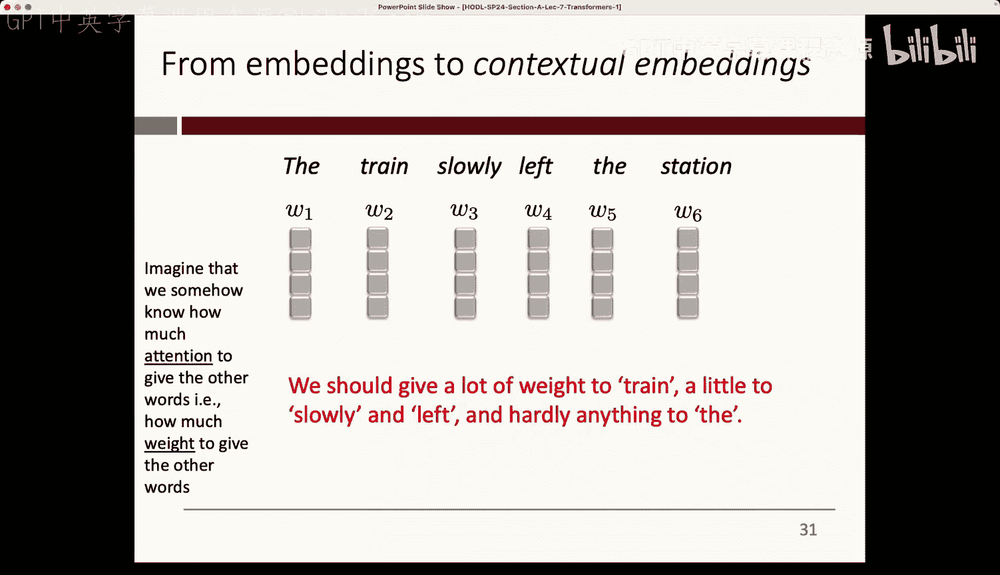

Okay。Okay， maybe something like this。 So we are saying the train 30% waitage。

 maybe 8% waitage to left， maybe 12% waitage to slowly。 And then as you will see here。

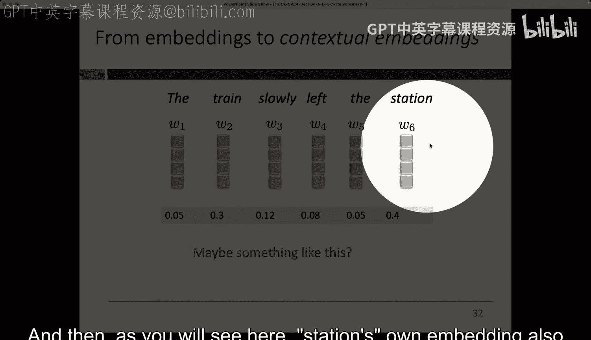

The station's own embedding also plays a role because we want to take its own standard on embedding and just move it slightly。

 change it slightly， which means that has to be the starting point。So it will get a lot of weight。

 You can't ignore itself， in other words。Right， so we give it maybe 40% weight。 By the way。

 these numbers are just made them up。

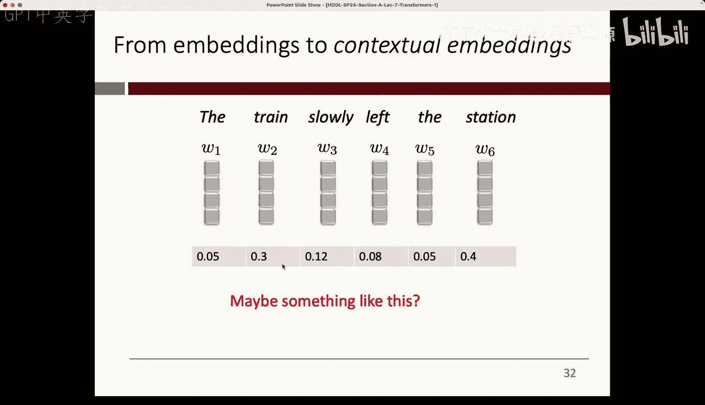

Okay， yeah。I'm sorry， it a good question。Waits。Are they stand condition according of the entire sentence or are they related to stations that off these six numbers are only put into station。

And for each word， we can notice to something similar。亮。

At this point was the model understand border because I was thinking of like because I can gave it a very low。

诶 a very good wing， but it say yes。Slowly B left station。

 the station on average should be higher correct， so at this point we are not worrying about order we are only already worrying about order。

Later， well take order income here is of lesser importance because。Its he has to figure it out。We。

 it doesn't know。 We， We are just giving it a whole bunch of capabilities。

 How it manifests those capabilities is all going to emerge from training。😊，Okay， so， all right。

 So let's say we have something like this。 So what we can do。Right。

 and we get to the all important question of where do we get these numbers from in just a moment。

 But suppose you have the numbers。How can we use these numbers to contextualize W 6， What can we do。

What is the simplest thing you can do？You have W6， you want to make it a new W6。

 which is now contextual， is aware of what else is going on okay。It's looking though I think。

We can take a weighted average， exactly， exactlyly。

 So when you have a bunch of things and you have a bunch of weights and， you know。

 we have to somehow modify one of those things with those weights。

 the simplest thing you can do is to take a weighted average。😊，Right。

 so that's exactly what you're going to do。So we are going to take all these weights。😊。

And just like move them up。Okay， move them up。

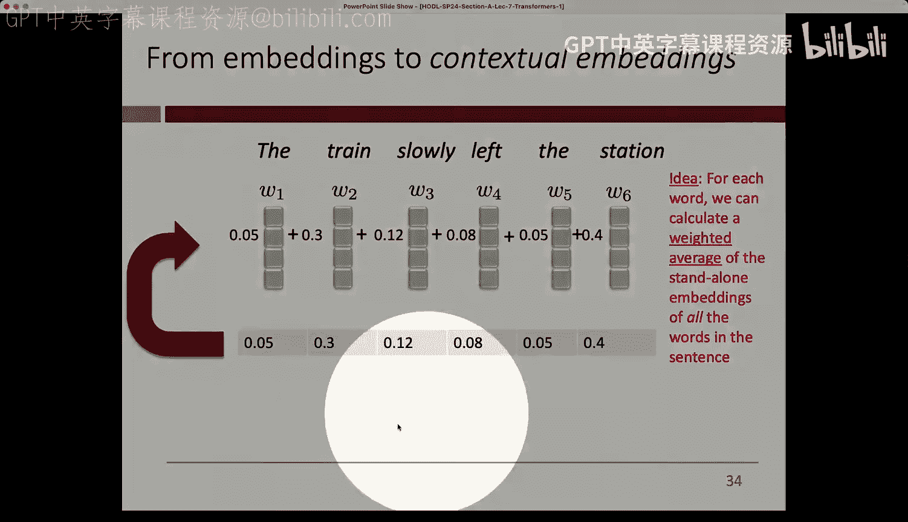

Don't even get me started on how long it took me to get this arrow around。

I don't know about you folks， is it its extremely painful to get the U turn arrows to work in PowerPoint。

😊，Anyway， back to work so。So we just move these up here Okay so now we can do 005 times this vector plus 0。

3 times that vector and so on and so forth。

And the result is just another vector。😊，Right。And that vector， folks。

Is the contextual embedding vector of station。

Okay， that was a standal on embedding and now we did the we multiplied this by that that way b bo boarrow them all up and then you get a new vector。

😊。

And contextual embeddings have this。Bluish can of colour。Okay。

And I'll maintain the callles scheme， as we go along。So， that's it。That's it。 That's the idea。

Any questions。Yeah。How did you come up with the original weights again？No， these weights， I just。

 I just。And type them in manually， just to make the point。

 And And now I'm going to talk about how we are actually going to calculate them。Okay。Alright， cool。

 So now I'm gonna okay， enough pictures。 Let's switch to some math， so。😊。

So basically what Im so let's write it a bit more formally。 So we have these w1 through w6。

 which is the standalone embeddings。😊，And then for station。

 we want to calculate you know w6 with a little hat on it， which is the contextual emdding。

 And the way we do it is to say we calculate some weights for each of these words。

 So this weight S16 means that the weight。😊，Of the first word on the sixth word。

 which happens to be station。TheThe weight of the second word on the sixth word and so on and so forth。

 And so what we are saying is that w6 is just you know this weight times w1， the same w thats it。😊。

Okay。I have to inflict all these know subscriptions and all that because you know， we need it。

Alright， so that's it。That's what we have。Now， let's talk about， okay。

 any questions on the mechanics of it。Before I get to O， where do these weights come from， yeah。

Ualizing something like。For， like how does it understand？Like the concept。We we。

The trained data that users put into work。But like20 new words that didn't exist before。

 a newer or a new context to a word。I already。No， I think the context is supplied because the query coming into something like Google is a full sentence。

😊，And we only take that sentence and take only the sentence that account as the context for us。

So the context is always present to us when we get the input。But the other question you had of， okay。

 what if there is a brand new word you have never seen before for which there is not even a standalone embedding。

 what do you do then？😊，So let's punt on that till Wednesday because I have to talk about something called white pair encoding and stuff like that before I can answer that。

😊，ItDoes not immediately translate to their predictive search queries。re系。Does that all。Right。

we're saying how toOr you mean like the autocomp？You know autocomp uses a slightly different mechanism。

 they had a very complicated non transformformer thing for a long time。

 I'm sure they have a transformer version now， but I don' I'm not trivye to how exactly they have done it。

 so I don't quite know how they do it。 but what you're proposing is a reasonable way to think about it。

😊，这样。I think we have it。Pa as in against the extent。等据拣。これてもおのタとし。いやそうですね。the places。Yeah。

W becomes W6 becomes W6 hat。I be a。不。己通都有几直半。这一分。や不よ。どた onだ。No， we lose it and as you will see here。

 as it flows through the transformer it getting more and more and more contextualized。😊。

So it's a left to right flow。All right。All right， great， so by the way。

 this thing that we did for station， we will do it for each word in the sentence。😊。

The same exact logic， obviously， the weights are going to change。Okay。

 but what will happen is that w1 through w6 will become w1 hat through w6 hat。

The same exact logic is going to hold。Okay， that's what。

 I just I don't have the slide sweater because the the best of that。

The same exact logic is going to hold。 All right， now switch heres。

And answer the all important question of where are the way it's going to come from。Okay。

 so the intuition here is really， really interesting and elegant。😊，So， clearly， the weight of a word。

Should be proportional to how related it is to the wordt。Right。

The word train clearly is very related to the word station。The word the is not clear how its rare is。

 Rob does all the related， so the relatedness matters to the weight more related higher the weight right just in。

😊，So one way to quantify how related two words are is to take their standalone embeings and calculate the dot product。

Okay。In case folks lived。Sort of forgotten about the dark product。Yops， it' I want。So， if you have。

 let's say you have a vector。Let's say this is the vector for train。

This is the vector forest station。So the dot product of these two vectors。I'll right to this train。

Station。Equals。Basically。The length。Off。Director for Tra。Chmes， the length。Of the vector for station。

Times the coine。Of the angle between them。Okay。So how long is each vector？

Product of the two and then the angle between them。 Okay。

 now let's assume for simplicity that these lengths are roughly the same。They just one unit length。

 Okay， just roughly。So if you assume that。Okay， this thing， let's say， becomes。Itcomes one。

 let's say。This thing becomes fun。So all the action。Is here。Okay。So all action is here。So basically。

 the dot product of these two vectors is really the cosine a angle between them。😊。

So now the question is， if you have something like this。which are very close to each other。

 the cosine of a very small angle， actually， the cosine of 0 is what。1。So if the angle is really。

 really small， the cosine is going to be very close to one。😡，Because0 is 1， the cos of  zero is1。

So this thing is going to be pretty close to one。If you have a cosine of two vectors that are like this 90 degrees apart。

 what is the cosine？Zero， that orthogonal， right， which maps to the English orthogonal。

So the cosine of that is0。And then if you have something like this。

Where they're literally pointing in opposite direction。What is the coine of that 18？-1。

So that's it So if these two vectors are very close to each other。

 the cosine of the angle between them is going to be very close to one if they are really kind of unrelated it is going to be 0。

 if they are antidirect it is going to be minus1。😊，So that's how dot products。

Capture this notion of closeness or relatedness。Okay。So， all right。Good point。

So we can use the dot product of these embeddings to capture relatedness。And so， okay， iPad done。

So now what we do is we know know that we know that dot products can be used。

 we can't use them assets because we need to do one more thing to make them proper weights。

 And what I mean by proper weights is that we want the weights to be， first of all。

 non- negativeative and we want to add we want them to add up to one right that that's what a weighted average actually is going to mean。

😊。

But these cosines could be negative。Right， and so we need to now adjust them to make them proper so that every one of them is guaranteed to be non negative and they will add up to one。

When was the last time you had to take a bunch of numbers which could be anything and then somehow make sure that they are going to be positive。

 non negative and they add up to one when was the last time。😊，Yeah， softmax， exactly。

 so we'll do the same trick。😊，So what we will simply do is well just you know exponentiate them right So like this w1。

 w 6， this angle bracket thing is the dot product。 That's the notation I'm using E XP of that。

 does just you exponentiate them Easese to that。😊。

And once you expientiate them， they all become non negative。

 And then we just divide each with the sum of everything。

 So the whole thing will become like a probability， right， It'll just add up to one。Makes sense。

 So that's why we take arbitrary numbers and make them proper weights。All right。So。

To summarize。From embeddings to contextual embeddings， that's what we do。

We take all the standalone embeddings， we calculate these weights using this formula。

 and then we just do the weighted average and we arrive with the context embedding and boom done。😊。

Okay。And so by way choosing weights in this manner。

 the embedding of a word gets dragged closer to the embeddings of the other words in proportion to how related they are。

 So just imagine for a second， right， in this case， station obviously has many contexts。

 But let's assume for a second that only has the train context and the radio station context。😊。

Okay。In the current context， train is closely to the station and therefore exerts a strong pull on it。

Right。Now， radio has also laid a station， but it doesn't appear in the word in the sentence。

So effective it as a weight of 0。Okay， and that's the beauty of it。

 And and please do not ask me things like， you know。

 I was listening to a great song on the radio station and the train pulled out of the station。😊。

Okay， transformers can deal with stuff like that。 Okay， but yeah， but you get the idea。

 the main idea。So by moving station closer a train。By paying more attention to train。

 we are contextualizing the station， the word， the embedding to the context of trains， platforms。

 departures， tickets and so on。 It's like the portal into the whole train world。😊。

RightIt is beautiful。 The simple idea will get you there。😊，Okay。

 so this focus is called self attention。What we just described is called self attention。

And it's the key building block of transformers。Okay and so they sort of summarize standalone embeddings come in。

 contextual emddings go out。😊，Any questions？呃，要。I'm still starting a little bit with the intuition of the word。

' the weight of。It's south in its。texualbedding， so like the weight of station in the station bedding。

 how should I think？Think of it as。It will be high。

 it will be typically be a high number because the cosine of the vector to itself is going to be very the cosine is going to be one right so it is going to be pretty high。

 but theres no guarantee is going to be the highest。😊，Right。

 because they are not actually the the length doesn't have to be one。 They could be。

 We try to keep them kind of smallish， but they don't have to be。

So the way I would think about it is imagine that you take an average of everything else first and then you average it with the new the old embedding。

😊，Effectively， it's the same as just calculating the different weights and averaging the whole thing together。

Sure。えとわ。Number inputs， but is this the reason why。系理。It's like that。Its。诶。Correct， correct， exactly。

 exactly。 and the other thing to remember is that by getting by keeping the origin the input sort of the size of the input cardinality intact as you move through the transformer stack。

😊，When you finally come out the other end， there is sort of no loss of information。

 And at the very end， you can choose to aggregate， simplify， summarize， and so on and so forth。

 It preserves your optionality as long as possible。😊，の？系化装。他说で。Yes色。对。Yeah。

 so what we is the sentence comes in there is the whole notion of something called a context window or what is sort of the maximum length that these sentences will handle and that's a parameter you can set and we will come to that when you actually look into collab。

😊，嗯。Was that a question in the middle No okay。All right， so that is self attention。😊，And now。

 because that felt too easy。We are going to do a little trick called multi head attention。

So this are this is the self attention we just saw。What we can do is we can be like， you know what。

Why can't we have more than this， Why can't we have more than one of these？

 So this is called an attention head， self attention head。 We'll have multiple self attention heads。

 okay。Now， and I'll come back to the top thing in a second。 Okay， but so the question is。

 why should we have multiple self attention heads。Because a particular attention head is going to pick up some patterns。

 The reason is because。It will help us attend to the multiple patterns that may be present in a single sentence。

So far when I've been explaining I've sort of basically been looking at what the meaning of these words are。

 just the meaning of these words， but in any complicated sentence you have to worry about grammar。

 you have to worry about tense， you have to worry about tone。

 you have to worry about facts versus you know opinions there could be any number of complicated patterns that are sitting in a simple sentence which means well there is just not one way to pay attention。

 there could be many ways of paying attention， many sort of there could be many needs to pay attention right。

😊。

Which means that， let's have many of these attention heads。

And each one could be learning something else。 It's exactly like having lots of filters in a convolutional network。

😊，Right one filter might learn a line， another filter might learn a curve and so on and so forth。

 and we don't want to decide a priorityi oh you are going to learn a line right similar to here we are not telling any of these things what you have to learn。

 they just have to learn based on the training process。😊，So what we do is。😊，So actually。

 this' is an example where this from the original transformer paper， where this sentences。

 the lawyer will， sorry， the law will never be perfect， but its application should be just。

This is what we are missing， in my opinion。The complicated sentence， right。

 So the first one attention head， actually， this is the pattern of things。 it's it's it's， So。

 for example， the word perfect here。

The contextual embodying of the word perfect。Draws upon heavily from the word law。In this example。

Okay。If you look at another attention head， the context emm for the word perfect is actually drawing heavily from just perfect。

😊，And nothing else， right。 And if you look at other words。

 the patterns are subly different of what it's paying attention to。

So these are two different attention heads， and they are learning different kinds of attentions。Okay。

 in reality， trying to make sense of why they。Pay attention to the way they do。

 It's usually quite sort of difficult to figure that out。 You can't actually interpret it。

 But when you have lots of attention heads， the performance on the task that you care about gets really much better。

Right，And then you say， okay， I can use that yeah。😊，This。です。Exactly same logic， same logic。

But you go to that link in that printer， we had designed a particular filter for particular task。

It comes of one and zeros but here take the how do we differentiate how do we of each different of scenario different kind of actually in the convolutional case the ones and zeros I had were just example numbers to show that that particular filter could detect a vertical line or horizontal line you will recall that when we actually train a convolution network we actually don't specify the numbers we start with random initialized weights and then we let back propagation figured it out。

Similarly here， we don't decide any of these things， we just let back figure it out。😊，Okay。

 and now the question of what are the weights that are actually going to be learned will come come to that in a bit。

😊，Okay， yeah。I was wondering how come we have different attention head， even though。

It seems like they're only function of adult product。It same of product for same and。Great question。

 Great question。 And I literally have a note in my slide saying。

 if a student asks this good question， tell them to wait till Wednesday。😊，So great question。

 And we'll come back to that on Wednesday and spend a fair amount of time on it。

 So the the point that's being made here。😊，Is that oops。When we look like self attention。

The embeddings came in and we did all these dot products and the contextual things popped out the other end。

 note that inside the self attention box there are no parameters。😊，There are no parameters。

 So the question that is being raised here is that So what are we learning， really。

 if there is nothing inside to be learn， if there are no parameters， no coefficients。

 what are we learning， That's the question。 And by extension。

 if we have two of these and neither of them is learning anything， what's the point。Sadly。

 you have to wait till Wednesday。Okay， but we have a great answer to the question。

 so it will be worth it。 And if you can't stand the suspense read the book。😊，Allright。

 so that is that is why we need multiple heads okay and now to come back to this so what we do is it goes through this head and you get these w ones right and it goes through here and we get another set of ws。

😊，Then what we do at the very end is we concatenate them。O， we concatenate them。

 and we do a projection。 And this is what I mean by that。So we have this。

 this is one self attention head， self attention 1。This is self attention， too。And let's say that。

W1 hat comes out。And I'm just going to call it Z Z1 for the same thing so that there's no name clash。

Okay， and W 2， W 6， all of them are coming。 right， this focus on W1 and Z1。

W1 and Z were not both contextual emddings for the same word。😊，Okay， for the first word word 1。

 And so what we do is lets say this w1 lets call lets say this vector is like this okay。

And let's say that this vector is like this。What I mean when I say concatennate here is we literally take this word here。

This embeing here。 Then we take this thing here。Okay， and we just make it a long vector。

 We concatenate it。 But now this vector has become twice as long， right。

So what but remember we always want to preserve this the the number of inputs we have and the lengths of these vectors everywhere as we go along。

 So what we do is at this point we run it through。😊，A single dense layer。

 which will take this thing and make it back into the same small shape as before。😊。

So this is a dense layer。That's it。 So this vector comes in and it becomes。

 it gets compressed back to the original shape that came out of here。

So you could have like 20 of these attention heads on the con will be 28 times long。

 And then just project boom。 One dense layer comes back to the original shape。So that's。

 that is a projection step。And that's what I mean here when I say concatenate and project。

So at this point， what we have is things come in， we contextualize them using these different attention heads。

 and when they come out of the attention heads， we take them all。

 we just like concatenate them and then compress them back to the same original starting shape right if these vectors are 100 units long or 100 dimension long whatever comes out is 100 still。

😊，And to preserving this size as we go along is very important for reasons that will become apparent a bit later。

😊，Okay， so that is the multi attention thing。Now， a final tweak for today。

Is that we will inject some non nonlinearity。

With some dense layers， dense re layers at the very end。

 So we went through a bunch of attention heads。 we came up with a bunch of contention embetics now。

 So at this point， so far。😊，There are no since there are no parameters inside these boxes right and there are some parameters here we need to do some nonlinearality so far theres been nothing that's nonlinear so far。

 so here we actually send it through one or more res typically this use one re so。😊。

And what I mean by that？O， sorry。So this is what we had here。 and then。We take it in。

And then run it through。Actually。We typically run it through。A reou。 This is a nice relo。

Okay and and the rule of thumb， as you will see， if let's say this vector is say 100 dimensions long。

 they typically will choose a re which is about 400。

and then it just gets projected out again back to 100。So。This is just a simple， you know。

 the input comes in， goes through a single hidden layer with four four times as many as here。

 And then it。Project， another dense layer。200 again。And since there are res here。

 we we have injected some non linearity into the processing。Okay， now。

A lot of this stuff when it came out， felt very ad hoc。

It didn't come from some deep theoretical motivations。😊。

But people had strong intuition as to why these things were helpful。 and as it turns out。

 since the transformer came out people have tried to optimize every aspect of this thing。😊。

It's actually pretty difficult to beat the starting architecture。Improments have been made。

 but it iss actually a very robust architecture。😊，So， so that's what's going on here。

 And then when we come out of this thing。This is what we have。 the story so far。

 We start with random standalone embeddings。 This could be glove embeddings。

 It could be random weights。 It doesn't matter。 It goes through a bunch of self attention heads。

 We concatenate it when it comes out the other end。

Concateated when it comes out to the other end and then we project it back to the same sizes before。

 then we run it through you know a re followed by a linear layer and we get these things again。

 So in this whole process if six things came in， six things will come out and if you those six things that came in where emdding standalone embedding vectors of 100 dimensions。

 what comes out is also0 dimensions。

So in that sense， you can think of this whole thing as a black box in which whatever you send in。

 the same number of things will come out of the same length。

The numbers will be different because they have be heavily contextualized。

The numbers are much smarter， in other words。So so far。

 what we have seen is that we have satisfied two of the three requirements。

 We have taken the context of each word into account。

By using these dot products in the self attention layer。

 and we can generate an output that is the same length as input。

 but we have ignored the fact that we have ignored word order completely。😊。

O， because whether I had said the train slowly left the station or I had said the the station slowly left the train。

😊，This thing won't know the difference。Because dot products function on sets， not on sequences。

 They function on sets。Okay， you you should convince yourself of this， regardless of the order。

 the doctor calculate doesn't change anything。😊，Because we are doing every pair。Okay。

 so the question is how do we take the order of the words into account right， as I were saying。

 we can scramble the order of the words in a sentence and well get the exact same context of puttings at the end。

😊，So by the way， if you're working on a problem in which the order doesn't matter。

Then you can stop right now and use the transformer。

And there are many problems that are actually in that category where the order doesn't matter。

 So if you take traditional structured data， right， tabular data， you know， blood pressure。

 cholesterol level， boom， boom， boom， Does it predict heart disease， Well。

 there is no order in that thing。 You can use the transform analysis without in doing anything more。

😊，So transformers work for both sets and sequences where order matters。Okay。

 so the fix for this is something called the positional encoding。So what we do is very simple。

 There are， by the way， there are many things Ive been invented to to to tell transformers。

To give transformers some information about the order of each of the things that are coming in。

 I'm going to go with something called the you know the simplest possible way。

 which actually works pretty well in practice。 So what we do is。😊，For each position。

Each possible position in the input starting from the first position all the way through the last position。

We imagine that that position itself is a categorical variable。

RightIf a sentence can only be 3030 words long， let us say we say that hey。

 the position of each word is a number between 0 and 29。😊。

And so we can just think of it as a categorical variable。And because the categorical variable。

 we can just imagine an embedding for that for each potential value。

 So it will become clear in just a moment because I have a numerical example。😊。

And so what we do is we will just take that standalone embedding and then we will take this position embedding。

😊，Which represents the position of the word in the sentence。 So just add them up。오케이 야。

So if in the initial sentence itself， I have made mistake。

 so I just write it as a train slowly the station。So which means my output is actually going to you know。

Now， the transformers are， since they train on lots of data。

 they will be quite robust to these things。But strictly arithmeically speaking， correct， yes。Okay。

 so here's look，'s look at an example。Let' us assume that your standalone embeddings， right。

 this is your vocabulary， okay。Unknown cat mat， I sit love the you on。 That's it。

 That's our vocabulary。And for this vocabulary， we have these standalone embeddings。😊。

And this for argument， let's assume these embeddings are only too long。

Okay， the dimension of these symbitics is2。If you recall the glove embeddings we used last week。

 I think they were about 100 long and the ones were using in the homework are even longer than that。

 but here we are assuming they are only too long。 Okay， so the embedding for cat is 0。5 comm 7。1。😊。

All right， now let us assume that the we can have at most 10 words in any sentence that is coming in。

😊，And obviously a particular word could be in position0 all the way through position 9 and we will learn embeddings for each of these positions and these embeddings are also too long。

😊。

2 units long， dimension 2。Okay。Now， where will these embeddings come from？

What's answer to that question， What is the answer to the general question of where will these weights come from。

We will learn it with backdrop。Okay。We will start initially with random numbers。

 and then we'll get them make them better and better as over the course of training。

So what we do is we have these two tables。Of embeddings。

The standalone embedding for the word and the position embedding。And then we literally add them up。

So for example lets say the word the sentence that came in this cat sat mat that's her sentence its got three words cat sat mat so what we do is we say well the embedding for cat is this thing here 0。

571 so I write it here 0。571 cat happens to be the0th position of the word so I grab the embedding for 0 which is 1。

33。9 I stick it there and then I literally add them up 0。5 plus 1。31。811。0 that's it。😊。

So now the positional encoded embedding for the word cat is 1。8，11。0， not 057。1。

So if cat happens to show up in another part of the sentence， let's say instead of cat S Matt。

 we had。Matatca。Now， cat is now the third position， right， which is 0，1 and 2， which means。

Its embedding doesn't change。 It's just embedding for cat。 But now instead picking 0。

 we'll pick this one，681 and put that here and add them up instead。

So this is the idea of the positional encoding。This is how we inject position knowledge into the transformer。

Yes。The position and wedding would be different for each center。No。

 this is just one table which tells you what the position is。

So though it says for a word that appears in the seventh position in any input sentence that you are feeding in。

 this is the embedding that you need to use。😊，For that position。Twice。Great question。 So if if。

 let's say， just for argument， let's say the the sentence was cat， cat， cat so the。😊。

For each one of those cat for cat， cat cat， this embedding will be the same 0。

571 because that happens to be just embedding for cat regardless of position。😊。

But then， the first cat。

For the first cat， we will use 1。33。9。As the addition for the second cat will use 6。33。7。

 and the third cat will use 0。681。So only the things that are adding the position and coding will change the position embedding。

 So the resulting sum is going to be different from each of these three words。

 even though they are exactly the same word。😊，Is that position at letting table specific。

If you were to hide or remove some。It's independent。Independent。

 it only depends on your assumption about how long the sentences can be。That's it。

It doesn't really care about what what words are coming in。 That's a whole different thing。

So these are two independent tables I just learn as part of this process。So， yeah。

 I have the same thing for Sa and Matt。

Certain mat。 That's what we have。So just make sure you understand these two slides to really like。

 make sure the mechanics are clear， yeah。

How do you filter out for dierward， for example， if you were taking an LP output for？Transcription。

I run a transform line and you have a lot of ponds and likes。Disproportionately large and happy。

The sides were。other ways to noise typicallyypically what they do is as we will we'll talk about this thing called B pair encoding in which we take individual characters。

 fragments of words and words into account as tokens。 So when you hear stuff like and so on。

 it gets mapped these small tokens。

RightAnd then we treat them as just any other talkingken。Yeah。

 iss aggregation like a simple song right here。This actual se meaning word in the same em bud。1 for。

It could be。 we just don't know a priori， whether it is going to be important or not for any particular sentence。

 we when we train the transformer with a lot of textual data， right。

 it'll just figure out the right values for these things so that on average。

 the accuracy is as high as possible。So in many of these things。

 there is always a tension between our human intuition as to how it should work and whether you should just throw it into the meat grinder of backp and see what happens。

 And so here it， as it turns out， you can just throw it into back actually do a pretty good job。😊，呃。

不要。Forriendent positional andco， we would just be。Using the sum vector。

 we would be using like this two by three。Oh yeah， this just for demonstration。 Basically。

 this is a thing that will actually go into the transformer， correct。Yeah。

That was just me being overly verbal in the slides。呃，呀。If you saying sentences the input。

 at this point， are we still parsing out punctuation。

 or if we have like a multis input is there positional embedding？sense。Yeah， so here。

 basically the starting point is tokens。Right， and in our example。

 because we are working with the idea of simple standardization and stripping and things like that。

 I'm just showing actual words if you go to something like GBB4。

 since it uses a different tokenization scheme， each token might be part of a word。😊，It might be。

 it might be an individual character。 It might be a punctuation mark。 It could be， in fact。

 the GP family doesn't support punctuation。Which is why when you ask a question。

 it comes back with intact punctuation in its response。And so well get。

 well revisit this when you look at Bp bypa encoing electron。

But the key thing to remember is that all the stuff you're talking about starts from the notion of a token。

As to how you define a token， given a bunch of text， that's the tokenizer's job。

 And we just assumed a simple tokenizer for the time being。Okay， so at this point， folks。

 we have satisfied all the requirements。We have taken the surrounding context of each word。

 we have taken the order and so on and so forth because what is coming in here is the positional embeddings okay and it runs through the whole transformer stack。

😊。

So。This is called a transformer encoder。Okay。

This is the transformer encoder。 And you can see here， this is the original picture from the paper。😊。

It's an iconic picture at this point。 So it says here， this， this is the input。

 This is like the cat SAT on the mat。It comes in here， gets transferred transformed to embeddings。

 standalone embeddings。And then based on the position of each word， we add。

 thats why the you see a plus sign here， we add the positional。😊，Embbedding to that。

And the resulting thing goes into this transformer block。

 And here we go through multi head attention。😊，And things come out the other end。

 then there is this thing called add and norm which will we will revisit on Wednesday。😊。

And then it goes through a feet forward network， another addom norm， which will revisit on Wednesday。

 And then it comes out the other end。 That's， that's a transformer encoder。

Okay。And so， if you look at this。

Just to point out a couple of things， the input embeddings can be random ways or it could be pretrain embeddings。

 we add in a position dependent embeing to represent the person each word in the sentence。

 That's the plus。 Then we pass it through multi attention to get a contextual representation。

 Then we finally we pass all this through a simple。😊，Typically， it's a two layer network。

 one hidden layer with res and then a linear layer after that and boom。 And then we do it。

 This is encoder and。😊。

Here is perhaps the most important point to keep in mind。

 because we have taken inordinate care to make sure that the things that are coming in and the things that are going out are the same size。

 both in terms of the number of tokens， as well as the length of each vector。

We can then stack them up like pancakes。We can have lots of transformers stacks。

 one on top of each other。Right， because it's the perfect API。 It's the simplest possible API。

 The same thing comes in， same thing goes out。😊，In terms of size。

 so you can have a transformer encoder， another one top， boom boom boom， boom， boom。

 one after the other G3 has 96 transformer stacks。And like in all things deep learning related。

 the more layers you have， the more complicated things we can do with it。😊。

As long as you have enough data to keep the model happy， so it doesn't overfi。Okay。Alright。

 so what we haven't covered， which well covered on Wednesday。

I is the question that he had posed about how you know since there are no parameters inside say the self retention block。

 what are we actually learning and then there is things called residualible connections and layer normalization。

 we will talk about all those things on Wednesday those are all like you know refinements to the idea。

😊。

So all right，9，39， let's apply the transformer encoder to an actual problem。Any questions。呃，呀。

My question is regarding like you said you could have multiple transformers。诉讼查询。分社府的。反再看。

When I say a transformer block within the block， there could be multiple testss。Actually。

 as you said， by cooking this the。Yeah， you can have a lot of attention heads。

 and that's certainly fine。 And typically if I get how many GP3 and4 have they have a whole bunch of them。

 but you can so you can go white and you can go deep。😊，Both are done in practice。

But the thing is if the one thing you have to remember is that if you go white。

 you have a lot of attention heads， then given the particular input that is coming into that block。

 it will learn different patterns from it。😊，Well if you stack them all up。

 it's going to learn different ways to contextualize the things that are coming in。

 It operates at higher levels of abstraction。 So the analogy would be that like the seventh layer of a convolution net may take the sixth layers output and say。

 oh， I'm seeing a lot of edges here。 I'm going to take an edge like this two circles there and call it a face。

😊，So it operate at a high level obstruction。O。Alright， let's go to the collab。

So what we are going to do is we're going to take the transformer that we just learned about。

 and we're going apply to solve the， the travel slot problem， okay。All right so。Okay。

 so we'll start with the usual preliminaries。And then we have taken the8 data set I talked about。

 and we have stuck them in Robox for easy consumption。It's here。Okay。

 so if you look at to the top few。You can see here， for example。

 I want to fly from Boston at 38 a and then this is the output， the slot filling is the output。

 And so as it turns out here that is this these wheel also gave it another they took the whole query and gave it an intent as to is it it's a flight query Its something else query and so on。

 which we are not gonna are you kidding me。I want to fly from Boston at 8。

30 AM and arrive at Denver 11 in the morning。 What kind of ground transportation is available in Denver。

 What's the airport at Orlando。How much does the limo service cost within Pittsburgh okay？

And so on and so forth。 So get you get the idea it's a very wide range of queries that are in this data set。

Okay， so let's just ignore that for a sec。 Okay， so what we are now going to do is we are going to take only。

This column right， the query column that's going to be our input text and then the slot filling column is going to be a dependent variable。

 the output。So we'll just gather them all up。Here。Let it run。

 we'll do it for the training data and the test data。

And so what we have done is that we have taken the transformer related code in KeS and we have packaged to a little hdle library for easy consumption and so that thing is here。

 you can download it。Calling at the library is like overt。

 We literally just a bunch of code and stuck it in the file， okay。So。

 and so what we'll do is from hurle， we'll import the transformer encoder。

And we will import this positional embedding layer because what we are going to do is we are going to take the input。

 do the positional encoding business and then send it into the transformer。😊，So。

 but first lets vectorize the input queries that are coming in， so we will define a thing here。

The youth this。Max query length is not defined。 That's what happens when you。Don't run everything。

All right。Okay， so now we have this thing here。 So turns out that there are 8，8，8 tokens right，8，8。

8 words in the input queries that we have in the data。 So take a look at the first few。

And you can see here you know there is inc and because the output mode here is you just want integers to come out not multiho encoding or anything because we are going to take those integers and then do embeddings from them so it it will create it will reserve this empty string as the pad token this should be familiar from last week。

And then the inc for unknown tokens and then two from flights these are all some of the most frequent。

 turns out Boston is actually the most frequent。 I don't know what's up with that。

Here is one of this， then we will do the same vectorization to the train and test data sets。

Now we need to do STIe for the output side of the problem because the slots the dependent variable here remember are all sentences as well with the B O things like that right so we need to vectorize those so we or we need to STIe on them so lets take a look at some of these slots。

And you can see here all this stuff is going on。 So now here is an example where you have to be very careful when you do the standardization。

😊，Typically standardanitization， you will remove punctuation and you know do things like that in a lower case。

 right， but here。😊，These things have a specific meaning。

We can't just go in there and remove the period and the underscore and then take make the B into lowercase B and stuff like that。

 that will just harm it right we need to be able to preserve the nomenclature of the output in terms of all those tags。

 so we don't want the standard do all those out。 So what we do is we say standardization none。😊。

Look at that。We tell cars do not standardize this， do not do your usual thing。Okay。So。We do that。

For the output side。 And then let's look at the vocabulary。Yeah， so this sounds pretty good。

These are all the things that we would expect to see。

 These are the distinct tokens in the output strings。Alright。Okay， let me get it。

So we have 125 of them in the in the lecture， I said there are 123 slots， possible slots。

 Why is it 125 here。Yes， uncompared， correct。Okay， now we'll set up a transformer encoder， right。

 this， Oh， wait， wait， wait。 I forgot about doing this。 My bad。

Alright。I just thought when I saw this slide that we should go to the collab。

Without giving you a bit more background， No problem。So。

The way we are going to model this problem is that we're going to have something like this， right。

 F from Washington， Denver。 That's the input that's coming in。 And that is the correct answer。

0，0， some B， something other others。 I mean， O， and then something else， right。

 That's the correct answer。 That's the， that's the input。 and there is the right answer。

 So what we'll do is we will create these positional input embeddings like we have discussed before。

We will run it through a transformer。It gives us contextual embeddings。 So if we send5 in。

 it' is going to send us5 out， except the color is no blue。😊。

Right， and then what we do is we will run it through a re。😊，Okay， we'll run it through a re。

 We will still have you know，5 vectors here，5 vectors will come in。

 And then for each of the things that comes in， we will stick a 1，23 way soft max。😊。

O， for each thing that comes out， we will have a 123 way soft max。

 and that's the classification problem we are going to solve。😊。

Okay。So。The weights in all these layers will get optimized by backdrop。

All these ways are going to get optimized。

呃，呀。Sorry。We often positional beddings important。Or no， that's a layer。

 the weights in the layer will still need to be learnt。

It's sort of like the text vectorization layer is a bunch of code。

 and then you actually run it on a particular corpus to adapt it and fill a vocabulary out of it。😊。

So it's like an empty shell that needs to get populated。Okay。

 so with the weights and all these things are going to get updated when we train the model。😊。

We're back prop。And that's it。 That's the setup。

Does this make sense before I switch back to the collab？In particular， does this make sense。

 this part of it。

Bunch of things come out。 And then for each one of those things。

 we need to figure out a classification of a 1，23 B classification。

 And that's why we stick a softmax and every one of those output nodes。😊，じゃあ。Right。Oh， I not three。

 but like why it's changed？

いやそう。But it just kind of random？It could be whatever or to put another way It is your choice as the user。

 as the modeler。 correct， The thing is， at this point with the blue stuff。

 the transformers basically say， my job is done。It has given you these valuable contextual embeddings at some high level abstraction。

 what you do with it depends on your particular problem and so that the best practice would be to take it and then maybe you know if these weddings are embeddings are really long。

 maybe make them a little smaller right using a reello and using a reello is always a good idea because when in doubt throw a bit of non nonlineararity。

😊。

Right， and then once you are done with that， well at this point， you need to actually classify it。

 So you stick and output softmax on it。😊。

Okay， so that's what we have。嗯。All right， back to this picture。😊，So what we are going to do is we。

We also get to decide how long are these embedding vectors， How long Because here。

 we are not going to use glove embeddings。 Were going to learn everything from scratch。

Right you can learn everything from scratch so and we can decide how long these embedding vectors are。

 So these embedding vectors I'm going to decide I have decided that I want them to be 5。

12 long right I want these actually to be 5，12 long。 so that's what I have here，512。😊。

And then inside the transformer， remember， when we concatenate everything and then we have something。

 we run it through a final Drello layer， how big should that layer be。😊，That's what here。

 what I mean by dense dim。 I wanted to be 64。 And then I， you know， for fun。

 I'm going to use five attention heads。Because why not。Okay， and then in the final thing here。

To go to Aliina's question here， these things are all 5，12 long， as I mentioned earlier。

 right these are all 5，12， but this thing here， Im going to make it just 128。😊，Okay。

 that's what I mean by units here。 And so if you look at the actual model。Okay。

 whatever comes in has a max query length of I think 30， if I call。Actually。

 let's just make sure of that。 What did I assume？30， correct， Max squared than 30。

 So each sentence is 30。 So if a sentence has 35 words in it， what's going to happen。

The last five will get chopped， truncated。 If it comes in at 22。

 we are going to pad it with8 more tokens with a pad token。 Okay。

 that's so we make sure everything gets to 30。All right， so we come back here。So。

 the input is still sentences which are 30 long tokens which are 30 long and then we run it through a positional embedding layer okay this positional embedding layer has the actual embedding for each word that table and it has the positional table position embedding table so just to be clear this position embedding layer is basically is basically this。

So this table and this table together are packaged up into the position encoding layer。😊。

But they are two distinct tables。 We just have to be packaged up。

So。So that is what we have here。 And then we get a nice position embedding out and then boom。

 we run it through the transformer and you know this transformer encoder object。

 we have to tell it obviously， hey， this is the embedding dimension that is going to come out。

 This is the dense dimension you're going to use in that final feed forward layer inside each attention block and this is the number of attention heads I want you to use。

 That's it。😊，Its very right。 Only three things have to be specified。

And then whatever comes out of the transform encodecoder or these blue vectors and then we are back into good old sort of you know traditional D stuff where we take this thing run it through yellow with 128 units。

 we add a little dropout and then we run it through a dense layer which the vab size here is 125 which is the 125 way softm。

😊，Okay， activation softm。Connect up everything into model input and output and boom。

 That's the whole model。So that's what we have here。Okay。No。This for the after Wednesday's class。

For extra credit and for your personal edification。

Try to work through this thing to come up with this number。53 million， sorry，5。3 million。Right。

 and see if it matches this number here。It should match。

H calculate the number of parameters inside the transformer。 Okay， for fame and fortune。

 That's an optional thing。 So do it after Wednesday class not right now。😊。

And I have actually listed the exact math that goes into it here。 Okay， Allright， so by the way。

 you can peek into any layers weights using its weight at if youre this the embedding。

 the position embedding thing we had， so。😊，We can click it and you can see here it has two tables。

 there is the first table which is just the embedding table which says there are 8，8。

8 tokens in my vocabulary and each of those tokens is an embedding vector which is 512 long that is a first table here and then it has the second object which is the positional embedding and it says here well my sentences can be 30 long and for each position of the 30 long sentence I will have a 512 embedding。

😊，Both these tables， as I mentioned earlier， are packaged up inside and you can actually see what the weights are before you do any training。

Okay。So， allright， so I'm gonna stop here because the model is gonna take a few minutes to run。

 and we are already at 5，9，45。 So we will continue the journey on Wednesday。

 If some of it is not super clear， don't worry about it。 It' will become much clearer on Wednesday。

 All， Alright， folks， have a good couple of days。 I'll see you on Wednesday。😊。

