# 《动手深度学习｜15.773 Hands-On Deep Learning Spring 2024》中英字幕 p08 -08-8_ Deep Learning for Natural Language – Transformers, Self-Supervised Learni -BV1ELraBoEtg_p8-

Okay， allright。 So we'll continue with transformers today， part 2。

If you are going to do the second pass， this is going to be a deeper pass through the transformer stack。

 and I think maybe the next 30 minutes， its potentially the most demanding 30 minutes of the entire course。

😊，Okay， with that motivational speech， let's get going。Okay， so quick review。

 Why do we want transformers because we want we want an architecture that can generate output that is the same length as the input。

😊。

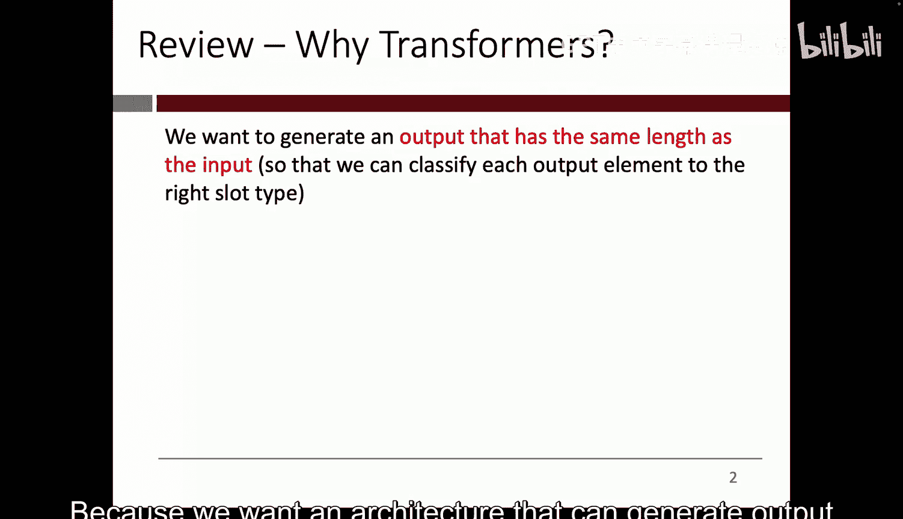

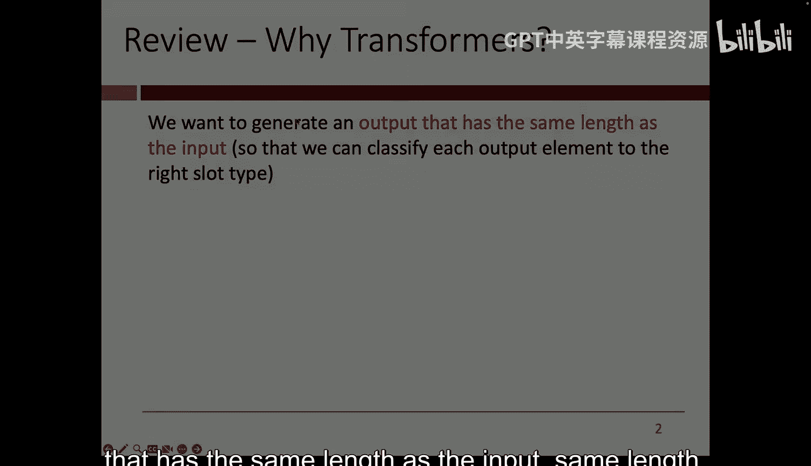

Same length There it is。Number two， we want to take the context into account and we want to take the order into account。

 And as you saw last time the transformer architecture delivers on those three requirements。

 And so just a quick review， if you have a phrase like the train leftization。

 we have all these little arrows which stand for the the standal alone or uncontextual embeddings and then sometimes this works so I'm going to put it close to me here。

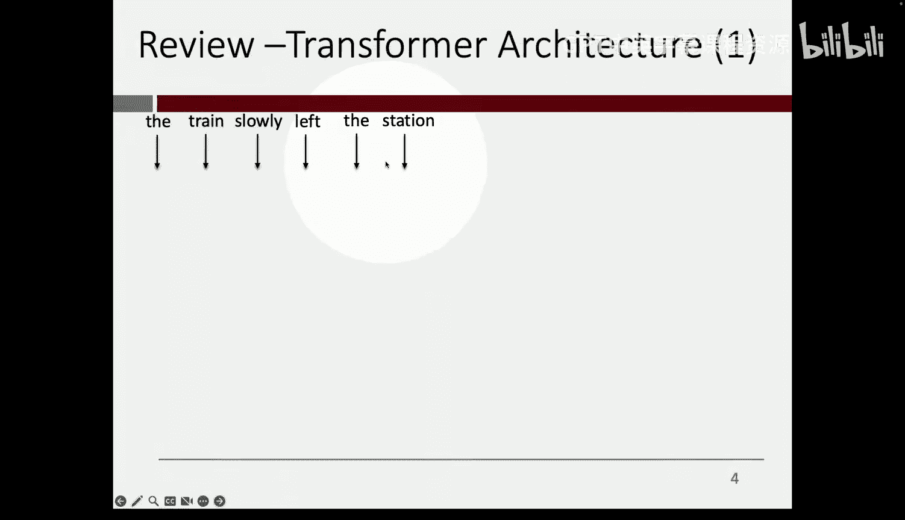

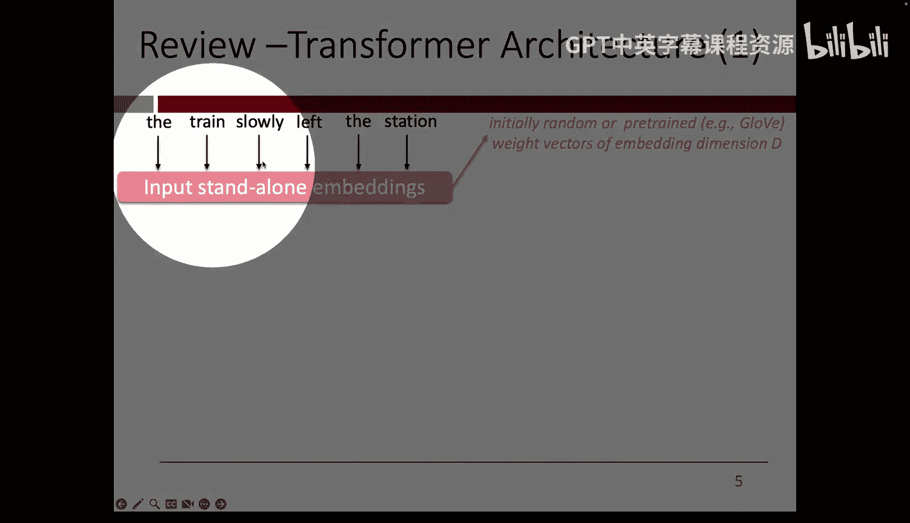

O。All right， so so if you hear if we start with either standalone embeddings， i。

e un contexttual embeddings which have been pretrained or random doesn't really matter if you look at the coab we did or the other day we actually just start with random weights for the embeddings。

😊。

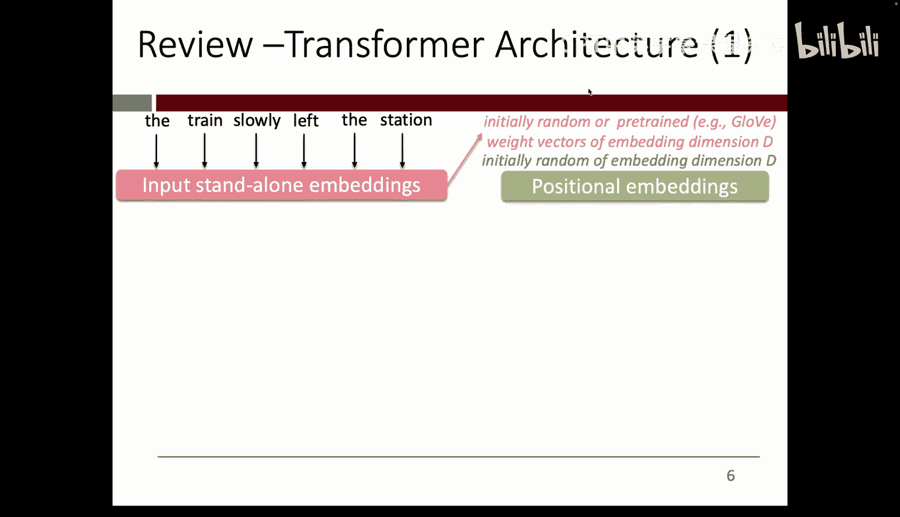

And then we add positional embeddings to them and so you know each embedding each word here we take its standalone。

 we take its position embedding we just literally just add them up element by element then we get a total embedding and that's called the positional embedding of each word okay。

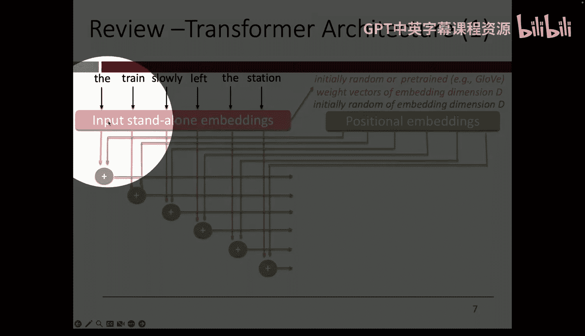

And then that's what we have， position input embeddings。

So this whole thing goes into this transformer encoder stack。

 And what pops out the other end is contextual embeddings。 Okay， so that's the overall flow now。😊。

We applied the transformer stack to the word to slot classification problem where we basically took every incoming natural language query that comes in。

 we calculated its position embeddings and then we run it through the transformer stack and then we get contextual embeddings and then at this point since each word that comes out each embedding that comes out needs to be classified into one of 125 possibilities we run it through a relu and then when we attach a softm to each embedding right this basically what we did last class。

😊。

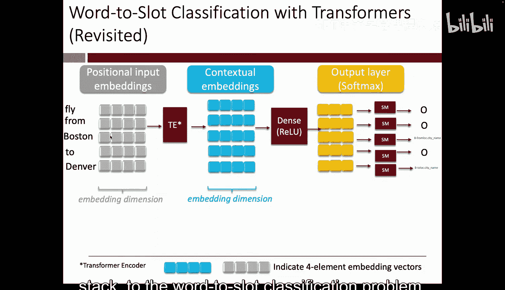

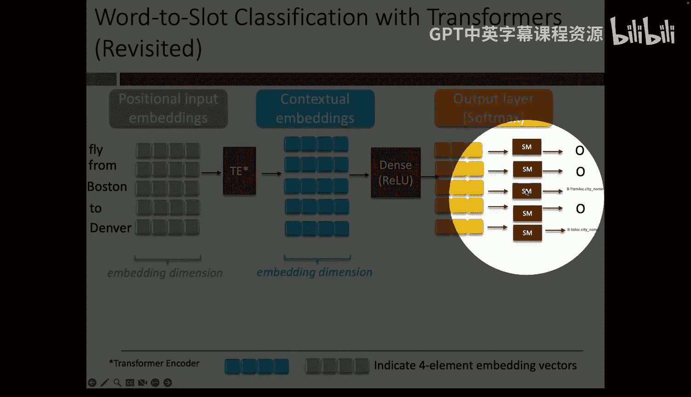

So this is the transformer encoder。 Okay， now actually。Any questions on this before I continue on？

I was wondering why when how do you decide where to add more self attention and where to add you mentioned that 9 so right so GPD3 has 9096 transformer blocks each one is a block so I think the question goes to do you add more attention heads within a single block。

Or do you add lots of blocks and both are good things to do what increasing the number of attention heads in a block does for you。

 it allows you to pick up more patterns at that level of abstraction。😊，But if you add more blocks。

 much like later convolutional filters can build on earlier convolutional filters。😊。

You're going up the levels of abstraction。 So to go to vision， for instance。

 you have the notion of lines and so on in the beginning。

 and then you have a notion of edges which are two lines， then you have you know nose。

 eyes face and so on and so forth。 So both are worth doing。

 So typically that's what you typically find that people typically have you know maybe a dozen heads or you know five。

 six， a dozen heads， we'll see examples of how many heads in a couple of architects later on today and you can the more you go up。

 the more more capable the model because as long as you have enough data to train it well。😊。

So the perennial question of do we have enough data to train this large model because if you don't have enough data。

 we might run into overfitting problems and so on， that's always a tradeoff。😊，So， okay。

 so here I just want to quickly switch to the collab because we didn't have a chance to finish it。

 I'm not going to run it because it's going to take some time。 So where we left off last time。Okay。

 so here。We basically took this architecture that we just saw on the slide and then we essentially wrote it as a kass model and I went through this model in the last class so I'm not going to go through it all over again。

What we did not do last class was to actually run it。 And so so if you actually run it。

You can just run it for 10 epochs， just like we normally do give it data， give it a bunch of epochs。

 choose a particular batch size I just arbitrarily chose 64。

 you run it for 10 epochs and that you evaluated on the test set you get a 99% accuracy。

On this problem， one transformer stack。 That's it，1，1 block， rather， one block。 That's it。And。

 of course， here， there is a little trickiness going on here because a naive model can literally say every word that comes in is other。

 oh。😊，And since the O's are the majority of the words， it's not going to do badly。😊，Right。

 it's like having a classification problem in which one class is very predominant。

 So the naive way to actually do well， is just say every time somebody comes in， oh。

 it's that majority class。 The same thing happens。 But if you then adjust for that。

 it turns out that the accuracy on the non o slots， which is really what you care about。

 is actually 93%。😊，Which is actually pretty good。Okay， and then I had some examples of， you know。

 lots of fun queries you can do， including queries where I try to break stuff like cheapest flight to fly from MIT to Mars and see what happens know things like that so have fun with it。

😊。

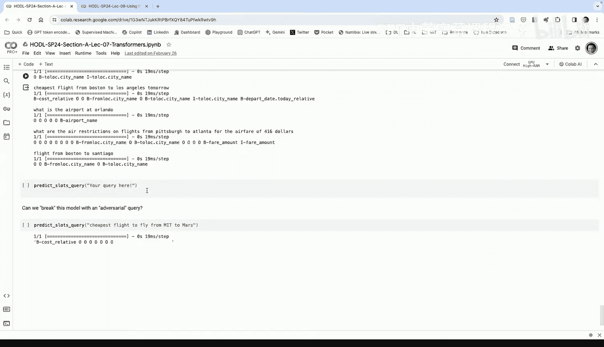

All right， back to PowerPoint。So this is what we had。 Now， what we are going to do。In today's class。

 we are actually going to take the encoder we built last time and introduce three new complications into it。

😊，And when you finish introducing these three complications。

 we will actually have the actual transformer that was invented in the 2017 paper。😊，Okay。All right。

 the first week is the hardest week， so we'll slowly work our way to it。😊。

So the thing to remember is lets review self attention what is self- attention you have a bunch of words and we further said that for any particular word like station we want to take its potential embedding and then make it contextual and the way we do that is by taking each words embedding and then calculating these dot products between all the other words and then since these dot products can be positive or negative we want to make them all positive and normalize them so that they nicely add up to one so we then exponentiate them and then divide with the total right which is basically softms。

😊。

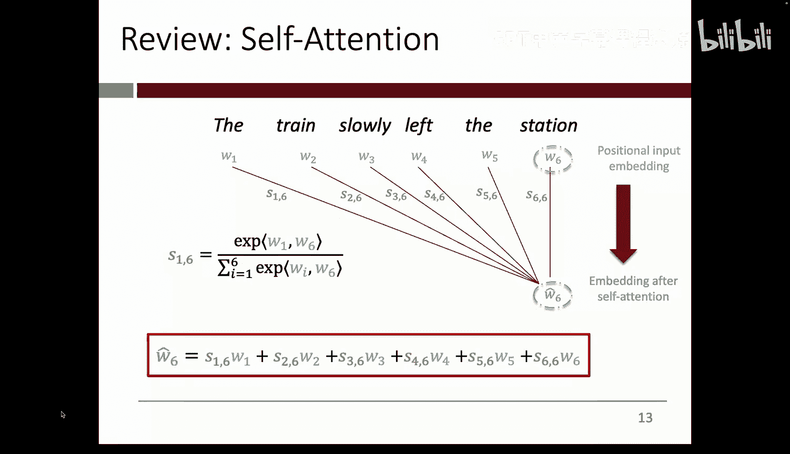

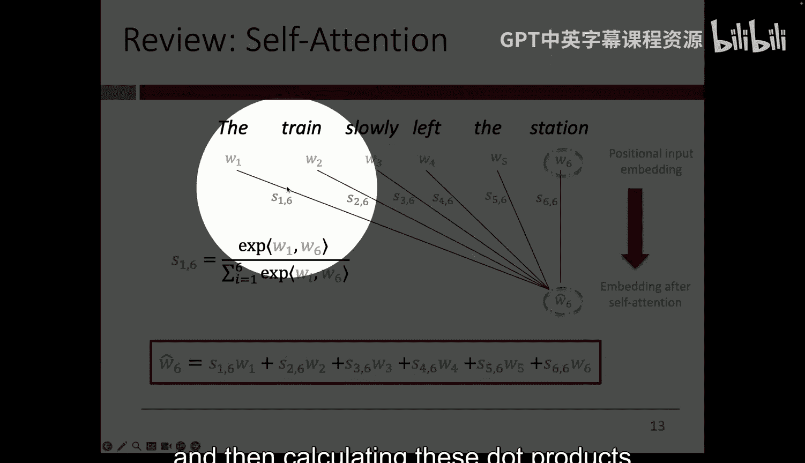

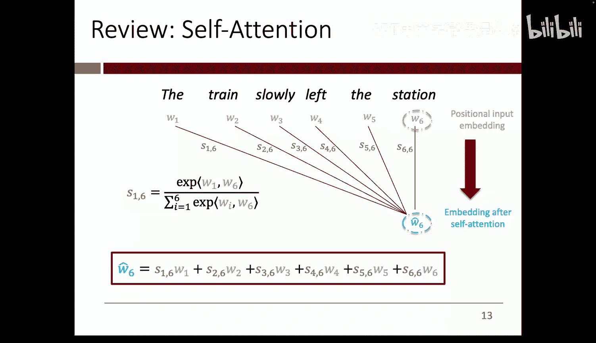

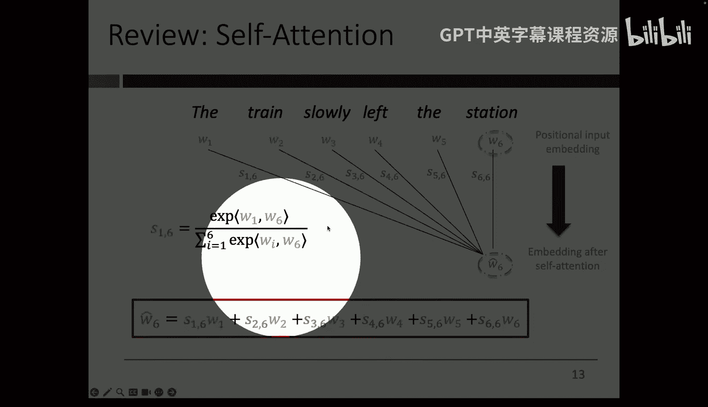

And when you do that you have nice fractions that add up to 1 and then we said well the context embudding for w6 is just all these weights S1。

 S2 all the way to S6 multiplied by the original Ws and then you get the context eming for W6。😊。

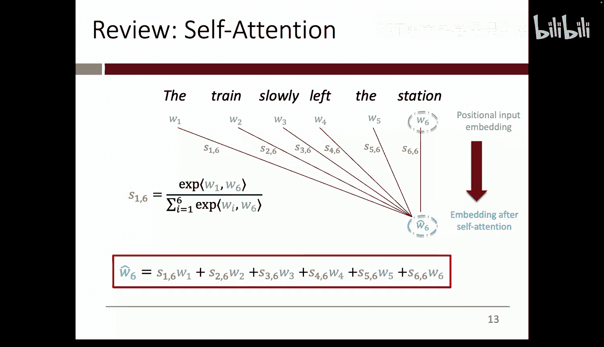

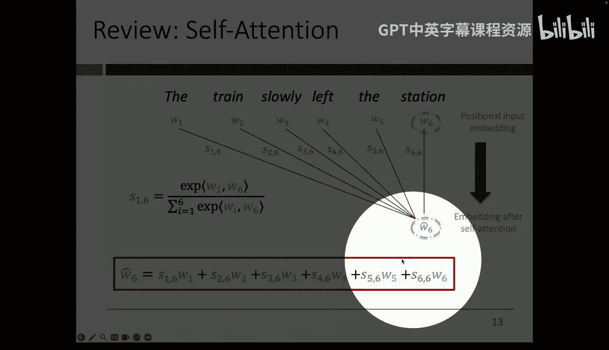

So this is the basic logic we covered last time。Now。

 it is obviously the case that we explained it only for one word。

 but we have to do the same exact operation with every one of the other words too。😊。

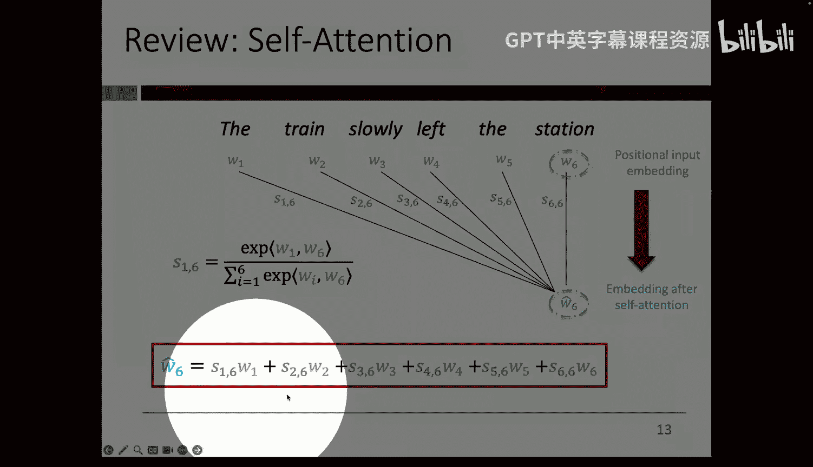

So that we could calculate w5 hat， W4 hat， w3 hat and so on and so forth。

 right So there is a lot of computations that are going on and they all look kinda similar。😊。

Where you got to do a bunch of dot products， you got to like， you know。

 do some soft maxing on it and stuff like that。 So the natural question is。

 is there a way to organize it very efficiently。😊，And the short answer is， yes， in fact。

 if we could not do that， there won't be any transformer revolution。Okay。

 because it is that ability to package it up into a very interesting and efficient operation that allows you to put the whole thing on GPSs。

😊，Okay， so now I'm going to switch to iPad and give you some iPad scribblings of mine。

 which were concocted last night because I was very unhappy with the slides that follow。😊。

So if you're going to do iPad， okay。All right， so。If it works， your folks are lucky。

 if it doesn't work， last year's hotelddle class is lucky here。😊，So， let's shift to that。Allright。

So we're going to go here。So let's assume we have a simple thing like。Okay。Instead of， you。

 train left the station， which is a long sentence。 Let's just say you have a simple sentence like I love huddle。

Okay and so I love  hddle is what you have and then you have these standalone embeddings w 1， w2， w3。

 okay so it comes into the self attention layer。😊，And let's assume that these W1s， W is2， W 3。

 they are already positionally encoded。😊，Right， we have already added up the positioning all that stuff。

 also， it's all behind us。 That all happens outside the transformer。So you get it here。

 Now what you do is you actually make three copies of this thing。Okay。

 and let's call this whole thing as just x， okay。I'm just giving you the name X。

 It's a matrix of these three vectors。And so the first copy goes up here。

 the second copy goes straight， the third copy goes down。

 and don't worry about the third copy just yet。😊，So if you look at the first two copies。

 here is the key thing to focus on。 Okay， this whole thing here。😊。

Remember that we want to calculate dot products between all these vectors。😊，And basically。

 we want to calculate the dotport of every pair of vectors。😊，Every pair of words。

The whole point of self attention is that every pair of words we figured out how attractive or related they are。

 right， which means that we have to calculate all pairs of do products。😊，And so。

 what you do is you take this vector right there， w1， ww3。

 you take this other copy that went up and then you transpose it。😊，So when you transpose it。

 it all becomes nice and vertical like that。😊，Right all the vectors come in came with this when you transport it becomes vertical。

😊，And now what you do is you take each one， you take w1 and then you multiply it by w1 here。

 you take w1， w2。W 1， w3， you calculate all those odd products like that。

 and when you do that you have these nice cells。😊，where every pair of words that dot points have been calculated in this grid okay and the key thing to see here and folks with a matrix algebra background will see this immediately all we are doing is we are taking this x。

 which is the matrix that came in。😊，And then x transpose。

 which is the matrix that we went sent up and then brought back down。

 We are basically doing a matrix quantplication of x times x transpose。 That's what we are doing。

And when we do that。We are getting this nice grid。Where in which every pair of words their dot products have been calculated for you with one matrix multiplication。

 boom， done。Okay， so if you have three words， there are9 multiplications， right。

 So if you have a million words。😊，That's a lot of multiplications。Right。

1 trillion multiplications on the order of 1 trillion。And the0 say order of is because， you know。

 W1 times W3 is the same as W3 times W1。 So there is some duplication here。

So you get this grid okay in one shot is the one multiplication and then we because each of these numbers is just a dot product which can be negative or positive。

 we need to soft max it。😊，And so what we do is we take all these numbers and we put it into a softm function where for each row it calculates a softm and what do I mean by that it takes each number here。

 does e racese to the top easese to the number， it does it for each of these numbers and then divides with some of those numbers for each row and when you do that。

😊，Okay， you can think of this operation as softm applied to x times x transpose。

 You get this nice little table of numbers。😊，This table of numbers basically says that for the first word right W1 for the first word。

 take 01 of the of the first 1。7 of the second point3 of the point2 of the third and add them up。😊。

We do a weighted average， so we have the table here。 we have now the third copy。😊，Shows up here。

 Okay， is' right there。 So we do this times that， which is just a matrix multiplication again。

 And when we do that， we get the final contextual embeddings。 So this， for example。

 is just 01 times W1。😊，02 times W2。Pot sorry， point7 times W2。

 and then  point2 times W 3 right there。 And you can see the same logic here as well。O。

 and you can read it later on， I will post this thing to make sure you understand exactly how it flowed。

😊，But the larger point I want you to focus on is that the entire self attention operation we just looked at here。

😊，Basically， is this， this beautifully little compact matrix formula。O， x comes in。

 you do x transpose， you do a matrix multiplication。

 you do a soft max on top of it and then multiied by x again and boom you down。

So that is the magic of taking the transformer stack and representing it using matrix operations because then lightning fast on GPUs。

😊，Okay。All right。That was the warm up。Now， let's crank it up a notch。

So recall that in the last class。I talked about the fact。The self attention operation。

 the Ws are coming in and we are doing all this stuff with the Ws right And then we're getting some W hats out。

 but there are no parameters。😊，There is nothing to be learned inside the transformer self attention layer。

 right， there are no， there are no weights。 There are no biases。 There are no coefficients。😊，So。

 well， okay， what are we learning then？Right so what we now do is we are going to make the self attention layer tuneable。

 we are going to inject some weights into it so that when we train it on an actual system the weights will keep changing to adapt itself to the particularities of whatever problem you are working on。

😊，RightSo that takes us to the tuneable。Self potential layer。Okay， tuneable self potential layer。

So this is the key thing to keep in mind， Any questions on this before I continue with the tunenability thing？

😊，Okay。Is this picture working out， by the way？😊，Okay。All right。

So what we now do is we have the same exact logic as before where we have this thing that comes in。

 we have this input that comes in the same we call it X again， this whole this matrix of embeddings。

And then before we just sent three copies。Instead of doing that。

 what we are going to do is well take each copy X and then we will actually multiply it by a matrix。

😊，Okay， this matrix is called the key matrix。Okay。And this matrix。

 this matrix of numbers or wage that will be learned by Blackpro。😊，So basically。

 what we are saying is that when this thing comes in。

 lets see if there is a way to transform this x into some other set of embeddings。😊。

Which may be useful for your task。We don't know if they are going to be useful。

 but surely giving it a bit more ability to have weights which can be learnt means that we giving it more expressive power。

😊，More modeling capacity。And whether it actually uses the capacity will depend on how much data you have and how will you train it。

😊，And maybe if it' is not useful， it won't use it in what I mean is if transforming x actually doesn't really help at all。

 then this matrix a is going to be what。😊，It's going to be the identity matrix because you take basically one and multiplied by x。

 you get one x again。So in the worst case， maybe it just says， I have nothing going on here。

But maybe there is something you can learn。So， so that's what we do。

 So we multiplied by this matrix a k。 and then we come up with the same， you know， some embeddings。

 transform embeddings。 and we call these things k。😊，Okay， okay， now this K Q V， as you will see， has。

Its origins in the speed of information retrieval， but I personally find that that interpretation is not super helpful。

😊，Because transformers are used for lots of applications outside information retrieval。

 So I'm not going to go with that kind of interpretation。 I'm going to go with interpretation of。

 let's make each of these things tunenable。 Okay， and tuability means we need to give it weights。

 Allright， so that's what we have here。 Now， the second copy。😊，We did this with the first copy。

 Well let's do the same thing with the second copy。

 We will take the second copy and multipied it by some other matrix called aQ。😊。

And when we are done with that， we get these embeddings。And we will call these embeddings as Q。

Okay now just like before， we will take this this thing here and we will transpose it。😊。

So it all becomes nice and vertical like that。And then we will do exactly the same as before well calculate all these pairways dot products using one one shot one matrix multiplication and because we are calling this Q and we are calling this whole thing as k。

 this thing just becomes Q times kt。😊， at the end of it。

 you come up with a grid of numbers just like before。😊，Okay。

 and these numbers could be negative or positive， so we need to do the softm on them to make sure they have well behave fractions that add up to one。

😊，So we take this Q KT business。And then we do we just run。

 we put it through a soft max function for each row。

And when we do that we will get basically like a table like the ones we saw before， by the way。

 the numbers here are the same just because I duplicated it because I'm lazy。😊，In reality。

 given that it has gone through all these transformations。

 the numbers are not going be to same right。You have these numbers and then you take the final copy which is x times Av right each copy is getting multiplied by its own matrix right and this copy is being multiplied by AV and lets call this x Av。

😊，Okay， which is here as just we。And so what you have here is this softm QKT times v is exactly the same kind of dot product as we saw before。

 matrix multiplication。😊，So we have these contextual embeddings。

 And that's what's coming out of the of the transformer block。 So now the whole thing we did here。

 the whole thing can be represented as softm of Q K T times V。😊，Okay， so if we zoom in a bit。Come on。

Okay。Okay。So， X came in。Three tracks went here the first track x times ak x times aq x times Av。

 and this thing is called k， this thing is called Q。

 this thing is called V and then we do the same transpo as before we do the dot product thing to calculate the pairwise dot products for everything which is just Q KT。

 we run it through a softm we get soft max of Q Kt we multiplied by one to do the final weighting and then boom the output comes and that is this function that's it。

Okay， so what we have done is we have introduced three matrices。

 learnable matrices into the self attention layer。😊。

Okay。No。Okay， let me just stop there for a second questions。Yeah。

Is there a relationship between and independent matrices？Yes。Could you use a microphone， please。

If there are let's say， if there about0。Flandland was say， number was say 15。 So we would have。

5 percent of parameters thick。So， if you have a 50 if the dimension is 50 long。

 what is coming in the ws are 50 long， then the key that what comes out of it if you want it to be 50 as well。

 so this matrix needs to be 50 times 50， 2500。😊，Lna。things that the three mates are trying to learn。

With all the different things that the matrices are trying to learn。

We don't know all we are saying is that we have a self attention layer which can pay attention to every pair of words。

 but we need to give it some ways to transform what is coming in。Into potentially useful things。

 right as to their actual usefulness， we have to figure out if if it actually helps or not。

 And of course， as you know， the punchline is a react， It helps massively。

 That's why we do it In general， what you will find in the deep learning literature is that whenever you want to increase the capacity。

 the modeling capacity of a particular model， you just take a small piece and inject a little matrix multiplication into it。

😊，You take a vector that is showing up in the middle and then you make it run through a matrix to get another vector。

😊，And then further， after you run it through a matrix， youd run it through a little re as well。

 even better。😊，So thats have you inject modeling capacity into the middle of these networks。Okay。

 and that's what these people are doing here。Yeah。And the last step you had the matrix V。

 so on the previous example， you had used their original matrix。

XSo what we are saying is that in the initial version we had three copies and we treat them all identical。

Now we said， well， are there ways to transform each copy into some other representation which could be useful。

 So we may as well use three different matrices for it， why stop it too。😊。

There are three opportunities to make them more expressive。 We'll use all of them。Yeah。

You mentioned that these are kind of。You're tuing it。

I riskWere not fine tu it just to be clear on the vocabulary here。

 So we have added more weights to make them tunable。

 what that means is that when we finally train this entire model。😊，Remember。

 all the weights are going to be updated using back propagation， right？In particular。

 these matrices will also get updated using black propagation。

riskThere is always a risk of overfitting when you add more parameters to a model。

 which means that you have to look at the validation set and all that good stuff。

We are basically adding more parameters in a very interesting way because。😊。

We want to add more capacity to the self attention layer。

 We want to give it a more of an ability to learn things from the data before it could not learn anything。

 It could only do dot products。So we want to solve that problem。All right。

 I'm going to continue and I'll come back to this，😊，So all right， let's just just for fun。

 I'm going to do this。 The The original paper is called attentionten is all you need。

This is a transformer paper。Your folks should read it at some point。

I just want to show you something。嗯。You see。So that is the famous transformer formula。Okay。

And the only thing we ignored is this root of Dk business in the under it。😊。

I wouldn't worry about it。 The reason they have it is because these soft maxes。

 when you have lots of numbers and some numbers are really， really big。

What's going to happen is that all other numbers are going to get squashed to 0。Okay。

 and so to make sure the gradient flows properly， we are just divide it by a particular number to make sure no number is too big。

😊，Okay， that is a small technical important but bit of a technical detail。

 which is why I ignored it in my iPad， but the rest of it you can see this is exactly the formula we derived。

😊，Q， K T times V， softm。Okay， so this is the famous transformer formula。

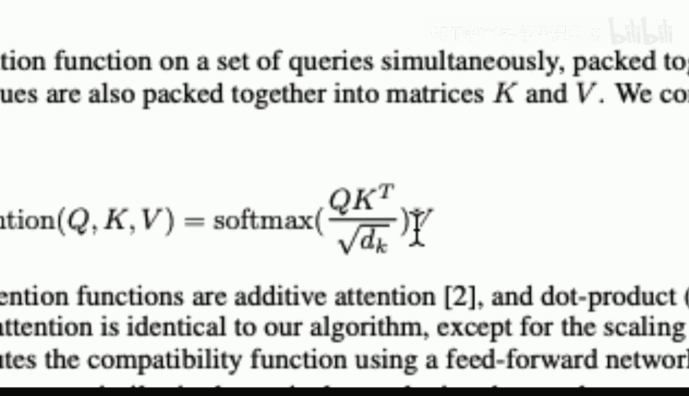

And congratulations。 No， you understand it。You seem less than fully convinced。Okay。Yes， iPad。Now。

 I have a bunch of slides， which I had。 by actually， I'll come back with this。

I had a bunch of other slides， this is from last year which actually explains what I did in the iPad in a very different way without using any matrices and so on。

😊，I was looking at it last evening， and I was getting very annoyed by these slides， for some reason。

Because I felt that it wasn't really conveying the core matrix， sort of the matrix。

 the ability of using matrix algebra to， to actually do this so efficiently and compactly。

 which is why I decided to like hand draw this thing on the iPad。 Okay。

 but you should read it afterwards to make sure that whatever you saw on the iPad actually matches this。

 Okay because two different ways of understanding something always helps。😊，Okay。

 so this is what we have here。 now， to， just to recall。Though by making self attention tunable。

 we get a very interesting benefit， which is that when you have these different attention heads before。

😊。

You could have two attention heads， but because there were no parameters inside。

 their output would have been identical。

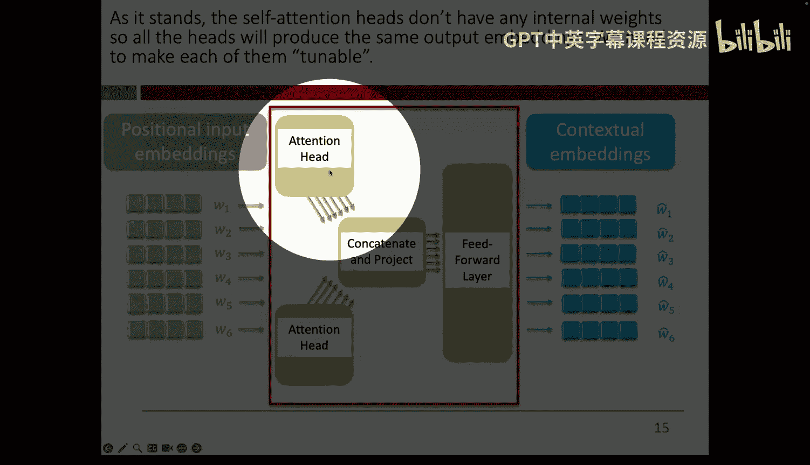

Because the inputs are the same for both。

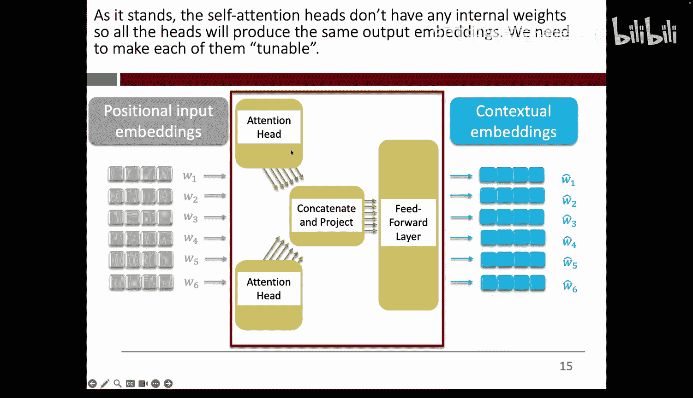

Therefore， the outputs will be identical， but now by since each attention head will have its own AQ AKAV matrix。

 the outputs are going to be different。😊。

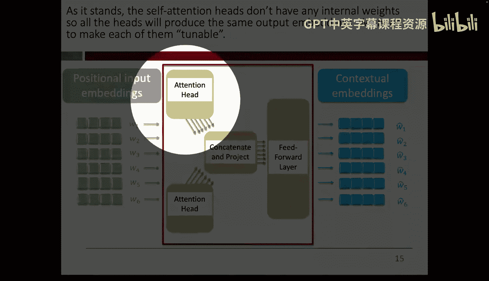

That's why it makes sense to do the tunenability thing。

 because that's what actually makes multiple attention。 It's actually useful。嗯。

Is there actually a relationship between AK， A Q& A B or the A just for a notation standpoint。

 just notation？The thing is we want to use Q KV for the resulting matrix。

 And so I had to find something else to use for the first one。 And I was like， okay， A Q。

 AQ and we at MIT， we do subscript superscripts， right。😊，Yeah。

What what is the size of the litrics are there like square inrics。Yeah。

 so typically what happens is that there is a whole bunch you can think of it as a hyperparameter in some ways typically what people do in most implementations is that they will actually just preserve the size so if the incoming embedding is 10 they'll make sure the thing coming out of thing is also 10 so you just do a 10 by 10 matrix to transform it but the value V AV matrix on the other hand there is a bit more technical stuff going on where it often tends to be smaller。

😊。

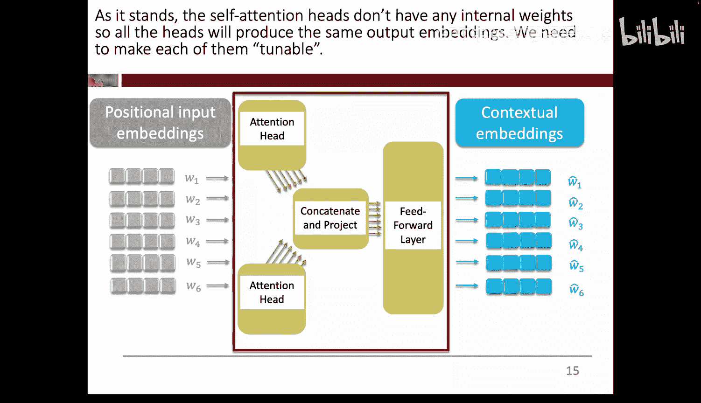

So， for example， let's say that the incoming is 100。 you do 100 to 100 for the key。

100 to 100 for the query。 but if you have say five attention heads。😊。

You may do 100 to 20 for the wes because ultimately all the V's are going to get concatenate into another 100 again。

😊，So I can tell you more offline， but fundamental them broadly speaking。

 these things tend to get transformed they they preserve the dimension 10 and 10 out。Yep。So thisす。えき。

These numbers are。And that exactly， exactly。So， all right。

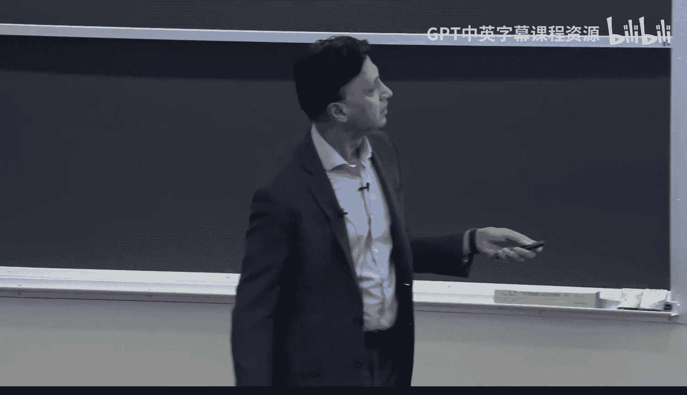

Yeah， so the values in these matrices are weights learned through optimization using S GD。

 And then what that means is that。

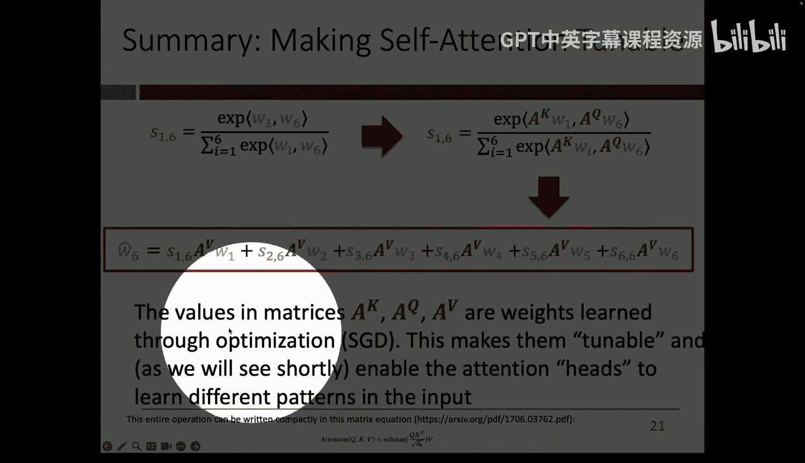

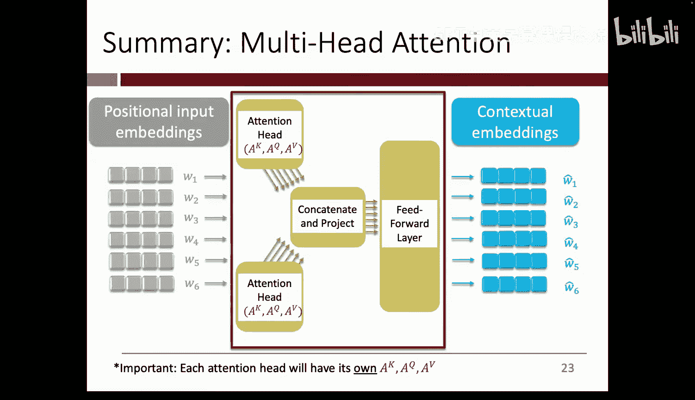

Each of these attentiontens now has its own copy of these matrices。 It has its own matrices。

 And over the course of back propagation， these matrices will look very different。Okay， so important。

 each addition head will have its own set of three matrices。

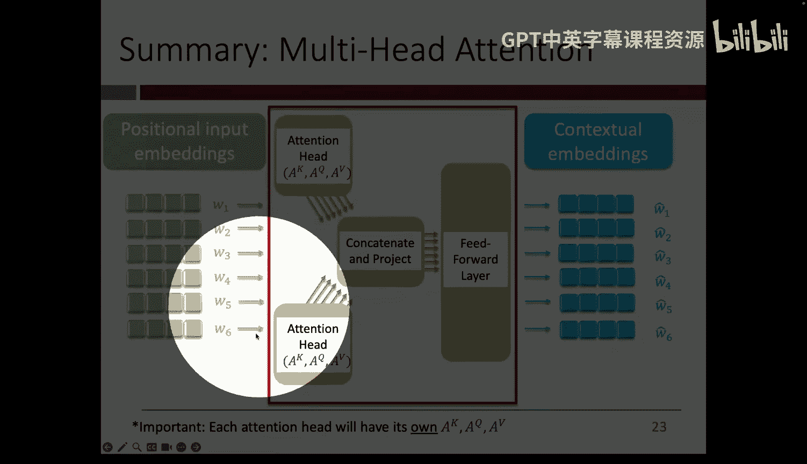

So if you have 10 attention heads，30 matrix will be learned。

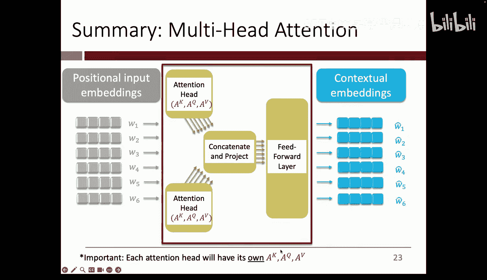

So why do that， it seems like it's creating。It's actuallyly a relationship。

The content being ingested and you're creating if you're ingesting all the content for each attention head。

 are there different categories of the tension head type that you're trying to go at？Yeah。

 so basically what we are trying to do is to say a particular attention head。

 So in any particular sentence， it may turn out to be the case that one pattern could be about the meanings of these words right like the word bank and what it means the word stations。

 train， things like that。 That's what really we've been talking about。

 But there is a whole other pattern to do with grammar and tense and things like that。

 There could be another one in terms of tone。😊，All those things are very important。 And at priori。

 we don't know how many such patterns exist， much like in a convolutional network。

 we don't when we are designing how many filters to have。

 we don't know how many kinds of little things we have to detect， you know。

 vertical line horizontal line semicicle， quartercle stuff like that。

 So you just give it a lot of capacity。😊，So then it can learn whatever it wants。All right。

 so so that that is the transformer encoder。 So we have done one the first of the three complications needed to make it like industrial strength。

😊，And legit， the second thing we do is something called the residual connection。So。

 what we do is that。

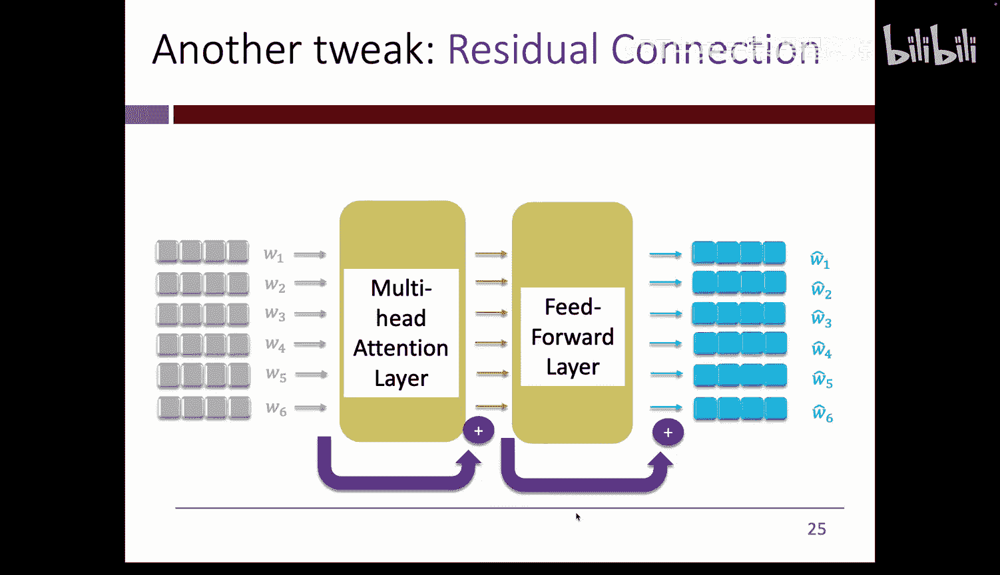

Whatever comes out here right W1 through w6 goes in and comes out as w1 hat。

 W2 and so on and so forth， right。😊。

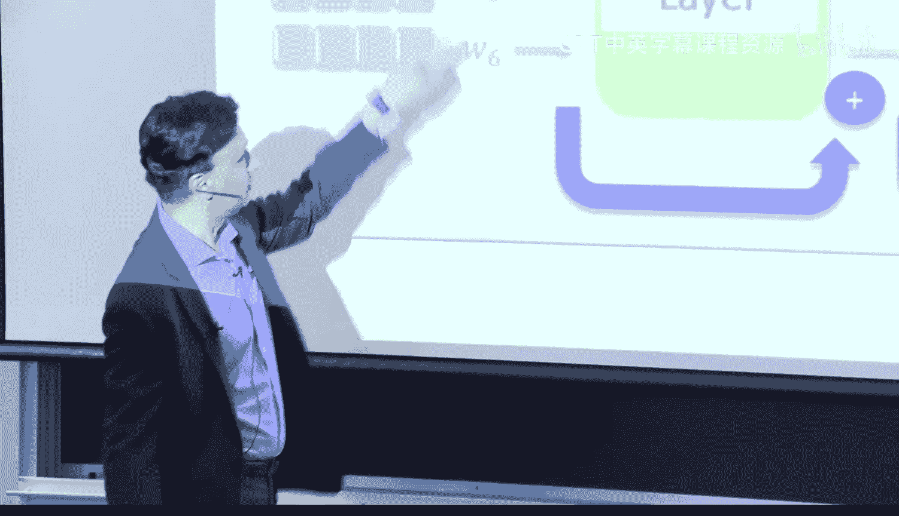

Actually sorry。What comes out here is the hat， but what comes out here is some intermediate ws。😊。

That is what the self is going to give you some intermediate ws what we do is and because what is coming out here these vectors are the same length as what goes in。

 we can just add them element by element so we take the input and we actually add it to what comes out。

😊。

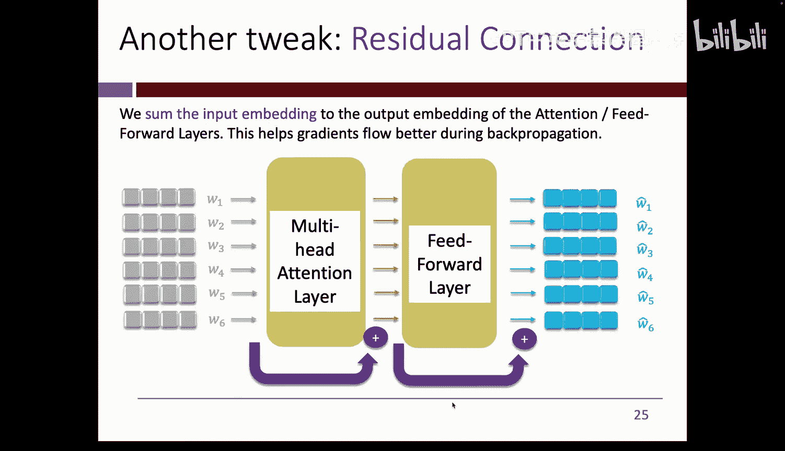

So why would we want to do that， Why would we want to you know go to a lot of trouble to process this thing。

 And then when it comes out， we like literally add up the original input。

 what do you think the intuition is。

So， turns out。Think of it this way。 You have a bunch of inputs。 You send it to a neural network。

It transforms it and gives you something else， right。At that point， you might be thinking， well。

Everything that go， everything that happens in network from that point onward。

Can no longer see a original input。It can only work with the transformed input， right？

But what if your transformations are not great。So， as an insurance policy。

 what you can do is you can take the the transform stuff and you can take the original stuff and send both in。

😊，Right and this whole thing is and you can go it call like a wide and deep network and things like that。

 but the whole point is that let's not lose the original input anywhere， let's also send it along。

 but if you keep adding the original input to every intermediate layer it is going to get longer and longer and longer and bigger which you don't want because you want it all to be the same size so the simplest alternative is to just add them up。

😊，You take the transform stuff and you add the original input， you get the same thing again。

 the the what came what came in w1 was 100 long vector。And the transform version is also 10 long。

 So just literally under0 at the。 That's it。 You get another hundred long vector。

So that is what's called a residual connection。Okay， and as it turns out。😊。

Resial connections make it may improve the gradient flow during back propagation dramatically。

And that's why they are very heavily used。 And， in fact， ReNe。

 which we looked at for computer vision。It stands for residual net。

Because it was the first network to actually figure this out。It's not this。

 this is not just a transformer thing， by the way， It's widely used in you know。

 lots of new deep architectures。The notion of a residual connection。 That's what it means， okay。

So we do a residual connection。😊，And then we come to the final streak。

 which is called layer  normalization。So once we add the residual connection。

 we are going to do something else here to these vectors before they continue flowing。😊。

And what layer nomination does is it basically says that。

you will recall from the very beginning of the semester。

 I've been saying that whatever comes into a neural network， the inputs。

 let's really make sure that they are all in some sort of a narrow， well definedfin range。

 They can't be in a big range right？ So for pictures for images， we divided every number by 2。

55 so that every little pixel values between 0 and 1。😊，Okay。

For continuous things like the heart disease example。

 we standardized it by calculating the mean in the standard deviation and doing subtracting the mean and dividing with the standard deviation。

 So when you do that， all the numbers are going to roughly be in the -1 to plus1 range。😊。

So in neural networks， its for back to work really well。

 you have to make sure that no numbers get too big。

That all the numbers are always in some sort of a narrow range。

 So what layer normalization does is to say， you know what， whatever is coming out here。

I want to make sure none of these numbers are too big。

I want to make sure they are all well behaved in a small range， because if I don't do that。

 back is not going to work very well。😊，And so。Is this what we do to make sure we don？ぱにしますれ。

So so there technical there there are could be two problems。

 There is an exploding gradient and vanishing gradient。 Both are bad。 This is way to address it。

 So you will find a whole bunch of dash normalization techniques， layer normalization。

 batch normalization and so on and so forth。 All these are methods to make sure that these numbers stay in a small range。

 So it doesn't cause gradient tissues later。😊，All right， so in particular。What we do is。

Or what happens inside this layer layer normalization is just calculate the mean and standard deviation of every one of these embeddings。

😊。

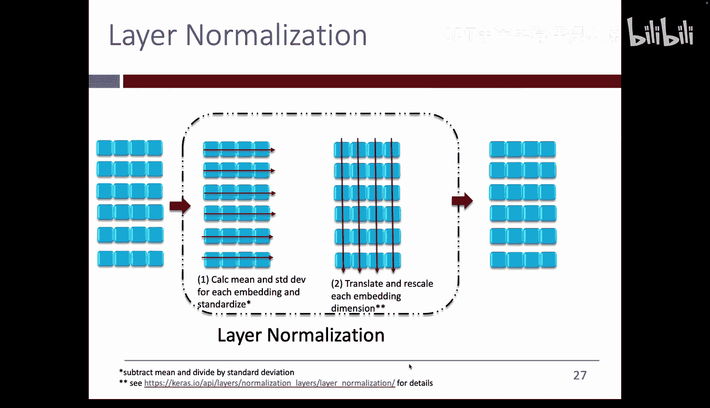

Right， if you have， let's say，6 em here， we will have 6 means and 600 deviations， right。

 for each one across the rows。And then we standardize it， meaning。

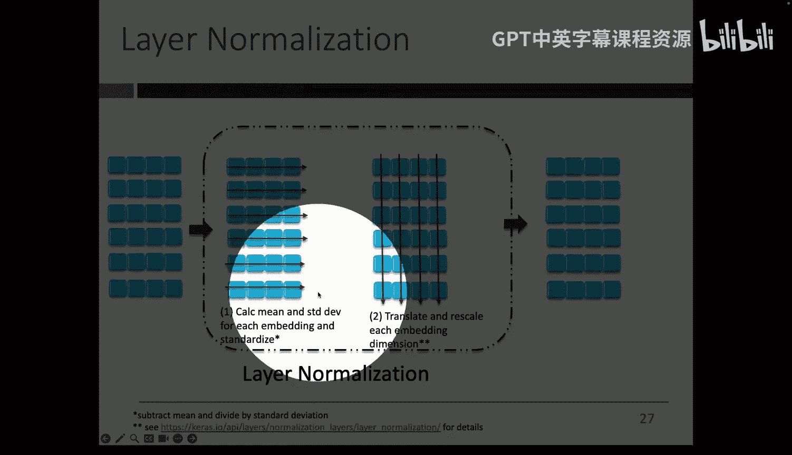

Subtract the main divider standard deviation。 And when you do that。

All these things are going to be nice and small and then we do this little other thing where we we have introduced two new parameters。

😊，To rescale it and move it around a little bit。Just because adding more weights always helps make these things better。

 so we add them and this gets slightly complicated because of the way the dimensions works。

 I'm not going to spend much time on it。😊，And then what comes out the other end is a very well behaved set of numbers in a nice and small and narrow range。

😊，Okay so this is called layer normalization。 you can see this link to understand it a bit better。

 and we do that as well。 So to put it all together。😊。

So this is a transformer encoder where we have this multi head attention layer where each attention head in the inside of it is tunenable to those a matrices and then we have a residual connection we do that and then we do layer norm and then we do the same thing in the next feet forward layer as well and then boom output pop the output。

😊。

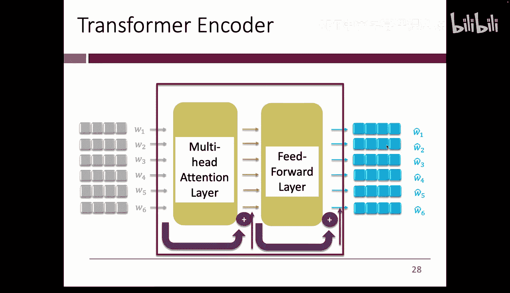

By that information in the market had attention there。你。给难一份。

The biases or the hate speech aspects which come in。Take care of it， right。

 so the model can account for the fact that something is biased to something。

The thing is it's not so much the model is accounting for it。

 It is capturing whatever patterns happen to be inherent in the data。It's capturing， right Now。

 what you do with that capture is up to you。 It depends on the actual problem you' are trying to solve。

 in particular， it is going to capture all the bad stuff， too。

Because if your training header has a lot of bias stuff in it， toxic things in。

 dangerous things in it， it doesn't have a sense of value as to what is good or bad。

 it' is just going to pick it up。😊，Yes。Ftting on that how do you actually make it under those or how do you mitigate the infected。

That's a whole course unto itself， but I'm happy to give you pointers offline。Allright。

 so this is what we have。 And remember what I said that this is just a single transformer block。

 And since what comes in and what goes out of the same dimensions。

 we can just stack them one after the other。😊，RightIt is very stackable， you can do it。

 you can multiply， you can stack it vertically as much as you want， and as I mentioned。

 I think GP3 has 96 of these things stacked one on top of the other。嗯。And so， yeah。

 that brings us to that is it。 that is the transformer encoder。 And this exactly maps to that。

 So basically the input beginnings come in， you add position embeddings。

 and then you send it to say these many attention blocks and they all get added up and then it comes over the attention block。

 You add the add and norm here means add means residual connection because youre adding the input。

 which is why you have this arrow going from the input。😊。

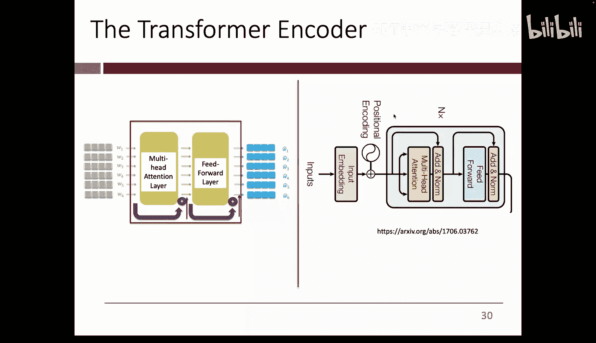

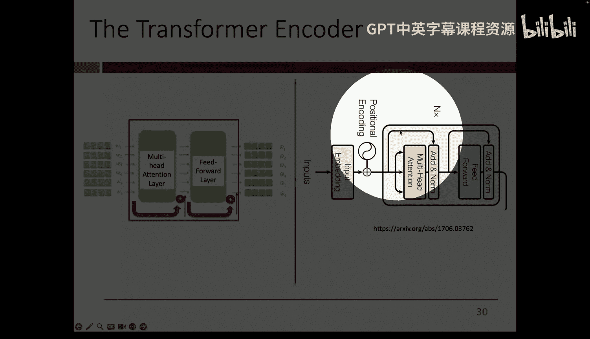

Being added there， and then you normalize it， send it along and do it again and out comes the output。

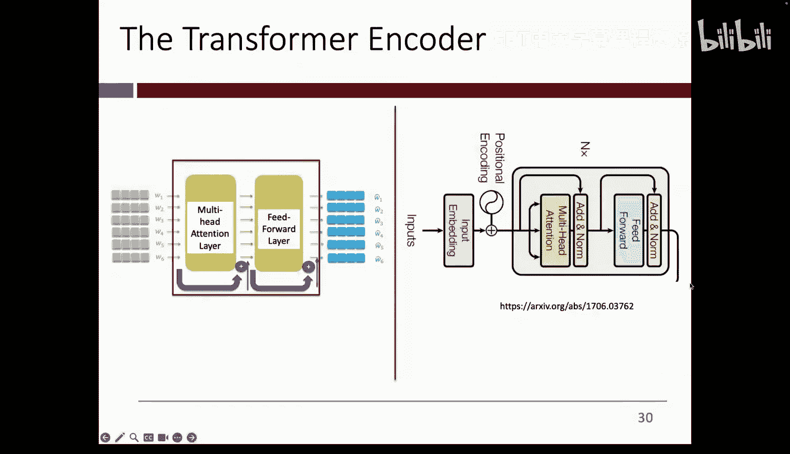

So， all right。Now， just to be very clear on what is being optimized during back propagation in this complex flow。

Right。Now， clearly the embeddings that you started out with。

 both the standalone embeddings as soon as position the position embeddings。

 those things are going to get optimized。😊，Those are just weights they are going to optimize。Clearly。

 everything inside the transformer encode block is getmind right， And what are they Well。

 they are the A K A， A Q A V matrices for each attention head。😊，Layer norm has parameters as well。

 the next like the little feet forward layer has weights as well。

All these things are going to get optimized。😊，And then it goes through this re， which again。

 has a bunch of weights iss going to get optimized。 And then the final softm has a bunch of weights。

 that's going to get optimized。😊。

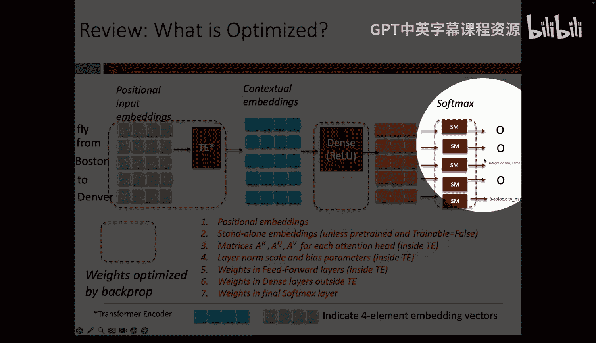

All these things are going to get optimized by a back。

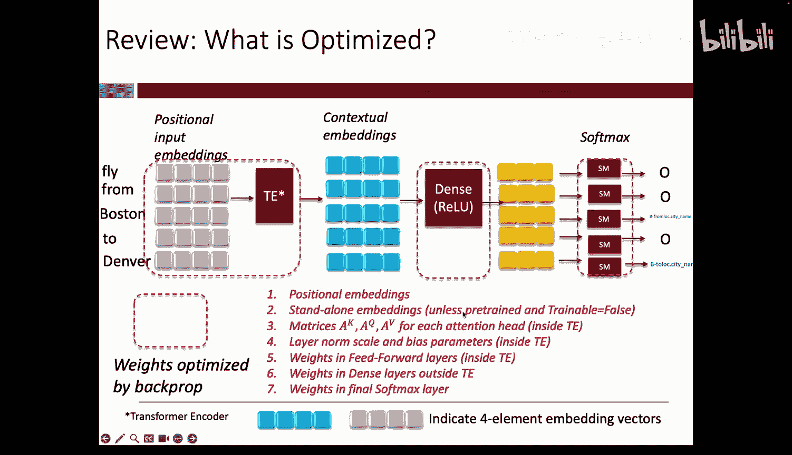

Okay， so in that sense， you just step back for a second and look at the whole thing。

 It is just a mathematical model with a lot of parameters。

And we're just going to use gradient descent or stochastic gradient decent and optimize it。

 That's it。Yeah。For those and interests， we train the。

Are we calculating weights for each cell of every possible matrix based on it？And puts like every。感觉。

Actually， the weights themselves don't depend on how long your input sentences because remember what you are doing is for each sentence that comes in let's say the sentence has say three words。

😊，There are three embeddings for that sentence。 Each of those embeddings gets multiplied by， say， ak。

So AK only needs to work， needs to know how long is each embedding？😊。

It doesn't need to know how many words do I have。And I'm glad you raised a question， Ben。

That's what makes a transformer's number of weights independent of the number of words in your sentence。

It only depends on the vocabulary that you are going to work with because the vocabulary determines how many embeddings you need。

 how many embeddings you need， the length only matters in terms of the positional embedding because if you have  a000 long sentence you need 1000 long positional embedding matrix。

 but beyond that it doesn't care。😊，And that's why for example， Google Gemini 1。5 pro。

 which is a million， it can accommodate basically a million long million token context window right it can it is still very compute heavy。

😊，But it does not change the number of parameters。呃，要。Conceptually。

 which weights are optimized first by a scheduler or they。Optimizing the of theSim。

Because if you think of back propagation， ultimately you have a loss function right and you calculate the gradient of that loss function。

 So if you have a say a billion parameters， that gradient is basically a billion long vector。😊。

RightAnd we are going to take the gradient and we are going to do w new equals w old minus alpha times the gradient so all that w is are going to update instantaneously。

😊，Now， the way it actually works in computation is you're going to do it because of the back and back propagation it is going to start at the end and slowly flow backwards。

 but when it' is done everything will be updated。😊，Yeah。你这个。多年轻孩子。

And we have to make this sort of A AQ and A。还那个。parametersmeter of all three of them。

 all the heads of the three mattresses on this side and this side would be different because finally。

 the things were。This thing。And the output is same So the learning process be idea same CNN where we had filters。

 which were different。 So what different because the initialization is different。

Like what I mean is if you have two heads right， each head has three matrices。

 the starting values of those six meters is different。😊，Starting value of AKA。

 AQ and AV is different with those correct。Much like for all the weights。

 typically the values are randomly chosen。😊，If they were all the same thing， you're right。

 You don't make a difference。 They will all change the same way。Yeah。嗯。

Is the input of the transformer of the sentence？接着边有个。That many of each words。

The transformer itself is expecting embedding in。And so what basically happens is that we get some sentence。

 we run it through a tokenizer， which connects it to a bunch of tokens， which is just integers。

 and then it goes through the embedding layer which maps the integers to these embeddings and then you feed it to the transformer but when you do back propagation it comes all the way back to the starting embedding layer and updates those weights。

So can but theyre trainable， exactly exactly。呃呀。Are the attention head solely？

Or can you having like a snack？Typically， they are parallellyzed And because you can always stack the block itself to get more and more power。

Allright， so so now to apply the transformer right there are common use cases are that you have a whole sentence that comes in and then you just want to classify it right the canonical thing being hey。

 movie sentiment classification boom， positive or negative right classification。

 Another common one is labeling where every word gets labeled as a multi-class label。

 And that's basically what we saw with our slot filling problem。

 And then there is another thing called sequence generation where you give it a sequence。

 you wanted to continue the sequence right generate more stuff。 i。

e large language models and all that good stuff。 So so this。

 you know already know how to do because we actually literally but a collab with this。😊。

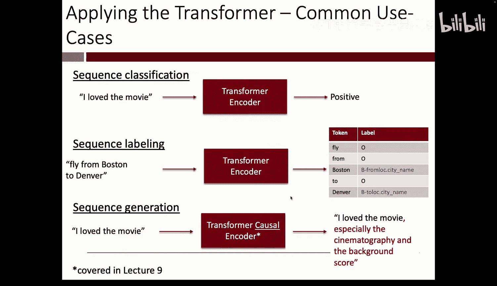

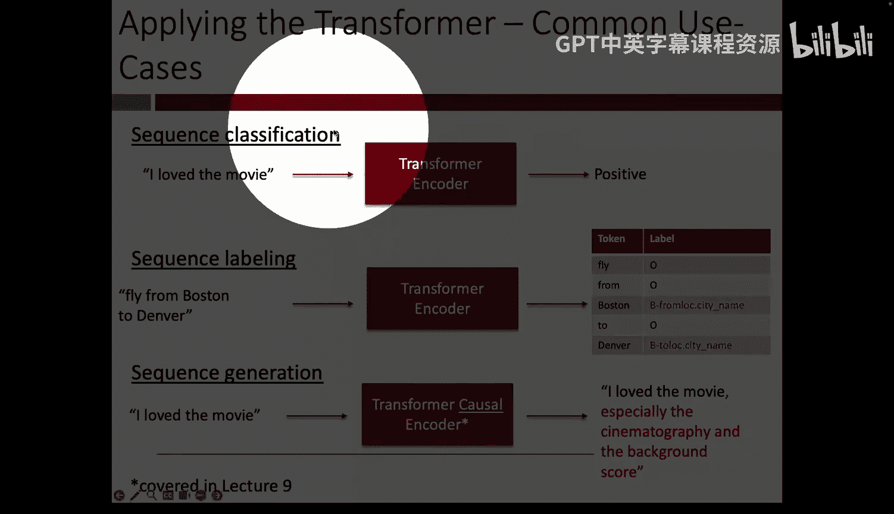

With the transformer stack。Now， the question is， how can we do that， right？

 How can we do basic classification these things。 So now if you again， when you send a sentence in。

 after all that stuff is done。 And when I say encoder here。

 I'm assuming that you may have one one block。 You may have 106 blocks。 I don't care。

 At the end of the day， you send something in。 You get a bunch of context embeddings out。😊，Right。So。

 at this point， we need to take these context embuddings and somehow make it work for classification we just classifying something into yes or no。

 positive or negative。😊，So it will be nice if we can actually take all these embeddings and like essentially summarize them into a single embedding。

 a single vector。😊，Because if you have a single vector， then we can run it through maybe a re。

 and then we do a sigmoid and boom。 We can do a， you know， a binary classification problem。

 super easy， right。😊。

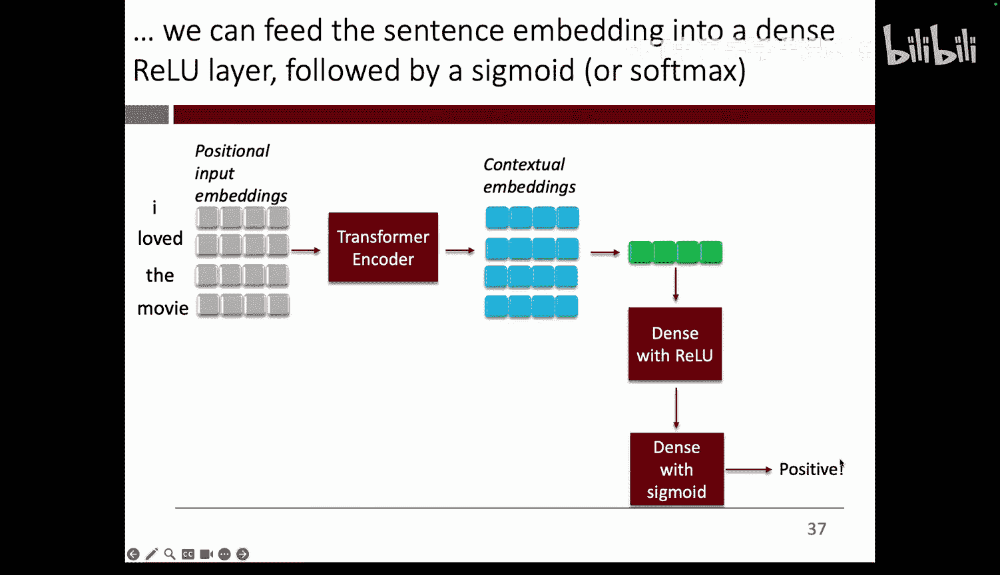

So this begs the question， okay， how are we going to go away from all the many blue things to one green thing？

😊。

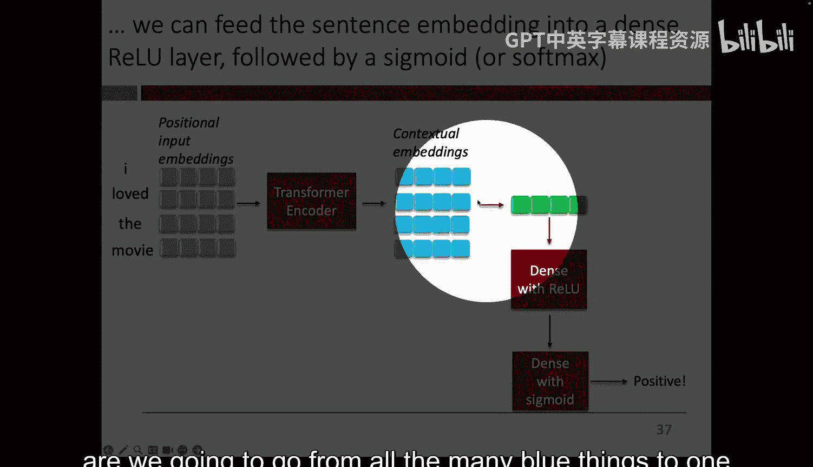

Okay， now， of course， what we can do is we can simply average them。😊，We can take each of them。

 but it exists simply average them element by element。 You'll get a nice green thing， okay。

Any shortcomings from doing that？

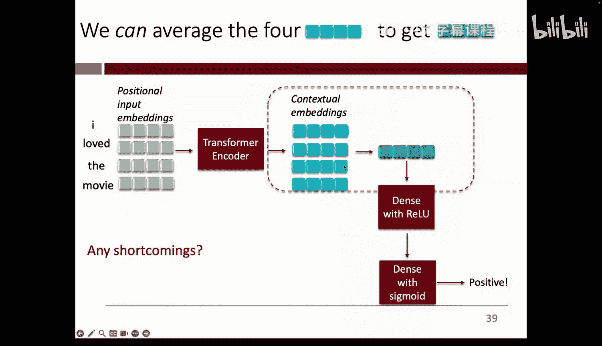

You would use the ordering of the words。You do well， in some sense， the position embedding。

 the position encoding you have in the input does have this notion of position。😊。

Right so you are not necessarily losing the order necessarily。

 but you are sort of averaging all this information into something and averaging is going to lose some richness。

😊，Okay。I think it's gonna be tri to the one that has like， the biggest。Tru。Yeah。

 the biggest ones are going to dominate， but hopefully we won't have too much of that because all the layer non business at the beginning has hopefully made sure the numbers are all in a reasonably small and well behavehaved range。

 but the point really is that youre going to lose richness in the information because you just like muing it down。

😊。

So there's a much better and more elegant way to do this。😊，Which is that what you do is。

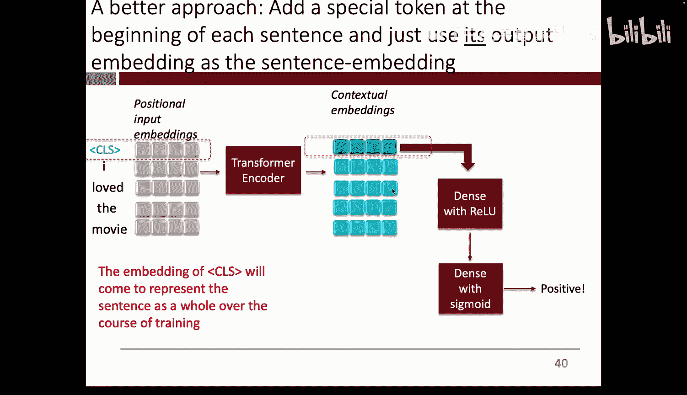

For every sentence， when you train it， you add an artificial token called the class token。

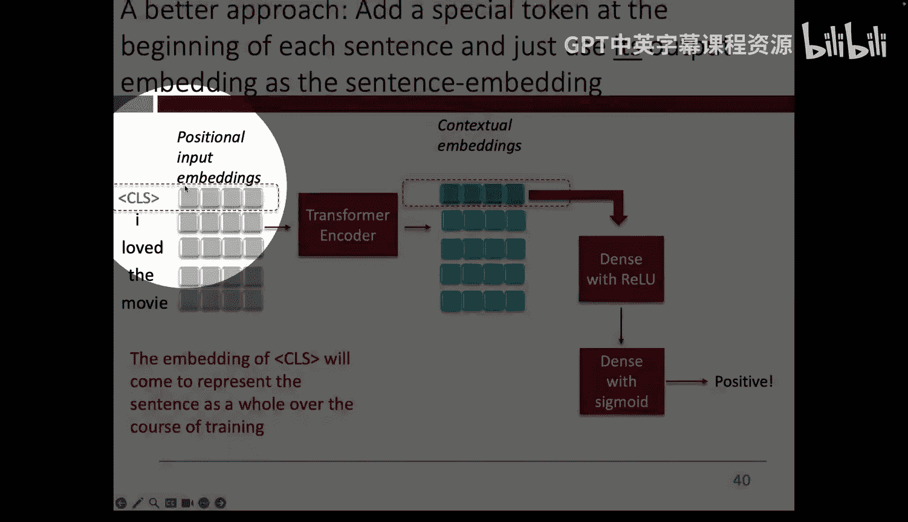

Okay， literally its an artificial token and it is designated as you know Cs in the literature。😊。

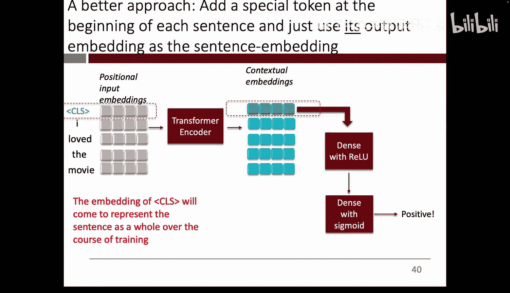

And then， this token is getting。Trained with everything else。Okay， and so once you。

 once you finish training。That token has its own embedding， too。

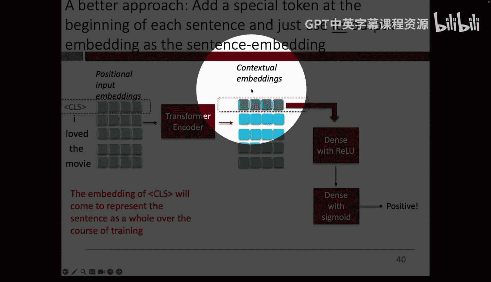

And because it has been trained with everything else and this token is remember is a contextual embedding。

 which means that it is very much aware of all the other words in the sentence。😊，So in some sense。

 this context this CS token's contextual embeing sort of captures everything that's going on about that sentence。

😊，RightAnd so what we do is once we are done training。

 we just grab this thing alone and then send that through a re and a sigmoid and boom we are done。😊。

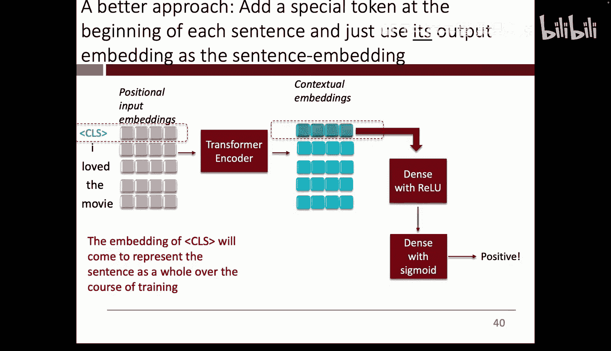

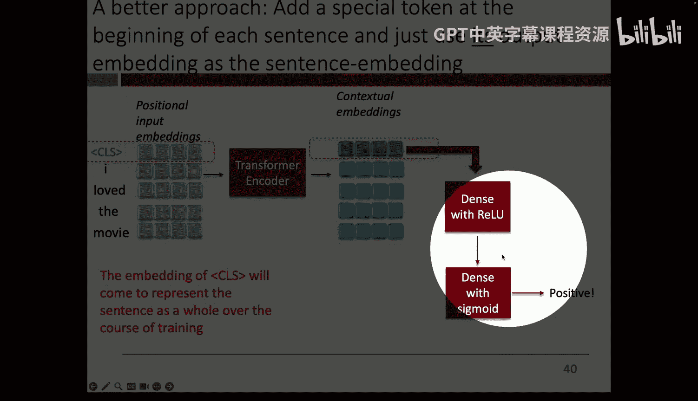

So this is a very clever trick to somehow， you know， instead of averaging everything at the end。

 let's just have something just for the whole thing， the sentence and just learn it anyway。

 along with everything else。 So in like a meta principle in deep learning is that。😊。

Whenever you think you are making an ad hoc decision about something like averaging a bunch of stuff。

 you should always stop and say， is there a better way to do it where it doesn't have to be ad hoc where the right way is learnable from the data directly。

😊，Using back propagation， there was a hand， yeah。Is there a reason that you。

can there any the only thing to remember is that it's a good question。

 so different sentences are going to be of different length right So there may be short sentences there may be long sentences in particular the lot the short sentences are going to get padded。

Right I remember I talked about padding to make it fit to one length so what internally the transform will do is ignore all the padded tokens because it does do it it is just padding doesn't really matter for anything so if you have the Cs at the very end we have to have much more administrative bookkeeping to take everything but the last one。

😊，Ignore it and only do the last one。 Just much easier to get it in the beginning。That's the reason。

 yeah。What be just a practical application of this would be something like sentiment analysis？Yeah。

 so basically any kind of text comes in and you want to figure out some labeling problem。

 like a classification problem， the easiest example I could think of a sentiment。But you can imagine。

 for example， an email comes into a like a call center operation。

 and you want to take the email and automatically figure out which department should I send it to。

Okay， so now， now if the input data for a task is natural language text， right。

 we don't have to restrict ourselves to only the input training data we have。

Would it be great to learn from all the text thats out there？😊，So， for example。

 to go back to the call center thing I just mentioned， you know， why clearly。

 let's say it's coming in English。😊，The ability to take that English email and route it to one of 10 things。

You know， you should have to learn English just for your call center application。

 You should learn English generally and use it for other things。

 right So why can't we just learn from all the text that's out there。😊。

And so that brings to something called self supervised learning。

And the idea of sensorized learning is this。 So if you recall the transfer learning example from lecture 4 right where we had ReNe right and we took ReNe。

 we chopped off the final thing。 we make made it sort of headless。😊。

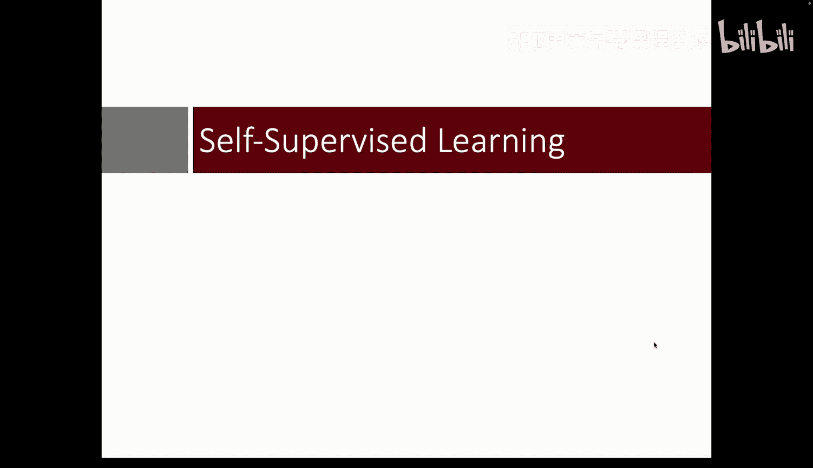

And then we attach that output of the headless renet to a little hidden layer an output and with the handbags and shows。

😊。

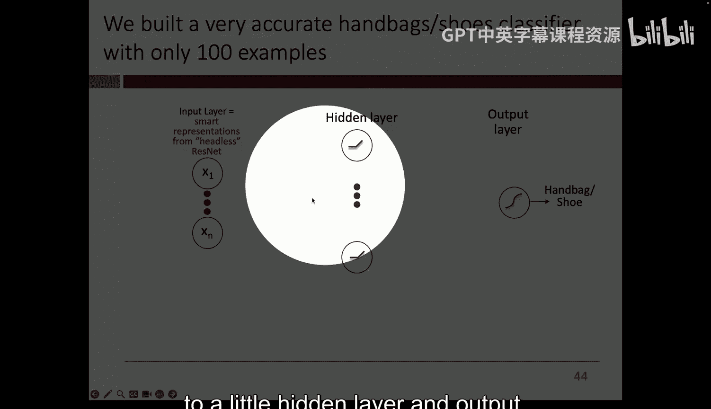

And you will recall that we were able to build a very good classifier for handbags and shoes with just like 100 examples。

😊，Right， so the question is， why was this so effective， Why was this so effective。

And turns out the reason why any of this stuff actually works。😊。

Is because neural networks or they learn representations automatically when you train them so what I mean by that is when you imagine a network you feed in a bunch of stuff。

 it goes through all the layers it comes out you can think of each layer as transforming the raw input in some different alternate representation of the input okay。

😊。

And so and these are called representations。 That's actually a technical term。😊。

And so you can from this perspective when you train a neural network。

 a deep network with lots of layers what you are really learning is you are learning a way to you are learning how to represent the input in many different ways each of these arrows is a different way of representing things plus you are learning a final regression model。

😊。

Either a linear regression model or a logistic regression model。 fundamentally。

 that's what's going on because the final layers tend to be sigmoid。

 softm are just linear right So the final layer， if you just look at this part alone。

 whatever is coming in is just going through essentially a linear regression model or a logistic regression model。

 Thats it。😊。

So fundamentally， are you learning representations and a final little model？😊，Okay。

 but the reason why all these things work so much better than electrical regression is because those representations have learned all kinds of useful things about the input data。

😊，They have sort of automatically feature engineered for you。😡，So。So from this perspective。

 you can imagine that each layer here is like an encoder。 It encodes the input， right。

 The first layer encodes it The first two layers encode something。

 The first three layers encode something and so on。 so forth。

 So a deep network contains many encoders。😊。

And so the question is， what do these representations actually。😊，Embody， right， What do they capture。

 Is it like specific knowledge about the particular problem that you train the thing train the network on。

 or is it like general knowledge about the input data。

 Because if it is general knowledge about the input， we can use it to solve other problems。

 unrelated problems。😊。

So is it specific knowledge or general knowledge， And it turns out they actually captured a lot of general knowledge about the input。

😊，And that's why you can get reuse out of them。You can reuse them for other unrelated things because they have captured general stuff。

 So if you look at this， I think I've shown you before， right。

 if you look at a network that classifies everyday objects into a bunch of categories。

 it can learn all these little patterns in the beginning and later on and so on and so forth。

 And this is a face detection network。 It has learned how to look at， you know。

 identify little circles and edges and nose like shapes and finally faces。

 So all these things are examples of representation， learning interesting things about the input。😊。

so since these representations are capturing intrinsic aspects of the data。

 you can use it for other things。😊。

Right， you can take a phase detection neural network and use it， reuse it for emotion detection。

 for instance。

So the question is， if we can somehow get like an encoder that generates good representation for your input data。

 we can simply build a regression model to those as input and labels as output and be done。

 And this is exactly what we with the renet。😊。

For handbags and shoes。We found a thing that had already been trained on similar everyday objects。

 everyday images。And the key insight here is that since we don't have to spend precious data on learning these good representations。

😊，We won't need as much label data in the first place。

Because the pre training used a lot of data and you're sort of piggybacking on the data。

 So in some sense， your draining data is everything that the pretrain model was traineded on plus your little 200 examples。

Okay， so this is what we did we use headless restnet as an encoder that can take raw input and transform into useful representations。

😊，This is what we did。 Al right， so the general approach is that you find a deep neural network built on similar inputs。

 but different outputs。😊，And then you basically grab maybe the penultimate representation or the one before that。

Then you chop off the head， you attach your own output head。Train the whole thing。

 just the final layer， or train the whole thing if you want。

This is like the playbook we followed for ReNe， the same thing works for all kinds of other data types as well。

😊，So now to build such a model， we need labeled data， right。

 We were lucky because Renet was actually trained on imagenet data， which is like a million images。

 each of which labeled it 1000 categories。😊，Which is very convenient for us， right， but。

What if you want to build a generally useful model for text data？

Clearly， we need to collect a lot of text data， but that's no problem because Internet is full of text data。

 right， We can easily scrape the Internet。 We can just download Wikipedia。 So that's not a problem。

The problem is something else， which is that。How do we define an input label for a piece of text。

So for an input sentence， what should the output label be， That's the key question。

Because if you can answer this question， you can just spray train all these things on all kinds of text tail。

 right。😊。

So like a beautiful idea for doing this is called self supervised learning。

 And the key idea is that you take your input， whatever the input is。😊。

You take a small part of the input and just remove it and then ask your network to fill in the blanks from everything else。

Okay so this is called masking and it is just one of many techniques in selfupvised learning but this is very commonly used so this original input right and then you take it and then you just like take this thing in the middle here randomly and zero it out or mask it and so this incomplete input is your now new input and the thing that you took out becomes your your fake label。

😊。

So you can almost imagine right if you take if you are baking donuts。

 you make a donut and then you punch a hole in the middle of the donut。

The donut with the hole is your new input， the munchkin is the label。

I mean making everybody hungry at this point， so。So once you do that， no problem， you have an input。

 you have labels， you just train a neural network。😊。

To essentially predict those， to basically fill in the blanks。And so if， for example。

 if you take a sentence like the Sloan school's mission。

You can just go in there and just， just knock out randomly a bunch of words like this second the ones I'm knocking out。

 I'm just putting the word mask in it。This is show what I'm doing and then what is actually given this sentence you to try to fill in the blanks with actual words。

😊。

Okay。So now， for the amazing part， in the process of learning to fill in the blanks。

 the network learns a really good representation of the kind of input data it's seeing。😊。

And it kind of makes sense right， because if I give you a sentence with a few missing blanks and you are able to very successfully fill in the blanks。

😊，You have learned a whole bunch of stuff about the world to be able to do that。

RightIf I say the capital of France is Da and youre like Paris， how did you know that？😊。

It's sort of like that。By learning to fill in the blanks。

 you really have to learn how how all these things work。

 All the the of connections between various words and so on and so forth， so。

And so what you can do is once we build such a model， we can just extract an encoder from it。😊，Right。

 and then we will find unit like we do by library for transfer learning。

But this have you build a generic， a generic pre train model。On unlaable data。

And so we can use a transformer encoder to build this whole thing in the middle。😊。

Because remember， the transformer can take any sentence and give you the same size sentence back。

 along with predictions for everything。😊，So we could just have it。

 take this thing in and ask it to just predict all the missing words here。😊。

And。So you to put in other words， masked self supervis learning is just a sequence labeling problem。

So basically this is the sequence that comes in and then you tell the transformer and you get all these embeddings it goes through all that stuff。

 you really don't care about these outputs， but wherever the word mask went in in the input you basically try to get it to the right answer is for example the word mission and youre trying to and that is the right answer this is the right answer here and then you take these right answers。

 create a loss function and do back proper boom you're done。

Inputs， right answers and， and your business。 That's it。Now。

 if we pre train a transform order like this on massive amounts of English text。

 let's say we did that。We get something called Bt。Bert is a very famous transformer model。

 and Bert was the first model actually， that Google used to upgrade its search in 2019。

Like the Brazil Bi example you may recall from earlier lectures that uses B under the hood。Okay。

 and so。Now， I just want to show you because you can actually read the birth paper and itll actually make sense to you now based on what you have learned in this class。

 Look at this。 B's model architecture is a multi layer by directional transformer encoder。 Okay。

 transformer encoder。 We denote the number of layers， transformer blocks as L。

 The hidden size is H and the number of attention heads is a。 And how much is that。😊。

Okay， we want H is 7，68。 Okay， so which means that。The embedding sizes or 768。

And the hidden feet forward layer is four times as much。 So it's 4，0，9，6。 And so sorry。

 the the the 4，0，9，6 is the feet forward layer。 The embeddings are 7，68。

 And you can see there are two bird models here。 This one has 12 transformer blocks。

 This one has 24 transformer blocks。

Okay。So you can actually read this paper。 You， You can actually relate it to exactly what we discussed in class。

 It all makes sense。Bydirect essentially means that the words can pay attention to every other word in the sentence。

😊，And as we will see on Monday， you can have， you have a different another transformer thing called a causalal transformer in which you only pay attention to the words that came before you。

 not the ones after you。So bidirectial means all birds are seen。Okay。

 so so what we do is remember we said to solve sequence classification。

 you can add a little total at the beginning and then boom user classification as it turns out。

 B very conveniently for us the people who built B， they actually when they trained B。

 they just use the CS business。😊。

During training， so it's actually available for us out of the box。

So when you use Bt for sequence classification， you don't even have to do any surgery on it。

 It just gives you the class token automatically， which is very convenient。😊。

And you can also use it for sequence labeling as well。😊。

So for sequence classifications and sequence labeling BRT is actually usually a really good starting point and in particular there have been lots of improvements in variations of Bt over the years and if you are curious about this there is a thing called the sentence transformformerss library which has got a whole bunch of Bt related code and resources that you can use to do things out of the box。

😊。

Okay， so okay， there is a bit of a word wall。😊。

So to solve any of these problems， classificational labeling where the input is natural language。

 we can obviously use a model like BRT， label a few hundred examples。

 attach the right final layers and find tune it like we did for the restNe。😊。

But if your problem is like a standard NLP problem， okay？

You don't even have to do that because people for these standard tasks they've already pretrained on those standard tasks right and so you can do all these things without any fine tuning at all like literally out of the box and so there are many hubs which have these pretrain models。

 but perhaps the biggest one is the hugging face hub。😊。

And I checked last night， it has 525，000 models。

Available， I think if I recall last year when I taught Hle， I think the number was a lot smaller。

 maybe 50000。 So it's like growing really， really fast。😊。

And so， all right， let's just switch to a hugging face collab。😊，So hugging face。

 How many of you are familiar with hugging face。It's good。All right， so for the others。

 basically you have a whole bunch of pretrain models on Huging face。

 you actually have a lot of data sets you can work with for your own tasks。😊。

There are lots of people demoing what they have built in this thing called spaces。 And of course。

 a lot of documentation and so on。 So the thing you can do is what they have done is they have organized all these models by the kind of task you can use them for。

 So you can see here there are a whole bunch of computer vision tasks that you can use them for There's a whole bunch of natural language task like text classification feature extraction。

 this and that， lots of interesting examples here。 And so what you do is you just literally can go in there and say okay。

 I want to do a text classification， you hit it and then it tells you all the models that are available termss that are 50000 models just for text classification and you can look at okay。

 which is you know most downloaded or which is the most like。

 And then you can just use them as a starting point for whatever you want to do okay。😊，So。

 so that is hugging face。 And so the way you do hugging face is。I'm just connecting it。嗯。

If you have a problem which the input is a natural language text， the first question you have ask is。

 is it standard or not， is it a standard task or not， if it's a standard task。

 you just go go there do not reinvent the wheel， this thing will usually work pretty well。Okay。

 so here we will use this thing called the Transformerss library from Huging phase in particular the pipeline function to demonstrate quickly how to do this thing。

 Fortunatelyly， this library as of this year is pre-instled and collab so we can we don't install it we can just simply start using it right away So we'll take this example where you have a bunch of text which says。

Dear Amazon， last week I ordered an Opim prime action figure from your store in Germany。

 unfortunately， when you opened the wickage， I discovered to my horror。

That had been sent an action figure of megaron。 Can you imagine that person's like sheer distress at this？

 So as a lifelong enemy of the deceptticons， I hope you can understand my dilemma。

 So to resolve the issue， I demand and exchange in closer copies expect to hear from you soon sincerely。

Bumblebee。Okay， that， okay， they should come up with a better name for this example。All right， cool。

 So that's the text we have。 So we import the。This pipeline function is the one that basically gives you the ability to out of the box。

 start using it without any pre training， nothing like that。 Okay， so we download this thing。Oh， wow。

 I got an 800 today。😊，That happens very rarely。sorry 。So here。

 let's say you want to classify that text。 Okay， You want to just want to classify it for sentiment。

 You literally go in there and say pipeline。😊，Text classification。

 That is the task you want the pipeline to do for you。Right，And you create a classifier。 Okay。

 it's going to download a bunch of stuff and so on and so forth。

The first time it just takes time to download and then you literally take the text you have here and then run it through the classifier as if just a little function。

 right。You got some outputs。And then actually， it just goes this way。

Negative sentiment is negative with 90% probability。Pretty good， right SQL classification solved。😊。

I mean， sentiment classification sort。 So we'll try a few different examples。 I hated the movie。

 if I said I love the movie， I would be lying。 Okay， that's a little tricky。

 The movie left me speechless incredible。 And then I had to add this last thing here last night。😊。

Almost， but not quite entirely unlike anything good。 I've seen。 Okay， that's not original。

 by the way， people who have read Douglas Adams will know this famous sentence about somebody drinking some beverage and saying it's almost。

 but not quite entirely unlike tea。So I was inspired by that， so anyway， let's see what happens。

All right。Bur in there。Okay， so negative， I hated the movie。 Okay， fine。

 if I said love me' be lying negative movie of me speechless， it says it's negative。

 but it could go either way right， a good classifier who are probably giving me a probability around the 50% mark because it's sort of right on the fence。

😊，Incredible， it's positive。 And then it got fooled by my crazy long sentence。

 And it says it's positive。 Okay， now that's classification。 Here is one other quick example。

 So you can actually give it a piece of text。😊，Right，For example。

 you can take like a writer's news story。You can fear it and say extract all the company names from it。

Extract company names， people names and things like that。

 it's called named entity extraction and there are back back in the day people would bring they would handbi painstakingly all these very complex systems to do do named into extraction now with just a pipeline away so you can take this thing and you can say create a pipeline for any named extraction and for any particular task that you are using there might be a few additional parameters you can set right as a part of the configuration so we download this pipeline。

Okay， perfect。 And then we run the output。So it says， okay， good， Amazon is an organization。呃。

And Germany is a location lock， which is nice。 So these things have a standard vocabulary as to org lock。

 things like that， which you can read up in the documentation。 And then bumblebee is a person。

 And then boy， all the like the optimus prime transformer stuff is all it got full right。

 It thinks optimus prime is miscellaneous。😊。

Discept is miscellaneous and so on and so forth。 But you get the idea。

 you can take standard things like Reuters use stories and so on。 You can just read a。

 you can get a very good entity extraction right out of the back。

 And once you get these entries extracted， then you can put them into a nice structured data table。

 like a database。 and then you can run traditional machine learning art。😊，Okay。And then I had。

 I think a few more examples of question answering and actually， let's just try that。

You can actually give it a thing and ask a question about it。

 and you can actually give you the answer。Which gets into the causalal transformer thing that we're going to see on Monday。

 which builds up into large language models because you obviously can give something。

 you can give a passage to chat GPT and ask a question ask it to give you an answer。

 So it's really in that thing。 but just sort fun to just do that to see if it's any good。Okay。

 so what does the customer want and the output is an exchange of megaron and it is telling you which。

Where it starts in the text and where it ends the relevant passage iss pretty good， right？

So because remember， if you have stuff like this， then when you asked like a large language model。

 a question， it gives you an answer， you can actually ask it to give you exactly where in the input it found the answer。

 And because， you know， these things are going to hallucinate。 you can actually look at the input。😊。

That it's claiming to use and look at what it says and see if they actually match。

It's a way to sort of essentially do Q A on LLM output。Okay， so that's what we have here。

 And I have other budgets which shall ignore for the moment because I want to go back to the PowerPoint。

So yeah， so if you have a standard task， you know， you can just use pipelines and hugging face to actually solve many of them out of the box without any heavy lifting。

So I mentioned earlier on that transformers are proven to be effective for a whole bunch of domains outside of natural language processing。

 like you know， speech recognition， computer vision and so on and so forth。

 And so I want to give you a couple of quick examples of how to think about transform using transformers for non textext applications。

 Okay， so。😊。

The the key insight here is that the architecture， the transformer block that we have looked at amazingly enough can be used as is with no changes。

 no surgery needed， no clever thinking required for any particular application。

 What is needed where the clever thinking may be required is you need to take the input that you're working with and you need to figure out a way to tokenize and encode them into embeddings。

😊。

Which can then be sent into the transformer。 So all the action is in taking that input。

 the non text input and figuring out a way to cast them in the language of embes。😊。

That's whether that's the game。 Okay， so here is something called the vision transformer。

 which is very famous。 actually， I think it may be the first。

 perhaps the first transformer architecture that is applied to vision problems。 So。

 so let's say you have a picture。 Yeah， So let's say you have this picture， okay。😊。

It is just a picture。 Okay， so you have to find a way to create embeddings from this picture。😊。

Or to tokenize this picture in some way which sentences， you know， I love hurdle。 Well， obviously。

 I love and hurdle or three tokens。 It's pretty trivial to figure outd tokenize them。

 But with a picture， what do you do right， It's kind of weird to think of tokenizing a picture。

 So what these people did is that they say， you know what I'm going to take this picture and chop it up into small squares。

😊，Right。So in this example， they have taken this big picture and chopted them into nine little pictures。

😊，Okay。Then you can take each of those nine pictures。Each of those nine pictures。

 right if you look at the how it's represented， it's just three tables of numbers。

 right the RGB values。Right。So you can take all those numbers and you just create a giant。

 long vector from it。Okay， you have a huge long vector。

And then you run it through a dense layer to come up with a smaller vector。

And that smaller vector is youre embedding。That's it。

 But the way you transform the long vector a small vector is just a dense layer whose weights can be learned。

So what these people did is they said well I'm going to first chop it up into these patches and then I take each patch and do a linear projection right a flattened patch is nothing more than a three tables or numbers flattened into a long vector that is what the word flatten here means。

😊，And once you are flat in it， I'm just going to run it through a dense layer。 So by the way。

 you will see the words linear projection。 It's a synonym for run it through a dense layer。😊。

So you run it through a dense layer， right， You get these nice vectors。😊，These vectors。

And now you say， well you know what， I have to take the order of these things into account because clearly this little patch is in the top left while this patch is somewhere in the middle right the order matters in the picture。

 otherwise every jumbled version is going to be the same thing so you use position embeddings。😊。

You basically say there are 9 positions in any picture。Right，0，1，23，4，5，6，7，8， there are9 positions。

 so I'm going to create nine position embeddings。😊。

And then I'm just going to add them up。I'm just going add them up to this em。

 just like we do with words。With words， we each word had an embedding。

 each position had an embedding， we added them up here， each image has an embedding。

 the position of that little patch in the picture has an embedding， we add them up。😊，Okay。

 and then because we want to use it for classification， no problem。 Well have a little CLS token。😊。

And then we just run it to the transformer。 That's it。And then you get the seal is token。

 and then you can attach a softm to it and say， okay， it's a bird， It's a ball。 It's a car。😊。

That's it， this simple approach actually works。

Amazingly enough。Okay， so that is the vision transformer。

And I'm going through fast just to give you a sense for how these things work。Many questions。掉。

My question is like in case of texts， we had fixed number of。

About of birds could the Indianulary in the English vocabulary。 But here， if you look at images。

 they will probably put to trillion that annual know。We are not one image。

 but we take a total set of lot of images。Try to subsidy for of damage。

There is no notion of vocabulary here。All we are saying is that given any image。

We create nine patches， sub images from it。Each of the patches gets passed through。A dense layer。

 and outcomes an embedding。So at that point， any image you give me。

 I'm going to give get you 9 ems out of it。And one second then I em things I just throw it into the mid grinder。

 the transformer mid grinder。Alright， so another example。

 I think some of you have asked me outside of class， how good are transformers for structured data。

 tableular data right for tableular data in general， things like X G boost。

 gradient boosting books really， really well。 So it's good to try them。 Certainly。

 I don't think transformers and deep networks have any great edge over X G boost for structured data problems。

 So it's worth trying both of them。 However， you can use transformers with this stuff， too。

 So that's called the tap transformer， One of the first ones to come out。😊。

A transform of vertular data。 And again， it's pretty simple。 All you do is。

In any kind of input that you have you will have some categorical variables right like blood pressure。

 things like that right not blood pressure， bad example gender right and so on and so forth and so what you do is you take all the categorical features and for each categorical feature you create embeddings。

😊，Because a categorical feature is just text。The category of it is just text。

 so you can create text ems for it。 No problem。呃。And you take all the continuous features。Right。

 cholesterol and blood pressure and whatnot， right to go to the heart disease example。

 And then you take just create all the correct them all and just create a vector order of them。

You're just a vector， okay。Then you run these， the embeddings for all the categorical variables through a nice transformer block。

😊，And you can see here is exactly the block you've seen before。 No difference。

 And then at the very end， when it comes out of the transformer。

 you take all the contexts of coming out the transformer。

 and then you concatenate it with the continuous features。😊。

Okay， and then you run it through maybe one or more dense layers and boom output。

So this is a tab tableular data transformer。 And there are many know refinements improvements over the years that have come since then。

😊，But the key thing I want you to remember here is that categorical variables can be very easily represented as embeddings。

😊，That's the key。Okay。Allright， so that's that。 Now。

 once the input has been transformed into sort of this common language of embeddings。

 we can process them without changing the architecture of the block itself because all it wants is embeddings。

 It's like you give me embeddings。 I give you a great context embeddings out and nobody gets hurt。😊。

RightThat is the deal with the transformer stack so。Now this this ability。

 this sort of since the transferer is agnostic to the kind of input as long as it comes into comes in as a form of an embedding you can use it for multimodal data very easily so for example let's say that you have a problem in which you have a picture that you have to be sent in some text that goes in a bunch of tableular data coming in。

😊。

Well， you take the text and do language embeddings like we know how to do。

 You take the image and do image embeddings like we just solve the vision transformer。

 You take tabt data and do tabid ems like we solve the tab transformer。😊，Once we do it。

 you saw all a bunch of embeddings。And then you attach a little class token on top。

 send it through a bunch of transformist blocks and then out the contextual class token。

 the contextual version， run it through a re， maybe a sigmoid or a softmax， predict the label done。😊。

So this is extremely powerful。 Its ability to handle multimodal data okay and that's why。

 for example， if you look at Gemini， Google Gemini 1。5 pro GP for vision and so on。

 you can send it images and a question and you get an answer back。😊。

Because every modality that goes in is cast into embeddings and once it emdding once it' is embedding iced。

😊，Then the transform doesn't care。 It's just do its thing。It will decide， for example。

 that this word in your question actually is highly related to that patch in the picture。😊，Right。

 you'll just figure it out。Okay， that's all I had because I said time permiting 9，55， perfect。😊。

All right， folks， thanks， have a great rest of your week。

