# 《动手深度学习｜15.773 Hands-On Deep Learning Spring 2024》中英字幕 p11 -11-11_ Generative AI – Text-to-Image Models.zh_en -BV1ELraBoEtg_p11-

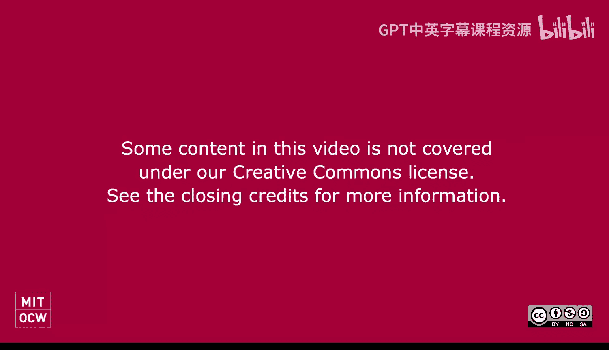

So all right， so today we actually come to the last lecture of the class because Wednesday is going to be project presentations and。

😊，So I want to talk to you about diffusion models today， which is an incredibly exciting area。

 which I don't think gets the same amount of attention in some ways compared to large language models。

But it's got enormous potential， so I'm very excited to talk to you about it。So， you know。

 just for cakes last night I said， I asked ChaGBT create a photoreistic image of graduate students in a class on deep learning。

 and this is what it came back with。There is a noticeable absence of an instructor。Plus。

 various students are facing in various directions。

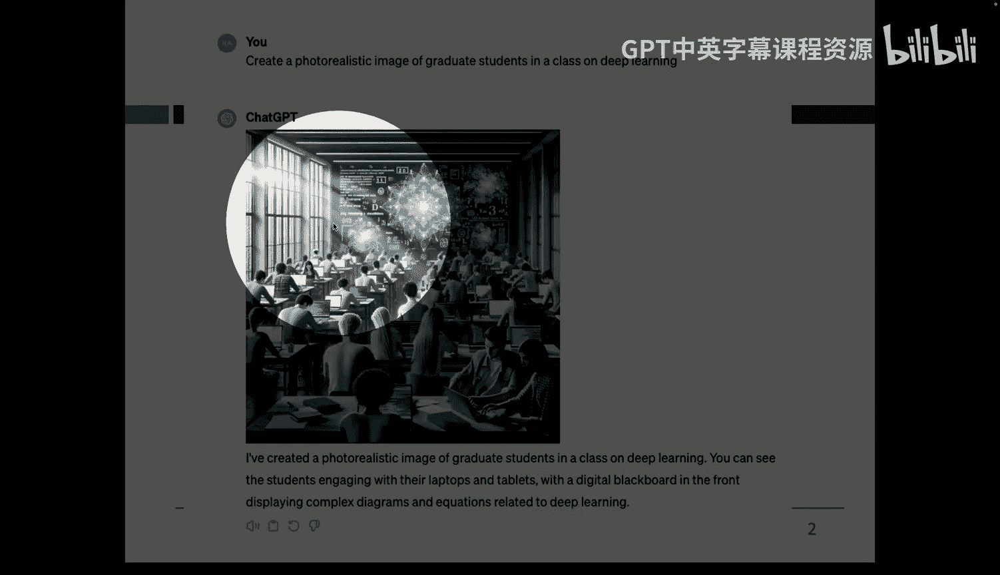

But apart from that， it's not bad。And here is an example of a midjoney textual imagetribution model。

 which produces the amazing picture。😊。

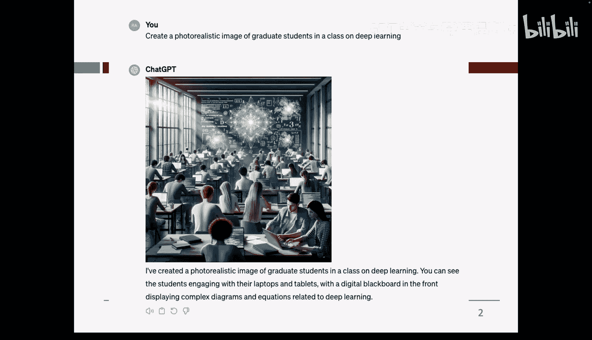

from this prompt， a quaint Italian seaside village with colorful buildings， blah， blah bh blah。

 rendered in the style of Claude Monet and so on and so forth。 and that's what you get。

 It's pretty unbelievable。😊。

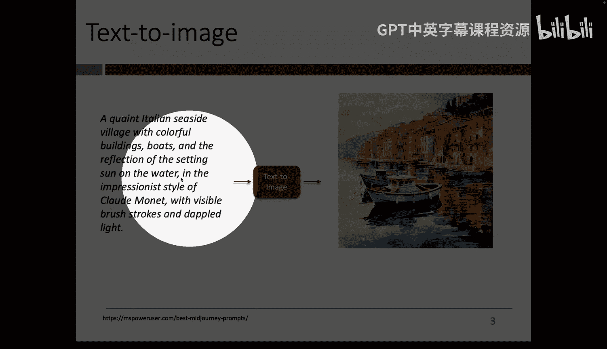

And I'm sure you folks have played around at these things and you have your favorite pictures and prompts and whatnot。

Now。February 15， open AI released a text to video model called Sora， which your folks may have seen。

 which I find frankly， just stunning what it can do。

 It can produce a one minute video from a text prompt and so。

So if you actually give it this prompt in an ornate historical hall。

 a massive tidal wave peaks and begins to crash and two surfers seizing the moment skillfully navigate the wave okay。

😊。

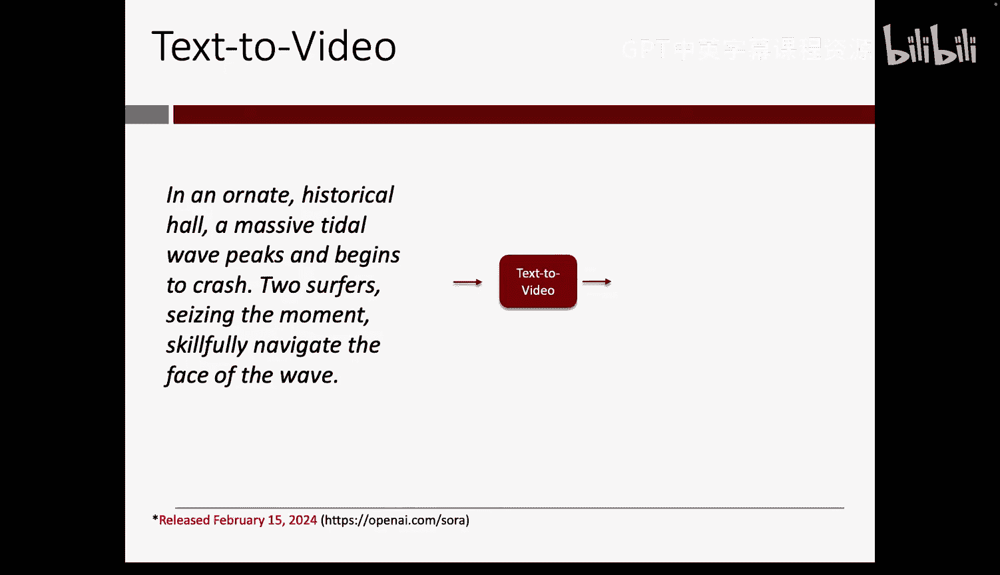

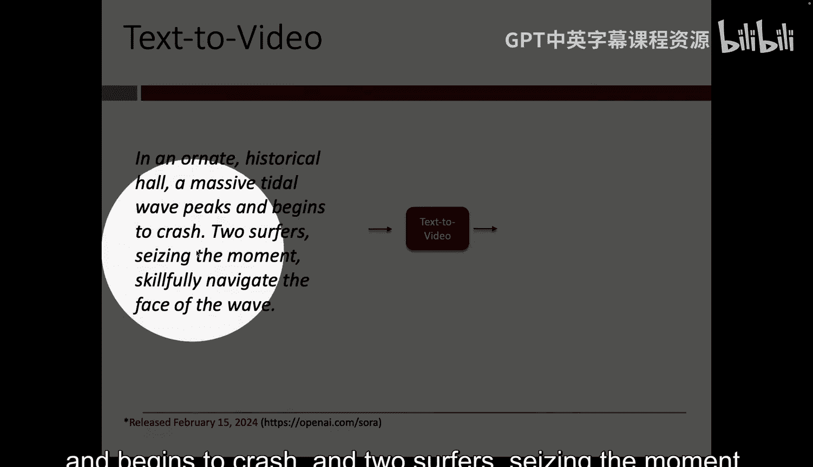

I think we can all agree that such a thing has never happened in history and therefore it was not in the training data right so and then you get this picture this video。

😊，And then some random person is coming back in a completely dry hall。 So anyway。

 but it's pretty amazing。 I think you would agree。😊，So。

If you actually look at the open eyes So technical report， you actually find this opening paragraph。

Where they say that we train text conditional diffusion models。

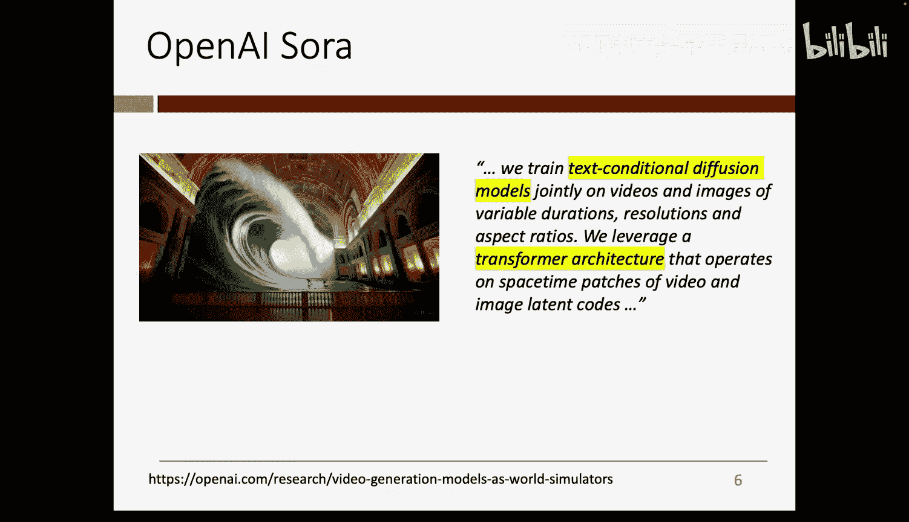

Blah， bh， blah， using a transformer architecture。

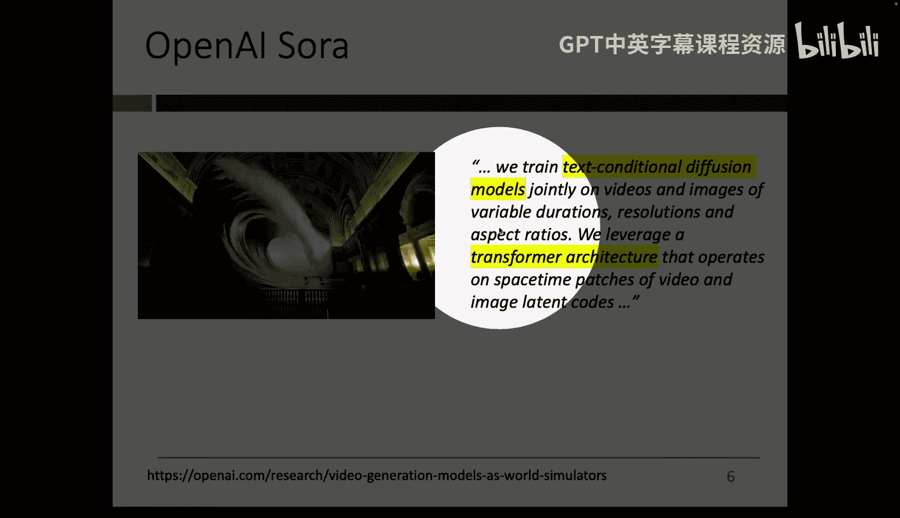

Okay， so now we know what a transformer architecture is， you have been working with it。

 you are quite familiar with it at this point。 So today's class is really about text conditional diffusion models。

😊，Okay， the other building block。Okay so let's get to it What I'm going to do is I'm going to sort of divide this into two parts。

 The first part is I'm just going to talk about how do you get a model to just generate an image for you right if you wanted to generate an image from a class of potential images how can you just generate an image and then next we talk about okay great now that you can do that how do you actually control or steer the model to do an image based on whatever prompting you give it。

😊，Okay， how do you condition it， How do you control it， Those are all the words。 How do you steer it。

 You'll find all these synonyms being used heavily in the literature。

 That's basically what they mean。 How do you give it a prompt and then steer what gets produced。

All right。Let's say you want to build a model that can be used to generate images of stately college buildings。

Okay obviously our very own Kian code is the finest example of such a thing and but let's say you want to do that。

 So what you do is you as we always do with machine learning。

 we collect a bunch of data in this particular place we collect a whole bunch of images of stately college buildings and what you see here is literally me just doing a Google image search with the query stately college buildings okay so this is kind of stuff you get So you have your training data at your disposal is ready to go now the question is if you have such a model let's say and obviously we talk about how to build such a model very soon but let's say you have such a model and every time you sort of sample this model every time you ask the model hey give me an image you obviously wanted to give a different image right otherwise it iss kind of boring。

😊。

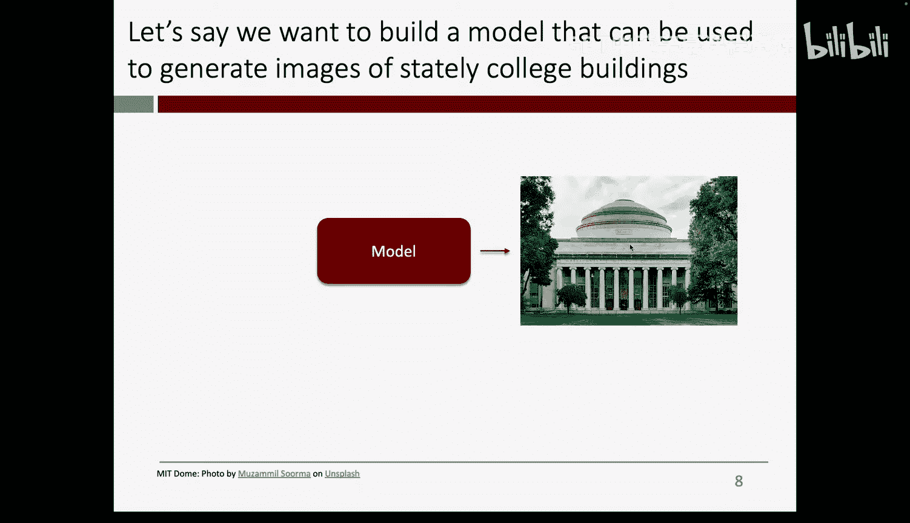

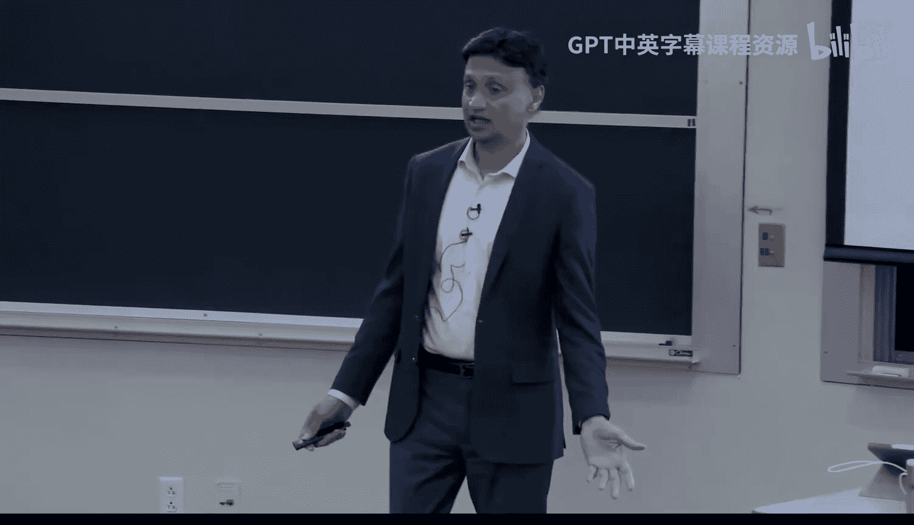

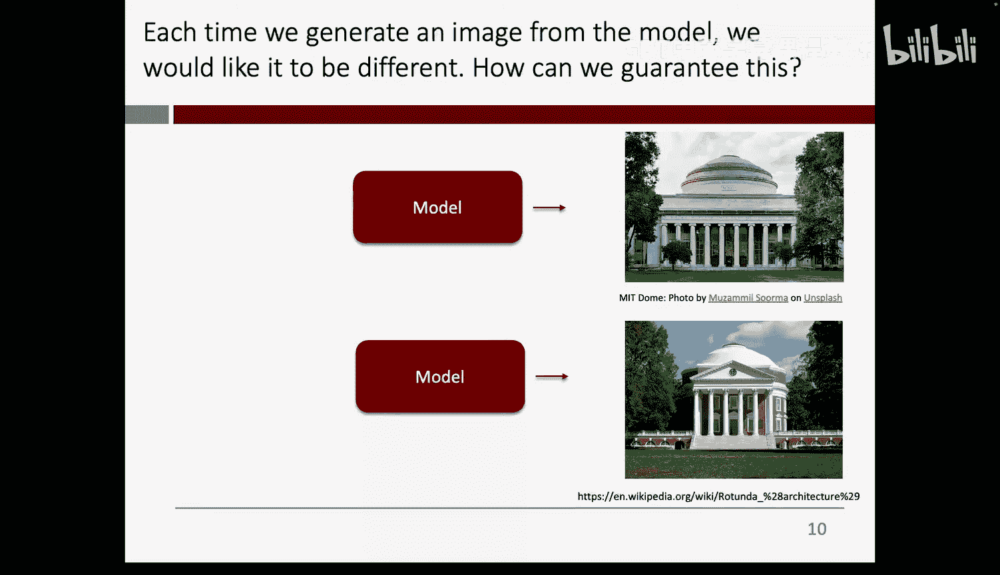

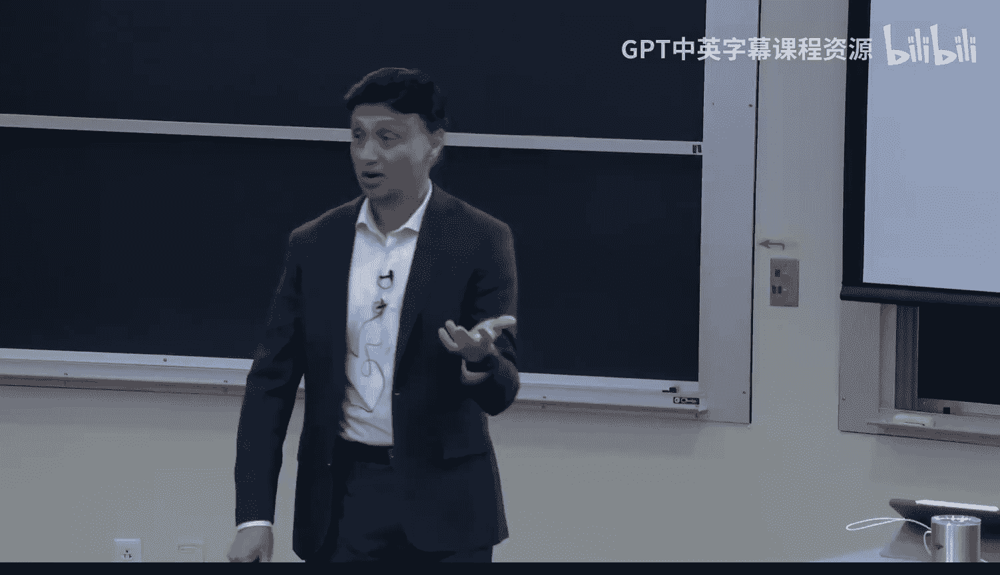

Right， you know maybe you want the cleared court， maybe you won the rotunda from the University of Virginia。

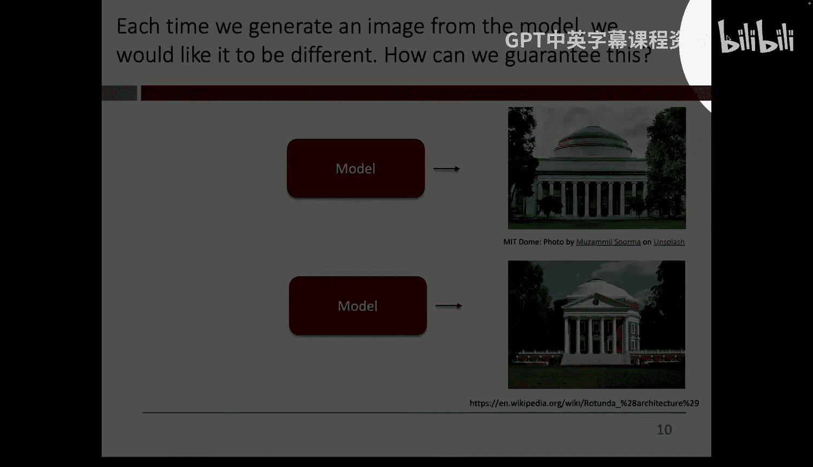

Any any UVA ats here？

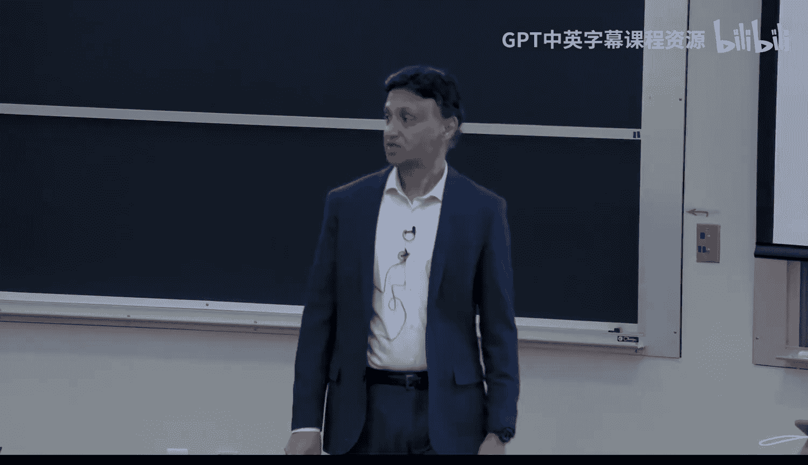

Nobody， okay。So right so the question is how can we actually get it to randomly give us different images but they all have to be stately college buildings it can't be just some random stuff。

😊。

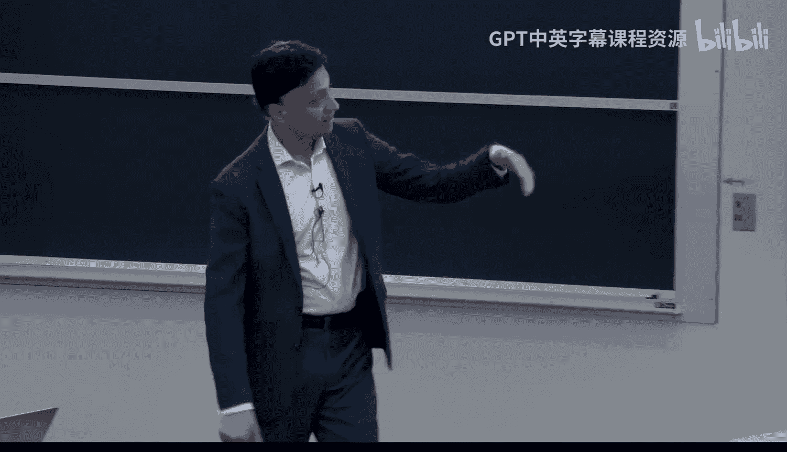

Right， so how do you do that？ And the way we do that。

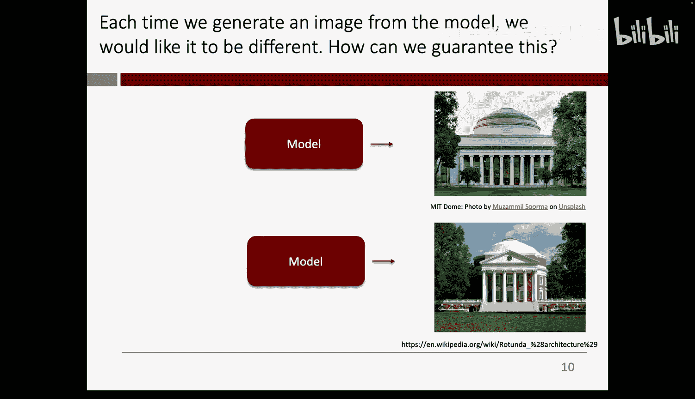

And I still find it really astonishing that this approach actually works。

 The way we do that is that we actually give it noise。😊。

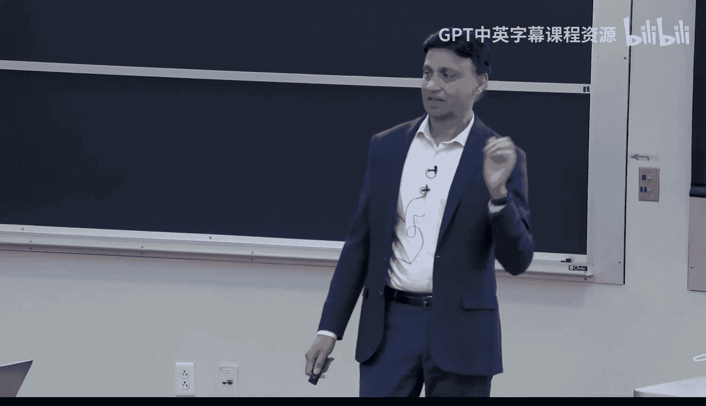

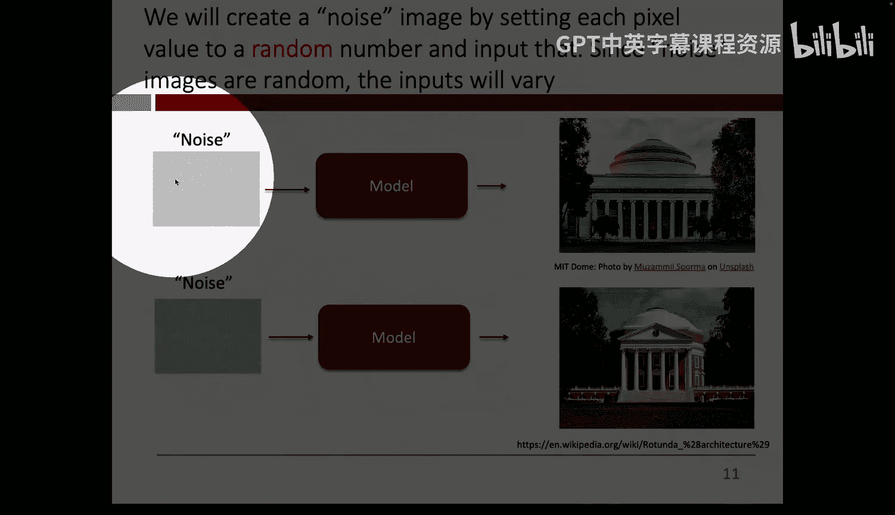

And I will define very precisely what I mean by noise in just a bit。 Okay， basically， assume。

An image in which all the pixel values are randomly picked。Right。

So every time you generate a random image and you give it to the model。

 it will use that random starting point。😊，And then create an image for you。

 And because by definition， if you choose noise randomly， they are。

 you know obviously going to be different each time。

 it's hopefully going to generate a different image。😊。

But if the model is trained on stately college buildings。

 it will produce images of stately college buildings。

 It's not going to produce a picture of a labdor retrieve。😊，Okay。

So that's basically what were going to do。 Now， if you look at something like this。

The first question， of course， is that how can we train a model to generate an image from pure noise。

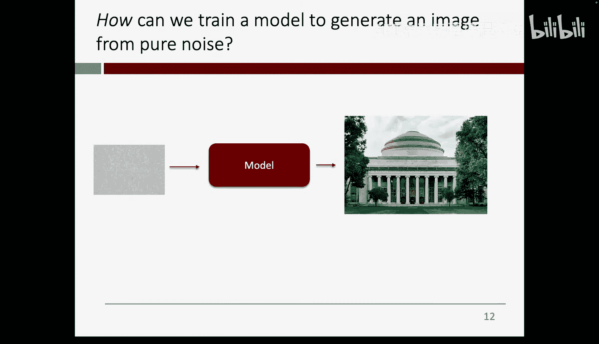

This just sounds ridiculous。You basically give it a bunch of random numbers and say give me killian card。

😊，It it feels really ridiculous。 And at that point。

 you know folks can sort of come to a stop and say， all right。

 this approach is probably not going to take me anywhere。 It's a bit of a dead end。😊。

But then some clever people had this very interesting idea。😊，They said。嗯。

It's not clear how to do this。You know， just a quick aside。 there is this really amazing book。

 which is published maybe 50 years ago， maybe earlier than that。 call How to solveve it。

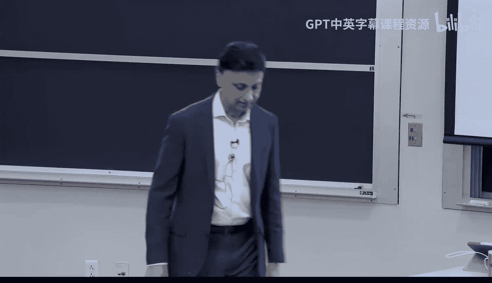

But George Polo， George Polo was a eminent mathematician。

And he wrote this small book called How to solveve it。

 And it lists a whole bunch of heuristics that mathematicians use when they solve problems。

 and perhaps the most commonly used heuristic is just reverse the question。

Just reverse the question and see if anything comes out of it。Most of the time。

 nothing will come out of it， but maybe some other time something amazing comes out， right。

 This is a great example of that heuristic at work。 We don't know how to do this。😊。

So the question is， can we do the reverse？If I give you Kian cord。

 can you produce noise out of it for me。And the answer is， yeah， of course we can do that。Right。

Given an image， we can easily create a noisy version of it。 So you can take the original image。

 You can add some nice to it to get this。 And you keep on adding a lot of nice。 And finally。

 you'll get something that's basically， you can't tell it that there is kill code anymore。😊。

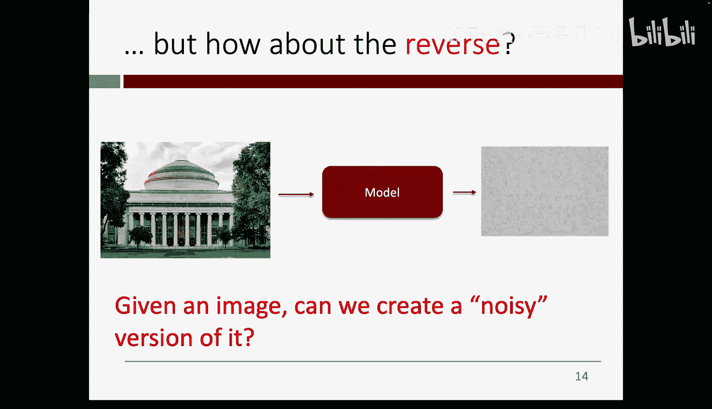

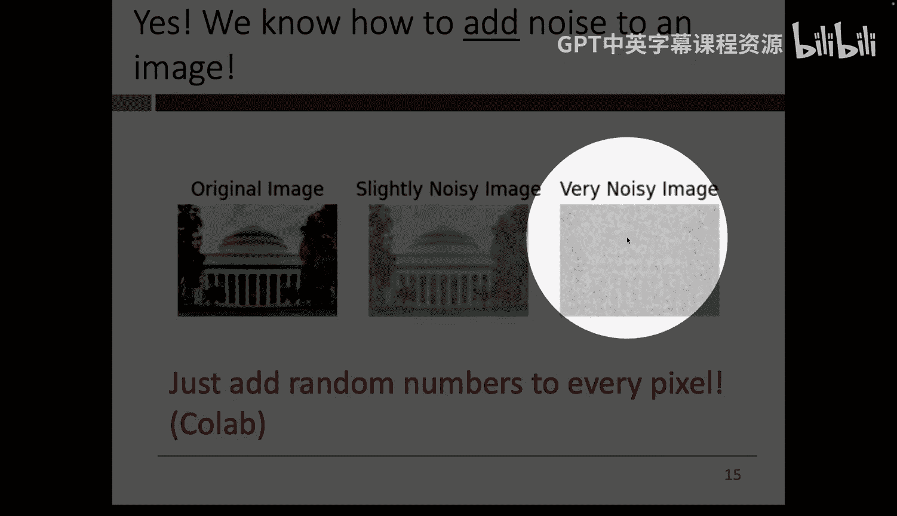

This process， the reverse process， is actually very easy to do。

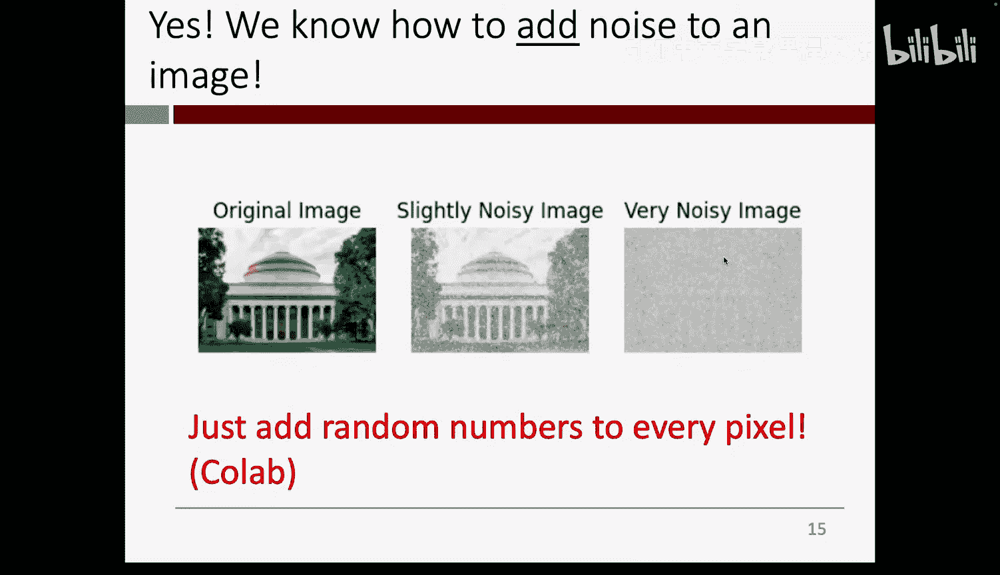

Okay， so the question， by the way， for folks of Ho we may not be very familiar with this notion of adding noise to an image or making an image noisy。

 Let me just show you in a coab just a minute。How easy it is。All right。

Let's say we import a bunch of these things as usual we have Ny and so there is this thing called the Python imagingaging library PL which is very handy for image manipulations so we import that and then I just literally read read this image I uploaded it before class let's just make sure it's here okay good Kelly do PNG so I read this image okay and then once I read it。

😊，I convert into a Nmpy array。 And then remember， in， in any color image。

You have three tables of numbers， the number there is a number for each pixel。For red。

 blue and green， and then each number is between 0 and 55。

And so here what we do is we divide everything we 55 just to normalize it so it is all between0 and 1 and we have done this in the past。

😊，Right， I do that here。All right so let me just read this back in。

 convert it and then if you look at the shape it's basically a 411 by 583 times 3 three channels as we have seen before and then let's just show it。

All right， that's the picture。So now what we want to do is we want to add noise to this picture all we have to do okay。

 for each pixel。😊，We basically。Randomly pick a normal variable， a normal distribution。

 normally distributed a random variable with a mean of 0 and a small standard deviation。

 So that its like a small number。 And then we just literally add that number to every pixel。😊。

But for every pixel， we sample， every pixel we sample。

 It's not like we sample once an a of all the pixels。 We sample for every pixel。😊。

And so the way you do that is basically literally n。 random。 normalormal。😊。

And then this 03 here is a standard deviation and we tell it generate as many of these things as the shape of the image that I gave you。

Okay， and then add each one of these numbers to the original image。 you get this noisy image。

 Okay so if this is the original image， these are all the values between 0 and1。

 and then you add do this noisy image。 you can see the numbers are become different。 The 。

23 has become 0。18。15 is become -017 and so on and so forth right you just added a small number random everything。

 But as you can see here now you have some negative numbers you may have some numbers that's greater than 1。

 And we do want everything to be between 0 and 1。 So all we do is we do this thing called clip it where essentially values smaller than0 or set to 0 values is greater than one or set to 1。

 And so we'll just do that。😊，That's it。 Everything over  one， squashed to 1， everything under 0。

 set to 0， others leave it unchanged。Now its again well behaved between0 and 1。

 and we can just plot it。😊，And you get this。That's it。

 That's all it takes to actually add noise image。 one line of nuumpy。Okay。

 obviously you can just put this whole thing in a loop and keep increasing that standard deviation number from 0。

3。4。5 so on and so forth。 And when you do that， you get this nice sequence of k code and all the way to some very。

 very noisy version k code。😊。

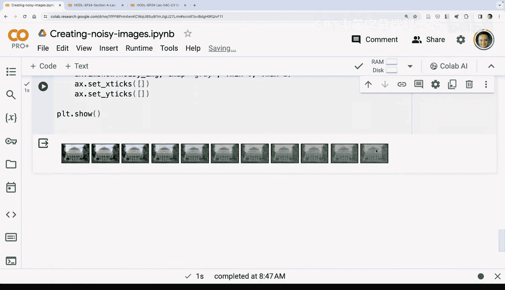

That's it。 So that's the basic idea of adding noise。Any questions on the mechanics？Okay， good。 So。

 so we can add nano numbers， right， And we can by increasing the magnitude of the standard deviation of these of these run normal random variables。

 we can make the image noiseier， okay。😊。

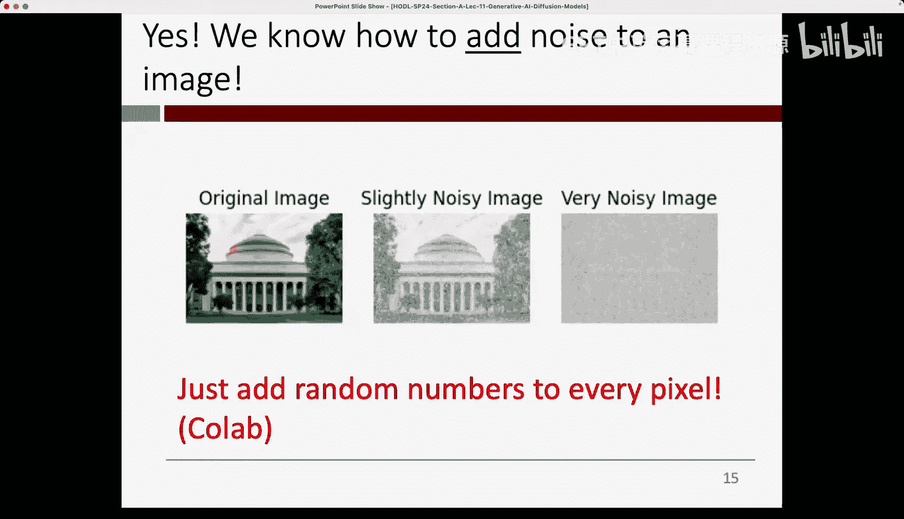

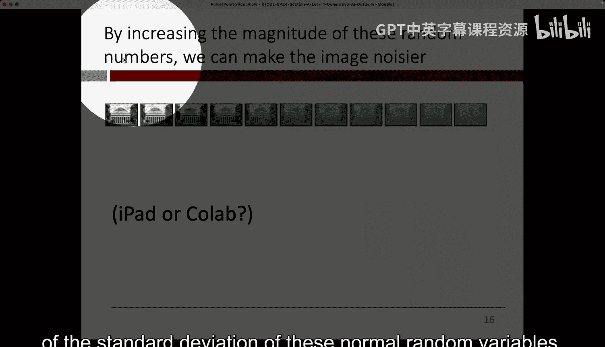

So that suggests a really interesting idea。

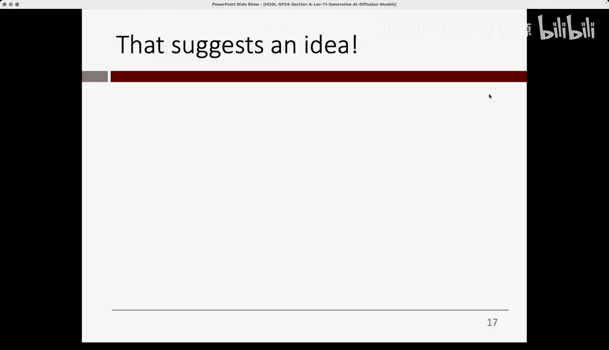

What idea would that be？Yeah， doing the Could you please microphone please。Doing the opposite。

 like recreating the image from the noise。So we are trying to create the image from the noise。But。

That feels a little hard。 So what exactly can we do be a little bit more specific。

So here we have the ability to take any image and add any amount of noise to it， right。

That's the data we have。There is Killian court， and there's various noisy versions of Kiian court like that for the rotundnda。

 the University of Virginia and so on and so forth。😊。

We do something of loss function for the final incentive。

Compared with the original image that you trained it on。And then yeah， hi can I go。Okay。

 you're on the right track。Any other。Proposals。I think we could try to train the role network。

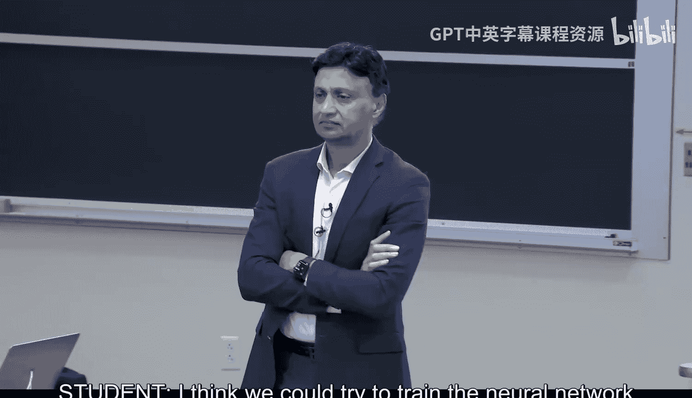

Construct the image going from the noise， the noise， noisy one。We have what does that with。Ws。

Find their。No is train of。出す。Yeah， that's definitely on the right track。

 That's definitely on the right track。 Yep， good ideas。So what we do more concretely。😊，え。We。

 we can take each image in the training data and create noisy versions of it， as we have seen before。

And then what we do is that we say。We can create X Y training data pairs。

 input output pairs from all these images。So， specifically， what we do。

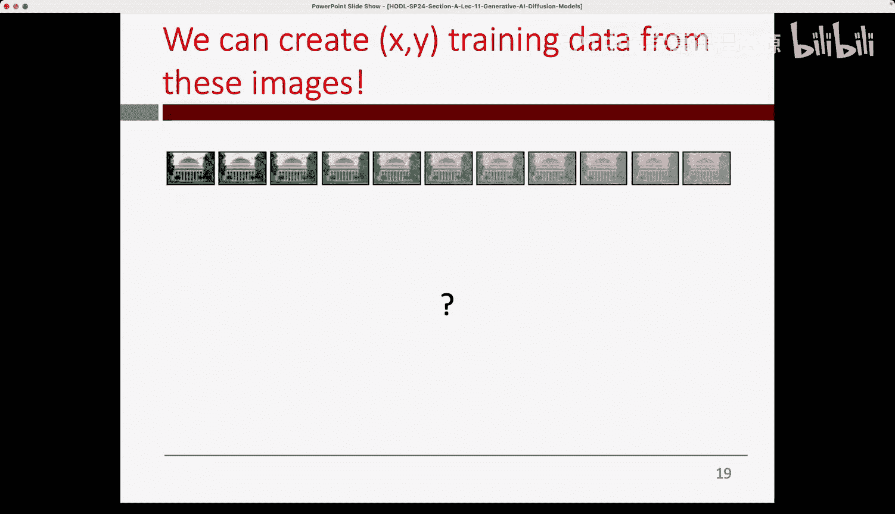

Itす。We take。The noisy slightly noisy version of Kian code and call it the input。😊。

And we take the the， the nice version of Cl code and call it the output。

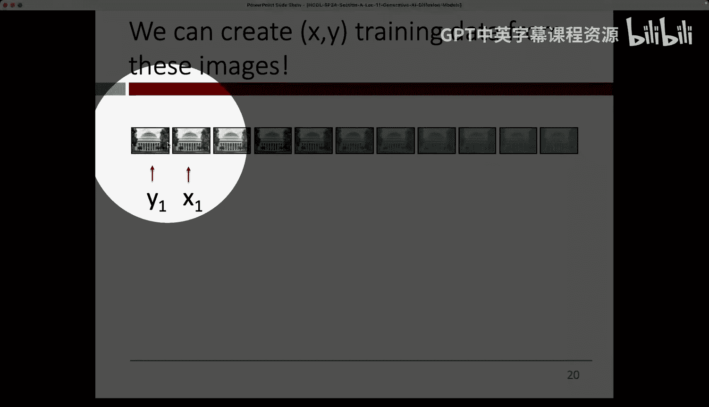

Okay， that's the y 1 x1 pair。And then we get y2 x2。We get y 3 x3 and all the way。😊。

So at any point in time。The relationship between x and y。What's the relationship between X and Y。

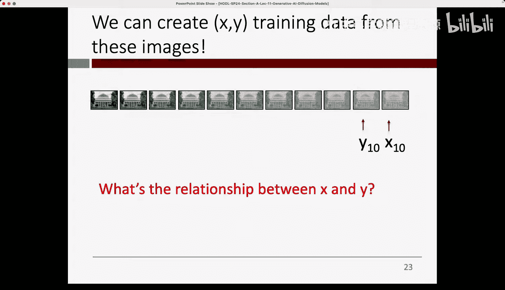

If you set it up like this， as the input an output。It's the set of standard deviations。나 you 수。

I like wes。price。Right， or maybe I was looking for something simpler， which was that that's correct。

 What I is was looking for is really， the relationship between X and y。😊。

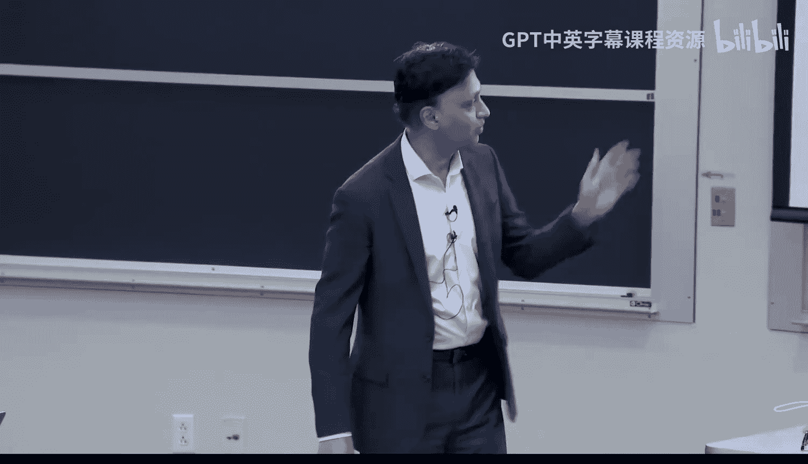

X is an image， any image， and Y happens to be a slightly less noisy version of the image。

The slightly less noisy is really， really important。You're not going from Kiian quote， right。

 you're not going from the image to full noise。😡，That's an impossible leap。

You're going from the image to a slightly noisy version of the image。😊。

It is that slightly that allows all the magic to happen。😊，So， that's what we have。And so here。

 what we can do with these X Y pairs。 when you have an， So here's a thing， right。

 This is like a larger comment about machine learning and deep learning。😊，Whenever you have。

Basically， what machine learning deepening are or really it's like this is black box where if you can find interesting input output pairs。

 you can learn a function to go from the input of the output。 That's it。😊。

But this sounds kind of simple when I describe it like that。

 but there are like some incredibly non-ob ways of applying this idea right So for example。

 a few years ago Google had this thing which may actually be in production in Google Sheets now where whenever you sort of choose a bunch of numbers。

 a range of numbers in a spreadsheet and then go into another cell。

 it immediately suggest a formula for you。😊，Where is that coming from。

It's because all the Google Sheets users all over the world。

They have been creating all these numbers with formulas， right。 So someone says， look， wait a second。

 We have all this data on people choosing a range of numbers and then entering a formula。

 So let's imagine that range is the input and the formula is the output。

And let's just give a million examples of despair pair。 andll see if anything comes out of it。

And boom， you get that feature。Okay， so similarly here。X is an image。

 less noisy version of the image。 What that means is that we can build a denoing network。Okay。

 we can take an image and we can build a network using all these X Y pairs to slightly dennoise it。😊。

Okay。And so。Or how do we do it， We just run sastic gradient to sit on the data。

We have a network which has x and y， and then y is a slightly less noisy version and then boom， bo。

 bo， bo， bo。😊，Okay， just a network。 It has a bunch of weights。 We have the。

 We have the right answer in terms of what the images need to be。

We can do stochastic gradient descent or atom or something。 And before you know it。

 if you have enough data， you have a network， which can dennoise anything you give it。Okay。

 you got a question。Rightice sleep。Wice slightly well come back to that question。

 the reason is that in general you you have to do what you can to help the model and this is sort of the proverbial there is an old adage you can't cross a ditch in two jumps。

It's too big so right so you can't do it。 So what you do is you create a bridge to go from here to there。

 And so what you do is if you can slightly denise something really well， well。

 I can actually dennoise anything you want really well using that fundamental capability。

 as you will see in a second。😊，Just a follow， So if you go back and I was like， I could have。

The same thing as， oh， that is my ex1 and that is my wife。

And the second one is x to n still is the y。 So there is effectively there is a learning there that it could have taken from。

Those fairs and come back with， okay， this is also a possibility。 This is also a possibility。

 and found out。Noise matrix， and it feels。Yeah， so the thing is you want to make sure that each time the amount of learning it has to do is as bounded and small as possible。

If you give it some starting point and an ending point and keep moving this ending point。

The gap is still really high for the first several of those starting points。That's the problem。Okay。

 so to come back to this so we can build a denoizing model。😊，We can do this。 And now， when you。

 once you have built such a thing， you give it some noisy thing。 and then it， you know。

Give you a slightly less noisy version of it。Okay， the resolution is going to go up slightly。

 If you do that， this， of course， suggests the obvious way in which you would use it， which is that。

Once you train it。We can solve this problem。Okay。And how can we solve this problem？

So what you do is you start with pure noise。😊，And then， repeatedly denies it。Okay， you get that。

 You get that。 And then before， you know， what Killian Cur is emerged from the fog。Right。

It's pretty insane that it actually works。 this idea。So。

So the model will generate a sequence of less noisy images。 And the final one you have is the answer。

😊，Okay， now there is a whole bunch of detail here， which I' am glossing over about okay。

 how many times must we run this loop？To get to a really good picture。

 the short answer is it initially does like you have to run it like10 times。

 each each daynoicing step was like a baby step。 You have to do it a thousand times to get a really good answer。

 Again， research has been very active in the area continues to be very active。 Now we can。

 I think do it like 50 steps or 100 steps， right， But diffusion models like this。

 they tend to take more time。 Then a large language model。

 which is why if you give a prompt to one of these models like midjourney。

 It will take some time for it to come back with an image。😊。

And the reason for the delay is because it's going through this know incremental denoicing loop。😊。

From this week， I understand that each the final noise output sample。But looking。So。

Like said if we take two images， finally we are getting a image and often when we start voicing it。

And the final output we get into the noise sample。We do distinct thing for each of them right。说。

But when we are picking up MH to get a discussion model。We work backwards。

 We do not have the exact thing available to us。 What was there。No。

 the thing is we don't want to necessarily regenerate images that were in the training data。

That's kind of pointless， we want to generate new images。And for new images。

 we just use noise as a starting point。You know， the fact that Kiian code was here and then the fully noised version of Kiian code is here。

 that is used for training and once use in training， you don't need it anymore。

Because you're not trying to recreate colon in code again。

You want to create new images which belong to the category of stately college buildings and for that all you you just grab noise c and it gives you a stately college building and a story。

😊，And because noise by definition is different each time you pick it。

 it's going to come up with a different stately college building。So the way I think about it is that。

All right， so you can think of it as this， right？So when you sample。

 think of this as like the noise distribution。Each time， you sample。

There's a little point you pick from here。Another time the sample， maybe you get a point here。

Each is just a nice distribution。 that's it。 What actually these things are doing is they are mapping it。

To the distribution of stately College buildings， which might be in a strange， crazy distribution。

So each time you sample， you just go from here and you land at a point here。

And when you go from here， you land at a point there。

Thats so what you have done is when you take the training data you basically created points here and then found the matching noise here and then flipped it for training as we have seen before and once you are done with it you basically have a mechanism for transforming any entry in this distribution of images to an entry in this distribution of images so it's a way to transform one distribution to another distribution that's what's going on。

😊，All right， So there was a question， Yeah， and then we'll go。

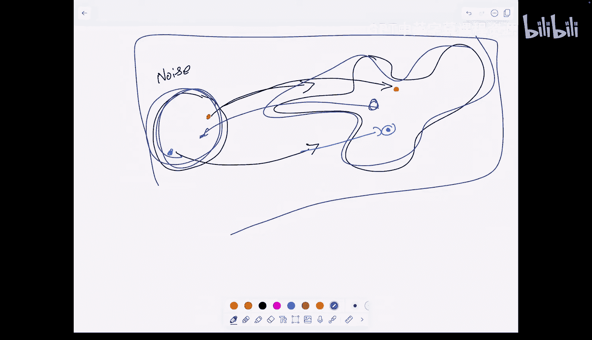

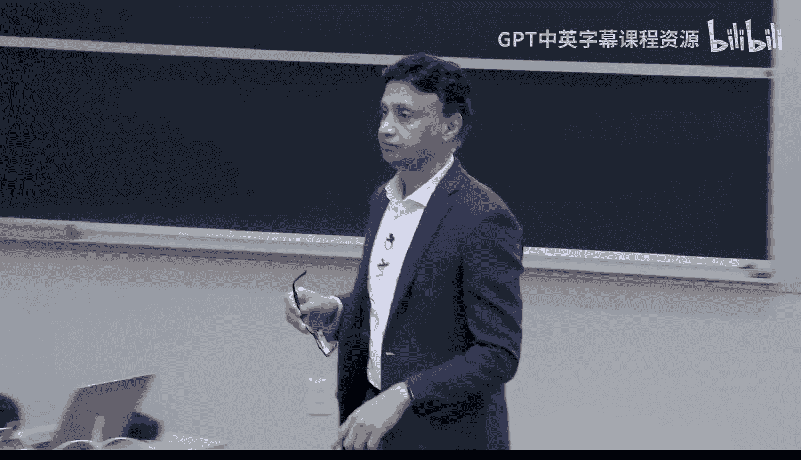

I understand going from noise to3 emit back how you call how the training works。 So my question is。

In some of these models today， you have。You could give it the noise now to generate with。ベち？

For example， it could generate a human with four fingers you know， stuff like that。

 So is it that the。The that the training data is not just quite enough or as robust enough to。

Generating。That kind detail kind talk yeah， so， so fundamentally。

 what it is doing is it actually does not understand the notion of fingers and things like that。

 right， because there is like we haven't injected any domain knowledge。

Into this whole process by saying that， hey， we need to generate， you need to generate human body。

 And here are the semantics of what the human body is， right。

 It's got five fingers and all the anatomical stuff。 You're not giving anything。

 We are literally giving it pixel values。 bunch of pictures。

 So everything you're seeing is basically just coming out of that very blind statistical transformation process。

 So it's， so you would expect that macro level details will probably get it right。

 because there are so many right answers。 So imagine it's actually， you know。

 it's creating the roof of a house。😊，There could be all kinds of variations in the roof of the house。

 and you would still think it's a roof of a house right。

 because there are many possible right answers， but when it comes to five fingers。

 there aren' not many possible right answers， which is why you notice the error very quickly。😊。

As far as a model is concerned it doesn't know， right It' just producing a statistically plausible sample from their distribution。

 And since we haven't forced it to obey constraints like5 fingers and so on and so forth。

 it's not going to do any of that stuff。 It's an unconstrained process。 Now， over time。

 these things have gotten better and better。 And that's because the data has gotten better to your point。

 But I think our approach to doing these things is also getting better。 right。

 there are lots of ways to now steer it and control it So it behaves the right way。

 And that is actually part of what's happening as well。

 So when we talk about how do you actually give a text prompt and have it build the image for that particular prompt。

 we would revisit this question。😊，Okay， there were more questions， yeah。

I heard some randomness in the model itself right， so if you gave it the same noise image twice will it actually produce the same？

There is randomness in the process well exactly。So to actually， that's a really good point。

But now I'm afraid to open my laptop on an iPad。 one second。Alright。Okay。

 so what's going on here is that if you go to this thing。So， I talked about。

We are transforming from here。To some crazy distribution here， So what happens that。

 let's say that this is the starting point for the the noise input。 This is your noise input。

And then what it does what you actually do is you go here。

And then you take this point and then you do a small sample next to it。

So use this as like the mean value and then sample around it。

 and that's actually what gets published in the user interface， that's where the randoms comes in。😊。

Okay，So back to this， was there another question？some么。没有。嗯。It's okay。I just for drinking。

When youre when training it on a。Cl picture go to。point。This time will probably suitable。

Inships that。あ白。多一些。Oh， I see。 so if you understand it question what you're saying is that it's pseudo random。

 not actually random。And so therefore， there is some signal in the supposedly random generation。

 Is it actually glamming onto that signal， right， is a question。😊，Theoretically。

 it's probably possible， but in practice， it really doesn't matter because we basically say pseudoor randomum is good enough。

For purposes。 And in fact， in practice， you will see it's not an issue。呃。Okay， so， oh yeah， go ahead。

Does there any question when you're doing？あ。Like text to text， let's say。おけない。

Here you somehow have to identify that this is killian cord。St。And this is just going from？

Pixel image to or like decoding it from pixelix thing。Where does the。Tag or token of。Like columns。

There's nothing。 It's learning everything from the pixel values。Yeah， and this is sort of whatever。

 you know， when I， when I asked the question about the four fingers，5 fingers thing。

 it has no idea of fingers。 It has zero knowledge about any of these things。

 All it's seeing is a bunch of photographs。Okay， so when you when you take in。Oh， I see。

 So we haven't yet come to the stage of， okay， how do you actually steer this image using your text prompt。

 It's coming。Right now all we are saying is that look I'm going to give you a bunch of photographs of a particular kind of thing。

 stately college buildings and I want to have a model which at the end of the day I just poke it every time I poke it gives me a state college building thats it。

😊，Now， I'm going to actually start giving a text and saying， okay， build know。

 create the thing I'm just telling you about。 that's coming。

 And that's sort of that some additional magic is going on to get that done。😊，Okay。

 so this is what we have。And this is called a diffusion model。 Okay。

 and this is the original paper that figured this out and。

The the process of actually creating taking an image and creating noisy versions of it to create a training data is called the forward process。

 And then what we did in reverse is called the reverse process。 check out the paper。

 it's actually really well written I recommended。 Now in practice。

 some other researchers came along shortly after this and made a small improvement。

 turns out to we are actually a big improvement practice in terms of improving the quality of what's being produced。

 And so what they said is hey， instead of training the model to predict the less noisy version of the image。

 we actually ask you to predict just the noise。😊，In the input。

And then we will just simply subtract the noise from the input to get the image。

So instead of saying here is an X X is image， Why is the noisy image。 We actually tell it。

 Here is the image。 Here is the noise that we added to X to get the， the noisy version。

 And then just predict the noise for me。 And then once I get it， I just do x minus noise。

 and I get the less noisy version of the image。😊。

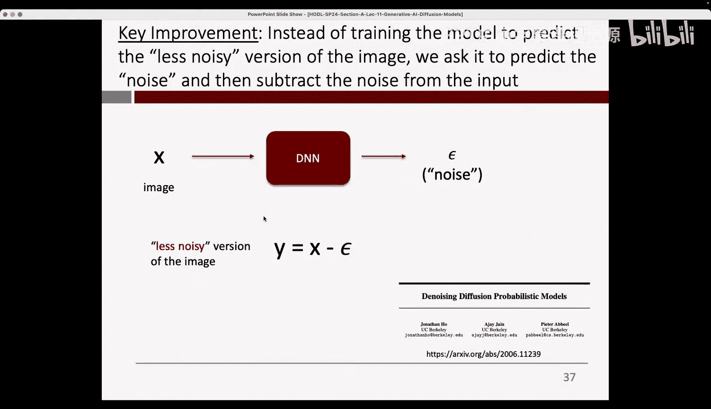

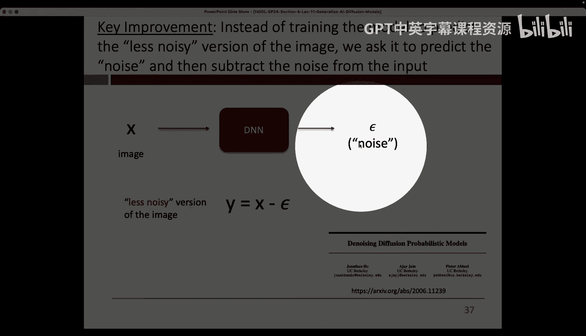

This feels arithmettically equivalent。😊，But in practice。

 it ends up generating much higher quality images。 And theres some very interesting theory as to why that works and so on and so forth。

 And you can read this paper， if you're interested。Okay。

 so if you actually look at what' is going on in most diffusion models today。

 they are basically using an approach like this。 They are actually predicting each and they predict noise and take it away subtract it。

😊，So iterative subtracting of predicted noise。That's what's going on。So， all right。

 so that's what we have。Now， at this point， you may be wondering。

Okay so far in the semester we have actually learned how to take an image and then classify it into one of you know 20 things 10 things whatever。

 we also take an text and figure out what to do things with it。

 we haven't yet talked about how do you actually take an image and how can we get the output also to be another image。

😊，We haven't done that yet。Okay， so we have actually not done image to image。

How do you actually build a neural network through images and in the interest of time you're not going to get into it massively。

 but I want to give you a quick idea of how it works So the the most sort of I would say the dominant architecture。

😊，To take an image as an input and produce an image as an output is called the unit。Okay。

And that's architecture we see here。So fundamentally， if you look at the left half。

 So there is a left half to the network and the right half to the network， hence the U。

 if you look at the left half of the network， it's， it's a good old convolution neural network。

 like the kind we know and love。😊，Okay， and the kind that we are very familiar with。

 So you take an input image and then you run it through a bunch of convolutional convolutional blocks。

 and then we do some max pooling。 And then we keep on doing it。 And at some point。

 it becomes smaller and smaller and you get something， you know， like this。

 which we are very familiar with， right， the the big image with three channels gets smaller， smaller。

 smaller。 But the number of channels gets wider and wider。 It becomes sort of much smaller。

 but much deeper， right， It becomes like a 3D volume。 and we have seen that again and again。😊。

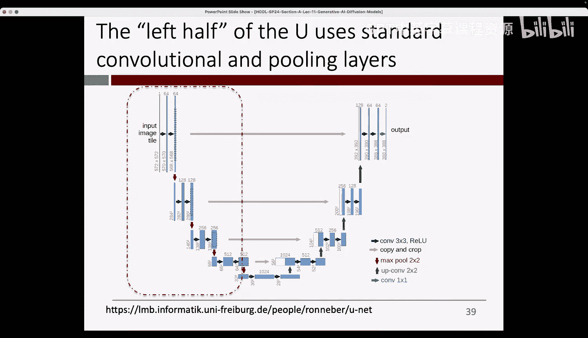

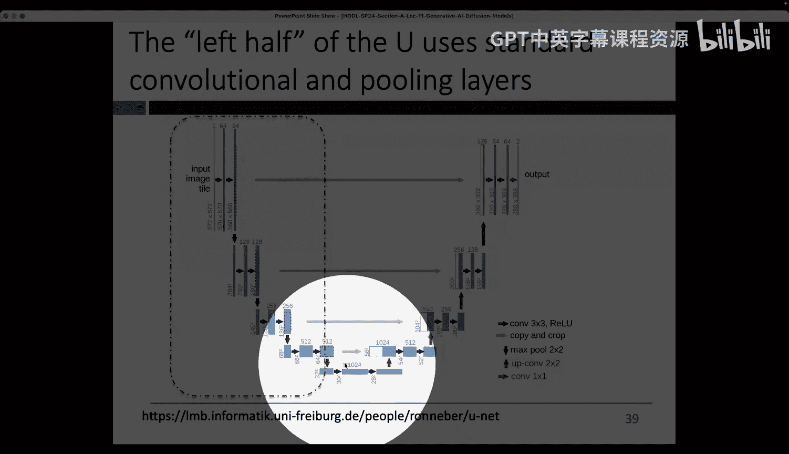

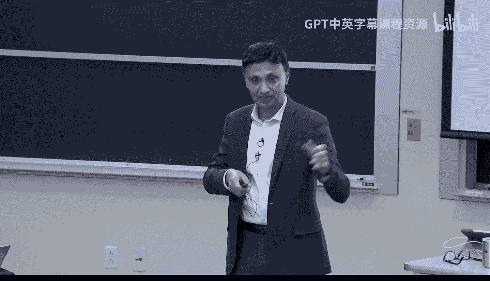

Right the left part is just a good old convolutional with pooling layers。

 And then you come to the middle。 And then from this point on。

 what we do is we take whatever this thing you here and then we essentially reverse the process。😊。

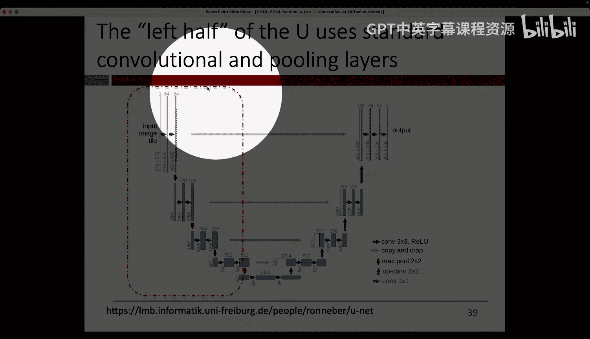

We go from the small things which are really deep to slightly bigger things that are a little less deep and so on and so forth till we get the original size back again。

😊。

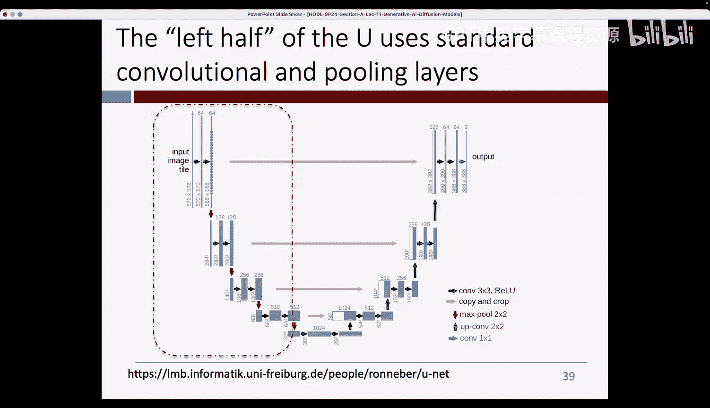

Okay， and we do that。😊，Using the an inverse of the convolution layer called an up convolution or deconvolution layer。

Okay， and you can check out 9。2 in the textbook to， to， to understand how it's done。 It's。

 it's also called con 2 D transpose。

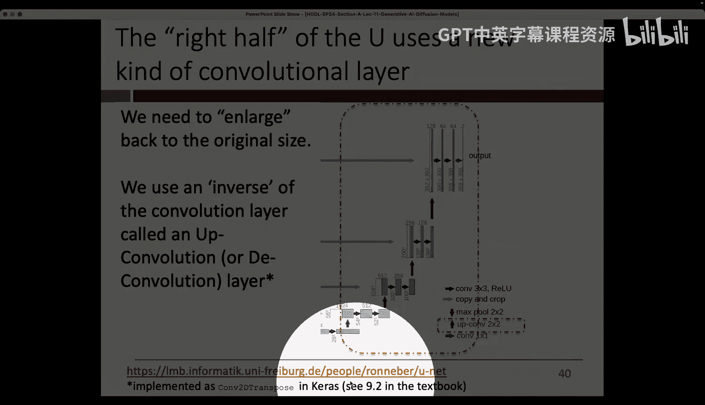

Okay， it' is a very similar idea， and I'm not going to get into the details here。

 but you essentially do that inverse of a convolutional operation to get the size to come back to the bigger size and you do it gradually。

😊，Till the output you have matches the size of the input that came in。Okay。

 so image gets smaller and smaller into a thing， and then it just blow it back up again to get an image back。

 So that is the unit。😊，Now， there is one very important thing that happens in the unit。Right。

 which is。You see these connections， right？

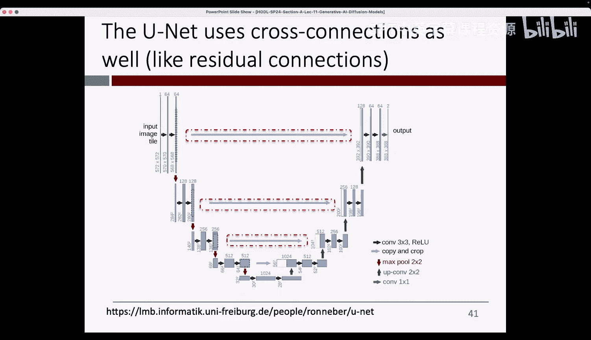

Basically what they do is at every step when youre coming back up in the right half。

 you actually attach whatever was in sort of the mirror image of the original input as we processed on the left side。

 we attach it to this side as well。😊，Remember， I talked about this whole notion of a residual connection back you know。

 many classes ago， what I said。When an input goes through each layer of a neural network。

At one point， let's say you're in the 10th layer。 You're only seeing what is the ninth layer is produced for you。

 That's all you're working with， But would it be nice if the the10th layer actually had access to the eighth layer。

 the seventh layer， the sixth layer， the fifth layer。

 Heck Why not the input right Because the more information it has。

 the more able is probably to do whatever it can with the input is giving why restrict to only the input of the the output of the previous layer。

 why can't we give it everything that is came before it。 Now， giving everything is too much。

 but we can be selective in what we give it right So what these folks decided。

 I'm sure after much experimentation is that if they actually attach。😊。

Whatever was coming out of this layer。To this layer， before it goes through the output。

 it really helped。 Similarly， this thing gets attached and so on and so forth。

 And it kind of makes sense。 You know， why force it to figure out everything it has to figure out just from this thing that came in。

 right， Let's give this that that let's also give little here a little here。

 So these residual connections are a huge building block for why these things work as well as they do。

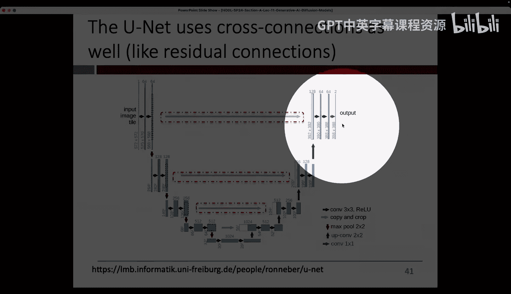

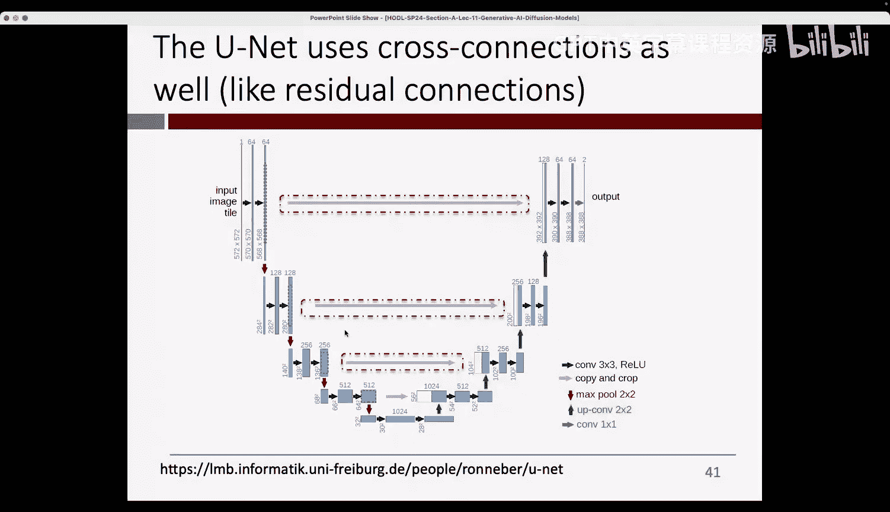

Okay， and in general， giving a layer as much information as you can give it is always a good idea。

 But you can't go nuts， because then you have much more parameters and all kinds of stuff happens。

 So there is a bit of a balance you have to strike。

 And this was the balance struck by these researchers。

 And so this thing was originally invented for some medical segmentation use cases。

 But it just heavily used for everything now。😊，It's a really powerful architecture。Questions。

Can we an example of like。

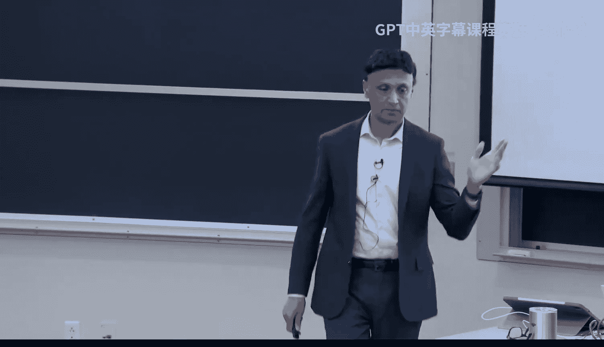

76。Anytime you have an image to image。はい。Or like what kind of examples abuse cases， Let's say that。

 for example， you want to take an image and like a black and white image and you want to colorize it。

😊，For instance， boom， you unit， you want to take an image and make it a higher resolution image unit。

 You want to take an image。 And for every pixel in the image， you want to classify it to， you know。

 one of 10 things。So every time when you want the output shape。

 the shape of the output to be basically the same shape as the input， but with other data。

 you need to use this。😊，Yeah。But this logic of。Having access to all the previous iterations。

Not iterations， all the previous layers， the outputs of the previous layers。But this would also help。

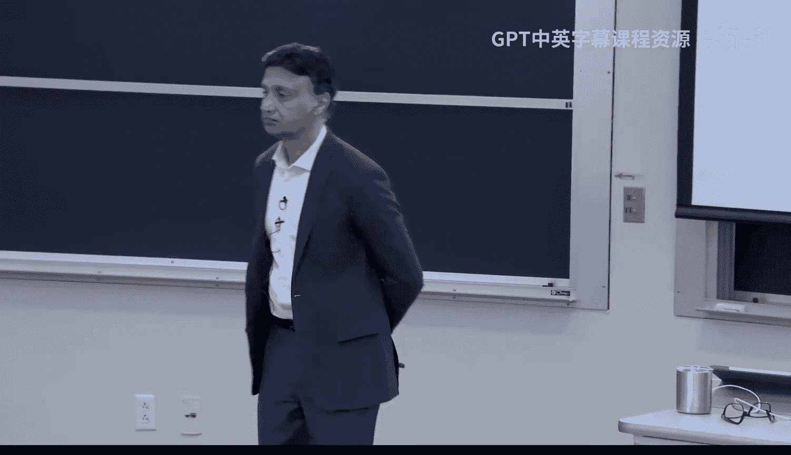

Clean up and give better categorization。 Like， does it always have to be an image to image。 No， no。

 in fact， if you look at restnet。 Renet is the one， in fact。

 that pioneered the idea of the residual connection。 So we use it for renet。

 We actually use the the transformer stack。 If you may remember。

 it goes through the self attention layer。 It comes out the other end。

 and then we add the input back to it， and then we send it through layer norm。

So you will see that this residual connection is sitting in two different places in a single transformer block。

😊，So it's extremely heavily used。 There is something called deep and wide network if I remember a densenet。

 which uses the same trick。 In fact， if you when you're working with structured data。

 right good old say linear regression and youve looked at your data and you come up with all kinds of very clever features。

 you know， I'm going to look at price per square foot you do a bunch of feature engineering and you have a bunch of new features。

😊，Well， you should take your old features and your new features and send both in。

Why send only the new stuff that you have concted， Why can't you send everything in。 That's the idea。

Alright， so let's come back here。Now we have seen how to generate a good image，Now。

 let's figure out how to steer it or condition it with a text prompt right because that's sort of the holy grail。

So， we want to take。So heres an intuition。We want to take the text prompt into account obviously gender image。

 Now， imagine if we had like a rough image。

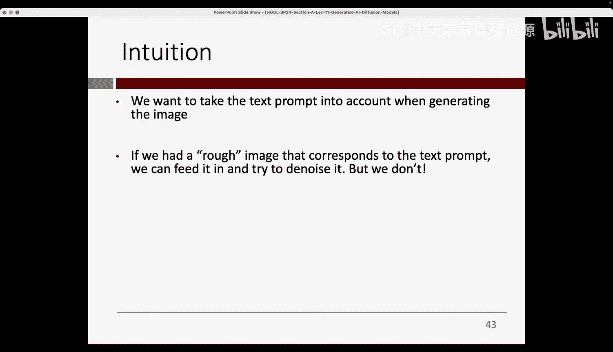

That corresponds to the text prompt。 Just imagine。 So the text prompt is you know。

 cute lab retriever。And you have like a very noisy image of a laboratory river。

 This happens to be handy。 You have it。Well， now you' are in good shape because you just feed that in and your system will dennoise it for you。

RightYou can get a better image。 That's pretty easy。So， but obviously， in reality。

 you don't have a rough image。 In fact， you're trying to create one of those things in the first place。

We don't。 So， but what if we had an embedding for the prompt that's close to the embeddings of all the images that correspond to the prompt。

 So let's take a prompt。

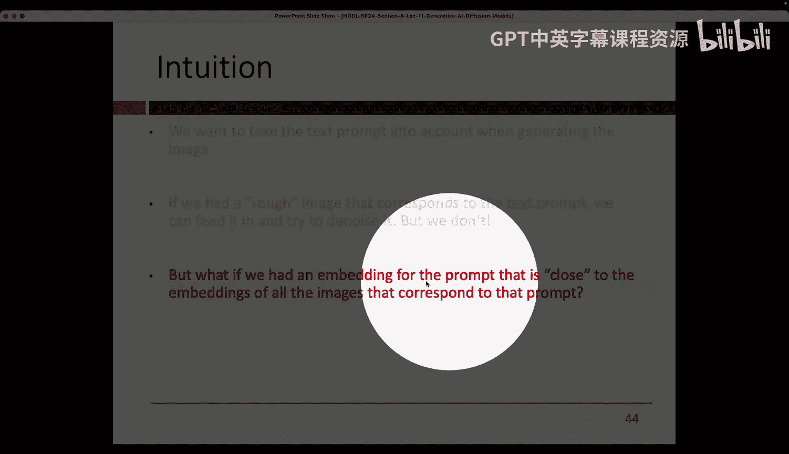

And let's imagine all the images in the in the universe that correspond to that prompt， okay。

And now further imagine， because everything is a vector， Everything is embedding in our world。

 that that image has an embedding。All sorry， the text prompt has an embedding。

Every image has an embedding， and we have somehow calculated these embeddings so that the text prompts embedding is smack where all the image embeddings are。

😊，We will get to how we actually do it in just a moment。 But conceptually。

 imagine if we had an embedding， if we could calculate embeddings for text and embeddings for images。

 So they all live in the same space。😊，Okay。So if we feed this embedding to a dennoing model。

Because that text embedding is sitting in the same space as all the image embeddings that it corresponds to。

 maybe our model can just deno the embedding and give you what you want。

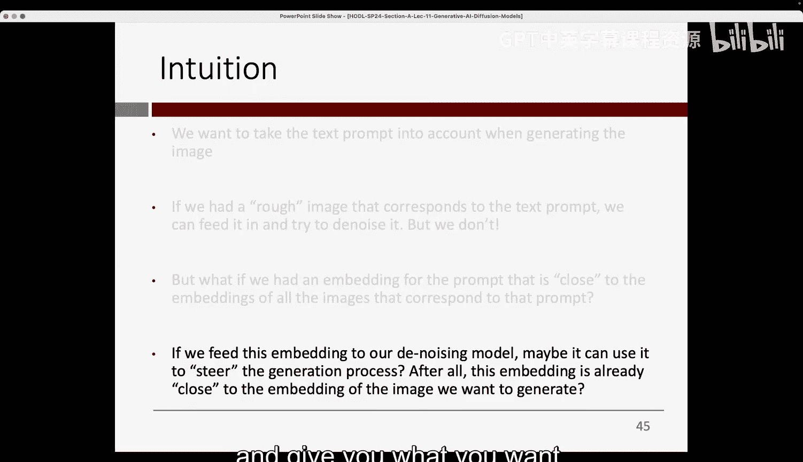

O， so since this embedding is already close to the embeddings of the things we want to generate。

 maybe you' will just get it done。😊。

So ultimately， we want to generate an image。 And if we had an embedding for that image。

 we could generate the image from the embedding。😊，And we use the text so we go from text to embedding。

 which happens to live in the same space as all the embeddings of the images we care about and then from that image embedding we go to the final image。

 Okay this is a bunch of me talking and hand waving it all become very clear。

 but that's sort of the rough intuition so。😊，So what we'll know is we'll describe an approach to calculate an embedding for any text。

 any piece of text that is close to the embeddings of the images that correspond to the piece of text。

So this is a problem we are going to solve。 there is a bunch of text。😊，Conceptly。

 there are a whole bunch of images that are described the text。

 and we're gonna now create embeddings so that that is close to all the embeddings of those images。

 right， It feels kind of like almost impossible that you can actually do something like this。😊。

But there's a very clever idea。啊。That open AI came up with that tells you how to do it。

 So here is what you're going to do。 So let's say we have an image and a caption。

So here is an image。Here is a caption right and we need some way to take that piece of text and run it through some network and create a nice embedding from it。

😊，Okay， similarly， we want to take this image， run through some network and create an em from it。😊。

Okay， now， first， first question， how can we compute embeddings from a piece of text。First question。

 how can we compute embodying from a piece of text。You know the answer？Run through a transformer。

Piece of cake， you know how to do that。Right。呃。Right， in particular， you can do something like bird。

And for an image encoder， you just run it through something like restant。

Like the the penultimate layer， right， one of the final layers rest is going to be a very good representation of the rematch。

 You get another embedding。😊，So using the building blocks we already know。

 we can create embeddings very quickly。From these things。Okay。

 but if you just take a piece of text and run it through a bird and you take image run it through anet。

 you're got to get some embeddings。 But why the heck should they be related。😊。

They were not trained together， so there's no basis for them to be related。

They would just be some too embeddings。 Maybe they are kind of similar。 Maybe they are not。

 we don't know。 There's no reason to expect that they're gonna be similar。Okay， they just do emeds。

Now， what we want to do is， but once we have these。

 we need to make sure the embeds that comes out of these two things satisfy two very important requirements。

😊，We want to make sure that if you give it an image。And a caption。That describes that image。

So you have an image and a caption that describes an image。

 We want to make sure that the embeddings that come out of these two boxes。

 they are as close to each other as possible。

Okay， given an， given an image and a caption that describes it。 That's the connection。

 They have to be close to each other。 and conversely。

If you have an image and a caption that's totally irrelevant。Right。

 a train rounding a bend of the beautiful fall foliage all around， right clearly irrelevant。

 Those embodys should be far apart。😊。

That it totally makes sense。

Right， pairs of related things should be together year 1 should be far apart。

So if we can find embeddings that satisfy these two criteria， maybe we will be in the game。Okay， so。

Now， this ensures that the text embedding and the image embedding are referring to the same underlying concept。

 right， This， these requirements will enforce that。

And so the embedding for any text prompt is close to the embedding so for all the images that correspond to that prompt。

So the question is， how do we do this？How can first of all。

 how can we tell how close the embeddings are， You know， the answer to this。 What answer。Correct。

 cosine similarity， right， we use a cosine similarity。Of the embeddings。

 So we know how to measure closeness。 So the question is。

 how can we compute embeddings that satisfy the two requirements And opening。

 I built a moral called clip， which is very famous to solve this problem， right。

 It stands for contrastive language image pretraining。😊。

And this forms the basis for a whole bunch of orders that have sprung up after this called blip and blip 2 and so on and so forth。

 but this is a fundamental idea。😊，Okay， so。This is how clip works。We what they did is they took a 12。

Block 12 layer。

8 head transformer causal encoder stack as a text encoder。okay。Now， you understand this， right。

 That's what it is，8 layer I mean， sorry，8，12 way transform causal and called T C E stack。

And that's a text encoder。 So we send any piece of text through it。

 right you get the next word prediction embedding。And that's somebody you're going to use。

And they took ReNe 50 and made it the image encode。

 they took ReNe 50 chopped off the top and whatever was left is the the image encode。Okay。

Then they initialized with random weights， these things。And then they grab。

 they grab a batch of image caption pairs。 So in this example。

 let's say that we have these three images and I have captions to go with these images。 Okay。

 We have these three things。😊。

And this is the key step。 they run the images through their image encoder and that captions through the text encoder and get these embeddings。

 okay it is a forward pass。 you send it through this network， you get two embeddings。😊。

And then， this is what they do。

With these embeddings， they calculate the cosine similarity for every image caption pair。 Okay。

 And so imagine something like this。 So you have these three captions， you have these three images。

 and those are the embeddings。😊。

And then they calculate the cosine similarity for every one of those things。

It took me like 5 minutes or 10 minutes to do this PowerPoint。You're welcome。

Particularly trying to get this comema to line up as a real pain in the neck。So， all right。

 so we have this here。Okay， now what we want to do is。

We want these scoress to be as high as possible。Because the scoresords in the diagonal are the ones where for the matching picture and caption。

😊。

Right。Those are the scores for the matching pairs of membranebeddings。

 we want to be as high as possible。

Okay。

So， if you want to maximize the sum of the green cells， right， these are the green cells。

 the diagonal。

So if if you want to write it as a loss function because a loss function is always minimization。

 we basically say minimize the negative sum of the green cells。😊。

Okay。

So the question is， with this loss function do the trick？😊，Seems reasonable。

 You want to make sure that related things are really close together。 So you want to maximize。

If that was the only part of the loss function， wouldn we just kind of squish every。the spot correct。

What it's going to do is it's going to basically ignore the input。

The optimizer can simply ignore the input， make all the embeddings the same。 For example。

 it can just make all the emdding 0。😊。

That's it。 And then now we have a perfect cosine similarity for everything。😊。

For any pair of image and captions， the cosine in somebody is going to be one。 It's perfect， right。

 So clearly， that's not enough。😊，This is， by the way， is's called model collapse， right。

So to prevent it from doing that， we need to do one more thing to the loss function。Any guesses。Yeah。

Make the images that aren't related。

Exactly right。 exactlyactly right。 So what we want to do is we want the scores of the red stuff。😊。

To be as small as possible。We want the green stuff to be as much as possible and the red stuff to be as small as possible。

Together， itll get the job done。Okay。And so， so if we want to maximize the sum of the green cells and minimize the sum of the red cells。

 So the equivalent loss function is minimize the sum of the red cells and the negative sum of the green cells。

 That's it。😊。

So all clip does is that it just grabs a batch of image caption pairs。

Runs it through the networks， calculates the embeddings and calculates this sum of the stuff here。

And that is your loss。 and then back propagate through the network。 boom， batch， batch， batch。

 do it a whole bunch of times。 And opening， I did this with this the official picture from the open from the paper。

 which is worth reading， by the way， right， it comes in。😊。

Text encoder， you get these emic vectors， image encoder， and then boom。

 The diagonal is maximized and the off diagonals are minimized。

And they did it with 400 million image caption pairs scraped from the Internet。400 million。

By the way， folks who work in this space may know this really well。

 but one very easy way to get a caption for an image。Right， U VC images。

 But where do you think the captions come from， Where did they get those captions， They didn't。

 obviously， they didn't ask people to manually label each image of the caption。

 Where do you think they got it from。Google search， Google search can help。But。

 but why why does Google search actually find the caption， How does it。

 Because Google search is not creating the caption。嗯。Correct， al text。So a lot of folks。

 for access celebrity reasons， they have alt text， right， all the images they create。

 a lot of people have allt text in the images they published on the web。 And that's what we use。

 And the alt text actually ends up being a more verbose description of the image than a typical caption。

 which tends to be much briefer。 And for us， more verbose， longer the better。😊。

Because there's more stuff for the Boer to learn from。So that's how they built clip。

And so now what we do is we use， we can use clips text encoder by itself， right。

 We can send in any text and get an embedding that is close to the embedding of any image that described by the text。

😊。

Okay， now， by the way， clip can be used for zero shot image classification。

And what I mean by zero short image classification。

 and I'll walk through the picture in a second is that typically when you want to build an image classifier。

 right you can get a whole bunch of training data of images and their labels and then we train them right maybe you take something like renet hit chop off the top。

 attach our own output head and train， train train boom， you have a classifier。

 But the only problem with that is let's say that tomorrow， So today， for example。

 you had five classes in your problem。 And tomorrow somebody comes along and says， oh。

 actually we have a sixth category。😊，Right， what do you do then， Well。

 you have to go back to the drawing board and retrain the whole thing with6 labels now， Not5。

 because your problem has changed。Would it be great if you had a classifier where you just come to it and say here's an image and here are the six possible labels I want you to pick from。

 pick one from me。😊，And you want to be able to give it a different set of labels each time。

And itll just use the labels you're giving it and the image and figures out which。

 which label corresponds to it， but you just fed it。

That would be an insanely flexible image classification system， right？

 And that's what I mean by zero short image classification。

 And you can use clip to do zero short image classification。😊。

Now how you do it is actually in the picture， though not very clearly done。😊。

Anyone wants to guess？How can you use clip to build a like a infinitely flexible image classifier。

I mean， the text input was like was stream。So in the same rate， work can handle words。

Does it should that。Sorry， say that again the last second book saying you're saying it sees a text input with something it's never seen before。

 right so in the BRT model which is where。Where it came from with the text decocoding and the bird model。

 I think we talked about when it sees a word it doesn't know it has never seen before it can use the。

The context words around it to try to right right。Just to be clear， I I。

 I wanted to use clip that we just built。Right， and assume clip can see knows all the words because it's been trained on a big vocabulary。

 You can give it any text you want。 It'll create an embeing from it。😊，That's the key capability。

So creates。で回たて。You。And then for your image of beauty currency。So付。Similar between the two。

 the image is complicated， but the text is not things help in the same species。

It makes a of business。Why is that a missing piece of the text？Because the image， the text。

De texts does not。Comptin the class。And then both for the image， the weight it was strained。

 it was strained like with pants with plastic blue。Right。

But we actually know the class now because so the use case is that I come to you with an image and I say。

 here are the seven possible labels for this image。😊，And each label is a piece of text。

So you can you actually have seven piece of text and an image。

And all I want clip to do is to tell me， okay， the seventh， the fourth label is the right one。

For this image。But you're on the right track。Once you see how it's done you'll be like， yeah。

 of course。I may not be understandinging something， but let me just pick them many into the close。这定。

Like the text is the closest to the。 correctect， you're not missing anything。

 That's the right answer。 Well done。

Come on， people。 Can we applaud our fellow sphere。Your folks are hard to impress。

That's exactly what we do。 So here。The key thing to remember。

 the key thing to keep in your head is that when a label is just text。Dog cat， right It just text。

 so you can just imagine taking each label with which is this case is playing car。

 dog whatever for each one of them you create an embedding。😊，You get T 1 through whatever。

 If you have N labels for the image， you just have one embedding I。

 and then you just create the cosines c， the cosine similarity。 And whichever is the highest number。

 you say， okay， it's a dog。 That's it。😊。

It's super。 just imagine the level of flexibility here。

So that's a side use of clip unrelated diffusion models。 But it's just thought it is really clever。

 So I wanted to share that。 Okay， good。 now， let's see how we can actually use this entire capability to go to solve the original problem we set out to solve。

 which is can we steer the diffusion model to create an image based on a particular prompt we give it。

 So now， remember， if we go back to how we did it。 We created all these straining pairs of X and y based on。

 you know， the the noicing the image。 X is the image。 Y is the less noisy version of the image。😊。

So what we can simply do。Is we can actually change the input。

 So it becomes the image and then the clip text embedding of the caption。

For that image。So you even image。 you have a caption。 You take the caption， run it through a clip。

You get an a bidding。By definition， that embedding lives in the same space as all the images that correspond to that caption。

😊，Right， so you just attach， you concatenate the embedding of the clip。

Output of a caption along with the image。 You say， make that the new input Now。

 Why continues to be the less noisy version of the image。 Or， as we saw earlier。

 it could be just the noise component of the image。

Okay， this is the new X， Y pair that we have。

And so now the model is， you send the clip text embedding the image X。

 send it through best noise version of the image and you could keep on training it for a while。

 Once your model is trained for， when you want to use it for inference for a new prompt。

 you just give it。😊。

You know， Killian court at MIT during the springtime， along with a bunch of noise。Goes in。

 it starts denoizing it， but because this embedding of this thing thanks to clip lives the same image space as all Kion code embeddings。

 clean code images keep on doing it for a while at some point youll get killllion code。

That's how they do it。 That's how they steer the image。It's a two step process。

 You create all these clip embeddings， which clip was a breakthrough， in my opinion。

 because it is one of the maybe the first example。 I don't know if it's very first。

 but one of the early examples of saying we have different kinds of data。 We have images。

 We have captions。 We have text。 How do we create embeddings for every one of these very different data types that all happen to live in the same space。

 the same concept of space。 That was the key idea。😊。

And if you look at the modern multimodal large language models。

 they are all based on the same exact idea。😊，So it's very powerful this approach。Yeah。

 now I understand this for images， but for video generation models like Soa。

 do they have some sort of。

Underlying physics structure， do they learn representation。

 There's a lot of debate on the Internet about this stuff。 They haven't published the results。

 the full technical report Yes。 So we don't know for sure。 but the consensus seems to be no。

 it's not they are not using a physics engine。 What they have done And again。

 this may be wrong once the report comes out will know for sure。

 But what people are saying computer vision experts is that。

It has been trained on a lot of video game data。

Along with actual videos and so on。 And if you and the corpus of training is so massive that it has basically learned to mimic certain physics aspects to it。

 just as a side effect。 much like Ls， you train them on a large amount of text data。

 they begin to start to do things which you didn't anticipate that they'll do right， So， for example。

 read this， I thought is a really great example of。😊。

What is surprising about large language models is not that you know you train them on a bunch of high school math problems and then you give it a new high school math problem it can actually solve it。

 that's not surprising。You give it a whole bunch of high school math problems in English。

 Then you ask you to read a bunch of French literature。

 and then you give it French high school math problems。 It' will solve it。 That is that is the nuos。

 right So similarly， here， I think the expectation is that it's not actually using a physics engine under the hood。

 It may have used a physics engine to actually come up with the videos and renderings。

 But there are no physics constraints in the model itself。 It just comes out of the training process。

 that's the current view。 Once the technical report comes out。

 we'll know for sure what they actually did。😊，诶。so。Qu about stability。

 it's claiming to be a little bit more real time in their younger generation。

So diffusion diffion so are they jumping through the noise more quickly or are they kind of like preing very good question and there's a very key trick it's coming。

You a question。So here the example of some noise is normal usual。

the noise distribution it or you mean if you change it to like a personisson or some other distribution。

 it'll definitely change the results because if you look at the underlying math of why this works。

 it heavily depends on the Gaussian assumption。😊，There was another question I about here。

You may not know the answer because the technical report's not up。

 but could it be in terms of video generation it's sort of analogous to going from like one noisy image to a another like you're almost doing a series of still images of learning。

No I think that I think people are sure is it's done。

 So basically you think of the video as just a series of frames right and each frame is an image。

 and there is a sequentiality to it， which is where the transformer stack will come in because it handles sequentiality。

 So in general， video stuff typically operates on frame by frame which is just an image。

 So that is definitely there。 what we don't know is if they also used some understanding of the fact that。

 for example， that if an object is dropped， it has to fall to the earth in a certain rate。

 or if an object goes behind another object， you can't see the object anymore， things like that。

 which we take for granted。😊，The question is are they using it and the consensus seems to be in the absence of an actual technical report that no。

 they are not doing it because there are lots of examples on Twitter where people will show a so video in which is not obeying the laws of physics。

😊，So you take like a beach chair and then put it in the sand。

 You see the sand come through the base of the beach chair， right。

 or you take an object and put it behind an object。 you can still see the object。

 even though the original object is opaque。So you'd be seeing some evidence at normal。

 It's not obeying the laws of physics。 What you're seeing is just an aze。

 You just sort of learn to fake the laws of physics in some context。

 much like it can fake5 fingers without knowing there has to be only five fingers。😊，嗯。

Okay。Alright， so we， let's keep going now， so this。

There was another paper afterwards in this original paper。

 which took that idea of the diffusion model。 and then diffusion board are very slow。

 as Olivia you pointed out。 So the question is， can we make it much faster， right？ So what they did。

 And I'm not going to get into this whole thing here， I just want to highlight a couple of things。😊。

The first one is that。

First of all， notice that you see unit here。 So they are using a unit。

Right， to go for my Wednesday match。

The second thing is that the clip embedding of the text prompt is basically is woven。

 meaning it's incorporated into the the into the into the unit through an attention mechanism。

 a transform mechanism。 And you can see the Q KV business here。

Which should be familiar at this point。 So it is integrated into the transformer stack directly。

 that input， the clip embeing。 That's the second thing I want to point out。 And then thirdly。

And this is where the speed up comes。 So what you do is， instead of taking the image。

 running it through the whole network and creating a slightly less noisy version of the image， here。

 what you do is you take the image， you run it through an image encoder。 You get an embedding。

 And now you only work with the embedding。😊，You take the embedding and create a slightly less noisy version embedding。

 Keep on doing it。 And these embeddings are much smaller than images。 Therefore。

 they are much faster to process。 And once you have done it like1 thousand0 times。

 you get a very sort of almost pure， noiseless version of the embedding。

 Now you run it through an image decoder to get the image out。😊，So this is the。

 the idea here is that you operate。In the la latent space， meaning the embedding space。 And hence。

 it's called the latent diffusion model。So that's where the speed up comes。

 But research continues to be very strong to make it even faster because for a lot of consumer applications。

 people are obviously not going to wait around for。 I mean， who much wait for 10 seconds right？ So。

 And so they are a lot of pressure to make it even faster。😊。

啊。Alright， so that's what we have。 Obviously， you know， these models are transforming everything。

 And by the way， this site here， Lexior art， you can go check it out。

 It has a whole bunch of very interesting images and prompts that created the images。

 So if you're working in this space， it gives you a lot of interesting ideas。 But it's not just for。

 you know， consumer fun applications。 you know， these models are being used to actually， you know。

 Al fold。 if you'll recall， if you give it an amino acid sequence。

 it can actually create the 3D structure， right， So that's an example of they don't。😊。

I don't think they use a diffusion model， but you can imagine using a diffusion model to create these complicated objects。

Meaning， the objects you create don't have to be images。

They can be arbitrarily complicated things as long as you have enough data about such things to use for training。

And the notion of noicing the input is meaningful。 You can create some very interesting structures。

 You can create 3D things and， you know protein structures。

 And there's a whole bunch of very interesting applications in biomedical sciences。

 So this really just a tip of iceberg。 And now there are these things there are ways in which you can use diffusion models to create to do large language modeling as well。

 So there's a lot of overlap and blending and so on going on in the space。

 So So I'm going to do a quick demo。 If you look at hugging phase。

 there is something called the diffusers library， which is like the as the name suggests。

 it's a library for a lot of diffusion models。😊，And let's take a quick look。

Alright， so we will the diffusus library has a whole bunch of diffusion models。

 We are gonna work with stable diffusion， which is one of， you know， like the。

 the better known models。 So let's install diffusers。

You will recall we when I did the quick lightning tour of the hugging face ecosystem for language hugging face is a whole bunch of capabilities sort of built out of the box and you use this thing called the pipeline function to very quickly use any model you want the same exact philosophy applies here you still use the pipeline so I'm going to import a bunch of stuff。

All right， so oh， I see you have to do this thing， okay。Right， again， face。

Okay so all right now that we have here so you remember that when we worked with text we had to pre we would grab a pre-train model and then we actually run it through a pipeline and we can do all the inference we want on it the same exact philosophy applies here so and this is very similar to what we did in lecture8 for NLP So what we're going to do is we use this command。

 the stable diffusion pipeline from pretrain and we use this version 1。

4 stable diffusion model so let's just create the pipeline and。And obviously。

 we have used tensorflow， not Pytch here， but a lot of these models unfortunately happen to be in Pytch。

Knowing a little bit of Pytch is actually very helpful to be able to work with these things and what we are doing here while it's downloading。

😊，We are using this FP16 storage format for the the model weights because it's going to be a little smaller than using 32 B。

 So it will download faster。 So that's what's happening here。 So all right， just downloaded。Fine。

 so now we just give it a prompt。 And this is actually one of the original famous meme prompts。

 a photograph of an astronaut raid a horse。 And so once we have the pipeline setup。

 I just a seat for reduceducibility。 And then literally I do pipe of prompt。 and then。😊，Is actually。

 you can see here 50， so it is going through 50 denoing steps。😊，Okay。

 and you come up with the national Read a horse。 Okay， so that's that。

You can actually change the seed and you can get a different the seed is basically sets the random starting point for the image so therefore you would expect a different astronaut yep there is a national trading another horse so I think people came up with these kinds of fun examples because it' is guaranteed not to be in the training data right so。

So whatever the model is doing， is not it's not regurgitating what it is already seen。 All right。

 give me a prompt。Prompts anyone。Wow。The that。Okay。😊，That might be a。AlRight， riding a horse。

All right。There are two of them。And clearly， MI might professors don't have really。Yeah。Moving on。

So by the way， if you you should spend some time with the diffusers library。

 they have a bunch of tutorials which are really interesting because this core capability of giving a prompt and getting an image out can actually be manipulated for all sorts of very interesting use cases So for example。

 there is this thing called negative prompting and the idea of negative prompting is that you can give it two prompts and say create an image which embodies the first prompt。

 but not the second prompt。😊，Essentially， subtract the second prompt for the first one。

 It's called negative prompting。 And you might be wondering， what uses that。

There are lots of fun uses。So。Here we are the prompt is going to be a labbrador in the style of vermia。

 that's the first prompt。50 steps。Look at that。 Amazing， right。

But maybe you don't care for the blue scarf。So you basically give it a negative prompt and you basically the negative prompt is blue。

 meaning remove everything that is blue。I don't like this， otherwise keep the Labrador thing going。

So， you run it。Like that， the blue is gone， negative prompting。Okay케이， yeah。

If you change it from five from 50。It become less excluded or will it eventually just？Now， typically。

 if you do more of these things， it gets better， the quality is much better because each step denize it very slightly。

 so errors won't accumulate and things like that。And the diffusive library gives you lots of controls for fidling around all these things。

Okay， so that's what we had。9，49。Okay， so you check out this tutorial if you're curious about how this stuff works。

 and I'm going to do one other thing because I didn't get to do it earlier on。

So we spent some time with the Huging face hub and I walked you through a few use cases for text where you can take a text model and use it for。

 you know classification， things like that， summarization and so on and so forth。

 you can do the same thing for computer vision models。

 So if you have a computer vision problem that just maps to a standard computer vision task you can just use the hugging face hub as well。

 So。😊，Let me just show you very quickly， the same kind of thing actually works here。Alright， okay。

 so。So let's say that you want to classify something， you just import the pipeline as before。

And once you import it， you can just literally give it the standard task that you care about。

 like image classification。And then you can start using it right from that point on。Okay。Alright。

 Okay， so now I'm gonna just get this image。So it's a very famous image， right。

 And we're going to ask it to classify this image。 So we just literally run through the pipeline。

And it says the most likely label is 94% probability， its an Egyptian cat。Seems reasonable。 Okay。

 I mean， it's， it's a tough picture， right， because there lots of things going on in that picture。

 It's not like1，1 image，1 object。 Okay， so you don't have to use the default model。

 You can actually give it your own model that you want。 So， for example， you can go， sorry。

You can go to the hub。Hgging face hub。And you can go in there and say， all right。

 I want image classification。 These are all the models，100047 models。 Let's sort by。I don't know。

 Most downloads。Or maybe most lakes。And you have all these models， you can pick any one of them。 So。

 for example， let's say you want to pick Microsoft Renet as your1。 That's what I tried here。

 So I have Microsoft Renet。 just so model equals that。Run it。

And it takes care of all the tokenization。 this that and whatnot。 it's really very handy。

 And then you run it through the pipeline again。 And it says tiger cat，94% probability。

 according to Resnet。 So yeah， so that's how you do it。 Now。

 let's actually try a more interesting example where you want to detect all the objects in the picture。

 which we didn't talk about in class object detection。 So just create an object detection pipeline。😊。

Same thing as before when you actually run this command。

 an astonishing some amount of complicated stuff is going on under the hood。 Okay。

 and we are all the beneficiaries of that。 So thank you。 So yeah， So we have this here。

 and then we run it through the pipeline。 It's looking at all the possible things that might be sitting in the pipeline。

 The results are hard to read。 So let's actually visualize them。😊。

And I got some nice code from this site for how to visualize them， let's just reuse it。So， yeah。

 so if you plot the results。Look at that。Okay， so it has picked up the cat100% probability。

 I guess the remote。The coach。The other remote and then the cat pretty good right off the shelf ready to go。

No no heavy lifting required now in this case we are actually putting these boxes called bounding boxes around each picture。

 but what if you actually don't want a bounding box what do you want to actually find the exact contour of that cat or the remote no problem we do something called image segmentation so let's do an image segmentation pipeline。

😊，And run it through。It takes some time。um。Alright， All right。

 let's visualize it so you can so each object it finds， it gives you a mask。

 It basically tells you for each object， what object it is。

 And then which pixels are on for that object and off for everything else。 It's a mask。

 It tells you where it stands。 And you can see here it is the first the object as found is this thing here and it's perfectly delineated right It's pretty amazing。

 So we can overlay this on the original image。😊，And C， it has found that。And it is。

 let's look at the other objects。Oh， it is on the remote， that's the second object。😊。

And the third remote。And the fourth。You you think any of other objects are remaining？Coach， good。

Alright， let's find the coach。And look， the couch is pretty good。

 except that the middle part has gotten confused。😊， but it's still pretty good， right？😊，Yeah。

 so that is so hugging faces all all these things。 And so you should definitely check it out。

 And if you're not already very familiar with it。 So we have one minute left， Any questions。😊。

No questions。 Okay， alright， folks， See you on Wednesday， thanks。😊。

