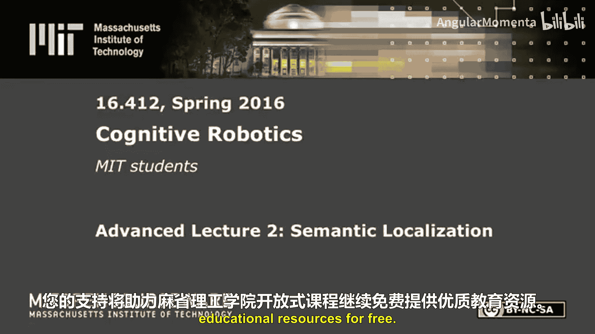
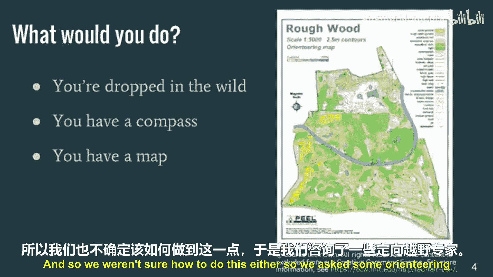
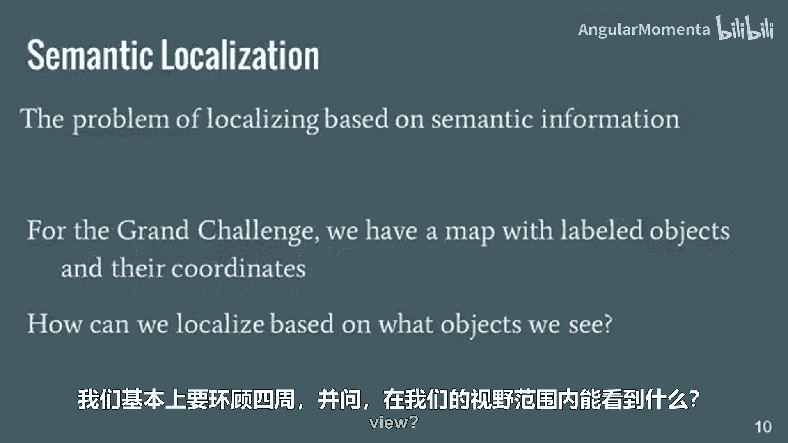
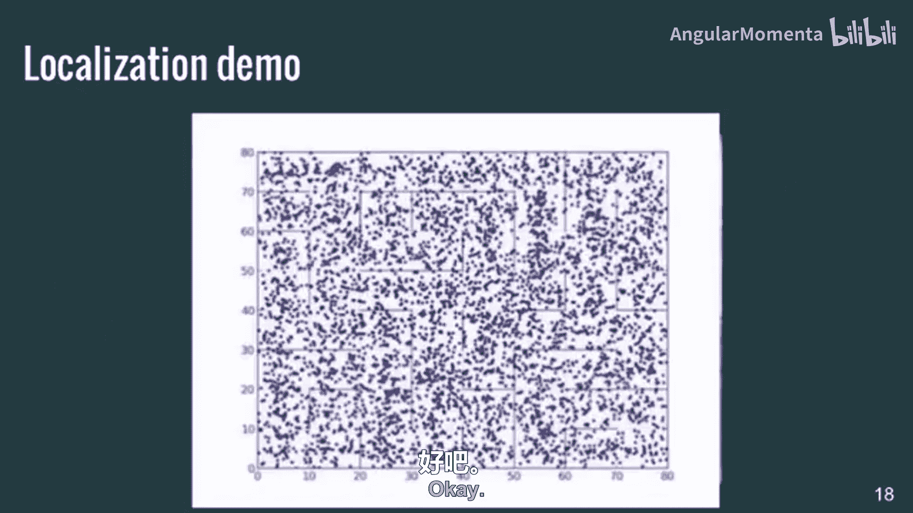
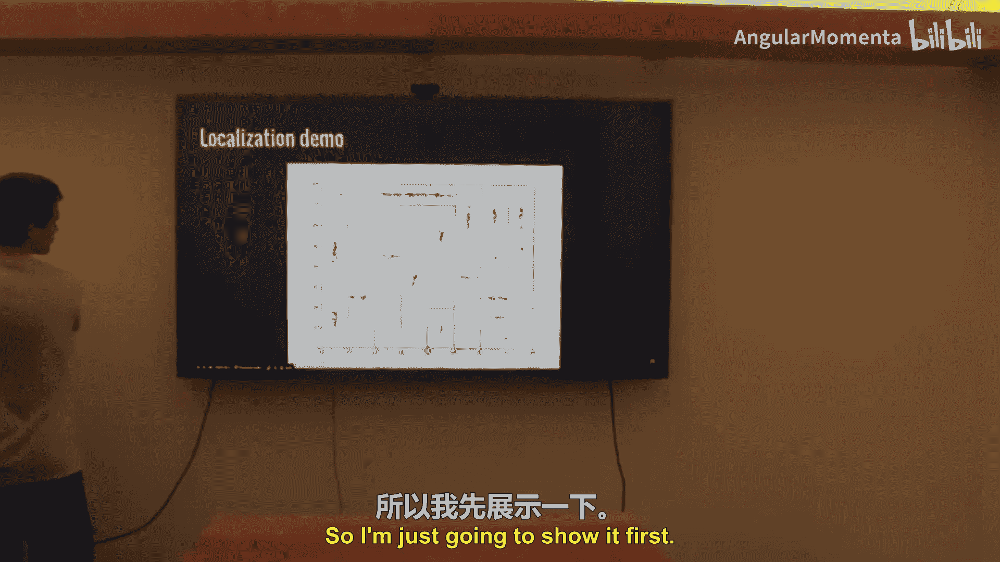
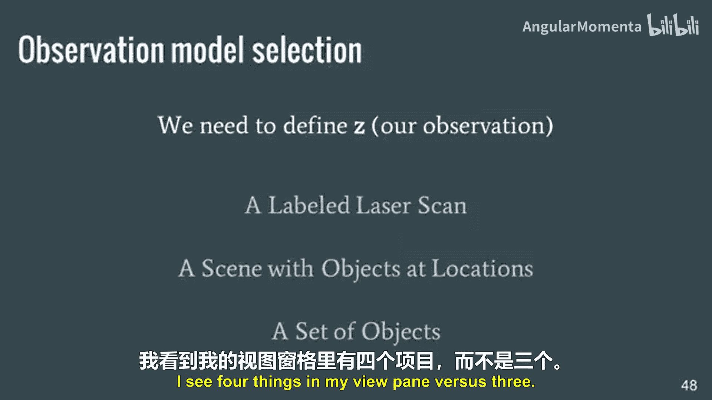
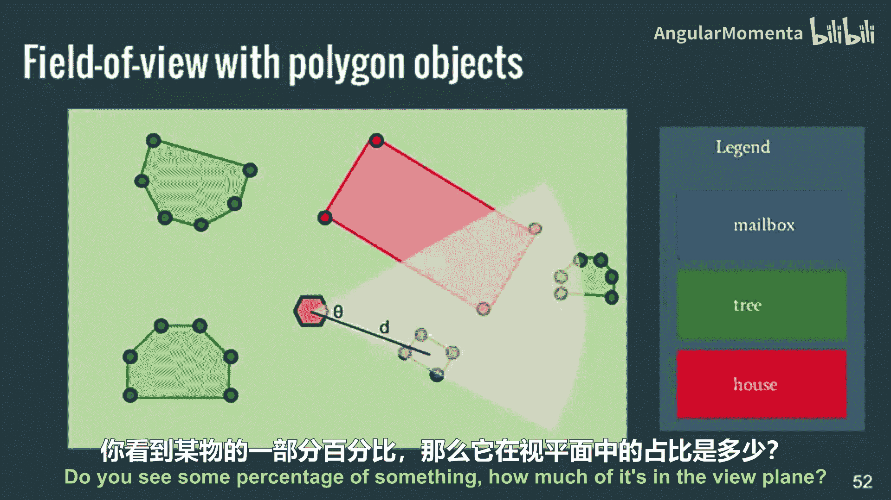
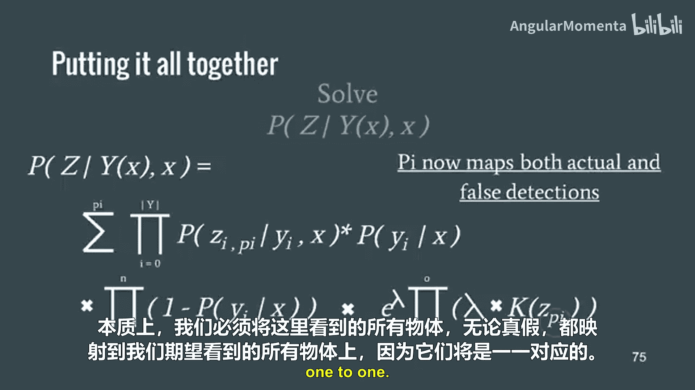
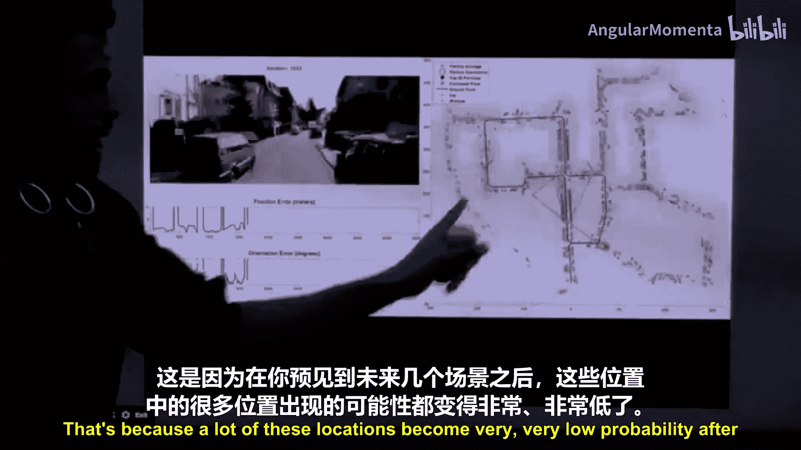
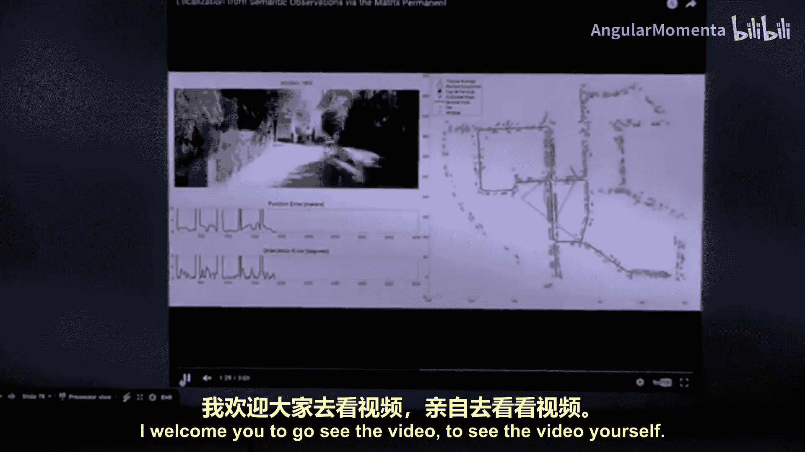

# 002：语义定位 🧠📍






在本节课中，我们将要学习**语义定位**。这是一种不同于传统度量定位的方法，它利用环境中具有语义意义的物体（如“厨房”、“咖啡机”）来确定机器人的位置，更接近人类的定位方式。我们将探讨其动机、核心算法，并详细讲解如何将语义信息整合到定位过程中。

## 什么是语义定位及其动机？🤔

首先，我们来谈谈什么是语义定位以及为什么需要它。



我们的研究灵感来源于**定向越野挑战**。在定向越野中，你有一张地图和一个指南针，需要前往各个检查点。这很困难，因为你只能通过指南针和地图上的特征来推断自己的位置。

我们咨询了定向越野专家。关键思路是：如果你迷失了方向，没关系，只需要找到一个**参考点**来确定你的位置。你可以回想上次已知的位置，并估算从那里开始的移动，这能给你一些可能位置的选项。然后，你可以寻找地图上能够**唯一识别**的特征。





例如，一张没有图例的定向越野地图用处不大。直到有了图例，你才能识别出道路、小径、坑洞等不同特征。这就是人类和机器人定位方式的区别：人类根据**特征**和功能来思考地点，而机器人可能使用激光扫描仪测量距离来形成环境的精确地图。

我们可以将**语义信息**定义为对人类包含有意义概念的标志和符号，即不同类型的抽象。

为什么需要语义信息？一个非常重要的应用是**改善人机交互**。例如，如果你想要一个会煮咖啡的机器人，它必须理解“去厨房”、“拿个杯子”、“打开咖啡机”这样的指令。这是人类思考的语言，如果机器人也能理解这种语言将非常有用。

此外，你还能获得**性能和内存上的优势**。你不需要存储包含每个表面距离的完整地图，只需存储关键信息的位置。这意味着你的搜索空间也小得多，可以剪枝掉与厨房或咖啡机无关的所有内容，从而获得性能提升。

最后，使用简单的摄像头而非复杂的激光扫描仪意味着这种方法对机器人来说**更便宜、更易获取**。

## 粒子滤波算法介绍 🔄

上一节我们介绍了语义定位的概念和动机。本节中，我们来看看实现定位的一个核心算法：**粒子滤波**。

粒子滤波是一种用于状态估计的工具，特别适用于在给定地图和测量值的情况下进行定位。定位，即“我在哪里”的问题，对于任何系统都至关重要。机器人需要知道它在地图上的位置。

度量定位是定量的，例如你距离某面墙或原点多少米，你的朝向是多少度。在数学上，定位问题可以表述为：基于你之前的位置、当前的观测、你给出的控制指令以及地图，利用概率来推断你当前的位置。



粒子滤波通过一组点（也称为**粒子**）来近似表示我们对位置的信念（即概率分布）。

以下是粒子滤波方法的四个步骤，其中第一步只执行一次：
1.  **初始化**：如果你在开始时对状态一无所知，可以在整个空间上均匀采样一组粒子。
2.  **更新权重**（重复步骤）：根据当前观测，计算每个粒子的可能性（权重）。
3.  **重采样**（重复步骤）：根据更新后的权重，重新采样一组新的粒子。权重高的粒子更有可能被保留。
4.  **传播动态**（重复步骤）：根据机器人的运动模型（如速度指令），将粒子向前推进一步，以反映机器人的移动。



让我们通过一个简单的玩具例子来理解这个过程。假设一架飞机在恒定高度飞行，我们只关心它在地面上的水平位置X。传感器是一个指向地面的测距仪。地图是已知的X位置到地面高度的映射。目标是确定飞机在山脉上方的位置。

*   **初始化**：我们不知道飞机相对于山脉的位置，因此在整个X范围内均匀采样初始粒子（即对位置的猜测）。
*   **更新权重**：进行第一次测距仪观测，得到一个较长的距离值。根据地高度图，计算每个粒子位置预期的测距值。将测量值与预期值比较，可能性高的粒子获得较大权重，可能性低的粒子获得较小权重（例如，在山顶的粒子此时权重会很低）。
*   **重采样**：根据新的权重分布重新采样，保持粒子总数不变。现在粒子更可能集中在与观测匹配的位置附近。
*   **传播动态**：飞机一直在以有噪声的速度向前飞。根据运动模型，将每个粒子向前移动一段距离（移动距离的概率分布反映了速度的不确定性）。
*   **重复**：不断重复“观测->更新权重->重采样->传播”的循环。随着时间推移，粒子会逐渐收敛到真实位置附近。

通过一个在迷宫中定位的机器人视频演示，我们可以看到粒子滤波的实际效果：机器人从完全随机的位置猜测开始，通过观测周围的墙壁，粒子群逐渐集中到走廊中心，并最终确定唯一的位置。

## 实现语义定位 🛠️

在了解了为何使用语义定位以及如何使用粒子滤波来获得初始位置猜测后，本节我们将讨论如何将这些结合起来，在机器人上实际实现语义定位。

回顾实现思路，我们有三个重要部分：
1.  **信念表示**：即粒子滤波中的一组粒子。
2.  **驱动模型**：一旦有了位置，机器人如何移动？这反映了运动的不确定性。
3.  **观测模型**：这是在给定某个假设位置（粒子）的情况下，看到某种观测的概率。**这是我们本节重点理解的部分**，因为其余大部分内容已由粒子滤波涵盖。

如果我们持续求解最可能的X（即权重最高的粒子），那就是我们猜测的位置。

以下是语义定位的伪代码框架：
```
当机器人移动时：
    进行观测（例如，Z = 看到{树， 树， 邮箱}）
    对于每个粒子（代表一个假设位置X）：
        根据驱动模型更新粒子位置（传播动态）
        根据地图像信息，计算在该假设位置X的预期观测Y（例如，Y = 看到{树， 树， 树， 邮箱}）
        计算概率 P(Z | X) = 在位置X看到实际观测Z的可能性
        根据此概率更新粒子权重
    对粒子进行重采样
```

观测模型 `P(Z | X)` 的选择多种多样，取决于我们如何定义“观测”。在度量定位中，你可能使用带标签的激光扫描。在语义定位中，可以是：
*   **场景中特定位置的对象**：需要物体的精确位置和相对方向信息。
*   **对象集合（词袋模型）**：只关心视野中看到了哪几类物体，不关心它们的精确顺序或位置。

不同的选择会带来不同的误差来源。例如，如果观测是“到某物体的距离和方位”，误差可能来自传感器噪声、探测距离限制、物体旋转导致识别困难等。如果观测是“对象的类别”，则存在**分类错误**（例如把树误认为邮箱）。如果使用对象集合，则存在**排列模糊**问题（两个树和一个邮箱，与邮箱和两个树被视为相同的集合）。

为了让讨论具体，我们假设使用**对象集合（词袋）**作为观测。Z 是实际观测到的对象集合（例如 {树， 树， 邮箱}）。Y(X) 是在假设位置 X，根据地图像信息预期会看到的对象集合。我们需要计算 `P(Z | Y(X))`，即预期看到Y却实际看到Z的概率。

我们通过一个例子来说明。假设地图上有一条长路，路边有树和邮箱。我们的机器人（橙色六边形）有一个视野。在实际位置，它看到了两个树和一个邮箱。现在，我们生成了一些粒子（假设位置），比如一个粒子稍微偏离道路，更靠前。在这个粒子的视野里，它看到了三个树（预期观测Y）。那么，如何将预期观测 {树， 树， 树} 与实际观测 {树， 树， 邮箱} 匹配起来呢？

我们需要考虑几种情况：
1.  **分类错误**：可能把其中一个树错误分类成了邮箱。
2.  **漏检**：可能没有看到视野内的某个物体。
3.  **误检**：可能看到了一个实际不存在的物体。
4.  **物体重叠**：两个物体可能重叠，被误认为一个。

为了简化初始模型，我们做两个假设：
*   **无漏检**：看到视野内的一切物体。
*   **无误检**：看不到任何不存在的物体。

在此假设下，将 {树， 树， 树} 映射到 {树， 树， 邮箱} 的唯一方式就是**错误分类**其中一个树为邮箱。我们需要一个映射算子 φ 来表示所有可能的错误分类排列。概率 `P(Z | Y)` 就变成了对所有可能排列 φ 下，每个对象被分类为对应类型的概率的乘积。这个分类概率可以基于分类器的置信度分数、物体方位等因素进行细化。

接着，我们**放松“无漏检”的假设**。现在，一个预期看到 {邮箱， 邮箱， 树， 树} 的粒子，要映射到实际观测 {树， 树， 邮箱}，可能的方式是漏掉一个邮箱。我们需要引入一个**检测概率** `P_det`，表示看到一个物体的概率，以及 `1 - P_det` 表示漏检的概率。并假设每个物体的检测是独立的。

然后，我们**再放松“无误检”的假设**。一个预期只看到 {树， 树} 的粒子，要映射到 {树， 树， 邮箱}，就需要凭空“产生”一个邮箱（误检）。我们通常用**泊松分布**来模拟误检噪声，表示在视野内随机出现虚假物体的概率。这个虚假物体被分类为某种类型的概率，通常假设为均匀分布。

最后，将所有情况结合起来：一个预期观测 Y 要映射到实际观测 Z，可能同时涉及**漏检**（Y中部分物体没看到）、**误检**（凭空产生一些物体）和**分类错误**（看到的物体类别识别有误）。最终的概率 `P(Z | Y)` 是所有这些可能事件组合的概率之和（或积分，在连续情况下）。计算会变得复杂，但核心思想是确保任何粒子都有可能解释实际观测，只是概率高低不同。非常复杂的映射方式（如同时涉及大量漏检和误检）的概率会非常低。



## 总结与展望 🎯

本节课中，我们一起学习了语义定位。我们从人类在定向越野中的定位方式获得灵感，引出了利用语义信息（如物体类别）进行定位的概念。我们介绍了粒子滤波算法作为实现定位的概率框架，并深入探讨了如何构建语义观测模型，该模型需要综合考虑分类错误、漏检和误检的概率。





通过一个在郊区环境中使用汽车和窗户作为语义标志物进行定位的视频演示，我们看到了语义定位的有效性：机器人仅凭这些稀疏的语义信息，就能快速收敛到正确的位置。

语义定位之所以有用，是因为它让机器人能使用更接近人类思维方式的稀疏信息进行定位和导航。这使人机交互变得更加直观（例如，直接命令“去桌子那里”），也可能带来性能和成本上的优势。

如果你想进一步实现语义定位，推荐深入研究相关论文，特别是那些涉及使用**矩阵积和式**来高效计算复杂观测概率的论文，它们能将看似低效的运算转化为可快速估计的形式。


希望本教程能帮助你理解语义定位的基本原理！