# 003：基于深度学习的图像分类 🧠🤖

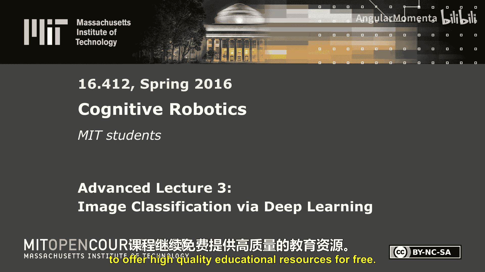

在本节课中，我们将要学习如何使用深度学习技术，特别是卷积神经网络（CNN），来解决图像分类这一曾经被认为极其困难的问题。我们将从深度学习的基本概念讲起，逐步深入到图像处理技术、CNN的架构、训练过程，最后探讨其实际应用成果与局限性。

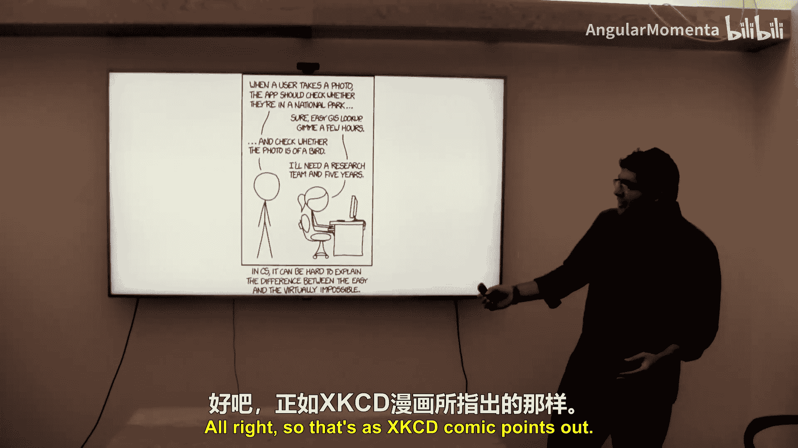

---

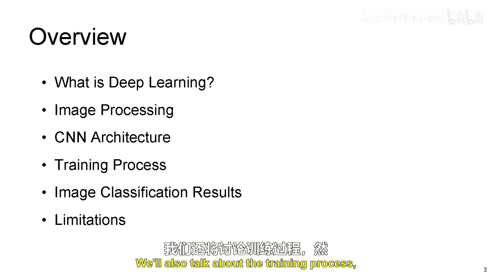

## 什么是深度学习？🤔

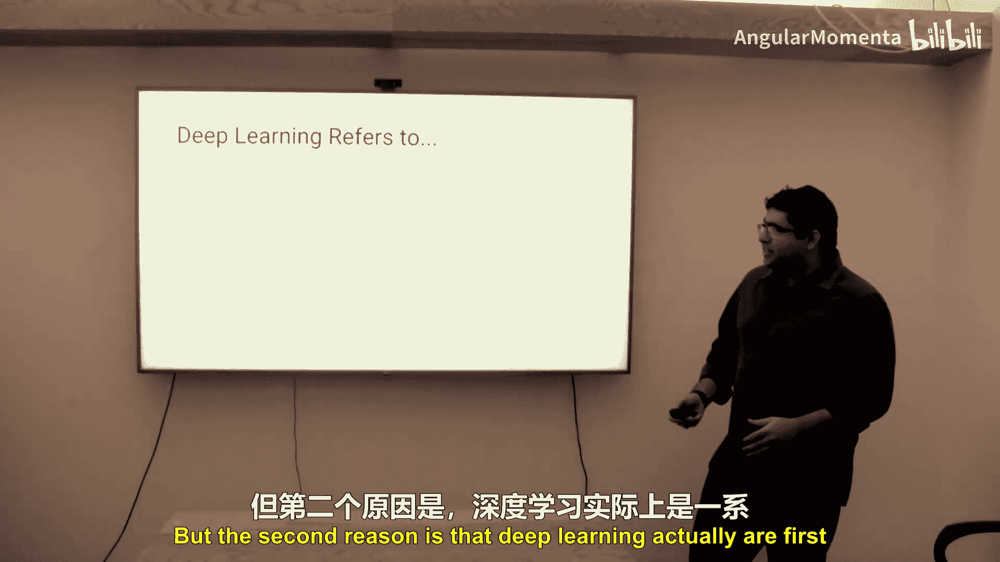

上一节我们介绍了课程概述，本节中我们来看看深度学习的定义。深度学习是一个相当宽泛的术语，它指的是一系列机器学习算法。这些算法的共同目标是解决那些过去被认为只有人类才能处理的复杂问题，其分类能力远超传统的机器学习算法。

以下是深度学习程序的核心工作方式：
*   它们将整个处理过程分解。
*   程序的不同部分负责处理不同任务，并行进行计算。
*   最终，所有部分的结果汇集在一起，得出最终结论。

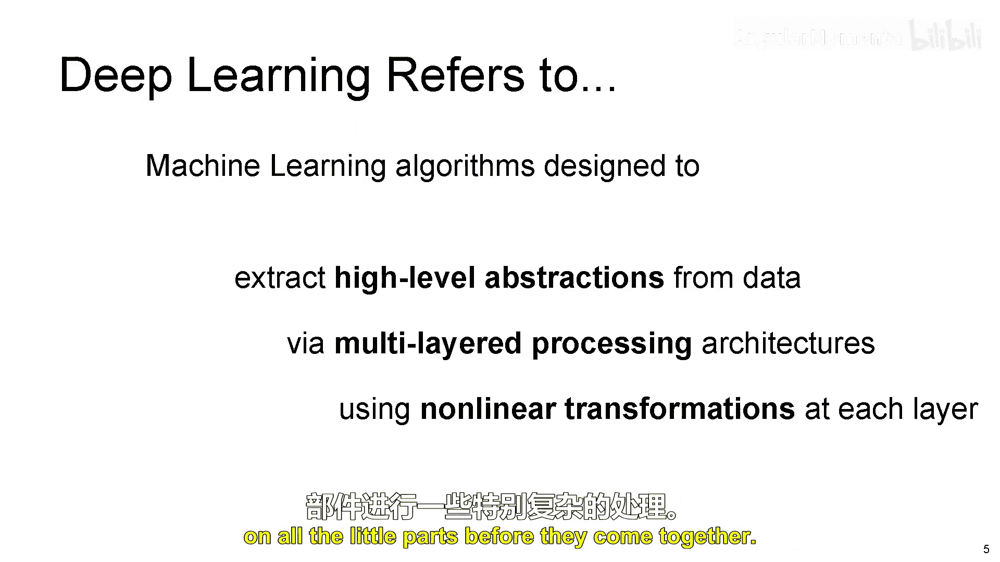

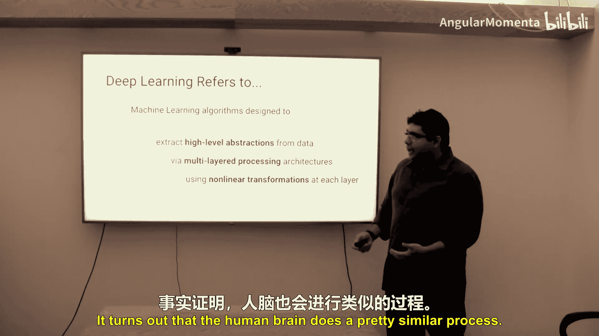

当然，分布式系统也采用分散式计算，但深度学习的关键在于，其每个部分都在执行**复杂的计算过程**，而不仅仅是重复简单的操作。每个部分都会对输入数据的小片段进行特定的复杂处理，然后才进行汇总。

---

## 为什么采用这种架构？🧠

那么，为什么工程师要设计这种去中心化、多层级的复杂处理架构呢？如果我们以图像分类为例，会发现人脑的处理过程与此非常相似。

人脑的视觉系统是一个层级化的处理过程。信息从视网膜开始，依次传递到大脑的不同区域，每个空间区域执行完全不同的计算。例如，V1区域负责提取边缘和角落，而几步之后的V4区域则开始将这些特征组合起来。因此，大脑的运作方式与这些网络的运作方式非常相似。

让我们以人脸分类为例。如果让你分类一张脸，第一步会做什么？正如之前提到的，我们大脑做的第一件事是找到边缘。首先要做的是识别脸部与背景的界限。下一步呢？也许可以将这些边缘组合起来，识别出一些特征，比如鼻子、嘴唇和眼睛。有了这些独立特征后呢？我们可以将它们按照已知的模式组织起来。我们知道一张脸必须有两只眼睛在鼻子上方，嘴巴在鼻子下方。这正是神经网络最终所做的事情，我们将在后续详细讲解这个过程。由此可见，我们分类人脸的直观方式以及大脑的运作机制，与我们设计的神经网络的工作方式非常相似。

---

## 卷积神经网络简介 🎯

如前所述，我们将重点讨论卷积神经网络。深度学习包含多种架构，但我们将聚焦于CNN，以便让大家了解其工作原理。

为了让大家对CNN的能力有一个初步认识，我们来看一下ImageNet竞赛的结果。ImageNet竞赛汇集了许多计算机科学家，比拼图像分类的准确率。在2010-2011年，错误率相当高，接近三分之一。然而，自2011年CNN被引入该领域后，错误率急剧下降。到2015年，ImageNet竞赛的成绩取得了显著提升。显然，CNN非常有效，并且正在激发该领域的研究热情。

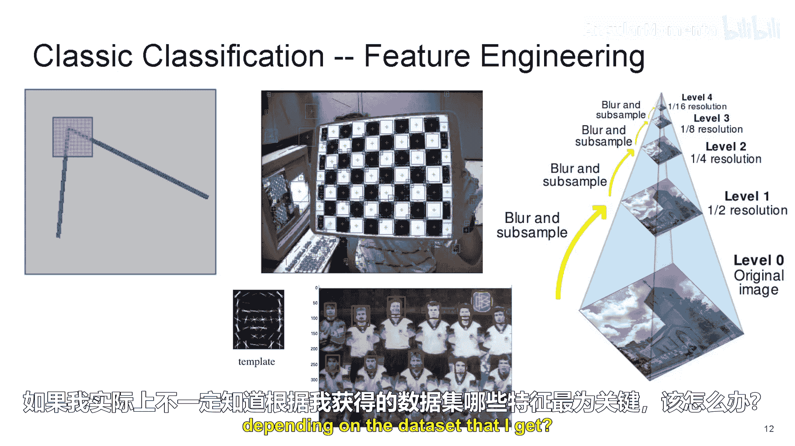

---

## 传统图像处理技术 🖼️

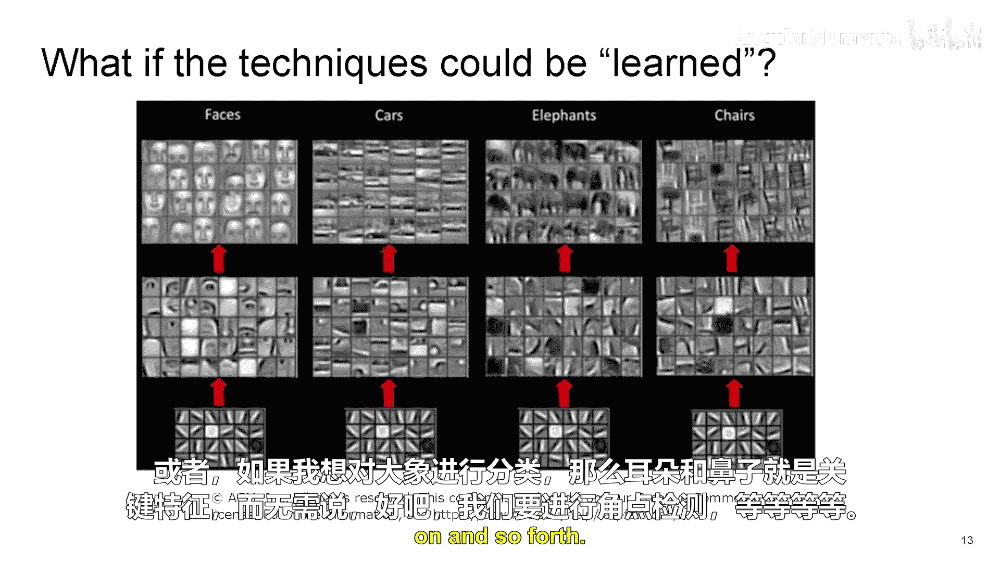

上一节我们介绍了CNN的起源和潜力，本节中我们来看看在CNN出现之前，传统的图像处理方法是怎样的。

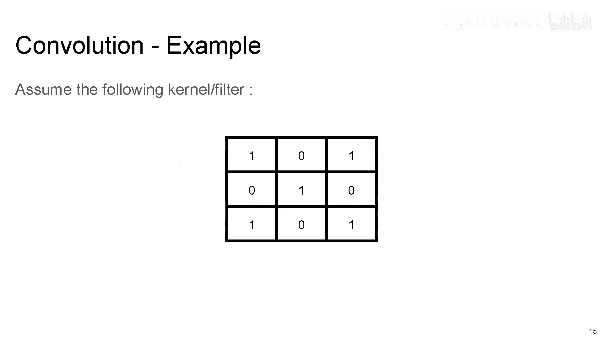

假设我们想让计算机识别一把椅子。我们有一些关于椅子构成部分的先验知识，可能会关注椅子的扶手、边角、椅腿等特征。因此，我们会手动设计特征提取方案来寻找特定的东西。

以下是传统上使用的一些技术：
*   **Harris角点检测器**：用于检测图像中强度的剧烈变化，以指示角点的存在。我们可以利用共同的角点来判断图像是否为椅子或门等物体。
*   **SIFT算法（尺度不变特征变换）**：即使物体尺寸不同，我们仍然能够提取关于角点位置等信息。
*   **HOG（方向梯度直方图）**：例如，要寻找包含人脸的图像，我们可以创建一个面部模板，为构成面部轮廓的像素组分配梯度，然后在样本图像上扫描，以判断是否存在人脸。

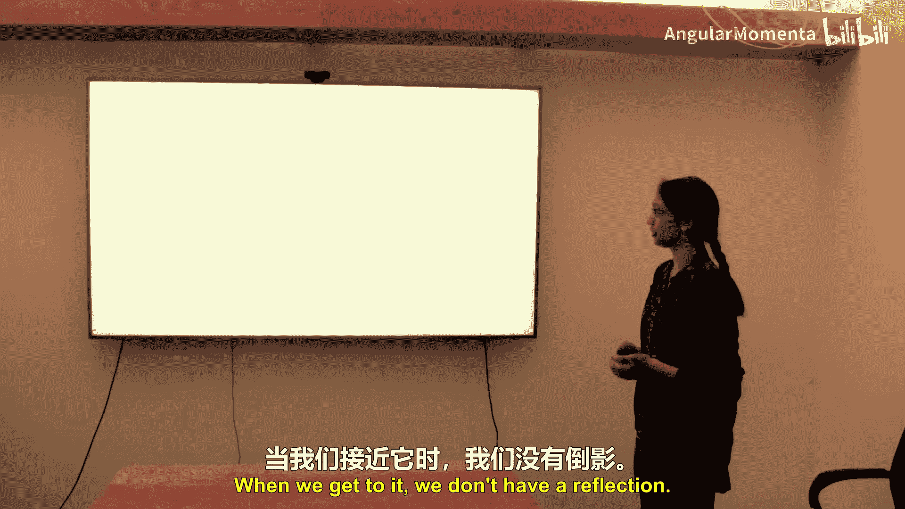

但这里存在一个问题：如果我们并不确切知道哪些特征对于给定的数据最为关键呢？我们希望系统本身能够在不具备任何数据先验知识的情况下，自动决定应用哪些技术。

---

## 卷积神经网络的核心思想 🧩

这正是卷积神经网络（CNN）的思想。我们希望技术能由系统通过处理过程自动学习。

例如，如果要分类人脸，我们希望系统能自行发现眼睛、耳朵、鼻子是最重要的特征；如果要分类大象，则希望系统能发现耳朵和象鼻是关键特征，而无需我们手动指定使用角点检测等方法。

为了更详细地理解这个过程，我们首先需要了解一些数学知识，即最基础的操作——卷积。

以下是二维卷积的形式化定义（由于我们处理的是图像，所以只考虑二维情况）：

**公式：**
`(f * g)(x, y) = Σ_i Σ_j f(i, j) * g(x - i, y - j)`

用更易于理解的图形化方式表示，其思想是：我们有一个**核**或**卷积滤波器**，将其应用于另一幅图像，以提取有助于最终分类的信息。

假设这是我们的核（滤波器），我们要将其应用到绿色的图像上。其思想是将这个滤波器在图像上滑动。我们所做的本质上是一系列点积运算：在图像的每个位置，我们将重叠的数字相乘，其和就成为卷积输出图像在该点的值。你可能注意到输出图像的尺寸减小了，我们稍后会讨论原因。

---

## 卷积能提取什么信息？🔍

让我们看一些例子，了解应用卷积能获得什么信息。

在左上角的老虎图像中，当我们应用一个**低通滤波器**（基本上是高斯滤波器）时，我们得到了图像的低空间频率信息，即图像被模糊了。这告诉我们一些可能想要学习的特定信息。

同样，我们可能对**高空间频率信息**感兴趣。在这种情况下，我们寻找尖锐的特征，比如水平边缘或垂直边缘。

此外，我们可能对特定频率的信息感兴趣。例如，我们可以取高通滤波器和低通滤波器的差值，在特定频率上提取信息。

另一种理解卷积所提取信息的方式是通过傅里叶变换。从图像处理的角度看，傅里叶变换基本上是一系列正弦光栅的叠加，这些光栅在频率、方向、振幅和相位上有所不同。你可以将斑马图像视为由不同光栅组合而成，傅里叶系数则代表了每种成分在最终图像中的贡献程度。

为了了解这类信息能传达什么，我们通常将傅里叶变换分解为幅度和相位表示。例如，对水平文本图像进行傅里叶变换，其幅度谱会反映出文本的方向性。如果我们旋转图像再进行傅里叶变换，幅度谱中的信息也会相应旋转。这些信息可能是网络在每个阶段学习到的，用于识别文本方向等特征。

---

## 卷积神经网络的架构 🏗️

上一节我们介绍了卷积操作，本节中我们来看看CNN的具体架构。

如前所述，为了分类或检测物体，你需要识别某些特征，而识别这些特征的方法是使用特定的卷积或滤波器。在许多情况下，我们不知道这些特征是什么，因此也不知道提取这些特征的滤波器是什么。卷积神经网络允许我们**自动确定这些特征以及提取这些特征的滤波器**。

复制大脑工作方式的想法始于20世纪50-60年代Hubel和Wiesel的实验。他们向猫展示不同角度的光带，并用电极测量其神经活动。实验结果表明，根据光线照射的角度，猫的神经反应不同。这使Hubel和Wiesel提出了大脑神经元按特定拓扑结构组织、每个神经元扮演特定角色、仅在特定输入出现时才激活的观点。

在代码中复制大脑工作的第一步是理解其基本构建块——神经元的工作原理。神经元是一个具有树突、细胞核、轴突和末端的细胞。它通过树突聚合来自相连神经元的动作电位（输入），将这些电位求和，并与内部阈值比较，以决定是否触发动作电位。

这个简单的想法可以在代码中复制。一个人工神经元看起来很像自然神经元。它有一组输入（这里假设有三个），在神经元内部进行求和。这个求和不是简单的求和，而是**加权求和**。神经元为每个输入指定一个权重，输入乘以权重后，总和被送入一个**激活函数**，产生神经元的输出。

我们刚才看到的是一个简单的、单一的神经元。但仅靠一个神经元做不了太多事情，因此我们需要将神经元按特定拓扑结构组合起来，形成一个网络。你可以将其视为一个具有多个输入和一个输出的大神经元。

例如，之前提到的椅子识别问题。如果你试图判断一张图像中是否有椅子，这里的多个输入可以是原始图像的一些子图像或小区域，输出可以是“是”或“否”，表示图像中是否有椅子。

这就是卷积神经网络背后的概念。在这种情况下，每个神经元所做的实际上就是执行一个点积运算。如果将所有神经元的点积运算聚合起来，就得到了卷积操作。

---

## 激活函数 ⚡

我们刚刚描述的是卷积步骤，接下来是激活步骤。计算出的点积会被送入一个函数，该函数产生神经元的输出。这就是激活层。

常见的激活函数有：
*   **Sigmoid函数**：将任何输入映射到0到1之间的输出。定义为 `1 / (1 + e^(-x))`。
*   **Tanh函数**：将任何输入映射到-1到1之间的输出。
*   **ReLU（修正线性单元）**：如果输入为正，则映射为输入本身；如果为负，则映射为0。

理论上，你可以在网络中使用任何函数作为激活函数。但在实践中，你希望激活函数是**非线性**的。主要原因在于，激活函数的目的是在系统中引入非线性。如果所有激活函数都是线性的，那么本质上你得到的是一个线性系统，这将限制你实现神经网络所需的复杂度水平。有一个形式化证明解释了为什么需要非线性激活函数（并非所有都需要，但网络中至少需要一些非线性激活函数）。

---

## 卷积层详解 🧮

讨论完激活层后，我们现在来详细讨论卷积层。

如前所述，图像显然是二维的，但我们使用的是RGB图像，因此实际上需要三个通道。这意味着图像实际上是三维的，每个2D矩阵代表一个通道（R、G、B）。因此，一个32x32的图像本质上由一个32x32x3的矩阵表示。

在卷积层会发生什么？假设我们有一个5x5x3的滤波器。它覆盖原始图像（32x32x3）中的某个区域。对于原始图像中的那个5x5x3区域，有一个神经元对该区域中的所有像素执行点积运算。像素值乘以滤波器值，然后这个点积结果被送入激活函数，从而得到该神经元的输出。

这个单一的神经元只覆盖原始图像的那个区域。在神经网络中，你会有许多神经元，每个覆盖原始图像的不同区域。如果聚合所有这些神经元的输出，你本质上就是在原始图像上执行卷积。

从更数学的角度形式化这个操作：如果你有一个大小为 `H1 x W1 x D1` 的输入，并使用一个滤波器执行卷积，那么输出宽度 `W2` 与 `W1` 的关系为：`W2 = W1 - 滤波器宽度 + 1`。高度公式相同。深度保持不变，因为我们使用的滤波器深度与原始图像相同（3）。

因此，如果你有28x28x1个神经元，每个对原始图像中的某些像素执行点积运算，那么输出将是一个大小为28x28x1的激活图，每个神经元的输出对应激活图中的一个像素。

---

## 多滤波器与参数数量 🔢

回到我们早先的观点，使用神经网络的原因是你不知道要提取哪些特征，也没有想要应用于图像的特定滤波器。因此，理想的做法是对第一幅图像应用多个滤波器，执行多次卷积。这可以通过多个神经元层来实现。

我们之前描述的只是一个神经元层。假设我们有五个不同的神经元层，每个对原始图像执行不同的卷积。那么，每层有28x28x1个神经元，如果将所有层聚合，则需要乘以5，这就是该网络中神经元的总数。

这实际上给我们留下了一个相当复杂的系统，我们会有很多参数（神经元的权重、神经元数量等）。如果我们有一个32x32x3的输入体积（原始图像）和一个5x5x3的滤波器大小，那么产生的激活图大小将是28x28x1。如果我们有五个不同的神经元层执行五种不同的卷积，那么神经元总数将是28x28x5。每个神经元的权重是5x5x3（75个）。假设神经元独立跟踪各自的权重（这可以简化为每层共享权重以大幅减少参数数量，但这里为了得到上限），参数总数将达到294,000个。这还只是使用32x32x3的小图像。如果图像更大，参数会多得多。

---

## 子采样（池化）📉

我们刚刚看到并描述了卷积和激活，这些步骤在神经网络（特别是CNN）中顺序发生。偶尔发生的另一个步骤是**子采样**（池化）。

进行子采样有两个主要原因：
1.  减少输入和特征空间的大小。
2.  保留最重要的信息，丢弃认为与分类无关的内容。

子采样的常用方法是**最大池化**或**平均池化**。这里我们描述最大池化。在最大池化中，你将图像划分为不同的、不重叠的子图像，并对每个子图像执行最大操作。例如，考虑2x2的滤波器，我们将4x4的图像分成四个子图像，对每个2x2的方块取最大值。这样做的原因是，你希望跟踪神经元的响应或产生的最高响应。最高的响应意味着图像中检测到了某些特征，这是你在网络中前进时希望保留的信息。

虽然这改变了像素的位置（可以视为对图像进行下采样），但它保留了你关心的信息，因为此时你只关心图像中是否检测到了某些特征，而不关心其在图像中的具体位置。你希望跟踪神经元检测到的所有特征，以便最终正确分类输入。

如果你有多个特征图（例如224x224x64），你的子采样操作将减少高度和宽度，深度保持不变。例如，从224x224x64减少到112x112x64，输出大小减少了4倍。

形式化地，如果你有一个大小为 `H1 x W1 x D1` 的输入，那么输出大小 `W2` 与输入的关系为：`W2 = (W1 - 池化宽度) / 步长 + 1`（假设步长等于池化宽度，通常为2）。高度公式相同，深度 `D2` 保持不变。

---

## 全连接层与分类 🎲

这些本质上就是卷积神经网络中发生的步骤。你可以在网络中重复这些步骤多次，但最终你必须进行分类并做出决策（在我们的例子中，判断图像是否有椅子）。这是如何发生的呢？

在执行所有这些步骤之后，有一个步骤允许你进行预测，这个步骤通常称为**全连接层**或**多层感知机**。这与你之前看到的层非常相似或完全相同，只是每一层中的每个神经元都连接到前一层的所有神经元。这允许你综合考虑当前关于输入的所有信息，计算点积，而不是像之前的层那样只关注输入的一个子样本。

如果你试图将输入分为四个类别，理想情况下，你会在输出层有四个不同的神经元，每个对应一个类别。然后，你会执行与之前层相同的操作，计算点积。一旦获得每个神经元的值，你将对所有输出执行一个归一化操作，称为 **Softmax**（归一化指数）。它的作用是给最高值赋予更大的权重。通过计算输出的Softmax，你可以计算后验概率，从而对输入做出更明智的分类决策。

---

## 数据预处理技巧 🛠️

现在我们已经了解了CNN的整体架构，接下来快速介绍一些标准的预处理技巧和提示，这些是在将图像数据集输入神经网络进行分类之前可能会用到的。

假设我们有一个数据集 `X`，其中有 `n` 个数据点，每个点有 `D` 维特征。以下是常见的预处理步骤：
*   **均值减法**：减去所有特征在所有数据点上的均值，使数据居中。
*   **归一化**：除以标准差，使数据点在不同维度上具有相同的值范围。
*   **主成分分析（PCA）**：当数据集维度非常高时，我们希望通过选取特征子集，将高维空间投影到低维空间。这通过生成协方差矩阵并进行奇异值分解来实现。
*   **数据增强**：通过引入相同图像的变体来有意扩充数据集。例如，对椅子图像进行旋转、翻转、缩放、裁剪、颜色重映射等操作。即使对人类感知来说，这些变体可能具有非常不同的含义，因此了解它们对神经网络的影响很有趣。

---

## 图像分类结果 📊

到目前为止，我们已经了解了卷积神经网络的构建方式以及可用于输入图像的某些处理技术。但这一切似乎有些抽象。了解CNN如何工作以及为何工作固然重要，但让我们看看CNN的一些实际结果和用途，这样你可以在课后自己尝试进行图像分类。

首先，让我们重新回顾ImageNet竞赛。自2012年CNN出现以来，最佳模型的错误率从约26%降至4.9%（2015年）。这证明了卷积神经网络是图像分类领域的顶尖技术。

ImageNet竞赛的图像是什么样的呢？每张图像下方有一个加粗的标题，代表竞赛认为正确的分类（真实标签）。其下列出的五个标签是由卷积神经网络生成的。不同长度的条形图（粉色和蓝色）代表CNN对该图像属于特定标签的置信度。

在某些例子中，CNN非常自信地给出了正确答案（如集装箱船）。有些情况下，它没有在第一次尝试中就得到正确标签，但正确标签在其前五个标签中（如烤架和蘑菇）。有趣的是，蘑菇图像被分类为“伞菌”，而伞菌实际上就是蘑菇的一种。但也有一些情况，CNN未能正确分类图像，其前五个标签中都没有正确选项（如椅子图像被错误地高置信度分类为斑点狗）。这表明CNN不仅可以用于图像分类，还可用于目标检测。

---

## 实际应用案例 🌍

这一切都很有趣，但有哪些实际应用呢？

*   **谷歌街景门牌号识别**：谷歌的一项研究使用CNN对街景中的门牌号照片进行分类。CNN的任务是识别图像中的单个数字，然后理解这是一个数字串，并成功分类为正确的门牌号。即使图像模糊，CNN也能达到约96-97%的准确率，接近人类操作员的水平。这使得谷歌能够自动从图像中提取门牌号，用于地理编码。该CNN成功地在不到一小时内处理了法国所有的街景门牌号图像。
*   **机器人手势识别**：机器人配备了许多部件，可以发送声音，也可以捕捉周围环境的图像。如果机器人能够分类所见之物，它就可以据此采取行动。一项研究使用CNN识别五种不同的手势类别（每个类别对应伸出的手指数量），错误率降至3%（97%准确率）。这些手势可用于向机器人发出命令。
*   **视频分类**：显然，手势不一定是静态的，可能涉及挥手等动作，这就需要时间成分。因此，我们可以将图像分类扩展到视频分类。视频本质上就是带有时间成分的图像。谷歌的一项研究从YouTube体育视频中提取了100万个视频，涉及400-500个不同类别，并使用CNN尝试分类这些视频。他们使用了不同的方法和CNN类型。目前的最佳准确率在前五个标签中约为80%。虽然远低于图像分类的98-99%，但考虑到视频的复杂性，这提供了一个良好的基准和未来改进的方向。

---

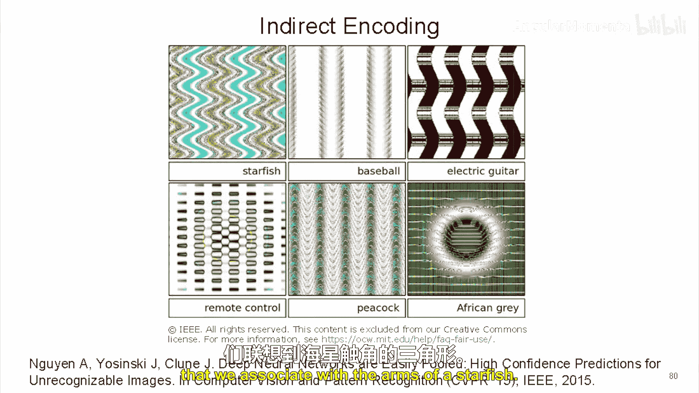

## 卷积神经网络的局限性 ⚠️

卷积神经网络虽然强大，但也存在一些局限性。

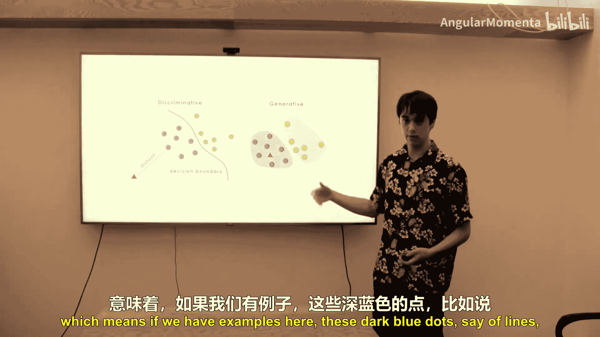

*   **数据与计算需求**：ImageNet竞赛包含1000个类别，这似乎很多，但对于最大的竞赛来说并不算多（例如不包含热气球等类别）。每个类别需要数千张训练图像，而人类儿童只需几个例子就能学会。训练ImageNet需要超过一百万张图像，即使有卷积的高效优化，在多块并行GPU上训练也需要数周时间。
*   **对抗性样本**：一个更根本的问题是神经网络容易受到微小扰动的攻击。在图像中添加人类无法察觉的微小失真，可能导致神经网络完全错误地分类图像（例如将校车、鸟和印度寺庙都分类为鸵鸟）。研究人员通过进化算法或梯度上升算法，从随机噪声开始，迭代生成能被神经网络高置信度分类为特定类别（如吉他、企鹅）的图像，但这些图像对人类来说毫无意义。这表明神经网络捕捉的特征与人类不同，它更关注局部低层特征，而不是人类所理解的抽象概念。
*   **模型差异**：人类使用**生成模型**，根据样本构建概率分布，并判断新样本是否属于该分布区域。而神经网络只是绘制决策边界，它不关心样本是否远离类别的核心区域，只关心其相对于边界的距离。因此，即使一个样本远离“狮子”类别的核心，但只要它更靠近“狮子”的决策边界而非其他类别，仍可能被分类为狮子。这就是为什么我们能够以如此简单或抽象的方式“欺骗”神经网络。

---

## 总结与要点 🎓

本节课中我们一起学习了基于深度学习的图像分类。

以下是本次演示的要点总结：
*   深度学习是图像分类的强大工具，它依赖于网络的多层处理。
*   卷积神经网络（CNN）在图像分类方面基本上优于所有其他方法，这是其主要用途。
*   这是因为卷积滤波器非常快速和高效。
*   **反向传播**是我们训练神经网络的方式。它避免了因神经元全连接导致的指数级训练时间增长，将其降低到线性时间，使得大规模训练成为可能。
*   即使有反向传播和卷积的高效性，训练神经网络仍然需要大量图像、长时间和强大的处理能力。
*   如果你想开始使用神经网络，有一些非常好的开源编程平台，例如Google的 **TensorFlow** 和伯克利的 **Caffe**（后者提供在线演示，可以立即上传图像并获得识别结果）。

---

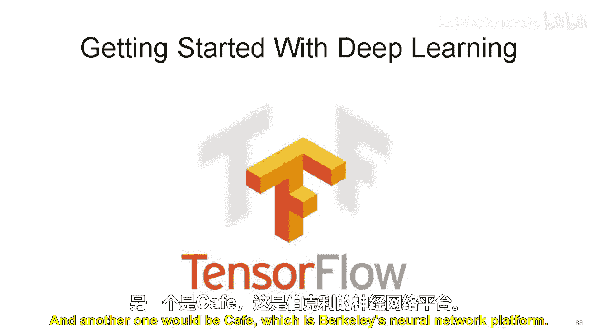

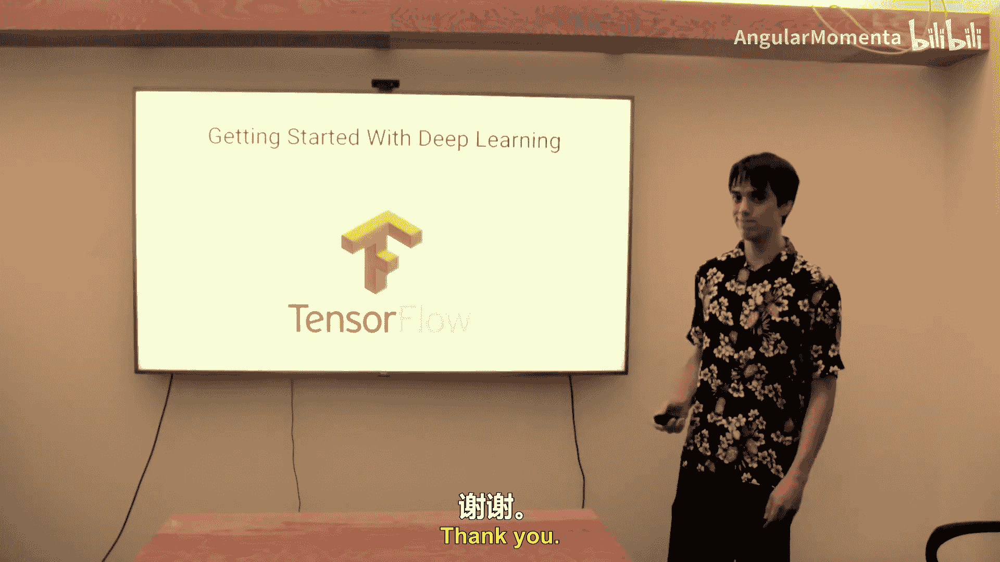

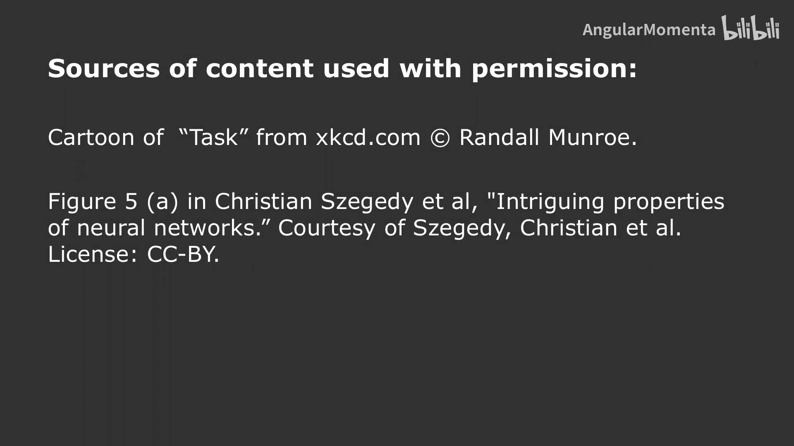

**感谢观看！**