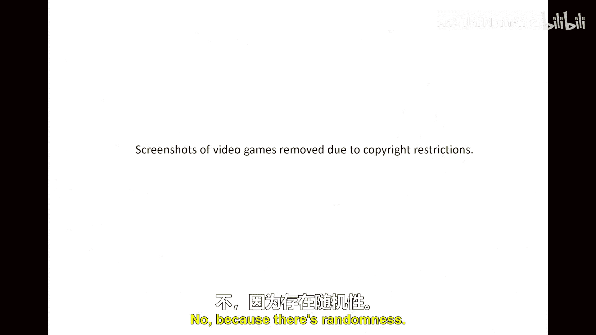
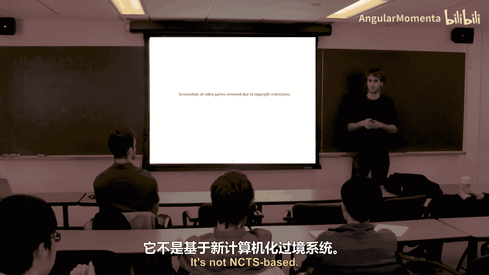
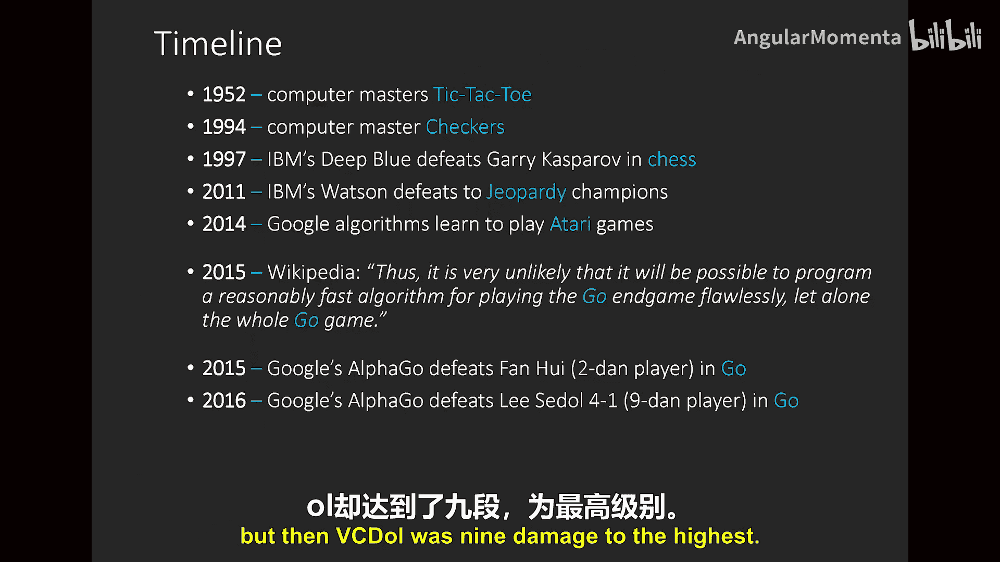
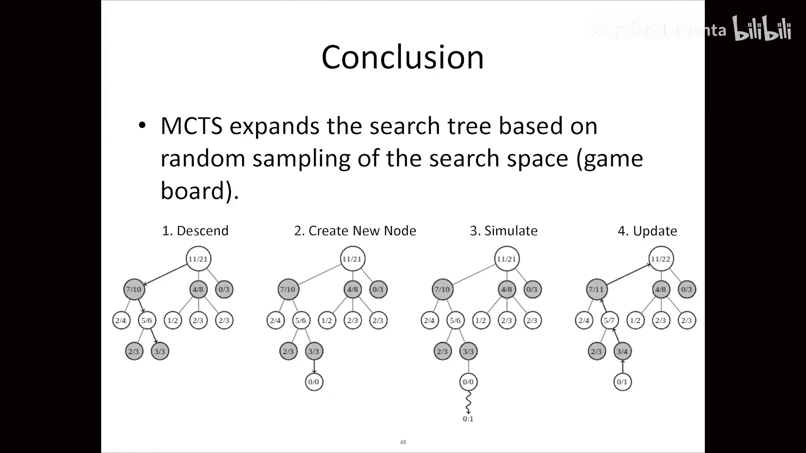

# 004：高级蒙特卡洛树搜索

在本节课中，我们将要学习一种强大的搜索算法——蒙特卡洛树搜索。这种算法在处理状态空间巨大的问题时表现出色，特别是在游戏和规划领域。我们将从传统搜索算法面临的挑战开始，逐步深入理解MCTS的原理、步骤、优缺点，并探讨其在超级马里奥和AlphaGo等复杂游戏中的实际应用。

## 传统搜索算法及其局限性

上一节我们提到了在大型状态空间中进行规划的困难。本节中，我们来看看在确定性、完全可观察的游戏中，传统算法是如何工作的，以及它们为何在面对高分支因子时力不从心。

这类游戏包括国际象棋、跳棋和围棋。它们的特点是信息完美，没有随机性，因此理论上可以构建包含所有可能结果的搜索树。

以下是几种传统的搜索算法：

*   **Minimax算法**：其核心思想是“最小化对手的最大收益”。在决策时，计算机会假设对手也会采取最优策略，从而选择对自己最有利的走法。在井字棋等简单游戏中，它可以遍历整个树来找到必胜策略。
*   **Alpha-Beta剪枝**：这是对Minimax算法的优化。其核心思想是：**如果已经知道某个分支的评估值不会比已知的最佳选择更好，就停止探索该分支**。这可以显著减少需要评估的节点数量。

然而，当游戏的分支因子变得非常大时（例如围棋有约250种可能的走法），即使是Alpha-Beta剪枝也会因为需要探索的节点数量爆炸而变得不切实际。这引出了我们对更高效算法的需求。

## 蒙特卡洛树搜索算法详解

上一节我们看到了传统算法在高分支因子游戏中的局限性。本节中，我们将深入探讨蒙特卡洛树搜索如何通过非对称地构建搜索树来优雅地解决这个问题。

MCTS的核心目标是**有选择性地扩展搜索树**。与其像深度优先或广度优先搜索那样均匀地探索所有分支，MCTS更倾向于深入探索那些看起来更有希望的区域，同时也会分配一些资源去探索未被充分了解的领域，以平衡“利用”和“探索”。

### 算法结构与节点信息

MCTS维护一棵不断增长的搜索树。树中的每个节点代表一个游戏状态（例如，一个特定的棋盘局面）。每个节点存储两个关键数值：
*   **N**：该节点被访问的总次数。
*   **W**：从该节点出发，我方（通常是执红方或电脑方）获胜的模拟次数。

初始状态下，根节点代表当前游戏状态。其子节点代表从我方角度出发所有可能的合法走法。

### MCTS的四个核心步骤

MCTS通过重复以下四个步骤来构建和更新搜索树：

1.  **选择**：从根节点开始，递归地选择子节点，直到到达一个“可扩展”的节点（即该节点还有未探索过的子节点）。选择的标准是平衡“利用”（选择胜率高的节点）和“探索”（选择访问次数少的节点），这通常通过**上置信界公式**来实现：
    `UCB = (W / N) + C * sqrt( ln(父节点的N) / N )`
    其中，`(W / N)`是**利用项**（当前节点的平均胜率），`C * sqrt( ln(父节点的N) / N )`是**探索项**（鼓励访问次数少的节点）。算法会选择UCB值最高的子节点。

2.  **扩展**：当到达一个可扩展的节点时，随机选择其一个未被访问过的合法子节点，将其作为新节点添加到树中。新节点的N和W初始值都设为0。

3.  **模拟**：从新扩展的节点开始，进行一场快速的随机模拟对局。双方玩家都根据游戏规则随机选择走法，直到游戏结束（赢、输或平）。模拟的结果记为 `Δ`（例如，胜利为1，失败为0）。

4.  **回溯**：将模拟的结果 `Δ` 沿着选择阶段经过的路径反向传播，更新路径上所有节点的N和W值。具体来说，每个节点的N加1，如果模拟是我方获胜，则W也加1。

### 决策与终止

上述步骤会重复执行成千上万次。当计算时间耗尽或达到预设的迭代次数时，算法终止。此时，需要从根节点的直接子节点中选择一步作为实际走法。一个常见的选择标准是**访问次数最多**的子节点，因为这通常意味着该走法经过了最充分的评估，胜率估计更可靠。

## MCTS的优缺点与应用实例

上一节我们详细剖析了MCTS算法的运行机制。本节中，我们来总结它的优势与不足，并看看它是如何被应用到实际复杂问题中的。

### 优点

*   **非对称树增长**：能有效处理高分支因子问题，计算资源集中在有希望的区域。
*   **无需领域知识**：算法只需要游戏的基本规则（如何走子、如何判定胜负），无需复杂的评估函数即可运行。这使其能快速适应新游戏。
*   **可融入启发信息**：算法框架灵活，可以在选择、模拟等步骤中方便地加入领域知识（如围棋定式、马里奥的得分规则）来提升性能。
*   **随时可终止**：属于“任意时间算法”，可以在任何时间点停止并给出当前最佳决策，适用于有时间限制的场景。
*   **可并行化**：树的不同分支可以独立进行模拟，非常适合分布式计算。

### 缺点

*   **模拟质量依赖**：算法的有效性很大程度上依赖于随机模拟的质量。如果模拟结果与真实游戏水平相关性很弱（例如在极深度的搜索或动作空间连续的游戏中），算法性能会下降。
*   **计算资源需求**：为了获得好的性能，通常需要大量的模拟次数，对计算能力要求较高。
*   **理论分析不足**：相较于一些经典算法，MCTS的收敛性、最优性等理论性质的研究相对较少。
*   **需要调参**：UCB公式中的常数C等参数需要针对具体问题进行调整。

### 应用实例：超级马里奥AI

在将MCTS应用于超级马里奥时，需要进行一些调整：
*   **单玩家游戏**：对手是游戏环境本身。
*   **状态与动作**：节点是游戏某一时刻的“状态”（屏幕快照），边是马里奥可执行的动作（左、右、跳等）。
*   **复杂的奖励函数**：由于模拟很难通关，胜负二元奖励不够。因此引入了**多目标加权评分**，例如：`得分 = 距离前进 * 0.1 + 收集金币 * 1 + 踩死敌人 * 2 - 死亡惩罚 * 5 ...`
*   **改进的模拟策略**：采用“多次模拟”策略，即从一个新节点进行多次随机模拟，取最高分作为该节点的模拟结果，以提高评估准确性。

实验表明，采用MCTS（尤其是结合了多次模拟和领域知识评分）的AI控制器，其表现优于传统的A*搜索算法。

### 应用实例：AlphaGo

AlphaGo的成功是MCTS与深度学习结合的典范。它通过以下组件增强了MCTS：
*   **策略网络**：一个卷积神经网络，输入棋盘状态，输出每个合法落子点的概率。它提供了“直觉”，指导MCTS在**选择**阶段优先探索高概率的走法。
    *   **快速策略网络**：用于**模拟**阶段，进行快速但有一定水平的走子。
    *   **慢速策略网络**：更准确，用于指导树搜索的初始方向。
*   **价值网络**：另一个神经网络，直接评估给定棋盘状态的胜率。这个评估值会与模拟结果相结合，在**回溯**阶段共同更新节点价值。

这种结合带来了巨大优势：策略网络缩小了搜索范围，价值网络提供了全局评估，而MCTS则通过大量模拟来验证和优化神经网络的“直觉”，三者相辅相成，最终战胜了人类顶尖棋手。

## 总结

本节课中，我们一起学习了蒙特卡洛树搜索这一强大的算法。我们从传统搜索算法（如Minimax和Alpha-Beta剪枝）在高分支因子游戏中遇到的挑战出发，逐步深入理解了MCTS通过**选择、扩展、模拟、回溯**四个步骤，以非对称方式构建搜索树的核心思想。我们分析了它的优点（如无需复杂启发信息、随时可终止）和缺点（如依赖模拟质量）。最后，通过超级马里奥AI和AlphaGo两个精彩案例，我们看到了MCTS如何通过与领域知识、深度学习相结合，解决极其复杂的决策问题。MCTS不仅是一种游戏AI算法，其平衡探索与利用的思想，在机器人规划、自动控制等许多需要在大规模空间中做出序列决策的领域都有着广泛的应用前景。