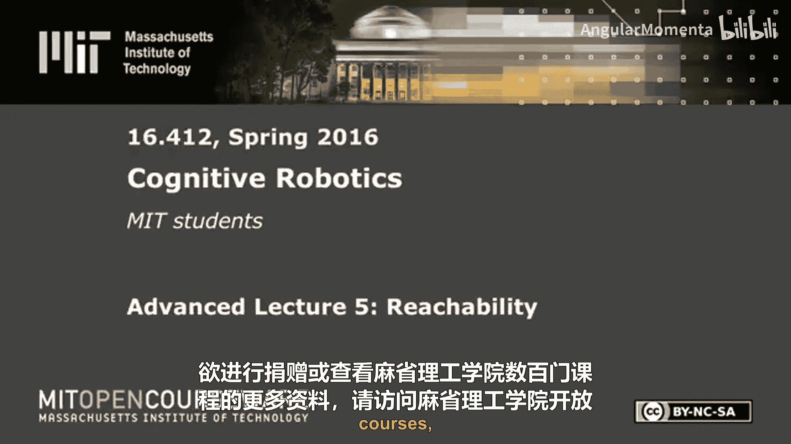
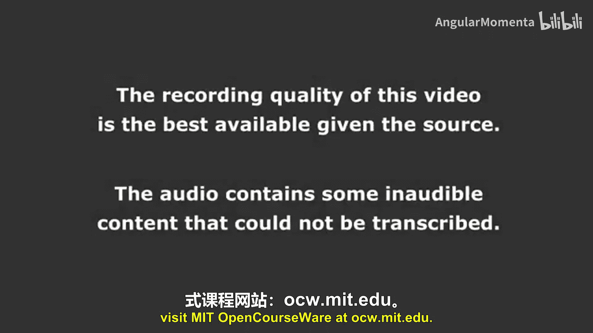
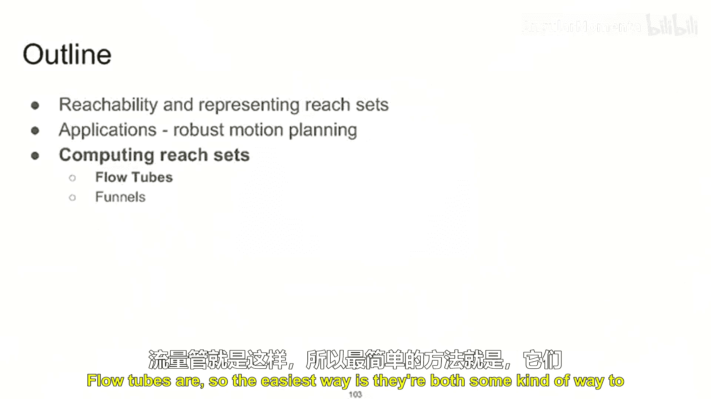
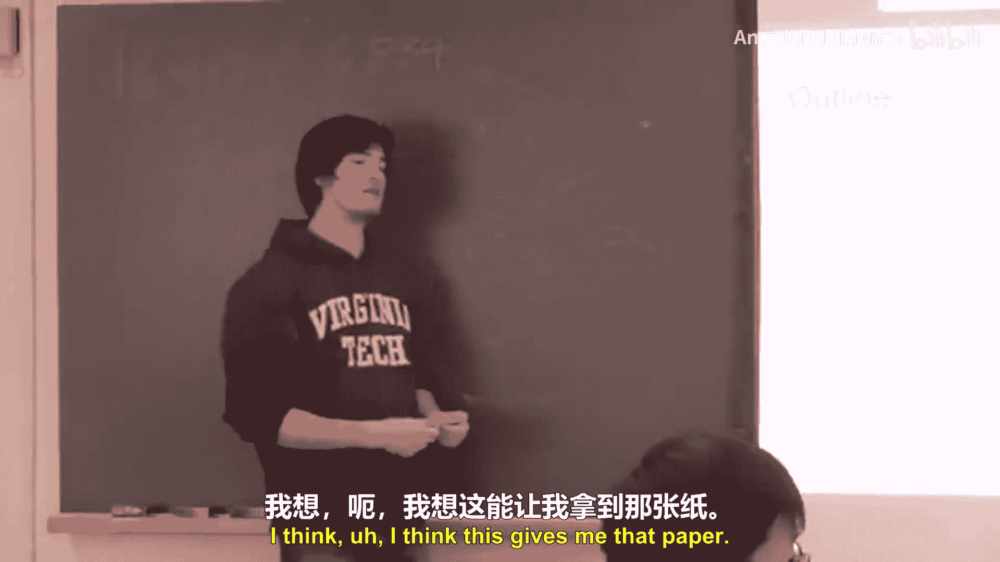
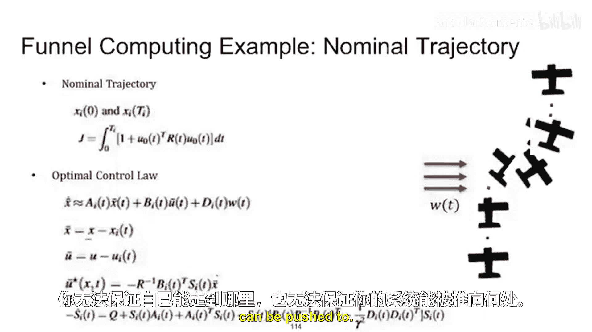
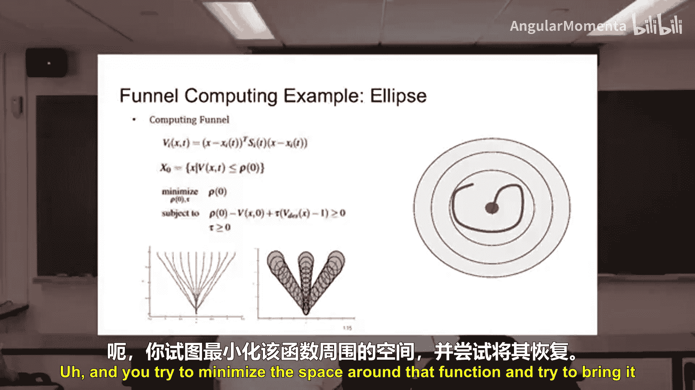
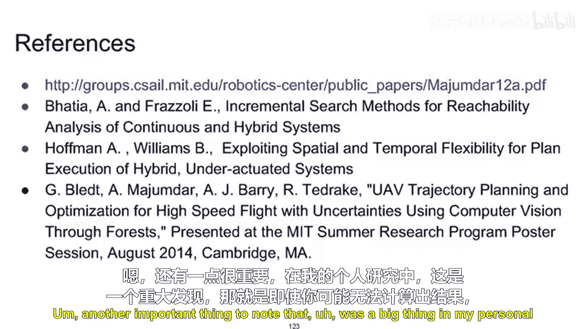

**认知机器人学：5：可达性** 🧠

在本节课中，我们将要学习可达性的基本概念，了解如何在连续空间中表示可达集，并探讨其在鲁棒运动规划中的应用。最后，我们将学习如何计算可达集和流管。

---

### **可达性概述**

可达性的任务是确定一个动态系统在特定时间可能到达或处于哪些状态。

例如，我们有两个系统：一个有限状态机（离散系统）和一个连续系统。给定初始状态和可能的动作（例如，向东或向北移动），我们可以计算系统在一秒、两秒或更长时间后可能处于的状态集合。这就是可达集。

可达性的一个主要应用是**验证**，即确保系统永远不会到达任何“坏”状态。例如，对于微波炉，一个坏状态是门开着时微波炉仍在运行。通过计算可达集并检查其是否与坏状态集合有交集，我们可以验证系统的安全性。

另一个重要应用是**鲁棒运动规划**，这将在后续章节中详细讨论。

---

### **可达性的形式化定义**

让我们回到有限状态机的例子。我们有一个有限状态集合 **X**，一个有限输入集合 **U**（例如，东、北），以及一个转移函数。此外，我们有一个初始状态集合 **X₀**。

**可达集** **R(T)** 定义为在时间 **T** 系统可能处于的状态集合。更正式地说，如果存在一个长度为 **T** 的控制输入序列，能将系统从某个初始状态 **x₀ ∈ X₀** 转移到状态 **x**，那么 **x** 就属于 **R(T)**。

**可达集合** **R(≤T)** 则定义为从时间 0 到时间 T 所有可达集的并集，即系统在时间 T 之前可能到达的所有状态。我们使用可达集合来检查是否与坏状态有交集。

对于有限状态机，计算可达集相对简单。我们可以通过时间步进的方式，先计算 **R(1)**，然后以 **R(1)** 作为新的初始集计算 **R(2)**，依此类推。这种方法有效是因为可达集具有半群性质。

---

### **连续系统中的集合表示**

对于连续系统，情况变得复杂，因为状态空间是连续的，包含无限多个点。我们不能简单地列出所有状态。因此，我们需要有效的方法来表示空间中的区域或集合。

以下是两种常用的表示方法：

**1. 凸多面体**
凸多面体是高维空间中凸多边形的推广。它可以通过两种基本方式表示：
*   **顶点列表**：定义凸包（想象用橡皮筋套住所有点，凸包就是橡皮筋内的区域）。
*   **不等式集合**：定义一组线性不等式的交集区域。

顶点表示便于测试集合是否为空（如果顶点列表为空，则集合为空）。不等式表示便于测试成员资格（只需将点代入所有不等式检查是否成立）。

**凸性**是一个关键属性，意味着集合内任意两点连线上的所有点也都在集合内。这对于后续算法非常重要。

**2. 椭球**
椭球是椭圆在高维空间的扩展。一个椭球可以由其中心 **c** 和一个正定矩阵 **P** 定义，满足条件 **(x - c)ᵀ P (x - c) ≤ 1** 的点 **x** 都在椭球内。

我们偏好使用凸多面体和椭球的一个重要原因是它们在**线性算子下的性质**。对于一个线性系统 **ẋ = Ax**，如果初始状态集是一个凸集（凸多面体或椭球），那么在任意时间 t，状态集 **x(t)** 将仍然是凸集。这意味着我们的表示方法在系统演化下是封闭的，便于计算。

虽然整个可达集合可能不是凸的（例如，从两个分离的初始区域演化出的可达集的并集），但它总可以表示为多个凸多面体或椭球的并集。

---

### **可达性在机器人学中的应用**

在理解了可达性的概念和表示方法后，我们来看看它在机器人学和复杂系统中的实际应用。

可达性可用于验证复杂系统（如双足机器人）的安全性，也广泛应用于自动驾驶汽车等安全关键系统的验证工作中。本节课，我们将重点探讨其在**鲁棒运动规划**中的应用。

---

### **鲁棒运动规划简介**

传统运动规划的目标是找到一组控制输入，使机器人从起始状态安全到达目标状态，且不与障碍物碰撞。然而，这种方法通常假设模型和环境是完美确定的。

实际上，存在多种不确定性：
*   **环境不确定性**：如风、水流、随时间变化的障碍物。
*   **模型不确定性**：用于表示系统的模型与真实世界存在差异。
*   **传感不确定性**：测量位置、速度时存在噪声或误差。
*   **初始条件不确定性**：机器人的实际起始位置可能与预期略有偏差。

**鲁棒运动规划**的目标是：即使在存在有界不确定性的情况下，也能**保证**系统能够到达目标而不与障碍物碰撞。

解决方案的核心思想是：规划时不再搜索单条轨迹，而是搜索一个**鲁棒的区域**（如流管或漏斗），该区域代表了在不确定性影响下系统所有可能状态的集合。只要这个区域不与障碍物相交，那么无论不确定性如何具体实现，系统都是安全的。

---

### **流管与漏斗**

**流管** 是一束轨迹的集合，这些轨迹共享某些共同特征（例如，都从初始区域出发并到达目标区域）。在规划中，我们寻找一个从起始区域到目标区域的流管，并确保该流管不与障碍物相交。这样，只要系统保持在流管内，就能安全到达目标。

**漏斗** 是流管的一种特殊类型，特别侧重于对扰动的稳定性。它通常围绕一条标称轨迹构建。漏斗在轨迹的每个点上都定义一个区域（常为椭球），并提供一个控制策略，保证：如果系统在某个时刻处于该点的漏斗区域内，那么在未来所有时刻，系统都将保持在漏斗内，并最终趋近于标称轨迹。这提供了更强的鲁棒性保证。

漏斗的稳定性通常使用**李雅普诺夫函数**进行分析。对于非线性系统，稳定性有多种定义（如全局指数稳定、渐近稳定、李雅普诺夫意义下的稳定）。漏斗通常对应李雅普诺夫意义下的稳定，即状态始终被限定在一个有界区域内。

---

### **在线运动规划与漏斗库**

直接在线计算漏斗计算量很大。因此，常见的做法是**离线**计算一个覆盖状态空间可能运动的**漏斗库**。每个漏斗都与一个控制策略相关联。

**在线规划**时，算法在漏斗库中搜索，寻找一个能**顺序组合**的漏斗序列：第一个漏斗必须包含当前状态，后续漏斗必须与前一个漏斗的末端区域有交集，并且整个序列构成的路径不能与已知障碍物相交。找到这样的序列后，机器人就执行第一个漏斗对应的控制策略。

当机器人移动并获得新的传感器信息（发现新障碍物）时，它会重新进行在线搜索，规划新的安全漏斗序列。这种方法结合了离线计算的保证和在线环境的适应性。

---

### **计算流管与漏斗的方法**

计算流管和漏斗有多种近似方法：
*   **使用凸多面体**：如果系统是线性的，凸多面体在演化下会保持凸性。我们可以传播一个初始凸多面体截面来近似流管。为了保证安全性，我们通常使用**内近似**（即近似区域完全包含在真实流管内）。
*   **使用椭球**：椭球同样适用于线性系统，并且常被用于表示漏斗的截面。
*   **学习的方法**：可以从示例轨迹中估计出流管的边界。

对于非线性系统，通常需要在其标称轨迹附近进行线性化，然后在每个线性化点附近使用凸多面体或椭球来近似。

**时间轴规划**：如果系统因扰动而处于当前流管之外，一种策略是进行**时间轴规划**。即，调整到达目标的时间，这会导致整个流管在时间轴上平移。原先不可行的状态可能因此被纳入新的、平移后的流管内，从而重新找到安全的路径。

---

### **应用实例**

**双足机器人步态规划**：步行是一个复杂的混合动力系统（连续动态与离散脚着地事件）。可以使用流管来规划脚部的摆动轨迹，保证即使在扰动下，脚也能准确踏到预定位置。同时，身体质心的运动也可以用另一组流管来规划，并通过反馈线性化等技术进行解耦，保证整体运动的稳定性和安全性。

**滑翔机导航**：这是一个在风场不确定性下进行规划的例子。首先为滑翔机规划一条标称轨迹，然后考虑风速和自身速度的有界不确定性，围绕标称轨迹设计控制器并计算出一个漏斗。这个漏斗定义了在给定扰动下，滑翔机所有可能状态的边界。在线规划时，滑翔机从其漏斗库中选择并组合安全的漏斗序列，以穿越充满障碍物的环境，并能根据实时感知的障碍物信息重新规划。

---

### **总结**

在本节课中，我们一起学习了可达性的核心概念。我们从离散和连续系统的基本定义出发，探讨了如何在连续空间中表示可达集（凸多面体和椭球）。接着，我们深入了解了可达性在鲁棒运动规划中的关键应用，特别是通过**流管**和**漏斗**来保证系统在有界不确定性下的安全性。我们还介绍了如何离线计算漏斗库，并在线组合它们以实现安全、自适应的运动规划。最后，通过双足机器人和滑翔机的实例，我们看到了这些理论在复杂机器人系统中的强大应用。