# 007：概率与无限时域规划 🧠🤖

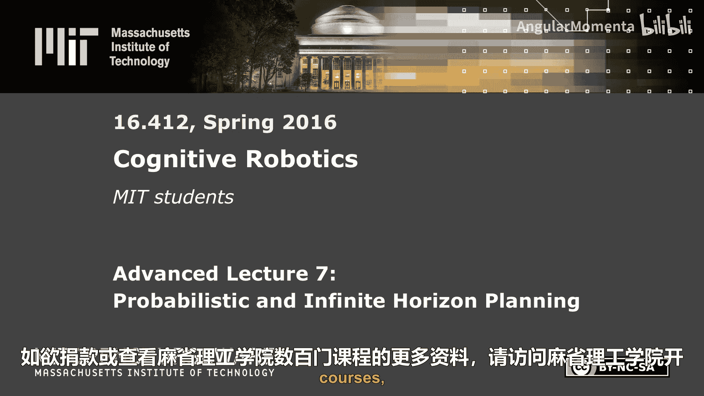

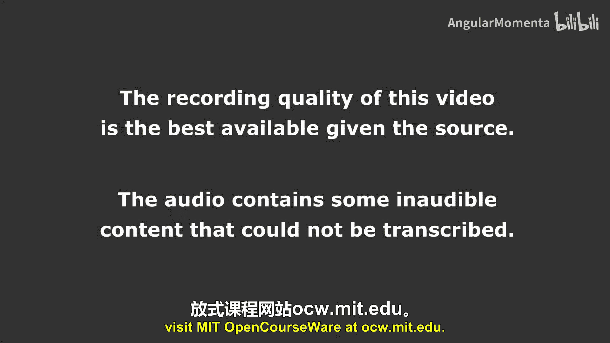

## 概述
在本节课中，我们将要学习如何在机器人规划中处理不确定性。我们将从更广泛的动机示例开始，逐步深入到使用马尔可夫决策过程进行规划，并介绍值迭代算法。随后，我们将探讨启发式引导求解器，并进入更具随机性的情况——部分可观测马尔可夫决策过程及其在配置空间中的操作。

## 动机：不确定性下的规划问题
我们经常将运动规划视为一个问题。例如，在亚马逊物流中心，我们有一个四旋翼飞行器从起始配置出发，可以采取一系列动作，并有一个奖励函数。假设我们希望它到达77号工位，并选择最短路径（红色虚线），但这条路径非常接近障碍物。如果路径上存在任何不确定性，我们将面临极高的失败或碰撞风险。

为了应对这种情况，我们可以采用类似“绿洲”的方法进行调整，以留出更多安全空间。不确定性水平决定了问题解决的难易程度。

## 不确定性分类
在左侧，我们有确定性动力学和确定性传感器。在这种情况下，动作按指令精确执行，传感器能准确告知我们所在位置，例如通过传感验证的航位推算。

当我们转向稍微复杂的情况时，可能具有确定性动力学，但传感器存在噪声（例如有噪的摄像头），导致观测不确定性。这时我们会使用航位推算，并通过卡尔曼滤波来补偿噪声。

在底部，我们有随机动力学和确定性传感器。这种情况下，动作执行存在不确定性，但可以通过传感进行验证。这正是我们下一节要讨论的马尔可夫决策过程。

在本讲稍后部分，我们将简要讨论最困难的情况：随机动力学和随机传感器。动作执行和传感器都可能存在噪声，这就是部分可观测马尔可夫决策过程。

## 马尔可夫决策过程规划
为了补偿不确定性，我们需要对问题进行建模，否则在高风险情况下，如果不考虑不确定性，可能会导致碰撞。这促使我们引入马尔可夫决策过程规划。

MDP包含以下要素：
*   **状态集合**
*   **可采取的动作集合**
*   **转移模型**：在给定状态下采取某个动作后，到达另一个状态的概率。
*   **即时奖励函数**
*   **折扣因子**：用于优先考虑即时奖励，而非不确定的未来奖励，体现了“一鸟在手胜过双鸟在林”的概念。

我们的目标是找到一个最优策略，为每个状态映射出最佳动作，以最大化期望的累积终身奖励。

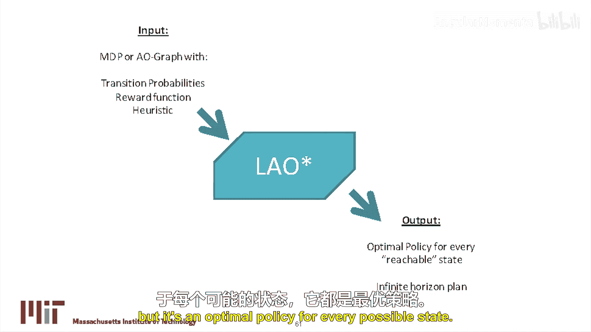

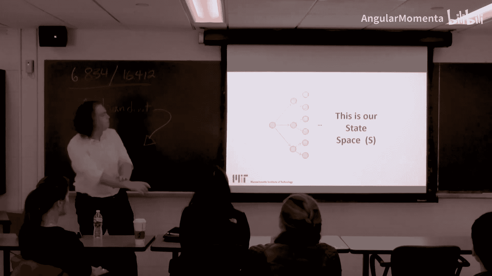

让我们通过一个例子来理解。假设我们有一个四旋翼飞行器和完美传感器，将其置于一个网格环境中。状态是网格中的位置。动作可能是上、下、左、右（北、南、东、西）。我们任意设定转移概率：执行指令动作的概率为50%，向左或向右移动的概率各为25%。奖励函数设定为：到达状态65获得奖励1。折扣因子设为0.9。

假设我们有一个最优策略，指示从某个状态采取“北”动作。根据转移概率，我们有50%的概率向北，25%的概率向左或向右。执行后，我们可能处于多个可能的状态。接着执行下一个动作，可能的状态组合会急剧增加，问题变得非常复杂。

如何简化这个分布呢？考虑到我们的传感器是确定性的，最简单的方法是在每个时间步后进行观测。在第一次时间步后，我们不确定处于三个可能状态中的哪一个，于是进行一次观测，从而完全确定当前状态。这使我们能够忽略状态历史，每次观测后都将分布坍缩为单一状态。

## 值迭代算法
现在回到如何得出最优策略的问题。我们通过动态规划来实现，主要有两种方法：值迭代和策略迭代。本讲重点介绍值迭代。

使用同一个例子，我们仍想最大化期望奖励。首先，将所有状态的值初始化为零。从时间T0开始，关注状态S65，假设初始采取“空”动作。根据概率分布，我们有50%的概率留在S65，25%的概率到S55，25%的概率到S75。这些状态当前的值都是零。最重要的是，无论最终处于哪个状态，从S65采取“空”动作获得的奖励都是1（根据初始设定）。

计算下一个时间步的值：我们从各个概率开始，加上获得的奖励（因为奖励不依赖于最终状态，所以对所有三个概率都加1），然后加上之前状态的折扣值。更一般的形式是：对所有可能到达的状态，计算到达该状态的概率，乘以（奖励 + 该状态的折扣终身值）的总和。

为了确保获得最佳值，我们需要考虑从该状态可以采取的所有其他动作。因此，我们将上述通用公式应用于所有可能的动作，然后取最大值。对于这个例子，所有动作的值相同，计算后得到值1，并更新该状态的值。这被称为贝尔曼备份或更新方程，它遍历整个状态空间并考虑历史信息。

最终，我们会在整个状态空间上迭代计算值。在T0，所有值为零；在T1，S65的值变为1；在T2，这个值开始向外传播。重复迭代，直到值的变化足够小，表明近似值已接近真实值。然后，从这些终身值中提取最优策略：查看贝尔曼方程，选择能带来最大值的动作，并将其映射到状态。

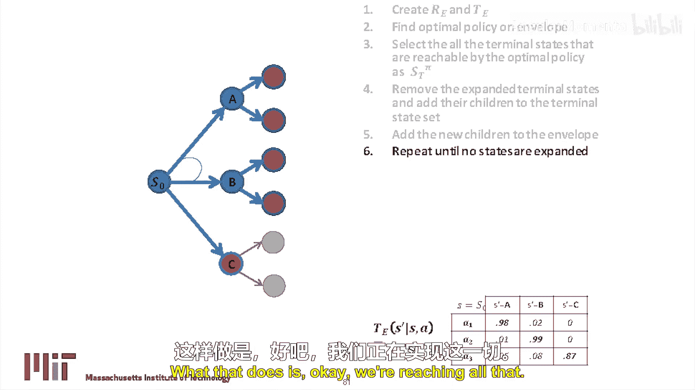

值迭代的复杂度取决于状态空间大小的平方和动作数量。随着状态空间扩大或动作增多，计算会变得非常复杂和耗时。

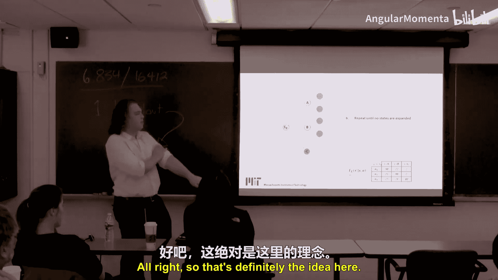

## 启发式引导求解器
值迭代速度很慢，因为它需要遍历每个可能的状态和动作。状态空间是多维的，且动作很多，计算成本很高。因此，我们倾向于采用某种最佳优先搜索方法。

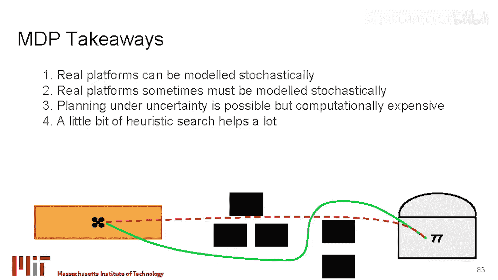

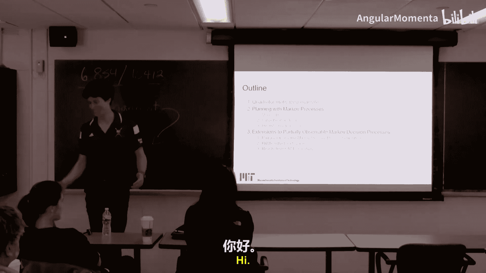

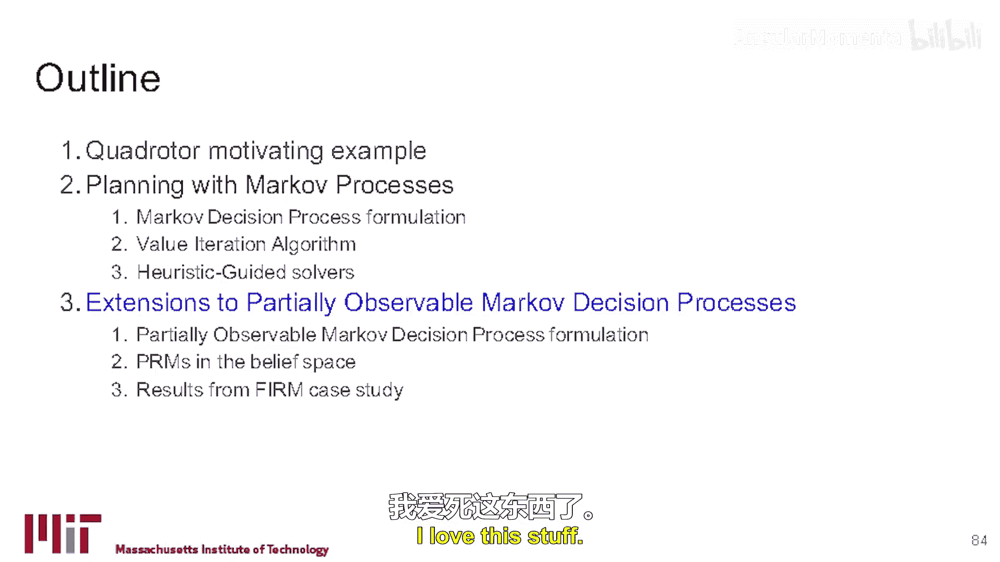

对于确定性图，我们可以使用启发式方法，沿着最感兴趣的路径搜索以到达目标。我们将引入两种新算法，重点是最后一种——AO*算法。AO*可用于搜索具有“与或”结构的图，而不仅仅是简单的图。“与”节点表达了概率耦合，如果探索一个分支，可能必须探索其他选项。LAO*是更一般的算法，它允许我们搜索带环的图，处理概率耦合，并使用启发式在无限时域上搜索最佳路径，可能会重新访问状态，并利用值迭代的工具来决定下一步。

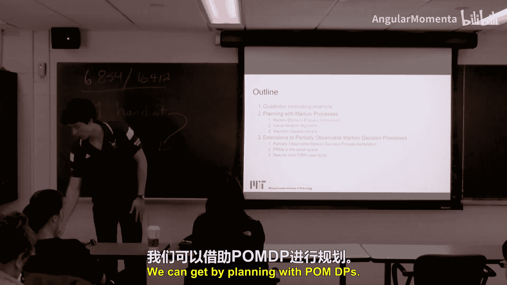

我们将讨论如何从MDP转换到这种“与或”图。考虑两种情况：
1.  一个简单情况，可以应用AO*算法。例如，一个四旋翼飞行器，如果指令向北动作，有高概率向北，但也可能向东；反之，如果指令向东，也可能向北。这形成了一个不断向东北方向扩展的树，不会回溯到已访问的状态。
2.  另一种情况是存在环状结构。例如，指令向北动作后，可能到达+1位置；再次指令向北，但由于概率分布，可能回到0。这创建了环状结构，是更真实的场景，由于不确定的动力学，我们很可能回到刚离开的地方。

我们将使用LAO*算法。它主要有三个优点：
*   **启发式引导的包络**：只关注状态空间中我们感兴趣的部分，即能带来最大奖励、在最优策略下可达的部分。这保持了问题的小规模，无需在巨大的状态空间上进行值迭代。
*   **状态空间扩展**：随着搜索进行，只扩展那些在最优策略下可能到达的状态。理想情况下，永远不会到达的状态永远不会被探索。
*   **处理环状和无限时域**：LAO*是AO*的扩展，能处理无限时域问题以及不同类型的转移，更好地模拟现实世界。

LAO*的输入可能是一个MDP或一个“与或”图，包含转移概率、奖励函数和启发式信息。输出是每个可达状态的最优策略（与值迭代为每个可能状态提供策略不同）。我们认为这足够了，因为如果我们知道起点并遵循最优策略，只会探索状态空间的特定部分。

## LAO*算法详解
我们定义一些术语：
*   **状态空间**：我们将要处理的一小部分。
*   **包络**：状态的一个子集，初始时只包含起始状态，随着算法进行，只扩展到我们感兴趣的区域。
*   **终端状态**：包络边界的节点，尚未扩展。我们跟踪这些未扩展的节点。
*   **奖励函数和转移概率矩阵**：根据我们尚未探索整个空间的事实进行了调整。对于终端节点，我们设定无法转移出去（因为不知道外面是什么），并将其奖励值设为启发式值。

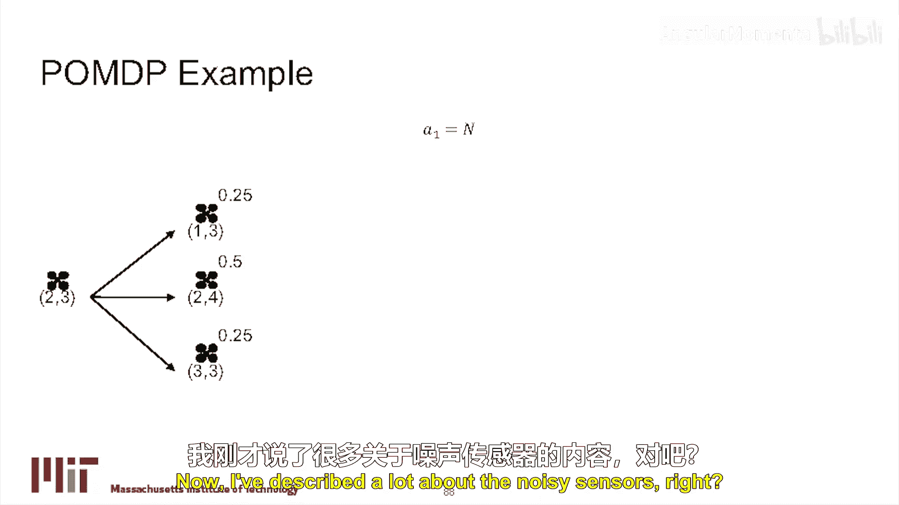

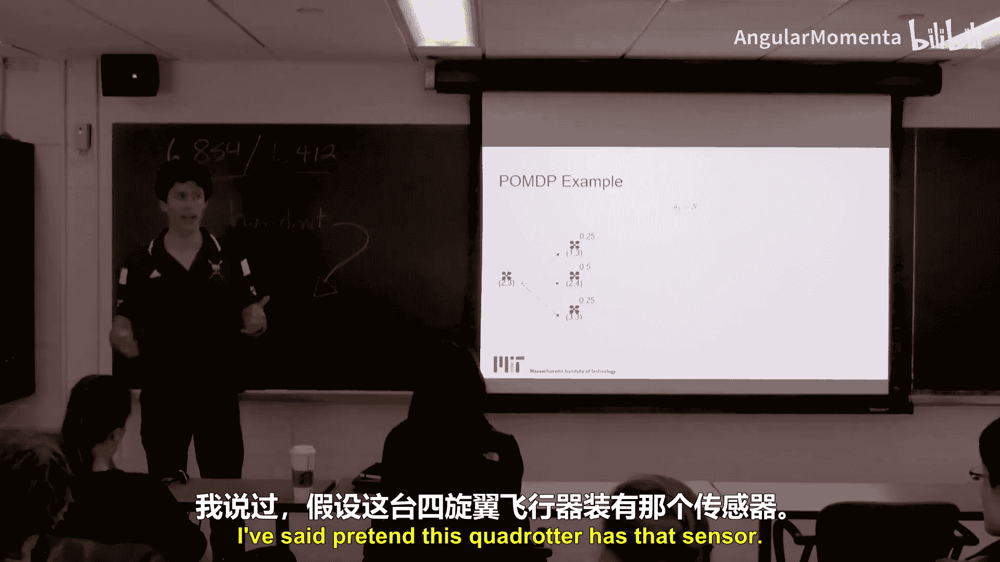

算法的一般步骤是：
1.  使用给定的定义创建奖励函数`R`和转移概率`P`。
2.  在感兴趣的子空间上运行值迭代，找到最优策略。
3.  根据这个最优策略，查看哪些新的终端状态（尚未探索的状态）可能被访问。将这些状态添加到包络和终端状态集合中。
4.  重复直到满足终止条件。

关键在于，我们只添加尚未访问过的状态到包络中，这使我们能够处理环状结构，而不会不断重新探索节点。

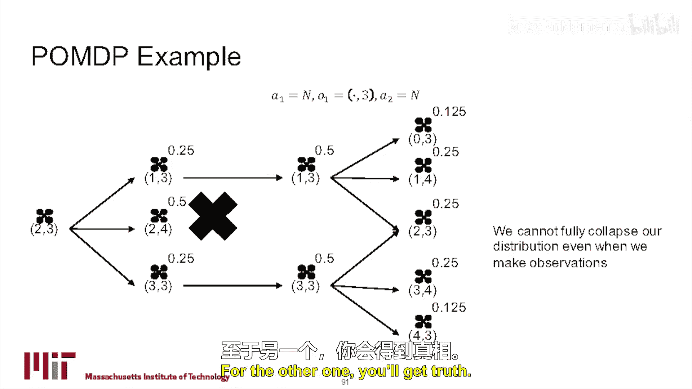

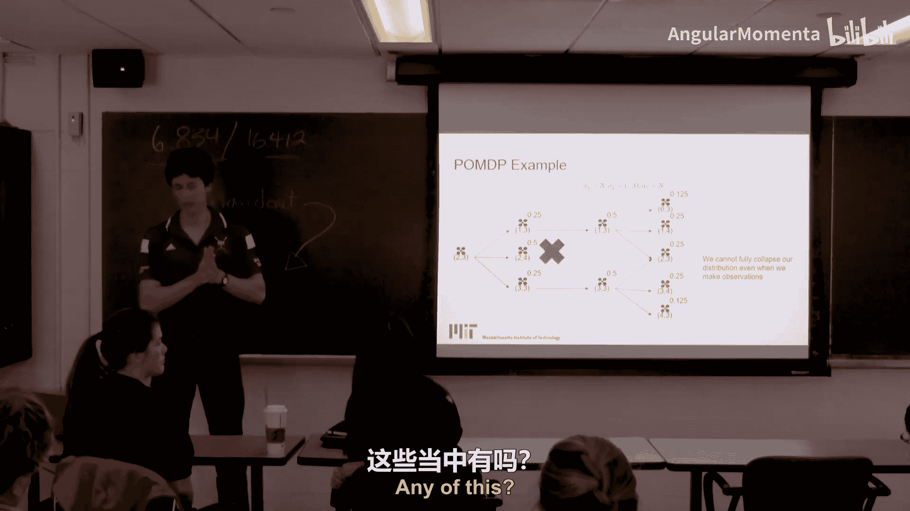

让我们通过一个简单示例逐步理解。初始时，包络和终端节点都只包含S0。根据定义，从S0到任何节点的转移概率为零（因为它是终端节点），奖励函数设为启发式值（例如20）。在这个非常基本的案例中，我们运行值迭代，最优策略是“不动”。由于S0是终端节点，且策略指示停留，所以没有新的可达终端节点。因此，我们扩展S0，添加其子节点A、B、C到包络和终端节点集合中。

现在进行第二次迭代。我们有了更多节点和更大的子空间。重新计算奖励函数和转移概率。例如，从S0采取动作A1、A2、A3，分别有确定的概率到达A、B、C，并带有相应的奖励。如果我们假设一切是确定性的，算法就退化为A*搜索：查看启发式值，选择最佳动作（例如A1），只扩展那个节点（A）。当存在概率耦合时，情况变得有趣。例如，如果采取动作A3有概率到达A、B、C，那么我们必须一起扩展这三个节点，因为即使概率很小，我们也可能意外到达它们。这保证了我们将为任何可能到达的状态（无论是否意图到达）制定行动方案。

算法重复进行，直到没有更多状态需要扩展（例如到达目标），或者策略不再指示前往任何未探索的终端节点。我们只扩展那些在最优策略下可达且可能意外到达的状态。这确保了我们在整个可能到达的状态空间上都有策略。我们可以离线计算所有内容，在执行前制定计划。

## 部分可观测马尔可夫决策过程
现在，我们将讨论扩展到MDP之外的一类更广泛的问题——部分可观测马尔可夫决策过程。POMDP非常重要，因为它们允许我们对现实世界问题进行建模，其中动力学和传感器都是随机的。

为什么这很重要？因为在之前的例子中，我们假设动作不确定但传感器完美，这是不现实的。传感器总有不完美之处：摄像头像素值波动、激光测距仪读数不精确、不同光照条件下行为不同、无法观测完整状态（例如在房间内无法看到墙外的障碍物），或者在非唯一环境中无法解析状态（例如在两个相同的走廊中）。当观测不确定性较小时，或许可以忽略，但它始终存在。

POMDP用七个要素来表述（MDP是五个）：
*   **状态集合**
*   **动作集合**
*   **转移模型**
*   **奖励函数**
*   **折扣因子**
*   **可能的观测集合**
*   **观测模型**：给定状态和刚刚执行的动作，做出某个观测的概率。这与现实世界的传感器特性匹配。

执行POMDP时，从某个状态S开始，采取动作A，根据转移模型以一定概率结束于多个不同状态。此时，我们进行观测。但与MDP不同，观测不能保证消除所有不确定性。观测是基于当前状态（以及刚刚执行的动作）概率性生成的。因此，我们无法将分布坍缩为单一状态，而是生成一个信念状态（可能状态的概率分布）。这使得策略不能映射精确状态到动作，因为我们永远不知道精确状态。

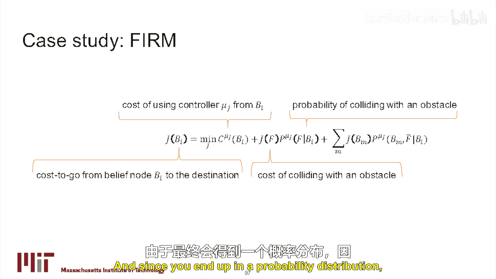

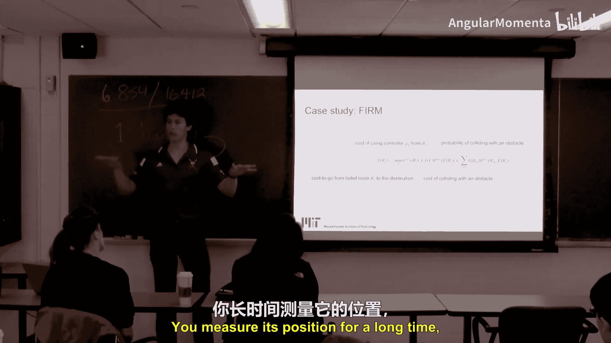

## 信念空间规划与概率路线图
那么，我们如何生成映射信念状态到动作的策略呢？我们将探讨在信念空间中规划的经典算法，特别是使用概率路线图。

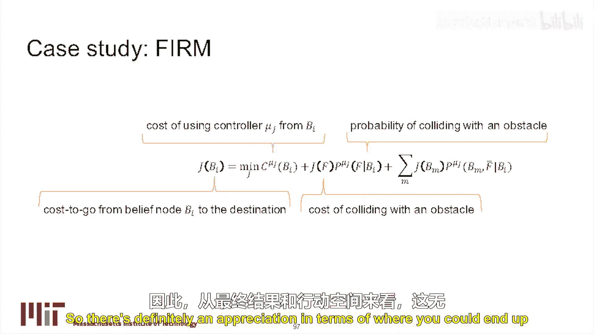

目标是生成一个将信念状态映射到动作的策略。通用算法步骤如下：
1.  从配置空间中采样点（如同一切都是确定性的）。
2.  将这些点与附近点连接起来，形成图（边不能与障碍物碰撞）。
3.  将配置空间的概率路线图转换为信念空间的概率路线图。
4.  根据成本函数执行最短路径搜索。

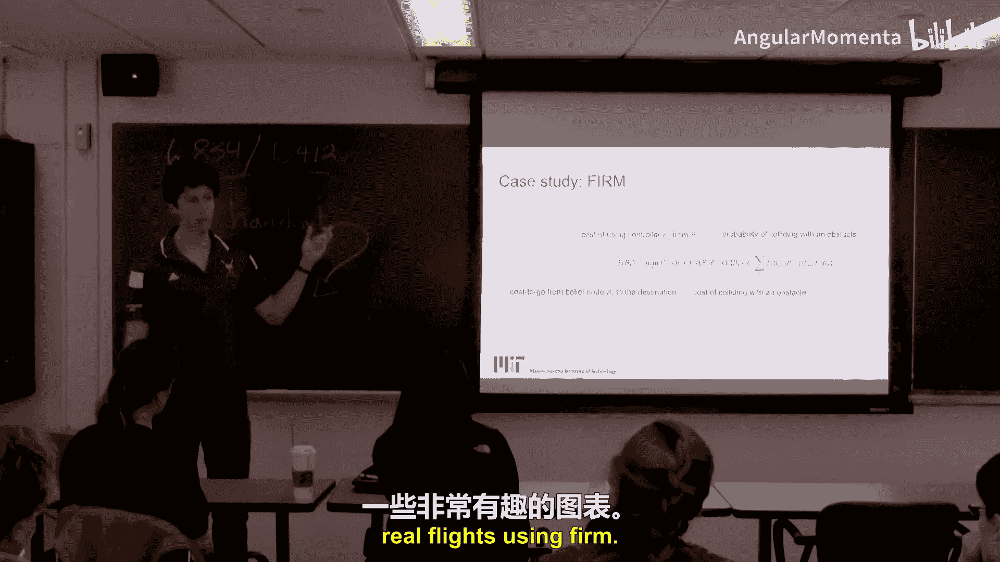

有趣的是，在配置空间和信念空间中，你会得到不同的最短路径。例如，绿色路径（信念空间规划）比红色路径（配置空间规划）长得多，因为绿色路径遵循了许多四旋翼可以从中获取测量值的地标，从而对其位置更有信心；而红色路径虽然短，但碰撞可能性更高。

概率路线图算法本身很简单：初始化一个空图，添加起始和目标配置，然后持续从自由空间采样节点，将其添加到图中，并连接到附近的节点，直到有足够多的节点或找到路径。然后，在图中找到最短路径。PRM的优点在于，随着采样点增多，它能渐近地逼近连续空间中的最佳路径，并且能很好地扩展到高维空间。

然而，将PRM从配置空间提升到信念空间非常困难。配置空间可能只有几个离散状态，但信念空间是无限的（所有可能的概率分布）。即使只考虑均值和方差，仍然很复杂。因此，我们需要进行近似，这也是不同POMDP规划器产生差异的地方。

## 案例研究：基于反馈的信息状态路线图
我们将深入研究一个具体的案例：基于反馈的信息状态路线图。其思想是：
1.  从配置空间中采样均值配置点。
2.  围绕这些均值点构建线性二次调节器控制器。LQR控制器可以在小区域内驱动系统（如四旋翼）到达该配置。
3.  如果存在反馈控制器，使得可以从一个“云”（信念空间中的分布）中的任何点到达另一个“云”，那么就可以连接这些点。

这样，我们就生成了图。执行边的成本被公式化为预期执行时间和该边上不确定性的线性组合。通过调整权重参数，可以控制机器人的行为倾向（冒险快速 vs. 保守安全）。

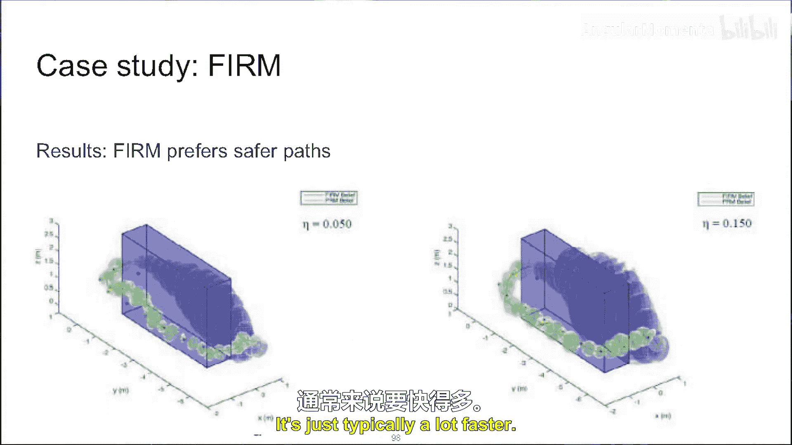

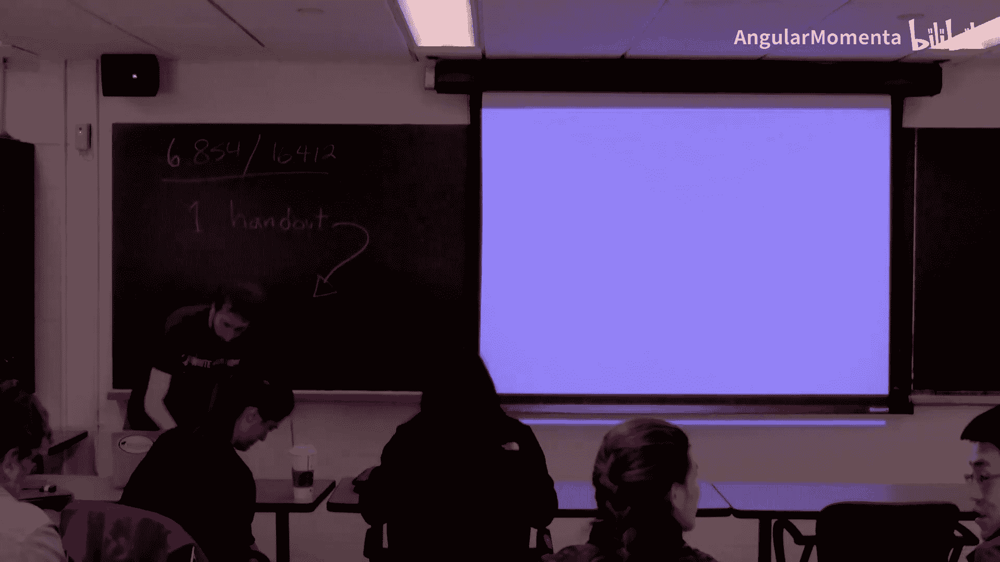

FIRM的成本方程基于贝尔曼备份方程。从信念状态出发的预期成本，是采取最佳动作的成本（包括执行动作的成本和碰撞成本乘以碰撞概率），加上到达新状态后的未来成本的期望值。

## FIRM实验结果
FIRM规划器倾向于更安全的路径。在一个测试中，四旋翼需要从起点导航到终点，中间有一个大障碍物，周围有一些地标（红色点）。比较PRM规划器和FIRM规划器：
*   PRM规划器（最小化时间）选择了障碍物左侧的狭窄路径。
*   FIRM规划器（最小化时间和不确定性的组合）选择了绕过障碍物的更长但更安全的路径。

通过绘制不确定性椭球（信念空间中状态不确定性的可视化）可以发现，PRM路径上的椭球更大，因为当飞行器在障碍物后面时，无法看到地标，只能依赖航位推算，不确定性增长。而FIRM路径上的椭球保持较小且恒定，因为规划器通过牺牲时间、在地标附近停留以确保定位，来管理不确定性。

当模拟噪声（如风速）增加时，PRM的碰撞次数增加，而FIRM的碰撞次数保持较低且恒定。这证明了考虑不确定性的规划器能提高安全性。

## 总结
本节课中，我们一起学习了：
1.  现实世界问题是随机的，对机器人进行随机建模非常重要，但这使得问题更难解决。
2.  通过使用启发式和做出明智的假设，我们可以管理这种复杂性。
3.  考虑不确定性可以产生本质上不同的、通常更安全的路径。

概率规划是一个强大的工具，它使机器人能够在充满不确定性的世界中可靠、安全地运行。