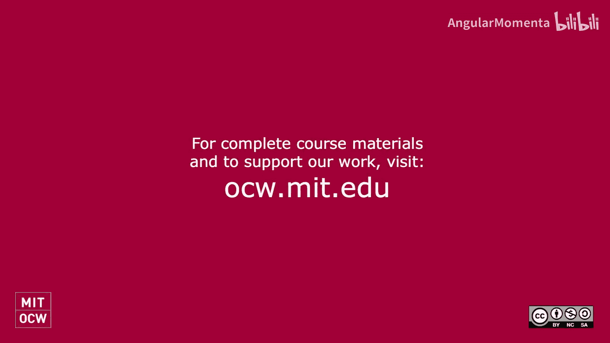

# 【麻省理工】计算音乐学与分析‌ ｜ MIT 21M.383 Computational Music Theory and Analysis,S 2023 p01 01 视频0：面向OCW学习者的21M.383计算音乐理论概览 -BV17xUmBDEUC_p1-

Hello， open Coseware learners。 My name is Michael Cuthbert。

 and I'm the professor of a class at MI I T 21 M383， computational music theory and analysis。😊。

I'm so glad that you're going to be joining us in this course。

And it's just absolutely great to have people learning about how computers can help understand music and especially music theory from throughout the world。

😊，I'm making this recording about a year after the class is done to welcome you and to say a few things along the way throughout the class。

 The first thing I wanted to let you know is we had some technical difficulties on the first day。

 And so you'll see that the lecture sort of begins a few minutes in。And that the video quality。

 especially of the PowerPoints and my live coding isn't。Up to the quality we would like to have。

 So I'm going to be re recording a few things here and there。 And when you see me looking like this。

This is something that's made just for you on open courseware。

 I'll come back and talk to you from time to time， for now。Hope you enjoyed the class。

