# 【麻省理工】计算音乐学与分析‌ ｜ MIT 21M.383 Computational Music Theory and Analysis,S 2023 p02 02 第一课 视频：计算机如何“听”音乐 -BV17xUmBDEUC_p2-

You've seen that there's more technical problems than a standard class。

 and that means you're in the right place。 if you're here for a computational class， right。

 This is 21 m383 computational music， theory and analysis。

 or I can't remember if I call analysis and theory， don't hold it against me。 I'm Michael Cuthbert。

 I'm the professor of the class。 I'm a professor of music in music and theater arts。

 and do some work with computational analysis。 So what I want to start with。

 and just that's why I am， I'm going get to know who you guys are on Friday and next Wednesday。

 It's very important to me。 I want to really quickly be able to learn everybody by name。

 But on the first class。 I think you all here to figure out if this is the place you want to be before we get to know everybody else。

 So that's why I'm not gonna be going around and asking everybody today。

 but I'm going to I really want to know that soon。😊。

So the big question for this class the whole semester is going to be， how do computers hear music？

What does that even mean， I'm gonna give you an answer if you care about answers like this that you can read。

 absorb， pack up， go home。 and youd no need for this class。

 If this is satisfactory computers here music by using a microphone connected to an analog digital converter connected to a microprocess were in specialized codec。

 I can never remember what that really means to quantize the sound into a wave file or A A C or something else file that we store on a magnetic or solid state disk or we store on the cloud and store on somebody else's magnetic solid state disks。

 right。😊，Not a very， very useful answer。 So what I think we more want to know is that computers are hearing music。

 but are they actually listening。And these two terms here versus listen in different contexts。

 one of them has higher priority than the other and implies a more deep， deep understanding like。

 you know， mom or dad ever tell you， I know you heard me， but did you listen to me。Right。

 we have that kind of distinction built in。 So want to know is。When computers hear music。

 what kinds of understanding？Might they have might， might。

 might be in encoded in that if you feel uncomfortable with the notion of computers， you know。

 having their own autonomy or something like that and。

The only reason I really care about this question is。That by understanding how a computer hears。

 it might change how we hear。Or it might open up new pieces for us to listen to that we didn't already know。

 And most importantly， it might answer questions about what it's like for us to be humans。

 Any ands here。What it's like for us to be humans who are。Listen to music。

 So here are any six big unknowns for me that I want to know the answer to。

 I'll just say you turn in on Friday， the correct answer to any of these six questions You get an A plus and you don't have to take the class。

 But I don't know them。 So why do we listen to music。没有问。喂。It's kind of。

 you know we don't go around all day， you know I have my different sense that I smell all day or we don't you know there are all kinds of things that are enjoyable。

 but that seem to be different that we don't do all day long nowadays Why do people choose what musical styles they like？

How does your musical tastes or our whole culture's musical taste change over time。

 and some of us will be from different cultures and have different musical tastes？

What's the difference between a great piece of music and a mediocre or a bad one。

 or do those terms even really exist， what makes a piece of music beautiful or ugly？

And let's not forget about the physical。 Why do I want to dance or move when I hear some music and other ones I just want to sit and cry。

啊。So these are the questions that。If you answer them， I mean， that would just be astounding。 I think。

 however， that a one semester， twice a week you know， class。

 we're not going to get the definitive answer to them。

So I like to break these questions into slightly smaller unknowns that helped answer these questions and that we might be able to start making progress on。

What particular musical characteristics distinguish a folk song from one part of the world。

 from one in another？How does the look of a band， its costume age。

 its racial composition affect the makeup of the audience。 I mean， you know。

 I'm not about to be a heavy metal star the way I'm currently dressed， right， what does that mean。

 Maybe maybe I'm okay at the piano， I'm actually better at metal than the piano And you'll hear。

 but that's okay， I'm pretty better at both， What sorts of chords are used for relaxation for rest for stop in music today。

 And how is this different in different centuries， So different parts of the world。

 And what do the lyrics of top sellingelling songs have in common with those of award sellingel songs or don't have in common？

 and you know。That's a question that， you know， I know that there are people at the big record labels trying to answer that because there's money involved。

What rhythms or instruments accompany texts about sadness or death that appear less often in moments of happiness。

 that's kind of related to the why does some music make me cry， so on。So five good questions。

That might help us answer a big unknown。What I'm going to do is I'm going to leave three up and take two off。

And say that these three questions in particular， musical characteristics distinguishing X from Y。

 chords used at certain points and change over time， rhythms about and connection to emotion。

 These all might be questions that having a representation of a musical score。

 whether it's more modern with handwritten， ancient， These are questions that might help answer。

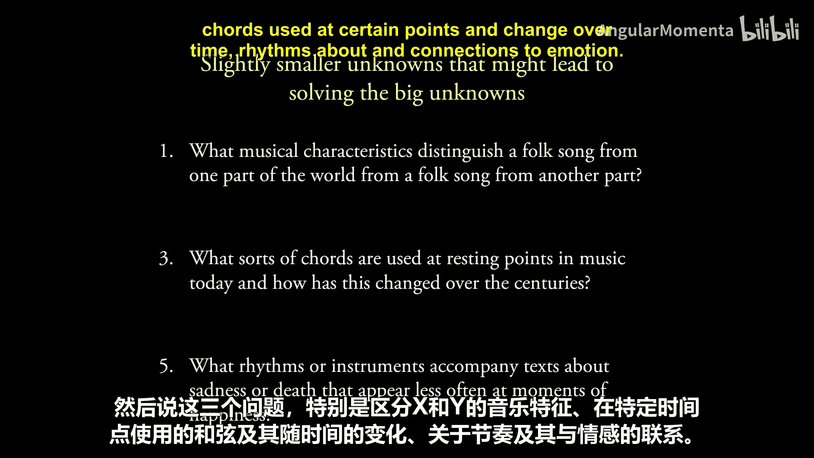

So let's just kind of recap what are some of the things the computers good at with music？I mean。

 kind of old sides， you'll see it's pretty out。 but that we， you know。

 we make a lot of music with computer。 we mix it。 We， you know， we we sort of do re editing with it。

Computer absolutely changed how we distribute music， how we get it， how we access it。

 and then very cool， you know， apps and algorithms developed at places like this can tell you know what kind of what song particularly is some drunken jerk singing in a bar。

😊。

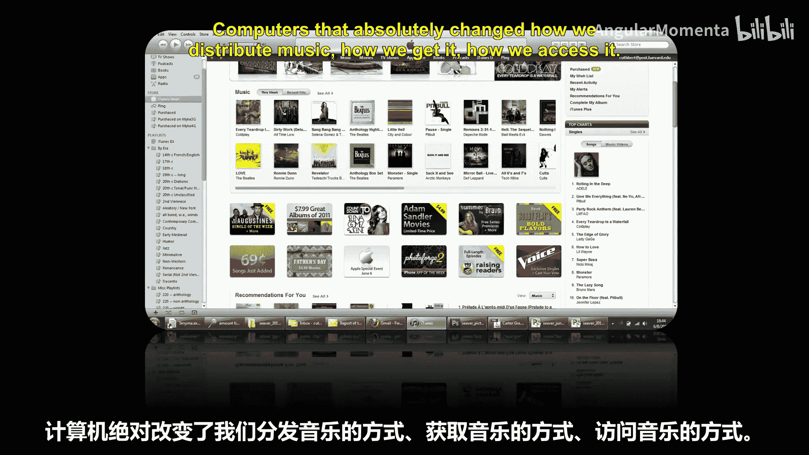

That's。But。Until about the last decade and a half， little had changed since the 70s and 80s in how computers could be used to analyze scores。

 and so things are changing now， but let me say you know where things were what people already had for let's say text that's different from music。

So if you load a text， you know， we're all computer geeks at least to a little bit。

 is that I consider that as a term of endearment for myself， but hope that's okay。

 We're all computer people。 And you know so we can look at I can use the term string right we can look at a string of text like this。

 and you can ask various algorithms already exist in any programming language to be able to identify the spaces split or what's a foreign diacritic casted to ASI and see what crashing is what's punctuation。

 And then if you have some kind of font rendering， you'll know what's going below the line and so on。

 what's a capital letter， all these things。 And this level of lowleve information about text。

Really helped to build the next level of information about text sentence diagraming。

 understanding from letters to a sentence level understanding。

And this kind of built up knowledge has helped to make to the next level。

 which we might be arguing today about whether or not there is an actual meaning involved。

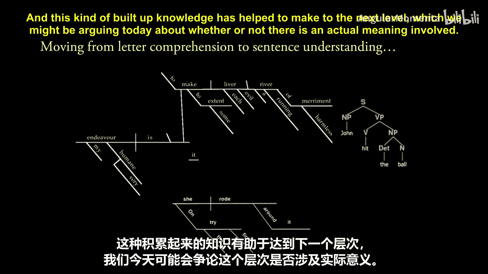

I'm really that want spam。嗯。

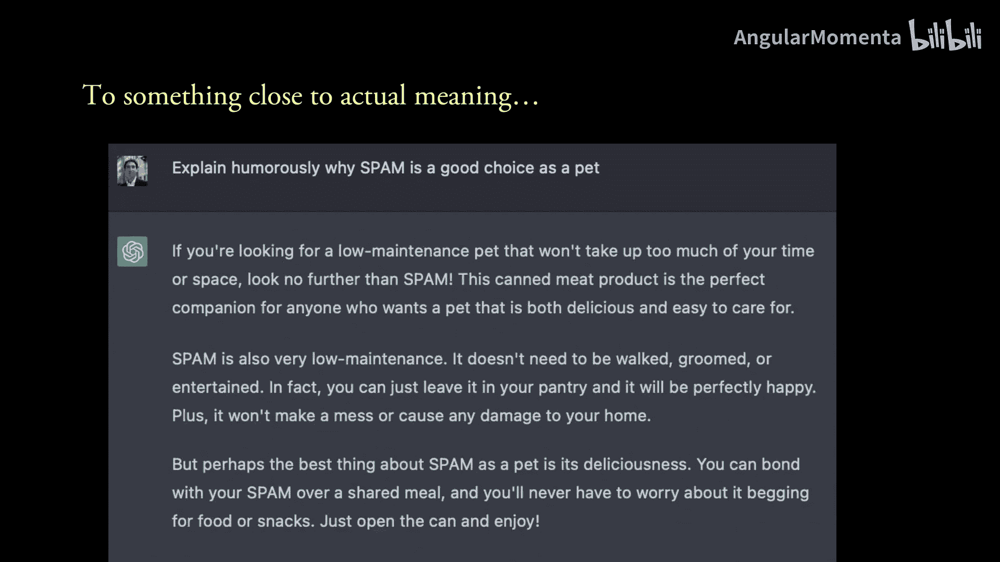

So。Can we build these technologies for musical scores， maybe。Maybe but not yet today。

So this is a class that I hope。People 5，6，7， 10 years from now， hopefully less， hopefully not 30。

 50 that what you do in this class will help get to that level of understanding。I think。

Put it somewhere， this is a unique， really unique class。

 I think that there's about three other classes that are something like computational music theory offered in the world today。

 the other ones are all doctoral seminars or graduate seminars。

This is a class that because of MIT's unique ability to merge the arts and programming。

 a deep knowledge of music and a great culture of collaboration in solving problems we can do this at the undergraduate level and if you're a graduate student。

 we can do even more with you all on that So what are some of the technologies we need to build。

Well here's some simple things that a computer has to know to do anything with scores。

 start off with D， E FG。 What's the next note。哎。Not H， right。

 Not even the Germans who have H would would go on from that。

 So you need to know about these cyclical little things。 Take a look at this next slide。Yeah， okay。

 we got some squmers in the room， right， right。3，4。 This does not compute。

 So we need to have an idea of meter and things。 And then from there building up。

 you know which of these two scores is more consonant and which is more dissonant。

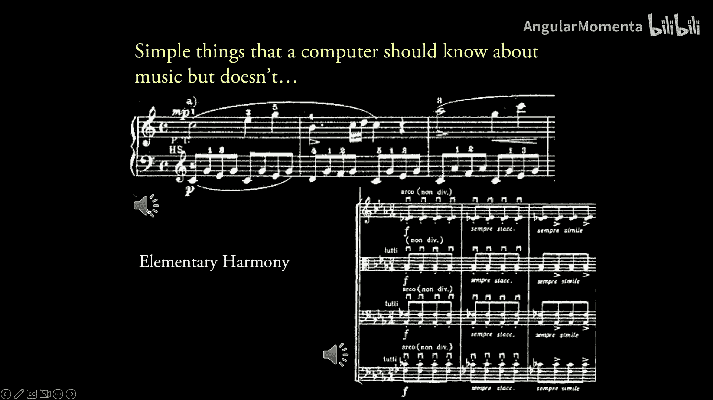

So we need a concept of consonance， dissonance and how to bring this from the score。

 So we're going to need to step back from some of even the middles questions and go to even smaller things。

 So for instance， let's say this is the checkho skis 1812 overture。

 and let's see if we wanted to understand how the key relations work。

 how we move from one key to another and how this builds up the form and the tension。

 the power of the piece。 Well， in order to do this。

 we need to know where all the key changes are right So we have to be able to cut the score into smaller pieces and identify that now how might you identify a key change。

 Well， you might say， well， it starts off with a cadence of one key and then it ends in a cadence and another key so now we need to be able to identify cadences。

 So we need something that can do that。 Well， well， this chord moves in five moves to one。

 So that's a particular type of cadence。 that term。 When I say five moves to one。

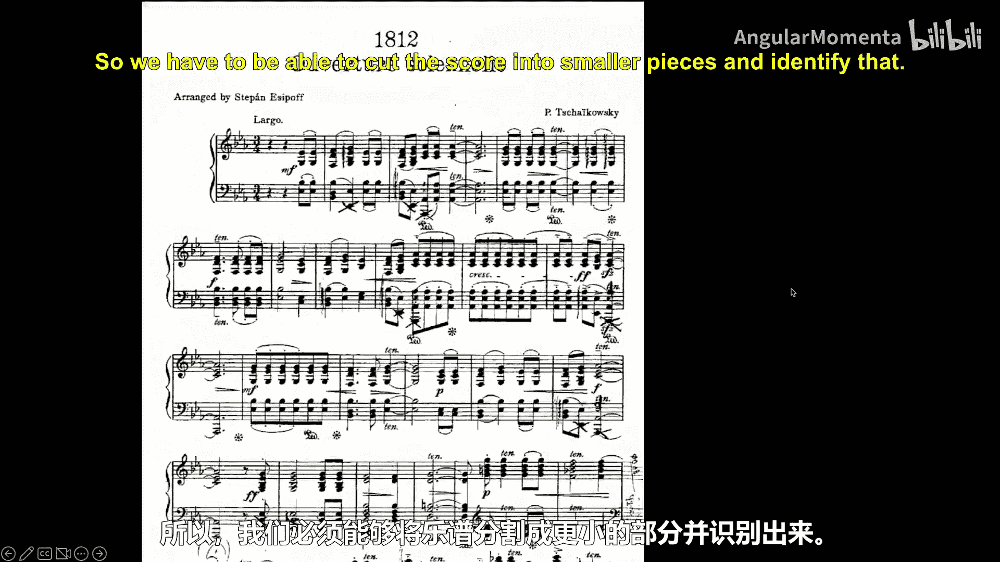

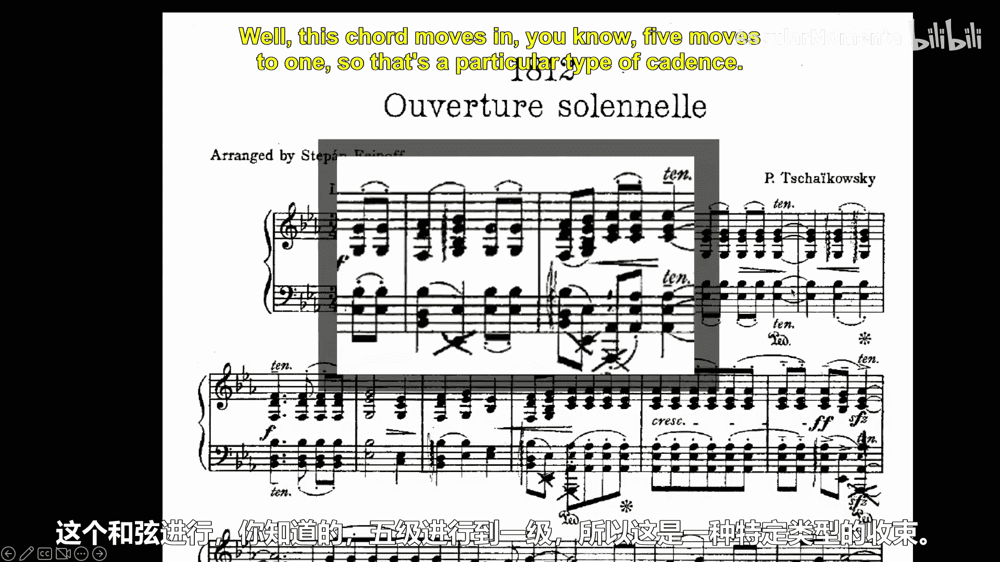

People hearing Roman numerals in your head and visualizing it because these are the levels of musical knowledge that we're going to be using a lot here and so in order to figure out if a chord is a five chord or one chord or what's in the chord at all。

 if it's a major minor， we need a representation of chords and notes and pitches。

So some of what we're going to be doing at the beginning of the class is recreating some of these tools and then we'll see what other people have done and go further from that。

So the notion that we don't have all these things is kind of surprising because there's a lot of money。

 a lot of work that's been out there taking some sort of representation， musical score。

 whether notation or MIi or something like that， some sort of a score and playing it really nicely on speakers and things like that。

 all those things， or if you've used notef， finale， Sebelius， Doco， something like that flat IO。

 you know that we can take a representation of notes and turn them into some sort of musical score。

 So I think of that as kind of output。It's like a printer。 And then a lot of work。

 especially in research labs on taking sound in and converting it into that kind of digital representation。

 That's useful for search things。 But once you have a digital representation of a score already in your computer。

 What do you do with it， How do you analyze it。 How do you work with it。

 And there's been a lot less research on this。 So it's like we've been spending all our time building printers and't know how do we get things in scanners and。

Much， much less time building our actual CPUs， nobody has a CPU that looks like that anymore time to update your slides across。

So one of the things that we're going to be using a lot in this class is the toolkit that I and many other people at MIT have used to do these kind of manipulations and's。

Think it's correct to say it's the most used toolkit in the world for working with musical scores。

 it's Python， free and open source， and sometimestime over the next couple days you're going to be installing it with Pip stall。

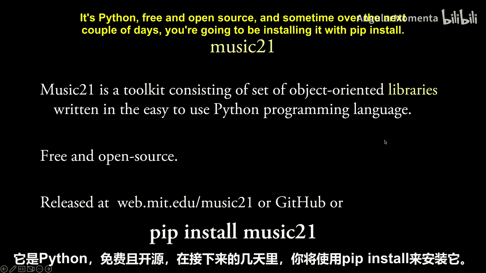

So music 21 really works from the notion that first we're going to encode a lot of groundup concepts about music so that when you have a chord it's not going。

 yep， we'll just generate a chord obviously not obviously otherwise you need this concept but you're gonna to have a representation of how to represent pitches。

 middle CEG and then all the different things once you have that chord that you might be able to do。

 you might get its lyrics， I don't know， it's going by really fast its volume isn't a diminished triad so you can do that and hopefully any good computer program seeing CEG for is diminished Triad will return。

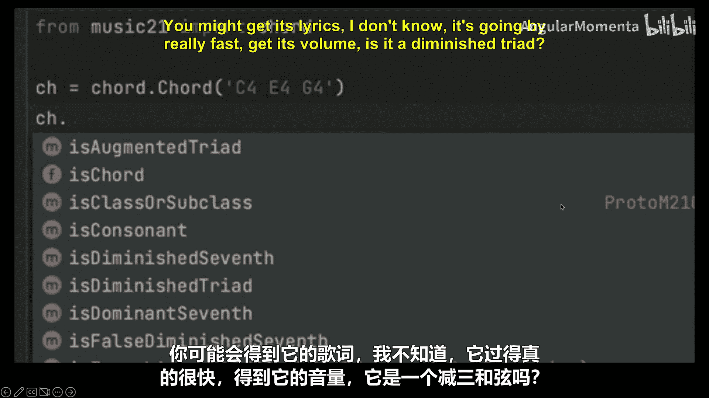

No fall swing， anything like that zero， right， yep good。

So in the amount of time it takes to write computer program that can tell whether CEG is a diminished triad you all can hear it instantly right so why have a computer do things and it's really so that we can listen to music faster than we can ever listen with our ears so this is a particular example of code in Music 21 similar code in other toolkis that will take a Kll by Johann Sebastian Bach。

His 11th cantata6 movement encoded his a file called Music XML story as a variable。

 get the alto part out of its story as Alto， get measures 13 to 20 as excerpt。

Do a particular analysis where we're going to put all these stars on according to how strong we accented。

 something might be metrically and show。And really any music analyst in the amount of time I took to do this。

 could have done it herself or himself or their。But。What's the great three letter a pre。

 preposition that makes computers really powerful？The ends with F。Oh，44， yeah。

 so we just put a four loop in and suddenly we're looking at every Cral that Bach wrote。

 getting its al part measure 1320， doing the same thing。 and of course。

 why just do that little excerpt， why just do the alto part， Let's grab every Cral。

 four loops within four loops， don't over optimizeimize first figure out if you can do this in the time it takes you to get a cup of coffee right？

嗯。Yeah， we'll come back to that theme in the class a lot in your computer science intro classes。

 you're going to early on be thinking a lot about is this O big O of n squared。

 is this un cubeed is this N log n all these terms。

 we're going to talk about that from time to time here。

 but for the first part we're going to build tools that work in an。Acceptable to us amount of time。

 You're going to hear me use this term a lot when we have a really big research question about， oh。

 I don't know，15th century musical styles。 and we'll say people have waited 500 years for this answer。

10 minutes isn't so bad right and then then later， you know。

 you can you can go back and make it a three minute problem， something like that。

Some of the questions we might ask that come up that these kinds of toolkits are built to solve are higher notes louder。

We。Many of us perceive them as loud， are they given loud dynamics so we can plot pitch。

 know octave numbers， middle C， C4 is the standard American representation today。

 and the cello doesn't really go up that high。I don't know is sportslando really somewhere between Forte who knows you these sort of kind of slightly arbitrary but doesn't look like it to me Now this is one little graph probably want to do this on a couple thousand pieces。

 run some regression lines， all the things we can do， but we can start answering those questions。

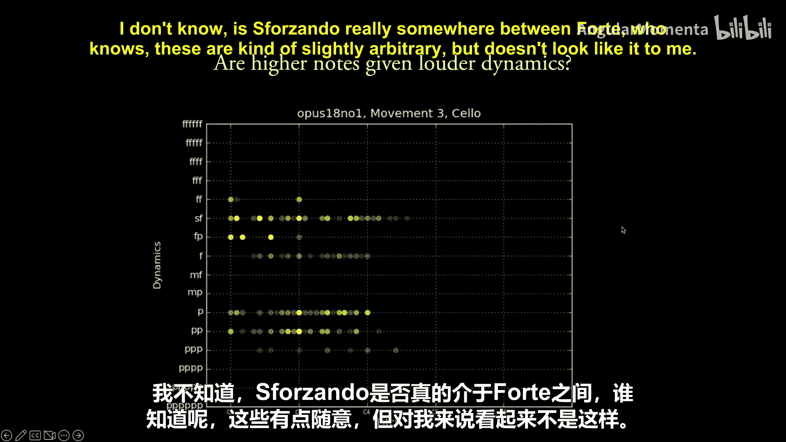

How does Robert Schumman use notes differently from Friedrich Chopin？And。Gg plotted this in。

 applying the pitch usage of Summan。 I can see How beautiful。 It's a really nice bell curve。

 really great。 Chopin， on the other hand， looks I don't know。

 kindnd of like one of these cities with no planning laws。

 I like here's I can say Abu Dhabi with the gigantic skyscraper。 When Chopin likes a G sharp。

 It's not just any G sharp。 It's this G sharp。 They just keep playing it forever stuff。 so。😊。

These are some of the ways you can do this。 Any Robert Schummont experts out there。

Some hands almost went up， some people like Robert Schummont。Garbage Inn， Gar out。

This particular piece by Summan is a string quartet。

This piece by Chopin is a piano when you have a string quartet。

 of course you're going to have more instruments with notes in the middle。

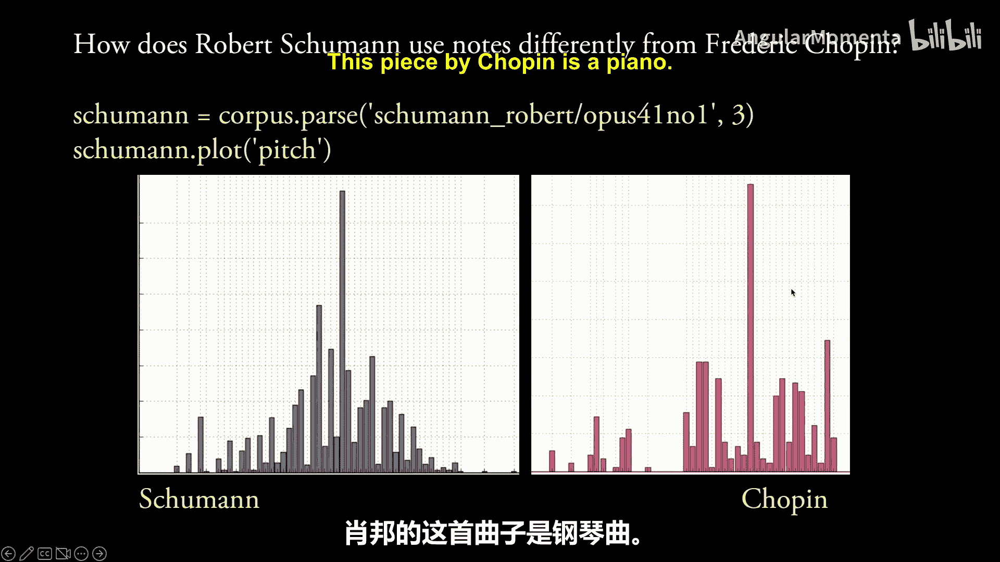

So。I did this once， I thought I had compared apples to apples。

 and I realized it compared apples to oranges， so we're going to think a lot about user error also in how we make things。

嗯。Visualization of music is a big part of what we're doing these kinds of visualized graphs can make understanding a piece very easy。

 you can also use 3D graphs which don't make it easy at all to understand anything。

 but they look really cool if you need to like donors and funding and stuff so always make them when you need that。

 but otherwise I can't really read that。We can combine different fields， so for instance。

 geographic information and plotting with musical characteristics。

 so this is one of my fun things I found。😊，Comparing the distribution of large intervals。

 these are intervals close to what would be Western7s。

But obviously they're not exactly that because different cultures use different intervals。

 but looking at the folk songs differing and you can see a large difference as we move northward and a little bit as you move inland in China in the increase of large intervals that are not octaves in folk songs and we'll look at certain point over the semester at a very cool paper that kind of shows how particular mountain range divides folk songs that are very different on either side of that range。

If you're looking for particular fingerprints that might tell you who a composer was。

 maybe there's these small moments you might find there's one moment。In this piece from around 1，500。

That is feels like it might be in a modern composition where you just smash your hand down on a piano。

It was very hard to see here。 but with a computer， what we can do is we can。

Take all of the notes and put them into singular chords here。

 Reduce them all so that they're in close position。

 Everyone remember that from music theory class as close together as you can make it。

 annotate the intervals。And suddenly。

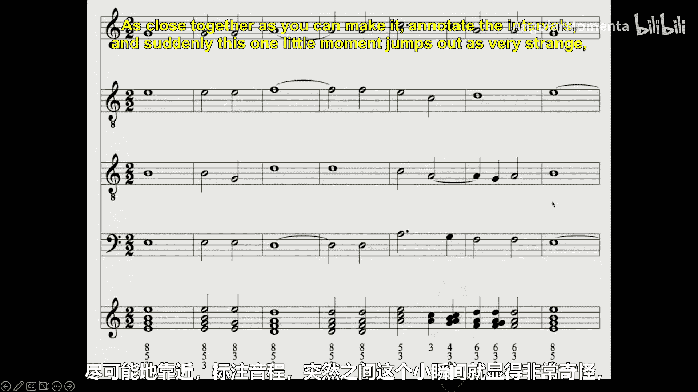

This one little moment jumps out as very strange。 Then you can go back and figure out how did the music create this。

Over the course of the semester we'll be looking at changes in music over time so this is and we're also going to be looking at various things that were done by people either in this class or who had worked in the lab that helps create music 21。

 so Beth Hadley was somebody who graduated from this program who did this analysis and looking at a lot of rock popular music songs the 1950s and 60s see the bass moves quite often by five semitones up or down which corresponds to sort of a movement of one to four or five to one things like that。

 and then occasionally up by two semitones where's that in the  one，4。

51 progression14 green to5 to one， and so you can see how this really dominates。Does that go。 Yeah。

 at the time most data set， it says post 1980， it should say 1980 to 2000 data set。

 And you can kind of see if we go back and forth how it's still these fives and chooses the main thing。

 but。These other intervals。Are continuing to move up and becoming more and more important。

 Love to see an analysis。 We now have another full 20 years，22 and a quarter。

 years by the time the semester is done worth of music after 2000 to see if this trend continues or stopped。

😊。

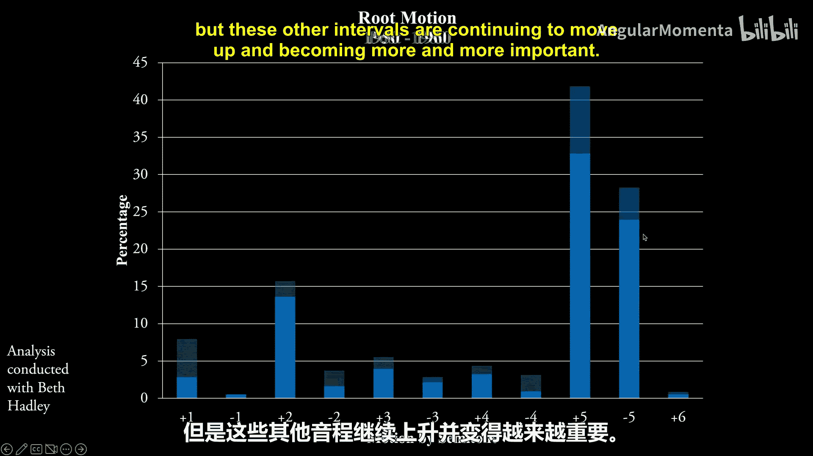

Anybody， you'all have taken either some sort of a theory class。 So at some point。

 who has written a parallel fifth in this class， Acally， Yes， okay， wow。

 some people have never written a parallel fifth。 That's amazing。

 or you you always did it on purpose just to annoy your teacher， right。

 so we can find next time you you've given that。 You can generate your own list of every single time that Johann Sebastian Bach wrote a parallel fifth or an octave so that you can give it to your teacher and say。

 yeah， that was a parallel fifth but it's exactly like what Bach wrote。

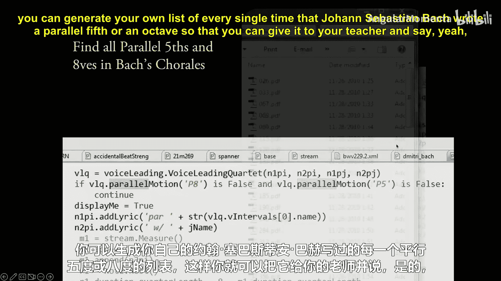

Once you've written a program that does a particular type of analysis on a particular corpus of music。

 a collection of music， and analysis， it's easy to swap one or the other so that once you have something that finds all parallel fits in Johan Sebastian Bach。

 then we can put it into Claudio Monteverde。

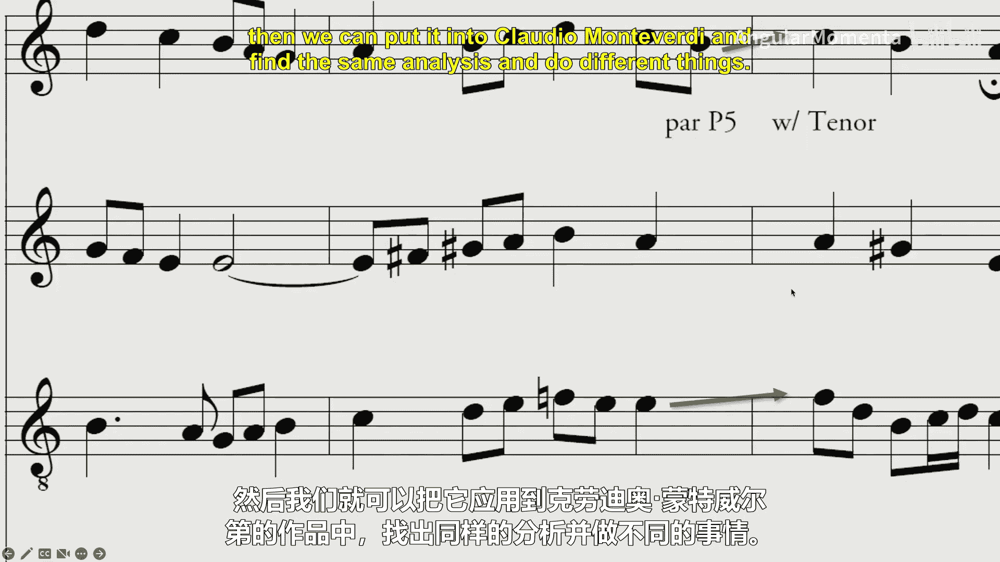

And find the same analysis and do different things。

 So each of our tools can work on what is it if most of our tools， I'll say not all of them。

 most of our tools can work on any corpus and any corpus can apply to multiple tools。

 So this is a place where you get sort of a squared increase in power by using computer over if you wanted to do this by hand。

I'm trained primarily as a musicologist。 that is a music historian and somebody first trained to do things by hand and look at history and look at context and come to conclusions。

 Then I did a lot of computer things and for a little while I kind of these were slightly separate worlds。

 I'm trying to move them more and more together so that when we answer a particular question。

 we think about which of those big questions。 what bigger answer might we have come to So this was a particular demonstration program。

 I wrote early in early in my development。 I's like， oh， cool， I have you're gonna see， well。

 we'll talk about why Js box coming up a lot。 but I have all these pieces by Bachs both and I know that Bach when he when he writes a piece that's in minor。

🎼Yeah。How is it going to end generally anybody know？🎼And the。🎼Yeah。Yeah。

 this kind of call piquty third， so usually when he's in minor， he ends in major。

 I wanted to find every exception to that in his corral composition， right。So。

Pretty easy to find all these places。 And then I was pretty happy that I found that there's exactly eight of them。

😊，I thought that that was kind of neat until one day I was a little bit bored and I started looking at what these pieces were。

 what pieces went with these weird numbers。 And I looked at the first one。Pece 248 in box catalog。

 And I saw， oh， that one's wrong。 The computer didn't get it。 I didn't expand all the repeats。

 So the final bar in the piece then said docopo， which ways right for you。 Yeah， docopo Alfinine。

 So go back there。 and the actual end was in the middle。 and that one was in major。

 So followed that that looked at these other pieces。

 I saw their sign some people call orphan quarals。 They're ones that JS box Sun CP E box said dad wrote。

And publish them， but we have no other evidence the dad wrote them。

And the only time this ever happens is in those collections。

So some people have been arguing maybe these pieces aren't really by Bach。

 or they've been edited heavily。This seems to give us some of the evidence that that might be true。

So always。Remember that the computer is not substituting for analysis。

 it's a tool to make the kind of analytical questions you might already have more efficient。Y。

 that's why。 yep， that's what we know。The first couple of things that we're going to be looking at in this class are how we represent music。

 what kinds of scores are happening and so on。

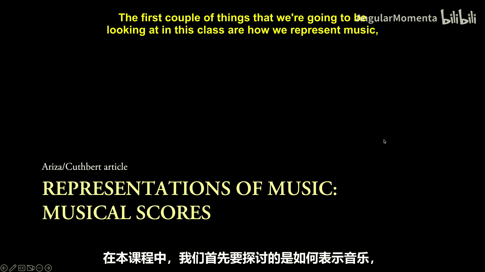

And we'll get into why you might do one representation or another。

 One of the first things we'll look at is music as a series of boxes of Russian nesting dolls。

 whatever we want to call it box within a box within a box。 So we have a score inside that box。

 We have some parts inside those boxes we might have measures。

 We might have voices two different independent voices within a measure， something like that。

 So we'll call those kind of partbased containers。 You're gonna even put the score into a bigger box with like the opus or all the works by in a collection。

And then our second box we might have is everything that happens at a certain point in time。

So everything that happens here， everything that happens here， here。

And we'll be looking at and trying to identify when one representation might be better and when another representation might be better。

And how you might use write tools to move from one representation to another。

 from a box based to a moment based。You'll see we sometimes call this sami s like here。

 just chop the thing like a sami。

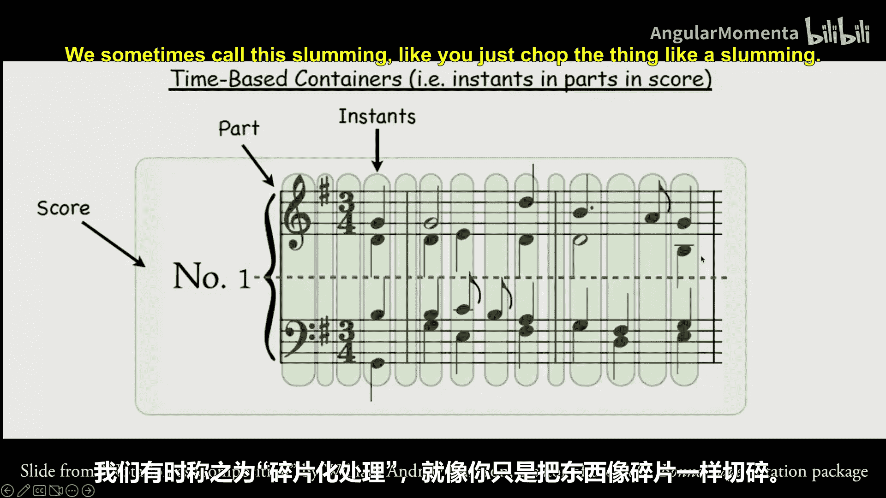

Yeah。A really important moment。 And this is I alluded to with the book there is to try to make sure that the。

Conclusions that we're making apply to more music that's out there。

 and that's only possible if we have a lot of music and that music' is representative of people who create music。

Here's some of my favorite composers out there， we've lived with V Beethoven。

 we have Joseph Boon Chevalier de San George， Kate Selpper friend of this music department。

 Amy Beach， Wagner， Rick Wagner， JS Boch， Scott Joplin， Queen Liby Uullani。

 I spent part of my year in Hawaii， very important composer。我 Yamaadaosska。

Wolfg Mozart got Dolly Parton and the Beatles， so these are people that I would really love to do my work on。

So I go and I start doing the work and of course。I don't want to encode all of this music in。

 So I go with what other people have encoded。And that lets me work on this subset of music。

Very representative subset of the people who were up there before。No， not at all。

 We have Beethoven Bach Wagner Mozart。All。Great composers， long dead white males out of copyright。

And then still in copyright of what no group of beetles that somehow there's just always beetles everywhere。

 you can almost always get that So this was a state。Of music， which sometimes called corpus research。

 work on large collections of scores， a corpus body。

 a large body of repertory of scores when I started going into this。Thankfully。

 the situation is getting a little， little better。We now have the complete piano rags of Scott Joplin who wrote the Entainer Male leafaf rag if you don't think you know his name。

 we'll play somebody' music and you're like， oh yeah， I know that music。

 so very important composer we're starting to get in and individuals and groups are starting to create collections like this collection of a couple hundred scores by women and non-white composers。

I hope that this class at some point， we will all contribute on to improving the situation just a bit and try to make it so eventually。

What is represented is in our representations looks like the world we want to be in。So。

We're you have in front of you somewhere a syllabus so so grab grab the syllabus。

 we're not going to go through it line by line and line。 In fact， I haven't even given you yet。

 the longer one that's going to tell you day by day what we're going to do because part of that depended on how many of y'all showed up today。

 And it's a good good crowd。 everybody comfortable a little bit a little bit not over there。

 but we'll we'll somehow make this make this happen。Okay。You'll be happy that this class。

 there's nothing to buy that you unless you don't happen to have some of these things earlier。

 we'll use as a textbook， the music 20， the sort of standard textbook， the Music 21 users guide。

Probably get to maybe chapter 25， I always said1 to 30。

 but we might not get there and we can't go too much past 30 because it just kind of trails off it's still being written。

 you can always write some more of it if you want as part of a project。

You're required for me to support you， for me to be a help to have a Windows or Mac OS laptop we're going to install the latest version Music 21。

 which is I believe 8。1 the hope the plan the bags under my eyes right now was to get version9 released before today it's not out it has some of the near features that we'll be using we'll get I'll probably get that out within a week or two you all are my focus and then we'll put that on so at some point I'll upgrade to that。

In use of 21 version 8 runs on Python 3。8， version 9 runs on 310， so install of Python 310。

 you'll be very happy with that or 311。Probably want to get some staff paper and a pencil because at various points unless if you're using a tablet。

 you're probably fine， but it's in size hard if you're taking notes on laptop and we at some point be using that staff lot。

There's four recommended books， I love them， but they're all ebooks。

 but you might consider buying them at least the first two were pretty cheap and things。

 but we don't really need to talk about that or。Okay， we're making great time， the typical week。

We're going to on Wednesday introduce a particularly new topic。

 this is just sort of middle of the semester right and then you're going get some readings to do for it。

 Some of them will probably be for by Friday， we'll try to make Wednesday to Friday， I mean。

 kind of a time more for reading and reflection and things on Friday So maybe the topic is let me not be hypothetical。

 What is topic3 it's written there're somewhere okay containers。

 we just talked about this how to represent as containers。

 what are the various ways working through that So we'll just sort of introduce like we did now a new topic and think about it on Friday we'll get to some of the nitty gritty difficult things。

Discussion of why this representation work， why this doesn't， Why you might make this choice。

 and we'll do some in- class work on that。 And then usually on Fridays， you'll get a problem set。

 So you'll get that on work on it。 But over the weekend。

 you'll also be getting a little bit of asynchronous content。

 So what happened was nobody really cares about the history of your class。 but I'm going to tell it。

 anyway， we started this class。 it was an hour and a half twice a week。

 And then Covid hit and suddenly a lot of things went online。

 and I did a lot of video recording partially because my wife and I were teaching at the exact same time in one bedroom house that had no no way for us to teach。

 So we did some asynchronous things。 and a lot of the asynchronous content。

 I'm so glad you'll never have to see again。 And so you all live through that right。

 But some of it was actually better than in class。 because sometimes。Every once in a while。

 there's something that I can teach you a particular technique and then if it was in class。

 I'd say great， so now you know how to do that and let's go on and here's another technique and let's go on and you haven't had any chance to practice any of them。

So there's some things that are useful about the Susamme Street style of here's a particular thing that takes me about five minutes to present and then you work on it for 10 minutes then here's another five minutes to work on it10 before you know it you've had one hour of lecture and you've had about three hours of a problem set that you've done problem by problem。

So those ones are still there。 There's about seven of times during the semester and。

I just guarantee I wouldn't be doing that if I didn't think that that was a better way to do things so you'll do some of that work there on Wednesday and this will be at least four or five hours before class so I can do a quick spot check that's a great part about doing things all online。

 turning the problem set。And then we'll unlock the tools。 What does that mean。

 means if you're working on something， Let's say we're doing something with chords。

 I'm going to ask you to to figure out certain of the algorithms for how to solve some difficult problems with chords。

 And some most of the things that you're going to be doing Some in the world has solved。

 I hope that's not too disappointing。 Most of what we do in most of our classes in structural engineering。

 saying somebody has solved it。 We're learning to do it ourselves。

So at that point we're going to show you some of the tools are already out there to do this and they will become unlocked to you。

 that is to say you can keep doing using the tools that you built or you can use the standardized cord manipulation tools。

Then we'll introduce the next topic and keep going over here。

 It does mean that you're sometimes going to have two topics going simultaneously。

 And I hope that's not too weird。 I'm going to try to make that as unconfusing as possible。

So if you could get out your laptop and click on this button， I'll click on it with you。

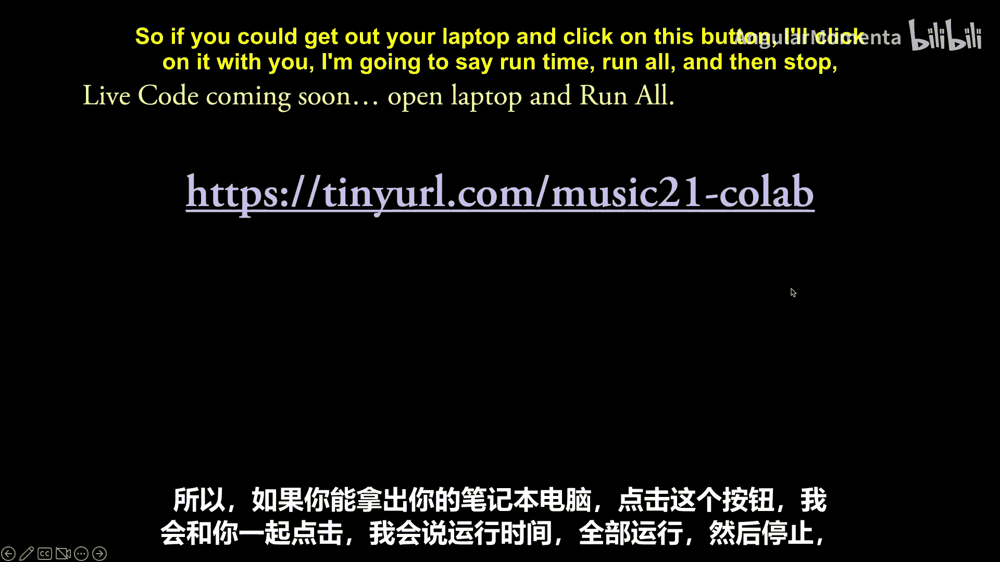

Let' me just going to get this ready to go when it all loads。Go to one time。 Run all。

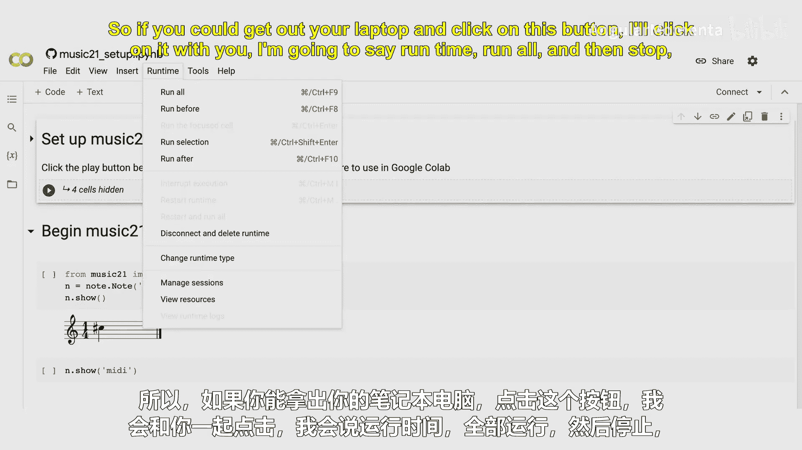

And then stop， that will probably take like two to three minutes。Okay。

 so we'll go on from that and I'll just talk a little bit about final projects while that's going。

 which way there we are great。So what we're going to do at the end of the semester is have final projects。

 We're a little bit big class。 I'm probably gonna let anybody who wants to have a group of three do that because of the number of people here。

 but generally two works really， really well Solo groups are really hard and I found that groups bigger than three have almost always had of problems So we're going to do a final project and I used to say any topic in computational music or music theory and analysis or composition types things as long as it involves representations。

 the scores of the computer I now have one exception Ive a lot of AI deep learning for composition projects have tended not to do as well as the students who ran them we're doing in a class so I'm going to not allow that for this semester to try to figure out how we can do that a little bit better。

 so that's just to just me learning from experience you're going to。

Spend some time researching a topic that you work on， programming the tools needed to do it。

 reading about what mistakes you might have done and just thinking about。

 then what I want from you is then you're going to be making a video about your project five minutes。

I know I'm a hard professor。 I could have made it 10 minutes， and it would have been a lot easier。

 But five minutes， you have to， you know， kind of be on toes。

 So what I want a couple days before that is just a draft of your script。 It can。

I don't care how mess it is， I just want to see that that I'm not going to get a frantic phone called 1130 pm that none of our software works or something like that and then record and edit a five minute video。

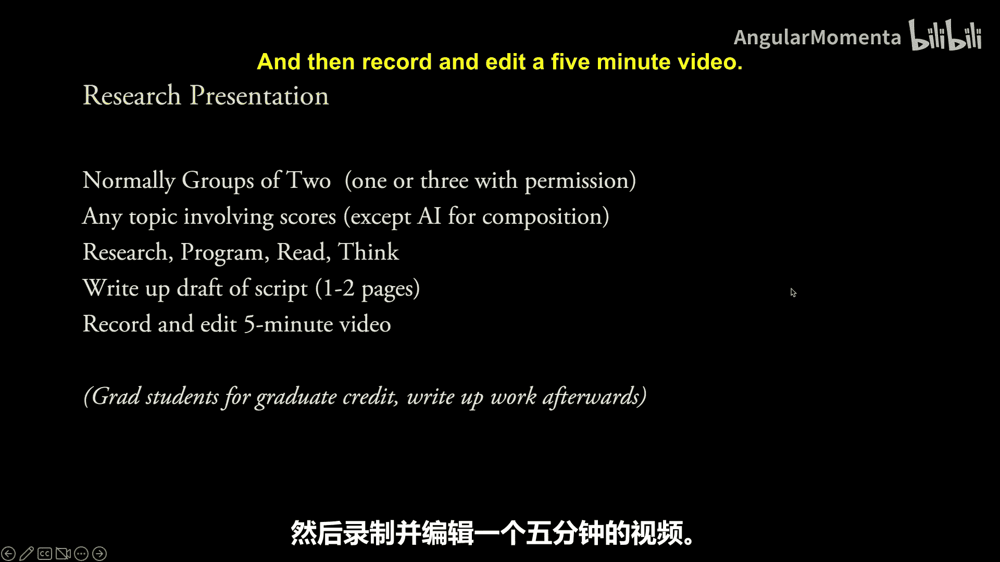

So let's get back to that live code。And somewhere on here。This one， we're all up。And I have it。

I have mine。Here， let me make this bigger in three ways。Anybody not get a note here and maybe。

This one sun doesn't work for a lot of people。So don't worry if that doesn't work for you， but。

Give me a thumbs up。 We got it。 Okay， cool。 So let's， let's start with。Refining。My script。Great。

 so let's do some of the things we can do。If you don't care about polluting your code base。

 so I got this little it go ahead and import from Music 21 Im star should already be in there。

 You'll know this。 Who has anybody not used Jupyter notebook or anything like that。

 Please who has used one me Okay， so don't need to do too much。 but we can yeah。

 we'll enter in a new code thing， move it down。 So go ahead enter a new code rank and let's just make sure that if I type chord and hit shift enter something like that comes out。

Cool， okay。Great， so let's grab。 There's a particular piece by Bach that we'll use quite often in this class。

 I'm gonna use it less often this year because we have more alternatives now to this。

 And we don't want to perpetuate the bach is everything stereotype。 But this one will use a lot。

 So we'll assign to the variable bach。 something from the music 21 corpus。😊。

Calling the method parse audit。And。We can just type。BWV 6，6。6。

I am not devil worship or something 666 happens to be the shortest corral that Buckch ever wrote。

 So it's a nice one for us to work with here and shift enter。

That should load if you ever if something doesn't work。

 this is the time to cheat and look off your neighbor and see if maybe you mis type something or tap them on。

 We're all in class， We're all here always just to help each other right we feel that。

You're going to do that People around you。 good， Okay， so let's。Show it the first time you run show。

 it's always a lot slower than every other time， hopefully it won't take too long。

 you should get a score up there somewhere。right now you're only going to get the first page of the score。

 though this that's why I use this one because it's only one page long soon you'll get the whole score okay。

So， let's。Go ahead and let's get that alto part。 So we'll say alto equals V parts is a way of getting something Alto。

And then， Alto do show。see something looks。Like this alto part's always a little。🎼他嘀嘀。

Something like that。I mean， page good。 You can also get part by doing it numerically， so。

Anybody know in a course， what are the four parts for high slow lowestest？

Soprano Alto ten outtter great。 Let's already get our thing。 Soprano Alto Tenor base， great。

 So if we can do it by numer order， we want to get the Alto， That's what number part。😊，2，1， yes。

0 index Python。 So what are the things you'll get。 And so that should be the same part。 Parts 1。

 good， good guesses， good， wrong guesses。 I love， I love great。

 wrong guesses better than great than even getting it right on the first time。

 one of the things you'll find is if something is in computer speak， we leave it alone。

 So we don't tend to number the parts in the orchestra。 hey， instrument 17， do this。 No。

 So when we do that， we leave it in computer speak and make it。😊，Make it sort of you know。

 zero index when we leave things that that musicians might know。 however。

 we tend to use the the the musicians thing。 So let's get the soprano part。Part zero here。And。

Let's get measures4 through 6。 So dot measures，4 comma 6 dot show。 And in Python。

 that should get you the fifth measure through set through the sixth measure because of the way0 indexed。

 however， measure numbers， measure number， something that human musicians talk about。Yeah， yeah。

 you you've heard of that。 great。 will save time always by just being being fearless at shouting out when I ask a rhetorical question。

 like measuring numbers， we know musicians， Yeah， good， good they'll just save time in the class。 So。

 yeah， since musicians know what measure 4 is， we'll use measure 4 that way。

 So let's measure 4 through 6。😊，Great， so let's start manipulating the score。

 let's say that the436 or537。Thank you。 That is measure。

 That is whatever a musician thinks measure for is。 So in this particular piece。

 let's go up to the beginning of the piece。😊，Yeah。What measure is this that the mouse is on？这个。Yeah。

 pickup is what a musician would say。 We got to give it a number。 So what number do we like here，0。

 So there can be a measure 0。 if there's a pickup。 measure one will always be whatever humans musicians think measure one should should be。

 So let's we can play some other things。 Let's let's just play around with the score a little bit。

 We'll take the soprano， get measure 5。 you'll also see some of our display things don't know how to display the right number。

 If you're on Mu score 4 it now displays the actual correct number。 But let's get。😊。

Let's make so measures 4 through 5。 Let's make the forada。Rand， so what number， if I'm get notes。

 I'm going to get it index by number。 So we're going get measure 5 and get a particular number on that。

 What what what note numbers the formatada shouted out。W。2， in this case。

 musicians don't tend to talk about。 I guess we do say the second note。 Yeah， yeah。

 that's really confusing。 So in this case， basically。

 when we're using the bracket square bracket notation， I'll make this a little bit bigger。

 Does that help a bit。 Yeah， we'll think that here。 So we'll say C。

 I should I should call it C sharp equals。 But then you just get what comments for the rest of the line。

 So we'll just call it C， even though it's a C sharp， C style。即解实有。

That doesn't give you autocomplete close red。And。Soprano。

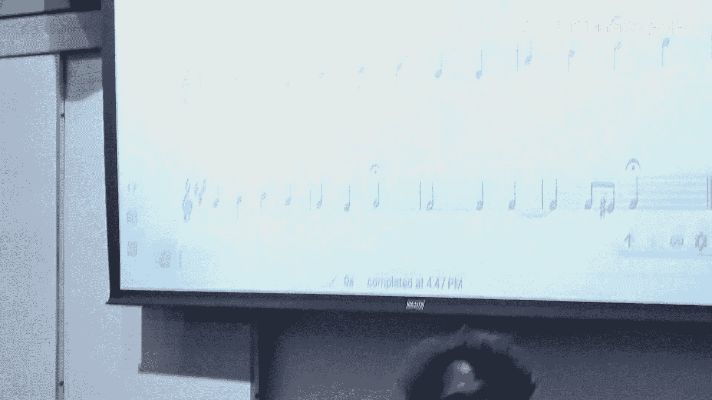

we got the soprano， I'll scroll back up again so you can see。Remember already got the soprano。

 we take a particular note， the third note index by two。From measure 5。

 which is actually5 and assign it here。Probably we could have made different decisions on how we number things right if for version 2。

 but whatever， then we' set the styles that notes color to red and then show the entire soprano line and we get something over here。

I'm half colorblind is there actually a red note up there Okay， good， good good。

 where is it so over here we'll emphasize that for the camera。

Chrying to laser on it becomes more red。Now， yeah， that's kind of fun play around things。

Something we might actually want to do。 Let's take the whole piece。 We called it buck， right？

' indexing got box of score。 object let's analyze its key。Analyze is a method。

 so we call it like this parentheesishees。S key if youre， so let me say if you're。

Following along at 80%， but you just wish I would go a little little bit slower and then you'd be able to have it。

It's going to be fun because most of the time we're going to go slower than this。

 This is just the sort of fun beginning the semester。 if you've never seen。

Apprenheses or square parentheses this might be a class to take next year or next semester after doing a little bit more programming and that's probably more for the camera people watching at home let's make sure that we。

That we just need a little bit of programming before we're going to go forward。 Okay。

 so the piece as a whole F sharp minor。What do we do now， I've tried to emphasize it early on。

 but we're going to make this a haven in the class。 We always check our BS meter， right？

Sas the piece is an F sharp minor。Is that at all plausible looking at this piece。

 Let's look at the base。 It's easier。 that looks like an A。 I mean， it's in three sharps， maybe。

Maybe。On the end。I sure。A sharp see， oh， looks like it ends up a sharp major。

But then maybe the rest of the piece is in minor and then this is just the ba ending thing。

 So to me it passes the smell test， it might be other things。

 but one of the other things we can do is let's analyze measures。

 oops we get B dot measures0 I haven't spoken out loud while I type for a while zero comma2。

 So we'll just get the pickup and the first two measures。And we'll analyze the key of this opening。

啊A major。That that feels more right for the opening。

 So we know that the piece as a whole is an F sharp minor， or at least the computer thinks so。

 If the computer got it right and it opens in a major。

A logical thing that we might play with next is where does it change， Can we do that。

 Can we analyze where key changes are， We're not going to do that。 Well， let's。

 let's get some easy thing。 So we said that not notes I used to get a particular note。

 So let's see how many。Notes， there are in this piece Le。Any other language would be dot length。

 talked notes and how many have notes take your prediction。Oh。0？There are no notes in this piece。

 It is the we started with cage 433 and we end with Buck 433。 Now， why are there no notes because。

Bock is a score。This is all about the representation。 We're currently in box within box within box。

 There are no notes of the score。 There are notes within parts。 No。

 there are no notes within the parts。Parts have measures。 There are notes in measures。

 So what we'll need to do is we'll say。Take the box。And let's run recur， go into every box。

 like like a child at Christmas， open every single box and find every single note in there。

So we'll say we can take a score， we can say open up every box and to every box。

Get me the notes and 165。pa smell test。Let's scroll up。Don't ask anybody ever to count this。

That looked like about 165 notes， too。Yeah。Just order of magnitude。

 if it said 1 million notes would something be wrong。 If it said zero notes。

 you knew what was something wrong。 So we're always trying to do these kind of smell tests before we go on。

 And the last thing I'm going to do because I'm looking at the time。 And And。

 I have only one good habit as a professor。 I really am'm allergic to keeping you over。

 So we're not going to do this， but we'll do。 just for fun。😊，Buckcorify。That show。

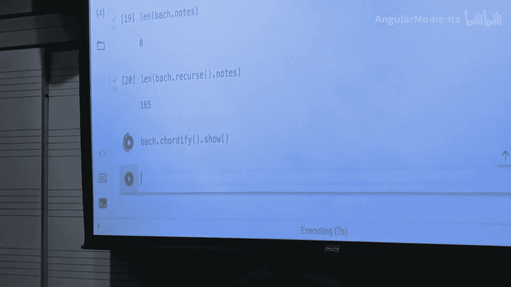

お。Now we've switched the entire thing into salami slice mode。

So these are some of the things we're going to be doing。

Hopefully that was good Professor Mo now here's really evil Professor Mo。

 you're going to forget every tool that you've just been given。Analyze key is not available to you。

 I'll call it locking it。 It's locked in this little cabinet here。 when you write。

Your own pretty decent key analysis algorithm。 You can unlock this one。 yours might be better。

 I might ask for a license to hey can we use that one there， This is a pretty decent one。

 but you might write a better when you write your own codification algorithm。

 then codify will be open for you we'll give you some tools extracting things particular measures that was a lot of work。

 but that kind of sounds boring boring in terms of our intellectual development。

 but coming up with the tools to be able to quantifydify a score we'll see how many difficult things that come from that。

I not the time's about up。 So we'll talk about that in other classes。 As I said on Friday。

 I want to get to know you guys want you guys to be able to talk more that I wanted today just a blab about what we might do in this semester。

 and I'm happy to have you here。 The numbers look great。 You' all come back Friday。

 you all make sure that you're registered， and I'm glad to have everyone in this class。

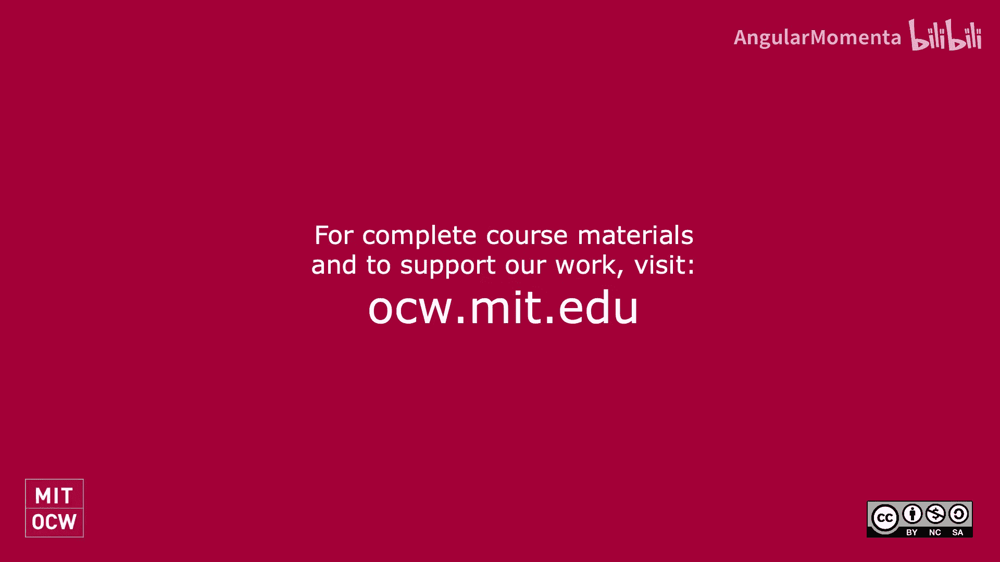