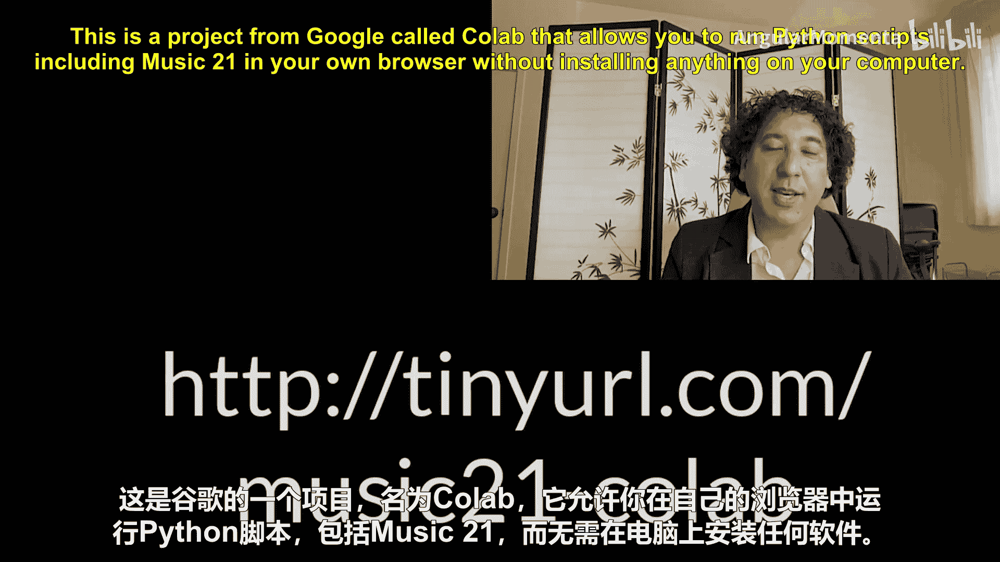
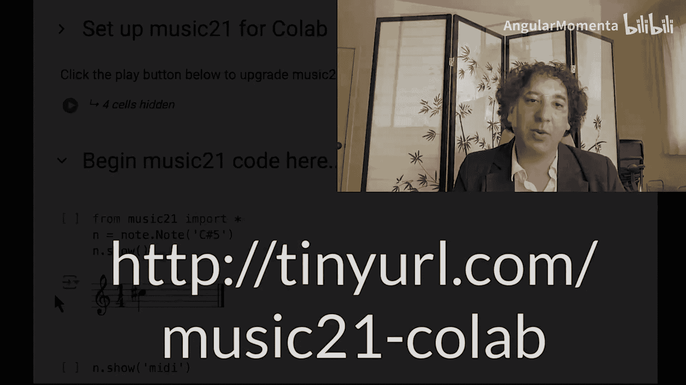
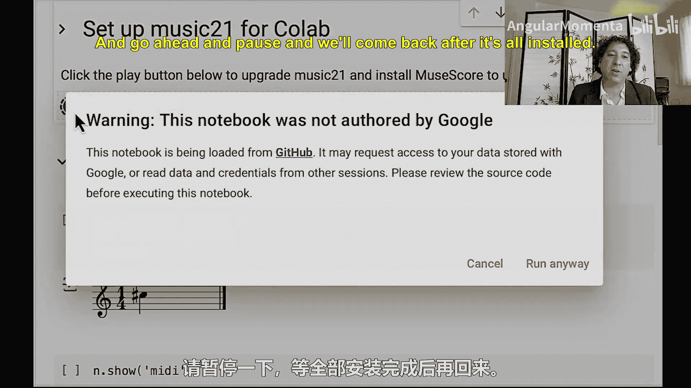
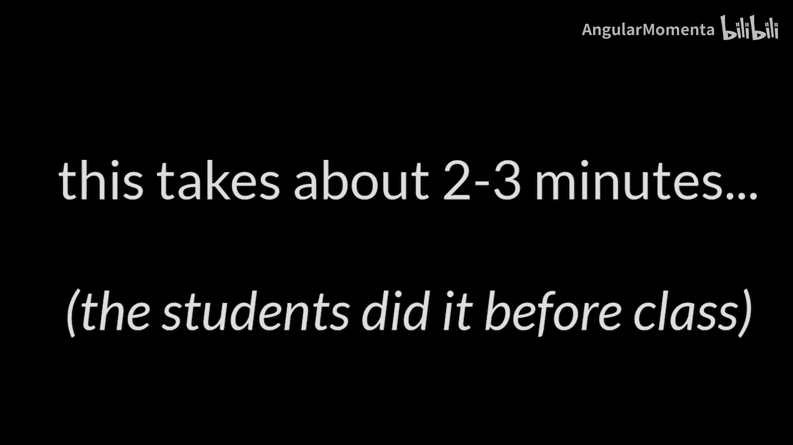
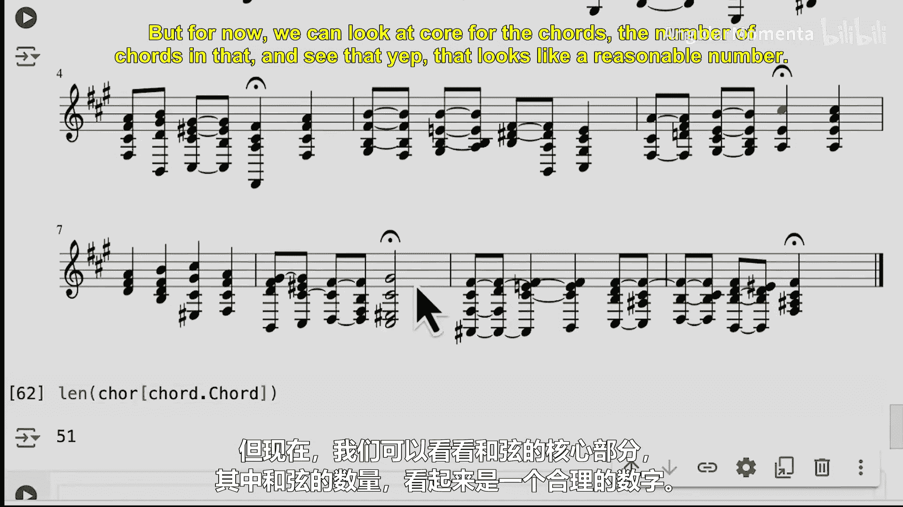
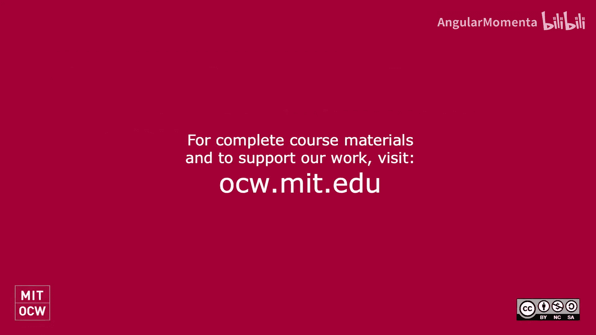

# 【麻省理工】计算音乐学与分析‌ ｜ MIT 21M.383 Computational Music Theory and Analysis,S 2023 p03 03 视频 1a：面向OCW学习者的music21编程教程 -BV17xUmBDEUC_p3-

Hi， opencourseware learners。 We've gotten to the part of the first lecture where the technical difficulties made it a little too hard to follow what was happening there。

 So I'm going to re recordcord what we all did as the opening of the class。To begin。

 go ahead and go to the URL on the screen right now。

 this is a project from Google called Coabab that allows you to run Python scripts。

 including Music 21 in your own browser。

Without installing anything on your computers。

So go ahead and click this play button， you're going to see a warning that Google didn't write this notebook I did。

It's。I think it's pretty safe。 What it does is it installs the latest version of Music 21 and Muse score and some other software needed to run。

Some of the tools we're going to be using without installing Python on your computer。

Google already has a copy of Music 21， but this just。Oh。Brings you to the latest version。And。

Go ahead and pause and we'll come back after it's all installed。

Welcome back。 I hope that these cells aren't running anymore， so we can start coming in。

 if you've never used a Jupiter notebook or another online collaborative environment。

 the important thing that you're going to need is to be clicking into these cells。

 the gray ones are where you type and the ones with a white black background are the ones where outputs coming out in order to run a cell。

 you just type shift and return or shift and enter。

 So what we're going to do is I'm just going click into this cell and hit shift enter and this will make sure that music 21 actually works。

 Sometimes the first time you show a score it it doesn't work as well。 And on some browsers。

 this will work。 you can listen to a score and。We'll see if this works or not。There we go。

And now we're ready to actually begin， we're not going to generate with AI today。

 we'll write our own scores。So if you're with me， we're going to start anything where you're doing a Python session by importing the code that's useful。

 And for this one， it's the music 21 toolkit。 So we're going to import everything from it。

 If you're somebody who's done a lot of Python and。Cars about things like polluting your namespace。

 you can do individual modules， but I'm always going to do it as if we have all the parts of Music 21 at your fingertips。

So we're going to load a crral byhan Johan fashionsian Bach。 it's his shortest corral called BwV 66。

6。 so first I'll create a variable， call it Bach and we'll use the corpus tool from Music 21 and its parse function to load in Bach s Bwv 66。

6 I'll hit shift enter and it's assigned to Bach and we can call the method show on it to see the score of that yep。

Books like a Corral by Bach and you can see that his soprano Alto Tenner base。

 and we can get the Alto part by saying Bach dot parts， square brackets， then Alto。

 and we'll just show that。Yes， looks like the alto part。Now we'll get the Soprano Parts。

 sign it to a variable SOPR for soprano， and we'll just do that。Instead， this time。

 we'll get it by doing the part number。 And so it's the first part。 And so in Python。

 that means it's part 0， parts 0 and。One of the things that we do in Music 21 is when something is in a programmer's role。

 we follow the。Conventions of programming where everything starts with 0。

 And when we're in musicians space， such as talking about measures。

 we don't subtract one from the measure number or anything like that。

 So if we wanted to just see measures 3 through 5 inclusive of the soprano part。

 we could do something like that。Or we could type the word measures properly and。

Then we'll get that measure just gets a single measure。 This one got that great， and in fact。

 we'll use the measure thing now and we'll get in measure 5， the0th first second note。

 the one with the Ramada on it and so we'll call it C because it's a C actually it's a C sharp but well we'll see why not and so we'll get notes number2。

If we called it C sharp， then everything after this would be a comment so that doesn't work。

 So we'll just call it C。 And now what we can do is manipulate it。Change its style， its color to red。

And now when I show the soprano part， because they're all linked to each other， we should see， yep。

 there's a note that's in red。So that's how we can manipulate a score。

 And now let's see how we can do some analytical functions on things。

 So let's do Bkta analyze and we'll analyze the key of the piece。

And it says we to key object that says it's an F sharp minor and one of the things I really want to emphasize is always go back and do the smell test。

 is this true， is it look like bologney and we can kind of see well， it begins in A。

 but it does have three sharps and at the end， yep， there is an F sharpp in the base。

 it looks kind of like F major， but。Yeah， okay， here， some F minor， okay。

 it kind of passes the smell tests。And we'll see why that's so important in just a little bit。

 But it did seem like it was beginning in a。 so we can just analyze a portion of that。

 So we'll do bach measures0 because we want the pick up measure and two。

 and we'll analyze the key of just that passage。Uh， does seem to start in a major。

Let's do something that seems pretty simple。 Let's count the number of notes in the piece so we can just do Ln。

Bock dot notes that just gets all the notes of the piece and another language would be bo dot notes dot length and I don't know。

I don't know how many notes are in the piece but I'm pretty sure it's more than0。

 and the reason for this is that Music 21 and most ways of conceiving music on the computer don't think of the score as having notes。

 The score has parts the parts have measures and the measures have notes。

 so what we could do is get the length of bach parts， one measure two dot notes and see， okay。

 that passes the smell test。So what we can do instead is we can use something called recur。

 so we'll get the Bch dot recur。That's a function or a method and we get the notes on that and what recur says is open up every box you get to a part。

 open it up， look inside for measures， open it up and keep going until you find notes。

And 165 notes that seems to pass the smell test to me。

Right now we've been working with this as a series of parts that are not connected to each other。

 but of course there are chords in there also， but if we do。

Bock do and here's another way you can say recur， I want to recurse and get everything that's a chord。

There are no chords in this piece。 So we have to create some chords using the codified methods。

 So we'll say core。Or chords equals buck codify。And now， if we sow。The codified method。

And we can see that some of these notes are way too low to be read properly。

 and they have duplicated notes and things。 And over the course of the semester。

 we'll find ways that we can make this a lot more representable。

 including things like getting rid of passing tones and other things that disturb looking at the chords。

 But for now， we can look at core for the chords， the number of chords in that and see that yep。

 that looks like a reasonable number。

So I hope that gives you a taste of some of what we're going to be doing over the course of the semester of this class。

Now， we've gone very fast through a bunch of things， but don't worry。

 because we're going to lock all those things up。 Cordify is going to be locked up。

 And now analyze key is going to be locked up。 And what' does that mean。

 that means that it won't be available to be used in the rest of the class until it's unlocked again。

 The way this class is going to work is all these analytical tools。

 all these ways of conceiving a score， will begin by being locked。

 And then you'll do an assignment either as a problem set or as in in class assignment where we'll figure out how does this work。

 What are the ways of doing this， And then once you've designed your own algorithm for doing these things。

 You can either continue to use your own algorithm or。

You will have unlocked the music 21 version of the algorithm。 And from then on。

 you can use that instead。 So we're going to just be building up knowledge little by little until we have everything。

One of the things that as an open courseware learner， you won't have access to。

Is the extremely valuable things that happened outside of class， Yes， coming to office hours。

 but mostly with students helping each other， giving each other inspiration for projects they could do and helping them through some of the more difficult parts of the class。

 So I encourage you。😊，If you can find somebody else online who is also taking the course or somebody who has taking it in the past and get to know them。

 that will give you a lot more of the experience that the students had at MT when they were taking the class in person。

I'm so glad that you've chosen to take your time to learn about the fascinating world of music theory and music analysis with the computer。

 And I look forward to seeing you again from tag to time in this course。😊。

