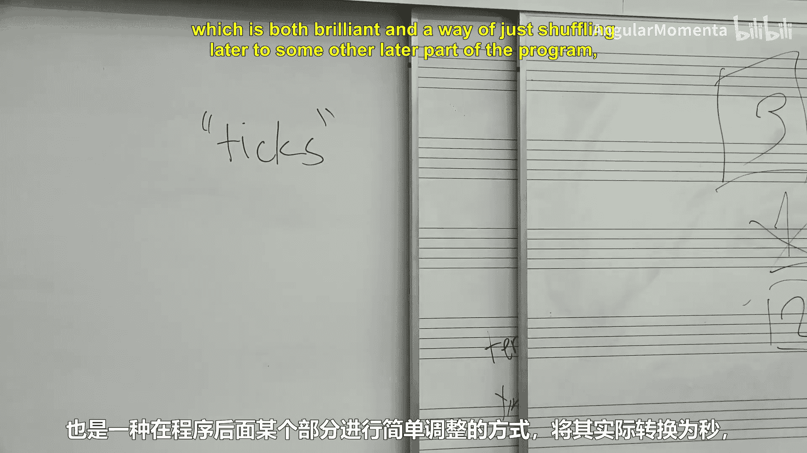

# 【麻省理工】计算音乐学与分析‌ ｜ MIT 21M.383 Computational Music Theory and Analysis,S 2023 p04 04 第二课 视频：音符、音高与时长表示法 -BV17xUmBDEUC_p4-

Let's get started。 Welcome back21 m383 computational music theory and analysis went through probably one of the most slide heavy。

 One of the fastest classes ever on Wednesday that I'll be doing this semester today we're gonna switch gears。

 We're gonna do one of the least tech heavy classes in the semester。

 and then we'll probably keep going back and forth。 This is the only one that in my particular notes。

 for my lecture。 It says Mike， don't panic。 there actually is no PowerPoint because I was panicking the other day when I was preparing this I was like wait wait wait wait。

 I delete it no， there is nothing because I want us to step back for a little bit。

 and think about some of the things and do some work on some of the things to do with what we mean by music because various musical points because there's a lot of things that we can know that are。

あ。You know， just sort of。Just， just sort of intuitively， we all know what that is。

 but then we might not， you know， we might not be able to explain it to a computer because。

Computers are smart， or computers are dumb。 What do you think。沙标有。No， neitherer are dumb， neither。

 no， no smart。 Okay， I think computers are really， really dumb until we make them smart。

 So or something like that。 great， There's some people in the back whose names I don't know。

 Can you take a sheet of paper， You can also use your outline to put your name on it。

 because the outlines for reading later。 And it's kind of nice this way you have it for later and this way。

 you won't。😊，Sort of get me if I go out of order， right。So I'm seeing who your names are。

 Can you take a second， And at least the person you're sharing a table or sharing the invisible table with and introduce yourself if you don't know that where。

Okay， now add into your conversation， Add into your conversation what you think a note is。

 You can also keep getting to know each other at same time。 But what you think a note is。Okay。

 I'm gonna be asking you for， for some definitions in a second。 But before we get to that。

All I want you to do is take your definitions。 You've kind of got them first thing。

 and you just got count notes。 Okay， so I'm gonna sing some things。

 And you tell me how many notes I sing。So write them down， and then I'll ask them later。First， set。

多 do do。Pretty easy， right？Second one。The。Third one。Do。Fourth one。滴答滴答滴答。And。5ifth one。

Great talk with your neighbor and see how many if you got answers that line up with each other。Okay。

 let's come back together。Let's come back together。 We have。

 I believe that the normal distribution of names in this class is kind of like the letters in alphabet。

 So， we'll start with Jays。 Ill call on， who's alphabetically first J。 Is it Jason。Jason， something。

 something like， and if I change the things， I'm doing it accidentally。

 because I don't remember what I saying。 But the first one， da do da。how we agree。 How me disagree。

 Greece。Disagrees。Good， that was the right answer。 I sang three notes。 Good。

 Who's alphabetically next after Jason， we have， we have some Jonathan's Jordans。 We have Jake。

 Oh Okay， you， we went out of order。 Sorry about that。 Jake。 Now， even if we do Jacob or something。

 It's still， I'm still wrong。 Okay， Jake， nice， this what I sang。😊，OneNot。Agree or disagree。

 Who agrees？Who disagrees？Good， everybody is wrong。 I sing four。Okay， next note， next one I did。

 I went up， right？うん。Next up alphabetically would be Jonathan comes before John and comes before Jordan。

 So Jonathan。Mys was two notes， two notes。Good， who agrees。Okay， some agrees， who disagrees。Okay。

 good。'll， we'll continue with the Jays that John， you disagreed， What's the number you came up with。

呃就。You're saying a lot， I think you're saying at least one note。啊，オーオッ。😊，Greater than one note， no。

 greater than or equal to one note， right， Okay， so that that takes a little， that's。

 that's a pretty pretty broad spectrum。 I like that。 It's always good。 who。

 Who agrees with greater than or equal to one note or or wants more disagree if you want more specificity than that。

 Who agrees with greater than or equal to one note。😊，Good Jordan's on your side。

 And he just got some， some people good。 So who disagrees with that with everything beforehand up till now。

 great。 So I think we have no Jason， we've already gone through who。

 who raise your hands again if you disagree。 I wanna keep going alphabetically next among the disagreeers。

 And that would， that might bema Kama got。A go N A， N A， okay， well。

 N A or we'll make it say pars in Python， Not a number。 Is that okay。Okay， good， good。 And any。

 anybody still did still have your number not said。 Adam， Yeah， I said 14 or 1514 or 15。 Okay， very。

 very specific。 what you base that on。 So you went from a seat to either sea sharp or a D so。s like。

 if you go to all the chromatic notes and slur them all that。😊，Okay， okay， good。 So we have。

 we have a range extension。 good。 Any else have a number that doesn't hasn't been done yet。Okay。

So that's， that's particularly good。 This 1 I went with。in。Oh， sorry。

 I wasn't tell you what what my numbers were yet。 Okay， well， that， that's I went with。 and then。

Next one， Di， Did， Did， we have some other。Please give you what B we have a listener。

 but you wanna be a participanter also。 Yeah， go ahead。 So with that one， I wrote 6，6。😊。

Anybody agree？Yep， anybody disagree。Good， okay。And。Yep， and now， oh， you no I was giving。

 I was giving the right numbers。 Yep， so I'm gonna say I did that。 I did that。 Nobody disagreed。

 The correct answer there was2。And don't worry， don't worry， this is frustrating， be frustrated。

 And then。Who's also around K or do I hear L。No。0ero。Anybody disagree？Great。

 a person who's disagreed who has to speak I said one， good， Good Who agrees with one。Good。

 how many people have heard neither 0 nor one。Y， so I was writing a lot of these。

 I've put two answers to a lot of them， depending on how Okay， you can go and give one right now。

 on how I how I'd like。Pitch wise， and I was singing it。Yeah， so I like。

 I say perception prim of spectrograms and a clap has like all of the。So， so， so give me a number in。

 okay。This one， I'm going to go withzebra。And I will tell you。

 there isn't a single answer on here that I couldn't， that you couldn't argue for and be correct。

So why three notes， I think we all agreed because I think I sang bomb， bomb， bomb。

 count each of those as one note， right？Second one was four， because。Was。

A half a whole note tied to a quarter note， tied to 6th note， tied to a 64th note。

And I do believe that is the closest， shortest representation I can do notally。

 So I was thinking in a notational sphere here。This time with the Gando。

 I was thinking of it as an infinite number of notes， because if it's continuous， it could be。

 But on the other hand， any of these other ones could be correct。 Now。

 let's see if anyone can come up with how from De， dided， dided， I came up with two。😊。

There' are two different pitches。 That's one good way to do it。 I'm glad I。

 I hit the same pitch each time。 maybe explain close。 That's not the reason I was thinking， Yeah。

 the treo， yeah。😊，It was something like。It well， don't know what thing we're in。 But yeah。

 I was thinking it as something like that or it actually it would be measured tremmo or。

 wouldn't it be like。Anyone know this sign。We have a beamed or no now， just one beam， right。

2 beamed dotted half notes， you see it every movie once a while when you're playing like perkofi off or。

 or or Schber and something。 I always like， oh， I have to remember what that is。

 But that means fill in the space of one dotted half note with as many eighth notes as it takes to fill in alternating between the top one and the bottom one。

And clap。I thought a note to me。Had to have some sort of。Specfiable pitch。So， I count0。Now。

 everything that somebody said， one。For， for this or infinite are all valid definitions of what we're going to be talking about。

And here's the thing。99% of the time when I'm not trying to set up an example for， you know。

 for having fun in the first week of class with you all。 there's no way I would call that second one。

 four notes。 right， I mean， if I hear it， I'm gonna be one。

So one of the things that's going to come up quite often is that depending on what purpose you want to do with something。

 you're not going to be able to necessarily even know how many notes or how many of something there is。

 let alone what's the correct spelling of something or not。

So I think we're just gonna be playing around with something like this。 Now。

 go back to your definitions of notes that you had before。 And let's grab into groups of four。

 So your two groups， that are the same joining with a group behind you。

 So's we're gonna get good spinning over here。 a group of three here and three here and we we'll break up this group。

 and talk about what your definitions of notes were with the other group。 And then try to figure out。

 if you had correct definitions or if you had compatibles not a correct definition。

 compatible definitions of notes before that with each other's group。

 And then also if you want to change definition based on all the weird numbers that we came up with here。

 So go ahead and let's take a couple minutes to do that。 Great， let's。

 let's all come back together and。😊，嗯。There was one word that I just kept hearing as I was going around and begins like this。

When any any group use a word that begins with this in their definition。Yeah， John， go ahead。

Representation， yeah。Tition。So we can kind of start with。嗯。Is。Of。

Is anybody's definition completely incompatible with this opening。

Like couldn't be put in is smile of。 Okay， so what are some of the ways that your groups could have。

Could have done this。 I didn't think I heard because it's physically difficult。 What Jonathan Kma。

 Jordan and Misha's group。Came up with what do you， How would。

 how would somebody in this group continue that everybody has， Oh。

 you guys are all normally distributed names。 So I've heard from everybody。 So Friman。

 would you like to。I think we said a with pitch。Is a representation of anything？With a pitch。And。

Duration。I think groups disagree with that。Yeah， so I'm coming at this from the percussion for Sky。

 where a note doesn't necessarily need a pitch and it doesn't necessarily need a duration。 Okay， so。

 so we have。Not necessarily on that。 So do you have a positive。

 Did your group come up with a positive。Definition from that。

 I don't think our group came into agreement。 Good。

 Let's hear some of you is a note as a representation of an instance of striking something。

 instance of striking something。 Okay， anybody。So it's Matthew。 anybody want to。Want to go forward。

With that like。Sorry， I can't talk and write something else at the same time。Anybody's。That's。

Perfect。😊，To for out。Thanks。While you're speaking anything with a pitch and a duration。

 I think an airplane on an airline flight has its pitch and duration， right， So。

 I'll start calling them notes too now， I'm just just having fun， just trying to。

 just trying to get us to think so we can start making things how we're going to make this happen for a computer。

 I， I like both of these。 an instance of striking something。 So yeah。

 I feel like that is a really applied to certain instrument like。😊，For example。

Don't have to strike anything to issue with event。Good。So。

Its somebody who hasn't spoken want to defend an instance of striking something as applying to the violin。

が go aheadりなさ。So I mean， if you want to be annoying。

 you can it's like a version of striking in a much more general sentence necessarily be like hitting anything just be when you're moving bow across strings。

 you can say that that counts as like a form of striking。

 even if it's not like the most straightforward definition。 Okay， weve got a wind wins Okay。

Whos you all， you all， most of you are， are juniors and seniors and think so you all。

 most of you all have gotten through your physics， mechanics general institute requirement。

 Any wantan to say， how do， what's， how sound produced。Or perceived， maybe。Movings of。

 vibrations of air， good。And so there's a lot of air vibrating way， way down the street。 Why。

 why do I not hear it。The inverse square law， yes， that might， might be。 But what。

 what is not happening with the movement of air， It's not reaching our ears。

 It's not reaching our ears。 It's not。What， what what is。

 what is one of the first thing it reaches in our ears。YouYour drum， oh。So maybe there is a way。

 So we could say an instance of something striking something such as air。Striking a drum。Before。

Half an hour of you go， how many of you would have said that that's a note。What's it striking？

He don't need to strike。 He said it's representation it's a representation of something striking good。

 good， okay。Any other things that we want to do with confusing。

 confusing definitions before we get to the one of the points of this class。 any other really great。

 beautiful things that wasn't covered here。By the way， I forgot to do this part on there。

How many notes。Okay， so if there's something about when you play that， the three different。

Sounds being done could be considered three different notes。 So is a chord a note。

Wheres a chor a bunch of notes。Where is a chor something else。

I' say this because we're gonna spend the a lot of the first problem set in the next week is going to be on how to represent music for the computers for the computers as as 1960s。

 for a computer， So how do we， how do， what kinds of choices will lead us into bad。

Places fastest And which ones will keep us in good and useful places for the longest amount of time。

 Notice， I didn't say which ones will never lead you astray because you're always every definition that you're going to encode into a computer at some point is going to completely screw up something。

 for instance。WeMight say one note。Add a little ornament to it。Still one note in some certain senses。

 But ya， that kind of turn can really change everything。

 So those are going to be coming up over and over and over again。

How to represent for a computer and whether or not any one representation is going to work。嗯。

Somebody said， no is a representation of anything with a pitch and a duration。嗯。

There are some people who use the term note and the term pitch， absolutely interchangeably。

And I do it sometimes also， you know， what pitch was that， what note， what note did you play， things。

 And other people use a note to mean。The pitch。And the duration。As two different entities。Now。

 obviously。That also leads to certain contradictions。

 I would hope that we think that an eighth note is a note。RightI mean。

 it has the word note in its name， we're not talking about quavers in Britain。 I mean。

 at least here in Good old USF A， we put the word note in our eighth notes。But by this definition。

Pitch and duration and eighth note itself is not a note。Because it doesn't have a pitch。

 So we're gonna be finding that we're gonna go back and forth quite often。 Now。

 let's your problem set is going to be dealing with certain representations of pitch。

At leastas the non duration part of something。 I will say sometimes will pop ahead when， when the。

 when the lecture is getting too cerebral and things like that in music 21。

 the software we're gonna to be using quite often。 This is probably the best。

 closest definition to how music 21 associates things。 It's something with。

A conceived of single pitch。And it conceived of single duration。

And that might mean that something like this is conceived of as having a single pitch or。

This is conceived of as having a single pitch。 That's a trail sign， but。

There are other times when we don't conceive of something as a single pitch。And duration。

 So let's talk about representations of duration。 So we've gone from the trick questions。 And now。

Now， I hope I haven't like ended your faith in humanity in the class。 Now。

 I want to go to some a little bit more thinking about standard situations and not weird tremos and loandos and all that stuff。

 I want to think about how are some ways you might represent。Pit duration。For a computer。

And we'll say。嗯。I'm going to put the term here， musical。

As if somehow there is a different world of time in music than there is in everywhere else。

 sort of there's three kinds of time in the world。 There's one on your clock。 There's one on music。

 And there's the one they teach you about in relativity class that you hope you never hear again。

 right， So thinking about this。 What are some ways that you might do， I think we've。

 we've grouped enough， I think people want to be able to shout。

 And some people whose names are toward the beginning and end of the alphabet might want to be able to say。

 So what are some of the things that a musical duration representation might include。Okay。

 I think that's， that's good enough。 I， I， I think it's， it's sort of like doing jumping jacks。

 you just， you know， sort of get， get the thinking calisthenics going。 So what。

 what some of the things that you might do for representing duration。 Jordan said like， yeah。

 like second Seconds good。 Now， let's think about it。😊，We。

 we'll make our default assumption for this class that we're thinking in Python。 Of course。

 obviously， any halfway decent programming language can go through another。

 So how are we gonna represent seconds for a note。 Yep， good。 Oh， was that。

I guess like typically dont， we use like ticks and like kind of like。 Well， we。

 we'll get to that keep that word there for a second。 great。

 But what kind of what kind of is string a good one。A， how are we going to represent seconds？J float。

 Okay， good。Why not int？Yeah， just shout out。 yep， go ahead。In between like。Good， good。

 we can have in between， Great， super other， other things。 I'm gonna other things you might want。

 ways you might want to represent duration。😊，Yeah， go ahead， Matthew。 fraction fraction。

 good fractions seconds as a fraction or， or I'm thinking both represent section seconds as a fraction instead of a float So you don't have the precision issues float I also think it might make sense to represent it as a beat and Okay。

 okay， well okay， we go that's that's doing things we have beat there， good， good。

 we'll keep keep going。 what are some other thingsca that we might do。 Yeah。

 looking at fraction of measure。 you。😊，Yeah， measure and youve had a。Half note。

 that would be two/ thirds。Yep， okay， so good two thirds。

 That's a particular place where a different between flow accuracy in fraction came can can be very。

 very important。 Good， our beat and fraction of measure basically saying the same thing with reciprocal relationship。

 Can somebody come up with a reason not to。 Yes， I mean not necessarily。

 like something could be on the second beat and have like duration of one or could be a second beat have duration of two And it was a fraction of a measure with values Okay。

 good， So we have beat as in what beat is it on。And that would be very different。

If we think about how many beats does it last， because to thank you， Vanessa， this is fantastic。

 Is that basically the same as what fraction of the measure is it。😊，I'm I see Matthew。

 But I wanna wan to get。 I think I'm been going this wayca I'm camera shy。 So let me。

 let me lean in over here， see if theres things aren Anyone wantan to who。

 who says it's basically the same thing。And we can go all the whole room。 Who says it's， it's。

 it' could be quite different。Good， go ahead。 I guess it was like。

Depends on what you define the beat as。 So it's like 5，8 time or something。 Oh， okay， so 5，8。

 we'll say we'll do it as this。 I don't know if people know that simple。So。How many beats。

Does this get。Two， in some ways， and how many this one？3， good。 now。

 give me another number that we could use instead of that for a lot of five eggs。 yeah，106。1016。

 Yeah， we could， we could do any other good， good。 We have an infinite number of non reduced fractions we can do。

 Great。 I love it that。😊，How about thisす。No， I won't wait that yet。How many beats does this get？按住佢。

3，3 is a good answer， and there's another good answer。1。Bm 1，1，2， right。

 So how many weekss does this get。So there's some ways of doing it when I put this symbol。

 I'm saying I'm gonna go1，1，2，1，2。 And they're， they're not。

 So a beat can actually change its length during a measure in some representation。 So。

 this is one of the ways I was thinking not exactly the same， same thing， but pretty， pretty close。

 Good， let's see。 what are some other ways we might represent duration for a computer。

I'm going go back to the in just a little bit the。The names， some of the things I've heard otherwise。

 I heard， I heard something。Over here that I think Adam or say one of you， Di。

Like an attribute like a dot is like an attribute。 Great。

 So we might keep check of attributes like how many dots does it have。Good， anything else like that。

 Thank you。Super。Yeah， yeah， you take the number for the n node this。

 So if it's an eighth node you say  eight Okay dots would be a eight dot。Okay。

 so we can represent it as now。8 dot works pretty well as a float。

 But is there another way we might consider that if we're talking。It works well as a string。

 It works better as a string， right， Because 8 dot dots， suddenly you're。

 you're kind of getting a crash error， right， So that's one way you can do it other。

Ways and then so we would say 16 dot or something like that。 good， good。

 What are other attributes we might want to represent to talk about the duration of a note。

Are all notes， yeah。You could also have things in are triplet。 You could have things that as triplet。

Yeah。Good。You can also have things in a quintuplate， right？So Im going squeeze this in。

And you could also have things。In a triplet within aquintt。This is called nested tuts。So。

I will guarantee you。 I have seen at least 20 representations of notated durations where the topt was originally created as an attribute。

 and then it needed to be represented as a list array tuple。

 something like that of a couple of topts。's try to say that 10 times fast。

 for indeterminate number of topts that might be applied to a certain note。

 So these might be certain things。 Good。 anything else that we might use to represent duration。 Yeah。

 go ahead certain markings like。Good， so we might have modifying。Finding， I don't know。

 articulations and expressions or markings。 We'lls call markings because。Who knows what they are。

Markingings。I will make a fora on my eye goods。 So， yeah， we have our dots， maybe。Mdifying， good。

 So we can think of to nos that those affect the duration。 Great。

 now I don't wantan to go to much further on this。Now， our music is on。

 I was gonna to use obsolete formats， A C D or streaming。 What are the most。

Useful representations of duration。Of notes， let's say。Or other things。

 which ones these are most useful。Yeah， I've heard you a couple of times from you。 So great。 super。

 Am's got it。😊，Who has got one。Is this a great duration that you representation that you're hearing of the duration of a note when you're listening to streaming music。

Maybe not， but， but boy， that could be useful for other things。 What about seconds。

That's good to depend on。Let's say you're listening just for fun。Second's very good。No， maybe not。

 I don't。 I don't usually hear seconds。 But who's somebody involved in the streaming music process who might really care about seconds of notes。

Yeah。I like computers the computers。 yeahep， and， but what kind of human might might be really interesting。

 Yeah， some editor the editor， Yeah， the the person who's doing the recording editing。

 They're always gonna be thinking about， okay， let's clip from 22。046 to 22。

048 when somebody coughed and will come up with something right。

 So those types of things come up quite a bit in in that type of world。 Now， what if we're。

 you've written your great piece， It's already been recorded， performed in things。

 And now you've sent it off to your sheet music publisher。

 What are the ones they're gonna care the most about。😊，What some， what's the representation， Yeah。

 John，duration， the pitch in the duration good。 And how are they gonna be thinking about duration。

 How's the engraver， That's the person who， who makes musical scores， the term for that， What's。

 what's the engraver， What's she gonna be thinking about in terms of duration。

What do you think about when you， when you're looking at musical scores， Yeah。

 the beat and then the modifying the beats， the modifiers good， good， the what do。

 what are we gonna call something， the difference between an eighth note， a quarter note。

 half note all that stuff。 What do， what do we want to call that。 do I。

 we all have been doing music for a very long time， We all must know the term for that， right。

There is no generalized term for it。 So what do we want to call it in this class。

Somebody shout out something or we'll call it the， the， the note animal。

 what animal is this note or what flavor is this note。 That's a good one。 Actually。

 I wish I had gone with that。16th notes are really， really tasty today。😊。

Anybody have a suggestion of a term。Eence， the essence， Well essence of note is good， good。

I will tell you that essence is better than animal， probably as a term。

 It's probably better than flavor。 And it's better than what all the rest of us didn't say。

 because the first thing you have to do when you're representing for your computer is come up with a name for everything。

 You have an essence。 O， but come up with a name for it。😊，What we。The duration， O。

 so we might have the duration of a duration is a quarter， and the number of dots is 2。

A lot of representations do that。 The I think M E I calls that part a duration。

 So that's a very good term for it other。Other terms。Get good at naming things。

 Come up with names fast in this class。 So let's， let's just pepper， pepper some。

 pepper some bad names for it。 Jonathan， what's， what's， the almond， What almond is it， Jonathan。😊。

I mean， it' a small。What length， good？What length does that note， It's a quarter note。

 What length does that know， It's an ath。There might be a better term， but that's a pretty good one。

That's good。 Yeah， I feel like span What span。 I like that。 What span， it might not be so so perfect。

 But， you know， it's， it gets us when you think think about things。

 What's something that spans things that people spend a lot of time。

 especially what course 3 thinking about。😊，Bridges， good。 And when you start thinking about bridges。

 what's something that we haven't even thought of that looks like a bridge when we think about durations and notes。

Slurs， slurs， ties， good， slurs， ties。 I was also thinking of beams， any of those good。

 So we start when we start thinking of terms like this。

 we start thinking of cases who had thought about ties and slurs in your definition。😊。

Who had thought about beams。I， I hadn't thought of size。 So So when we do these types of things。

 suddenly why something is a good name or might not be a good name can help us think about what other things we're gonna have to represent。

 I'm looking at the time。 we're not gonna be able to get through all the different types of representations here。

 but， but good。 now， what would it take。Let's say， you have。This。

What's it gonna take that's dotted quarter note， That's not， not a true question。

 What's it gonna take for you to figure out how many seconds that is。

Who has performed music from shape music in this class in their life。 Okay， it's basically everybody。

So when you do that， you have to decide how long you're going to play that， right？

You might have even been thinking it in your head。 I've never been like， okay。

 I'm gonna play that for。0365 seconds。嗯。How do we， how do we go from this to a number of seconds。じゃ。

Oh sorry， there was two in a row。 going in behind firsts very。Based off the tempo， good。

 has tempo been。Included， I suppose it's almost implicitly included in beat。

 But tempo is this particular term。 So we have tempo。 How do we measure tempos， tempe， tempe。

What's that feet per minute， good。Beat per minute。So what do we need to know？Also。

 in addition to tempo， in order to figure out how many beats something is。We all think of 4，4， right。

 So， yeah， Jake， you intentionally say 。365。 This is 387。I guess is。37，5。 but yeah， said whatever。

 I was， I don't know。 It was something something like that。 Yeah， I I， I。

 I'd ver rarely do anything intentionally。 So， so maybe it's karma what do we need to do to get beats per minute。

😊，How many beats is this？Depends， good。 depends on the everybody shouted out。 Time signature。 Good。

 So suddenly moving from this representation of notes to seconds。

 we need tempo in beats for minute on a time signature。Good。Let me give you another one。

 What if I said the tempo here was。Iegal Ma non。Tple。Okay， well， the other thing。

 if it gets too much longer than that， the other thing we need is an Italian dictionary， right。

 aegro， but not too aegro， not too much。 So what do we need also in order to convert。This to seconds。

Take a， take a stab at it。 You guys have all been speaking pretty well。 Hannah。

 I don't think I've heard from you in a little bit。

 What would you say you need in order to convert this to。I acknowledge of what put。

A knowledge of what it means。Knowledge of good knowledge。Of a conversion。

 can you give me a conversion， maybe what it means， What it conversion to， let's say， BPM。

What would be what's somebody， Hannah， if you want to or pass it along to somebody else， take step。

 what are you going name that？Eegro， approximately。7。Okay，2 million。 Okay， good。

 we're narrowing it down。呃 herolic。1101，10， good。Anybody want to go higher than 1，10。

What do you want to go to126？Very specific number。 I mean， but anyone want to go lower。

I'm going to go a little bit lower， and say 90。Because the other thing that you need to know。

Is the cultural context。And。Because each of these things。Changes so much。

 Hand has a tempo marking of aegraodagggio。What does that mean， Those are like contradictions。

 That's like， you know， how how do you like your cereal。 I like a hot cold。 Yeah。

 but at a particular time that so sometimes we ignore quite a lot of these， right。

 I know I use And by the hand pretty close。 I think I use 1。

18 in a lookup table when I have no idea what I want to do from a leg grow or sub I've used 1，26。

 I've used other things，1，10s，1，10， I usually use the， the。😊。

It depends on whether or not I have a conception of the term aegretto。

 in which case I need to make room for that。 But yeah，110 is also very good。 Good。 By the way。

 every guess that people are doing has been really， really， really good in this class。 So just。

 just keep taking the guess。 And when we start talking too much。 then I'll， you know， then I'll。

 I'll slow it down。 Buts good。 So these are all the various things that we might do to convert from one to another。

😊，There was one other temp。One other way that we could measure duration that I think Ireland said that I was like not yet。

 not yet， not yet。 but becomes very important。 Do you remember what we said。Ticks， good。

 So you can measure on the number of bugs that get into your hair when you go hiking， right？ No。

 what， what do we， what do we mean by ticks。 This has a different meaning than my understanding is how like the process。

 like whatever program or application learning。 And that matters and kind like ticks。

 And so that kind of dictates how what a second is based on。Great， yeah。

 so what we can do is we can think of time as somehow discrete。That。Time moves forward。

 And by the way， theres some， there's some theoretical physicists whove been trying to study whether time actually is discrete and moves forward in know。

10 to the negative 58th seconds or not。 But， but that we can think of musical time as a number of something in a purely computer world。

Like。Ticks。Which is both brilliant and a way of just shuffling later to some other later part of the program。

 The actual conversion of this two seconds or to quarter notes or to eighth notes or anything like that。

😊。

But it's very， very useful。 The one thing that you term that you may have heard of before Mii。

 the Mii file format， the Midi thinks Midi tends to measure everything in ticks。There's。

 there's some， some things are not。 It's a little bit of a simplification。

 So ticks end up being sort of ticks per second。Or ticks per。

Ticks per second is a pretty good one for tempo， and the other one ticks per。Per quarter note。

Comes up quite a lot。Intriguingly， because of the problem of 6，8 and 5，8 and these weird things。

 measure， fundamental measurements in terms of beats have not primarily been taken on by。

By by people who do musical representation， it's generally seen as a slightly higher representation。

 which is ironic because it's one of our fundamental ones for as musicians， right。

 I mean you think of that。That lasts half no。 It lasts two beats， right。

 And then somebody reminds you， what about cut timing like， you ruin everything right， you know。

 because we generally do some things like this。I will share now what。

I ended up in my program in Music 21， decided that， for some reason， the quarter note。

Is the fundamental measure of everything else so that everything send to get measured in quarter lengths。

Which is a terrible term。 Boy， I wish I had come up with something better essence。 That's almonds。

 I wish I had measured in almond because quarter length takes a very long time to type with the camel case in the middle。

 And， and we didn't have what is a gi Github autopilot and things like that。嗯。Yeah， by the way。

 I did mean to put no chat GT on the syllabus。 I put it on the thing later today。

 You have fun with it， but not when we're doing any sort of writing your essay or anything like that。

 But we we maybe we'll come up with a music chat music or something later on the semester and try to see how we can。

Do things like that。 But yeah， I wish I had come up with a better thing。

 but almost everything measured in quarter lengths。

 What's nice about that is how many quarter lengths is a quarter note。😊，1， good， good， good。

 we're all， we're all still awake。 I know it's Friday late and things， but yeah。

 so I don't what how many quarter lengths is a quarter note in 6，8。1。

 how many quarter length is a quarter note in aegro 1。 So， so these things it。

 But then how many seconds is something that's 1。5 quarter lengths。

 now you have to keep up with everything。 So you can kind of think about when you're thinking about now。

 let's get to the first word in this class。 It's not representational music theory。

 It's computational when you're starting to think about。I'll abbreviate it quite often as QL。2。😔。

Suck。And maybe we'll say sex are floats in this case。I've used a lot of typed Python， by the way。

 where if you haven't ever seen this， you'll put put this into， say what I expect to do。

 So it's sort of， you know， the you know， all the， all the all the joys of having to type more things without type safety。

 It's not so good。 but what do we want to put in as our attribute or attributes here。

 we're going to return afloat。What's the first thing that we need？Q L to seconds。How many key Ls。

 Yeah， So maybe it'll be Q L。 Some people like to do Q L in。 And that's gonna be measured in。

 What do we want to make that。Let's float。Good， could be a float。

Int's probably not good enough to name something not representational as an int in quarter lengths。

 eighth note， good good。The issue， I tend to sometimes use the fraction class if you haven't ever done that。

 because the first time they had three triplets add up， actually， triplets work fine。

5 quintupts adds up to 1。00001 sports quarter notes that's。

Well I started moving that but floats pretty good， good。

What Sos attribute1 is that anybody want another attribute in there。Quel length second。 yes， tempo。

 good。 So we can define a temple object。 And now we're gonna see orstruct or some。

 some kind of thing。 Well， tempo could be a basic thing。 It could be a float， right。

What else could it be。What do we。If we're not thinking about legroal nontropo as used by handle。

 as opposed to Mendelin or something like that， what do we。Yeah， beats per minute， beats per minute。

 okay。So we have beats。Per minute。 That's the most common one， right， So that's gonna be， what do。

 how do you measure beats per minute。Oh exactly what， how do we want to represent it。Float， good。So。

We pass in first thing， a quarterlink。 Second thing， a tempo， I that enough。Why not？

 Time signature Time signature in order to define what are。

 what are we defining by the time signature， How many beats quarter length is Great beats per quarter length。

So TS well measure in beats per quarter length。And what do we want to make that also？Float， good。

What's。Let's do this。 You don't need any sort of go ahead， grab laptops。

 Let's implement quarter length to second。Let's do it as paired programming。

 So we learn from each other， so。The person on the left is the who who's done paired programming。

 Per on the left is the driver unless， unless the person on the left doesn't have the thing。

 that's your， your left， not my left。 and everybody else will。But。4，34 will take about 10 minutes。都。

So it should go okay， just， just， just before we， we continue and start going on these things。

 how many people wrote five test cases before you started。How many people were10th test cases？

How many people wrote one test case。Well test case。 how many people wrote 0 test cases。 Okay。

 this is， you're gonna hear this a couple times in the next class and this is very different。 guys。

 just one second。 Let get back into it。 very different from a lot of the。

 especially intro level C S classes at M T。 But because this isn't a really big established field。

 I I， I told all y' all that you're really， this one of the very few classes like this， right。😊。

One of the really important things is writing test cases and especially looking at corner cases。

 So get in the habit of this， you're going to， if I'm feeling nice。

 I might give one or two test cases with correct answers on things。

 But a lot of it is sit down and think at 60 beats per minute at4， for。 how many。

 how long what's the answer for a quarter note for one。😊，What， good。

Leas make sure your code does that before we go on。 So keep going， try。

 try some running and try some。Okay， let's， let's all come back together for a bit because this。

 this isn't the problem set。 And I want to， want to kind of move on and think what。

One of the terms I heard a lot for was。This one， let's do a dimensional analysis or things like that For somebody who didn't use that term or who doesn't。

 We're all coming from different backgrounds and thinks， what's a dimensional analysis。St羊。

Toy keyometry， well， thank you for obviously skating further。

We'll get you out the what what's I calledtoicometry，toichiometry。 I I， I have I。

 I must have failed trigonometry。 So I didn't get to that one。 What， what is what， okay， what。

 what what， what， what what that mean， I honestly， I just learned a new word。 Thank you。

s just dimensional analysis or chemistry。 That's a dimensional analysis for chemistry。 Okay， good。

 I I， remember， remember I， I was up the river So we didn't， we didn't learn these things。

 what's the what， what do we mean when we were talking about dimensional analysis。 Yeah。

 got a between equivalent unit， A version between equivalent units， Good。

 what is some dimensional analysis things youve you've done before this class。😊，NoYeah， physics。 So。

 so what's， what's in dimension， What's kind like。嗯。Where strength really is that meters per second。

 like hour。 Great meters per second to miles per hour。 Abolutely， thank， thank you。

 So we have a particular conversion there。 So we have meters seconds， miles， hours。 What。

 what were some dimensionality things dimensions that that you used now that you might not have used in your past before。

😊，Yeah。Beats， quarter length， beats per quarter length， beats quarter length。

 quarter length per beat， good beats， quarter length， absolutelyol。

 you've probably done heard beats per minute。 Not everybody has thought of it as， okay。

 Then I have to convert to beats per。Beat per second， which is not something we think about。

 We're very， very good at think about beats per minute as musicians， we're very， very bad。

 I think about beats per second。 or seconds per beat。 And then beats per。 What was the other thing。

 beats per quarter length。Awesome。😊，So that came up quite a bit on， on things going on。

 what were some other things that seemed to stump or be be fun or interesting or that you learned from programming this。

I heard a lot of。We don't need the time signature。 I think。

 I think I heard that aloud at least three or four times。 So。

 but what do you do if you have the time signature。And the problem。

 let's say we're leaving out that 5，8 where the beat changes stuff。 How do we convert from。

Time signature，s let's think of time signature first as astruct as a two tu of numerator and denominator。

How do you convert a numerator denominator into beats per quarter length？What is 4，4。

 How many beats per quarter length。Good， what is22。How many beats。So oh good。 I I did。 I did hear it。

 but I heard a lot of， I love it。 This is， this is why Im hoping to get to his class。

 I heard a lot of very loud， wrong answers。 And then very。

 very trickling right he had a little whispered right answer。 How many。

 how many beats per quarter length for cut time for22。😊，2，2。 And I also heard whispered。准备一下子。啊系。

One half。How many beats does it take to play a quarter note in 2，2。How long。Does each of these。

 Is that correct。 Am I wrong this time。Half a beat。 This is half a beat and it gets a quarter note。

 This is half a beat and it gets a quarter note。Okay， what about in3，2。On half1 half。 So what。

 what part do we not need。Nummerator。So for this particular thing， we don't need the numerator。

We would， if we， go ahead， Matthew。 we need the numerator in 6，8。Do we need the numerator in 6，8。

 Yes， so what do we need the numerator  for。We only need the numerator。Qu。😔，Do a modo operation。

To see， compare if it equals 0。But that good enough because because 6，8，9，8，12，8。

 these all generally default in most conceptions， not all。

 but in most conceptions as the the number of beats is。Divided by 3 on that。 So is that good enough。

 Does everyone no modular notation， like the remainder when divided by 3 equals 0。 So does that work。

6，8， great，8，8， Nope， that's a normal 1，9，8， great。So6，4， great that how many beates does 6，4 have。

In treated in this， in this way。2，2，1，2。1， dot do，2， dot ta。 Yeah， I say it has 2 and I 1，2，3，4。

 I say， but I， I'm giving you the big one， great。 So 6，6，4， How many does 9，16 have3， Great， So this。

 this works， right， We've， we've， we have all our good test cases there。😊，Yeah， you're smiling big。

 anyone else smiling big， you're smiling big， what's the test case we've missed？Three， four。So 3。

4 has one beat。Right， because you divide by 3。 So what， what do we have to do。This。

 if the numinator modular 3 equals 0。And。Nam。Not equals3。Right。

Let's assuming we've already done our assertion that numerator is positive and all the other things。

 right。So these are the algorithms that you already know in your head for music by being musicians。

But they are not the algorithms that you have been programming before。

 Here's a particular one that's。I always like to do。

 and I don't think we're gonna have time to go through it today because you guys have been such great participants in my。

 my terrible employees and things。Given a note， given a quarter note， let's say we'll。

 we'll keep it really simple because we're already in。 we'll call the quarter note 1。

1 quarter like one beat or something。Given a dot， how many beats。1。5， given two dots。Three lots。Well。

 somebody had。 is it rear trail。 good N dots。What is the formula。Yeah， so so working this out。

 And if you want， I'll put a link online once I originally had to write out this formula because I kind of needed it。

 It becomes kind of fun， so。😊，Yes， so it ends up being what do you call。 These are meen numbers。

 which are not the same as mereen primes。 They end up being sort of n-1。 is it 2 to the n。

-1 over 2 to the n。 So you end up one and one half slightly under one and  three4，1 and 7，8。

 So2 to the n， whatever。 So you can begin to figure out， okay， and hopefully that works2 to the 0。

 sorry， that that goes down below。 That's not part of the exponent。

I should make that nicer2 to the n-1 over 2 to the n。

 Sorry I haven't been writing on whiteboards in a year。 So my technique is a little low。

 So does that， does that workler  one plus， right。Yeah， so does that work for zero dots。

What's 2 to the 0th。What's due to the 0，1，1-1 is0。 So that cancels that out as long as that's not 0。

 there're good。 So you get one。What happens if you have a negative one dot？2 to the negative 1。

One half minus-1， negative one half。Over2 to the2 to the negative gave one。Over one half。

 what's that end up negative one half over one half one plus negative one equals 0。

So every time you don't hear。Any music， no。You're hearing the grand symphony of negative one dots。

I think that's a good place to wrap up。