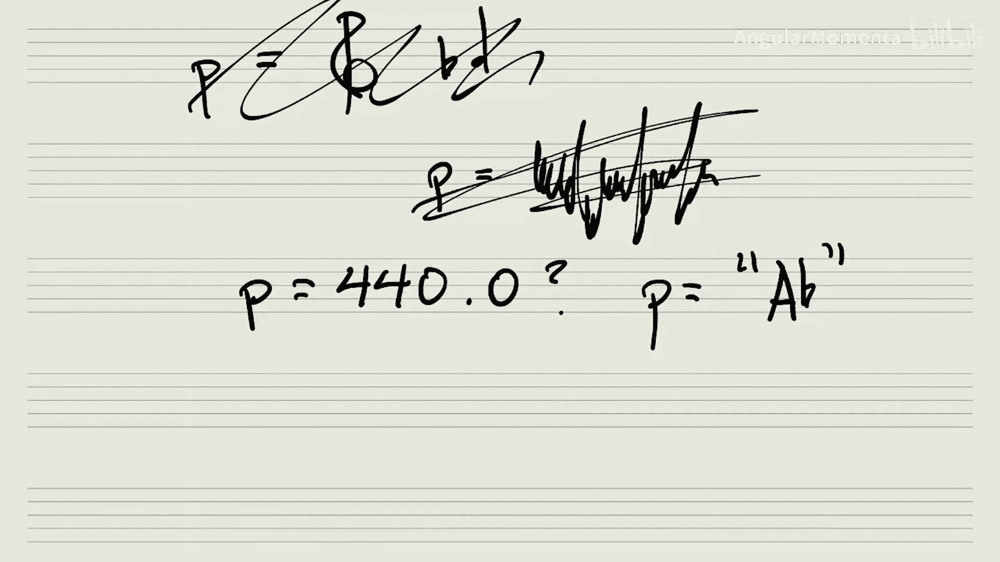

# 【麻省理工】计算音乐学与分析‌ ｜ MIT 21M.383 Computational Music Theory and Analysis,S 2023 p05 05 视频 3a：音高表示法入门 -BV17xUmBDEUC_p5-

Hi， everybody。Our first thing that we really want to think about is， how are we going to represent。

Musical。Objects， music。On a computer。 So let's start with maybe one of the most fundamental things。

 And that is pitch。So。In a score based class， we might represent pitch with a score。

 and we write notes on it。 I guess then we assign it to。A variable， well， that's not of work。Okay。

 so we take a frequency and we assign that to a variable well I'm not exactly sure how to do that either。

 maybe we just assign a variable to a particular number representing a frequency。Or to a string。

Representing a pitch。Okay。

First thing I want you to do is take five minutes。 no more than that。

And jot down some notes on how you bite represent pitch on a computer very naively。

