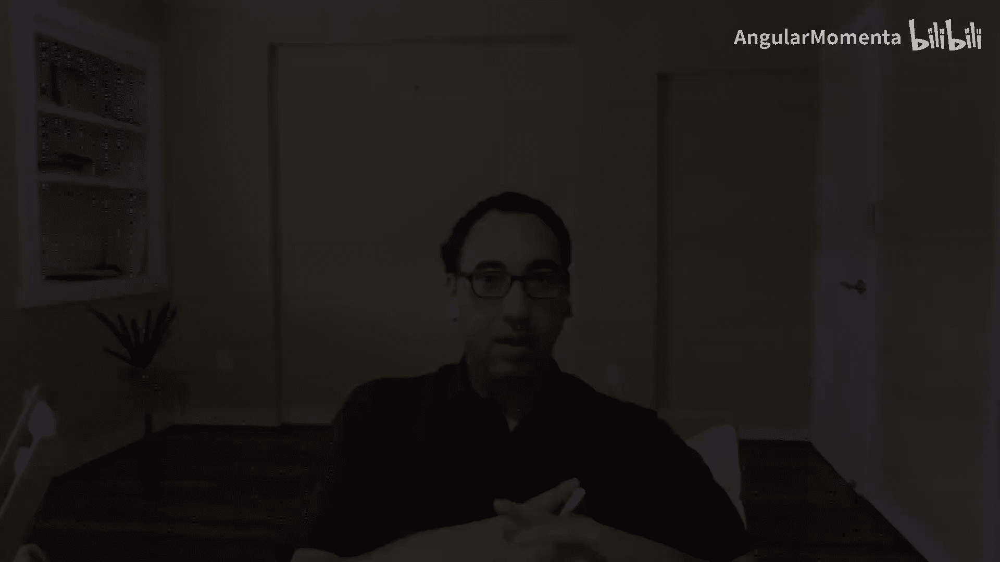
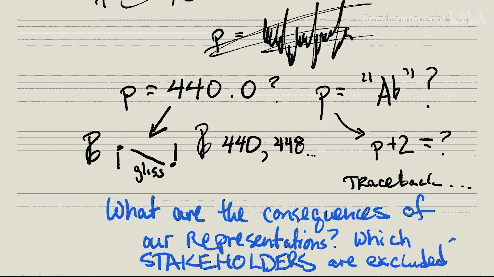

# 【麻省理工】计算音乐学与分析‌ ｜ MIT 21M.383 Computational Music Theory and Analysis,S 2023 p06 06 视频 3b：音高表征：优势、劣势与利益相关方 -BV17xUmBDEUC_p6-

Hi there， I hope you were able to take a couple minutes to think about how you might represent pitch I'm back better camera。

 hopefully a little bit better。

So。What are the consequences of the pitch representation that we might choose？

That's what we're going to be looking at now。So let's say that we decide to work with。

The numeric representation， P equals 440。How would we represent them a type of continuous pitch like Google Sanddo？

Since we only have one number or even just thinking about the performance perspective， how do we？

Represent how do we go for a number like 440 into something that？

A performer would be able to see on a staff and play with。

 And are we just going to have a whole series of numbers。

 So maybe the string base thing will be a little bit better。 But then how do we manipulate it。

 What does P plus 2 mean。Are we just going to have a whole bunch of Python errors that we can never add things together that way？

So what we're going to be thinking about in the first group discussion is what are the consequences of？

The particular representations that we choose。In other words。

What kinds of applications can be done with a particular representation that can't be done with another representation？

Another way of putting it is which stakeholders are included or excluded depending on our representation。

So the next thing I'd like you to do is to think of three different ways that you might represent pitch on a computer and then think about for each of those。

 what does this way do well and what does this way do badly？At and。Then think about the stakeholders。

 a stakeholder might be a musician or it might be a programmer or it might be a record producer。

 or it might be somebody who is more specific like a rock musician versus a classical musician or something of that sort and who are the stakeholders who。

Are excluded or included by what you've done。