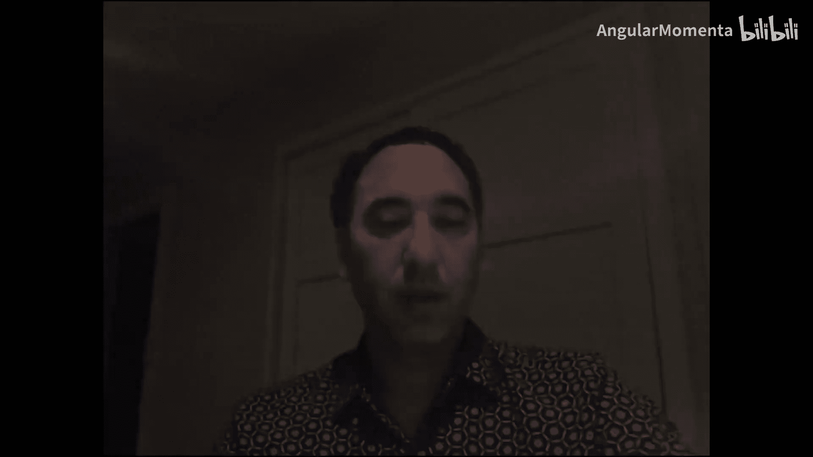
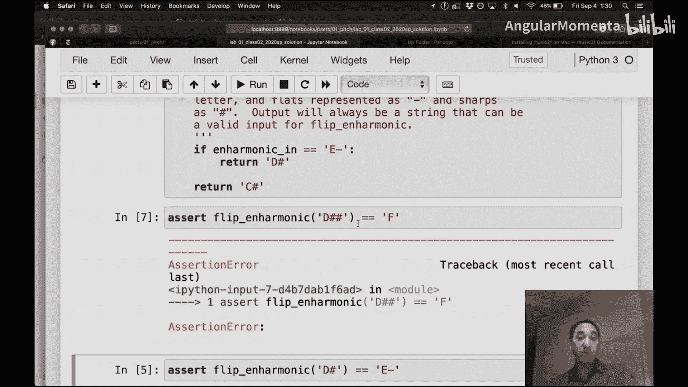
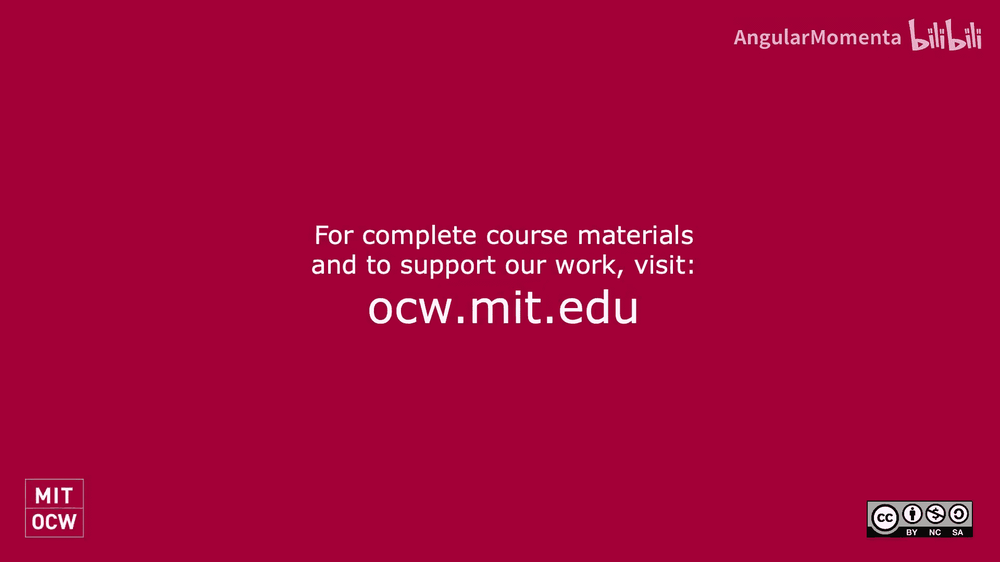

# 【麻省理工】计算音乐学与分析‌ ｜ MIT 21M.383 Computational Music Theory and Analysis,S 2023 p07 07 视频 3c：如何着手解决问题集 -BV17xUmBDEUC_p7-

Hello， I want to give a sense of how some problem sets are going to work or the majority of the time。

 General speaking， you'll be given。Some instructions on what to do。

 like write a routine that takes a string representing an harmonic with minus sign for flats。

 We'll talk about that in a bit。 and number sign for sharps。

 And we a new string that is an N and harmonic。 You're not allowed to change it， but I can here。

 That is。And and harmonic of the pitch。 You will be given valid input only。

 I will always tell you if you have to check for invalid input。

 If there's more than one valid and harmonic， you can give any an harmonic up to double flats of shops。

 Then below， you're going to be giving。The name of the routine that you're going to need to write along with usually the name of a variable that you should use。

And the type， if you haven't looked at Python typing， this can be really exciting and what's output？

At this point， you need to define the routine。Quite often you can take some of the language from above。

 but make it in your own words to see what happened。

 but put it in the active voice takes in a string representing a pitch。

 So I should say representing a pitch earlier and returns valid and harmonic。4our is。嗯。

If there's specific things that constrain。What the valid input might be。

 I'll tend to write it here or you should be writing it in。

We write for humans to read not just for computers to process。

 So it's always going to be important that your code be documented and that your variable names be things that humans can understand Okay。

 so then you can go ahead and write your code and if you're not so great programmer。

 maybe you'll start with if an harmonic in it is the flat we're going to use minus signs for flat return。

D sharp。Otherwise， return C shark， and at least maybe you'll get it right sometimes。Great。Now。

 I will sometimes give you one or two test cases。 So maybe I'll say assert。Plip and harmonic。If what。

He calls G chart。I to see that that works。Maybe if I'm very nice， I'll give you two of them。

Up and you can see that doesn't work。I am not。Going to give you all of the interesting and fun。

Test cases， part of the。Thought process of this class， part of why you get humanity's credit is that。

You need to be thinking about。 Well， what are the weird cases。 Okay， I can put in if it's this。

 it's E flat and if it's D sharp， it's E flat and so on。 Oh， but。

We're going to need to make sure that。This works。Or maybe I need to make sure that。That works。

Or at least that it's a valued answer， ha。And so part of what you need to do is be thinking about how do we write test code。

 What are the test cases that Professor Cufford is going to be putting in。

Such that it's going to challenge how I write， you'll probably need to rewrite your code as you go。

Great， let's get started。

